# Customer Domain Architecture and Boundary Analysis

## Table of Contents

- [Executive Summary](#executive-summary)
- [DB2 Tables in Customer Domain](#db2-tables-in-customer-domain)
- [Transactions in Customer Domain](#transactions-in-customer-domain)
- [Programs in Customer Domain](#programs-in-customer-domain)
  - [Presentation and Orchestration Layer](#presentation-and-orchestration-layer)
  - [Persistence and Backend Services](#persistence-and-backend-services)
- [Cross-Domain Functionality](#cross-domain-functionality)
  - [Business Cross-Domain Workflows](#business-cross-domain-workflows)
  - [Shared Technical and Infrastructure Services](#shared-technical-and-infrastructure-services)
- [Domain Boundaries and Architecture Diagram](#domain-boundaries-and-architecture-diagram)
  - [Domain Boundaries](#domain-boundaries)
  - [Interaction Architecture Diagram](#interaction-architecture-diagram)
  - [Interactive Zoomable Diagram](#interactive-zoomable-diagram)

---

## Executive Summary

This document details the architectural boundaries, DB2 database tables, CICS transactions, application programs, and cross-domain interactions for the **Customer Domain** within the GenApp PL/I application suite. The findings are based on the local metadata database repository scan and application source code.

---

## DB2 Tables in Customer Domain

Based on metadata queries against the application database, the following tables belong to the Customer Domain:

| Table Name | Domain Role | Access Types / Operations | Accessing Programs |
| :--- | :--- | :--- | :--- |
| **`CUSTOMER`** | Core Domain Master Entity | `INSERT`, `SELECT`, `UPDATE` | [`LGACDB01`](pli/LGACDB01.pli), [`LGACUS01`](pli/LGACUS01.pli), [`LGICDB01`](pli/LGICDB01.pli), [`LGUCDB01`](pli/LGUCDB01.pli), [`LGBATCH`](pli/LGBATCH.pli), [`LGBATDB2`](pli/LGBATDB2.pli) |
| **`CUSTOMER_SECURE`** | Core Domain Entity (Sensitive / Security Details) | `INSERT` | [`LGACDB02`](pli/LGACDB02.pli) |

---

## Transactions in Customer Domain

The primary CICS transaction dedicated to the Customer Domain is:

| Transaction ID | Entry / Menu Program | Domain Classification | Description |
| :--- | :--- | :--- | :--- |
| **`SSC1`** | [`LGTESTC1`](pli/LGTESTC1.pli) | **Pure Customer Domain** | 3270 BMS Map Menu transaction for Customer management operations (Add, Inquire, Update). |

*Note: Other application transactions (`SSP1`, `SSP2`, `SSP3`, `SSP4`) belong to specific Policy/Product domains (Motor, Endowment, House, Commercial), and `SSST` serves as a shared stats/web transaction.*

---

## Programs in Customer Domain

### Presentation and Orchestration Layer

1. [`LGTESTC1`](pli/LGTESTC1.pli) — 3270 BMS Map Menu driver for Customer transaction `SSC1`. Receives terminal input and links to customer orchestrators.
2. [`LGICUS01`](pli/LGICUS01.pli) — Customer Inquiry Orchestrator. Validates COMMAREA and dynamically links to DB2 inquiry backend `LGICDB01`.
3. [`LGUCUS01`](pli/LGUCUS01.pli) — Customer Update Orchestrator. Coordinates customer updates and routes requests to `LGUCDB01`.

### Persistence and Backend Services

1. **DB2 Persistence Services:**
   - [`LGACDB01`](pli/LGACDB01.pli) — Add Customer DB2 Backend. Inserts master customer records into the DB2 `CUSTOMER` table and calls `LGACVS01`.
   - [`LGACDB02`](pli/LGACDB02.pli) — Add Customer Secure DB2 Backend. Inserts credit card and security verification records into `CUSTOMER_SECURE`.
   - [`LGICDB01`](pli/LGICDB01.pli) — Inquire Customer DB2 Backend. Executes SQL queries against the DB2 `CUSTOMER` table.
   - [`LGUCDB01`](pli/LGUCDB01.pli) — Update Customer DB2 Backend. Executes SQL `UPDATE` against the DB2 `CUSTOMER` table and links to `LGUCVS01`.

2. **VSAM Persistence Counterparts:**
   - [`LGACVS01`](pli/LGACVS01.pli) — Add Customer VSAM Backend (writes customer records to KSDS VSAM dataset).
   - [`LGICVS01`](pli/LGICVS01.pli) — Inquire Customer VSAM Backend (reads customer records from VSAM).
   - [`LGUCVS01`](pli/LGUCVS01.pli) — Update Customer VSAM Backend (updates customer records in VSAM).

---

## Cross-Domain Functionality

### Business Cross-Domain Workflows

1. **[`LGACUS01`](pli/LGACUS01.pli) (Add Customer Orchestrator / Multi-Entity Provisioning):**
   - **Cross-Domain Operation:** Orchestrates customer onboarding across multiple data stores (`LGACDB01`, `LGACVS01`, `LGACDB02`) and directly executes SQL (`SELECT`, `INSERT`, `DELETE`) against the **`POLICY`** table. This bridges the Customer Domain with the Policy Domain for initial policy creation.
2. **[`LGBATCH`](pli/LGBATCH.pli) & [`LGBATDB2`](pli/LGBATDB2.pli) (Batch Extract & Reporting):**
   - **Cross-Domain Operation:** Reads the `CUSTOMER` table in bulk and formats data for cross-domain reporting and sequential flat-file distribution via [`LGBATCHF`](pli/LGBATCHF.pli).

### Shared Technical and Infrastructure Services

- **[`LGSTSQ`](pli/LGSTSQ.pli) (CICS TS Queue Error Logger):**
  - Invoked across all Customer programs (`LGACDB01`, `LGACDB02`, `LGACUS01`, `LGICDB01`, `LGICUS01`, `LGUCDB01`, `LGUCUS01`, `LGACVS01`, `LGICVS01`, `LGUCVS01`) and Policy programs for centralized temporary storage error logging.

---

## Domain Boundaries and Architecture Diagram

### Domain Boundaries

1. **Customer Domain vs. Policy Domain:**
   - **Boundary Contract:** `CUSTOMER_NUMBER` (`CA_CUSTOMER_NUM`).
   - **Ownership:** Customer records are master entities. Policy entities (`POLICY`, `MOTOR`, `ENDOWMENT`, `HOUSE`, `COMMERCIAL`, `CLAIM`) maintain foreign key references to `CUSTOMER_NUMBER`.
   - **Coupling Note:** [`LGACUS01`](pli/LGACUS01.pli) contains direct SQL access against the `POLICY` table during composite setup routines.
2. **Customer Domain vs. Batch / Reporting Domain:**
   - **Boundary Contract:** Read-only access to DB2 `CUSTOMER` by batch routines without executing online CICS transactions.
3. **Customer Domain vs. Security / Sensitive Data:**
   - **Boundary Contract:** Isolation of standard customer demographic data (`CUSTOMER`) from sensitive payment/security details (`CUSTOMER_SECURE` via [`LGACDB02`](pli/LGACDB02.pli)).

### Interaction Architecture Diagram

```mermaid
graph TD
    %% Class Definitions for Color Coding
    classDef cicsTrans fill:#E1F5FE,stroke:#0288D1,stroke-width:2px,color:#01579B;
    classDef presProg fill:#E8EAF6,stroke:#3F51B5,stroke-width:2px,color:#1A237E;
    classDef custOrch fill:#E0F2F1,stroke:#00897B,stroke-width:2px,color:#004D40;
    classDef custBackend fill:#E8F5E9,stroke:#43A047,stroke-width:2px,color:#1B5E20;
    classDef custData fill:#C8E6C9,stroke:#2E7D32,stroke-width:3px,color:#1B5E20;
    classDef custSecure fill:#FFF9C4,stroke:#FBC02D,stroke-width:2px,color:#F57F17;
    classDef crossDomainProg fill:#FFE0B2,stroke:#FB8C00,stroke-width:2px,color:#E65100;
    classDef policyDomain fill:#F3E5F5,stroke:#8E24AA,stroke-width:2px,color:#4A148C;
    classDef batchDomain fill:#ECEFF1,stroke:#607D8B,stroke-width:2px,color:#263238;
    classDef sharedInfra fill:#FFEBEE,stroke:#E53935,stroke-width:2px,color:#B71C1C;

    subgraph Presentation_Layer [Presentation Layer]
        SSC1[CICS Trans: SSC1]:::cicsTrans --> LGTESTC1[LGTESTC1 - Customer Menu]:::presProg
    end

    subgraph Customer_Domain [Customer Domain]
        LGTESTC1 -->|CICS LINK| LGICUS01[LGICUS01 - Inquire Cust]:::custOrch
        LGTESTC1 -->|CICS LINK| LGUCUS01[LGUCUS01 - Update Cust]:::custOrch
        LGTESTC1 -->|CICS LINK| LGACUS01[LGACUS01 - Add Cust / Cross-Domain Bridge]:::crossDomainProg
        
        LGICUS01 -->|CICS LINK| LGICDB01[LGICDB01 - Inquire DB2]:::custBackend
        LGICUS01 -->|CICS LINK| LGICVS01[LGICVS01 - Inquire VSAM]:::custBackend
        
        LGUCUS01 -->|CICS LINK| LGUCDB01[LGUCDB01 - Update DB2]:::custBackend
        LGUCDB01 -->|CICS LINK| LGUCVS01[LGUCVS01 - Update VSAM]:::custBackend
        
        LGACUS01 -->|CICS LINK| LGACDB01[LGACDB01 - Add DB2]:::custBackend
        LGACUS01 -->|CICS LINK| LGACDB02[LGACDB02 - Add Secure DB2]:::custSecure
        LGACDB01 -->|CICS LINK| LGACVS01[LGACVS01 - Add VSAM]:::custBackend

        LGICDB01 -->|SQL SELECT| T_CUST[(DB2: CUSTOMER)]:::custData
        LGUCDB01 -->|SQL UPDATE| T_CUST
        LGACDB01 -->|SQL INSERT| T_CUST
        LGACDB02 -->|SQL INSERT| T_CUSTSEC[(DB2: CUSTOMER_SECURE)]:::custSecure
    end

    subgraph Policy_Domain [Policy / Product Domain]
        T_POLICY[(DB2: POLICY)]:::policyDomain
        LGACUS01 -.->|Cross-Domain SQL| T_POLICY
        LGAPOL01[LGAPOL01 / LGIPOL01]:::policyDomain -.->|Customer Ref| T_CUST
    end

    subgraph Batch_Domain [Batch & Reporting Domain]
        LGBATCH[LGBATCH - Batch Report]:::batchDomain -->|SQL SELECT| T_CUST
        LGBATDB2[LGBATDB2 - DB2 Batch Extract]:::batchDomain -->|SQL SELECT| T_CUST
    end

    subgraph Shared_Infrastructure [Cross-Domain Infrastructure]
        LGSTSQ[LGSTSQ - TS Queue Error Logger]:::sharedInfra
        LGACDB01 -.->|Error Log| LGSTSQ
        LGICDB01 -.->|Error Log| LGSTSQ
        LGUCDB01 -.->|Error Log| LGSTSQ
        LGACUS01 -.->|Error Log| LGSTSQ
        LGUCUS01 -.->|Error Log| LGSTSQ
        LGICUS01 -.->|Error Log| LGSTSQ
    end
```

### Interactive Zoomable Diagram

For high-resolution exploration with **pan**, **smooth zoom (20% – 800%)**, **drag-to-pan**, **node highlighting**, and **caller/callee relationship inspection**, open the interactive standalone HTML diagram:

👉 [`docs/Customer-Domain-Diagram.html`](docs/Customer-Domain-Diagram.html)
