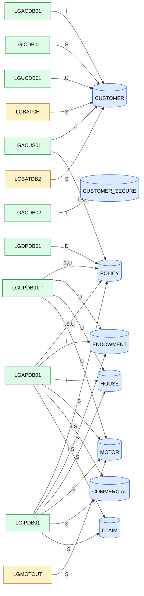
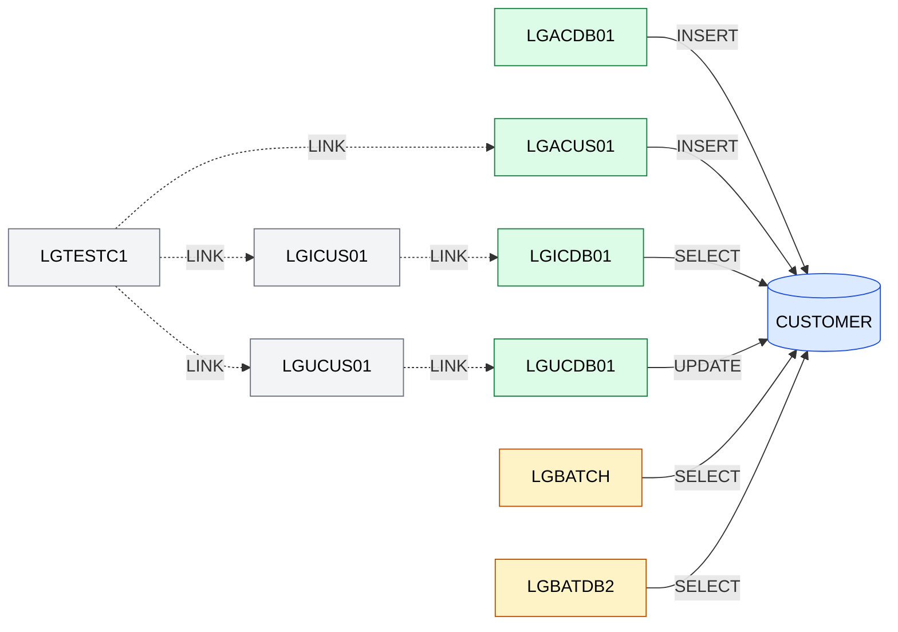
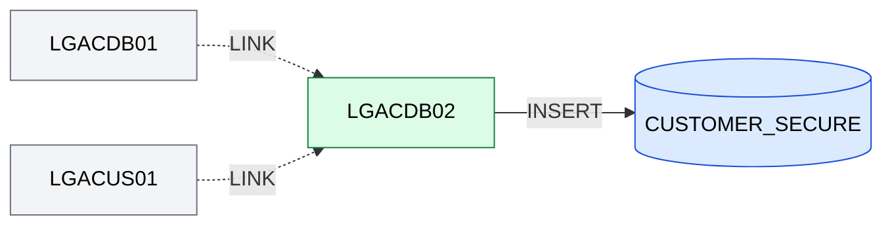
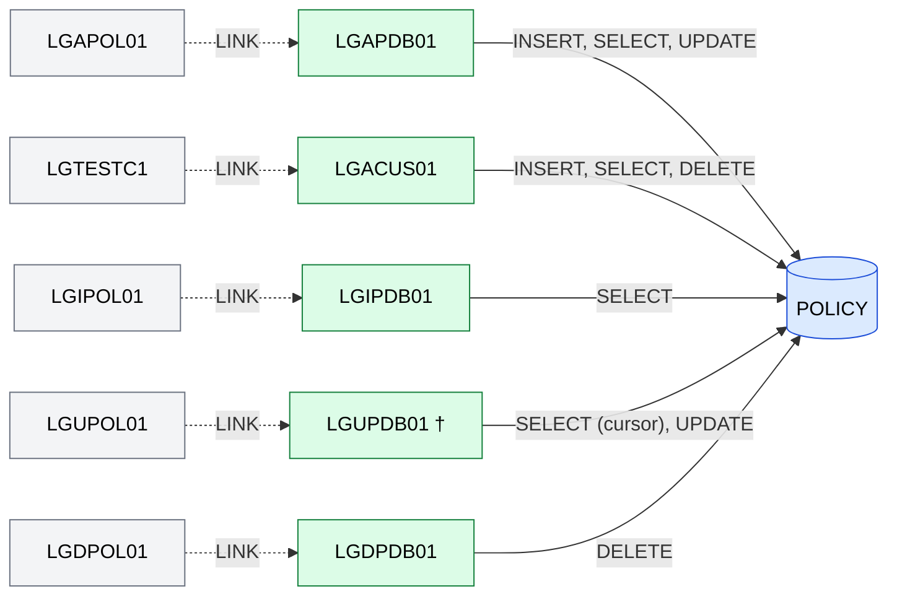
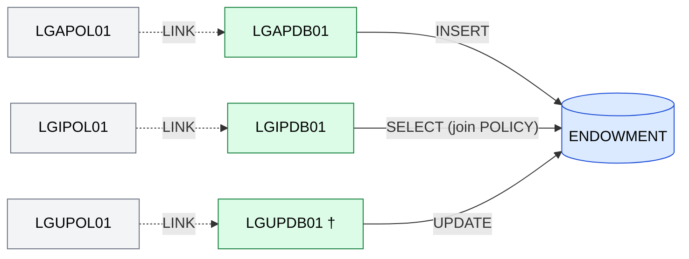
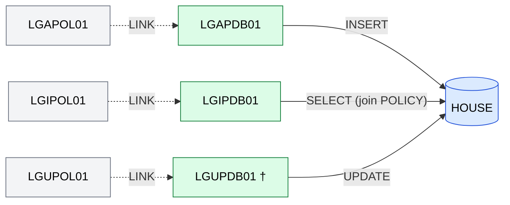
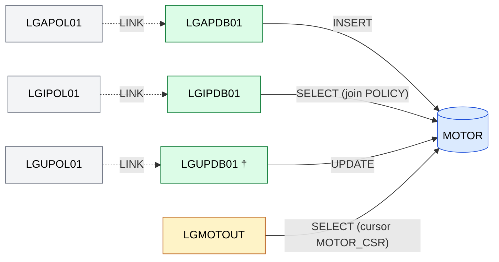
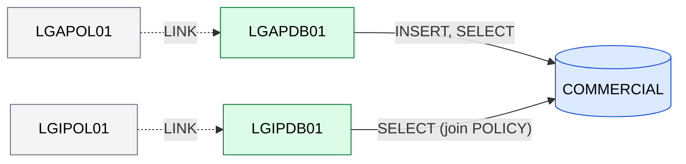
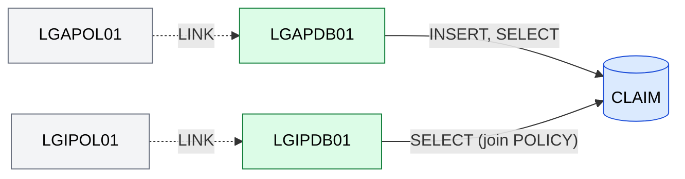
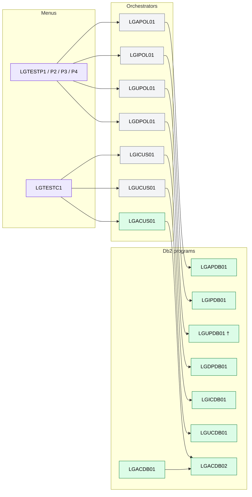

# GenApp PL/I — Db2 Table Dependency Visualization

## Table of Contents

- [Scope and Method](#scope-and-method)
- [Summary](#summary)
- [Application-Wide Dependency Map](#application-wide-dependency-map)
- [Program × Table Access Matrix](#program--table-access-matrix)
- [Per-Table Dependency Diagrams](#per-table-dependency-diagrams)
  - [CUSTOMER](#customer)
  - [CUSTOMER_SECURE](#customer_secure)
  - [POLICY](#policy)
  - [ENDOWMENT](#endowment)
  - [HOUSE](#house)
  - [MOTOR](#motor)
  - [COMMERCIAL](#commercial)
  - [CLAIM](#claim)
- [Indirect Dependents (Callers of Db2 Programs)](#indirect-dependents-callers-of-db2-programs)
- [Findings and Data Quality Notes](#findings-and-data-quality-notes)

---

## Scope and Method

- **Table list source:** the "DB2 Table Access Summary" in [`GenApp-PL1-Inventory.md`](GenApp-PL1-Inventory.md) — 8 tables: `CUSTOMER`, `CUSTOMER_SECURE`, `POLICY`, `ENDOWMENT`, `HOUSE`, `MOTOR`, `COMMERCIAL`, `CLAIM`.
- **Direct dependents:** programs with an embedded SQL reference to the table. Taken from the local metadata database (`SQLTables` → `StatementReference` → `OccurrencesStmt` → `Programs`, runtime statements only, `ParaID != 0`).
- **Operation type (I/S/U/D):** the local database only records read/write. I/S/U/D was derived from the SQL statements in [`pli/`](../pli) for the programs the database returned.
- **Indirect dependents:** CICS `LINK` relationships from the PL/I sources, because the database's call-resource table has no entries for dynamic CICS links.
- **Legend:** `I` = INSERT, `S` = SELECT (incl. cursor), `U` = UPDATE, `D` = DELETE.

> **Gap in the local database:** [`LGUPDB01`](../pli/LGUPDB01.pli) is classified as COBOL (type 1) with **0 statements**, so it has no table references in the database. Its dependencies (`POLICY`, `ENDOWMENT`, `HOUSE`, `MOTOR`) were taken from the PL/I source and are marked with † below. The database run on the other 11 programs matches the inventory.

---

## Summary

| Table | # Direct programs | Programs |
|-------|:-----------------:|----------|
| `CUSTOMER` | 6 | LGACDB01, LGACUS01, LGBATCH, LGBATDB2, LGICDB01, LGUCDB01 |
| `CUSTOMER_SECURE` | 1 | LGACDB02 |
| `POLICY` | 5 | LGACUS01, LGAPDB01, LGDPDB01, LGIPDB01, LGUPDB01† |
| `ENDOWMENT` | 3 | LGAPDB01, LGIPDB01, LGUPDB01† |
| `HOUSE` | 3 | LGAPDB01, LGIPDB01, LGUPDB01† |
| `MOTOR` | 4 | LGAPDB01, LGIPDB01, LGMOTOUT, LGUPDB01† |
| `COMMERCIAL` | 2 | LGAPDB01, LGIPDB01 |
| `CLAIM` | 2 | LGAPDB01, LGIPDB01 |

- **12 distinct programs** access Db2 tables directly, out of 35 programs in the repository. 26 program-to-table links in total.
- **LGAPDB01** and **LGIPDB01** are the widest: each touches 6 tables (`POLICY`, `ENDOWMENT`, `HOUSE`, `MOTOR`, `COMMERCIAL`, `CLAIM`).
- **`POLICY`** is the most shared policy-side table (5 programs, all four operations I/S/U/D).
- **`CUSTOMER`** is the most shared table overall (6 programs, including both batch programs).

---

## Application-Wide Dependency Map

Programs on the left, tables on the right. Edge labels show the operation. The entry marked † comes from source because the database has no data for that program.

Legend: green = CICS program, amber = batch program, blue cylinder = Db2 table.

---

## Program × Table Access Matrix

| Program | Type | CUSTOMER | CUSTOMER_SECURE | POLICY | ENDOWMENT | HOUSE | MOTOR | COMMERCIAL | CLAIM |
|---------|------|:--------:|:---------------:|:------:|:---------:|:-----:|:-----:|:----------:|:-----:|
| [`LGACDB01`](../pli/LGACDB01.pli) | CICS | I | | | | | | | |
| [`LGACDB02`](../pli/LGACDB02.pli) | CICS | | I | | | | | | |
| [`LGACUS01`](../pli/LGACUS01.pli) | CICS | I | | I,S,D | | | | | |
| [`LGAPDB01`](../pli/LGAPDB01.pli) | CICS | | | I,S,U | I | I | I | I,S | I,S |
| [`LGDPDB01`](../pli/LGDPDB01.pli) | CICS | | | D | | | | | |
| [`LGICDB01`](../pli/LGICDB01.pli) | CICS | S | | | | | | | |
| [`LGIPDB01`](../pli/LGIPDB01.pli) | CICS | | | S | S | S | S | S | S |
| [`LGUCDB01`](../pli/LGUCDB01.pli) | CICS | U | | | | | | | |
| [`LGUPDB01`](../pli/LGUPDB01.pli) † | CICS | | | S,U | U | U | U | | |
| [`LGBATCH`](../pli/LGBATCH.pli) | Batch | S | | | | | | | |
| [`LGBATDB2`](../pli/LGBATDB2.pli) | Batch | S | | | | | | | |
| [`LGMOTOUT`](../pli/LGMOTOUT.pli) | Batch | | | | | | S | | |
| **Programs per table** | | **6** | **1** | **5** | **3** | **3** | **4** | **2** | **2** |

---

## Per-Table Dependency Diagrams

Each diagram shows the direct dependents (solid edges, labelled with the operation) and the program that calls each one (dashed edges, via CICS `LINK`). Menu programs are summarized in [Indirect Dependents](#indirect-dependents-callers-of-db2-programs).

### CUSTOMER

6 direct dependents: 4 CICS programs and 2 batch programs.

| Program | Operation | Statement refs (DB) | Notes |
|---------|-----------|:-------------------:|-------|
| LGACDB01 | INSERT | 2 | Two INSERT variants (with / without customer number) |
| LGACUS01 | INSERT | 2 | Two INSERT variants |
| LGICDB01 | SELECT | 1 | |
| LGUCDB01 | UPDATE | 1 | |
| LGBATCH | SELECT | 1 | Batch cursor read |
| LGBATDB2 | SELECT | 1 | Batch cursor read |

### CUSTOMER_SECURE

1 direct dependent.

### POLICY

5 direct dependents. This is the only table that sees all four operations.

| Program | Operation | Statement refs (DB) | Notes |
|---------|-----------|:-------------------:|-------|
| LGAPDB01 | INSERT, SELECT, UPDATE | 6 | INSERT at line 281, SELECTs at lines 335/352/382, UPDATE at line 777 |
| LGACUS01 | INSERT, SELECT, DELETE | 5 | Policy handling within the add-customer logic |
| LGIPDB01 | SELECT | 18 | Joins `POLICY` with each type-specific table |
| LGUPDB01 † | SELECT (cursor, `WITH HOLD`), UPDATE | n/a | Not in database; from source |
| LGDPDB01 | DELETE | 1 | |

### ENDOWMENT

3 direct dependents.

### HOUSE

3 direct dependents.

### MOTOR

4 direct dependents: 3 CICS and 1 batch. `LGMOTOUT` is the only program that qualifies the table (`GENASA1.MOTOR`).

### COMMERCIAL

2 direct dependents.

### CLAIM

2 direct dependents.

---

## Indirect Dependents (Callers of Db2 Programs)

Programs that reach Db2 tables through a CICS `LINK`, taken from the PL/I sources.

| Db2 program | Called by (CICS LINK) | Tables reached |
|-------------|-----------------------|----------------|
| LGAPDB01 | LGAPOL01 ← LGTESTP1-4 | POLICY, ENDOWMENT, HOUSE, MOTOR, COMMERCIAL, CLAIM |
| LGIPDB01 | LGIPOL01 ← LGTESTP1-4 | POLICY, ENDOWMENT, HOUSE, MOTOR, COMMERCIAL, CLAIM |
| LGUPDB01 † | LGUPOL01 ← LGTESTP1-3 | POLICY, ENDOWMENT, HOUSE, MOTOR |
| LGDPDB01 | LGDPOL01 ← LGTESTP1-4 | POLICY |
| LGICDB01 | LGICUS01 ← LGTESTC1 | CUSTOMER |
| LGUCDB01 | LGUCUS01 ← LGTESTC1 | CUSTOMER |
| LGACUS01 | LGTESTC1 | CUSTOMER, POLICY (plus CUSTOMER_SECURE via LGACDB02) |
| LGACDB02 | LGACUS01, LGACDB01 | CUSTOMER_SECURE |
| LGACDB01 | no caller found in the source | CUSTOMER |
| LGBATCH, LGBATDB2, LGMOTOUT | batch entry points (JCL) | CUSTOMER (LGBATCH, LGBATDB2), MOTOR (LGMOTOUT) |

---

## Findings and Data Quality Notes

1. **`LGUPDB01` is missing from the local database.** It was classified as COBOL with 0 statements, so any database-only query would miss four table dependencies (`POLICY`, `ENDOWMENT`, `HOUSE`, `MOTOR`). Re-scanning with the PL/I language override for this file should fix it.
2. **Inventory and database agree** for the other 11 programs: every program/table pair listed in the inventory's "DB2 Table Access Summary" is found in the database, and no extra pairs were found.
3. **`LGACDB01` has no caller in the source.** `LGACUS01` declares the name `LGACDB01` but never links to it; it inserts into `CUSTOMER` itself and links only to `LGACVS01` and `LGACDB02`. Two programs therefore insert customer rows, which is a possible duplication.
4. **Write-flag caveat.** The database marks `LGIPDB01` and `LGACUS01` as both read and write on `POLICY` and on several other tables. For `LGIPDB01` the source shows only SELECTs; the write flag comes from `INTO` host-variable assignment. For that reason the matrix uses the statement text and not the database read/write flag.
5. **Change-impact hot spots:** a schema change to `POLICY` affects 5 programs plus their orchestrators and menus; a change to any of `ENDOWMENT`, `HOUSE`, `MOTOR`, `COMMERCIAL` or `CLAIM` affects both `LGAPDB01` and `LGIPDB01` (and `LGUPDB01` for the first three, `LGMOTOUT` for `MOTOR`).
