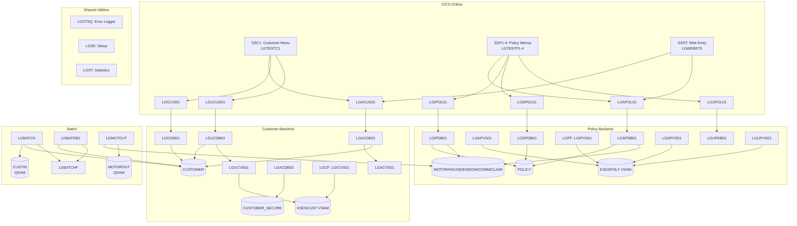

# GenApp — Application Inventory

> Generated from local metadata database (ScannerOutput.db).  
> Language: PL/I (with 3 legacy COBOL stubs registered in CICS but not present in this workspace).

---

## 1. Program Inventory

### 1.1 Naming Convention

The program naming follows the pattern `LG<area><function><nn>`:

| Segment | Meaning |
|---|---|
| `LG` | GenApp prefix |
| `AC` | Customer — **A**dd **C**ustomer |
| `IC` | Customer — **I**nquire **C**ustomer |
| `UC` | Customer — **U**pdate **C**ustomer |
| `AP` | Policy — **A**dd **P**olicy |
| `IP` | Policy — **I**nquire **P**olicy |
| `DP` | Policy — **D**elete **P**olicy |
| `UP` | Policy — **U**pdate **P**olicy |
| `DB` | Suffix: uses **D**b2 |
| `US` | Suffix: top-level CICS **U**ser-facing orchestrator |
| `VS` | Suffix: uses **V**SAM |
| `OL` | Suffix: **O**n**l**ine (CICS), delegates to DB or VS backend |

---

### 1.2 All Programs

#### CICS Online Programs

| Program | Type | Role | CICS Transaction |
|---|---|---|---|
| **LGTESTC1** | PL/I | Customer menu — CICS BMS menu screen driver | `SSC1` |
| **LGTESTP1** | PL/I | Motor policy menu — CICS BMS menu screen driver | `SSP1` |
| **LGTESTP2** | PL/I | Life (endowment) policy menu — CICS BMS menu screen driver | `SSP2` |
| **LGTESTP3** | PL/I | House policy menu — CICS BMS menu screen driver | `SSP3` |
| **LGTESTP4** | PL/I | Commercial policy menu — CICS BMS menu screen driver | `SSP4` |
| **LGWEBST5** | PL/I | Web services entry point — routes REST/web requests into GenApp | `SSST` |
| **LGASTAT1** | PL/I | Application statistics — CICS online statistics display | `LGST` |
| **LGSETUP** | PL/I | Initial setup — initialises CICS TS queues on startup | `LGSE` |
| **LGSTSQ** | PL/I | Shared error/message utility — writes messages to CICS TS queue (called by all programs for error logging) | — |
| **LGACUS01** | PL/I | Add Customer orchestrator — receives COMMAREA, validates, calls `LGACDB01`/`LGACVS01` | — |
| **LGACDB01** | PL/I | Add Customer (Db2) — INSERT into `CUSTOMER`; calls `LGACVS01` | — |
| **LGACDB02** | PL/I | Add Customer Secure (Db2) — INSERT into `CUSTOMER_SECURE` | — |
| **LGACVS01** | PL/I | Add Customer (VSAM) — writes customer record to VSAM KSDS `KSDSCUST` | — |
| **LGICUS01** | PL/I | Inquire Customer orchestrator — routes to `AAAAAAAA` (stub) | — |
| **LGICDB01** | PL/I | Inquire Customer (Db2) — SELECT from `CUSTOMER` | — |
| **LGICVS01** | PL/I | Inquire Customer (VSAM) — reads `KSDSCUST` | `LGCF` |
| **LGUCUS01** | PL/I | Update Customer orchestrator | — |
| **LGUCDB01** | PL/I | Update Customer (Db2) — UPDATE `CUSTOMER`; calls `LGUCVS01` | — |
| **LGUCVS01** | PL/I | Update Customer (VSAM) — updates `KSDSCUST` | — |
| **LGAPOL01** | PL/I | Add Policy orchestrator — calls `LGAPBR01` (COBOL stub) | — |
| **LGAPDB01** | PL/I | Add Policy (Db2) — INSERT into `POLICY` + type-specific table (MOTOR/HOUSE/ENDOWMENT/COMMERCIAL/CLAIM) | — |
| **LGAPVS01** | PL/I | Add Policy (VSAM) — writes to `KSDSPOLY` | — |
| **LGIPOL01** | PL/I | Inquire Policy orchestrator — calls `LGIPDB01` | — |
| **LGIPDB01** | PL/I | Inquire Policy (Db2) — SELECT from `POLICY` + all type-specific tables | — |
| **LGIPVS01** | PL/I | Inquire Policy (VSAM) — reads `KSDSPOLY` | `LGPF` |
| **LGDPOL01** | PL/I | Delete Policy orchestrator — calls `LGDPDB01`/`LGDPVS01` | — |
| **LGDPDB01** | PL/I | Delete Policy (Db2) — DELETE from `POLICY`; calls `LGDPVS01` | — |
| **LGDPVS01** | PL/I | Delete Policy (VSAM) — deletes from `KSDSPOLY` | — |
| **LGUPOL01** | PL/I | Update Policy orchestrator — calls `LGUPDB01` (COBOL stub) | — |
| **LGUPVS01** | PL/I | Update Policy (VSAM) — updates `KSDSPOLY` | — |
| **LGMOTOUT** | PL/I | Motor output report — reads `MOTOR` table, writes to QSAM file `MOTOROUT` | — |

#### Batch Programs

| Program | Type | Role |
|---|---|---|
| **LGBATCH** | PL/I | Batch customer loader — reads QSAM `CUSTIN`, queries `CUSTOMER`, calls `LGBATCHF`, writes `CUSTRPT` |
| **LGBATDB2** | PL/I | Batch Db2 customer report — reads `CUSTOMER` via SQL, calls `LGBATCHF`, produces report |
| **LGBATCHF** | PL/I | Batch format utility — called by `LGBATCH` and `LGBATDB2` to format output records |
| **LGBATCF** | PL/I | Internal name alias for `LGBATCHF` (same source file, different progId) |

#### Stubs / External Programs (referenced but not in workspace)

| Program | Type | Note |
|---|---|---|
| **AAAAAAAA** | COBOL stub | Placeholder/test stub called by `LGICUS01` |
| **LGAPBR01** | COBOL | Policy add business rules — called by `LGAPOL01`; source not present |
| **LGUPDB01** | COBOL | Update Policy (Db2) — called by `LGUPOL01`; source not present |

---

## 2. Dependencies per Program

### 2.1 Copybooks / PL/I Includes

| Copybook | Used By | Purpose |
|---|---|---|
| `LGCMAREA.inc` | All CICS programs | Central COMMAREA structure — request/response contract |
| `LGCMARER.inc` | CICS programs | COMMAREA response extension |
| `LGPOLICY.inc` | Policy programs | Policy data structure |
| `SSMAP.inc` | Menu programs | BMS map structure for screen I/O |
| `SQLCA` | LGACDB01, LGACDB02, LGACUS01, LGAPDB01, LGBATCH, LGBATDB2, LGDPDB01, LGICDB01, LGIPDB01, LGMOTOUT, LGUCDB01 | SQL Communication Area — embedded DB2 status |

### 2.2 DB2 Tables Used per Program

| Program | Tables Accessed | Access Mode |
|---|---|---|
| LGACDB01 | CUSTOMER | Write (INSERT) |
| LGACDB02 | CUSTOMER_SECURE | Write (INSERT) |
| LGACUS01 | CUSTOMER, POLICY | Write (INSERT), Read/Write |
| LGAPDB01 | POLICY, CLAIM, COMMERCIAL, ENDOWMENT, HOUSE, MOTOR | Read + Write |
| LGBATCH | CUSTOMER | Read (SELECT) |
| LGBATDB2 | CUSTOMER | Read (SELECT) |
| LGDPDB01 | POLICY | Write (DELETE) |
| LGICDB01 | CUSTOMER | Read (SELECT) |
| LGIPDB01 | POLICY, CLAIM, COMMERCIAL, ENDOWMENT, HOUSE, MOTOR | Read (SELECT) |
| LGMOTOUT | MOTOR | Read (SELECT) |
| LGUCDB01 | CUSTOMER | Write (UPDATE) |

### 2.3 VSAM Files Used per Program

| Program | VSAM File | Access Mode |
|---|---|---|
| LGACVS01 | KSDSCUST | Write |
| LGICVS01 | KSDSCUST | Read |
| LGUCVS01 | KSDSCUST | Read/Write |
| LGAPVS01 | KSDSPOLY | Write |
| LGIPVS01 | KSDSPOLY | Read |
| LGDPVS01 | KSDSPOLY | Read/Write |
| LGUPVS01 | KSDSPOLY | Read/Write |

### 2.4 QSAM Files (Batch)

| Program | File | Direction |
|---|---|---|
| LGBATCH | CUSTIN | Input |
| LGBATCH | CUSTRPT | Output |
| LGMOTOUT | MOTOROUT | Output |

### 2.5 Called Programs (CICS LINK / CALL)

| Caller | Calls | Mechanism |
|---|---|---|
| LGACDB01 | LGACVS01 | EXEC CICS LINK |
| LGACUS01 | LGACVS01 | EXEC CICS LINK |
| LGAPOL01 | LGAPBR01 | EXEC CICS LINK |
| LGBATCH | LGBATCHF | CALL |
| LGBATDB2 | LGBATCHF | CALL |
| LGDPDB01 | LGDPVS01 | EXEC CICS LINK |
| LGICUS01 | AAAAAAAA | EXEC CICS LINK |
| LGIPOL01 | LGIPDB01 | EXEC CICS LINK |
| LGUCDB01 | LGUCVS01 | EXEC CICS LINK |
| LGUPOL01 | LGUPDB01 | EXEC CICS LINK |
| All programs | LGSTSQ | EXEC CICS LINK (error logging) |

### 2.6 CICS Transactions

| Transaction ID | Entry Program | Description |
|---|---|---|
| SSC1 | LGTESTC1 | Customer menu |
| SSP1 | LGTESTP1 | Motor policy menu |
| SSP2 | LGTESTP2 | Life/endowment policy menu |
| SSP3 | LGTESTP3 | House policy menu |
| SSP4 | LGTESTP4 | Commercial policy menu |
| SSST | LGWEBST5 | Web services entry point |
| LGCF | LGICVS01 | Customer file inquiry |
| LGPF | LGIPVS01 | Policy file inquiry |
| LGSE | LGSETUP | Setup TS queues |
| LGST | LGASTAT1 | Statistics display |

---

## 3. Architecture Overview

---

## 4. JCL Jobs

| JCL File | Purpose |
|---|---|
| `jcl/GenAppDDL.jcl` | Creates Db2 tablespaces, tables, and indexes |
| `jcl/GenAppBind.jcl` | Binds DB2 packages into collection `GENASA1`, plan `GENAONE` |
| `jcl/CreateCSDDefs.jcl` | Loads CICS CSD group `GENA` into the running CICS region |
