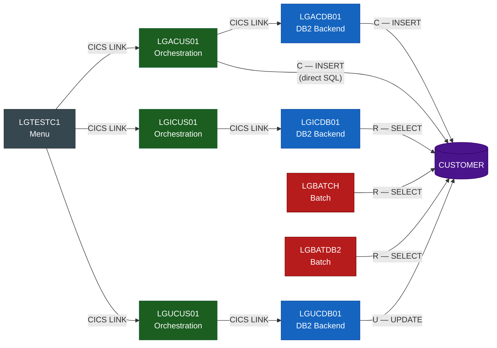
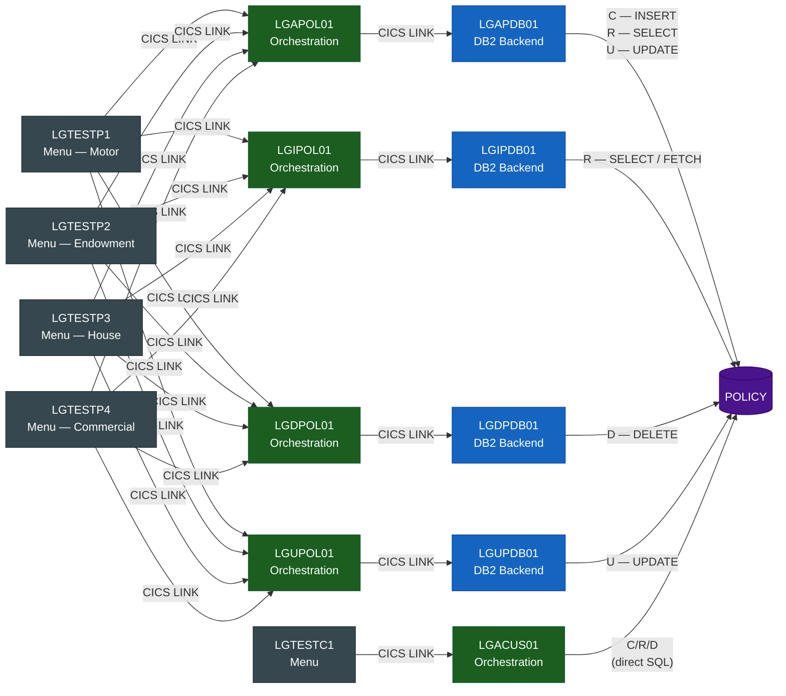
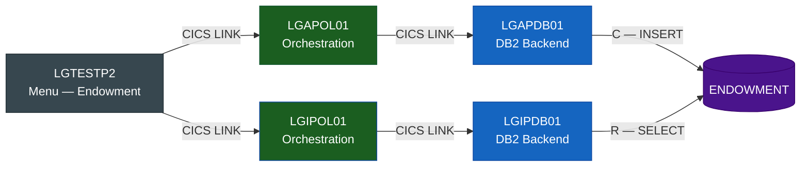
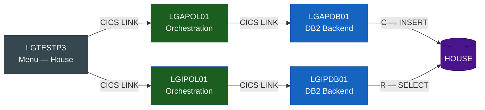
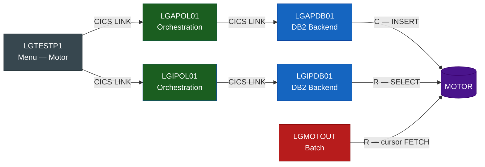
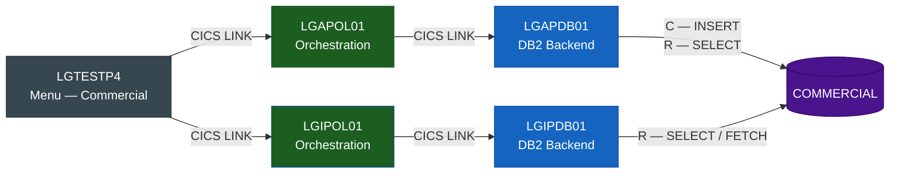
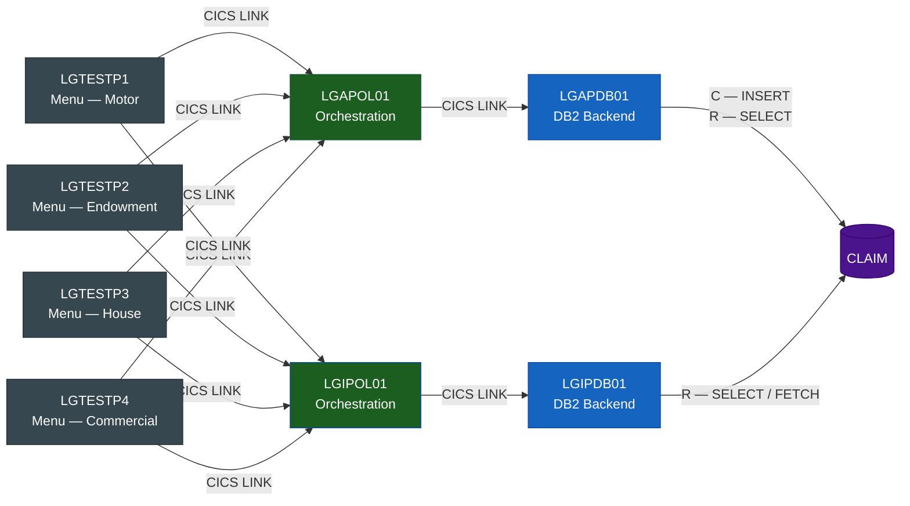

# GenApp — Db2 CRUD Matrix

> **Database**: `GENASA1`  
> **Source**: derived from scan database via SQL analysis of all embedded `EXEC SQL` statements  
> Legend: **C** = INSERT &nbsp;|&nbsp; **R** = SELECT / FETCH &nbsp;|&nbsp; **U** = UPDATE &nbsp;|&nbsp; **D** = DELETE

---

## Program × Table Matrix

| Program | Layer | CUSTOMER | CUSTOMER_SECURE | POLICY | ENDOWMENT | HOUSE | MOTOR | COMMERCIAL | CLAIM |
|---------|-------|:--------:|:---------------:|:------:|:---------:|:-----:|:-----:|:----------:|:-----:|
| **LGACDB01** | DB2 Backend | **C** | | | | | | | |
| **LGACDB02** | DB2 Backend | | **C** | | | | | | |
| **LGICDB01** | DB2 Backend | **R** | | | | | | | |
| **LGUCDB01** | DB2 Backend | **U** | | | | | | | |
| **LGAPDB01** | DB2 Backend | | | **CRU** | **C** | **C** | **C** | **CR** | **CR** |
| **LGIPDB01** | DB2 Backend | | | **R** | **R** | **R** | **R** | **R** | **R** |
| **LGDPDB01** | DB2 Backend | | | **D** | | | | | |
| **LGUPDB01** | DB2 Backend | | | **U** | | | | | |
| **LGACUS01** | Orchestration | **C** | | **CRD** | | | | | |
| **LGBATCH** | Batch | **R** | | | | | | | |
| **LGBATDB2** | Batch | **R** | | | | | | | |
| **LGMOTOUT** | Batch | | | | | | **R** | | |

---

## Table Dependency Diagrams

Each diagram shows the **full call chain** from BMS menu down to the Db2 table.
Reading left-to-right: **Menu → Orchestrator → DB2 Backend → Table**.
Every program in a diagram must be changed or adapted if the table is migrated off the mainframe.

Node colour = architectural layer:

| Colour | Layer |
|--------|-------|
| 🟫 Dark grey `#37474f` | Presentation (BMS Menu) |
| 🟩 Forest green `#1b5e20` | Business Orchestration |
| 🟦 Steel blue `#1565c0` | DB2 Backend |
| 🟥 Crimson `#b71c1c` | Batch (non-CICS) |
| 🟪 Deep purple `#4a148c` | Db2 Table |

---

### CUSTOMER

**6 programs impacted** across 3 layers (+ 2 batch programs).

---

### CUSTOMER_SECURE

**3 programs impacted** across 3 layers.

---

### POLICY

**10 programs impacted** across 3 layers.

---

### ENDOWMENT

**7 programs impacted** across 3 layers.

---

### HOUSE

**7 programs impacted** across 3 layers.

---

### MOTOR

**8 programs impacted** across 3 layers (+ 1 batch program).

---

### COMMERCIAL

**8 programs impacted** across 3 layers.

---

### CLAIM

**8 programs impacted** across 3 layers.

---

## Operations Detail

### CUSTOMER

| Program | C | R | U | D | Notes |
|---------|:-:|:-:|:-:|:-:|-------|
| `LGACDB01` | ✓ | | | | Inserts new customer row |
| `LGICDB01` | | ✓ | | | Point SELECT by customer number |
| `LGUCDB01` | | | ✓ | | Updates customer details |
| `LGACUS01` | ✓ | | | | Direct INSERT (combined customer+policy orchestrator) |
| `LGBATCH`  | | ✓ | | | Batch customer report — SELECTs each row driven by CUSTIN |
| `LGBATDB2` | | ✓ | | | DB2 test driver — SELECTs customer 1 |

### CUSTOMER_SECURE

| Program | C | R | U | D | Notes |
|---------|:-:|:-:|:-:|:-:|-------|
| `LGACDB02` | ✓ | | | | Inserts password hash and state indicator for new customer |

### POLICY

| Program | C | R | U | D | Notes |
|---------|:-:|:-:|:-:|:-:|-------|
| `LGAPDB01` | ✓ | ✓ | ✓ | | INSERT on add; SELECT to verify; UPDATE on claim processing |
| `LGIPDB01` | | ✓ | | | Point SELECT + cursor FETCH for policy list |
| `LGDPDB01` | | | | ✓ | DELETE — cascades to all child policy-type tables |
| `LGUPDB01` | | | ✓ | | Updates policy header fields |
| `LGACUS01` | ✓ | ✓ | | ✓ | INSERTs linked policy, SELECTs it back, DELETEs on rollback path |

### ENDOWMENT

| Program | C | R | U | D | Notes |
|---------|:-:|:-:|:-:|:-:|-------|
| `LGAPDB01` | ✓ | | | | Inserts endowment-specific details after POLICY row |
| `LGIPDB01` | | ✓ | | | Point SELECT for endowment fields |

### HOUSE

| Program | C | R | U | D | Notes |
|---------|:-:|:-:|:-:|:-:|-------|
| `LGAPDB01` | ✓ | | | | Inserts house-specific details after POLICY row |
| `LGIPDB01` | | ✓ | | | Point SELECT for house fields |

### MOTOR

| Program | C | R | U | D | Notes |
|---------|:-:|:-:|:-:|:-:|-------|
| `LGAPDB01` | ✓ | | | | Inserts motor-specific details after POLICY row |
| `LGIPDB01` | | ✓ | | | Point SELECT for motor fields |
| `LGMOTOUT` | | ✓ | | | Batch export — cursor over all MOTOR rows → MOTOROUT file |

### COMMERCIAL

| Program | C | R | U | D | Notes |
|---------|:-:|:-:|:-:|:-:|-------|
| `LGAPDB01` | ✓ | ✓ | | | INSERT; SELECT back to verify / retrieve generated key |
| `LGIPDB01` | | ✓ | | | Point SELECT + cursor FETCH |

### CLAIM

| Program | C | R | U | D | Notes |
|---------|:-:|:-:|:-:|:-:|-------|
| `LGAPDB01` | ✓ | ✓ | | | INSERT; SELECT back to verify / retrieve generated claim number |
| `LGIPDB01` | | ✓ | | | Point SELECT + cursor FETCH |

---

## Observations

- **`LGAPDB01`** is the most data-intensive program — it writes to all six child tables (POLICY, ENDOWMENT, HOUSE, MOTOR, COMMERCIAL, CLAIM) and is the sole **Create** path for policy data.
- **`LGIPDB01`** is the sole **Read** path for all policy-type detail tables. It uses cursors for CLAIM and COMMERCIAL to handle multiple rows per policy.
- **No program performs UPDATE or DELETE on policy-type detail tables** (ENDOWMENT, HOUSE, MOTOR, COMMERCIAL, CLAIM). Deletion is handled entirely by the `ON DELETE CASCADE` foreign key constraint when a POLICY row is deleted via `LGDPDB01`.
- **`CUSTOMER_SECURE`** is written only once (`LGACDB02`) and never read back by any scanned program — it exists purely for authentication purposes outside the GenApp core transaction flow.
- **Batch programs** (`LGBATCH`, `LGBATDB2`, `LGMOTOUT`) are **read-only** against Db2 — no inserts, updates, or deletes.
- **`LGACUS01`** (orchestration layer) contains its own embedded SQL against CUSTOMER and POLICY, bypassing the dedicated DB2 backend programs for the combined add-customer-and-policy use case.
