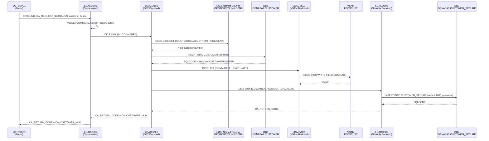
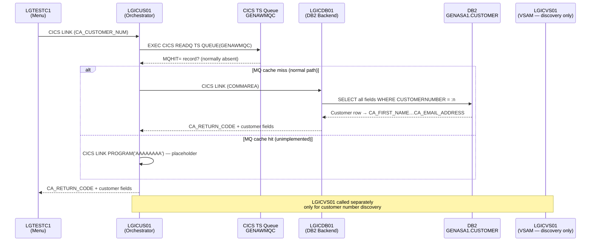
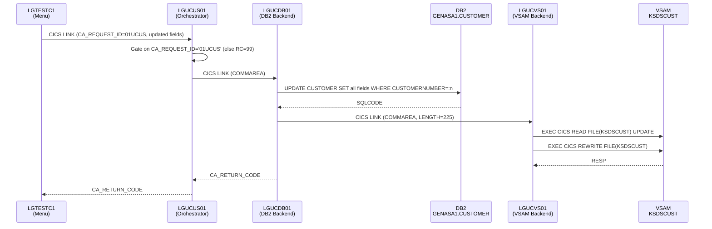

# Customer Management Domain — Deep Dive

## 1. Component Map

The domain has a strict **three-tier layering** — every operation follows the same structure:

```
Presentation (LGTESTC1)
       │ CICS LINK (CA_REQUEST_ID)
       ▼
  Orchestrator Layer        ← business validation, routing, request ID gating
  ┌──────────────────────────────────────────────────────────────┐
  │  LGACUS01 (Add)    LGICUS01 (Inquire)    LGUCUS01 (Update)  │
  └──────────────────────────────────────────────────────────────┘
       │ CICS LINK (dynamic program name variable)
       ▼
  DB2 Backend Layer         ← all SQL; also links to VSAM and Security
  ┌────────────────────────────────────────────────────────────────────────┐
  │  LGACDB01 (Add)    LGICDB01 (Inquire)    LGUCDB01 (Update)            │
  │                                                                        │
  │  LGACDB02 (Security Add) ← called by LGACDB01 after INSERT CUSTOMER   │
  └────────────────────────────────────────────────────────────────────────┘
       │ CICS LINK (inline after DB2 write)
       ▼
  VSAM Mirror Layer         ← secondary store; keyed on customer number
  ┌──────────────────────────────────────────────────────────────┐
  │  LGACVS01 (Add)    LGICVS01 (Inquire)    LGUCVS01 (Update)  │
  └──────────────────────────────────────────────────────────────┘
```

> **Note on `LGICVS01`**: The Inquire VSAM backend is unusual — it does not simply read a customer record. It reads the `GENACNTL` TS queue for the configured customer number range, then performs a GTEQ read on `KSDSCUST` to return a random valid customer number. It is a **customer number discovery utility**, not a customer data retrieval path.

> **Note on `LGICUS01`**: Before calling `LGICDB01`, it checks TS queue `GENAWMQC` for an `MQHIT=` record. If found, it branches to a placeholder program `AAAAAAAA` instead of `LGICDB01` — this is an **unimplemented MQ cache bypass hook**.

---

## 2. Data Flows

### 2a. Add Customer (`01ACUS`)



**Key data observations:**

- Customer number is sourced from CICS named counter `GENACUSTNUM` — **not** from DB2 `IDENTITY`. If the counter call fails (`LGAC_NCS='NO'`), the INSERT falls back to DB2-assigned identity with `IDENTITY_VAL_LOCAL()` to recover the number.
- [`LGACDB01`](../../pli/LGACDB01.pli) calls [`LGACVS01`](../../pli/LGACVS01.pli) with `LENGTH=225`, which is a fixed partial COMMAREA — only the customer header portion is written to VSAM, not the full 32,500-byte COMMAREA.
- [`LGACDB02`](../../pli/LGACDB02.pli) receives a **separate, purpose-built COMMAREA** (`CDB2AREA`) — not the main COMMAREA — containing only the security fields. The initial password is a hardcoded MD5 hash string (`5732fec825535eeafb8fac50fee3a8aa`).

---

### 2b. Inquire Customer (`01ICUS`)



**Key data observations:**

- [`LGICDB01`](../../pli/LGICDB01.pli) returns `CA_RETURN_CODE='01'` for SQLCODE 100 (not found) or -913 (deadlock/timeout) — both treated identically as "not found" by the caller.
- [`LGICVS01`](../../pli/LGICVS01.pli) is **not** in the Inquire flow above. It is called independently by [`LGTESTC1`](../../pli/LGTESTC1.pli) as a utility to pick a sample customer number for demo/test purposes.

---

### 2c. Update Customer (`01UCUS`)



**Key data observation:** The VSAM rewrite ([`LGUCVS01`](../../pli/LGUCVS01.pli)) uses a Read-for-Update / Rewrite pattern with CICS record-level locking. This lock is held across the DB2 UPDATE and the VSAM REWRITE in the same CICS task, which has deadlock risk if another task is updating the same customer concurrently.

---

## 3. Shared Resources

| Resource | Type | How the domain uses it | Risk if unavailable |
|---|---|---|---|
| [`LGCMAREA.inc`](../../plinc/LGCMAREA.inc) | PL/I include | Universal COMMAREA structure — all 10 programs include it. `CA_CUSTOMER_NUM`, `CA_FIRST_NAME`…`CA_EMAIL_ADDRESS` are the primary data fields. | Compile-time failure for all 10 programs |
| `GENASA1.CUSTOMER` | DB2 table | INSERT (Add), SELECT (Inquire), UPDATE (Update) | Add/Inquire/Update all fail |
| `GENASA1.CUSTOMER_SECURE` | DB2 table | INSERT only (Add, via [`LGACDB02`](../../pli/LGACDB02.pli)) | New customers added without security record — FK violation possible |
| `GENACUSTNUM` counter / `GENA` pool | CICS Named Counter | Read-increment for new customer number assignment (Add path) | Falls back to DB2 identity; customer number in COMMAREA may differ from DB2-assigned value |
| `KSDSCUST` | VSAM KSDS | WRITE (Add), GTEQ READ (Inquire-discovery), READ+REWRITE (Update) | Add/Update VSAM steps abend with `LGV0`/`LGV1`/`LGV2`; Inquire-discovery silently returns no result |
| `GENACNTL` TS queue | CICS TS | Read by [`LGICVS01`](../../pli/LGICVS01.pli) for customer number range (LOW/HIGH CUSTOMER) | Discovery utility returns default range `1000001–1000001` |
| `GENAWMQC` TS queue | CICS TS | Read by [`LGICUS01`](../../pli/LGICUS01.pli) to detect MQ cache hit | MQ bypass never triggers (placeholder `AAAAAAAA`); queue absence is silently ignored |
| [`LGSTSQ`](../../pli/LGSTSQ.pli) | Shared CICS program | All 10 programs call it via CICS LINK on any error | Errors silently lost; no visibility into failures |

---

## 4. Dependencies on the Rest of the Application

### Inbound — who calls this domain

| Caller | Program | What it passes |
|---|---|---|
| Presentation domain | [`LGTESTC1`](../../pli/LGTESTC1.pli) | COMMAREA with `CA_REQUEST_ID` (`01ACUS`, `01ICUS`, `01UCUS`) and customer fields |

### Outbound — what this domain calls

| Target | Domain | Program called | Why |
|---|---|---|---|
| Operations | Ops & Infrastructure | [`LGSTSQ`](../../pli/LGSTSQ.pli) | Error logging on every failure path in all 10 programs |
| Operations | Ops & Infrastructure | CICS Named Counter `GENACUSTNUM` | Customer number generation during Add |
| Operations | Ops & Infrastructure | TS queue `GENACNTL` | Customer number range read during VSAM discovery |

### Key architectural dependencies

1. **[`LGCMAREA.inc`](../../plinc/LGCMAREA.inc) is the contract boundary.** [`LGTESTC1`](../../pli/LGTESTC1.pli) and all downstream programs share the same physical COMMAREA layout. Any field size or position change in [`LGCMAREA.inc`](../../plinc/LGCMAREA.inc) is a breaking change across the entire call chain.

2. **The `GENACUSTNUM` named counter is a single point of control for customer IDs.** The counter is initialised by [`LGSETUP`](../../pli/LGSETUP.pli) (Operations domain). If `LGSETUP` has not been run, or if the counter pool `GENA` is exhausted, both [`LGACDB01`](../../pli/LGACDB01.pli) and [`LGACUS01`](../../pli/LGACUS01.pli) fall back to DB2 identity — but the customer number written back into the COMMAREA may then be inconsistent with what the Presentation domain expects.

3. **DB2 `POLICY` table has an FK dependency on `CUSTOMER`.** Because `GENASA1.POLICY.customerNumber` references `GENASA1.CUSTOMER` with `ON DELETE CASCADE`, any customer deletion (there is no Delete Customer operation in this domain today) would cascade-delete all policies for that customer. This is an implicit cross-domain constraint owned by the Policy Management domain.

4. **The MQ bypass hook in [`LGICUS01`](../../pli/LGICUS01.pli) is dead code.** The TS queue `GENAWMQC` check and the `AAAAAAAA` program stub are placeholder infrastructure for a cache integration that was never implemented. Any attempt to trigger it would cause a CICS `PGMIDERR` abend.

---

## 5. Return Code Catalogue

All programs report status back through `CA_RETURN_CODE` in the COMMAREA:

| Code | Meaning | Set by |
|---|---|---|
| `00` | Success | All programs on normal completion |
| `01` | Customer not found (SQLCODE 100 or -913) | [`LGICDB01`](../../pli/LGICDB01.pli) |
| `80` | VSAM Write failure | [`LGACVS01`](../../pli/LGACVS01.pli) |
| `81` | VSAM Read-for-Update failure | [`LGUCVS01`](../../pli/LGUCVS01.pli) |
| `82` | VSAM Rewrite failure | [`LGUCVS01`](../../pli/LGUCVS01.pli) |
| `90` | DB2 unexpected SQLCODE | [`LGACDB01`](../../pli/LGACDB01.pli), [`LGICDB01`](../../pli/LGICDB01.pli), [`LGUCDB01`](../../pli/LGUCDB01.pli), [`LGACDB02`](../../pli/LGACDB02.pli) |
| `98` | COMMAREA too short | All orchestrators and DB2 backends |
| `99` | Invalid `CA_REQUEST_ID` or system error | [`LGUCUS01`](../../pli/LGUCUS01.pli), [`LGACDB02`](../../pli/LGACDB02.pli) |

---

## Key Risks and Notable Findings

| # | Finding | Affected Programs | Severity |
|---|---|---|---|
| 1 | **Dual customer number sources** — CICS counter is primary, DB2 identity is fallback; mismatch possible under counter failure | [`LGACDB01`](../../pli/LGACDB01.pli), [`LGACUS01`](../../pli/LGACUS01.pli) | Medium |
| 2 | **No DB2/VSAM rollback coordination** — if DB2 INSERT succeeds but VSAM WRITE fails, the customer exists in DB2 but not VSAM; abend `LGV0` leaves DB2 committed | [`LGACDB01`](../../pli/LGACDB01.pli), [`LGACVS01`](../../pli/LGACVS01.pli) | High |
| 3 | **VSAM Update lock held across DB2 UPDATE** — deadlock risk under concurrent updates to the same customer | [`LGUCDB01`](../../pli/LGUCDB01.pli), [`LGUCVS01`](../../pli/LGUCVS01.pli) | Medium |
| 4 | **Dead MQ bypass code** — `GENAWMQC` check and `AAAAAAAA` stub in [`LGICUS01`](../../pli/LGICUS01.pli) will cause `PGMIDERR` if activated | [`LGICUS01`](../../pli/LGICUS01.pli) | Low (latent) |
| 5 | **Hardcoded initial password** — MD5 hash `5732fec825535eeafb8fac50fee3a8aa` set in both [`LGACDB01`](../../pli/LGACDB01.pli) and [`LGACDB02`](../../pli/LGACDB02.pli) | [`LGACDB01`](../../pli/LGACDB01.pli), [`LGACDB02`](../../pli/LGACDB02.pli) | Medium (security) |
| 6 | **`LGCMAREA.inc` is a blast-radius multiplier** — any layout change breaks all 10 programs plus the Presentation domain simultaneously | All 10 programs | High |
