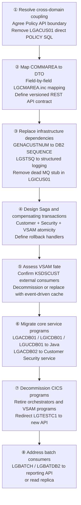

# Customer Domain — Migration Effort Analysis

**Scope**: Migration of the Customer Management domain (10 PL/I programs) off the mainframe to a Java/REST microservice architecture.  
**Based on**: [`customer-domain-analysis.md`](customer-domain-analysis.md) and direct source + database analysis.

---

## Migration Scope Summary

| # | Migration Item | Programs Affected | Category |
|---|---|---|---|
| M1 | COMMAREA — shared flat-buffer contract | All 10 programs + `LGTESTC1` | Shared module |
| M2 | DB2 `CUSTOMER` / `CUSTOMER_SECURE` tables | 4 DB2 backends + `LGBATCH`, `LGBATDB2` | Shared data |
| M3 | `LGACUS01` crosses into Policy domain | [`LGACUS01`](../../pli/LGACUS01.pli) alone | Cross-domain coupling |
| M4 | CICS LINK call chain — lost transactional UoW | All 10 programs | Architecture |
| M5 | `GENACUSTNUM` CICS Named Counter | [`LGACDB01`](../../pli/LGACDB01.pli), [`LGACUS01`](../../pli/LGACUS01.pli) | Shared infrastructure |
| M6 | VSAM `KSDSCUST` parallel store | [`LGACVS01`](../../pli/LGACVS01.pli), [`LGICVS01`](../../pli/LGICVS01.pli), [`LGUCVS01`](../../pli/LGUCVS01.pli) | Shared data |
| M7 | `LGSTSQ` shared error logging service | All 10 programs | Shared module |
| M8 | TS queues (`GENAWMQC`, `GENACNTL`) | [`LGICUS01`](../../pli/LGICUS01.pli), [`LGICVS01`](../../pli/LGICVS01.pli) | Shared infrastructure |
| M9 | CICS ENQ/DEQ locking in `LGICVS01` | [`LGICVS01`](../../pli/LGICVS01.pli) | Architecture |
| M10 | Dead MQ cache stub in `LGICUS01` | [`LGICUS01`](../../pli/LGICUS01.pli) | Dead code |

---

## Ranked Migration Risks

---

### 🔴 RISK 1 — `LGACUS01` Writes Directly to the `POLICY` Table
**Category: Cross-domain data coupling · Severity: CRITICAL**

[`LGACUS01`](../../pli/LGACUS01.pli) contains procedures `INSERT_CUSTOMER_POLICY`, `TRANSFER_CUSTOMER_POLICY`, and `DELETE_CUSTOMER_POLICY` — it writes to and reads from `GENASA1.POLICY`, a table owned by the Policy Management domain. This is confirmed by database analysis.

**Why it matters:**  
You cannot migrate the Customer domain independently. If `LGACUS01` is lifted to a microservice while `LGAPDB01` / `LGDPDB01` / `LGIPDB01` remain on the mainframe, both the new service and the remaining mainframe programs will be writing to the same `POLICY` table with no API boundary between them. This forces a choice: migrate both domains together, or carve out Policy ownership before touching Customer.

**Migration action:**
- Define which domain owns the `POLICY` table (Policy domain).
- Replace `LGACUS01`'s direct `POLICY` SQL with an API call to a Policy service.
- Design a Saga for the "add customer + add policy" combined flow that is currently a single synchronous operation.

---

### 🔴 RISK 2 — CICS LINK Shares One Transaction Unit of Work Across the Entire Call Chain
**Category: Architecture · Severity: CRITICAL**

Every call in the chain — `LGTESTC1` → `LGACUS01` → `LGACDB01` → `LGACVS01` + `LGACDB02` — runs in a **single CICS transaction with a single DB2 unit of work**. If `LGACDB02`'s INSERT into `CUSTOMER_SECURE` fails, the entire chain rolls back automatically, including the `CUSTOMER` INSERT. This atomicity is implicit and free in CICS.

**Why it matters:**  
REST calls across microservice boundaries do **not** share a DB2 unit of work. Once `LGACDB01`'s INSERT into `CUSTOMER` is committed, there is no automatic rollback if `LGACDB02` subsequently fails. Every inter-service call now requires an explicit compensating action (delete the customer row) or a Saga coordinator.

**Migration action:**
- Implement a Saga pattern for the Add Customer flow (DB2 insert → VSAM write → security insert).
- Define a compensating transaction (`DELETE FROM CUSTOMER WHERE CUSTOMERNUMBER = ?`) that fires if the security step fails.
- Note: the VSAM write (Risk 4) further complicates this because VSAM does not participate in DB2 rollback.

---

### 🔴 RISK 3 — `LGCMAREA.inc` Is the Contract for All 10 Programs and the Caller
**Category: Shared module · Severity: CRITICAL**

[`LGCMAREA.inc`](../../plinc/LGCMAREA.inc) is a 32,500-byte flat binary structure shared by all 10 programs plus `LGTESTC1`. Customer fields (`CA_FIRST_NAME` through `CA_EMAIL_ADDRESS`) are accessed by byte offset within this buffer. There are no accessor methods, no type safety, and no versioning. `PIC '9999999999'` fields are zoned decimal; `CHAR(n)` fields are EBCDIC space-padded.

**Why it matters:**  
The COMMAREA is the API contract. Every field must be mapped to a typed Java DTO. Any field offset misidentified during this mapping produces silent data corruption — no compile-time check catches it. The COMMAREA also has no version field, so the new API must introduce versioning from day one.

**Migration action:**
- Produce a complete field-level mapping document from every `CA_*` customer field to a typed Java DTO.
- Pay particular attention to: `PIC '9(10)'` → `int`/`long`, `CHAR(n)` EBCDIC → `String` (trimmed), `PIC '99'` return code → enum.
- Version the REST API from the outset (`/api/v1/customers`); the COMMAREA has no version concept.

---

### 🟠 RISK 4 — VSAM `KSDSCUST` Has No Rollback Coordination with DB2
**Category: Shared data · Severity: HIGH**

`KSDSCUST` is a parallel store written synchronously after every DB2 INSERT/UPDATE. The VSAM write is **not** part of the DB2 unit of work. If [`LGACVS01`](../../pli/LGACVS01.pli) abends on WRITE (abend `LGV0`), the customer row already committed in DB2 is not rolled back. Database analysis confirms `KSDSCUST` is exclusive to the customer domain — no other domain touches it.

**Why it matters:**  
- **Option A (Decommission)**: `KSDSCUST` appears to serve primarily as a mirror and a customer-number discovery source for demo/test purposes (`LGICVS01`). If no external system reads it directly, it can be dropped — eliminating three programs and their risk.
- **Option B (Migrate)**: If `KSDSCUST` has external consumers, it must be replaced with a cache layer that has explicit consistency guarantees.

**Migration action:**
- Confirm whether any system outside this codebase reads `KSDSCUST` directly.
- If not: decommission `LGACVS01`, `LGICVS01`, `LGUCVS01` as part of migration.
- If yes: replace with an event-driven cache update pattern (`CustomerCreated`/`CustomerUpdated` events → cache service).

---

### 🟠 RISK 5 — `GENACUSTNUM` Named Counter Creates a Dual ID-Generation Path
**Category: Shared infrastructure · Severity: HIGH**

Both [`LGACDB01`](../../pli/LGACDB01.pli) and [`LGACUS01`](../../pli/LGACUS01.pli) call `EXEC CICS GET COUNTER(GENACUSTNUM)` before the DB2 INSERT. If the counter fails, both fall back to `IDENTITY_VAL_LOCAL()` — a DB2 function that returns the last identity value assigned **on the current connection**. In a Java connection pool, the connection may be returned to the pool between the INSERT and the `IDENTITY_VAL_LOCAL()` call, returning a wrong value.

**Why it matters:**  
The CICS Named Counter Server has no Java equivalent. It must be replaced. The `CUSTOMER` table already has `GENERATED BY DEFAULT AS IDENTITY (START WITH 1000001)`, so the fallback is already correct — but the counter call must be removed, and `IDENTITY_VAL_LOCAL()` must be replaced with JDBC `getGeneratedKeys()`.

**Migration action:**
- Remove CICS counter calls; use DB2 identity exclusively.
- Replace `IDENTITY_VAL_LOCAL()` with JDBC `PreparedStatement.RETURN_GENERATED_KEYS` + `stmt.getGeneratedKeys()`.
- Ensure the identity start value does not collide with existing customer numbers.

---

### 🟠 RISK 6 — DB2 FK CASCADE from `POLICY` to `CUSTOMER` Creates Silent Cross-Domain Deletes
**Category: Cross-domain dependency · Severity: HIGH**

`GENASA1.POLICY` has `FOREIGN KEY(customerNumber) REFERENCES GENASA1.CUSTOMER ON DELETE CASCADE`. There is currently no Delete Customer operation in the domain. Any future delete built into the migrated service will silently delete all policies for that customer without notifying the Policy service.

**Why it matters:**  
A Customer microservice that issues `DELETE FROM CUSTOMER WHERE CUSTOMERNUMBER = ?` will cascade-delete all `POLICY` rows, all `ENDOWMENT`/`HOUSE`/`MOTOR`/`COMMERCIAL`/`CLAIM` rows — all Policy domain data — without the Policy service being aware. This is an invisible cross-domain dependency.

**Migration action:**
- Document the FK cascade as a cross-domain constraint before migration begins.
- Any `DELETE /customers/{id}` endpoint must call the Policy service first to confirm no active policies exist (or explicitly request their deactivation).
- Do not rely on the DB2 cascade in a microservice architecture.

---

### 🟡 RISK 7 — `LGSTSQ` Is a Shared Cross-Cutting Error Service
**Category: Shared module · Severity: MEDIUM**

All 10 programs call [`LGSTSQ`](../../pli/LGSTSQ.pli) (Operations domain) on every error path. `LGSTSQ` writes to TDQ `CSMT` and TS queue `GENAERRS`. It is not a domain-internal component.

**Why it matters:**  
If `LGSTSQ` is retired before all programs are migrated, error logging breaks silently — `EXEC CICS LINK` to a missing program causes `PGMIDERR` with no fallback logging path. This is the worst possible failure mode for an error handler.

**Migration action:**
- Replace all `EXEC CICS LINK PROGRAM('LGSTSQ')` calls with structured logging (e.g., SLF4J/Logback to a centralized log system) **before** migrating any program.
- Keep the mainframe `LGSTSQ` operational until the last program in the domain is decommissioned.

---

### 🟡 RISK 8 — CICS ENQ/DEQ in `LGICVS01` Has No Direct Java Equivalent
**Category: Architecture · Severity: MEDIUM**

[`LGICVS01`](../../pli/LGICVS01.pli) wraps its `GENACNTL` TS queue read-modify-write in `EXEC CICS ENQ`/`DEQ` to prevent concurrent corruption of the LOW/HIGH CUSTOMER range. CICS advisory locks have no direct equivalent in stateless Java microservices.

**Why it matters:**  
`LGICVS01` is a demo/test utility for customer number discovery. However, ENQ/DEQ represents the general CICS pattern for shared mutable in-memory state — any future discovery of similar patterns elsewhere in the application must be handled the same way.

**Migration action:**
- Since `LGICVS01` is a demo utility: decommission it or replace with a simple DB2 query (`SELECT MIN/MAX(CUSTOMERNUMBER) FROM CUSTOMER`), which is inherently transactionally safe.
- For the general ENQ/DEQ pattern: establish a project policy that all shared mutable state must be backed by DB2 (`SELECT ... FOR UPDATE`) or a distributed lock (Redis Redlock).

---

### 🟡 RISK 9 — Batch Programs Read `CUSTOMER` Table Outside the Domain
**Category: Shared data · Severity: MEDIUM**

Database analysis confirms both [`LGBATCH`](../../pli/LGBATCH.pli) and [`LGBATDB2`](../../pli/LGBATDB2.pli) (Batch Reporting domain) execute `SELECT` against `GENASA1.CUSTOMER`. They are read-only but bypass any API layer the migrated Customer service introduces.

**Why it matters:**  
If the migrated Customer microservice owns the `CUSTOMER` table, these batch programs will be reaching directly into the new service's database — violating the database-per-service principle and bypassing any future business rules applied at the API layer.

**Migration action:**
- **Short term (strangler fig)**: allow the batch programs to continue reading `CUSTOMER` directly from DB2 while the migration proceeds.
- **Long term**: expose a batch-query API from the Customer service, or provide a dedicated reporting read replica that batch programs access without touching the transactional database.

---

### 🟢 RISK 10 — Dead MQ Cache Stub in `LGICUS01`
**Category: Dead code · Severity: LOW**

[`LGICUS01`](../../pli/LGICUS01.pli) checks TS queue `GENAWMQC` for an `MQHIT=` record and, if found, calls the non-existent program `AAAAAAAA`. This code has never been completed and will cause `PGMIDERR` if triggered.

**Why it matters:**  
This is a latent defect that must not be carried forward. It also signals that a caching layer for customer inquiries was once planned — the migration is an opportunity to implement it properly.

**Migration action:**
- Remove the `GENAWMQC` check and the `AAAAAAAA` branch from `LGICUS01` before migration.
- Optionally implement the originally intended cache as a Redis `GET/SET` around the `SELECT FROM CUSTOMER` query in the new service.

---

## Consolidated Risk Register

| Rank | Risk | Category | Severity | Key Action |
|---|---|---|---|---|
| 1 | [`LGACUS01`](../../pli/LGACUS01.pli) writes to `POLICY` table | Cross-domain data | 🔴 CRITICAL | Define Policy API boundary; cannot migrate Customer independently |
| 2 | CICS LINK shared UoW — no cross-service atomicity | Architecture | 🔴 CRITICAL | Design Saga with compensating transactions |
| 3 | [`LGCMAREA.inc`](../../plinc/LGCMAREA.inc) flat binary contract | Shared module | 🔴 CRITICAL | Full field-by-field DTO mapping; introduce API versioning |
| 4 | VSAM `KSDSCUST` — no DB2 rollback coordination | Shared data | 🟠 HIGH | Decommission if no external consumers; else event-driven cache |
| 5 | `GENACUSTNUM` counter + `IDENTITY_VAL_LOCAL()` connection-pool race | Shared infrastructure | 🟠 HIGH | Replace with DB2 SEQUENCE / JDBC `getGeneratedKeys()` |
| 6 | DB2 FK CASCADE `POLICY → CUSTOMER` | Cross-domain dependency | 🟠 HIGH | Explicit cross-domain delete policy; no silent cascade |
| 7 | [`LGSTSQ`](../../pli/LGSTSQ.pli) shared error logger | Shared module | 🟡 MEDIUM | Replace with structured logging before migrating any program |
| 8 | CICS ENQ/DEQ in [`LGICVS01`](../../pli/LGICVS01.pli) | Architecture | 🟡 MEDIUM | Decommission utility or replace with `SELECT FOR UPDATE` |
| 9 | [`LGBATCH`](../../pli/LGBATCH.pli)/[`LGBATDB2`](../../pli/LGBATDB2.pli) direct DB2 reads | Shared data | 🟡 MEDIUM | Strangler-fig short term; reporting API or read replica long term |
| 10 | Dead MQ stub in [`LGICUS01`](../../pli/LGICUS01.pli) | Dead code | 🟢 LOW | Remove before migration; optionally add Redis cache |

---

## Recommended Migration Sequence

---

## CICS/DB2 Construct → Java Migration Mapping

| Mainframe Construct | Used In | Java Replacement | Risk |
|---|---|---|---|
| `EXEC CICS LINK` | All programs | REST/gRPC + Saga / compensating transactions | 🔴 HIGH |
| `EXEC CICS GET COUNTER` | `LGACDB01`, `LGACUS01` | DB2 `SEQUENCE` / JDBC `getGeneratedKeys()` | 🟢 LOW |
| `EXEC SQL` host variables | `LGACDB01`, `LGACDB02`, `LGICDB01`, `LGUCDB01` | JDBC `PreparedStatement` typed parameters | 🟡 MEDIUM |
| `IDENTITY_VAL_LOCAL()` | `LGACDB01`, `LGACUS01` | JDBC `stmt.getGeneratedKeys()` | 🟠 HIGH |
| `EXEC CICS READQ/WRITEQ TS` | `LGICUS01`, `LGICVS01` | Redis (TTL) or DB2 staging table | 🟡 MEDIUM |
| `EXEC CICS ENQ/DEQ` | `LGICVS01` | `SELECT FOR UPDATE` / Redis Redlock | 🟡 MEDIUM |
| `EXEC CICS ABEND NODUMP` | All programs | Custom exception + `@Transactional` rollback | 🟢 LOW |
| COMMAREA (`LGCMAREA.inc`) | All programs | Typed Java DTO with versioned REST contract | 🔴 HIGH |
| `EXEC CICS WRITE/READ/REWRITE FILE` | VSAM programs | Decommission or event-driven cache | 🟠 HIGH |
