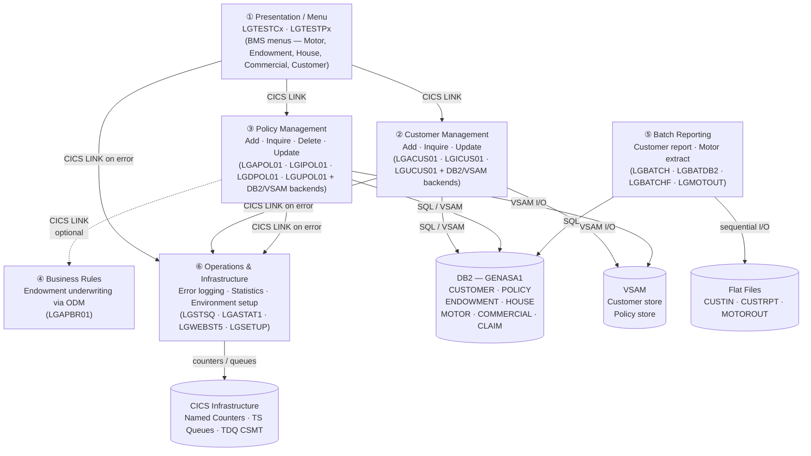

# GenApp (PL/I) — Functional Domain Map

## Domain Diagram

---

## Domain Profiles

### ① Presentation / Menu Domain

| Aspect | Detail |
|---|---|
| **Business responsibility** | CICS BMS terminal menus; the user-facing entry point for all online policy and customer transactions. Accepts user input (customer/policy number, field values), routes to the appropriate operation orchestrator via `EXEC CICS LINK`, and displays results. |
| **Programs** | [`LGTESTC1`](../../pli/LGTESTC1.pli) (Customer menu), [`LGTESTP1`](../../pli/LGTESTP1.pli) (Motor), [`LGTESTP2`](../../pli/LGTESTP2.pli) (Endowment), [`LGTESTP3`](../../pli/LGTESTP3.pli) (House), [`LGTESTP4`](../../pli/LGTESTP4.pli) (Commercial) |
| **Data stores** | None directly — pass/receive COMMAREA only |
| **Key dependencies** | BMS mapset `SSMAP` (`%INCLUDE SSMAP`) · COMMAREA structure `LGCMAREA` · All orchestrators in Customer & Policy domains |

---

### ② Customer Management Domain

| Aspect | Detail |
|---|---|
| **Business responsibility** | Full customer lifecycle: create, retrieve, and update a customer record. Maintains the `CUSTOMER` and `CUSTOMER_SECURE` DB2 tables and a parallel VSAM store. Orchestrator programs validate the COMMAREA and dispatch to either the DB2 or VSAM backend. |
| **Programs** | Orchestrators: [`LGACUS01`](../../pli/LGACUS01.pli) (Add), [`LGICUS01`](../../pli/LGICUS01.pli) (Inquire), [`LGUCUS01`](../../pli/LGUCUS01.pli) (Update) · DB2 backends: [`LGACDB01`](../../pli/LGACDB01.pli), [`LGICDB01`](../../pli/LGICDB01.pli), [`LGUCDB01`](../../pli/LGUCDB01.pli), [`LGACDB02`](../../pli/LGACDB02.pli) (security) · VSAM backends: [`LGACVS01`](../../pli/LGACVS01.pli), [`LGICVS01`](../../pli/LGICVS01.pli), [`LGUCVS01`](../../pli/LGUCVS01.pli) |
| **Data stores** | DB2 tables `GENASA1.CUSTOMER` and `GENASA1.CUSTOMER_SECURE` · VSAM customer dataset · CICS Named Counter `GENACUSTNUM` (pool `GENA`) for customer number generation |
| **Key dependencies** | COMMAREA structure [`LGCMAREA.inc`](../../plinc/LGCMAREA.inc) · Error logger `LGSTSQ` · Called by Presentation domain |

---

### ③ Policy Management Domain

| Aspect | Detail |
|---|---|
| **Business responsibility** | Full policy lifecycle (Add, Inquire, Delete, Update) for four product lines: **Motor, Endowment, House, Commercial**, plus **Claims**. Orchestrators resolve routing; DB2 backends own the SQL; VSAM backends provide alternative/fallback storage. |
| **Programs** | Orchestrators: [`LGAPOL01`](../../pli/LGAPOL01.pli), [`LGIPOL01`](../../pli/LGIPOL01.pli), [`LGDPOL01`](../../pli/LGDPOL01.pli), [`LGUPOL01`](../../pli/LGUPOL01.pli) · DB2 backends: [`LGAPDB01`](../../pli/LGAPDB01.pli), [`LGIPDB01`](../../pli/LGIPDB01.pli), [`LGDPDB01`](../../pli/LGDPDB01.pli), [`LGUPDB01`](../../pli/LGUPDB01.pli) · VSAM backends: [`LGAPVS01`](../../pli/LGAPVS01.pli), [`LGIPVS01`](../../pli/LGIPVS01.pli), [`LGDPVS01`](../../pli/LGDPVS01.pli), [`LGUPVS01`](../../pli/LGUPVS01.pli) |
| **Data stores** | DB2 tables `GENASA1.POLICY`, `ENDOWMENT`, `HOUSE`, `MOTOR`, `COMMERCIAL`, `CLAIM` (all FK child of POLICY) · VSAM policy dataset |
| **Key dependencies** | COMMAREA [`LGCMAREA.inc`](../../plinc/LGCMAREA.inc) + product-specific fields (`CA_MOTOR`, `CA_ENDOWMENT`, `CA_HOUSE`, `CA_COMMERCIAL`, `CA_CLAIM`) · Business Rules domain (optional, for Endowment Add only) · Error logger `LGSTSQ` |

---

### ④ Business Rules Domain

| Aspect | Detail |
|---|---|
| **Business responsibility** | Applies IBM Operational Decision Manager (ODM) underwriting rules to Endowment policy additions. Called optionally by the Policy Add orchestrator only when the `BUSINESS_RULES` flag is `'Y'`. Receives a dedicated request/response area (`LGCMARER`) rather than the full COMMAREA. |
| **Programs** | `LGAPBR01` (external — not present as source in this workspace; referenced by `LGAPOL01`) |
| **Data stores** | None directly; operates on the Endowment policy data passed in [`LGCMARER.inc`](../../plinc/LGCMARER.inc) |
| **Key dependencies** | Caller: `LGAPOL01` (CICS LINK, conditional) · Include [`LGCMARER.inc`](../../plinc/LGCMARER.inc) (business rule request/response structure) |

---

### ⑤ Batch Reporting Domain

| Aspect | Detail |
|---|---|
| **Business responsibility** | Non-CICS batch programs for offline reporting. `LGBATCH` reads customer keys from a sequential file, fetches each from DB2, and produces a formatted report via the reusable `LGBATCHF` subroutine. `LGBATDB2` is a simpler test driver for a single customer. `LGMOTOUT` dumps all `MOTOR` table rows to a sequential output file. |
| **Programs** | [`LGBATCH`](../../pli/LGBATCH.pli) (customer report driver), [`LGBATDB2`](../../pli/LGBATDB2.pli) (DB2 test driver), [`LGBATCHF`](../../pli/LGBATCHF.pli) (report formatter subroutine), [`LGMOTOUT`](../../pli/LGMOTOUT.pli) (motor table extract) |
| **Data stores** | DB2 `GENASA1.CUSTOMER` (read) · DB2 `GENASA1.MOTOR` (read) · Sequential flat files: `CUSTIN` (input key file), `CUSTRPT` (customer report), `MOTOROUT` (motor extract) |
| **Key dependencies** | COMMAREA [`LGCMAREA.inc`](../../plinc/LGCMAREA.inc) (used as work area) · No CICS dependency — runs as standard z/OS batch |

---

### ⑥ Operations & Infrastructure Domain

| Aspect | Detail |
|---|---|
| **Business responsibility** | Environment lifecycle and operational observability. `LGSETUP` initialises all CICS named counters and TS queues before system use. `LGASTAT1` is an event-processing adapter that increments the appropriate success/failure named counter for each transaction. `LGWEBST5` periodically samples all counters, maintains delta values in TS queues, and restarts itself every minute (transaction `SSST`). `LGSTSQ` is the shared error-logging service (writes to TDQ `CSMT` and TS queue `GENAERRS`) invoked by every other domain on error. |
| **Programs** | [`LGSETUP`](../../pli/LGSETUP.pli), [`LGASTAT1`](../../pli/LGASTAT1.pli), [`LGWEBST5`](../../pli/LGWEBST5.pli), [`LGSTSQ`](../../pli/LGSTSQ.pli) |
| **Data stores** | CICS Named Counter pool `GENA` (36 counters for success/error by operation) · CICS TS queues `GENASTRT`, `GENASTAT`, `GENAERRS`, `GENACNTL`, `GENA<code>V` (rate queues) · TDQ `CSMT` |
| **Key dependencies** | No business data dependency · Consumed by all other online domains (LGSTSQ via CICS LINK on every error path) |

---

## Cross-Domain Dependency Summary

| Caller Domain | Called Domain | Mechanism | Notes |
|---|---|---|---|
| Presentation | Customer Management | `EXEC CICS LINK` | Via `CA_REQUEST_ID` routing |
| Presentation | Policy Management | `EXEC CICS LINK` | Separate menu per policy type |
| Customer Orchestrators | Customer DB2/VSAM backends | `EXEC CICS LINK` | Dynamic program name variable |
| Policy Orchestrators | Policy DB2/VSAM backends | `EXEC CICS LINK` | Direct program name string |
| Policy Add Orchestrator | Business Rules | `EXEC CICS LINK` (conditional) | Only for Endowment + `BUSINESS_RULES='Y'` |
| Policy DB2 backends | Policy VSAM backends | `EXEC CICS LINK` | After DB2 insert succeeds |
| All online domains | Operations/Infrastructure | `EXEC CICS LINK LGSTSQ` | Error path only |
| Batch drivers | Report formatter | Static `CALL` | No CICS context |

---

## Shared Integration Points

| Artifact | Type | Used by |
|---|---|---|
| [`LGCMAREA.inc`](../../plinc/LGCMAREA.inc) | PL/I include (COMMAREA) | All online programs |
| [`LGCMARER.inc`](../../plinc/LGCMARER.inc) | PL/I include (BR request/response) | `LGAPOL01`, `LGAPBR01` |
| [`SSMAP.inc`](../../plinc/SSMAP.inc) | BMS map structure | All 5 menu programs |
| [`LGSTSQ`](../../pli/LGSTSQ.pli) | Shared CICS service | Every domain (error logging) |
| `GENA` named counter pool | CICS infrastructure | Customer Mgmt, Operations |
| DB2 database `GENASA1` | Relational store | Customer, Policy, Batch domains |
