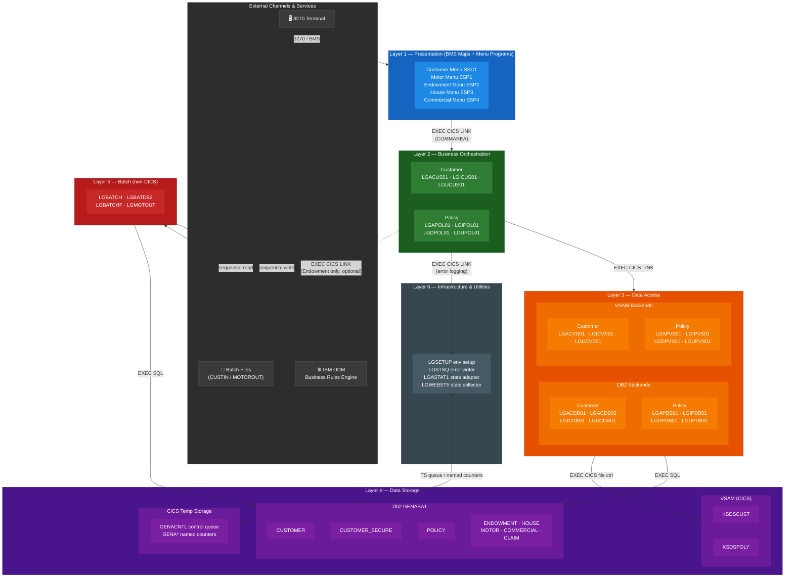

# GenApp (PL/I) — Architecture Diagram

> **Application**: IBM General Insurance Application (GenApp), PL/I variant  
> **Platform**: z/OS — CICS online transactions + DB2 + VSAM + Batch  
> **Build system**: IBM zAppBuild (DBB/Groovy)

---

## Application Architecture Overview



---

## Functional Layers Summary

| Layer | Programs | Description |
|-------|----------|-------------|
| **Presentation** | `LGTESTC1`, `LGTESTP1`–`4` | 3270 BMS menu programs; one per domain (customer + 4 policy types). Entry via CICS transactions `SSC1`, `SSP1`–`SSP4`. |
| **Business Orchestration** | `LGACUS01`, `LGICUS01`, `LGUCUS01`, `LGAPOL01`, `LGIPOL01`, `LGDPOL01`, `LGUPOL01` | CICS-linked orchestrators. Accept COMMAREA, validate length, route to DB2 and/or VSAM backends. |
| **DB2 Backend** | `LGAC/IC/UC/AP/IP/DP/UPxx DB01/DB02` | Single-purpose DB2 programs. Execute embedded SQL (INSERT / SELECT / UPDATE / DELETE) against `GENASA1` tables. |
| **VSAM Backend** | `LGAC/IC/UC/AP/IP/DP/UPxx VS01` | Mirror of DB2 layer using CICS file control (`WRITE`, `READ`, `REWRITE`, `DELETE`) against KSDS files. |
| **Infrastructure** | `LGSETUP`, `LGSTSQ`, `LGASTAT1`, `LGWEBST5` | Environment initialisation, error TS-queue writer, statistics named-counter adapter, statistics collector. |
| **Batch** | `LGBATCH`, `LGBATDB2`, `LGBATCHF`, `LGMOTOUT` | Non-CICS; read sequential files or drive DB2 cursors; use static `CALL` for subprograms. |

---

## CICS Transaction Definitions

| Transaction ID | Program | Description |
|----------------|---------|-------------|
| `SSC1` | `LGTESTC1` | Customer menu |
| `SSP1` | `LGTESTP1` | Motor policy menu |
| `SSP2` | `LGTESTP2` | Endowment policy menu |
| `SSP3` | `LGTESTP3` | House policy menu |
| `SSP4` | `LGTESTP4` | Commercial policy menu |
| `LGSE` | `LGSETUP`  | Environment setup |
| `LGCF` | `LGICVS01` | Direct VSAM customer inquire |
| `LGPF` | `LGIPVS01` | Direct VSAM policy inquire |

---

## BMS Map — `SSMAP`

| Map name | Used by | Purpose |
|----------|---------|---------|
| `SSMAPP1` | `LGTESTP1` | Motor policy fields |
| `SSMAPP2` | `LGTESTP2` | Endowment policy fields |
| `SSMAPP3` | `LGTESTP3` | House policy fields |
| `SSMAPP4` | `LGTESTP4` | Commercial policy fields |
| `SSMAPC1` | `LGTESTC1` | Customer fields |

All maps are defined in the single BMS mapset `SSMAP` (compiled as program `SSMAP` in CSD group `GENASAP`). The PL/I include [`plinc/SSMAP.inc`](../../plinc/SSMAP.inc) provides the corresponding data-structure declarations.

---

## Db2 Schema — `GENASA1`

| Table | Tablespace | Key | Relates to |
|-------|-----------|-----|-----------|
| `CUSTOMER` | `GENATS01` | `customerNumber` (identity) | — |
| `CUSTOMER_SECURE` | `GENATS0A` | `customerNumber` | → CUSTOMER (cascade delete) |
| `POLICY` | `GENATS02` | `policyNumber` (identity) | → CUSTOMER (cascade delete) |
| `ENDOWMENT` | `GENATS03` | `policyNumber` | → POLICY (cascade delete) |
| `HOUSE` | `GENATS04` | `policyNumber` | → POLICY (cascade delete) |
| `MOTOR` | `GENATS05` | `policyNumber` | → POLICY (cascade delete) |
| `COMMERCIAL` | `GENATS06` | `policyNumber` | → POLICY (cascade delete) |
| `CLAIM` | `GENATS07` | `claimNumber` (identity) | → POLICY (cascade delete) |

Policy type is encoded in `POLICY.policyType` (M=Motor, E=Endowment, H=House, C=Commercial).

---

## PL/I Include Files

| Include | Used by | Purpose |
|---------|---------|---------|
| [`LGCMAREA.inc`](../../plinc/LGCMAREA.inc) | All CICS programs | 32 500-byte COMMAREA with `CA_REQUEST_ID`, `CA_RETURN_CODE`, `CA_CUSTOMER_NUM`, and UNION branches for each policy type |
| [`LGCMARER.inc`](../../plinc/LGCMARER.inc) | `LGAPOL01` → `LGAPBR01` | Compact 152-byte request/response area for IBM ODM business rules |
| [`SSMAP.inc`](../../plinc/SSMAP.inc) | Menu programs | BMS map I/O structures (`SSMAPP1I/O`, `SSMAPC1I/O`, etc.) |
| [`DCLPOLIC.inc`](../../plinc/DCLPOLIC.inc) | Policy backends | Policy field declarations |
| [`DCLENDOW.inc`](../../plinc/DCLENDOW.inc) | Endowment backend | Endowment-specific declarations |
| [`LGPOLICY.inc`](../../plinc/LGPOLICY.inc) | Policy programs | Policy data structure |

---

## External Services & Infrastructure

| Service | Type | Connected via | Used by |
|---------|------|--------------|---------|
| **IBM ODM** (LGAPBR01) | External business rules engine | `EXEC CICS LINK` | `LGAPOL01` (optional, Endowment only) |
| **Db2 (DBD1)** | RDBMS | Embedded `EXEC SQL` + CICS DB2CONN `JKEDB2`/`DBD1` | All DB2 backend + batch programs |
| **VSAM KSDS** | File system | `EXEC CICS` file control | All VSAM backend programs |
| **CICS TS Queues** | Temp storage | `EXEC CICS WRITEQ TS` / `READQ TS` | `LGSTSQ`, `LGWEBST5`, `LGSETUP`, `LGTESTC1` |
| **CICS Named Counters** | Atomic counter pool `GENA` | `EXEC CICS INCREMENT COUNTER` | `LGASTAT1`, `LGWEBST5`, `LGACUS01`, `LGSETUP` |

---

## COMMAREA Request ID Convention

```
CA_REQUEST_ID = XX + VERB + ENTITY (total 6 chars)

XX   = '01' (standard operation)
VERB = A(dd) | I(nquire) | D(elete) | U(pdate)
ENTITY = CUS(tomer) | MOT(or) | END(owment) | HOU(se) | COM(mercial)

Examples:
  '01ACUS' — Add Customer
  '01IMOT' — Inquire Motor
  '01DEND' — Delete Endowment
  '01UHOU' — Update House
```

Return code `'00'` = success, `'98'` = bad COMMAREA length, `'99'` = DB2/system error.
