# GenApp PL/I — Complete Program Inventory

> Generated from local scan database (`ScannerOutput.db`).  
> **35 source programs** in `pli/` · **4 include files** in `plinc/`

---

## Table of Contents

1. [Program Classification Summary](#1-program-classification-summary)
2. [Menu / Presentation Layer](#2-menu--presentation-layer)
3. [Policy Orchestrators](#3-policy-orchestrators)
4. [Customer Orchestrators](#4-customer-orchestrators)
5. [DB2 Backend Programs](#5-db2-backend-programs)
6. [VSAM Backend Programs](#6-vsam-backend-programs)
7. [Batch Programs](#7-batch-programs)
8. [Utility / Infrastructure Programs](#8-utility--infrastructure-programs)
9. [External / Stub Programs](#9-external--stub-programs)
10. [Include Files](#10-include-files)
11. [Dependency Matrix](#11-dependency-matrix)
12. [SQL Table Access Matrix](#12-sql-table-access-matrix)
13. [VSAM / File Access Summary](#13-vsam--file-access-summary)

---

## 1. Program Classification Summary

| Program | Type | Layer | Cyclomatic Complexity |
|---------|------|-------|-----------------------|
| [LGTESTP1](#lgtestp1) | CICS Online | Menu | 12 |
| [LGTESTP2](#lgtestp2) | CICS Online | Menu | 12 |
| [LGTESTP3](#lgtestp3) | CICS Online | Menu | 12 |
| [LGTESTP4](#lgtestp4) | CICS Online | Menu | 15 |
| [LGTESTC1](#lgtestc1) | CICS Online | Menu | 13 |
| [LGAPOL01](#lgapol01) | CICS Online | Policy Orchestrator | 9 |
| [LGDPOL01](#lgdpol01) | CICS Online | Policy Orchestrator | 8 |
| [LGIPOL01](#lgipol01) | CICS Online | Policy Orchestrator | 5 |
| [LGUPOL01](#lgupol01) | CICS Online | Policy Orchestrator | 11 |
| [LGACUS01](#lgacus01) | CICS Online | Customer Orchestrator | 25 |
| [LGICUS01](#lgicus01) | CICS Online | Customer Orchestrator | 11 |
| [LGUCUS01](#lgucus01) | CICS Online | Customer Orchestrator | 6 |
| [LGAPDB01](#lgapdb01) | CICS Online | DB2 Backend | 53 |
| [LGDPDB01](#lgdpdb01) | CICS Online | DB2 Backend | 8 |
| [LGIPDB01](#lgipdb01) | CICS Online | DB2 Backend | 70 |
| [LGUCDB01](#lgucdb01) | CICS Online | DB2 Backend | 8 |
| [LGACDB01](#lgacdb01) | CICS Online | DB2 Backend | 13 |
| [LGACDB02](#lgacdb02) | CICS Online | DB2 Backend | 7 |
| [LGICDB01](#lgicdb01) | CICS Online | DB2 Backend | 8 |
| [LGACVS01](#lgacvs01) | CICS Online | VSAM Backend | 5 |
| [LGAPVS01](#lgapvs01) | CICS Online | VSAM Backend | 9 |
| [LGDPVS01](#lgdpvs01) | CICS Online | VSAM Backend | 5 |
| [LGICVS01](#lgicvs01) | CICS Online | VSAM Backend | 12 |
| [LGIPVS01](#lgipvs01) | CICS Online | VSAM Backend | 7 |
| [LGUCVS01](#lgucvs01) | CICS Online | VSAM Backend | 6 |
| [LGUPVS01](#lgupvs01) | CICS Online | VSAM Backend | 10 |
| [LGBATCH](#lgbatch) | Batch | Batch Main | 6 |
| [LGBATCHF](#lgbatchf) | Batch | Batch Subprogram | 9 |
| [LGBATDB2](#lgbatdb2) | Batch | Batch DB2 | 1 |
| [LGMOTOUT](#lgmotout) | Batch | Batch DB2 | 9 |
| [LGASTAT1](#lgastat1) | CICS Online | Utility | 9 |
| [LGSETUP](#lgsetup) | CICS Online | Utility | 3 |
| [LGSTSQ](#lgstsq) | CICS Online | Utility | 5 |
| [LGWEBST5](#lgwebst5) | CICS Online | Utility | 9 |
| [LGAPBR01](#lgapbr01-external) | External | Business Rules | — |

---

## 2. Menu / Presentation Layer

These programs handle CICS BMS map interaction and user input. They use `%INCLUDE SSMAP` for BMS map structures and `%INCLUDE LGCMAREA` for the COMMAREA. Each program uses `DFHEIPTR` and `COMM_AREA_PTR` as procedure parameters (reentrant).

### LGTESTP1
| Attribute | Value |
|-----------|-------|
| **Source** | [`pli/LGTESTP1.pli`](../../pli/LGTESTP1.pli) |
| **Role** | Motor policy menu — presents Add/Update/Inquire options for Motor policies |
| **CICS Transaction** | `SSP1` |
| **Calls (CICS LINK)** | `LGAPOL01` (Add Policy), `LGUPOL01` (Update Policy) |
| **Complexity** | 12 |

### LGTESTP2
| Attribute | Value |
|-----------|-------|
| **Source** | [`pli/LGTESTP2.pli`](../../pli/LGTESTP2.pli) |
| **Role** | Endowment policy menu — presents Add/Update/Inquire options for Endowment policies |
| **CICS Transaction** | `SSP2` |
| **Calls (CICS LINK)** | `LGAPOL01` (Add Policy), `LGUPOL01` (Update Policy) |
| **Complexity** | 12 |

### LGTESTP3
| Attribute | Value |
|-----------|-------|
| **Source** | [`pli/LGTESTP3.pli`](../../pli/LGTESTP3.pli) |
| **Role** | House policy menu — presents Add/Update/Inquire options for House policies |
| **CICS Transaction** | `SSP3` |
| **Calls (CICS LINK)** | `LGAPOL01` (Add Policy), `LGUPOL01` (Update Policy) |
| **Complexity** | 12 |

### LGTESTP4
| Attribute | Value |
|-----------|-------|
| **Source** | [`pli/LGTESTP4.pli`](../../pli/LGTESTP4.pli) |
| **Role** | Commercial policy menu — presents Add/Update/Inquire options for Commercial policies |
| **CICS Transaction** | `SSP4` |
| **Calls (CICS LINK)** | `LGAPOL01` (Add Policy) |
| **Complexity** | 15 |

### LGTESTC1
| Attribute | Value |
|-----------|-------|
| **Source** | [`pli/LGTESTC1.pli`](../../pli/LGTESTC1.pli) |
| **Role** | Customer menu — presents Add/Inquire options for Customers |
| **CICS Transaction** | `SSC1` |
| **Calls (CICS LINK)** | `LGICUS01` (Inquire Customer) |
| **Complexity** | 13 |

---

## 3. Policy Orchestrators

These programs receive the COMMAREA from the menu layer, validate `CA_REQUEST_ID`, and delegate to the appropriate DB2 or VSAM backend via CICS LINK/DYNAMIC_LINK.

### LGAPOL01
| Attribute | Value |
|-----------|-------|
| **Source** | [`pli/LGAPOL01.pli`](../../pli/LGAPOL01.pli) |
| **Role** | **Add Policy** orchestrator — routes Add Policy requests to DB2 backend; optionally invokes business rules |
| **Called by** | `LGTESTP1`, `LGTESTP2`, `LGTESTP3`, `LGTESTP4` (CICS LINK) |
| **Calls (CICS LINK)** | `LGAPBR01` (Business Rules — external) |
| **Complexity** | 9 |

### LGDPOL01
| Attribute | Value |
|-----------|-------|
| **Source** | [`pli/LGDPOL01.pli`](../../pli/LGDPOL01.pli) |
| **Role** | **Delete Policy** orchestrator — routes Delete Policy requests to DB2 and VSAM backends |
| **Calls (CICS LINK)** | `LGDPVS01` (Delete Policy VSAM) |
| **Complexity** | 8 |

### LGIPOL01
| Attribute | Value |
|-----------|-------|
| **Source** | [`pli/LGIPOL01.pli`](../../pli/LGIPOL01.pli) |
| **Role** | **Inquire Policy** orchestrator — routes Inquire Policy requests to DB2 backend |
| **Calls (CICS DYNAMIC_LINK)** | `LGIPDB01` (Inquire Policy DB2) |
| **Complexity** | 5 |

### LGUPOL01
| Attribute | Value |
|-----------|-------|
| **Source** | [`pli/LGUPOL01.pli`](../../pli/LGUPOL01.pli) |
| **Role** | **Update Policy** orchestrator — routes Update Policy requests to DB2 backend |
| **Called by** | `LGTESTP1`, `LGTESTP2`, `LGTESTP3` (CICS LINK) |
| **Calls (CICS LINK)** | `LGUPDB01` (Update Policy DB2 — external/not in repo) |
| **Complexity** | 11 |

---

## 4. Customer Orchestrators

### LGACUS01
| Attribute | Value |
|-----------|-------|
| **Source** | [`pli/LGACUS01.pli`](../../pli/LGACUS01.pli) |
| **Role** | **Add Customer** combined orchestrator — writes to DB2 CUSTOMER table and optionally VSAM; handles policy read |
| **Called by** | External / menu layer |
| **Calls (CICS DYNAMIC_LINK)** | `LGACVS01` (Add Customer VSAM) |
| **DB2 Access** | `CUSTOMER` (WRITE), `POLICY` (READ) |
| **Complexity** | 25 |

### LGICUS01
| Attribute | Value |
|-----------|-------|
| **Source** | [`pli/LGICUS01.pli`](../../pli/LGICUS01.pli) |
| **Role** | **Inquire Customer** combined orchestrator — retrieves customer details from DB2 |
| **Called by** | `LGTESTC1` (CICS LINK) |
| **Calls (CICS LINK)** | `AAAAAAAA` (placeholder/stub — unknown external program) |
| **Complexity** | 11 |

### LGUCUS01
| Attribute | Value |
|-----------|-------|
| **Source** | [`pli/LGUCUS01.pli`](../../pli/LGUCUS01.pli) |
| **Role** | **Update Customer** combined orchestrator — routes Update Customer requests to DB2 backend |
| **Complexity** | 6 |

---

## 5. DB2 Backend Programs

These programs contain all direct DB2 SQL access. They are called by orchestrators and execute INSERT, SELECT, UPDATE, or DELETE statements against DB2 tables.

### LGAPDB01
| Attribute | Value |
|-----------|-------|
| **Source** | [`pli/LGAPDB01.pli`](../../pli/LGAPDB01.pli) |
| **Role** | **Add Policy** DB2 backend — inserts new policy records across all policy type tables |
| **DB2 Access** | `POLICY` (WRITE), `MOTOR` (WRITE), `HOUSE` (WRITE), `ENDOWMENT` (READ/WRITE), `COMMERCIAL` (READ), `CLAIM` (READ) |
| **Complexity** | 53 ⚠️ High |

### LGDPDB01
| Attribute | Value |
|-----------|-------|
| **Source** | [`pli/LGDPDB01.pli`](../../pli/LGDPDB01.pli) |
| **Role** | **Delete Policy** DB2 backend — deletes policy records from the POLICY table |
| **Called by** | `LGDPOL01` (indirect via VSAM call) |
| **Calls (CICS LINK)** | `LGDPVS01` (Delete Policy VSAM) |
| **DB2 Access** | `POLICY` (WRITE/DELETE) |
| **Complexity** | 8 |

### LGIPDB01
| Attribute | Value |
|-----------|-------|
| **Source** | [`pli/LGIPDB01.pli`](../../pli/LGIPDB01.pli) |
| **Role** | **Inquire Policy** DB2 backend — reads full policy details across all policy type tables |
| **Called by** | `LGIPOL01` (CICS DYNAMIC_LINK) |
| **DB2 Access** | `POLICY` (READ/WRITE), `MOTOR` (READ), `HOUSE` (READ), `ENDOWMENT` (READ), `COMMERCIAL` (READ), `CLAIM` (READ/WRITE) |
| **Complexity** | 70 ⚠️ Very High |

### LGACDB01
| Attribute | Value |
|-----------|-------|
| **Source** | [`pli/LGACDB01.pli`](../../pli/LGACDB01.pli) |
| **Role** | **Add Customer** DB2 backend — inserts new customer record into DB2 CUSTOMER table; also triggers VSAM add |
| **Calls (CICS DYNAMIC_LINK)** | `LGACVS01` (Add Customer VSAM) |
| **DB2 Access** | `CUSTOMER` (WRITE) |
| **Complexity** | 13 |

### LGACDB02
| Attribute | Value |
|-----------|-------|
| **Source** | [`pli/LGACDB02.pli`](../../pli/LGACDB02.pli) |
| **Role** | **Add Customer Security** DB2 backend — inserts sensitive customer data into the `CUSTOMER_SECURE` table (security-separated from main customer record) |
| **DB2 Access** | `CUSTOMER_SECURE` (WRITE) |
| **Complexity** | 7 |

### LGICDB01
| Attribute | Value |
|-----------|-------|
| **Source** | [`pli/LGICDB01.pli`](../../pli/LGICDB01.pli) |
| **Role** | **Inquire Customer** DB2 backend — reads customer record from DB2 CUSTOMER table |
| **DB2 Access** | `CUSTOMER` (READ) |
| **Complexity** | 8 |

### LGUCDB01
| Attribute | Value |
|-----------|-------|
| **Source** | [`pli/LGUCDB01.pli`](../../pli/LGUCDB01.pli) |
| **Role** | **Update Customer** DB2 backend — updates customer record in DB2 CUSTOMER table; also triggers VSAM update |
| **Calls (CICS DYNAMIC_LINK)** | `LGUCVS01` (Update Customer VSAM) |
| **DB2 Access** | `CUSTOMER` (WRITE/UPDATE) |
| **Complexity** | 8 |

---

## 6. VSAM Backend Programs

These programs perform KSDS VSAM file I/O as a parallel data store alongside DB2. They are called by DB2 backends or orchestrators.

### LGACVS01
| Attribute | Value |
|-----------|-------|
| **Source** | [`pli/LGACVS01.pli`](../../pli/LGACVS01.pli) |
| **Role** | **Add Customer** VSAM backend — writes new customer record to `KSDSCUST` KSDS |
| **Called by** | `LGACDB01` (CICS DYNAMIC_LINK), `LGACUS01` (CICS DYNAMIC_LINK) |
| **VSAM Files** | `KSDSCUST` (WRITE) |
| **Complexity** | 5 |

### LGAPVS01
| Attribute | Value |
|-----------|-------|
| **Source** | [`pli/LGAPVS01.pli`](../../pli/LGAPVS01.pli) |
| **Role** | **Add Policy** VSAM backend — writes new policy record to `KSDSPOLY` KSDS |
| **VSAM Files** | `KSDSPOLY` (WRITE) |
| **Complexity** | 9 |

### LGDPVS01
| Attribute | Value |
|-----------|-------|
| **Source** | [`pli/LGDPVS01.pli`](../../pli/LGDPVS01.pli) |
| **Role** | **Delete Policy** VSAM backend — deletes policy record from `KSDSPOLY` KSDS |
| **Called by** | `LGDPDB01` (CICS LINK), `LGDPOL01` (CICS LINK) |
| **VSAM Files** | `KSDSPOLY` (DELETE/WRITE) |
| **Complexity** | 5 |

### LGICVS01
| Attribute | Value |
|-----------|-------|
| **Source** | [`pli/LGICVS01.pli`](../../pli/LGICVS01.pli) |
| **Role** | **Inquire Customer** VSAM backend — reads customer record from `KSDSCUST` KSDS |
| **VSAM Files** | `KSDSCUST` (READ) |
| **Complexity** | 12 |

### LGIPVS01
| Attribute | Value |
|-----------|-------|
| **Source** | [`pli/LGIPVS01.pli`](../../pli/LGIPVS01.pli) |
| **Role** | **Inquire Policy** VSAM backend — reads policy record from `KSDSPOLY` KSDS |
| **VSAM Files** | `KSDSPOLY` (READ) |
| **Complexity** | 7 |

### LGUCVS01
| Attribute | Value |
|-----------|-------|
| **Source** | [`pli/LGUCVS01.pli`](../../pli/LGUCVS01.pli) |
| **Role** | **Update Customer** VSAM backend — updates customer record in `KSDSCUST` KSDS |
| **Called by** | `LGUCDB01` (CICS DYNAMIC_LINK) |
| **VSAM Files** | `KSDSCUST` (READ/UPDATE) |
| **Complexity** | 6 |

### LGUPVS01
| Attribute | Value |
|-----------|-------|
| **Source** | [`pli/LGUPVS01.pli`](../../pli/LGUPVS01.pli) |
| **Role** | **Update Policy** VSAM backend — updates policy record in `KSDSPOLY` KSDS |
| **VSAM Files** | `KSDSPOLY` (READ/UPDATE) |
| **Complexity** | 10 |

---

## 7. Batch Programs

Non-CICS programs; use `Proc Options(Main)` without a COMMAREA parameter.

### LGBATCH
| Attribute | Value |
|-----------|-------|
| **Source** | [`pli/LGBATCH.pli`](../../pli/LGBATCH.pli) |
| **Role** | Batch customer report — reads customer records from sequential input file, generates customer report; calls `LGBATCHF` for formatting |
| **Calls (static CALL)** | `LGBATCHF` (subprogram) |
| **DB2 Access** | `CUSTOMER` (READ) |
| **Sequential Files** | `CUSTIN` (READ), `CUSTRPT` (WRITE) |
| **Complexity** | 6 |

### LGBATCHF
| Attribute | Value |
|-----------|-------|
| **Source** | [`pli/LGBATCHF.pli`](../../pli/LGBATCHF.pli) |
| **Role** | Batch subprogram — formatting/processing subprogram called by `LGBATCH` and `LGBATDB2` |
| **Called by** | `LGBATCH` (static CALL), `LGBATDB2` (static CALL) |
| **Complexity** | 9 |

### LGBATDB2
| Attribute | Value |
|-----------|-------|
| **Source** | [`pli/LGBATDB2.pli`](../../pli/LGBATDB2.pli) |
| **Role** | Batch DB2 report — reads customer data directly from DB2 CUSTOMER table; calls `LGBATCHF` for processing |
| **Calls (static CALL)** | `LGBATCHF` (subprogram) |
| **DB2 Access** | `CUSTOMER` (READ) |
| **Complexity** | 1 |

### LGMOTOUT
| Attribute | Value |
|-----------|-------|
| **Source** | [`pli/LGMOTOUT.pli`](../../pli/LGMOTOUT.pli) |
| **Role** | Motor policy output batch — reads and writes `MOTOR` DB2 table; produces output via `MOTOROUT` sequential file |
| **DB2 Access** | `MOTOR` (READ/WRITE) |
| **Sequential Files** | `MOTOROUT` (WRITE) |
| **Complexity** | 9 |

---

## 8. Utility / Infrastructure Programs

### LGASTAT1
| Attribute | Value |
|-----------|-------|
| **Source** | [`pli/LGASTAT1.pli`](../../pli/LGASTAT1.pli) |
| **Role** | Statistics / status utility — collects and reports application statistics |
| **Complexity** | 9 |

### LGSETUP
| Attribute | Value |
|-----------|-------|
| **Source** | [`pli/LGSETUP.pli`](../../pli/LGSETUP.pli) |
| **Role** | Setup utility — initialises application environment or DB2 tables (used for initial setup / demo data loading) |
| **Complexity** | 3 |

### LGSTSQ
| Attribute | Value |
|-----------|-------|
| **Source** | [`pli/LGSTSQ.pli`](../../pli/LGSTSQ.pli) |
| **Role** | TS Queue utility — shared helper for writing messages or errors to a CICS Temporary Storage queue |
| **Complexity** | 5 |

### LGWEBST5
| Attribute | Value |
|-----------|-------|
| **Source** | [`pli/LGWEBST5.pli`](../../pli/LGWEBST5.pli) |
| **Role** | Web service stub — CICS program exposing GenApp operations via a web/service interface; uses transaction `SSST` |
| **CICS Transaction** | `SSST` |
| **Complexity** | 9 |

---

## 9. External / Stub Programs

These programs are referenced by calls within the repository but their source is **not present** in `pli/`.

| Program | Referenced by | Call type | Notes |
|---------|--------------|-----------|-------|
| `LGAPBR01` | `LGAPOL01` | CICS LINK | Business rules engine for Add Policy — optional rules validation |
| `LGUPDB01` | `LGUPOL01` | CICS LINK | Update Policy DB2 backend — source not in repo |
| `AAAAAAAA` | `LGICUS01` | CICS LINK | Placeholder / unknown stub |

---

## 10. Include Files

| File | Used by | Purpose |
|------|---------|---------|
| [`plinc/LGCMAREA.inc`](../../plinc/LGCMAREA.inc) | All CICS programs | COMMAREA structure definition (`CA_REQUEST_ID`, `CA_RETURN_CODE`, etc.) |
| [`plinc/SSMAP.inc`](../../plinc/SSMAP.inc) | `LGTESTP1-4`, `LGTESTC1` | BMS map structures for terminal screens |
| [`plinc/LGCMARER.inc`](../../plinc/LGCMARER.inc) | `LGAPOL01` → `LGAPBR01` | Business rule request area structure |
| [`plinc/SQLCA.inc`](../../plinc/SQLCA.inc) | All DB2 programs | SQL Communication Area (`SQLCODE`, `SQLERRM`, etc.) |

---

## 11. Dependency Matrix

Call direction: **caller → callee**. `L` = CICS LINK · `D` = CICS DYNAMIC_LINK · `C` = static CALL

### Call Graph

```mermaid
flowchart TD
    %% ── Styling ───────────────────────────────────────────────────────────
    classDef menu      fill:#dbeafe,stroke:#3b82f6,color:#1e3a5f
    classDef orch      fill:#dcfce7,stroke:#16a34a,color:#14532d
    classDef db2       fill:#fef9c3,stroke:#ca8a04,color:#451a03
    classDef vsam      fill:#fce7f3,stroke:#db2777,color:#500724
    classDef batch     fill:#f3e8ff,stroke:#9333ea,color:#2e1065
    classDef util      fill:#f1f5f9,stroke:#64748b,color:#0f172a
    classDef external  fill:#fee2e2,stroke:#dc2626,color:#450a0a,stroke-dasharray: 6 3

    %% ── Nodes ────────────────────────────────────────────────────────────
    subgraph MENU["🖥️ Menu / Presentation"]
        LGTESTP1["LGTESTP1\nMotor Menu"]
        LGTESTP2["LGTESTP2\nEndowment Menu"]
        LGTESTP3["LGTESTP3\nHouse Menu"]
        LGTESTP4["LGTESTP4\nCommercial Menu"]
        LGTESTC1["LGTESTC1\nCustomer Menu"]
    end

    subgraph POLICY_ORCH["📋 Policy Orchestrators"]
        LGAPOL01["LGAPOL01\nAdd Policy"]
        LGDPOL01["LGDPOL01\nDelete Policy"]
        LGIPOL01["LGIPOL01\nInquire Policy"]
        LGUPOL01["LGUPOL01\nUpdate Policy"]
    end

    subgraph CUST_ORCH["👤 Customer Orchestrators"]
        LGACUS01["LGACUS01\nAdd Customer"]
        LGICUS01["LGICUS01\nInquire Customer"]
        LGUCUS01["LGUCUS01\nUpdate Customer"]
    end

    subgraph DB2_BE["🗄️ DB2 Backends"]
        LGAPDB01["LGAPDB01\nAdd Policy DB2"]
        LGDPDB01["LGDPDB01\nDelete Policy DB2"]
        LGIPDB01["LGIPDB01\nInquire Policy DB2"]
        LGACDB01["LGACDB01\nAdd Customer DB2"]
        LGACDB02["LGACDB02\nAdd Customer Security DB2"]
        LGICDB01["LGICDB01\nInquire Customer DB2"]
        LGUCDB01["LGUCDB01\nUpdate Customer DB2"]
    end

    subgraph VSAM_BE["📁 VSAM Backends"]
        LGACVS01["LGACVS01\nAdd Customer VSAM"]
        LGAPVS01["LGAPVS01\nAdd Policy VSAM"]
        LGDPVS01["LGDPVS01\nDelete Policy VSAM"]
        LGICVS01["LGICVS01\nInquire Customer VSAM"]
        LGIPVS01["LGIPVS01\nInquire Policy VSAM"]
        LGUCVS01["LGUCVS01\nUpdate Customer VSAM"]
        LGUPVS01["LGUPVS01\nUpdate Policy VSAM"]
    end

    subgraph BATCH["⚙️ Batch"]
        LGBATCH["LGBATCH\nCustomer Report"]
        LGBATDB2["LGBATDB2\nDB2 Report"]
        LGMOTOUT["LGMOTOUT\nMotor Output"]
        LGBATCHF["LGBATCHF\nBatch Formatter"]
    end

    subgraph UTIL["🔧 Utility"]
        LGASTAT1["LGASTAT1\nStatistics"]
        LGSETUP["LGSETUP\nSetup"]
        LGSTSQ["LGSTSQ\nTS Queue Helper"]
        LGWEBST5["LGWEBST5\nWeb Service Stub"]
    end

    subgraph EXT["🔴 External / Stub"]
        LGAPBR01["LGAPBR01\nBusiness Rules"]
        LGUPDB01["LGUPDB01\nUpdate Policy DB2"]
        AAAAAAAA["AAAAAAAA\nUnknown Stub"]
    end

    %% ── Edges ────────────────────────────────────────────────────────────
    %% Menu → Policy Orchestrators
    LGTESTP1 -->|"L: Add"| LGAPOL01
    LGTESTP1 -->|"L: Update"| LGUPOL01
    LGTESTP2 -->|"L: Add"| LGAPOL01
    LGTESTP2 -->|"L: Update"| LGUPOL01
    LGTESTP3 -->|"L: Add"| LGAPOL01
    LGTESTP3 -->|"L: Update"| LGUPOL01
    LGTESTP4 -->|"L: Add"| LGAPOL01

    %% Menu → Customer Orchestrators
    LGTESTC1 -->|"L: Inquire"| LGICUS01

    %% Policy Orchestrators → Backends
    LGAPOL01 -->|"L: Business Rules"| LGAPBR01
    LGDPOL01 -->|"L: Delete Policy DB2"| LGDPDB01
    LGIPOL01 -->|"D: Inquire Policy DB2"| LGIPDB01
    LGUPOL01 -->|"L: Update Policy DB2"| LGUPDB01

    %% Customer Orchestrators → Backends
    LGACUS01 -->|"D: Add Customer VSAM"| LGACVS01
    LGICUS01 -->|"L: Stub"| AAAAAAAA

    %% DB2 Backends → VSAM / Security
    LGACDB01 -->|"D: Add Customer VSAM"| LGACVS01
    LGDPDB01 -->|"L: Delete Policy VSAM"| LGDPVS01
    LGUCDB01 -->|"D: Update Customer VSAM"| LGUCVS01

    %% Batch → Subprogram
    LGBATCH  -->|"C: Format"| LGBATCHF
    LGBATDB2 -->|"C: Format"| LGBATCHF

    %% ── Class assignments ────────────────────────────────────────────────
    class LGTESTP1,LGTESTP2,LGTESTP3,LGTESTP4,LGTESTC1 menu
    class LGAPOL01,LGDPOL01,LGIPOL01,LGUPOL01,LGACUS01,LGICUS01,LGUCUS01 orch
    class LGAPDB01,LGDPDB01,LGIPDB01,LGACDB01,LGACDB02,LGICDB01,LGUCDB01 db2
    class LGACVS01,LGAPVS01,LGDPVS01,LGICVS01,LGIPVS01,LGUCVS01,LGUPVS01 vsam
    class LGBATCH,LGBATDB2,LGMOTOUT,LGBATCHF batch
    class LGASTAT1,LGSETUP,LGSTSQ,LGWEBST5 util
    class LGAPBR01,LGUPDB01,AAAAAAAA external
```

> **Legend** — node colours: 🔵 Menu · 🟢 Orchestrator · 🟡 DB2 Backend · 🩷 VSAM Backend · 🟣 Batch · ⬜ Utility · 🔴 External/Stub (dashed border)
> **Edge labels** — `L` CICS LINK · `D` CICS DYNAMIC\_LINK · `C` static CALL

### Raw Dependency Table

Call direction: **row calls column**.

|  | LGAPOL01 | LGDPOL01 | LGIPOL01 | LGUPOL01 | LGACUS01 | LGICUS01 | LGUCUS01 | LGAPDB01 | LGDPDB01 | LGIPDB01 | LGACDB01 | LGACDB02 | LGICDB01 | LGUCDB01 | LGACVS01 | LGAPVS01 | LGDPVS01 | LGICVS01 | LGIPVS01 | LGUCVS01 | LGUPVS01 | LGBATCHF | LGAPBR01 | LGUPDB01 |
|--|--|--|--|--|--|--|--|--|--|--|--|--|--|--|--|--|--|--|--|--|--|--|--|--|
| **LGTESTP1** | L | | | L | | | | | | | | | | | | | | | | | | | | |
| **LGTESTP2** | L | | | L | | | | | | | | | | | | | | | | | | | | |
| **LGTESTP3** | L | | | L | | | | | | | | | | | | | | | | | | | | |
| **LGTESTP4** | L | | | | | | | | | | | | | | | | | | | | | | | |
| **LGTESTC1** | | | | | | L | | | | | | | | | | | | | | | | | | |
| **LGAPOL01** | | | | | | | | | | | | | | | | | | | | | | | L | |
| **LGDPOL01** | | | | | | | | | L | | | | | | | | | | | | | | | |
| **LGIPOL01** | | | | | | | | | | D | | | | | | | | | | | | | | |
| **LGUPOL01** | | | | | | | | | | | | | | | | | | | | | | | | L |
| **LGACUS01** | | | | | | | | | | | | | | | D | | | | | | | | | |
| **LGACDB01** | | | | | | | | | | | | | | | D | | | | | | | | | |
| **LGDPDB01** | | | | | | | | | | | | | | | | | L | | | | | | | |
| **LGUCDB01** | | | | | | | | | | | | | | | | | | | | D | | | | |
| **LGBATCH** | | | | | | | | | | | | | | | | | | | | | | C | | |
| **LGBATDB2** | | | | | | | | | | | | | | | | | | | | | | C | | |

---

## 12. SQL Table Access Matrix

`W` = WRITE (INSERT/UPDATE/DELETE) · `R` = READ (SELECT)

| Program | CUSTOMER | CUSTOMER_SECURE | POLICY | MOTOR | HOUSE | ENDOWMENT | COMMERCIAL | CLAIM |
|---------|----------|-----------------|--------|-------|-------|-----------|------------|-------|
| LGACDB01 | W | | | | | | | |
| LGACDB02 | | W | | | | | | |
| LGACUS01 | W | | R | | | | | |
| LGAPDB01 | | | W | W | W | W | R | R |
| LGBATCH | R | | | | | | | |
| LGBATDB2 | R | | | | | | | |
| LGDPDB01 | | | W | | | | | |
| LGICDB01 | R | | | | | | | |
| LGIPDB01 | | | W | R | R | R | R | W |
| LGMOTOUT | | | | W | | | | |
| LGUCDB01 | W | | | | | | | |

---

## 13. VSAM / File Access Summary

`W` = WRITE · `R` = READ

| Program | KSDSCUST | KSDSPOLY | CUSTIN (seq) | CUSTRPT (seq) | MOTOROUT (seq) |
|---------|----------|----------|-------------|--------------|----------------|
| LGACVS01 | W | | | | |
| LGICVS01 | R | | | | |
| LGUCVS01 | R/W | | | | |
| LGAPVS01 | | W | | | |
| LGDPVS01 | | W/D | | | |
| LGIPVS01 | | R | | | |
| LGUPVS01 | | R/W | | | |
| LGBATCH | | | R | W | |
| LGMOTOUT | | | | | W |

---

*Document generated by Bob Z Architect · source: local scan database (`ScannerOutput.db`)*
