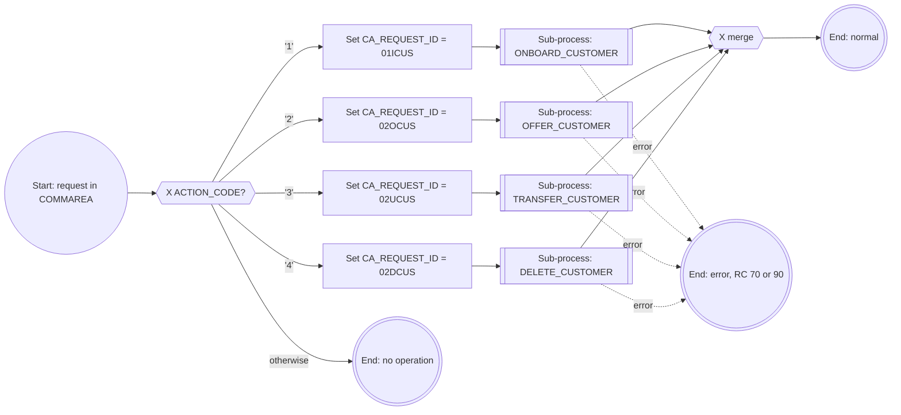
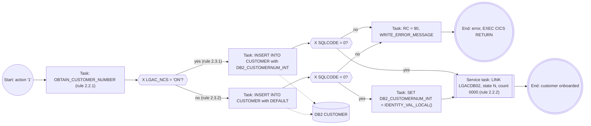
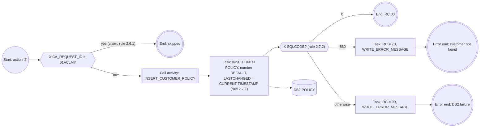
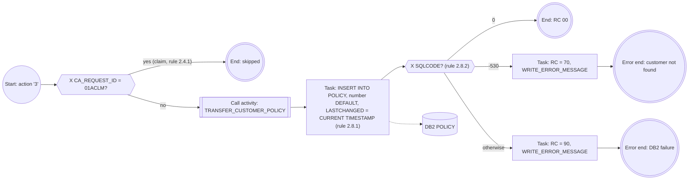
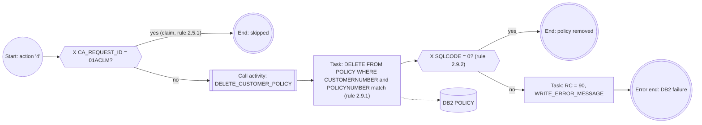
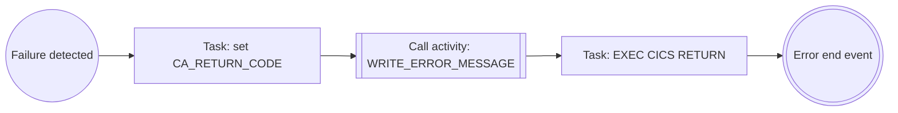

# Business rules: BPMN view of the inventory

**Program:** LGACUS01
**Source:** [LGACUS01-inventory.md](LGACUS01-inventory.md) (14 rules across 9 procedures)

## Table of Contents

- [1. Purpose](#1-purpose)
- [2. BPMN Notation Used](#2-bpmn-notation-used)
- [3. Top-Level Process](#3-top-level-process)
  - [3.1 Rule 2.1.1: Action dispatch](#31-rule-211-action-dispatch)
- [4. Sub-Process Models](#4-sub-process-models)
  - [4.1 ONBOARD_CUSTOMER (rules 2.2.1, 2.2.2, 2.3.1, 2.3.2)](#41-onboard_customer-rules-221-222-231-232)
  - [4.2 OFFER_CUSTOMER (rules 2.6.1, 2.7.1, 2.7.2)](#42-offer_customer-rules-261-271-272)
  - [4.3 TRANSFER_CUSTOMER (rules 2.4.1, 2.8.1, 2.8.2)](#43-transfer_customer-rules-241-281-282)
  - [4.4 DELETE_CUSTOMER (rules 2.5.1, 2.9.1, 2.9.2)](#44-delete_customer-rules-251-291-292)
- [5. Error Handling Pattern](#5-error-handling-pattern)
- [6. Rule-to-BPMN Traceability](#6-rule-to-bpmn-traceability)
- [7. Return Codes as BPMN End Events](#7-return-codes-as-bpmn-end-events)
- [8. Observations](#8-observations)

## 1. Purpose

This document restates the business rules from [LGACUS01-inventory.md](LGACUS01-inventory.md) in BPMN 2.0 terms: events, tasks, gateways, sub-processes, data stores and sequence flows. Mermaid has no native BPMN notation, so each diagram is a flowchart that uses BPMN symbols as described in the next section. Every rule number in the inventory is mapped to a BPMN element in [section 6](#6-rule-to-bpmn-traceability).

## 2. BPMN Notation Used

| BPMN element | Mermaid rendering | Meaning in LGACUS01 |
|---|---|---|
| Start event | `((text))` | A request arrives in the COMMAREA with `ACTION_CODE` set |
| End event (normal) | `(((text)))` | Process finishes with `CA_RETURN_CODE` = '00' or with no operation |
| End event (error) | `(((text)))` | `CA_RETURN_CODE` = '70' or '90', then `EXEC CICS RETURN` |
| Task | `[text]` | A unit of work such as an SQL statement or a variable assignment |
| Service task | `[[text]]` | A call to another program, here `EXEC CICS LINK PROGRAM(LGACDB02)` |
| Call activity / sub-process | `[[text]]` | A PL/I internal procedure such as `ONBOARD_CUSTOMER` |
| Exclusive gateway (XOR) | `{{"X ..."}}` | `SELECT`, `IF`, `ELSE` decisions: exactly one branch is taken |
| Data store | `[(text)]` | DB2 tables `CUSTOMER` and `POLICY` |
| Message / error flow | dotted arrow | Error escalation to the error end event |

## 3. Top-Level Process

The pool is the CICS program `LGACUS01`. It contains one start event, one dispatch gateway, four sub-processes and three kinds of end event.

### 3.1 Rule 2.1.1: Action dispatch

- **BPMN construct:** exclusive gateway with four conditional flows and one default flow.
- **Condition expressions:** `ACTION_CODE = '1'`, `'2'`, `'3'`, `'4'`. The default flow (`OTHERWISE`) leads to an end event with no work done.
- **Data output:** each branch first assigns `CA_REQUEST_ID`, which identifies the operation for later steps and for audit.

| Flow condition | Request ID set | Target sub-process |
|---|---|---|
| `ACTION_CODE = '1'` | `01ICUS` | ONBOARD_CUSTOMER |
| `ACTION_CODE = '2'` | `02OCUS` | OFFER_CUSTOMER |
| `ACTION_CODE = '3'` | `02UCUS` | TRANSFER_CUSTOMER |
| `ACTION_CODE = '4'` | `02DCUS` | DELETE_CUSTOMER |
| default | unchanged | none |

## 4. Sub-Process Models

### 4.1 ONBOARD_CUSTOMER (rules 2.2.1, 2.2.2, 2.3.1, 2.3.2)

**Sequence:** obtain a customer number, insert the customer, then create the security record through a service task.

The inventory describes `INSERT_CUSTOMER` as two alternative rules (2.3.1 and 2.3.2). In BPMN they are the two outgoing flows of one exclusive gateway on `LGAC_NCS`.

| Rule | BPMN element | Business meaning |
|---|---|---|
| 2.2.1 | Two sequential tasks (obtain number, insert) | The number must exist before the customer record is created |
| 2.3.1 | Flow "ON" from the XOR gateway | The pre-assigned number from the named counter is used |
| 2.3.2 | Flow "otherwise" from the XOR gateway | DB2 generates the number and the program reads it back |
| 2.2.2 | Service task (CICS LINK to `LGACDB02`) | Baseline security record: state `'N'`, failed-attempt count `'0000'` |

**Data objects:** input `CA_FIRST_NAME`, `CA_LAST_NAME`, `CA_DOB`, `CA_HOUSE_NAME`, `CA_POSTCODE`, `CA_PHONE_MOBILE`, `CA_EMAIL_ADDRESS`. Output `DB2_CUSTOMERNUM_INT`.

### 4.2 OFFER_CUSTOMER (rules 2.6.1, 2.7.1, 2.7.2)

| Rule | BPMN element | Business meaning |
|---|---|---|
| 2.6.1 | Guard gateway on `CA_REQUEST_ID` | Claim requests (`01ACLM`) never create a policy |
| 2.7.1 | Task writing to the `POLICY` data store | Policy is linked by customer number; DB2 generates the policy number |
| 2.7.2 | Three-way XOR gateway on `SQLCODE` | 0 gives RC '00'. -530 (referential integrity) gives RC '70'. Anything else gives RC '90' |

### 4.3 TRANSFER_CUSTOMER (rules 2.4.1, 2.8.1, 2.8.2)

The structure is the same as OFFER_CUSTOMER. The only differences are the entry action code ('3') and the call activity (`TRANSFER_CUSTOMER_POLICY`).

| Rule | BPMN element | Business meaning |
|---|---|---|
| 2.4.1 | Guard gateway on `CA_REQUEST_ID` | Claim requests never trigger a policy transfer |
| 2.8.1 | Task writing to the `POLICY` data store | The transfer is realised as a new policy row for the customer. `CA_POLICY_NUM` is generated by DB2 |
| 2.8.2 | Three-way XOR gateway on `SQLCODE` | Same outcome mapping as rule 2.7.2 |

### 4.4 DELETE_CUSTOMER (rules 2.5.1, 2.9.1, 2.9.2)

| Rule | BPMN element | Business meaning |
|---|---|---|
| 2.5.1 | Guard gateway on `CA_REQUEST_ID` | Claim requests never delete a policy |
| 2.9.1 | Task with a two-key selection condition | Only the owner (customer number plus policy number) can remove a policy |
| 2.9.2 | Binary XOR gateway on `SQLCODE` | Any non-zero SQLCODE gives RC '90' and termination. See [section 8](#8-observations) |

## 5. Error Handling Pattern

Rules 2.3.1, 2.3.2, 2.7.2, 2.8.2 and 2.9.2 all repeat one pattern. In BPMN this is a reusable error-handling flow that ends in an error end event.

## 6. Rule-to-BPMN Traceability

| Rule | Procedure | Title | BPMN element |
|---|---|---|---|
| 2.1.1 | LGACUS01 | Customer action dispatch and request identification | Exclusive gateway with default flow |
| 2.2.1 | ONBOARD_CUSTOMER | Obtain and insert new customer record | Two sequential call activities |
| 2.2.2 | ONBOARD_CUSTOMER | Create customer security record | Service task (CICS LINK) |
| 2.3.1 | INSERT_CUSTOMER | Insert customer with pre-assigned number | Gateway branch "counter ON" plus task |
| 2.3.2 | INSERT_CUSTOMER | Insert customer with database-generated number | Gateway branch "counter OFF" plus two tasks |
| 2.4.1 | TRANSFER_CUSTOMER | Transfer policy unless claim request | Guard gateway |
| 2.5.1 | DELETE_CUSTOMER | Delete policy unless claim request | Guard gateway |
| 2.6.1 | OFFER_CUSTOMER | Offer policy unless claim request | Guard gateway |
| 2.7.1 | INSERT_CUSTOMER_POLICY | Insert policy record for customer | Task plus data store write |
| 2.7.2 | INSERT_CUSTOMER_POLICY | Evaluate policy insert outcome | Three-way gateway plus error end events |
| 2.8.1 | TRANSFER_CUSTOMER_POLICY | Insert transferred policy record | Task plus data store write |
| 2.8.2 | TRANSFER_CUSTOMER_POLICY | Policy insert outcome handling | Three-way gateway plus error end events |
| 2.9.1 | DELETE_CUSTOMER_POLICY | Delete customer policy record | Task plus data store delete |
| 2.9.2 | DELETE_CUSTOMER_POLICY | Delete outcome acceptance rule | Binary gateway plus error end event |

## 7. Return Codes as BPMN End Events

| End event | `CA_RETURN_CODE` | Reached from | Type |
|---|---|---|---|
| Normal completion | '00' | Rules 2.7.2, 2.8.2 (SQLCODE 0), onboarding and delete success paths | Normal end |
| Customer not found | '70' | Rules 2.7.2, 2.8.2 (SQLCODE -530) | Error end (business error) |
| DB2 or system failure | '90' | Rules 2.3.1, 2.3.2, 2.7.2, 2.8.2, 2.9.2 | Error end (technical error) |
| Skipped (claim request) | unchanged | Rules 2.4.1, 2.5.1, 2.6.1 | Normal end, no work done |
| No operation | unchanged | Rule 2.1.1 default flow | Normal end, no work done |

## 8. Observations

- **Delete and SQLCODE 100 (rule 2.9.2):** The source comment says SQLCODE 0 and 100 (record not found) are both treated as success. The code is `IF (SQLCODE <> 0)`, so SQLCODE 100 would take the error path. The model in [section 4.4](#44-delete_customer-rules-251-291-292) follows the code. If the comment is the intended behavior, the gateway needs a third flow for SQLCODE 100 that leads to the normal end event.
- **Onboarding transaction boundary (rules 2.3.x and 2.2.2):** The customer insert and the security LINK are separate tasks with no compensation flow. If the LINK to `LGACDB02` fails, the BPMN model shows no rollback of the customer row, so the transaction boundary should be confirmed.
- **Request ID rewrite:** Rule 2.1.1 overwrites `CA_REQUEST_ID` before the guard gateways in rules 2.4.1, 2.5.1 and 2.6.1 test it. The values set ('02UCUS', '02DCUS', '02OCUS') are never `'01ACLM'`, so the claim guard cannot be true for requests dispatched by this program.

---

Generated by IBM Bob Premium Package for Z
