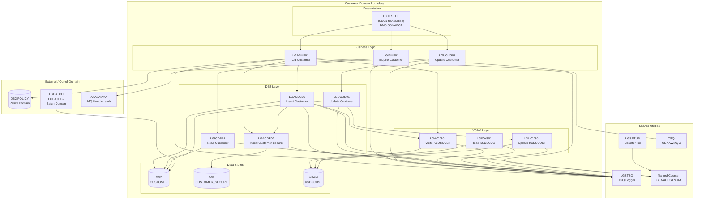

# GenApp PL/I — Customer Domain Boundary Analysis

## 1. Components and Their Roles

### CICS Programs — Customer Domain Only

| Program | Role | Belongs To |
|---------|------|-----------|
| [`LGTESTC1`](../../pli/LGTESTC1.pli) | Customer operations menu (transaction SSC1); orchestrates all customer CRUD from the BMS screen | Customer domain only |
| [`LGACUS01`](../../pli/LGACUS01.pli) | Add Customer business logic — validates COMMAREA, calls LGACDB01/LGACVS01/LGACDB02; also handles OFFER, TRANSFER, DELETE customer actions | Customer domain only |
| [`LGACDB01`](../../pli/LGACDB01.pli) | INSERT into DB2 CUSTOMER table; calls LGACVS01 and LGACDB02 as alternative entry point | Customer domain only |
| [`LGACDB02`](../../pli/LGACDB02.pli) | INSERT into DB2 CUSTOMER_SECURE table (password hash, state, change count) | Customer domain only |
| [`LGACVS01`](../../pli/LGACVS01.pli) | WRITE to VSAM KSDSCUST | Customer domain only |
| [`LGICUS01`](../../pli/LGICUS01.pli) | Inquire Customer business logic — checks CICS TSQ GENAWMQC for MQ indicator, then LINKs to LGICDB01 or AAAAAAAA | Customer domain only |
| [`LGICDB01`](../../pli/LGICDB01.pli) | SELECT from DB2 CUSTOMER table | Customer domain only |
| [`LGICVS01`](../../pli/LGICVS01.pli) | READ from VSAM KSDSCUST | Customer domain only |
| [`LGUCUS01`](../../pli/LGUCUS01.pli) | Update Customer business logic — validates COMMAREA, LINKs to LGUCDB01 | Customer domain only |
| [`LGUCDB01`](../../pli/LGUCDB01.pli) | UPDATE in DB2 CUSTOMER table; LINKs to LGUCVS01 | Customer domain only |
| [`LGUCVS01`](../../pli/LGUCVS01.pli) | UPDATE in VSAM KSDSCUST | Customer domain only |

### CICS Programs — Shared (Customer + other domains)

| Program | Shared With | Interaction |
|---------|-------------|-------------|
| [`LGSTSQ`](../../pli/LGSTSQ.pli) | All domains | Error/diagnostic TSQ writer — called by every customer program for error logging |
| [`LGSETUP`](../../pli/LGSETUP.pli) | Policy domain | Initialises Named Counter `GENACUSTNUM` (customer number sequence) and policy counter |

### Customer Programs that Cross Domain Boundary

| Program | Cross-domain Access | Details |
|---------|---------------------|---------|
| [`LGACUS01`](../../pli/LGACUS01.pli) | **Policy domain** — DB2 POLICY table | `ONBOARD_CUSTOMER` flow inserts a POLICY row and reads POLICY.LASTCHANGED; `OFFER_CUSTOMER` and `TRANSFER_CUSTOMER` also call `INSERT_CUSTOMER_POLICY` / `TRANSFER_CUSTOMER_POLICY` which INSERT into POLICY |
| `LGBATCH` | Batch domain | Reads DB2 CUSTOMER table — not a customer domain program but consumes customer data |
| `LGBATDB2` | Batch domain | Reads DB2 CUSTOMER table — not a customer domain program but consumes customer data |

### Data Stores

| Store | Type | Access Mode | Shared? |
|-------|------|-------------|---------|
| DB2 `CUSTOMER` | DB2 table | C (LGACDB01, LGACUS01), R (LGICDB01), U (LGUCDB01) | Shared: LGBATCH, LGBATDB2 also READ |
| DB2 `CUSTOMER_SECURE` | DB2 table | C (LGACDB02) | Customer domain only |
| DB2 `POLICY` | DB2 table | C, R (LGACUS01) | Shared: Policy domain owns the rest of CRUD |
| VSAM `KSDSCUST` | KSDS VSAM | C (LGACVS01), R (LGICVS01), U (LGUCVS01) | Customer domain only |
| CICS Named Counter `GENACUSTNUM` | Named Counter | R (LGACUS01, LGACDB01) | Initialised by LGSETUP (shared util) |
| CICS TSQ `GENAWMQC` | TS Queue | R (LGICUS01) | MQ integration control queue |

### Batch Jobs

No dedicated batch JCL exists for the customer domain. The batch programs LGBATCH and LGBATDB2 are in the Batch Reporting domain but read the CUSTOMER table.

---

## 2. Boundary Visualization

---

## 3. Batch Processing

There is **no batch processing owned by the Customer domain**.

The batch domain programs that touch customer data are:

| Program | Dataset In | Dataset Out | DB2 | Purpose |
|---------|-----------|-------------|-----|---------|
| `LGBATCH` | CUSTIN (sequential) | CUSTRPT (sequential) | CUSTOMER (READ) | Customer report — reads DB2 CUSTOMER and input file, writes report |
| `LGBATDB2` | — | — | CUSTOMER (READ) | DB2-based customer extract; calls LGBATCHF for formatting |

These programs READ customer data; they do not write to or modify the CUSTOMER domain's stores. They would remain on the mainframe after customer domain migration but would need to point to the new system's customer data (API or replicated DB).

---

## 4. DB2 Usage — Programs Accessing Customer Tables

| Table | Program | Domain | Access Mode |
|-------|---------|--------|-------------|
| CUSTOMER | LGACDB01 | Customer | INSERT |
| CUSTOMER | LGACUS01 | Customer | INSERT |
| CUSTOMER | LGICDB01 | Customer | SELECT |
| CUSTOMER | LGUCDB01 | Customer | UPDATE |
| CUSTOMER | LGBATCH | Batch Reporting | SELECT |
| CUSTOMER | LGBATDB2 | Batch Reporting | SELECT |
| CUSTOMER_SECURE | LGACDB02 | Customer | INSERT |
| POLICY | LGACUS01 | **Customer → Policy boundary** | INSERT, SELECT |

---

## 5. Integration Points with Other Domains

| Caller | Callee / Resource | Mechanism | Domain Boundary | Data Passed |
|--------|-------------------|-----------|-----------------|-------------|
| LGACUS01 | DB2 POLICY table | Embedded SQL INSERT | Customer → Policy | customerNumber, issue/expiry dates, policyType, brokerID, payment |
| LGACUS01 | DB2 POLICY table | Embedded SQL SELECT | Customer → Policy | LASTCHANGED timestamp |
| LGACUS01 | DB2 POLICY table | Embedded SQL DELETE | Customer → Policy | customerNumber, policyNumber |
| LGICUS01 | `AAAAAAAA` | CICS LINK | Customer → MQ stub | Full COMMAREA (32500 bytes) — MQ cache handler |
| All customer programs | LGSTSQ | CICS LINK | Customer → Shared Util | ERROR_MSG structure (~90 bytes) |
| LGACUS01/LGACDB01 | Named Counter `GENACUSTNUM` | EXEC CICS GET COUNTER | Customer → Shared Util | Customer number value |
| LGICUS01 | TSQ `GENAWMQC` | EXEC CICS READQ TS | Customer → Shared Util | 80-byte queue records scanned for `MQHIT=` |
| LGBATCH, LGBATDB2 | CUSTOMER table | Batch SQL SELECT | Batch → Customer | All customer columns |

**Migration implication**: When Customer domain moves off the mainframe, these integration points must be replaced:
1. LGACUS01's POLICY INSERTs → will need to call the Policy domain's add-policy API
2. LGICUS01's AAAAAAAA call → an MQ integration point; requires API design
3. LGSTSQ calls → either implement equivalent logging in new system or expose as API
4. Named Counter `GENACUSTNUM` → replace with cloud sequence/UUID generator
5. Batch programs (LGBATCH, LGBATDB2) → will need to call a customer API or replicated data store

---

## 6. External Interfaces

No external CICS web service, CTG (ECI/EPI), or MQ queue definitions were found in the CSD for the Customer domain proper. However:

| Interface | Direction | Contract | Programs | Notes |
|-----------|-----------|----------|----------|-------|
| CICS TSQ `GENAWMQC` | Inbound (read) | 80-byte record with `MQHIT=` prefix | LGICUS01 | MQ integration control queue — if this record exists, LGICUS01 routes to `AAAAAAAA` instead of DB2. This is the hook for an MQ-based cache or external customer lookup. |
| CICS Named Counter `GENACUSTNUM` | Shared | Single numeric value | LGACUS01, LGACDB01 | Counter provides next customer number; initialised by LGSETUP |
| BMS map `SSMAPC1` / mapset `SSMAP` | Bidirectional | Screen map fields | LGTESTC1 | Terminal-facing UI for customer CRUD |
| COMMAREA `LGCMAREA` | Bidirectional | 32,500-byte structured record | All CICS programs | The API contract between all programs — this is what the new cloud service must implement as its request/response schema |
