# GenApp PL/I — Functional Domains

## Identified Domains

Analysis of the naming convention (`LG` + function-code + operation-type), program roles, DB2 table ownership, VSAM files, and CICS transactions reveals **five functional domains**:

| # | Domain | Business Responsibility |
|---|--------|------------------------|
| 1 | **Customer** | Create, inquire, and update insurance customers and their security credentials |
| 2 | **Policy** | Add, inquire, update, and delete insurance policies across all types |
| 3 | **Batch Reporting** | Offline customer and motor data extraction/reporting |
| 4 | **Statistics & Monitoring** | Application transaction statistics and health monitoring |
| 5 | **Shared Utilities** | Cross-cutting services used by all domains |

---

## Domain 1 — Customer

### Business Responsibility
Manages the lifecycle of insurance customers: creation with contact details, inquiry by customer number, and update of personal information. Also manages customer security credentials (password storage).

### Main Programs

| Program | Type | Role |
|---------|------|------|
| LGTESTC1 | CICS Presentation | Customer operations menu (SSC1) |
| LGACUS01 | CICS Business Logic | Add Customer orchestrator |
| LGACDB01 | CICS DB2 | Insert Customer into DB2 |
| LGACDB02 | CICS DB2 | Insert Customer security record |
| LGACVS01 | CICS VSAM | Insert Customer into KSDSCUST |
| LGICUS01 | CICS Business Logic | Inquire Customer orchestrator |
| LGICDB01 | CICS DB2 | Read Customer from DB2 |
| LGICVS01 | CICS VSAM | Read Customer from KSDSCUST |
| LGUCUS01 | CICS Business Logic | Update Customer orchestrator |
| LGUCDB01 | CICS DB2 | Update Customer in DB2 |
| LGUCVS01 | CICS VSAM | Update Customer in KSDSCUST |

### CICS Transactions
- **SSC1** → LGTESTC1

### Data Stores
| Store | Access |
|-------|--------|
| DB2 CUSTOMER | C, R, U |
| DB2 CUSTOMER_SECURE | C |
| VSAM KSDSCUST | C, R, U |

### Key Dependencies
- Uses **LGCMAREA.inc** for all COMMAREA communication
- Calls **LGSTSQ** (shared utility) for error/audit TSQ logging
- **LGACUS01** also reads/inserts POLICY table (when adding a customer with an initial policy)
- **AAAAAAAA** is called from LGICUS01 — a placeholder stub

---

## Domain 2 — Policy

### Business Responsibility
Manages insurance policies for all product lines: Endowment, House, Motor, Commercial, and Claim. Supports add, inquire, update, and delete operations via CICS menus and shared DB2/VSAM storage.

### Main Programs

| Program | Type | Role |
|---------|------|------|
| LGTESTP1 | CICS Presentation | Endowment policy menu (SSP1) |
| LGTESTP2 | CICS Presentation | House policy menu (SSP2) |
| LGTESTP3 | CICS Presentation | Motor policy menu (SSP3) |
| LGTESTP4 | CICS Presentation | Commercial policy menu (SSP4) |
| LGAPOL01 | CICS Business Logic | Add Policy orchestrator |
| LGAPDB01 | CICS DB2 | Insert Policy + sub-type into DB2 |
| LGAPVS01 | CICS VSAM | Insert Policy into KSDSPOLY |
| LGIPOL01 | CICS Business Logic | Inquire Policy orchestrator |
| LGIPDB01 | CICS DB2 | Read Policy from DB2 |
| LGIPVS01 | CICS VSAM | Read Policy from KSDSPOLY |
| LGDPOL01 | CICS Business Logic | Delete Policy orchestrator |
| LGDPDB01 | CICS DB2 | Delete Policy from DB2 |
| LGDPVS01 | CICS VSAM | Delete Policy from KSDSPOLY |
| LGUPOL01 | CICS Business Logic | Update Policy orchestrator |
| LGUPDB01 | CICS DB2 | Update Policy in DB2 *(missing source)* |
| LGUPVS01 | CICS VSAM | Update Policy in KSDSPOLY |
| LGAPBR01 | CICS Broker | Policy broker sub-program *(external, not in workspace)* |

### CICS Transactions
- **SSP1** → LGTESTP1 (Endowment)
- **SSP2** → LGTESTP2 (House)
- **SSP3** → LGTESTP3 (Motor)
- **SSP4** → LGTESTP4 (Commercial)

### Data Stores
| Store | Access |
|-------|--------|
| DB2 POLICY | C, R, U, D |
| DB2 ENDOWMENT | C, R, D (cascade) |
| DB2 HOUSE | C, R, D (cascade) |
| DB2 MOTOR | C, R, D (cascade) |
| DB2 COMMERCIAL | C, R, D (cascade) |
| DB2 CLAIM | C, R, D (cascade) |
| VSAM KSDSPOLY | C, R, U, D |

### Key Dependencies
- **POLICY → CUSTOMER** FK: every policy requires an existing customer
- Uses **LGCMAREA.inc** for all COMMAREA communication
- Calls **LGSTSQ** for error/audit logging

---

## Domain 3 — Batch Reporting

### Business Responsibility
Offline processing of customer and motor data: reads customer records for reporting, extracts motor policy data for downstream feed.

### Main Programs

| Program | Type | Role |
|---------|------|------|
| LGBATCH | Batch | Customer report from DB2 + VSAM file |
| LGBATDB2 | Batch | Customer extract from DB2 |
| LGBATCHF | Batch Utility | Formatting utility for batch output |
| LGBATCF | Batch | Control flow (in DB only) |
| LGMOTOUT | Batch | Motor policy extract to flat file |

### JCL Jobs
- `jcl/GenAppDDL.jcl`
- `jcl/GenAppBind.jcl`

### Data Stores
| Store | Access |
|-------|--------|
| DB2 CUSTOMER | R |
| DB2 MOTOR | R |
| VSAM CUSTIN | R (input file) |
| Flat file CUSTRPT | W (report output) |
| Flat file MOTOROUT | W (extract output) |

### Key Dependencies
- Reads CUSTOMER table (shared with Customer domain)
- Reads MOTOR table (shared with Policy domain)
- No CICS dependency — pure batch

---

## Domain 4 — Statistics & Monitoring

### Business Responsibility
Tracks application-level transaction statistics (counters per transaction type) and provides a real-time statistics dashboard via CICS.

### Main Programs

| Program | Type | Role |
|---------|------|------|
| LGWEBST5 | CICS | Statistics collector and display (SSST) |
| LGASTAT1 | CICS | Application statistics helper |

### CICS Transactions
- **SSST** → LGWEBST5

### Data Stores
- CICS Named Counters (GENACUSTNUM, GENAPOLICYNUM)
- CICS TS Queues (TSQ per transaction type)

### Key Dependencies
- No DB2 or VSAM dependency
- Reads CICS Named Counters set up by LGSETUP

---

## Domain 5 — Shared Utilities

### Business Responsibility
Cross-domain services that every domain relies on: TSQ error logging and CICS Named Counter initialisation.

### Programs

| Program | Type | Role |
|---------|------|------|
| LGSTSQ | CICS Utility | Write error/diagnostic messages to CICS TSQ — called by all domains |
| LGSETUP | CICS Setup | Initialise Named Counters for Customer and Policy number generation |
| LGCMAREA.inc | Include | Universal COMMAREA definition |
| LGCMARER.inc | Include | COMMAREA return variant |

---

## Domain Map

```mermaid
graph TD
    subgraph "Presentation Layer"
        SSC1["SSC1 LGTESTC1<br/>Customer Menu"]
        SSP1["SSP1 LGTESTP1<br/>Endowment"]
        SSP2["SSP2 LGTESTP2<br/>House"]
        SSP3["SSP3 LGTESTP3<br/>Motor"]
        SSP4["SSP4 LGTESTP4<br/>Commercial"]
        SSST["SSST LGWEBST5<br/>Statistics"]
    end

    subgraph "Customer Domain"
        LGACUS01["LGACUS01<br/>Add Customer"]
        LGICUS01["LGICUS01<br/>Inquire Customer"]
        LGUCUS01["LGUCUS01<br/>Update Customer"]
        LGACDB01["LGACDB01<br/>+LGACVS01"]
        LGICDB01["LGICDB01<br/>+LGICVS01"]
        LGUCDB01["LGUCDB01<br/>+LGUCVS01"]
        LGACDB02["LGACDB02<br/>Security"]
    end

    subgraph "Policy Domain"
        LGAPOL01["LGAPOL01<br/>Add Policy"]
        LGIPOL01["LGIPOL01<br/>Inquire Policy"]
        LGDPOL01["LGDPOL01<br/>Delete Policy"]
        LGUPOL01["LGUPOL01<br/>Update Policy"]
        LGAPDB01["LGAPDB01<br/>+LGAPVS01"]
        LGIPDB01["LGIPDB01<br/>+LGIPVS01"]
        LGDPDB01["LGDPDB01<br/>+LGDPVS01"]
        LGUPDB01["LGUPDB01<br/>+LGUPVS01"]
    end

    subgraph "Batch Domain"
        LGBATCH["LGBATCH<br/>Customer Batch"]
        LGBATDB2["LGBATDB2<br/>Customer DB2"]
        LGMOTOUT["LGMOTOUT<br/>Motor Extract"]
    end

    subgraph "Shared Utilities"
        LGSTSQ["LGSTSQ<br/>TSQ Logger"]
        LGSETUP["LGSETUP<br/>Counter Init"]
    end

    subgraph "DB2"
        CUSTDB[("CUSTOMER<br/>CUSTOMER_SECURE")]
        POLICYDB[("POLICY<br/>+sub-types")]
    end

    subgraph "VSAM"
        KSDSCUST[("KSDSCUST")]
        KSDSPOLY[("KSDSPOLY")]
    end

    SSC1 --> LGACUS01
    SSC1 --> LGICUS01
    SSC1 --> LGUCUS01
    SSP1 --> LGAPOL01
    SSP1 --> LGIPOL01
    SSP1 --> LGDPOL01
    SSP2 --> LGAPOL01
    SSP3 --> LGAPOL01
    SSP4 --> LGAPOL01

    LGACUS01 --> LGACDB01
    LGICDB01 --> CUSTDB
    LGACDB01 --> CUSTDB
    LGUCDB01 --> CUSTDB
    LGACDB02 --> CUSTDB
    LGACDB01 --> KSDSCUST
    LGICDB01 --> KSDSCUST
    LGUCDB01 --> KSDSCUST

    LGAPOL01 --> LGAPDB01
    LGIPOL01 --> LGIPDB01
    LGDPOL01 --> LGDPDB01
    LGUPOL01 --> LGUPDB01
    LGAPDB01 --> POLICYDB
    LGIPDB01 --> POLICYDB
    LGDPDB01 --> POLICYDB
    LGUPDB01 --> POLICYDB
    LGAPDB01 --> KSDSPOLY
    LGIPDB01 --> KSDSPOLY

    LGBATCH --> CUSTDB
    LGBATDB2 --> CUSTDB
    LGMOTOUT --> POLICYDB

    LGACUS01 --> POLICYDB
    CUSTDB -.->|FK| POLICYDB

    LGACDB01 --> LGSTSQ
    LGAPDB01 --> LGSTSQ
    LGICUS01 --> LGSTSQ
    LGIPOL01 --> LGSTSQ

    SSST --> LGWEBST5["LGWEBST5"]
    LGWEBST5 --> LGSETUP
```

---

## Domain Interaction Summary

| From → To | Interaction |
|-----------|-------------|
| Customer → Policy | LGACUS01 reads/inserts POLICY when creating a customer with initial policies |
| Customer → Shared Util | All customer programs call LGSTSQ for TSQ logging |
| Policy → Shared Util | All policy programs call LGSTSQ for TSQ logging |
| Policy → Customer | FK constraint: POLICY.customerNumber → CUSTOMER.customerNumber |
| Batch → Customer | LGBATCH / LGBATDB2 read CUSTOMER table |
| Batch → Policy | LGMOTOUT reads MOTOR table |
| Statistics → Shared Util | LGWEBST5 uses Named Counters initialised by LGSETUP |
