# GenApp — Functional Domains

> Based on program inventory, DB2 schema, CICS CSD definitions, and inter-program call graph.

---

## 1. Domain Overview

GenApp is structured around **5 functional domains** and **2 shared infrastructure services**:

| # | Domain | Business Responsibility |
|---|---|---|
| 1 | **Customer** | Manage customer identity, contact details, and credentials |
| 2 | **Policy** | Manage insurance policy lifecycle across all product types |
| 3 | **Motor** | Motor vehicle insurance — a specialised policy sub-domain with its own batch reporting |
| 4 | **Batch Reporting** | Cross-domain batch jobs producing customer and motor reports |
| 5 | **Infrastructure / Shared** | CICS setup, error logging, statistics, and the BMS screen framework |

> **Note**: Motor, House, Endowment, Commercial, and Claim all share the same Policy add/inquire/delete programs (`LGAPDB01`, `LGIPDB01`, `LGDPDB01`). Motor is distinguished as a separate domain only because it has a dedicated batch report program (`LGMOTOUT`) and its own output dataset. The other policy sub-types (House, Endowment, Commercial, Claim) are sub-domains entirely embedded inside the Policy domain.

---

## 2. Domain Details

---

### Domain 1 — Customer

**Business responsibility**: Create, retrieve, and update customer master records. Customers are the root entity: every policy belongs to a customer. The domain also manages customer security credentials via a separate table.

#### CICS Modules
| Program | Transaction | Role |
|---|---|---|
| LGTESTC1 | SSC1 | Customer BMS menu — entry point for all customer operations |
| LGACUS01 | — | Add Customer orchestrator — dispatches to Db2 and VSAM back-ends |
| LGACDB01 | — | Add Customer (Db2) — INSERT into CUSTOMER; also invokes LGACVS01 |
| LGACDB02 | — | Add Customer Secure — INSERT into CUSTOMER_SECURE |
| LGACVS01 | — | Add Customer (VSAM) — writes to KSDSCUST KSDS |
| LGICUS01 | — | Inquire Customer orchestrator — currently routes to AAAAAAAA stub |
| LGICDB01 | — | Inquire Customer (Db2) — SELECT from CUSTOMER |
| LGICVS01 | LGCF | Inquire Customer (VSAM) — reads KSDSCUST |
| LGUCUS01 | — | Update Customer orchestrator |
| LGUCDB01 | — | Update Customer (Db2) — UPDATE CUSTOMER; invokes LGUCVS01 |
| LGUCVS01 | — | Update Customer (VSAM) — updates KSDSCUST |

#### Db2 Tables
| Table | Programs | Access |
|---|---|---|
| CUSTOMER | LGACDB01, LGACUS01, LGICDB01, LGUCDB01, LGBATCH, LGBATDB2 | C/R/U |
| CUSTOMER_SECURE | LGACDB02 | C only |
| POLICY | LGACUS01 | C/R/D (creates initial policy row during customer add; rollback deletes it) |

#### VSAM Files
| File | Programs | Access |
|---|---|---|
| KSDSCUST (ADAPPL.GENAPP.KSDSCUST) | LGACVS01, LGICVS01, LGUCVS01 | C/R/U |

#### Key Dependencies
- Calls **LGSTSQ** for error logging (shared utility)
- `LGACUS01` touches **POLICY** table — a cross-domain coupling point

---

### Domain 2 — Policy

**Business responsibility**: Manage the full lifecycle of insurance policies (add, inquire, delete, update) across five product types: Motor, House, Endowment, Commercial, and Claim. Policies are always linked to a customer (`customerNumber` FK).

#### CICS Modules
| Program | Transaction | Role |
|---|---|---|
| LGTESTP1 | SSP1 | Motor policy BMS menu |
| LGTESTP2 | SSP2 | Life/Endowment policy BMS menu |
| LGTESTP3 | SSP3 | House policy BMS menu |
| LGTESTP4 | SSP4 | Commercial policy BMS menu |
| LGAPOL01 | — | Add Policy orchestrator — calls LGAPBR01 (business rules stub) |
| LGAPDB01 | — | Add Policy (Db2) — INSERT into POLICY + type-specific table |
| LGAPVS01 | — | Add Policy (VSAM) — writes to KSDSPOLY |
| LGIPOL01 | — | Inquire Policy orchestrator — calls LGIPDB01 |
| LGIPDB01 | — | Inquire Policy (Db2) — SELECT from POLICY + all sub-type tables |
| LGIPVS01 | LGPF | Inquire Policy (VSAM) — reads KSDSPOLY |
| LGDPOL01 | — | Delete Policy orchestrator |
| LGDPDB01 | — | Delete Policy (Db2) — DELETE from POLICY; calls LGDPVS01 |
| LGDPVS01 | — | Delete Policy (VSAM) — deletes from KSDSPOLY |
| LGUPOL01 | — | Update Policy orchestrator — calls LGUPDB01 (COBOL stub, source absent) |
| LGUPVS01 | — | Update Policy (VSAM) — updates KSDSPOLY |

#### Db2 Tables
| Table | Programs | Access |
|---|---|---|
| POLICY | LGAPDB01, LGIPDB01, LGDPDB01, LGACUS01 | C/R/U/D |
| CLAIM | LGAPDB01, LGIPDB01 | C/R |
| COMMERCIAL | LGAPDB01, LGIPDB01 | C/R |
| ENDOWMENT | LGAPDB01, LGIPDB01 | C/R |
| HOUSE | LGAPDB01, LGIPDB01 | C/R |
| MOTOR | LGAPDB01, LGIPDB01, LGMOTOUT | C/R |

#### VSAM Files
| File | Programs | Access |
|---|---|---|
| KSDSPOLY (ADAPPL.GENAPP.KSDSPOLY) | LGAPVS01, LGIPVS01, LGDPVS01, LGUPVS01 | C/R/U/D |

#### Key Dependencies
- Depends on Customer domain for `customerNumber` validation (FK in POLICY table)
- `LGAPBR01` (COBOL, source absent) is the policy business-rules gate — called before Db2 insert
- `LGUPDB01` (COBOL, source absent) handles policy Db2 update — not yet PL/I
- **POLICY** table is also written by `LGACUS01` (Customer domain) — shared coupling point

---

### Domain 3 — Motor (specialised sub-domain)

**Business responsibility**: Extract and report motor vehicle insurance data in batch. This domain owns the batch output pipeline for the MOTOR table.

#### Programs
| Program | Type | Role |
|---|---|---|
| LGMOTOUT | PL/I (CICS/batch) | SELECTs all rows from MOTOR table, writes formatted output to MOTOROUT QSAM file |

#### Db2 Tables
| Table | Access |
|---|---|
| MOTOR | Read (SELECT) |

#### Files
| File | Direction |
|---|---|
| MOTOROUT (QSAM) | Output |

#### Key Dependencies
- Shares the MOTOR table with LGAPDB01 and LGIPDB01 (Policy domain)
- No CICS transaction — invoked directly or scheduled

---

### Domain 4 — Batch Reporting

**Business responsibility**: Produce customer reports from Db2 and flat-file sources; used for operational reporting and bulk data validation.

#### Programs
| Program | Type | Role |
|---|---|---|
| LGBATCH | PL/I batch | Reads CUSTIN (QSAM), SELECTs matching customers from CUSTOMER, formats via LGBATCHF, writes CUSTRPT |
| LGBATDB2 | PL/I batch | SELECT customer 1 from CUSTOMER via SQL, formats via LGBATCHF |
| LGBATCHF | PL/I batch | Shared format subroutine — called by both LGBATCH and LGBATDB2 |

#### Db2 Tables
| Table | Access |
|---|---|
| CUSTOMER | Read (SELECT) |

#### Files
| File | Direction |
|---|---|
| CUSTIN (QSAM) | Input — customer numbers for lookup |
| CUSTRPT (QSAM) | Output — formatted customer report |

#### Key Dependencies
- Read-only consumer of the Customer domain's CUSTOMER table
- No CICS dependency — pure batch

---

### Domain 5 — Infrastructure / Shared Services

**Business responsibility**: Cross-cutting services that all other domains depend on: CICS environment initialisation, centralised error/message logging, application statistics, and the web services gateway.

#### Programs
| Program | Transaction | Role |
|---|---|---|
| LGSTSQ | — | **Universal error logger** — every program calls this via EXEC CICS LINK to write messages to a CICS TS queue |
| LGSETUP | LGSE | Initialises CICS TS queues at startup |
| LGASTAT1 | LGST | Application statistics display |
| LGWEBST5 | SSST | Web services entry point — routes inbound HTTP/REST requests into GenApp operations |

#### Key Dependencies
- **LGSTSQ** is called by every domain — the single most-shared program in the application
- **LGWEBST5** routes to Customer and Policy operations — an external integration point
- No direct Db2 or VSAM access

---

## 3. Domain Map

```mermaid
graph TD
    %% External entry points
    Terminal([Terminal User]) -->|CICS BMS| SSC1
    Terminal -->|CICS BMS| SSP1_4
    WebClient([Web / REST Client]) -->|HTTP| SSST

    subgraph Infrastructure
        SSST[SSST: LGWEBST5\nWeb Gateway]
        LGSE[LGSE: LGSETUP\nTS Queue Init]
        LGST[LGST: LGASTAT1\nStatistics]
        LGSTSQ[LGSTSQ\nError Logger]
    end

    subgraph Customer Domain
        SSC1[SSC1: LGTESTC1\nCustomer Menu]
        SSC1 --> LGACUS01 --> LGACDB01 --> LGACVS01
        SSC1 --> LGICUS01 --> LGICDB01
        LGICVS01[LGCF: LGICVS01]
        SSC1 --> LGUCUS01 --> LGUCDB01 --> LGUCVS01
        LGACDB01 --> DB_CUST[(CUSTOMER)]
        LGACDB02 --> DB_CSEC[(CUSTOMER_SECURE)]
        LGICDB01 --> DB_CUST
        LGUCDB01 --> DB_CUST
        LGACVS01 --> KSDSCUST[(KSDSCUST\nVSAM)]
        LGICVS01 --> KSDSCUST
        LGUCVS01 --> KSDSCUST
    end

    subgraph Policy Domain
        SSP1_4[SSP1-4: LGTESTP1-4\nPolicy Menus]
        SSP1_4 --> LGAPOL01 --> LGAPDB01 --> DB_POLICY[(POLICY)]
        LGAPDB01 --> DB_SUBTYPES[(MOTOR / HOUSE /\nENDOWMENT /\nCOMMERCIAL / CLAIM)]
        SSP1_4 --> LGIPOL01 --> LGIPDB01 --> DB_POLICY
        LGIPDB01 --> DB_SUBTYPES
        SSP1_4 --> LGDPOL01 --> LGDPDB01 --> DB_POLICY
        SSP1_4 --> LGUPOL01 --> LGUPDB01
        LGPF[LGPF: LGIPVS01] --> KSDSPOLY[(KSDSPOLY\nVSAM)]
        LGAPVS01 --> KSDSPOLY
        LGDPVS01 --> KSDSPOLY
        LGUPVS01 --> KSDSPOLY
    end

    subgraph Motor Sub-domain
        LGMOTOUT --> DB_SUBTYPES
        LGMOTOUT --> MOTOROUT[(MOTOROUT\nQSAM)]
    end

    subgraph Batch Reporting
        LGBATCH --> CUSTIN[(CUSTIN\nQSAM)]
        LGBATCH --> DB_CUST
        LGBATCH --> LGBATCHF
        LGBATDB2 --> DB_CUST
        LGBATDB2 --> LGBATCHF
        LGBATCHF --> CUSTRPT[(CUSTRPT\nQSAM)]
    end

    %% Cross-domain couplings
    LGACUS01 -->|INSERT/DELETE POLICY\nCross-domain coupling| DB_POLICY
    SSST -->|Routes to| LGACUS01
    SSST -->|Routes to| LGAPOL01

    %% Shared utility used by all
    LGACDB01 -.->|Error log| LGSTSQ
    LGAPDB01 -.->|Error log| LGSTSQ
    LGICDB01 -.->|Error log| LGSTSQ
    LGIPDB01 -.->|Error log| LGSTSQ
    LGUCDB01 -.->|Error log| LGSTSQ
```

---

## 4. Cross-Domain Dependencies

| From Domain | To Domain | Type | Detail |
|---|---|---|---|
| Customer | Policy | Db2 shared table | `LGACUS01` (Customer) reads, inserts, and deletes rows in **POLICY** table — creates the initial policy row as part of customer add flow |
| Policy | Customer | Db2 FK constraint | **POLICY.customerNumber** → CUSTOMER (ON DELETE CASCADE) — deleting a customer cascades to all their policies |
| Batch Reporting | Customer | Db2 read | `LGBATCH` and `LGBATDB2` read **CUSTOMER** table for reporting |
| Motor Sub-domain | Policy | Db2 shared table | `LGMOTOUT` reads **MOTOR** table (owned by Policy domain) |
| Web Gateway (Infra) | Customer + Policy | CICS LINK | `LGWEBST5` routes HTTP requests to Customer and Policy orchestrators |
| All domains | Infrastructure | CICS LINK | Every program calls `LGSTSQ` for error logging |

---

## 5. Shared Resources Summary

| Resource | Type | Domains That Use It |
|---|---|---|
| LGSTSQ | Program (error logger) | Customer, Policy, Motor, Batch — **all** |
| CUSTOMER | Db2 table | Customer (owner), Batch Reporting (read), Policy (FK) |
| POLICY | Db2 table | Policy (owner), Customer (LGACUS01 writes it) |
| MOTOR | Db2 table | Policy (owner), Motor sub-domain (LGMOTOUT reads it) |
| LGCMAREA.inc | PL/I include | All CICS programs — the central COMMAREA contract |
| LGBATCHF | Batch program | Batch Reporting — shared formatter |
