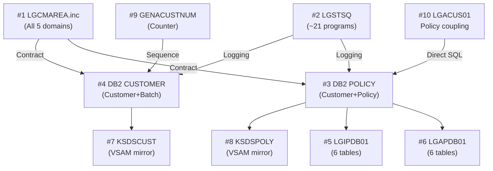

# GenApp PL/I — Application-Wide Migration Hotspots

## Methodology

Hotspots were identified by measuring breadth of impact across programs and functional domains:
- How many programs depend on this component?
- How many domains use it?
- What is the risk if this component changes or moves?

Ranked by breadth (most programs/domains first).

---

## Hotspot Ranking Summary

| Rank | Hotspot | Type | Programs Dependent | Domains |
|------|---------|------|--------------------|---------|
| 1 | `LGCMAREA.inc` (COMMAREA) | Include / Data Contract | 20+ all CICS programs | All 5 |
| 2 | `LGSTSQ` | Shared CICS Utility | ~21 programs | Customer, Policy, Batch, Stats |
| 3 | DB2 `POLICY` table | DB2 Table | 6 programs | Customer, Policy |
| 4 | DB2 `CUSTOMER` table | DB2 Table | 6 programs | Customer, Batch |
| 5 | `LGIPDB01` | CICS DB2 Program | 1 direct caller but reads 6 tables | Policy |
| 6 | `LGAPDB01` | CICS DB2 Program | 4 callers, writes 6 tables | Policy |
| 7 | VSAM `KSDSCUST` | VSAM File | 3 programs, 1 domain | Customer |
| 8 | VSAM `KSDSPOLY` | VSAM File | 4 programs, 1 domain | Policy |
| 9 | Named Counter `GENACUSTNUM` | CICS Named Counter | 2 programs | Customer |
| 10 | `LGACUS01` — Policy INSERT path | CICS Program | Cross-domain coupling | Customer → Policy |

---

## Hotspot Detail

---

### H1 — `LGCMAREA.inc` — Universal COMMAREA Contract *(Most Critical)*

**Type**: PL/I Include file  
**Programs depending on it**: Every CICS program in the application (20+)  
**Domains affected**: All 5  

**Why it is critical**: `LGCMAREA.inc` defines the 32,500-byte COMMAREA structure that is the **sole communication contract** between all CICS programs. It defines:
- CA_REQUEST_ID (6 chars) — operation routing key
- CA_RETURN_CODE (2 digits) — success/error signal
- CA_CUSTOMER_NUM (10 digits) — customer identity
- CA_CUSTOMER_REQUEST — all customer fields (first/last name, DOB, address, contacts)
- CA_CUSTSECR_REQUEST — security fields
- CA_POLICY_REQUEST — all policy fields and sub-type unions

**Migration impact**: Any cloud service replacing a customer or policy domain program must accept and return exactly this COMMAREA layout (or the calling CICS programs must be modified). The COMMAREA is the API contract. Changing field lengths, types or offsets breaks all callers simultaneously.

**Anomaly**: The COMMAREA is a single 32,500-byte flat structure with UNION overlays for every domain's data. There is no versioning, no content-type indicator, and no optional fields. This creates very high coupling — even a customer inquiry carries all policy sub-type fields.

---

### H2 — `LGSTSQ` — Universal TSQ Error Logger *(Most Widely Called)*

**Type**: CICS utility program  
**Called by**: LGACDB01, LGACDB02, LGACUS01, LGACVS01, LGICUS01, LGICDB01, LGICVS01, LGUCDB01, LGUCUS01, LGUCVS01, LGAPDB01, LGAPOL01, LGAPVS01, LGIPDB01, LGIPOL01, LGIPVS01, LGDPDB01, LGDPOL01, LGDPVS01, LGUPOL01, LGUPVS01 — **approximately 21 programs across all domains**  
**Domains affected**: Customer, Policy, Batch (indirect), Statistics  

**Why it is critical**: Every domain's error handling logic terminates with a CICS LINK to LGSTSQ. If LGSTSQ is unavailable or its interface changes, all diagnostic and error audit logging breaks across the entire application. If the Customer domain moves off the mainframe, the new platform must either:
- Call LGSTSQ via CICS DPL (if still on mainframe)
- Implement equivalent structured logging

**Anomaly**: LGSTSQ is not domain-specific — it is called identically by 21 programs. It writes to a CICS TDQ for diagnostics. No equivalent exists in the cloud.

---

### H3 — DB2 `POLICY` Table *(Cross-Domain Data Hub)*

**Type**: DB2 table  
**Programs accessing it**: LGAPDB01 (C/R), LGDPDB01 (D), LGIPDB01 (R/D), LGUPDB01 (U), LGACUS01 (C/R), and indirectly all policy sub-type programs via FK cascade  
**Domains affected**: Customer domain (LGACUS01 inserts policy), Policy domain (owns full CRUD)  

**Why it is critical**: POLICY is the **hub table** for the entire policy hierarchy. All five sub-type tables (ENDOWMENT, HOUSE, MOTOR, COMMERCIAL, CLAIM) are children of POLICY via CASCADE DELETE FK. Deleting a POLICY row cascades to all five sub-type tables. LGACUS01 in the Customer domain inserts directly into POLICY — this is the primary cross-domain coupling. When Customer moves off mainframe, this POLICY INSERT must either call a Policy domain API or be restructured.

**Anomaly**: LGACUS01 (a Customer domain program) directly inserts into POLICY without going through LGAPOL01. This bypasses the Policy domain's business logic and creates a hidden dependency.

---

### H4 — DB2 `CUSTOMER` Table *(Multi-Domain Shared Read)*

**Type**: DB2 table  
**Programs accessing it**: LGACDB01 (C), LGACUS01 (C), LGICDB01 (R), LGUCDB01 (U), LGBATCH (R), LGBATDB2 (R)  
**Domains affected**: Customer (owns CRUD), Batch Reporting (read-only)  

**Why it is critical**: The CUSTOMER table is owned by the Customer domain but read by the Batch Reporting domain (LGBATCH, LGBATDB2). When Customer moves off the mainframe:
- The batch programs must either call a Customer API or use a replicated read store
- The DB2 CUSTOMER table on the mainframe is the canonical source — it either moves to the cloud or a sync mechanism is required

**Anomaly**: CUSTOMER and CUSTOMER_SECURE are tightly coupled (CUSTOMER_SECURE FK → CUSTOMER CASCADE DELETE) but they are managed by separate programs. The security table has no read path in this PL/I port — password verification is unimplemented.

---

### H5 — `LGIPDB01` — Policy Inquiry DB2 Program *(Single Reader for 6 Tables)*

**Type**: CICS DB2 program  
**Tables accessed**: POLICY, ENDOWMENT, HOUSE, MOTOR, COMMERCIAL, CLAIM (all as READ + DELETE cascade markers)  
**Domains affected**: Policy domain  

**Why it is critical**: LGIPDB01 is the sole program that reads all six policy tables. It contains all policy inquiry logic for every product type. It is a large, complex program with significant branching. When Policy migrates, this program carries the most domain logic.

**Anomaly**: A single program handles inquiry for 6 different policy types — very high internal complexity. Any change to any policy type table structure affects this one program.

---

### H6 — `LGAPDB01` — Policy Add DB2 Program *(Single Writer for 6 Tables)*

**Type**: CICS DB2 program  
**Called by**: LGAPOL01 (direct), LGTESTP1-4 (via LGAPOL01)  
**Tables accessed**: POLICY (C/R), ENDOWMENT (C), HOUSE (C), MOTOR (C), COMMERCIAL (C), CLAIM (C)  
**Domains affected**: Policy domain  

**Why it is critical**: LGAPDB01 is the only program that inserts rows into all policy type tables. It is called by 4 different menu programs (via LGAPOL01). It has high cyclomatic complexity from branching on policy type. Any migration of Policy domain must carry LGAPDB01's full logic.

---

### H7 — VSAM `KSDSCUST` *(Customer Dual-Store Complexity)*

**Type**: CICS VSAM KSDS  
**Programs accessing it**: LGACVS01 (C), LGICVS01 (R), LGUCVS01 (U)  
**Domains affected**: Customer domain  

**Why it is critical**: KSDSCUST is a duplicate of DB2 CUSTOMER in VSAM form. Every add and update writes to both DB2 and VSAM. When Customer migrates, both stores must either move or the VSAM store must be retired with a compensating mechanism. VSAM has no direct cloud equivalent.

**Anomaly**: Delete Customer has no VSAM delete path — LGDCVS01 does not exist. Customer records accumulate in VSAM indefinitely after DB2 deletes. The CSD shows DELETE(NO) for KSDSCUST — enforced by CICS resource definition.

---

### H8 — VSAM `KSDSPOLY` *(Policy Dual-Store Complexity)*

**Type**: CICS VSAM KSDS  
**Programs accessing it**: LGAPVS01 (C), LGIPVS01 (R), LGDPVS01 (D), LGUPVS01 (U)  
**Domains affected**: Policy domain  

**Why it is critical**: Same dual-store issue as KSDSCUST but for policies. Full CRUD is implemented in VSAM for policies. When Policy migrates, KSDSPOLY must either move or be retired with data migration.

---

### H9 — CICS Named Counter `GENACUSTNUM` *(Customer Number Source)*

**Type**: CICS Named Counter  
**Programs accessing it**: LGACUS01, LGACDB01  
**Domains affected**: Customer  

**Why it is critical**: The Named Counter is the authoritative source for customer number sequencing (as an alternative to DB2 IDENTITY). When Customer migrates to the cloud, the cloud service must provide a sequence generator with the same properties (monotonically increasing, unique, starting from 1000001). The Named Counter cannot be accessed from outside CICS without a DPL call.

---

### H10 — `LGACUS01` Policy INSERT Path *(Cross-Domain Coupling)*

**Type**: Cross-domain tight coupling  
**Programs involved**: LGACUS01 (Customer), DB2 POLICY (Policy)  
**Domains affected**: Customer, Policy  

**Why it is critical**: LGACUS01 directly inserts into the POLICY table using `ACTION_CODE`-controlled logic (OFFER_CUSTOMER, TRANSFER_CUSTOMER, DELETE_CUSTOMER). This bypasses LGAPOL01 entirely. Although these ACTION_CODE paths are currently dormant in the PL/I port (ACTION_CODE is always '0'), the pattern must be analysed and either activated with a proper API call or explicitly removed in the target architecture.

---

## Hotspot Impact Matrix

