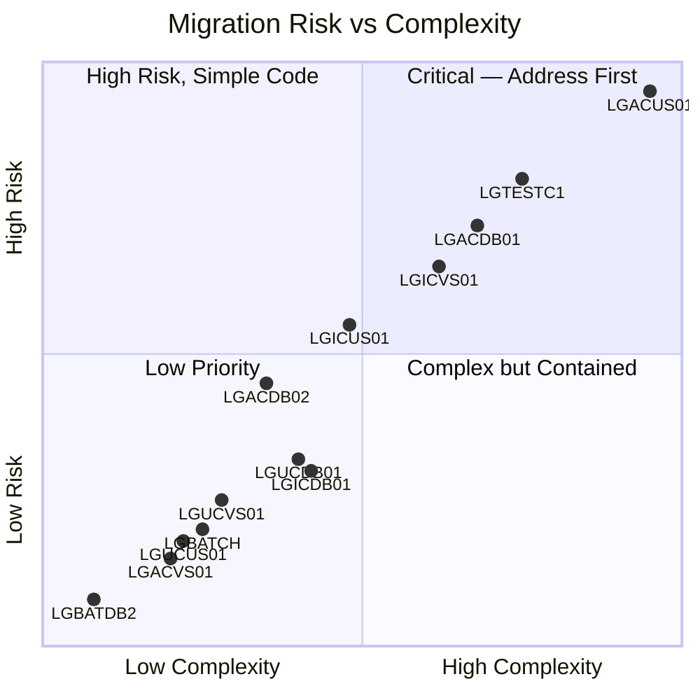
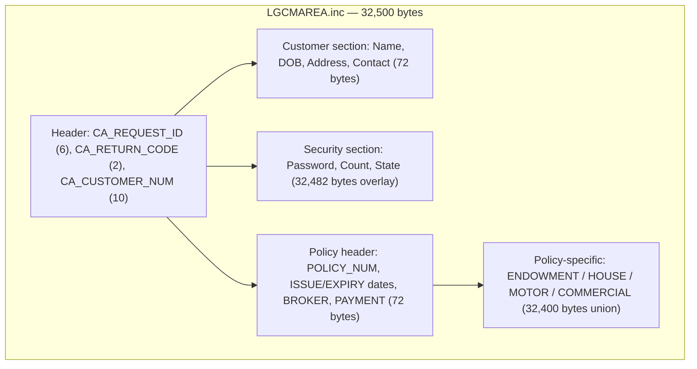
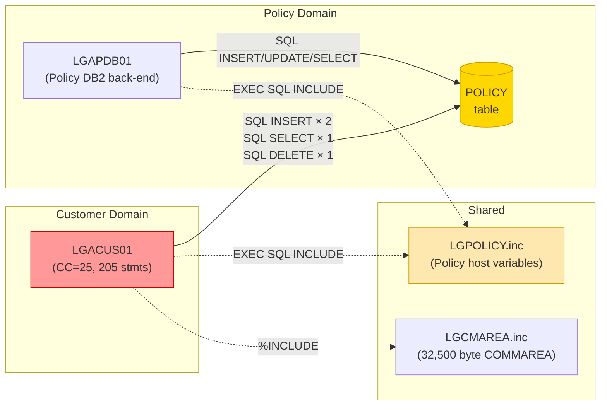
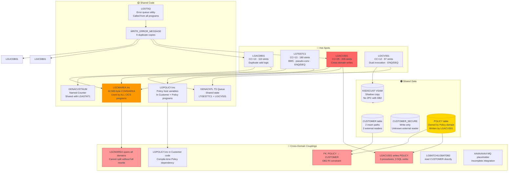

# Impact Analysis Report: Customer Domain Migration Risks

**Created**: 2025-01-28  
**Author**: IBM Bob Z Architect  
**Analysis Method**: Local Workspace (SQL database) + Source Code Review  
**Workspace Alignment**: Fully Aligned  
**Confidence Level**: High

---

## Table of Contents

- [1. Change Summary](#1-change-summary)
- [2. Scope Definition](#2-scope-definition)
- [3. Hot-Spots](#3-hot-spots)
  - [3.1 Complexity Heat Map](#31-complexity-heat-map)
  - [3.2 LGACUS01 — Primary Hot-Spot](#32-lgacus01--primary-hot-spot)
  - [3.3 LGTESTC1 — Presentation Layer Hot-Spot](#33-lgtestc1--presentation-layer-hot-spot)
  - [3.4 LGACDB01 — Add Path Complexity](#34-lgacdb01--add-path-complexity)
  - [3.5 LGICVS01 — Anomalous VSAM Program](#35-lgicvs01--anomalous-vsam-program)
- [4. Shared Code](#4-shared-code)
  - [4.1 LGCMAREA.inc — Universal COMMAREA](#41-lgcmareaincuniversal-commarea)
  - [4.2 LGPOLICY.inc — Cross-Domain Include in Customer Code](#42-lgpolicyinccross-domain-include-in-customer-code)
  - [4.3 LGSTSQ — Shared Error Queue Writer](#43-lgstsqshared-error-queue-writer)
  - [4.4 WRITE_ERROR_MESSAGE — Duplicated Procedure](#44-write_error_messageduplicated-procedure)
  - [4.5 GENACUSTNUM Named Counter](#45-genacustnum-named-counter)
  - [4.6 GENACNTL TS Queue — Shared State](#46-genacntl-ts-queueshared-state)
- [5. Shared Data](#5-shared-data)
  - [5.1 CUSTOMER Table — Access Matrix](#51-customer-tableaccess-matrix)
  - [5.2 CUSTOMER_SECURE Table](#52-customer_secure-table)
  - [5.3 KSDSCUST VSAM File — Dual-Write Shadow](#53-ksdscust-vsam-filedual-write-shadow)
  - [5.4 POLICY Table — Customer Domain Write Access](#54-policy-tablecustomer-domain-write-access)
  - [5.5 DB2 Referential Integrity Constraints](#55-db2-referential-integrity-constraints)
- [6. Cross-Domain Couplings](#6-cross-domain-couplings)
  - [6.1 LGACUS01 ↔ Policy Domain (POLICY Table)](#61-lgacus01--policy-domain-policy-table)
  - [6.2 LGTESTC1 — Dual-Domain Presentation Layer](#62-lgtestc1dual-domain-presentation-layer)
  - [6.3 LGCMAREA — Monolithic Shared Contract](#63-lgcmareamonolithic-shared-contract)
  - [6.4 LGPOLICY Include Used Inside Customer Code](#64-lgpolicy-include-used-inside-customer-code)
  - [6.5 Batch Domain Reads Customer Table](#65-batch-domain-reads-customer-table)
  - [6.6 CICS Named Counter (GENACUSTNUM) — Infrastructure Coupling](#66-cics-named-counter-genacustnum--infrastructure-coupling)
  - [6.7 MQ Integration Path (LGICUS01 → AAAAAAAA)](#67-mq-integration-path-lgicus01--aaaaaaaa)
- [7. Change Propagation Map](#7-change-propagation-map)
- [8. Risk Assessment](#8-risk-assessment)
- [9. Key Architectural Decision: LGACUS01 Decomposition](#9-key-architectural-decision-lgacus01-decomposition)
- [10. Migration Effort Indicators](#10-migration-effort-indicators)

---

## 1. Change Summary

### Change Specification

**Title**: Customer Domain Migration Risk Analysis

**Type**: Migration Risk Assessment (target platform TBD)

**Description**: Identify all migration risks for the Customer domain of the GenApp PL/I application, covering hot-spots, shared code, shared data, and cross-domain couplings that must be resolved or accounted for in any migration approach.

**Business Objective**: Provide an evidence-based risk inventory to inform migration strategy selection, sequencing decisions, and effort estimation before committing to a target architecture.

**Entry Points**: All programs in the Customer domain (see §2), with specific focus on `LGACUS01` as the primary risk item.

---

## 2. Scope Definition

### In Scope

| Component | Type | Notes |
|---|---|---|
| `CUSTOMER`, `CUSTOMER_SECURE` | DB2 Tables | Owned by Customer domain |
| `LGTESTC1` | Presentation (CICS) | Customer menu, transaction SSC1 |
| `LGICUS01`, `LGACUS01`, `LGUCUS01` | Orchestrators (CICS) | Business logic layer |
| `LGACDB01`, `LGICDB01`, `LGUCDB01`, `LGACDB02` | DB2 back-ends (CICS) | Data persistence layer |
| `LGACVS01`, `LGICVS01`, `LGUCVS01` | VSAM back-ends (CICS) | Parallel shadow layer |
| `LGCMAREA.inc`, `LGPOLICY.inc` | PL/I Includes | Shared structures used by customer programs |
| `KSDSCUST` VSAM file | VSAM Dataset | Shadow customer store |
| `GENACUSTNUM` Named Counter | CICS resource | Customer number generation |
| `GENACNTL` TS Queue | CICS resource | Shared control queue |

### Out of Scope (but boundary-touching)

| Component | Reason |
|---|---|
| `LGBATCH`, `LGBATDB2` | Batch programs reading `CUSTOMER` — external consumers |
| Policy domain programs (`LGAPDB01` etc.) | Policy domain owner; coupled via `POLICY` table and `LGACUS01` |
| `LGSTSQ`, `LGSTSQ` callers | Infrastructure utility; not a Customer domain program |
| `LGAPBR01` | Business rules; no direct customer coupling |

### Functional Area

**Primary Functional Area**: Customer Lifecycle Management

**Business Function Summary**: Create, inquire, update, and archive insurance customer records, including security credential provisioning and dual-write to VSAM shadow store.

---

## 3. Hot-Spots

### 3.1 Complexity Heat Map

The following table ranks all Customer domain programs by **cyclomatic complexity** (CC) and **executable statement count** — the two primary indicators of migration effort and regression risk.

| Program | CC Score | Stmts | Risk Tier | Key Risk Reason |
|---|---|---|---|---|
| **`LGACUS01`** | **25** | **205** | 🔴 **CRITICAL** | Cross-domain, dual-table, multi-operation, fan-out to security + VSAM |
| **`LGTESTC1`** | **13** | **180** | 🔴 **HIGH** | BMS map, ENQ/DEQ, HANDLE_CONDITION, SYNCPOINT_ROLLBACK, stateful pseudo-conversation |
| **`LGACDB01`** | **13** | **110** | 🟠 **HIGH** | Named counter fallback, dual-write (DB2 + VSAM + security), ABEND path |
| **`LGICVS01`** | **12** | **97** | 🟠 **HIGH** | Dual invocation mode (LINK + direct TRAN), ENQ/DEQ, SEND TEXT, random customer selection |
| **`LGICUS01`** | **11** | **76** | 🟡 **MEDIUM** | MQ hit routing to unknown `AAAAAAAA` placeholder |
| **`LGICDB01`** | **8** | **67** | 🟡 **MEDIUM** | Simple but shared; read of `CUSTOMER` |
| **`LGUCDB01`** | **8** | **62** | 🟡 **MEDIUM** | UPDATE with VSAM shadow; retry flag declared but unused |
| **`LGACDB02`** | **7** | **68** | 🟡 **MEDIUM** | Security credential insert; hardcoded initial password |
| **`LGUCVS01`** | **6** | **59** | 🟢 LOW | VSAM REWRITE + ABEND (×2) |
| **`LGUCUS01`** | **6** | **54** | 🟢 LOW | Simple orchestrator |
| **`LGBATCH`** | **6** | **56** | 🟢 LOW | Batch read; no CICS |
| **`LGACVS01`** | **5** | **47** | 🟢 LOW | Simple VSAM write |
| **`LGBATDB2`** | **1** | **21** | 🟢 LOW | Trivial DB2 SELECT |

---

### 3.2 LGACUS01 — Primary Hot-Spot

[`LGACUS01`](../../pli/LGACUS01.pli) is the highest-risk program in the Customer domain by every metric: highest CC (25), largest executable statement count (205), and most cross-domain coupling.

**Why it is a hot-spot**:

| Factor | Detail |
|---|---|
| **Multiple operations in one program** | 4 distinct lifecycle operations: Onboard (Add), Offer Policy, Transfer, Delete |
| **Cross-domain DB2 writes** | Directly executes `INSERT`, `SELECT`, and `DELETE` on the `POLICY` table — a Policy domain asset |
| **Dual-include dependency** | Includes both `LGCMAREA` and `LGPOLICY` — the broadest possible structural coupling to both domains |
| **Dual-store write** | Inserts into `CUSTOMER` (DB2) then calls `LGACVS01` (VSAM), then calls `LGACDB02` (security) — three chained writes with no compensating transaction |
| **Named counter dependency** | Uses CICS Named Counter `GENACUSTNUM` for key generation; falls back to DB2 identity on failure |
| **Hardcoded security credential** | MD5 hash `5732fec825535eeafb8fac50fee3a8aa` is hardcoded in `LGACUS01.ONBOARD_CUSTOMER` and in `LGACDB01` |
| **ATRANID reference** | References CICS transaction `DSC1` (not `SSC1`) — unclear if this is a stale reference or an alternative path |
| **Paragraph structure spans lines 29–774** | The main procedure body is 745 lines before internal procedures begin; the 13 internal procedures follow |

**Procedure inventory** (from DB analysis):

| Procedure | Lines | Operation | Cross-Domain? |
|---|---|---|---|
| `INIT_CICS_VARIABLES` | 405–411 | CICS init | No |
| `CHECK_INPUTS` | 413–438 | COMMAREA validation | No |
| `ONBOARD_CUSTOMER` | 443–469 | Add customer + VSAM + security | No (customer only) |
| `OBTAIN_CUSTOMER_NUMBER` | 472–487 | Named counter GET | No |
| `INSERT_CUSTOMER` | 492–560 | DB2 INSERT CUSTOMER | No |
| `TRANSFER_CUSTOMER` | 563–568 | Dispatcher | No |
| `DELETE_CUSTOMER` | 571–576 | Dispatcher | No |
| `OFFER_CUSTOMER` | 579–584 | Dispatcher | No |
| **`INSERT_CUSTOMER_POLICY`** | **590–647** | **DB2 INSERT POLICY** | **✅ YES** |
| **`TRANSFER_CUSTOMER_POLICY`** | **653–710** | **DB2 INSERT POLICY** | **✅ YES** |
| **`DELETE_CUSTOMER_POLICY`** | **717–734** | **DB2 DELETE POLICY** | **✅ YES** |
| `WRITE_ERROR_MESSAGE` | 741–772 | Error logging | No |

**3 of 13 procedures are entirely Policy domain operations** living inside a Customer domain program.

---

### 3.3 LGTESTC1 — Presentation Layer Hot-Spot

[`LGTESTC1`](../../pli/LGTESTC1.pli) (CC=13, 180 statements) is the sole terminal-facing entry point, and it has several hard-to-migrate patterns:

| Factor | Detail |
|---|---|
| **BMS map dependency** | Uses `SSMAPC1` / `SSMAP` BMS mapset — requires either BMS emulation or full UI replacement |
| **Pseudo-conversational pattern** | Returns with `TRANSID('SSC1') COMMAREA(COMM_AREA)` — state is round-tripped through COMMAREA on every user interaction |
| **Inline Update flow** | Option 4 performs an Inquire **then** inline Update in the same transaction turn — the user edits a pre-populated form; the COMMAREA is the session state carrier |
| **SYNCPOINT ROLLBACK** | Issues `EXEC CICS SYNCPOINT ROLLBACK` on Add failure (line 790) — transaction boundary management present at the presentation layer |
| **ENQ / DEQ** | Acquires CICS ENQ on `GENACNTL` TS queue and releases it — shared lock must be accounted for in any concurrent-access scenario |
| **CICS HANDLE_AID + HANDLE_CONDITION** | Legacy pre-structured condition handling; mapped to CLEAR key and MAPFAIL — requires explicit equivalent handling in any target |
| **GO TO labels** | Uses `GO TO NO_DATA`, `GO TO NO_UPD`, `GO TO NO_ADD`, `GO TO ERROR_OUT`, `GO TO ENDIT_STARTIT` — non-structured control flow throughout |
| **WRITE_GENACNTL internal procedure** | Updates TS queue `GENACNTL` with new customer number range after a successful Add — shared state mutation at presentation layer |

---

### 3.4 LGACDB01 — Add Path Complexity

[`LGACDB01`](../../pli/LGACDB01.pli) (CC=13, 110 statements) is the DB2-only Add Customer back-end and is called both standalone and as a delegate from `LGACUS01`. It is a hot-spot because:

- **Duplicate of `LGACUS01` add path**: Both programs contain identical `OBTAIN_CUSTOMER_NUMBER` and `INSERT_CUSTOMER` logic. They are two separate implementations of the same operation (one for the full lifecycle path via `LGACUS01`, one for the direct DB2-only path). Any change to Add Customer logic must be made in both.
- **Named counter with fallback**: CICS Named Counter failure silently changes the insert from explicit ID to DB2 `DEFAULT` identity — behavior difference depending on CICS runtime state.
- **Calls `LGACVS01` and `LGACDB02`**: Fan-out to two services after DB2 insert with no rollback on VSAM failure.
- **Hardcoded MD5 password** at line 154.

---

### 3.5 LGICVS01 — Anomalous VSAM Program

[`LGICVS01`](../../pli/LGICVS01.pli) (CC=12, 97 statements) is anomalous for what is expected to be a simple VSAM Inquire back-end:

- **Dual invocation mode**: Detects whether it was started by LINK (`WS_STARTCODE='D'` or invoking program set) or by direct terminal transaction (`CICS RECEIVE`). This program can be called both ways, making it effectively two programs in one.
- **ENQ/DEQ on `GENACNTL`**: Acquires a global CICS lock on the same TS queue that `LGTESTC1.WRITE_GENACNTL` uses — concurrent access risk.
- **Random customer number selection**: Reads a customer number range from `GENACNTL` TS queue, generates a random number, then reads `KSDSCUST` VSAM GTEQ to find the nearest actual key. This is a data-discovery utility, not a simple lookup.
- **`CICS SEND TEXT`**: Emits output directly to a terminal in one code path — currently **not called by any scanned program** (no callers identified in the scan), yet it is a fully deployed CICS program.
- **WRITEQ TS**: Bootstraps the `GENACNTL` queue if it does not exist — side-effect behavior.

---

## 4. Shared Code

### 4.1 LGCMAREA.inc — Universal COMMAREA

[`plinc/LGCMAREA.inc`](../../plinc/LGCMAREA.inc) is the **most pervasive shared artifact** in the entire application. It defines the single `COMM_AREA` structure (32,500 bytes) that is used as the interface contract between **every CICS program** across all domains.

**Migration risk**: Any change to `LGCMAREA.inc` — adding a field, changing a field width, or reordering — requires recompilation of **every** CICS program in the application. In a migration, if the Customer domain is extracted first, `LGCMAREA` must either:
1. Remain as-is (tight coupling preserved), or
2. Be split into domain-specific interface contracts (major refactoring effort).

The COMMAREA contains interleaved structures for Customer, Policy (all types), and Security — it cannot be cleanly partitioned without changing every caller.

**All 10 customer CICS programs** include this structure. Any API boundary in a migrated service must carry or replace the full 32,500-byte contract.

---

### 4.2 LGPOLICY.inc — Cross-Domain Include in Customer Code

[`plinc/LGPOLICY.inc`](../../plinc/LGPOLICY.inc) defines DB2 host variable structures for `CUSTOMER`, `POLICY`, `ENDOWMENT`, `HOUSE`, `MOTOR`, `COMMERCIAL`, and `CLAIM` tables.

`LGACUS01` includes it via `EXEC SQL INCLUDE LGPOLICY` — this is the only Customer domain program that pulls in the full Policy host variable library. This creates a **compile-time dependency from the Customer domain to every Policy data structure**. Changing any Policy table's column definitions requires recompiling `LGACUS01`.

---

### 4.3 LGSTSQ — Shared Error Queue Writer

[`LGSTSQ`](../../pli/LGSTSQ.pli) is called via `EXEC CICS LINK PROGRAM('LGSTSQ')` from **every** Customer domain program's `WRITE_ERROR_MESSAGE` procedure. It is a cross-application utility — the scan database shows no resolved callers (calls are via string literals), but source code analysis confirms it is called from at minimum:

- `LGACDB01`, `LGACDB02`, `LGACUS01`, `LGICDB01`, `LGICUS01`, `LGUCDB01`, `LGUCUS01`, `LGACVS01`, `LGUCVS01`

**Migration risk**: `LGSTSQ` writes to a CICS TD (Transient Data) queue. Any migration that removes CICS must replace this error-reporting mechanism. Since it is called from every program, it is a **cross-cutting concern** that must be addressed as an infrastructure decision, not a per-program decision.

---

### 4.4 WRITE_ERROR_MESSAGE — Duplicated Procedure

Every Customer domain program contains a **private copy** of `WRITE_ERROR_MESSAGE`. The procedure is structurally identical across all programs — format timestamp, format error message, call `LGSTSQ` twice. There is no shared include or subprogram for this logic.

**Count**: 9 separate copies across Customer domain programs.

**Migration risk**: Any change to error handling (e.g., replacing CICS TD with a structured logging API) must be applied to 9 separate programs. In a refactoring prior to migration, this is the first extraction candidate — a shared error-handling service.

---

### 4.5 GENACUSTNUM Named Counter

The CICS Named Counter `GENACUSTNUM` in pool `GENA` is used for customer number generation by:

| Program | Usage |
|---|---|
| `LGACDB01` | `EXEC CICS GET COUNTER(GENACOUNT) POOL(GENAPOOL) VALUE(LASTCUSTNUM)` |
| `LGACUS01` | Same — identical code block |
| `LGASTAT1` | Also uses `GET COUNTER` (application statistics program) |

**Migration risk**: CICS Named Counters are a CICS-proprietary distributed counter mechanism with atomic increment semantics. There is no direct equivalent in most target platforms. Migration requires replacing this with:
- A DB2 identity column (already the fallback path — `DEFAULT` used when NCS unavailable)
- A sequence object
- An application-level counter with locking

The fallback path (`LGAC_NCS = 'NO'`) is already coded in both `LGACDB01` and `LGACUS01`, which means the DB2 identity fallback is tested and functional. However, the two programs generate customer numbers independently — any migration that decommissions the Named Counter must ensure both programs are updated consistently.

---

### 4.6 GENACNTL TS Queue — Shared State

The TS queue `GENACNTL` is a **shared mutable runtime state store** used by:

| Program | Operation | Purpose |
|---|---|---|
| `LGTESTC1` | ENQ → READQ TS → WRITEQ TS → DEQ | Updates customer number range after successful Add |
| `LGICVS01` | ENQ → READQ TS → WRITEQ TS → DEQ | Bootstraps + reads customer number range for random lookup |

Both programs acquire an exclusive ENQ on `GENACNTL` before reading or writing. This TS queue is a shared state artifact with no DB2 backing — **its content will be lost** if the CICS region restarts unless it is defined as a recoverable queue.

**Migration risk**: The TS queue `GENACNTL` carries runtime state (low/high customer number range) that has no persistent backing. Any migration must decide: replace with a persistent store, eliminate the random customer lookup capability, or retain CICS for this function.

---

## 5. Shared Data

### 5.1 CUSTOMER Table — Access Matrix

| Program | Domain | INSERT | UPDATE | SELECT | Notes |
|---|---|---|---|---|---|
| `LGACDB01` | Customer | ✅ | — | — | Primary add path |
| `LGACUS01` | Customer | ✅ | — | — | Combined lifecycle add path |
| `LGICDB01` | Customer | — | — | ✅ | Inquire back-end |
| `LGUCDB01` | Customer | — | ✅ | — | Update back-end |
| `LGBATCH` | **Batch (external)** | — | — | ✅ | Batch report consumer |
| `LGBATDB2` | **Batch (external)** | — | — | ✅ | Batch report consumer |

**Key finding**: The `CUSTOMER` table has **two insert paths** — `LGACDB01` (direct) and `LGACUS01` (lifecycle). Both insert to `CUSTOMER` with near-identical SQL. Both then call `LGACVS01` and `LGACDB02`. Migrating one without the other leaves the table with inconsistent ownership.

---

### 5.2 CUSTOMER_SECURE Table

| Program | Domain | INSERT | UPDATE | SELECT |
|---|---|---|---|---|
| `LGACDB02` | Customer | ✅ | — | — |

`CUSTOMER_SECURE` is **write-only** — no scanned program reads it. It stores a hardcoded initial MD5 password hash `5732fec825535eeafb8fac50fee3a8aa`. This table has no read path in the application, which raises the question of what consumes it. It is likely read by an external authentication system not in this codebase.

**Migration risk**: Unknown external reader. Any migration that changes the table schema or moves the data store must identify the authentication consumer first.

---

### 5.3 KSDSCUST VSAM File — Dual-Write Shadow

The VSAM KSDS file `KSDSCUST` is a shadow copy of the `CUSTOMER` table, written on every Add and Update:

| Program | Operation |
|---|---|
| `LGACVS01` | `EXEC CICS WRITE FILE('KSDSCUST')` — on Add |
| `LGUCVS01` | `EXEC CICS READ` then `EXEC CICS REWRITE FILE` — on Update |
| `LGICVS01` | `EXEC CICS READ FILE('KSDSCUST') GTEQ` — on Inquire (random customer lookup) |

**Consistency gap**: The VSAM write happens **after** the DB2 commit in the same CICS task, but there is no two-phase commit between DB2 and VSAM. If `LGACVS01` fails (e.g., KSDS full), the DB2 row exists but the VSAM record does not. The application does not roll back the DB2 insert in this case.

**Migration risk**: The VSAM shadow is tightly coupled to CICS file control. Any migration must decide whether to:
1. Preserve the VSAM shadow (requires CICS file control or equivalent)
2. Eliminate it (requires confirming that no other consumer uses `KSDSCUST`)
3. Replace it with a secondary database write

`LGICVS01` uses the VSAM file for **random customer number discovery** — a non-CRUD use. This cannot be eliminated without also removing the `LGICVS01` random customer selection feature.

---

### 5.4 POLICY Table — Customer Domain Write Access

`LGACUS01` writes directly to the `POLICY` table, which is otherwise the exclusive concern of the Policy domain. The full access matrix across both domains is:

| Program | Domain | INSERT | UPDATE | SELECT | DELETE |
|---|---|---|---|---|---|
| `LGACUS01` | **Customer** | ✅ (×2) | — | ✅ (×1) | ✅ (×1) | 
| `LGAPDB01` | Policy | ✅ | ✅ | ✅ | — |
| `LGDPDB01` | Policy | — | — | — | ✅ |
| `LGIPDB01` | Policy | — | — | ✅ | — |

`LGACUS01` is the only program outside the Policy domain that writes to `POLICY`. The `POLICY` table has a DB2 foreign key referencing `CUSTOMER.CUSTOMERNUMBER`, making the two tables structurally coupled at the database level independent of application logic.

---

### 5.5 DB2 Referential Integrity Constraints

The `POLICY` table has a foreign key on `CUSTOMERNUMBER` → `CUSTOMER.CUSTOMERNUMBER`. This means:

- A policy row **cannot be inserted** unless the customer row exists (`SQLCODE -530` on FK violation, handled in `LGACUS01.INSERT_CUSTOMER_POLICY`)
- A customer row **cannot be deleted** while related policy rows exist unless cascaded

**Migration risk**: In any migration that splits the Customer and Policy domains into separate services with separate databases, this FK constraint **cannot be preserved at the database level**. It must be enforced at the application or API level, requiring new validation logic. This is a non-trivial data integrity risk.

---

## 6. Cross-Domain Couplings

### 6.1 LGACUS01 ↔ Policy Domain (POLICY Table)

This is the **most critical cross-domain coupling** in the Customer domain.

**Coupling type**: Direct SQL DML — not through a service call, not through a shared API. The Customer domain program uses the Policy table as if it owns it.

**Consequence for migration**: Any service decomposition must decide whether `LGACUS01` retains direct DB2 access to `POLICY`, or whether it calls a Policy domain service. Neither option is trivial:
- **Retain direct DB2 access**: Both domains must share the same database or be granted cross-schema access — limits decoupling.
- **Call a Policy service**: Requires creating new API endpoints on the Policy side for Insert/Delete/Select policy by customer — new interface design work. Also requires replacing atomic SQL operations with compensating transactions.

---

### 6.2 LGTESTC1 — Dual-Domain Presentation Layer

`LGTESTC1` is nominally the Customer menu, but examination of its call chain shows it **only calls `LGICUS01`** — not `LGACUS01` directly. The `LGACUS01` call is made with request code `01ACUS`. Both `LGICUS01` and `LGUCUS01` are called in a single user interaction (option 4: inquire-then-update).

The menu program is therefore not purely Customer-domain — it orchestrates a multi-step transaction that crosses two orchestrator programs in a single pseudo-conversational session. Migrating the presentation layer requires migrating the orchestration logic simultaneously.

---

### 6.3 LGCMAREA — Monolithic Shared Contract

The COMMAREA is not a Customer domain artifact — it is an application-wide shared contract. The Customer domain cannot migrate its interface without migrating the COMMAREA definition. The COMMAREA contains:

- Customer fields (offsets 18–90)
- Customer security fields (offsets 18–32,500 — entire overlay)
- Policy fields (offsets 18–32,500 — entire overlay)
- Policy-type specific fields (Motor, Endowment, House, Commercial)

In the current implementation, a caller passing a 32,500-byte flat buffer to `LGICUS01` (Customer domain) is using the same buffer layout as a caller passing data to `LGIPOL01` (Policy domain). The domain boundary does not exist at the data layer.

**Migration risk level**: CRITICAL. This is the single largest blocker for true domain separation.

---

### 6.4 LGPOLICY Include Used Inside Customer Code

`LGACUS01` includes `LGPOLICY.inc` via `EXEC SQL INCLUDE LGPOLICY`. This include defines host variables for all Policy table types (`DB2_POLICY`, `DB2_ENDOWMENT`, `DB2_HOUSE`, `DB2_MOTOR`, `DB2_COMMERCIAL`, `DB2_CLAIM`, `DB2_CUSTOMER`). The `DB2_CUSTOMER` structure defined here is **separate from** the COMMAREA customer fields — it is the DB2 host variable structure used for SQL operations.

`LGPOLICY.inc` is also included by `LGAPDB01`, `LGIPDB01`, `LGDPDB01`, and `LGUPDB01` in the Policy domain. It is a **cross-domain shared include** with field-length constants for all Policy tables.

---

### 6.5 Batch Domain Reads Customer Table

`LGBATCH` and `LGBATDB2` read `CUSTOMER` directly via SQL. They do not go through the Customer CICS programs. They are independent DB2 consumers. Migration of the Customer domain's database schema requires coordinating with the Batch domain.

---

### 6.6 CICS Named Counter (GENACUSTNUM) — Infrastructure Coupling

The `GENACUSTNUM` Named Counter is used by both `LGACDB01` and `LGACUS01`. It is also accessed by `LGASTAT1` (the statistics program, which is a cross-domain application utility). This means:
- Customer number generation is a **shared CICS infrastructure resource**, not private to the Customer domain
- `LGASTAT1` may be querying counter values for reporting — removing the counter breaks statistics

---

### 6.7 MQ Integration Path (LGICUS01 → AAAAAAAA)

[`LGICUS01`](../../pli/LGICUS01.pli) checks TS queue `GENAWMQC` for an `MQHIT=` record. If found, it routes to `AAAAAAAA` instead of `LGICDB01`. `AAAAAAAA` is a **placeholder program** — it exists in the scan database as program ID 7 but is a stub. This represents an **incomplete MQ integration** where a real program would replace `AAAAAAAA` to return customer data from an MQ message.

**Migration risk**: The MQ path is currently inactive (placeholder). Any migration must decide whether this integration point is to be activated, preserved, or removed. If activated, the MQ consumer program and the MQ message schema become additional migration dependencies.

---

## 7. Change Propagation Map

---

## 8. Risk Assessment

| Risk ID | Description | Category | Likelihood | Impact | Level | Mitigation |
|---|---|---|---|---|---|---|
| **R1** | `LGACUS01` cross-domain POLICY writes block domain separation | Cross-Domain Coupling | **High** | **High** | 🔴 CRITICAL | Architectural decision required first (see §9). Cannot migrate without resolving. |
| **R2** | `LGCMAREA.inc` monolithic COMMAREA — every CICS program change cascades | Shared Code | **High** | **High** | 🔴 CRITICAL | Define new domain-scoped API contracts. COMMAREA must be replaced with scoped interfaces before or during migration. |
| **R3** | DB2 FK `POLICY → CUSTOMER` prevents independent database separation | Shared Data / RI | **High** | **High** | 🔴 CRITICAL | FK must be enforced at application level if databases are split. Requires new validation logic in Policy domain insert paths. |
| **R4** | Two independent insert paths for `CUSTOMER` (`LGACDB01` + `LGACUS01`) | Shared Data | **High** | **Medium** | 🟠 HIGH | Consolidate to a single insert service before migration. Divergence risk if one is migrated and the other is not. |
| **R5** | KSDSCUST VSAM shadow has no 2PC with DB2 — consistency gap | Shared Data | **Medium** | **High** | 🟠 HIGH | Determine whether VSAM shadow is a live consumer requirement. If not needed, eliminate before migration. If needed, introduce a reliable dual-write mechanism. |
| **R6** | `LGTESTC1` BMS map requires either BMS emulation or full UI rewrite | Presentation | **High** | **Medium** | 🟠 HIGH | Scoping decision: preserve BMS 3270 interface vs. replace with web/API UI. |
| **R7** | `WRITE_ERROR_MESSAGE` duplicated 9 times — change must be applied 9× | Shared Code | **High** | **Low** | 🟡 MEDIUM | Extract to shared utility before migration. Low risk individually, but multiplies effort. |
| **R8** | CICS Named Counter `GENACUSTNUM` has no direct non-CICS equivalent | Shared Code / Infra | **High** | **Medium** | 🟠 HIGH | DB2 IDENTITY fallback path already coded — activate it. Validate atomicity guarantee is equivalent. |
| **R9** | `CUSTOMER_SECURE` has no read path in this codebase — unknown consumer | Shared Data | **Medium** | **High** | 🟠 HIGH | Identify the external authentication reader before migrating schema. Risk of breaking authentication silently. |
| **R10** | `LGICVS01` dual invocation mode (LINK + direct TRAN) — complex migration | Hot-Spot | **Medium** | **Medium** | 🟡 MEDIUM | Determine if direct terminal invocation is still in use. If not, simplify to LINK-only before migration. |
| **R11** | `LGTESTC1` SYNCPOINT ROLLBACK at presentation layer — transaction scope spans layers | Presentation | **Medium** | **Medium** | 🟡 MEDIUM | Ensure compensating transaction logic is preserved in target. Rollback scope covers `LGACUS01` downstream DB2 writes. |
| **R12** | `LGPOLICY.inc` included in `LGACUS01` — compile-time Policy dependency | Shared Code | **High** | **Low** | 🟡 MEDIUM | Resolved if `LGACUS01` is decomposed (R1 mitigation). Must be tracked until decomposition is complete. |
| **R13** | `AAAAAAAA` MQ placeholder — incomplete integration in `LGICUS01` | External Coupling | **Low** | **Medium** | 🟡 MEDIUM | Determine if the MQ integration path is to be activated or removed. Document decision. |
| **R14** | Hardcoded MD5 password hash in `LGACDB01` + `LGACUS01` | Security | **High** | **Medium** | 🟠 HIGH | Replace with configurable credential provisioning before or during migration. Hardcoded hash is a security vulnerability regardless of migration. |
| **R15** | `GENACNTL` TS queue is shared between `LGTESTC1` and `LGICVS01` — lost on region restart | Shared State | **Medium** | **Low** | 🟡 MEDIUM | Determine recoverability setting. If volatile state is acceptable, document. If not, persist to DB2. |

---

## 9. Key Architectural Decision: LGACUS01 Decomposition

This is **the** decision that shapes every other migration plan. `LGACUS01` cannot be migrated as-is without dragging the Policy domain's data layer into the Customer domain's migration scope.

**Option A — Migrate As-Is (Monolith-Lift)**

Keep `LGACUS01` as a combined Customer + Policy service. The migrated version retains direct access to both `CUSTOMER` and `POLICY` tables.

| Pros | Cons |
|---|---|
| No code restructuring required | Customer and Policy services cannot be independently deployed or scaled |
| Atomic SQL transactions preserved | Does not achieve domain separation — a primary goal of migration |
| Lowest immediate effort | Technical debt carried forward |

**Option B — Decompose Before Migration**

Split `LGACUS01` into two programs: a Customer lifecycle program (owns `CUSTOMER`) and a policy-creation delegate (calls the Policy domain for `POLICY` operations).

| Pros | Cons |
|---|---|
| Clean domain boundary established in PL/I before migration begins | Requires new PL/I code and a new internal API |
| Migration of each domain becomes truly independent | Atomic SQL across both tables is lost — requires saga/compensating transactions |
| Policy domain API contract is defined upfront | Higher pre-migration effort |

**Option C — Decompose During Migration**

Migrate `LGACUS01` as part of a joint Customer+Policy migration stream, defining the service boundary during implementation.

| Pros | Cons |
|---|---|
| One migration event, not two | Teams must coordinate tightly; risk of scope bleed |
| Policy API design and Customer migration run in parallel | Higher complexity; dual-domain expertise required simultaneously |

**Recommendation**: Flag as an architectural decision for the migration team. The risk profile favors Option B (decompose before) if clean domain separation is a goal, and Option A if speed is the priority.

---

## 10. Migration Effort Indicators

| Category | Item | Effort Signal |
|---|---|---|
| **Highest effort** | `LGACUS01` decomposition + Policy coupling resolution | Large — requires architectural design + code split |
| **Highest effort** | `LGCMAREA` replacement with scoped API contracts | Large — application-wide impact |
| **Medium effort** | `LGTESTC1` BMS map + pseudo-conversation replacement | Medium-Large — UI redesign or BMS emulation |
| **Medium effort** | CICS Named Counter → DB2 IDENTITY migration | Medium — existing fallback path reduces effort |
| **Medium effort** | VSAM shadow decision (keep/eliminate/replace) | Medium — 3 programs involved |
| **Low effort** | Extract `WRITE_ERROR_MESSAGE` to shared utility | Small — mechanical refactoring |
| **Low effort** | Replace hardcoded MD5 password | Small — single configuration change |
| **Low effort** | `LGBATDB2` / `LGBATCH` (read-only consumers) | Small — no write coupling |
| **Unknown** | `CUSTOMER_SECURE` external reader identification | Blocked until consumer identified |
| **Unknown** | `AAAAAAAA` MQ placeholder activation vs. removal | Blocked until business decision |
