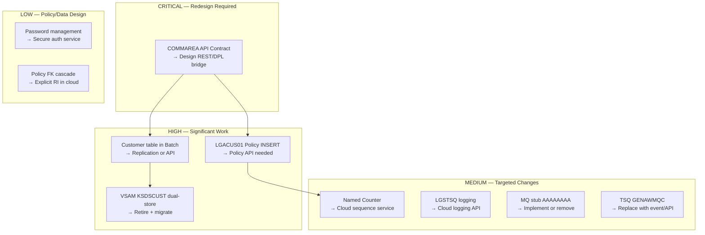

# GenApp PL/I — Customer Domain: Migration Risk Assessment

## Scope

This document identifies the main migration effort, shared modules, shared data, highly coupled programs, and cross-boundary dependencies for migrating the **Customer domain** off the mainframe to a cloud platform. Risks are ranked by impact.

---

## Migration Risk Ranking

| Rank | Risk Item | Risk Level | Why It Matters |
|------|-----------|-----------|----------------|
| 1 | COMMAREA as API contract | **CRITICAL** | Every remaining CICS caller passes a 32,500-byte flat COMMAREA to customer programs — the new cloud service must speak this protocol or all callers break |
| 2 | LGACUS01 direct POLICY INSERT | **HIGH** | Customer domain program inserts directly into POLICY table — bypassing Policy domain — creating a cross-domain data dependency |
| 3 | CUSTOMER table shared with Batch domain | **HIGH** | LGBATCH and LGBATDB2 read CUSTOMER directly — after migration these programs need a new data path |
| 4 | Dual-store (DB2 + VSAM KSDSCUST) | **HIGH** | Both stores must be handled — migrate both or retire VSAM and update all readers |
| 5 | CICS Named Counter GENACUSTNUM | **MEDIUM** | Customer number sequence source is a CICS Named Counter — must be replaced by cloud sequence service |
| 6 | LGSTSQ logging dependency | **MEDIUM** | All customer programs call LGSTSQ via CICS LINK — cloud service must implement equivalent logging |
| 7 | LGICUS01 MQ integration path (AAAAAAAA) | **MEDIUM** | LGICUS01 has a conditional MQ cache routing path — the stub `AAAAAAAA` must be implemented or retired |
| 8 | TSQ GENAWMQC control queue | **MEDIUM** | LGICUS01 reads a CICS TS Queue for MQ routing signals — this cannot be accessed from the cloud |
| 9 | CUSTOMER_SECURE password management | **LOW-MEDIUM** | Password stored as MD5 hash `NewPass` for all new customers — no read/verify path exists in PL/I port; must be designed for cloud |
| 10 | POLICY FK cascade to CUSTOMER | **LOW** | DB2 FK from POLICY to CUSTOMER means customer deletes cascade to all customer policies — must be preserved or explicitly handled in cloud |

---

## Detailed Risk Analysis

---

### RISK-1: COMMAREA as API Contract *(CRITICAL)*

**Description**: The COMMAREA (`LGCMAREA.inc`) is a 32,500-byte binary struct used by every CICS program to pass parameters. It is not self-describing, has no version number, and uses UNION overlays for all data types. Any cloud replacement for LGACUS01, LGICUS01, or LGUCUS01 must either:
1. Accept the exact binary COMMAREA layout from remaining CICS callers (LGTESTC1) via CICS DPL, or
2. Replace LGTESTC1 with a new front-end that speaks a cloud-native API (REST/JSON/MQ)

**Affected Programs**: LGTESTC1 (caller), LGACUS01, LGICUS01, LGUCUS01, and all downstream chain

**Effort**: High — requires API design decisions for the entire integration layer

**Mitigation Options**:
- **DPL bridge**: Keep LGTESTC1 on CICS, add a CICS DPL stub that translates COMMAREA to REST calls. Low risk but adds latency.
- **COMMAREA reuse**: Deploy cloud service as a CICS-callable microservice via CICS Transaction Gateway (CTG/ECI). Preserves binary contract.
- **API replace**: Replace LGTESTC1 with a cloud-native UI; full COMMAREA translation effort.

---

### RISK-2: LGACUS01 Direct POLICY INSERT *(HIGH)*

**Description**: [`LGACUS01`](../../pli/LGACUS01.pli) contains procedures `INSERT_CUSTOMER_POLICY`, `TRANSFER_CUSTOMER_POLICY`, and `DELETE_CUSTOMER_POLICY` that INSERT/DELETE directly into the DB2 POLICY table. When Customer moves to the cloud, this code must:
1. Call the Policy domain's add-policy API instead of direct SQL, or
2. Be left on the mainframe as a bridge

**Programs involved**: LGACUS01 (Customer domain), DB2 POLICY (Policy domain)

**Tables affected**: POLICY (cross-domain write), POLICY.LASTCHANGED SELECT

**Effort**: High — requires Policy API design and contract alignment

**Mitigation**: Design a Policy add-policy REST/event API. LGACUS01 calls it. Policy domain owns all POLICY INSERTs.

---

### RISK-3: CUSTOMER Table Shared with Batch Domain *(HIGH)*

**Description**: LGBATCH and LGBATDB2 read the DB2 CUSTOMER table directly. If CUSTOMER moves to a cloud database, these batch programs lose direct access.

**Affected Programs**: LGBATCH, LGBATDB2 (Batch Reporting domain)

**Mitigation Options**:
- **DB replication**: Replicate DB2 CUSTOMER to a mainframe shadow table for batch to read
- **API-based batch**: Modify LGBATCH/LGBATDB2 to call a Customer REST API
- **Change data capture**: Stream CUSTOMER changes to a Db2 or file accessible by batch
- **Retain table**: Keep DB2 CUSTOMER on mainframe as a read replica synced from cloud

---

### RISK-4: Dual-Store (DB2 + VSAM KSDSCUST) *(HIGH)*

**Description**: Every add/update in Customer domain writes to both DB2 CUSTOMER and VSAM KSDSCUST. When Customer migrates:
- If both stores move to cloud: CICS programs accessing KSDSCUST (if any remain) must be updated
- If VSAM is retired: Any current VSAM readers must switch to DB2 or cloud API
- **Note**: KSDSCUST DELETE path does not exist — records accumulate after DB2 customer deletes

**Affected Programs**: LGACVS01 (C), LGICVS01 (R), LGUCVS01 (U)

**Effort**: Medium — VSAM has no direct cloud equivalent; must use file transfer or API replacement

**Mitigation**: Retire KSDSCUST; implement a cloud-based customer store. Ensure any remaining CICS programs using KSDSCUST are updated or removed.

---

### RISK-5: CICS Named Counter GENACUSTNUM *(MEDIUM)*

**Description**: Customer number assignment uses CICS Named Counter `GENACUSTNUM` (pool `GENA`). The cloud service cannot access CICS Named Counters directly.

**Affected Programs**: LGACUS01, LGACDB01

**Mitigation**: Replace with a cloud-native sequence service (database auto-increment, UUID, or distributed sequence). Ensure the starting value matches the last mainframe counter value to avoid collisions during transition.

---

### RISK-6: LGSTSQ Logging Dependency *(MEDIUM)*

**Description**: 21 programs across all domains call LGSTSQ via CICS LINK. The cloud Customer service cannot call LGSTSQ directly — it uses CICS TDQ (transient data queue) for output.

**Affected Programs**: All customer programs (10 programs)

**Mitigation**: Implement a structured logging API in the cloud service (CloudWatch, Splunk, ELK, etc.) that replicates the diagnostic information: date, time, program name, customer number, SQLCODE. The LGSTSQ write can remain for mainframe-resident programs.

---

### RISK-7 & RISK-8: LGICUS01 MQ Path + TSQ GENAWMQC *(MEDIUM)*

**Description**: LGICUS01 reads CICS TSQ `GENAWMQC` and conditionally routes to `AAAAAAAA` (an MQ handler stub). This MQ integration path is partially implemented — `AAAAAAAA` is a stub. When Customer migrates, this path must be:
1. Fully implemented in the cloud service as a cache layer, or
2. Removed/disabled if MQ cache is not required

**Effort**: Medium — stub must be replaced with real implementation; TSQ read is CICS-specific

---

### RISK-9: CUSTOMER_SECURE Password Management *(LOW-MEDIUM)*

**Description**: When a customer is created, a default password `NewPass` is set with `state_indicator = 'N'`. No read or verify path exists in this PL/I port. The cloud service must implement:
- Password storage (hashed, salted — not plain `NewPass`)
- Password verification
- State machine for password changes

---

### RISK-10: POLICY FK CASCADE on CUSTOMER DELETE *(LOW)*

**Description**: DB2 enforces `POLICY → CUSTOMER (ON DELETE CASCADE)`. Deleting a CUSTOMER cascades to delete all their POLICIES and all POLICY sub-type rows. The cloud service must implement this referential integrity rule explicitly — most cloud databases do not enforce FK cascades by default.

---

## Migration Effort Summary

---

## Recommended Migration Sequence

1. **Design the Customer API contract** (REST schema aligned with COMMAREA fields) — resolves RISK-1
2. **Design a CICS-to-cloud bridge** (CICS DPL stub calling the new Customer API) — resolves RISK-1 without changing LGTESTC1
3. **Build cloud Customer service** with: Create, Read, Update, Delete, sequence service — resolves RISK-5
4. **Implement cloud logging** equivalent to LGSTSQ — resolves RISK-6
5. **Migrate CUSTOMER and CUSTOMER_SECURE data** to cloud — resolves RISK-4 (partly)
6. **Retire VSAM KSDSCUST** and update any CICS readers — resolves RISK-4
7. **Set up CUSTOMER read replica** for LGBATCH/LGBATDB2 — resolves RISK-3
8. **Refactor LGACUS01 POLICY INSERT** to call Policy API — resolves RISK-2
9. **Implement AAAAAAAA** as real MQ cache or disable — resolves RISK-7/8
10. **Implement password management** in cloud auth service — resolves RISK-9
