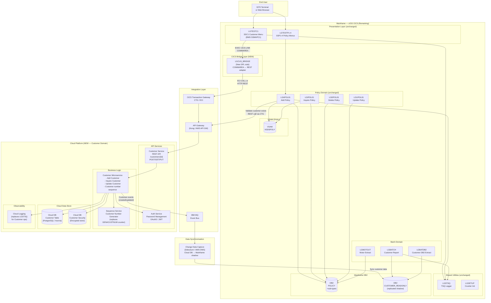

# GenApp PL/I — To-Be State Architecture: Customer Domain Migrated to Cloud

## Overview

This document describes a high-level architecture showing how the GenApp mainframe application integrates with the Customer domain after it has been migrated to a cloud platform. The remaining mainframe components (Policy, Batch, Statistics, Shared Utilities) continue to operate on z/OS CICS while the Customer domain is hosted as cloud-native microservices.

---

## Architectural Principles

1. **Strangler Fig pattern** — Customer domain is extracted incrementally; the mainframe continues to work during and after migration
2. **Thin CICS bridge** — A lightweight CICS DPL stub translates the existing COMMAREA protocol to REST/API calls to the cloud Customer service
3. **Data sovereignty** — The cloud is the system of record for customer data; mainframe reads via a synchronisation mechanism
4. **Preserve Batch access** — LGBATCH and LGBATDB2 continue to read customer data via a replicated Db2 table on the mainframe or via an API adapter
5. **Event-driven sync** — Customer data changes are published as events to keep mainframe dependents consistent

---

## To-Be Architecture Diagram

---

## Integration Component Description

### 1. CICS Bridge (LGCUS_BRIDGE) — *New Component*

A new lightweight CICS program that replaces the direct CICS LINK from LGTESTC1 to LGACUS01/LGICUS01/LGUCUS01. It:
- Accepts the existing 32,500-byte COMMAREA from LGTESTC1
- Parses `CA_REQUEST_ID` to determine operation type
- Translates COMMAREA fields to a JSON REST payload
- Calls the Customer API via CICS Transaction Gateway (ECI) or direct HTTP
- Translates the REST response back to COMMAREA fields
- Returns `CA_RETURN_CODE` to the caller

**No changes required in LGTESTC1.**

### 2. CICS Transaction Gateway (CTG/ECI)

The existing IBM CICS Transaction Gateway provides the bidirectional bridge between CICS and external systems. It enables:
- CICS programs to call external REST APIs (outbound)
- External systems to call CICS programs (inbound)
- TLS transport, connection pooling, and transaction management

### 3. API Gateway

A cloud-side API Gateway provides:
- HTTPS endpoint for the Customer Service
- Authentication (API key, mTLS, or JWT)
- Rate limiting and traffic management
- Route to Customer microservice

### 4. Customer Microservice — *Replaces LGACUS01, LGICUS01, LGUCUS01*

Cloud-native service implementing all customer operations:

| Operation | Replaces | Endpoint |
|-----------|----------|----------|
| Add Customer | LGACUS01 + LGACDB01 + LGACVS01 + LGACDB02 | `POST /customers` |
| Inquire Customer | LGICUS01 + LGICDB01 | `GET /customers/{id}` |
| Update Customer | LGUCUS01 + LGUCDB01 + LGUCVS01 | `PUT /customers/{id}` |

**Business rules preserved**: All 18 business rules from [`docs/business-rules/CUSTOMER-BUSINESS-RULES.md`](../business-rules/CUSTOMER-BUSINESS-RULES.md) must be implemented in this service.

### 5. Sequence Service — *Replaces CICS Named Counter GENACUSTNUM*

A dedicated service providing monotonically increasing customer numbers starting at 1000001. Options:
- Database IDENTITY/SEQUENCE column
- Dedicated sequence microservice
- Cloud-native sequence (AWS SQS message IDs, etc.)

### 6. Cloud DB — *Replaces DB2 CUSTOMER + CUSTOMER_SECURE + VSAM KSDSCUST*

A cloud-hosted relational database (PostgreSQL/Aurora/Azure SQL) with:
- `customer` table (same schema as DB2 CUSTOMER)
- `customer_secure` table with proper password hashing (bcrypt/Argon2 — not MD5)
- Referential integrity: customer_secure FK → customer CASCADE DELETE

**VSAM KSDSCUST is retired** — the cloud DB is the single store.

### 7. Change Data Capture (CDC) — *New Component*

Synchronises customer data changes from the cloud back to the mainframe:
- Cloud DB change events published to IBM MQ
- CDC consumer on mainframe writes to `CUSTOMER_READONLY` shadow table in DB2
- LGBATCH and LGBATDB2 read from `CUSTOMER_READONLY` — no code change required
- Eventual consistency acceptable for batch reporting

### 8. Cloud Logging — *Replaces LGSTSQ for Cloud Components*

The Customer Microservice writes structured logs to a cloud logging platform (CloudWatch, Splunk, ELK). The log format preserves the diagnostic fields from LGSTSQ:
- Timestamp, program name, customer number, operation, error code

---

## Policy Domain: Customer Validation API Call

When the Policy domain adds a policy (LGAPOL01 → LGAPDB01), it currently relies on DB2 FK enforcement to validate the customer exists. After Customer migrates:

- **LGAPDB01** calls Customer API `GET /customers/{id}` before inserting into POLICY to validate existence
- Alternatively, DB2 FK is maintained by keeping CUSTOMER_READONLY table on mainframe as the FK reference target

---

## Data Flow Summary

| Flow | As-Is | To-Be |
|------|-------|-------|
| Customer Add | LGTESTC1 → LGACUS01 → DB2 + VSAM | LGTESTC1 → LGCUS_BRIDGE → CTG → Customer API → Cloud DB |
| Customer Inquiry | LGTESTC1 → LGICUS01 → LGICDB01 → DB2 | LGTESTC1 → LGCUS_BRIDGE → CTG → Customer API → Cloud DB |
| Customer Update | LGTESTC1 → LGUCUS01 → LGUCDB01 → DB2 + VSAM | LGTESTC1 → LGCUS_BRIDGE → CTG → Customer API → Cloud DB |
| Batch Customer Read | LGBATCH → DB2 CUSTOMER | LGBATCH → DB2 CUSTOMER_READONLY (CDC-synced shadow) |
| Policy FK Validation | DB2 FK enforcement | Customer API `GET /customers/{id}` + optional shadow FK |
| Customer Number | CICS Named Counter GENACUSTNUM | Cloud Sequence Service |
| Error Logging | LGSTSQ → CICS TDQ | Cloud Logging Service (Customer ops) + LGSTSQ (mainframe ops) |

---

## What Remains on the Mainframe

| Component | Status |
|-----------|--------|
| LGTESTC1 | **Unchanged** — calls LGCUS_BRIDGE instead of LGACUS01 directly |
| LGCUS_BRIDGE | **New** — CICS DPL adapter |
| LGSTSQ | **Unchanged** — still used by Policy, Batch, Stats |
| All Policy domain programs | **Unchanged** |
| LGBATCH, LGBATDB2 | **Config change only** — point to CUSTOMER_READONLY |
| DB2 POLICY and sub-types | **Unchanged** |
| VSAM KSDSPOLY | **Unchanged** |
| VSAM KSDSCUST | **Retired** |
| DB2 CUSTOMER | **Moved to cloud** |
| DB2 CUSTOMER_SECURE | **Moved to cloud** |
