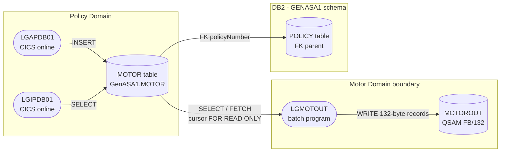

# GenApp — Motor Domain: Boundary Analysis (Step 6)

> Scope: Motor sub-domain selected for migration demo.  
> Source analysed: [`pli/LGMOTOUT.pli`](../pli/LGMOTOUT.pli), [`DDL/db2cre.jcl`](../DDL/db2cre.jcl), local scanner database.

---

## 1. Components and Their Roles

### 1.1 Programs

| Component | Type | Belongs To | Role |
|---|---|---|---|
| **LGMOTOUT** | PL/I batch program | Motor domain (exclusively) | Reads all rows from `GENASA1.MOTOR` via a DB2 cursor and writes each row as a 132-byte fixed-block record to the `MOTOROUT` QSAM file. No CICS, no VSAM, no calls to other programs. |
| **LGAPDB01** | PL/I CICS program | **Policy domain** (shared) | Inserts motor policy rows into MOTOR when a new motor policy is created. This is the **only writer** to the MOTOR table. |
| **LGIPDB01** | PL/I CICS program | **Policy domain** (shared) | Reads motor policy rows from MOTOR when a policy inquiry is performed. |

### 1.2 Db2 Tables

| Table | Owner Domain | Motor Domain Role |
|---|---|---|
| **GENASA1.MOTOR** | Policy (write); Motor (read) | The sole data source for LGMOTOUT. Contains 10 columns describing a motor vehicle insurance policy. |
| **GENASA1.POLICY** | Policy | Parent table — MOTOR.policyNumber is a FK to POLICY. Managed entirely by the Policy domain. Not touched by the Motor domain. |

### 1.3 Files

| File | DD Name | Format | Direction | Belongs To |
|---|---|---|---|---|
| **MOTOROUT** | MOTOROUT | FB RECSIZE(132) | Output | Motor domain (exclusively) |

### 1.4 Copybooks / Includes

| Include | Used By | Purpose |
|---|---|---|
| `EXEC SQL INCLUDE SQLCA` | LGMOTOUT | SQL Communication Area — holds SQLCODE after each SQL statement |

> No `LGCMAREA.inc` (COMMAREA) is used — LGMOTOUT is a batch `Options(Main)` program with no CICS context.

### 1.5 CICS Transactions

None. LGMOTOUT is a **pure batch program** (`Proc Options(Main)`). It has no CICS transaction, no COMMAREA, and no EXEC CICS statements.

### 1.6 JCL

No dedicated JCL job exists in this workspace for LGMOTOUT. It would be invoked by a JCL step that:
- Allocates the `MOTOROUT` DD (QSAM sequential output dataset)
- Executes `PGM=LGMOTOUT`
- Provides the Db2 connection (DSNHDECP, STEPLIB including Db2 runtime libraries)

---

## 2. Boundary Visualisation



**Data flows:**
1. Policy domain programs (`LGAPDB01`) populate the `MOTOR` table as part of normal online policy processing.
2. `LGMOTOUT` opens a `FOR READ ONLY` cursor over `GENASA1.MOTOR`, fetches all rows, formats each as a 132-byte fixed-length record, and writes to `MOTOROUT`.
3. `MOTOROUT` is the final output — a sequential flat file containing all motor policies.

---

## 3. Batch Processing

### 3.1 LGMOTOUT Batch Flow

| Step | Action |
|---|---|
| **1. Open output file** | `OPEN FILE(MOTOROUT)` — failure sets RC=12 and stops |
| **2. Open DB2 cursor** | `OPEN MOTOR_CSR` — failure logs error, sets RC=12, returns |
| **3. Fetch loop** | `DO WHILE (SQLCODE ^= 100 & SQLCODE >= 0)` — calls `FETCH_MOTOR_ROWS` |
| **4. Fetch one row** | `FETCH MOTOR_CSR INTO :HV_*` — SQLCODE=0 → write row; SQLCODE=100 → end-of-data; other → error RC=8 |
| **5. Format and write** | `WRITE_MOTOR_ROW` builds `WS_MOTOR_LINE` (119 data bytes + 13 pad), writes as `MOTOROUT_REC CHAR(132)` |
| **6. Close cursor + file** | `CLOSE MOTOR_CSR`, `CLOSE FILE(MOTOROUT)` |
| **7. Display count** | `DISPLAY('LGMOTOUT: ROWS WRITTEN=' || WS_ROW_COUNT)` |

### 3.2 Return Codes

| RC | Meaning |
|---|---|
| 0 | All rows fetched and written successfully |
| 8 | FETCH error (unexpected SQLCODE during fetch loop) |
| 12 | OPEN failure — either cursor open or file open failed |

### 3.3 Input / Output Datasets

| Dataset | DD | Direction | Content |
|---|---|---|---|
| Db2 `GENASA1.MOTOR` | — (Db2 connection) | Input | All motor policy rows |
| `MOTOROUT` | MOTOROUT | Output | 132-byte FB sequential records, one per motor policy |

### 3.4 Output Record Layout (132 bytes)

| Field | PL/I Variable | Size | Source Column |
|---|---|---|---|
| Policy Number | WS_OUT_POLNUM | 9 | POLICYNUMBER |
| _(space)_ | | 1 | |
| Make | WS_OUT_MAKE | 15 | MAKE |
| _(space)_ | | 1 | |
| Model | WS_OUT_MODEL | 15 | MODEL |
| _(space)_ | | 1 | |
| Value | WS_OUT_VALUE | 9 | VALUE |
| _(space)_ | | 1 | |
| Registration | WS_OUT_REGNUMBER | 7 | REGNUMBER |
| _(space)_ | | 1 | |
| Colour | WS_OUT_COLOUR | 8 | COLOUR |
| _(space)_ | | 1 | |
| CC | WS_OUT_CC | 4 | CC |
| _(space)_ | | 1 | |
| Year of Manufacture | WS_OUT_YEAROFMFR | 10 | YEAROFMANUFACTURE |
| _(space)_ | | 1 | |
| Premium | WS_OUT_PREMIUM | 9 | PREMIUM |
| _(space)_ | | 1 | |
| Accidents | WS_OUT_ACCIDENTS | 9 | ACCIDENTS |
| _(padding)_ | | 15 | |
| **Total** | | **132** | |

### 3.5 Data Comes From

The `MOTOR` rows written to `MOTOROUT` originate from **Policy domain**:
- `LGAPDB01` (CICS online) inserts a `MOTOR` row when a motor policy is added via any of the `SSP*` CICS transactions (`LGTESTP1–4` → `LGAPOL01` → `LGAPDB01`).
- There is no other domain that feeds data into `MOTOR`.

### 3.6 Data Goes To

The `MOTOROUT` dataset is consumed downstream. In this workspace there is no consuming program defined — it is an end-of-chain file output.

---

## 4. Db2 Usage: All Programs Accessing MOTOR

| Program | Domain | Operation | Access Type | Notes |
|---|---|---|---|---|
| **LGAPDB01** | Policy | INSERT | Write | Inserts one row per new motor policy; policyNumber is generated by POLICY table identity column and passed in |
| **LGIPDB01** | Policy | SELECT | Read | Selects the MOTOR row for a given policyNumber during policy inquiry |
| **LGMOTOUT** | **Motor** | SELECT / FETCH (cursor) | Read-only | Reads **all** rows via `FOR READ ONLY` cursor for batch report |

**Summary**: MOTOR is written only by `LGAPDB01` (Policy domain). The Motor domain is a **pure read consumer**.

---

## 5. Integration Points with Other Domains

| Point | Caller/Provider | Callee/Consumer | Mechanism | Data Passed | Migration Impact |
|---|---|---|---|---|---|
| **MOTOR table read** | Policy domain (`LGAPDB01` writes) | Motor domain (`LGMOTOUT` reads) | Db2 shared table — no direct program call | All 10 columns of `GENASA1.MOTOR` | When Motor moves to cloud, it needs a read path to the mainframe Db2 MOTOR table (or a replicated copy) |
| **POLICY FK** | Policy domain (owns `POLICY`) | Motor domain (MOTOR.policyNumber → POLICY) | Db2 foreign key constraint | policyNumber | Motor rows can only exist if a matching POLICY row exists — cascade delete applies |
| **No program call interface** | — | — | — | — | LGMOTOUT is never called by another program; it is invoked only by JCL. No CICS LINK or CALL coupling. |

**There are no direct program-to-program integration points between Motor and any other domain.** The only coupling is the shared `MOTOR` Db2 table.

---

## 6. External Interfaces

| Interface | Type | Direction | Contract | Programs Involved | Known Consumers |
|---|---|---|---|---|---|
| **MOTOROUT QSAM file** | Sequential flat file | Outbound from Motor | 132-byte FB records (layout above) | LGMOTOUT (writer) | Unknown — no consuming program exists in this workspace. Likely a downstream report or archiving process. |
| **GENASA1.MOTOR (Db2)** | Db2 table | Inbound to Motor | Table schema in `DDL/db2cre.jcl` (10 columns, policyNumber PK + FK to POLICY) | LGAPDB01 (writer), LGMOTOUT (reader) | Motor domain consumes this. Policy domain provides it. |

No CICS web services, MQ queues, CTC/sockets, DPL, or ECI/EPI interfaces exist for this domain.

---

## 7. Migration Change Points

These are the specific places that must be modified when the Motor domain moves off the mainframe:

| # | Change Point | Current (Mainframe) | Required Change |
|---|---|---|---|
| 1 | **Db2 access** | Embedded SQL via Db2 cursor (`FOR READ ONLY`) in LGMOTOUT | Replace with JDBC / Db2 Connect / REST data API call to read `GENASA1.MOTOR` rows from the cloud service |
| 2 | **MOTOROUT output** | QSAM FB/132 sequential file | Replace with cloud-native output: REST response, S3 object, database table, Kafka topic, or equivalent |
| 3 | **Job invocation** | JCL step (`PGM=LGMOTOUT`) | Replace with cloud job scheduler (e.g. Kubernetes CronJob, AWS Batch, Azure Batch) |
| 4 | **POLICY FK dependency** | Db2 referential integrity — MOTOR rows only exist with valid POLICY parent | In the cloud service, enforce this constraint either via API call to Policy domain or via a replicated read model |
| 5 | **Error handling** | `DISPLAY()` to SYSOUT + RC via `PLIRETC()` | Replace with structured logging + cloud-native return/exit codes |

---

## 8. Summary: Motor Domain Boundary

```
┌──────────────────────────────────────────────────────────┐
│  MOTOR DOMAIN boundary                                   │
│                                                          │
│  Input:  GENASA1.MOTOR (Db2, read-only, shared with      │
│          Policy domain which owns the write path)        │
│                                                          │
│  Program: LGMOTOUT (PL/I batch, 217 lines, no CICS,      │
│           no VSAM, no inter-program calls)               │
│                                                          │
│  Output: MOTOROUT (QSAM FB/132 sequential file)          │
│                                                          │
│  Zero CICS transactions                                  │
│  Zero VSAM files                                         │
│  Zero inter-program calls (in or out)                    │
│  One Db2 table dependency (read-only)                    │
│  One external output file                                │
└──────────────────────────────────────────────────────────┘
         │ reads                      │ writes
         ▼                            ▼
  GENASA1.MOTOR               MOTOROUT (QSAM)
  (written by Policy
   domain — LGAPDB01)
```

The Motor domain has the **smallest boundary surface** of any domain in GenApp: one inbound shared table (read-only) and one outbound flat file. This makes it the cleanest candidate for migration.
