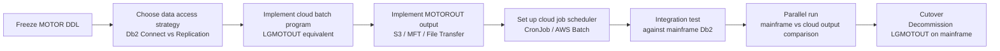

# GenApp — Motor Domain: Migration Effort Analysis (Step 9)

> Scope: Migrating the **Motor domain** off the mainframe to a cloud platform.  
> Inputs: Steps 6–8 analysis, scanner database, boundary document, hotspots report.

---

## 1. Executive Summary

The Motor domain has the **smallest boundary surface** of any GenApp domain:
- **One program** (`LGMOTOUT`) — a pure PL/I batch program, no CICS, no inter-program calls.
- **One inbound shared table** (`GENASA1.MOTOR`) — read-only, written by the Policy domain.
- **One outbound file** (`MOTOROUT` QSAM) — consumed downstream, no known cloud equivalent today.

Despite its small surface, migration introduces **five migration dependencies** that must be resolved before the domain can run independently in the cloud. These are ranked by risk below.

---

## 2. Motor Domain Migration Dependencies

### 2.1 Shared Data: MOTOR Table (Db2)

| Attribute | Detail |
|---|---|
| **Dependency type** | Inbound data — Motor domain reads data that the Policy domain writes |
| **Current mechanism** | Embedded SQL cursor (`SELECT … FOR READ ONLY` on `GENASA1.MOTOR`) inside LGMOTOUT |
| **Programs involved** | LGMOTOUT (reader), LGAPDB01 (writer), LGIPDB01 (reader) |
| **Migration risk** | 🔴 High |

**Why it matters**  
When LGMOTOUT moves to the cloud, it can no longer issue embedded SQL against the mainframe Db2 instance directly. The cloud program needs a mechanism to access the MOTOR data. Options include:
- **Db2 Connect / JDBC**: Cloud service connects directly to the mainframe Db2 using Db2 Connect. Lowest code change, highest operational coupling — Db2 must be reachable from the cloud network.
- **Data replication**: Motor table is replicated to a cloud database (e.g., IBM Db2 on Cloud, PostgreSQL, Aurora) using CDC (Db2 IIDR). The cloud service reads from the replica. Decouples runtime but adds replication lag.
- **REST/API gateway**: A new mainframe API exposes MOTOR rows over HTTPS/REST. The cloud service calls the API. Highest decoupling, requires a new mainframe API component.

**Recommended approach**: Db2 Connect for the initial lift, with a replication strategy as the target state.

---

### 2.2 Policy FK Constraint (POLICY → MOTOR referential integrity)

| Attribute | Detail |
|---|---|
| **Dependency type** | Db2 FK — `MOTOR.policyNumber` references `POLICY.policyNumber` |
| **Current mechanism** | Db2 enforces referential integrity at the database layer |
| **Migration risk** | 🟠 Medium |

**Why it matters**  
The MOTOR table's `policyNumber` is a FK to the `POLICY` table. When the Motor domain runs on the cloud:
- If it reads from the mainframe Db2 (Db2 Connect / API), the FK constraint is still enforced by Db2 — no action needed.
- If it reads from a replicated copy, the replica may not have FK enforcement. Motor rows may reference policies that have since been deleted (cascade-delete on mainframe is not replicated as a constraint). This can cause referential integrity violations in downstream consumers.

**Recommended approach**: Validate that cascade-deletes on the mainframe Db2 are reflected in the replica within acceptable latency. Add an application-level consistency check in the cloud service if needed.

---

### 2.3 Output Channel: MOTOROUT QSAM File

| Attribute | Detail |
|---|---|
| **Dependency type** | Outbound data — cloud service must write to or replace the MOTOROUT dataset |
| **Current mechanism** | QSAM FB/132 sequential file written via PL/I `WRITE FILE(MOTOROUT)` |
| **Migration risk** | 🟠 Medium |

**Why it matters**  
`MOTOROUT` is consumed by a downstream process (not visible in the workspace). The 132-byte fixed-block layout is the current "API" between LGMOTOUT and its consumer. When the cloud service replaces LGMOTOUT, the consumer must either:
- Receive the same 132-byte format (the cloud service writes to an S3 object, SFTP, or mainframe dataset via FTP/MFT).
- Accept a new format (JSON, CSV, Parquet) if the consumer is also modernised.

**Recommended approach**: In the first migration phase, write a 132-byte format output to S3 or a file transfer endpoint so existing downstream consumers require no change. Plan a format modernisation separately.

---

### 2.4 Job Invocation: JCL → Cloud Scheduler

| Attribute | Detail |
|---|---|
| **Dependency type** | Operational — how the batch job is triggered |
| **Current mechanism** | JCL step `PGM=LGMOTOUT` (no dedicated JCL exists in this workspace; invoked by a JCL job scheduler) |
| **Migration risk** | 🟡 Low–Medium |

**Why it matters**  
LGMOTOUT is today triggered by a mainframe job scheduler (TWS/OPC, CA7, or equivalent). When it moves to the cloud, the job scheduler must be replaced by a cloud-native equivalent: Kubernetes CronJob, AWS Batch, Azure Batch, IBM Cloud Scheduler, or an event-driven trigger. The scheduling dependency and SLA (run time, retry policy, notification on failure) must be captured before migration.

**Recommended approach**: Map the existing JCL job schedule to the cloud scheduler before Go Live. Ensure failure alerting (currently via SYSOUT + PLIRETC) is replaced with cloud-native observability (CloudWatch, Azure Monitor, IBM Log Analysis).

---

### 2.5 Error Handling: LGSTSQ and DISPLAY()

| Attribute | Detail |
|---|---|
| **Dependency type** | Infrastructure — error logging |
| **Current mechanism** | `DISPLAY()` writes to SYSOUT; `PLIRETC()` sets the job return code |
| **Migration risk** | 🟢 Low |

**Why it matters**  
Unlike the online programs, `LGMOTOUT` does **not** call `LGSTSQ` (it has no CICS context). Its error handling uses `DISPLAY()` (writes to SYSOUT / job log) and `PLIRETC()` (sets the JCL return code for the step). In the cloud, these translate directly:
- `DISPLAY()` → structured log output (stdout/stderr captured by the container runtime or batch platform).
- `PLIRETC()` → process exit code.

**This is the lowest-risk migration dependency** — no CICS dependency and the error model maps cleanly to cloud conventions.

---

## 3. Highly Coupled Programs and Shared Data

| Item | Coupling Type | Motor Impact | Risk |
|---|---|---|---|
| `LGAPDB01` — writes MOTOR table | Shared Db2 table (write path) | Motor domain reads what LGAPDB01 writes; if LGAPDB01 changes MOTOR schema, LGMOTOUT must be updated | 🔴 High |
| `LGIPDB01` — reads MOTOR table | Shared Db2 table (read contention) | Low risk — both are readers after LGAPDB01 writes; no write contention | 🟢 Low |
| `POLICY` table (FK parent) | Db2 FK cascade | Cascade-deletes on POLICY propagate to MOTOR — must be visible in cloud read model | 🟠 Medium |
| `LGSTSQ` | Shared error utility | Not used by LGMOTOUT — **no risk** | 🟢 None |
| `LGCMAREA.inc` | Shared COMMAREA | Not used by LGMOTOUT — **no risk** | 🟢 None |

---

## 4. Migration Risk Register

| # | Risk | Likelihood | Impact | Mitigation |
|---|---|---|---|---|
| R1 | Cloud service cannot reach mainframe Db2 | Medium | High | Configure Db2 Connect or set up data replication before migration |
| R2 | MOTOR table schema changes during migration | Low | High | Freeze MOTOR DDL during the migration sprint; add schema version check |
| R3 | Downstream consumer of MOTOROUT cannot read cloud output | Medium | Medium | Maintain 132-byte FB format in initial cloud output; migrate consumer separately |
| R4 | Cascade-delete on POLICY not reflected in cloud replica | Low | Medium | Add consistency validation job; monitor delete events |
| R5 | Job scheduling SLA not met by cloud scheduler | Low | Medium | Benchmark cloud scheduler timing; add monitoring and alerting |
| R6 | LGAPBR01 (missing COBOL source) blocks Motor data path | Low | Low | LGAPBR01 is in the Policy add path, not Motor read path — no direct Motor risk |

---

## 5. Migration Effort Estimate (Indicative)

| Work Item | Effort |
|---|---|
| Translate LGMOTOUT PL/I → Java/Python/Go batch service | Medium (clean program, 217 lines, cyclomatic 9) |
| Implement Db2 data access (JDBC or Db2 Connect) | Low–Medium |
| Implement MOTOROUT output (S3 / MFT) | Low |
| Set up cloud job scheduler | Low |
| Replace DISPLAY/PLIRETC with cloud logging/exit codes | Low |
| Integration test with Policy domain Db2 data | Medium |
| End-to-end output validation (compare mainframe vs cloud output) | Medium |

**Overall migration complexity for Motor domain: LOW** — it is the simplest domain to migrate from a coupling and complexity standpoint.

---

## 6. Critical Path

The critical path dependency is **data access strategy** (step B). All other work items are parallel once the data access method is confirmed.
