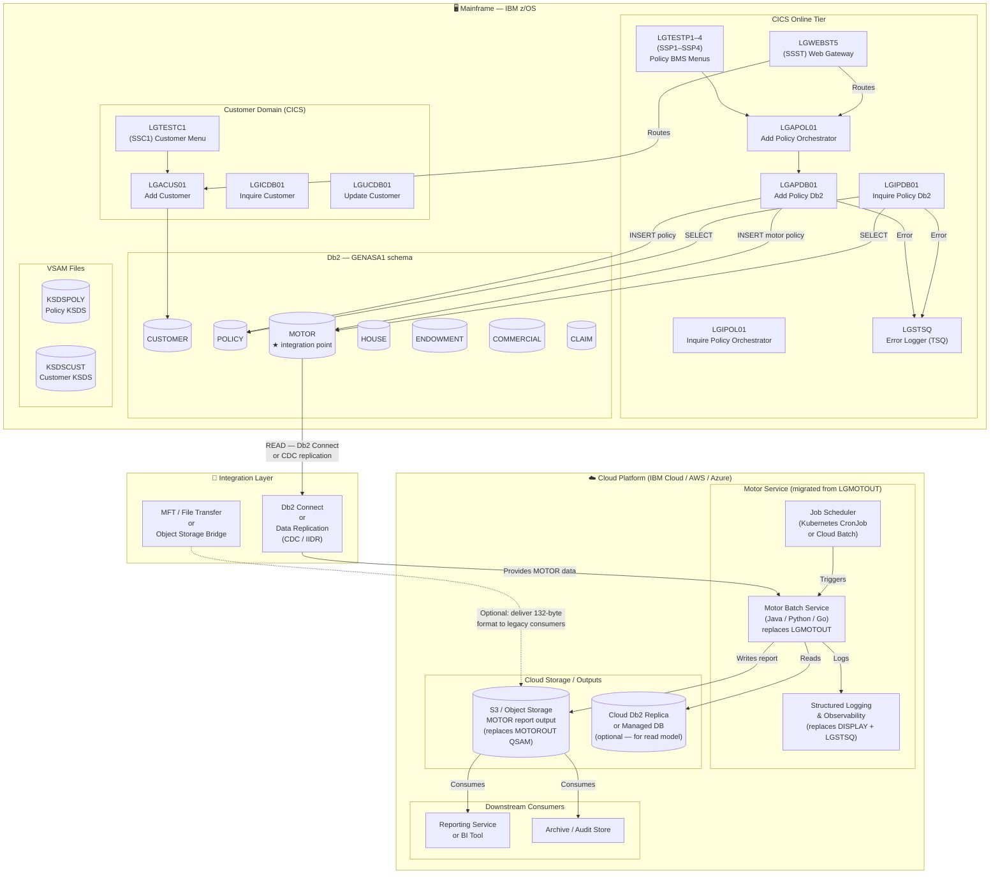

# GenApp — To-Be Architecture: Motor Domain Migrated to Cloud (Step 10)

> Assumption: The **Motor domain** (`LGMOTOUT` batch program) has been migrated to a cloud platform.  
> The remaining GenApp domains (Customer, Policy, Batch Reporting, Infrastructure) continue to run on the mainframe as-is.  
> This document describes the high-level integration architecture for the hybrid state.

---

## 1. Architecture Overview

The to-be state is a **hybrid mainframe + cloud architecture**:

- The mainframe continues to own and write all master data (CUSTOMER, POLICY, MOTOR tables in Db2).
- The cloud-hosted Motor service replaces `LGMOTOUT` as a batch data extraction and reporting pipeline.
- Integration between the two platforms occurs through **one of the data access patterns** described below.

---

## 2. High-Level Architecture Diagram



---

## 3. Integration Patterns

### 3.1 Data Access: Mainframe Db2 → Cloud Motor Service

Two patterns are viable, and the choice depends on latency and decoupling requirements:

| Pattern | Description | Pros | Cons |
|---|---|---|---|
| **Db2 Connect (direct)** | Cloud service connects to mainframe Db2 via Db2 Connect over an encrypted network link (TLS). The Motor service issues JDBC queries directly against `GENASA1.MOTOR`. | No replication lag; always reads current data; minimal infrastructure overhead. | Runtime coupling — cloud service availability depends on mainframe Db2 availability. Network latency. |
| **CDC Replication (Db2 IIDR)** | IBM Db2 IIDR (or equivalent CDC) replicates changes from `GENASA1.MOTOR` to a managed cloud database (Db2 on Cloud, PostgreSQL, Aurora). Motor service reads the replica. | Decoupled runtime; cloud service unaffected by mainframe downtime windows; enables future analytics/ML on the replica. | Replication lag (minutes); replica may not have FK enforcement; adds operational complexity. |

**Recommended**: Start with Db2 Connect for the initial migration. Add CDC replication as a future-state target once operational readiness is established.

---

### 3.2 Output: MOTOROUT QSAM → Cloud Object Storage

| Phase | Approach |
|---|---|
| **Phase 1 (compatibility)** | Cloud Motor service writes a **132-byte FB format output** to S3 or Azure Blob Storage. An MFT gateway optionally copies the file to a mainframe dataset to feed any existing legacy consumers without change. |
| **Phase 2 (modernisation)** | Cloud Motor service writes a **structured format** (JSON Lines, CSV, Parquet) to object storage. Downstream consumers are updated to read the new format. Legacy consumers decommissioned. |

---

### 3.3 Job Scheduling

| Current (Mainframe) | To-Be (Cloud) |
|---|---|
| JCL step `PGM=LGMOTOUT` triggered by TWS/OPC or CA7 | **Kubernetes CronJob** (if containerised) or **Cloud Batch** (AWS Batch / Azure Batch / IBM Cloud) triggered on the same schedule |
| Job failure → JCL step RC + job log | Job failure → structured log → Cloud alerting (CloudWatch, Azure Monitor, IBM Log Analysis) → PagerDuty / Slack notification |

---

### 3.4 Error Handling and Observability

| Current | To-Be |
|---|---|
| `DISPLAY()` → SYSOUT (job log) | stdout/stderr → captured by container runtime → forwarded to centralised log platform |
| `PLIRETC(8/12)` → JCL step return code | Process exit code → read by cloud scheduler; non-zero triggers retry / alert |
| No LGSTSQ (LGMOTOUT is batch) | Structured log entries (JSON) with correlation IDs, severity levels, timestamps |

---

## 4. What Stays on the Mainframe (Unchanged)

| Component | Reason Unchanged |
|---|---|
| LGAPDB01, LGIPDB01, LGDPDB01 | Policy domain programs — still run on mainframe CICS |
| GENASA1.MOTOR (Db2 table) | Still owned and written by the Policy domain on the mainframe |
| GENASA1.POLICY, CUSTOMER, etc. | All other tables — unchanged |
| LGSTSQ, LGCMAREA.inc | Shared utilities for the CICS tier — unchanged |
| LGWEBST5 | Web gateway — still routes to mainframe CICS programs |
| KSDSPOLY, KSDSCUST (VSAM) | VSAM stores — unchanged (Policy and Customer domains remain on mainframe) |

---

## 5. Security and Network Architecture

| Concern | Approach |
|---|---|
| **Network connectivity** | IBM Secure Gateway / Direct Link / ExpressRoute / AWS Direct Connect between mainframe and cloud VPC |
| **Db2 Connect authentication** | Db2 Connect uses Db2 user credentials; stored in cloud secret management (Vault, AWS Secrets Manager, Azure Key Vault) |
| **Data encryption in transit** | TLS 1.2+ on all Db2 Connect and MFT connections |
| **Data encryption at rest** | S3 / Blob Storage server-side encryption for MOTOROUT objects |
| **IAM** | Cloud Motor service runs under a dedicated service account with least-privilege access to storage and logging |

---

## 6. Summary: What Changed and What Didn't

```
BEFORE (all mainframe)                  AFTER (Motor on cloud)
──────────────────────────────────────  ────────────────────────────────────────
JCL → PGM=LGMOTOUT (z/OS)              Cloud Scheduler → Motor Service (cloud)
  │                                       │
  ├─ reads GENASA1.MOTOR (Db2)            ├─ reads GENASA1.MOTOR via Db2 Connect
  │                                       │    OR reads from CDC replica
  └─ writes MOTOROUT (QSAM)              └─ writes to S3 / Object Storage
                                               (optionally bridged to QSAM via MFT)

No change to:
  • LGAPDB01 (writes MOTOR on mainframe CICS)
  • LGIPDB01 (reads MOTOR on mainframe CICS)
  • POLICY, CUSTOMER, VSAM stores
  • LGSTSQ, LGWEBST5, all CICS tier programs
```

The mainframe remains the **system of record** for all insurance policy data. The cloud hosts only the **reporting extraction pipeline** — a read-only consumer of the MOTOR table. This is the safest possible first migration step for the GenApp application.
