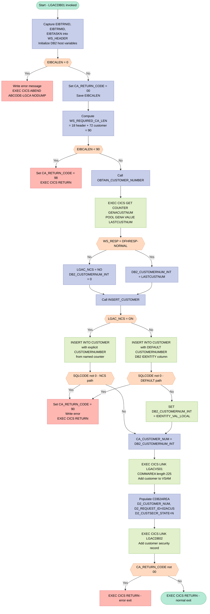
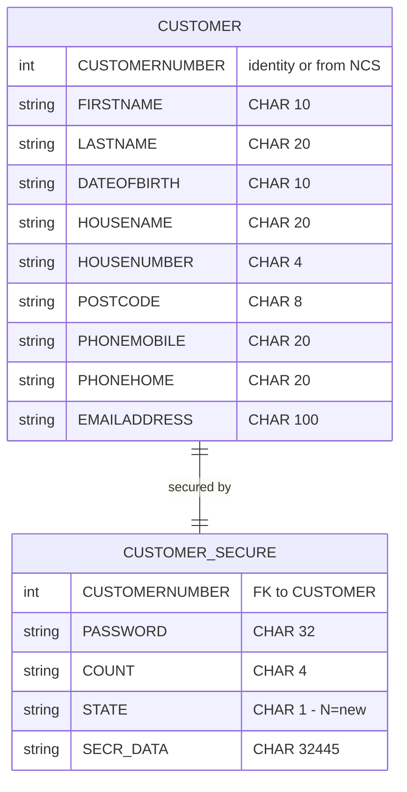

## Table of Contents

- [1. Purpose](#1-purpose)
- [2. Inputs](#2-inputs)
  - [2.1 CICS Communication Area (COMMAREA) — passed in via `COMM_AREA_PTR`](#21-cics-communication-area-commarea--passed-in-via-comm_area_ptr)
  - [2.2 CICS Runtime Fields (EIB — Execute Interface Block)](#22-cics-runtime-fields-eib--execute-interface-block)
  - [2.3 CICS Named Counter Service](#23-cics-named-counter-service)
  - [2.4 DB2 Database (`CUSTOMER` table)](#24-db2-database-customer-table)
  - [2.5 Linked Subprogram Response (`LGACDB02` — Customer Security Add)](#25-linked-subprogram-response-lgacdb02--customer-security-add)
- [3. Outputs](#3-outputs)
- [4. Processing Logic](#4-processing-logic)
  - [4.1 Mermaid Flow Diagram](#41-mermaid-flow-diagram)
  - [4.2 Processing Logic Description](#42-processing-logic-description)
  - [4.3 Database Tables](#43-database-tables)
- [5. Paragraphs](#5-paragraphs)
- [6. Dependencies](#6-dependencies)
  - [6.1 CICS Runtime Environment](#61-cics-runtime-environment)
  - [6.2 CICS Services Used](#62-cics-services-used)
  - [6.3 DB2 Database](#63-db2-database)
  - [6.4 External Programs / Subprograms](#64-external-programs--subprograms)
  - [6.5 CICS Named Counter Resource](#65-cics-named-counter-resource)
  - [6.6 Copybook / Include File](#66-copybook--include-file)
  - [6.7 Input COMMAREA (Caller-Supplied)](#67-input-commarea-caller-supplied)
- [7. Constraints](#7-constraints)
  - [7.1 Communication Area (COMMAREA) Validation Constraints](#71-communication-area-commarea-validation-constraints)
  - [7.2 DB2 Insert and Customer Number Constraints](#72-db2-insert-and-customer-number-constraints)
  - [7.3 Named Counter Service (NCS) Availability Constraint](#73-named-counter-service-ncs-availability-constraint)
  - [7.4 Sequencing and Ordering Constraints](#74-sequencing-and-ordering-constraints)
  - [7.5 Downstream Subprogram Interface Constraints](#75-downstream-subprogram-interface-constraints)
  - [7.6 Error Logging Constraints](#76-error-logging-constraints)
- [8. Error Handling](#8-error-handling)
  - [8.1 Input Validation — Communication Area (COMMAREA) Checks](#81-input-validation--communication-area-commarea-checks)
  - [8.2 CICS Named Counter Service Failure Handling](#82-cics-named-counter-service-failure-handling)
  - [8.3 DB2 Error Handling](#83-db2-error-handling)
  - [8.4 Return Code Propagation and Caller Notification](#84-return-code-propagation-and-caller-notification)
  - [8.5 Error Logging via WRITE_ERROR_MESSAGE Procedure](#85-error-logging-via-write_error_message-procedure)
- [9. Examples](#9-examples)
  - [9.1 Example 1: Successful New Customer Add (Named Counter Service Available)](#91-example-1-successful-new-customer-add-named-counter-service-available)
  - [9.2 Example 2: COMMAREA Too Short — Length Validation Failure](#92-example-2-commarea-too-short--length-validation-failure)
  - [9.3 Example 3: Named Counter Unavailable — DB2 IDENTITY Column Used](#93-example-3-named-counter-unavailable--db2-identity-column-used)
  - [9.4 Example 4: DB2 INSERT Failure](#94-example-4-db2-insert-failure)

## 1. Purpose

This program adds a new customer to the insurance application’s customer domain by accepting customer details from a CICS commarea, validating that the request contains the required data, creating and storing a new customer record in the DB2 CUSTOMER table, assigning the newly created customer number back to the caller, and then triggering related follow-on processing to keep other customer resources in sync, including a linked VSAM-side update and creation of the customer’s initial security record. Its purpose is to complete the end-to-end “add customer” business transaction and return a status code that tells the caller whether the operation succeeded or failed.

## 2. Inputs

### 2.1 CICS Communication Area (COMMAREA) — passed in via `COMM_AREA_PTR`

The program entry point is `LGACDB01: Proc(COMM_AREA_PTR) Options(Main)`. The entire COMMAREA is the primary external input, overlaid by the `COMM_AREA` based structure. The following fields within it are consumed as inputs:

- **`CA_REQUEST_ID`** (`CHAR(6)`) — Identifies the operation type being requested. Passed in by the caller to direct processing (not modified by this program).
- **`CA_FIRST_NAME`** (`CHAR(10)`) — Customer's first name; used directly as a DB2 host variable to populate the `FIRSTNAME` column of the `CUSTOMER` table.
- **`CA_LAST_NAME`** (`CHAR(20)`) — Customer's last name/surname; used as a DB2 host variable to populate the `LASTNAME` column.
- **`CA_DOB`** (`CHAR(10)`) — Customer's date of birth; used as a DB2 host variable to populate the `DATEOFBIRTH` column.
- **`CA_HOUSE_NAME`** (`CHAR(20)`) — Customer's house/property name; used as a DB2 host variable to populate the `HOUSENAME` column.
- **`CA_HOUSE_NUM`** (`CHAR(4)`) — Customer's house number; used as a DB2 host variable to populate the `HOUSENUMBER` column.
- **`CA_POSTCODE`** (`CHAR(8)`) — Customer's postal code; used as a DB2 host variable to populate the `POSTCODE` column.
- **`CA_PHONE_MOBILE`** (`CHAR(20)`) — Customer's mobile phone number; used as a DB2 host variable to populate the `PHONEMOBILE` column.
- **`CA_PHONE_HOME`** (`CHAR(20)`) — Customer's home phone number; used as a DB2 host variable to populate the `PHONEHOME` column.
- **`CA_EMAIL_ADDRESS`** (`CHAR(100)`) — Customer's email address; used as a DB2 host variable to populate the `EMAILADDRESS` column.

### 2.2 CICS Runtime Fields (EIB — Execute Interface Block)

These are read-only fields provided by the CICS runtime at program invocation:

- **`EIBCALEN`** — Length of the inbound COMMAREA. Used to validate that the COMMAREA is large enough (minimum 90 bytes: 18-byte header + 72-byte customer section); if zero, the program abends (`LGCA`); if less than required, `CA_RETURN_CODE` is set to `'98'` and the program returns immediately.
- **`EIBTRNID`** — CICS transaction identifier for the current invocation; stored in `WS_TRANSID` for diagnostic/logging purposes.
- **`EIBTRMID`** — CICS terminal identifier; stored in `WS_TERMID` for diagnostic/logging purposes.
- **`EIBTASKN`** — CICS task number; stored in `WS_TASKNUM` for diagnostic/logging purposes.

### 2.3 CICS Named Counter Service

- **`GENACUSTNUM`** (counter name, pool `GENA`) — The CICS named counter from which the next available customer number is retrieved via `EXEC CICS GET COUNTER`. Its value is received into `LASTCUSTNUM` and then fed into the DB2 INSERT as the explicit `CUSTOMERNUMBER`. If the counter service is unavailable (`WS_RESP ≠ NORMAL`), the DB2 `IDENTITY` column default is used instead.

### 2.4 DB2 Database (`CUSTOMER` table)

- **`IDENTITY_VAL_LOCAL()`** — When the named counter service is unavailable, DB2 assigns the customer number automatically via an identity column, and the program retrieves it back using `SET :DB2_CUSTOMERNUM_INT = IDENTITY_VAL_LOCAL()`. This makes the DB2 identity generator an implicit external input that determines the new customer number.

### 2.5 Linked Subprogram Response (`LGACDB02` — Customer Security Add)

- **`D2_RETURN_CODE`** (within `CDB2AREA`) — The return code written back into the `CDB2AREA` commarea by the `LGACDB02` subprogram after it is invoked via `EXEC CICS LINK`. Although not explicitly tested after the LINK in the current code, it is a value originating from outside this program's logic.

## 3. Outputs

**Communication Area (COMMAREA) — returned to the caller via `EXEC CICS RETURN`**

- `CA_RETURN_CODE` — Two-digit outcome code written back to the caller in `COMM_AREA`; set to `'00'` on success, `'98'` when the incoming COMMAREA is shorter than the required 90 bytes, and `'90'` when the DB2 INSERT into the CUSTOMER table fails
- `CA_CUSTOMER_NUM` — Ten-digit customer number written into `COMM_AREA` after a successful INSERT; sourced from the CICS named counter (`LASTCUSTNUM`) when the counter service is available, or from DB2's `IDENTITY_VAL_LOCAL()` when it is not

**DB2 Database — written by `EXEC SQL INSERT INTO CUSTOMER`**

- `CUSTOMER` table row — A new customer record inserted into the DB2 CUSTOMER table; the columns populated are:
  - `CUSTOMERNUMBER` — from `DB2_CUSTOMERNUM_INT` (named counter value) or `DEFAULT` (DB2 identity column)
  - `FIRSTNAME` — from `CA_FIRST_NAME`
  - `LASTNAME` — from `CA_LAST_NAME`
  - `DATEOFBIRTH` — from `CA_DOB`
  - `HOUSENAME` / `HOUSENUMBER` — from `CA_HOUSE_NAME` / `CA_HOUSE_NUM`
  - `POSTCODE` — from `CA_POSTCODE`
  - `PHONEMOBILE` / `PHONEHOME` — from `CA_PHONE_MOBILE` / `CA_PHONE_HOME`
  - `EMAILADDRESS` — from `CA_EMAIL_ADDRESS`

**Downstream CICS LINK calls — side-effect outputs passed to linked programs**

- LGACVS01 call — `COMM_AREA` (225 bytes) is passed via `EXEC CICS LINK PROGRAM(LGACVS01)`; the program writes the new customer to VSAM as a parallel store alongside the DB2 INSERT
- LGACDB02 call — `CDB2AREA` commarea passed via `EXEC CICS LINK PROGRAM(LGACDB02)` to add the customer security record; the fields written into this commarea are:
  - `D2_CUSTOMER_NUM` — newly assigned customer number, sourced from `DB2_CUSTOMERNUM_INT`
  - `D2_REQUEST_ID` — hardcoded to `'02ACUS'` to identify the Add Customer Security operation
  - `D2_CUSTSECR_PASS` — hardcoded initial password hash passed to the security subprogram
  - `D2_CUSTSECR_COUNT` — hardcoded to `'0000'` (no prior logins)
  - `D2_CUSTSECR_STATE` — set to `'N'` to mark the security record as new

**Error / diagnostic output — written to a CICS Transient Data Queue (TDQ) via `LGSTSQ`**

- `ERROR_MSG` — Structured error message containing date, time, program identifier (`LGACDB01`), SQL request label (`EM_SQLREQ`), and the DB2 `SQLCODE` at the time of failure; written by `EXEC CICS LINK PROGRAM('LGSTSQ')` on any DB2 error or missing COMMAREA condition
- `CA_ERROR_MSG` — Up to 90 bytes of the raw incoming COMMAREA captured at error time and forwarded to `LGSTSQ` as a second diagnostic write, giving the operator visibility of the data that caused the failure

**CICS ABEND — issued when no COMMAREA is present**

- `EXEC CICS ABEND ABCODE('LGCA') NODUMP` — raised when `EIBCALEN = 0`; this is a terminal side-effect that abnormally terminates the transaction and produces a CICS abend record with code `LGCA`

## 4. Processing Logic

### 4.1 Mermaid Flow Diagram

---

### 4.2 Processing Logic Description

#### 4.2.1 High-level Summary

`LGACDB01` is a CICS-linked PL/I program that adds a new customer record to the DB2 `CUSTOMER` table. It obtains a unique customer number via the CICS Named Counter Service, inserts the full customer record into DB2, mirrors the record into a VSAM datastore by calling `LGACVS01`, and then provisions an initial customer security record by calling `LGACDB02`. It returns a structured result code to its caller through the COMMAREA.

---

#### 4.2.2 Execution Flow

**Step 1 — Initialization**
The program is invoked via `EXEC CICS LINK` with a pointer to the caller's COMMAREA (`COMM_AREA_PTR`). On entry, it captures the CICS EIB fields `EIBTRNID`, `EIBTRMID`, and `EIBTASKN` into the working-storage header for diagnostics, and zeroes out the DB2 host variable structure.

**Step 2 — COMMAREA Presence Check**
If `EIBCALEN = 0` (no COMMAREA at all), the program writes a diagnostic error message to the CICS TS error queue (via `LGSTSQ`) and issues `EXEC CICS ABEND ABCODE('LGCA') NODUMP`, terminating the task immediately.

**Step 3 — COMMAREA Length Validation**
`CA_RETURN_CODE` is initialized to `'00'`. The program computes the minimum required COMMAREA length as `WS_CA_HEADER_LEN (18) + WS_CUSTOMER_LEN (72) = 90 bytes`. If `EIBCALEN < 90`, it sets `CA_RETURN_CODE = '98'` and returns to the caller — no DB2 work is performed.

**Step 4 — Obtain Customer Number (`OBTAIN_CUSTOMER_NUMBER`)**
The program issues `EXEC CICS GET COUNTER(GENACUSTNUM) POOL(GENA) VALUE(LASTCUSTNUM)` to retrieve the next sequential customer number from the CICS Named Counter Service.
- If the call succeeds (`WS_RESP = DFHRESP(NORMAL)`), `DB2_CUSTOMERNUM_INT` is set from `LASTCUSTNUM` and the flag `LGAC_NCS` remains `'ON'`.
- If the call fails, `LGAC_NCS` is set to `'NO'` and `DB2_CUSTOMERNUM_INT` is set to `0`, signalling the fallback path.

**Step 5 — Insert Customer Row (`INSERT_CUSTOMER`)**

*Named Counter path (`LGAC_NCS = 'ON'`):*
An `INSERT INTO CUSTOMER` statement is executed with all ten columns explicitly supplied, including `CUSTOMERNUMBER = :DB2_CUSTOMERNUM_INT` from the named counter. If `SQLCODE ≠ 0`, `CA_RETURN_CODE` is set to `'90'`, an error message is written, and the program returns immediately.

*Fallback path (`LGAC_NCS = 'NO'`):*
The same `INSERT` is issued but with `DEFAULT` for `CUSTOMERNUMBER`, allowing the DB2 IDENTITY column to generate the value automatically. On `SQLCODE ≠ 0`, the same `'90'` error path is taken. On success, `EXEC SQL SET :DB2_CUSTOMERNUM_INT = IDENTITY_VAL_LOCAL()` recovers the DB2-generated customer number.

In both paths, after a successful INSERT, `CA_CUSTOMER_NUM` is set from `DB2_CUSTOMERNUM_INT` and returned to the caller in the COMMAREA.

**Step 6 — VSAM Mirror (`LGACVS01`)**
`EXEC CICS LINK PROGRAM(LGACVS01)` is called with the original COMMAREA (length 225). This writes a corresponding customer record to the VSAM keyed datastore, keeping the two datastores in sync.

**Step 7 — Customer Security Record (`LGACDB02`)**
The program populates the `CDB2AREA` structure:
- `D2_CUSTOMER_NUM` ← `DB2_CUSTOMERNUM_INT` (the newly assigned number)
- `D2_REQUEST_ID` = `'02ACUS'` (Add Customer Security)
- `D2_CUSTSECR_PASS` = a fixed initial hashed password
- `D2_CUSTSECR_COUNT` = `'0000'`
- `D2_CUSTSECR_STATE` = `'N'` (new)

`EXEC CICS LINK PROGRAM(LGACDB02)` is then called to insert the security row into the `CUSTOMER_SECURE` table.

**Step 8 — Final Return Code Check**
If `CA_RETURN_CODE ≠ '00'` after the security call, the program exits via `EXEC CICS RETURN` immediately (propagating the error). Otherwise a final `EXEC CICS RETURN` returns control normally to the caller.

**Error Handling — `WRITE_ERROR_MESSAGE`**
Called on any DB2 failure. It:
1. Saves the current `SQLCODE` into the error message structure.
2. Calls `EXEC CICS ASKTIME` / `EXEC CICS FORMATTIME` to get the current date and time.
3. Links to `LGSTSQ` to write the formatted error message to the CICS TD error queue.
4. Writes up to 90 bytes of the raw COMMAREA content to the same queue for additional context.

---

#### 4.2.3 External Interactions

| System | Call | Purpose |
|--------|------|---------|
| CICS Named Counter Service | `EXEC CICS GET COUNTER GENACUSTNUM POOL GENA` | Allocate the next unique customer number |
| DB2 `CUSTOMER` table | `EXEC SQL INSERT INTO CUSTOMER` | Persist the new customer's personal details |
| DB2 `IDENTITY_VAL_LOCAL()` | `EXEC SQL SET ... = IDENTITY_VAL_LOCAL()` | Retrieve the DB2-generated identity value when the NCS is unavailable |
| CICS program `LGACVS01` | `EXEC CICS LINK` | Mirror the new customer record to the VSAM datastore |
| CICS program `LGACDB02` | `EXEC CICS LINK` | Create the initial customer security (password/state) record in DB2 |
| CICS program `LGSTSQ` | `EXEC CICS LINK` | Write error messages to the CICS transient data queue |

---

#### 4.2.4 Plain Language Summary

When a new customer needs to be registered in the system, `LGACDB01` is called with the customer's details (name, date of birth, address, phone, email). It first checks that the request is well-formed. It then fetches a unique customer ID number from a CICS counter service. Using that ID, it saves the customer record to the DB2 database. It also saves a copy to a secondary VSAM file to keep both datastores consistent. Finally, it creates an initial security record for the new customer — with a default password and a "new" status — in a separate security table. If anything goes wrong at any point, an error code is returned to the calling program and a diagnostic message is logged.

---

### 4.3 Database Tables

## 5. Paragraphs

- **Main Procedure (LGACDB01 inline body)**
  - Serves as the program's entry point and top-level control flow driver. It is executed first when CICS transfers control to the program via `EXEC CICS LINK`.
  - Initializes working-storage diagnostic fields (`WS_TRANSID`, `WS_TERMID`, `WS_TASKNUM`) from the CICS Execute Interface Block fields `EIBTRNID`, `EIBTRMID`, and `EIBTASKN`, and resets the DB2 output integer area to zero.
  - Validates the incoming communication area:
    - If `EIBCALEN` (the length of the passed COMMAREA) is zero, it populates an error message text, calls `WRITE_ERROR_MESSAGE`, and issues `EXEC CICS ABEND ABCODE('LGCA') NODUMP` to terminate abnormally without producing a dump.
    - Sets `CA_RETURN_CODE` to `'00'` (success) and saves the COMMAREA pointer and length for later use.
    - Computes the minimum required COMMAREA length by summing `WS_CA_HEADER_LEN` (18 bytes) and `WS_CUSTOMER_LEN` (72 bytes) into `WS_REQUIRED_CA_LEN`. If `EIBCALEN` is less than this sum, sets `CA_RETURN_CODE` to `'98'` and issues `EXEC CICS RETURN` immediately.
  - Orchestrates the main customer-add workflow by calling the two internal procedures in sequence:
    - `CALL OBTAIN_CUSTOMER_NUMBER` — retrieves the next customer number.
    - `CALL INSERT_CUSTOMER` — inserts the new customer row into DB2.
  - After the DB2 insert, issues `EXEC CICS LINK PROGRAM(LGACVS01)` passing the full COMMAREA (225 bytes) to replicate the customer record into the VSAM data store.
  - Prepares the `CDB2AREA` structure for the customer security sub-program:
    - Sets `D2_CUSTOMER_NUM` from `DB2_CUSTOMERNUM_INT` (the assigned customer number).
    - Sets `D2_REQUEST_ID` to `'02ACUS'` (Add Customer Security).
    - Supplies a fixed initial password, count of `'0000'`, and state flag `'N'` (new).
  - Issues `EXEC CICS LINK PROGRAM(LGACDB02)` passing `CDB2AREA` to add the customer security record.
  - Checks `CA_RETURN_CODE`; if non-`'00'`, returns immediately via `EXEC CICS RETURN`.
  - Returns control to the caller with a final `EXEC CICS RETURN`.

- **OBTAIN_CUSTOMER_NUMBER**
  - Retrieves the next available customer number from the CICS Named Counter Service using the counter name `GENACUSTNUM` and pool `GENA`.
  - Issues `EXEC CICS GET COUNTER(GENACOUNT) POOL(GENAPOOL) VALUE(LASTCUSTNUM) RESP(WS_RESP)` to atomically fetch and increment the counter. The resulting value is stored in `LASTCUSTNUM`.
  - Conditional logic branches on the CICS response code `WS_RESP`:
    - If the response is not `DFHRESP(NORMAL)` (i.e., the Named Counter Service is unavailable or failed), sets `LGAC_NCS` to `'NO'` and `DB2_CUSTOMERNUM_INT` to `0`, signalling downstream logic to fall back to the DB2 IDENTITY column default.
    - If the response is normal, copies `LASTCUSTNUM` into `DB2_CUSTOMERNUM_INT` for use as the explicit customer number in the forthcoming DB2 INSERT.
  - No external file I/O or direct DB2 interaction; the only external dependency is the CICS Named Counter Service.

- **INSERT_CUSTOMER**
  - Performs the DB2 INSERT of the new customer record into the `CUSTOMER` table, using one of two strategies depending on the availability of the Named Counter Service (governed by `LGAC_NCS`).
  - Sets `EM_SQLREQ` to `' INSERT CUSTOMER'` for inclusion in any subsequent error message.
  - **Named Counter available (`LGAC_NCS = 'ON'`):**
    - Executes an `EXEC SQL INSERT INTO CUSTOMER` statement supplying all ten columns explicitly, with `DB2_CUSTOMERNUM_INT` as the `CUSTOMERNUMBER` host variable and the remaining columns bound from COMMAREA fields (`CA_FIRST_NAME`, `CA_LAST_NAME`, `CA_DOB`, `CA_HOUSE_NAME`, `CA_HOUSE_NUM`, `CA_POSTCODE`, `CA_PHONE_MOBILE`, `CA_PHONE_HOME`, `CA_EMAIL_ADDRESS`).
    - After the INSERT, checks `SQLCODE`; if non-zero, sets `CA_RETURN_CODE` to `'90'`, calls `WRITE_ERROR_MESSAGE`, and issues `EXEC CICS RETURN`.
  - **Named Counter unavailable (`LGAC_NCS ≠ 'ON'`):**
    - Executes a second form of the `EXEC SQL INSERT INTO CUSTOMER` statement where `CUSTOMERNUMBER` is supplied as `DEFAULT`, allowing the DB2 IDENTITY column to generate the value automatically.
    - After the INSERT, checks `SQLCODE`; on failure, applies the same `'90'` / `WRITE_ERROR_MESSAGE` / `EXEC CICS RETURN` pattern.
    - On success, issues `EXEC SQL SET :DB2_CUSTOMERNUM_INT = IDENTITY_VAL_LOCAL()` to retrieve the DB2-generated customer number back into `DB2_CUSTOMERNUM_INT`, so it can be returned to the caller.
  - In both successful paths, assigns `CA_CUSTOMER_NUM = DB2_CUSTOMERNUM_INT` to expose the newly assigned customer number back through the COMMAREA.

- **WRITE_ERROR_MESSAGE**
  - A diagnostic utility procedure responsible for formatting and writing error information to a CICS Transient Data Queue (TDQ) via the shared logging program `LGSTSQ`.
  - Captures the current DB2 `SQLCODE` value into `EM_SQLRC` within the `ERROR_MSG` structure.
  - Obtains the current clock time using `EXEC CICS ASKTIME ABSTIME(WS_ABSTIME)`, then formats it into a human-readable date (`WS_DATE` in MMDDYYYY format) and time (`WS_TIME`) via `EXEC CICS FORMATTIME`.
  - Populates `EM_DATE` and `EM_TIME` in the error message structure, then issues `EXEC CICS LINK PROGRAM('LGSTSQ')` passing the `ERROR_MSG` structure to write the primary error record.
  - Conditional logic writes a secondary TDQ record containing up to 90 bytes of the raw COMMAREA (`COMM_AREA_RAW`) when `EIBCALEN > 0`:
    - If `EIBCALEN < 91`, copies exactly `EIBCALEN` bytes of the COMMAREA into `CA_DATA` using the `LEFT` built-in function.
    - Otherwise, copies the first 90 bytes.
    - In either case, issues a second `EXEC CICS LINK PROGRAM('LGSTSQ')` passing `CA_ERROR_MSG` to log the COMMAREA snapshot.
  - Does not alter any return codes or COMMAREA fields; its sole side effect is writing diagnostic records.

## 6. Dependencies

### 6.1 CICS Runtime Environment
- **EIBCALEN** — CICS Execution Interface Block field providing the length of the incoming COMMAREA; used to validate that the COMMAREA is present (abend `LGCA` if zero) and that it meets the minimum required length (18 + 72 = 90 bytes)
- **EIBTRNID, EIBTRMID, EIBTASKN** — EIB fields supplying the current transaction ID, terminal ID, and task number; stored into `WS_TRANSID`, `WS_TERMID`, and `WS_TASKNUM` for diagnostic/logging purposes
- **DFHRESP(NORMAL)** — CICS special response-code constant used to check whether the named counter GET succeeded

### 6.2 CICS Services Used
- **EXEC CICS GET COUNTER** — Named counter service; retrieves the next value from counter `GENACUSTNUM` in pool `GENA` to obtain the next customer number; result stored in `LASTCUSTNUM`
- **EXEC CICS ABEND ABCODE('LGCA') NODUMP** — Issued when EIBCALEN is zero (no COMMAREA received); terminates the task with a named abend code
- **EXEC CICS RETURN** — Returns control to the CICS caller at multiple points: after COMMAREA length failure (return code `'98'`), after DB2 INSERT failure (return code `'90'`), and on normal completion
- **EXEC CICS LINK PROGRAM(LGACVS01)** — Synchronous call to the VSAM customer-add backend; passes the full COMMAREA (225 bytes); executed after the DB2 INSERT succeeds
- **EXEC CICS LINK PROGRAM(LGACDB02)** — Synchronous call to the customer-security-add subprogram; passes `CDB2AREA` (32,500 bytes) containing the new customer number, request ID `'02ACUS'`, password, count, and state `'N'`
- **EXEC CICS LINK PROGRAM('LGSTSQ')** — Synchronous call to the shared logging/queue-write utility; called (up to three times) from `WRITE_ERROR_MESSAGE` to write the formatted error message and a COMMAREA dump to the CICS transient data queue
- **EXEC CICS ASKTIME / FORMATTIME** — Used within `WRITE_ERROR_MESSAGE` to obtain the current absolute time and format it into `WS_DATE` (MMDDYYYY) and `WS_TIME`

### 6.3 DB2 Database
- **CUSTOMER table** — The primary data target; a row is inserted via `EXEC SQL INSERT INTO CUSTOMER` with columns `CUSTOMERNUMBER`, `FIRSTNAME`, `LASTNAME`, `DATEOFBIRTH`, `HOUSENAME`, `HOUSENUMBER`, `POSTCODE`, `PHONEMOBILE`, `PHONEHOME`, `EMAILADDRESS`
  - When the named counter is available (`LGAC_NCS = 'ON'`), the explicit customer number from `DB2_CUSTOMERNUM_INT` is supplied
  - When the named counter is unavailable, `DEFAULT` is used for `CUSTOMERNUMBER` and `IDENTITY_VAL_LOCAL()` is called afterward to retrieve the DB2-generated identity value
- **SQLCA** — DB2 SQL Communications Area; included via `EXEC SQL INCLUDE SQLCA`; `SQLCODE` is checked after every INSERT and written to the error message on failure
- **EXEC SQL SET :DB2_CUSTOMERNUM_INT = IDENTITY_VAL_LOCAL()** — DB2 scalar function used to retrieve the identity column value assigned by the last INSERT when the named counter path is not taken

### 6.4 External Programs / Subprograms
- **LGACVS01** — CICS-linked VSAM customer-add program; receives the full COMMAREA; called unconditionally after the DB2 INSERT path completes
- **LGACDB02** — CICS-linked customer-security-add subprogram; receives `CDB2AREA` containing the new customer number (`D2_CUSTOMER_NUM`), request ID (`D2_REQUEST_ID = '02ACUS'`), password, count (`'0000'`), and initial security state (`D2_CUSTSECR_STATE = 'N'`)
- **LGSTSQ** — Shared CICS logging utility program; receives error message structures via `EXEC CICS LINK`; writes diagnostic information to a transient data queue

### 6.5 CICS Named Counter Resource
- **GENACUSTNUM** (counter name, in pool **GENA**) — CICS named counter that maintains the sequence of customer numbers; the program requests the next value via `EXEC CICS GET COUNTER`; if the counter service is unavailable the program falls back to the DB2 IDENTITY column

### 6.6 Copybook / Include File
- **LGCMAREA.inc** (`plinc/LGCMAREA.inc`) — PL/I include file defining the full `COMM_AREA` structure (`BASED(COMM_AREA_PTR)`); included at compile time; provides all `CA_*` fields (header, customer request, policy request, security request) used throughout the program

### 6.7 Input COMMAREA (Caller-Supplied)
- **COMM_AREA** — Passed by reference via `COMM_AREA_PTR`; must be at least 90 bytes (18-byte header + 72-byte customer section); supplies the following fields consumed by the program:
  - `CA_REQUEST_ID` — identifies the operation type
  - `CA_FIRST_NAME`, `CA_LAST_NAME`, `CA_DOB`, `CA_HOUSE_NAME`, `CA_HOUSE_NUM`, `CA_POSTCODE`, `CA_PHONE_MOBILE`, `CA_PHONE_HOME`, `CA_EMAIL_ADDRESS` — customer data used as DB2 host variables in the INSERT statement

## 7. Constraints

### 7.1 Communication Area (COMMAREA) Validation Constraints

- **Mandatory COMMAREA presence**: `EIBCALEN` is checked at program entry; if it equals `0` (no COMMAREA passed), the program immediately issues `EXEC CICS ABEND ABCODE('LGCA') NODUMP` and does not proceed — normal processing is entirely blocked without a COMMAREA.
- **Minimum COMMAREA length**: `WS_REQUIRED_CA_LEN` is computed as the sum of `WS_CA_HEADER_LEN` (18 bytes) + `WS_CUSTOMER_LEN` (72 bytes) = **90 bytes minimum**. If `EIBCALEN` is less than this threshold, `CA_RETURN_CODE` is set to `'98'` and the program returns immediately to the caller without performing any DB2 or CICS operations.
- **COMMAREA structure layout**: The COMMAREA union `COMM_AREA` is declared with a maximum raw size of `CHAR(32500)`, imposing an upper bound on the data that can be addressed; any data beyond 32,500 bytes is not accessible.
- **Fixed-length customer fields**: The incoming COMMAREA fields have strict maximum lengths enforced by their `CHAR` declarations:
  - `CA_FIRST_NAME` — exactly 10 characters
  - `CA_LAST_NAME` — exactly 20 characters
  - `CA_DOB` — exactly 10 characters
  - `CA_HOUSE_NAME` — exactly 20 characters
  - `CA_HOUSE_NUM` — exactly 4 characters
  - `CA_POSTCODE` — exactly 8 characters
  - `CA_PHONE_MOBILE` — exactly 20 characters
  - `CA_PHONE_HOME` — exactly 20 characters
  - `CA_EMAIL_ADDRESS` — exactly 100 characters

### 7.2 DB2 Insert and Customer Number Constraints

- **Successful DB2 INSERT required before proceeding**: The `INSERT_CUSTOMER` procedure checks `SQLCODE` immediately after each `INSERT INTO CUSTOMER` statement. A non-zero `SQLCODE` sets `CA_RETURN_CODE` to `'90'`, writes an error message, and issues `EXEC CICS RETURN` — no further processing (VSAM logging, customer security add) occurs if the INSERT fails.
- **Customer number must be numeric and 10 digits**: `CA_CUSTOMER_NUM` is declared as `PIC '9999999999'`, constraining it to exactly 10 decimal digits. The same constraint applies to `D2_CUSTOMER_NUM` in the downstream `CDB2AREA`.
- **Customer number sourced from named counter or DB2 IDENTITY, not caller-supplied**: The customer number is never taken from the inbound COMMAREA for the INSERT; it is always obtained either from the CICS named counter (`LASTCUSTNUM`) or from the DB2 `IDENTITY_VAL_LOCAL()` function, preventing the caller from dictating or manipulating the assigned customer number.
- **DB2 IDENTITY_VAL_LOCAL() used only in fallback path**: When `LGAC_NCS = 'NO'` (named counter unavailable), the INSERT uses `DEFAULT` for `CUSTOMERNUMBER` and then retrieves the assigned value via `SET :DB2_CUSTOMERNUM_INT = IDENTITY_VAL_LOCAL()`. This second SQL call only executes after a successful INSERT in the fallback branch.
- **Return code initialised to success before any operation**: `CA_RETURN_CODE` is set to `'00'` immediately after COMMAREA length validation passes, ensuring any subsequent failure codes (`'90'`, `'98'`) reflect actual runtime errors rather than uninitialised values.

### 7.3 Named Counter Service (NCS) Availability Constraint

- **Named counter availability governs INSERT branch selection**: `LGAC_NCS` is initialised to `'ON'`. The `OBTAIN_CUSTOMER_NUMBER` procedure issues `EXEC CICS GET COUNTER('GENACUSTNUM') POOL('GENA')`. If the response (`WS_RESP`) is not `DFHRESP(NORMAL)`, `LGAC_NCS` is set to `'NO'` and `DB2_CUSTOMERNUM_INT` is reset to `0`, triggering the `DEFAULT` IDENTITY path in `INSERT_CUSTOMER`. The named counter path and the DB2 IDENTITY path are mutually exclusive.
- **Named counter name and pool are hardcoded**: The counter name `'GENACUSTNUM'` (stored in `GENACOUNT`) and pool `'GENA'` (stored in `GENAPOOL`) are fixed at compile time; the program cannot use an alternative counter without a code change.
- **Customer number passed to downstream programs must match DB2 value**: After INSERT, `D2_CUSTOMER_NUM` is set directly from `DB2_CUSTOMERNUM_INT`, ensuring the value forwarded to `LGACDB02` is always the actual database-assigned customer number, not any intermediate or caller-supplied value.

### 7.4 Sequencing and Ordering Constraints

- **Customer number must be obtained before INSERT**: `OBTAIN_CUSTOMER_NUMBER` is always called before `INSERT_CUSTOMER`; the value of `LGAC_NCS` and `DB2_CUSTOMERNUM_INT` set by the former controls which INSERT branch executes.
- **VSAM logging (`LGACVS01`) must be called before customer security add (`LGACDB02`)**: The `EXEC CICS LINK PROGRAM(LGACVS01)` call occurs immediately after `INSERT_CUSTOMER` and before the `LGACDB02` LINK. There is no conditional guard on the VSAM call; it always executes if the DB2 INSERT succeeded.
- **Customer security add (`LGACDB02`) called only after successful DB2 INSERT**: Because `INSERT_CUSTOMER` issues `EXEC CICS RETURN` on INSERT failure, the `LGACDB02` LINK is never reached if the customer row was not created.
- **Final `CA_RETURN_CODE` check before ultimate return**: After `LGACDB02` completes, the program checks `CA_RETURN_CODE <> '00'`; if true it returns immediately, suppressing any additional post-processing.

### 7.5 Downstream Subprogram Interface Constraints

- **`LGACDB02` COMMAREA must be exactly 32,500 bytes**: The `EXEC CICS LINK PROGRAM(LGACDB02)` passes `CDB2AREA` with `LENGTH(32500)`, fixing the interface size regardless of actual data.
- **`LGACVS01` COMMAREA fixed at 225 bytes**: The LINK to `LGACVS01` specifies `LENGTH(225)`, limiting the data communicated to the VSAM module to that fixed length.
- **`D2_REQUEST_ID` hardcoded to `'02ACUS'`**: The request type passed to `LGACDB02` is always `'02ACUS'` (Add Customer Security), preventing the caller from changing the operation type.
- **`D2_CUSTSECR_STATE` hardcoded to `'N'`**: The initial customer security state is always set to `'N'` (new), enforcing that every newly added customer begins in the "new" security state.
- **`D2_CUSTSECR_PASS` hardcoded to a fixed hash string**: The initial customer security password (`'5732fec825535eeafb8fac50fee3a8aa'`) is a hardcoded literal, meaning all newly created customers share the same initial credential value.
- **`D2_CUSTSECR_COUNT` hardcoded to `'0000'`**: The security count is always initialised to zero for new customers.

### 7.6 Error Logging Constraints

- **Error message logging limited to 90 bytes of COMMAREA**: In `WRITE_ERROR_MESSAGE`, if `EIBCALEN` is between 1 and 90, only `EIBCALEN` bytes are copied; if `EIBCALEN` exceeds 90, exactly 90 bytes are written to the TDQ via `LGSTSQ`. Data beyond 90 bytes is never logged.
- **Error logging requires a non-zero COMMAREA**: The COMMAREA dump within `WRITE_ERROR_MESSAGE` is conditional on `EIBCALEN > 0`; no COMMAREA data is logged if the program was entered without one (though in that case the ABEND path would have already been taken).
- **Error messages always include SQLCODE**: `EM_SQLRC` is set from `SQLCODE` before any timestamp or message text is written, ensuring DB2 diagnostic information is always captured in the error record.

## 8. Error Handling

### 8.1 Input Validation — Communication Area (COMMAREA) Checks

- **Zero-length COMMAREA detection:** At program entry, the CICS-provided field `EIBCALEN` is tested. If it equals zero, the program concludes that no COMMAREA was passed at all. This triggers an immediate call to the internal error-logging procedure, followed by `EXEC CICS ABEND ABCODE('LGCA') NODUMP`, which terminates the transaction with a known abend code without producing a system dump.

- **Insufficient COMMAREA length check:** The minimum required COMMAREA length is computed by summing the header length constant (18 bytes) and the customer data length constant (72 bytes) into `WS_REQUIRED_CA_LEN`. This computed value is compared against `EIBCALEN`. If the actual length is shorter than required, `CA_RETURN_CODE` is set to `'98'` and `EXEC CICS RETURN` is issued immediately, returning control to the caller with an error indicator rather than aborting.

---

### 8.2 CICS Named Counter Service Failure Handling

- **RESP-based outcome check on GET COUNTER:** After issuing `EXEC CICS GET COUNTER` to retrieve the next customer number from the named counter pool, the CICS response code is captured in `WS_RESP`. The value is compared against `DFHRESP(NORMAL)`. If the response is anything other than normal (indicating the named counter service is unavailable or failed), the flag `LGAC_NCS` is set to `'NO'` and `DB2_CUSTOMERNUM_INT` is reset to zero.

- **Fallback to DB2 IDENTITY column:** When `LGAC_NCS` is `'NO'`, the `INSERT_CUSTOMER` procedure takes an alternate path that omits the explicit customer number from the DB2 `INSERT` statement, instead supplying `DEFAULT` for the `CUSTOMERNUMBER` column. This causes DB2 to generate the customer number automatically via its IDENTITY column mechanism. After the insert, `IDENTITY_VAL_LOCAL()` is called via an `EXEC SQL SET` statement to retrieve the DB2-assigned value back into `DB2_CUSTOMERNUM_INT`. This constitutes a full fallback path ensuring customer insertion can still proceed even when the CICS named counter is unavailable.

---

### 8.3 DB2 Error Handling

- **SQLCODE check after explicit-number INSERT:** When `LGAC_NCS` is `'ON'`, the INSERT statement uses the counter-derived customer number. Immediately after the `EXEC SQL INSERT`, `SQLCODE` is tested. If it is non-zero (indicating any DB2 error), `CA_RETURN_CODE` is set to `'90'`, the `WRITE_ERROR_MESSAGE` procedure is called to log the failure, and `EXEC CICS RETURN` is issued to return control to the caller with the error code.

- **SQLCODE check after IDENTITY-based INSERT:** The same SQLCODE check and response logic is applied symmetrically in the alternate `ELSE` branch that uses the `DEFAULT` value for the customer number. A non-zero SQLCODE results in the same `'90'` return code, error logging, and immediate return.

---

### 8.4 Return Code Propagation and Caller Notification

- **CA_RETURN_CODE as the primary error signal:** All error outcomes are communicated back to the calling program through `CA_RETURN_CODE` in the COMMAREA:
  - `'00'` — initialized at entry, indicating success
  - `'98'` — insufficient COMMAREA length
  - `'90'` — DB2 INSERT failure

- **Post-LGACDB02 return code check:** After linking to the customer security subprogram `LGACDB02` via `EXEC CICS LINK`, `CA_RETURN_CODE` is tested. If it is not `'00'`, `EXEC CICS RETURN` is issued immediately, preventing further processing and propagating the error state back to the original caller.

---

### 8.5 Error Logging via WRITE_ERROR_MESSAGE Procedure

- **Structured error message construction:** The `WRITE_ERROR_MESSAGE` procedure assembles a formatted error message in the `ERROR_MSG` structure. The current SQLCODE is saved into `EM_SQLRC` for inclusion in the message. The current date and time are obtained via `EXEC CICS ASKTIME` and `EXEC CICS FORMATTIME`, stamping the message with a precise timestamp.

- **Writing to a transient data queue via LGSTSQ:** The formatted error message is written to a CICS Transient Data Queue (TDQ) by linking to the shared logging program `LGSTSQ` with the `ERROR_MSG` structure as its COMMAREA. This provides a persistent, queryable audit trail of errors without aborting the transaction mid-stream.

- **COMMAREA content logging:** A second call to `LGSTSQ` writes up to 90 bytes of the raw COMMAREA content (stored in `CA_ERROR_MSG`) to the same TDQ. If `EIBCALEN` is greater than zero but less than 91, only the actual available bytes are written; otherwise the first 90 bytes are used. This provides contextual diagnostic data alongside the error message to assist in post-failure analysis.

- **Eyecatcher for dump identification:** The `WS_EYECATCHER` field within `WS_HEADER` is initialized to the literal `'LGACDB01------WS'`. This field acts as a visual marker in any memory dump, allowing IBM tools to quickly locate the program's working storage even without a structured dump.

## 9. Examples

### 9.1 Example 1: Successful New Customer Add (Named Counter Service Available)

**Input COMMAREA fields:**

| Field | Value |
|---|---|
| `CA_REQUEST_ID` | `'01ACUS'` |
| `CA_FIRST_NAME` | `'John      '` |
| `CA_LAST_NAME` | `'Smith               '` |
| `CA_DOB` | `'1985-06-15'` |
| `CA_HOUSE_NAME` | `'Maple House         '` |
| `CA_HOUSE_NUM` | `'12  '` |
| `CA_POSTCODE` | `'SW1A 1AA'` |
| `CA_PHONE_MOBILE` | `'07700900123         '` |
| `CA_PHONE_HOME` | `'02079460123         '` |
| `CA_EMAIL_ADDRESS` | `'john.smith@example.com'` (padded to 100 chars) |
| `EIBCALEN` | `≥ 90` (18 header + 72 customer fields) |

**Processing:**
1. `EIBCALEN` is non-zero → no abend. `CA_RETURN_CODE` is initialised to `'00'`.
2. `WS_REQUIRED_CA_LEN` is computed as 18 + 72 = 90; `EIBCALEN ≥ 90` → length check passes.
3. `OBTAIN_CUSTOMER_NUMBER` calls the CICS named counter `GENACUSTNUM` in pool `GENA`. Assume the counter returns `1000042` → `LASTCUSTNUM = 1000042`, `DB2_CUSTOMERNUM_INT = 1000042`, `LGAC_NCS` stays `'ON'`.
4. `INSERT_CUSTOMER` executes the explicit-number `INSERT INTO CUSTOMER` with `CUSTOMERNUMBER = 1000042` and all supplied name/address fields. `SQLCODE = 0` → success. `CA_CUSTOMER_NUM` is set to `1000042`.
5. `EXEC CICS LINK LGACVS01` writes a VSAM record for the new customer.
6. `CDB2AREA` is populated (`D2_CUSTOMER_NUM = 1000042`, `D2_REQUEST_ID = '02ACUS'`, `D2_CUSTSECR_STATE = 'N'`) and `EXEC CICS LINK LGACDB02` inserts the customer security record.

**Output COMMAREA fields:**

| Field | Value |
|---|---|
| `CA_RETURN_CODE` | `'00'` |
| `CA_CUSTOMER_NUM` | `'1000042   '` (10-digit picture) |

---

### 9.2 Example 2: COMMAREA Too Short — Length Validation Failure

**Input:**

| Field | Value |
|---|---|
| `EIBCALEN` | `50` (less than the required 90 bytes) |
| All customer fields | (irrelevant — never accessed) |

**Processing:**
1. `EIBCALEN` is non-zero → no abend.
2. `WS_REQUIRED_CA_LEN` is computed as 18 + 72 = 90; `50 < 90` → length check fails.
3. `CA_RETURN_CODE` is set to `'98'` and `EXEC CICS RETURN` is issued immediately. No DB2 INSERT, no counter call, no VSAM or security sub-program call occurs.

**Output COMMAREA fields:**

| Field | Value |
|---|---|
| `CA_RETURN_CODE` | `'98'` |
| `CA_CUSTOMER_NUM` | *(unchanged / undefined)* |

---

### 9.3 Example 3: Named Counter Unavailable — DB2 IDENTITY Column Used

**Input:** Same valid customer data as Example 1, but the CICS named counter service is unavailable (responds with a non-NORMAL response code).

**Processing:**
1. Length check passes (EIBCALEN ≥ 90).
2. `OBTAIN_CUSTOMER_NUMBER`: the `EXEC CICS GET COUNTER` call returns a non-NORMAL `WS_RESP`. `LGAC_NCS` is set to `'NO'`; `DB2_CUSTOMERNUM_INT` is set to `0`.
3. `INSERT_CUSTOMER`: because `LGAC_NCS = 'NO'`, the alternative `INSERT INTO CUSTOMER … VALUES (DEFAULT, …)` is executed, letting DB2 assign the customer number via its `IDENTITY` column.
4. After the INSERT, `EXEC SQL SET :DB2_CUSTOMERNUM_INT = IDENTITY_VAL_LOCAL()` retrieves the DB2-generated number (e.g., `1000043`). `CA_CUSTOMER_NUM` is set to `1000043`.
5. Processing then continues identically to Example 1 (VSAM link, security record add).

**Output COMMAREA fields:**

| Field | Value |
|---|---|
| `CA_RETURN_CODE` | `'00'` |
| `CA_CUSTOMER_NUM` | `'1000043   '` (DB2-assigned number) |

---

### 9.4 Example 4: DB2 INSERT Failure

**Input:** Valid customer data, named counter succeeds and returns `1000044`, but the DB2 INSERT fails (e.g., duplicate key), returning a non-zero `SQLCODE`.

**Processing:**
1. Length check passes; `OBTAIN_CUSTOMER_NUMBER` sets `DB2_CUSTOMERNUM_INT = 1000044`, `LGAC_NCS = 'ON'`.
2. `INSERT_CUSTOMER` executes the INSERT. `SQLCODE ≠ 0` → `CA_RETURN_CODE` is set to `'90'`, `WRITE_ERROR_MESSAGE` logs an error entry (date, time, program name, SQLCODE) to the CICS TD queue via `LGSTSQ`, and `EXEC CICS RETURN` is issued.
3. Neither the VSAM link nor the security sub-program (`LGACDB02`) is called.

**Output COMMAREA fields:**

| Field | Value |
|---|---|
| `CA_RETURN_CODE` | `'90'` |
| `CA_CUSTOMER_NUM` | *(unchanged / unset)* |

---

Generated by IBM Bob Premium Package for Z
