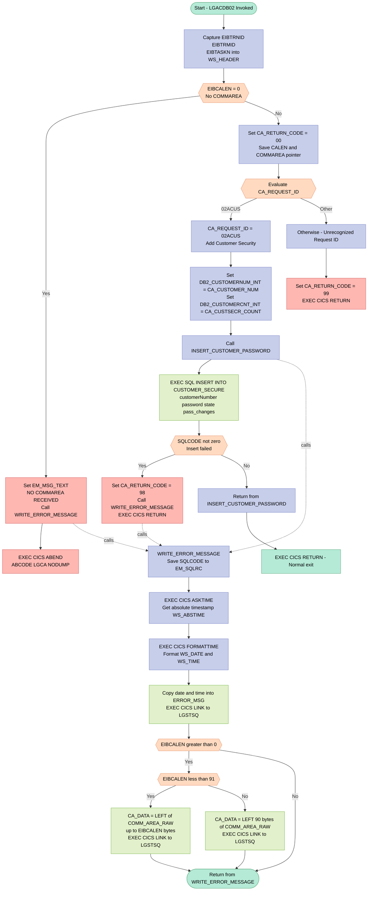
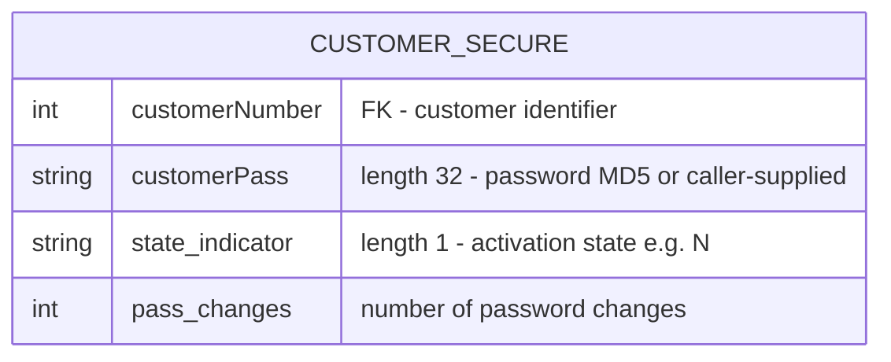

## Table of Contents

- [1. Purpose](#1-purpose)
- [2. Inputs](#2-inputs)
  - [2.1 Communication Area (COMMAREA) — passed via `COMM_AREA_PTR`](#21-communication-area-commarea--passed-via-comm_area_ptr)
  - [2.2 CICS Execution Interface Block (EIB) — implicitly provided by CICS](#22-cics-execution-interface-block-eib--implicitly-provided-by-cics)
  - [2.3 DB2 — SQL Communications Area (SQLCA)](#23-db2--sql-communications-area-sqlca)
- [3. Outputs](#3-outputs)
- [4. Processing Logic](#4-processing-logic)
  - [4.1 Mermaid Flow Diagram](#41-mermaid-flow-diagram)
  - [4.2 Processing Logic Description](#42-processing-logic-description)
  - [4.3 Database Tables](#43-database-tables)
- [5. Paragraphs](#5-paragraphs)
- [6. Dependencies](#6-dependencies)
  - [6.1 DB2 Database](#61-db2-database)
  - [6.2 CICS Middleware](#62-cics-middleware)
  - [6.3 Linked / Called Programs](#63-linked--called-programs)
  - [6.4 Communication Area (COMMAREA)](#64-communication-area-commarea)
  - [6.5 Include Files / Copybooks](#65-include-files--copybooks)
  - [6.6 Runtime / Compiler-Supplied Resources](#66-runtime--compiler-supplied-resources)
- [7. Constraints](#7-constraints)
  - [7.1 Input / COMMAREA Constraints](#71-input--commarea-constraints)
  - [7.2 DB2 / Database Constraints](#72-db2--database-constraints)
  - [7.3 Processing / Sequencing Constraints](#73-processing--sequencing-constraints)
  - [7.4 Error Logging / Diagnostic Constraints](#74-error-logging--diagnostic-constraints)
  - [7.5 Return Code Contract Constraints](#75-return-code-contract-constraints)
- [8. Error Handling](#8-error-handling)
  - [8.1 Missing Communication Area Detection](#81-missing-communication-area-detection)
  - [8.2 Communication Area Return Code Initialization](#82-communication-area-return-code-initialization)
  - [8.3 Request Identifier Validation](#83-request-identifier-validation)
  - [8.4 DB2 SQL Error Detection After INSERT](#84-db2-sql-error-detection-after-insert)
  - [8.5 Centralized Error Logging Procedure (WRITE_ERROR_MESSAGE)](#85-centralized-error-logging-procedure-write_error_message)
  - [8.6 Error Message Structure Design](#86-error-message-structure-design)
  - [8.7 Diagnostic Eyecatcher for Dump Identification](#87-diagnostic-eyecatcher-for-dump-identification)
- [9. Examples](#9-examples)
  - [9.1 Example 1: Successful Customer Security Record Insertion](#91-example-1-successful-customer-security-record-insertion)
  - [9.2 Example 2: Unrecognized Request ID](#92-example-2-unrecognized-request-id)
  - [9.3 Example 3: DB2 INSERT Failure (Duplicate Key)](#93-example-3-db2-insert-failure-duplicate-key)

## 1. Purpose

`LGACDB02` is a CICS-hosted PL/I program that adds a new customer security record to the DB2 `CUSTOMER_SECURE` table. When invoked via a communication area carrying the request identifier `02ACUS`, it extracts the customer number, password, state indicator, and password-change count from the communication area and inserts them as a new row into the security table, using a default password of `NewPass` (an MD5 checksum) if none is supplied. The program validates that a communication area was provided, sets appropriate return codes (`00` for success, `98` for a DB2 error, and `99` for an unrecognized request), and upon any error captures the current date, time, and SQLCODE before forwarding a diagnostic message — along with a snapshot of the raw communication area — to a logging queue via the `LGSTSQ` program.

## 2. Inputs

### 2.1 Communication Area (COMMAREA) — passed via `COMM_AREA_PTR`

The program receives a single pointer parameter (`COMM_AREA_PTR`) at entry, which it uses to address the `COMM_AREA` structure. The following fields within that structure are consumed as inputs:

- **`CA_REQUEST_ID`** *(CHAR(6))*
  - Identifies the type of operation requested. The value `'02ACUS'` routes processing to the customer security insert path; any other value causes an immediate error return. Acts as the primary dispatch key for the program.

- **`CA_CUSTOMER_NUM`** *(PIC '9999999999')*
  - The 10-digit customer number supplied by the caller. Converted to the integer host variable `DB2_CUSTOMERNUM_INT` and inserted as `customerNumber` in the `CUSTOMER_SECURE` table.

- **`CA_CUSTSECR_PASS`** *(CHAR(32))*
  - The customer's password (defaulting to an MD5 checksum) supplied by the caller. Passed directly as the `customerPass` column value in the DB2 INSERT.

- **`CA_CUSTSECR_COUNT`** *(CHAR(4))*
  - The number of password changes associated with the customer's security record. Converted to the integer host variable `DB2_CUSTOMERCNT_INT` and inserted as the `pass_changes` column value.

- **`CA_CUSTSECR_STATE`** *(CHAR(1))*
  - A single-character state indicator for the customer's security record. Inserted directly as the `state_indicator` column value in the DB2 INSERT.

### 2.2 CICS Execution Interface Block (EIB) — implicitly provided by CICS

These fields are provided by the CICS runtime at task invocation and are read as inputs by the program:

- **`EIBCALEN`** — Length of the passed communication area; used to validate that a COMMAREA was received and to control how much of it is logged on error.
- **`EIBTRNID`** — Transaction identifier of the current task; stored in `WS_TRANSID` for diagnostic context.
- **`EIBTRMID`** — Terminal identifier of the current task; stored in `WS_TERMID` for diagnostic context.
- **`EIBTASKN`** — Task number of the current CICS task; stored in `WS_TASKNUM` for diagnostic context.

### 2.3 DB2 — SQL Communications Area (SQLCA)

- **`SQLCODE`** *(included via `EXEC SQL INCLUDE SQLCA`)*
  - Set by DB2 after every SQL operation. Read after the INSERT to determine whether the operation succeeded; a non-zero value triggers error handling and sets `CA_RETURN_CODE` to `'98'`.

## 3. Outputs

**Communication Area (`COMM_AREA`) — Return Values to Caller**

- `CA_RETURN_CODE` — The primary outcome indicator written back into the communication area before returning to the caller:
  - Set to `'00'` on successful initialization
  - Set to `'98'` when the DB2 `INSERT INTO CUSTOMER_SECURE` fails (non-zero `SQLCODE`)
  - Set to `'99'` when an unrecognized `CA_REQUEST_ID` is received

**DB2 Database Write**

- `CUSTOMER_SECURE` table — A new row is inserted via `EXEC SQL INSERT INTO CUSTOMER_SECURE` when `CA_REQUEST_ID = '02ACUS'`, with the following column values:
  - `customerNumber` ← `DB2_CUSTOMERNUM_INT` (derived from `CA_CUSTOMER_NUM`)
  - `customerPass` ← `CA_CUSTSECR_PASS`
  - `state_indicator` ← `CA_CUSTSECR_STATE`
  - `pass_changes` ← `DB2_CUSTOMERCNT_INT` (derived from `CA_CUSTSECR_COUNT`)

**CICS Transient Data Queue (Error Logging via `LGSTSQ`)**

- `ERROR_MSG` structure — Written to the logging queue via `EXEC CICS LINK PROGRAM('LGSTSQ')` whenever an error is detected (no commarea, or DB2 failure). Contains:
  - `EM_DATE` / `EM_TIME` — Current date and time formatted by `CICS FORMATTIME`
  - `EM_SQLREQ` — The SQL operation label (e.g., `' INSERT SECURITY'`)
  - `EM_SQLRC` — The DB2 `SQLCODE` at the time of the error
  - `EM_CUSNUM` / `EM_POLNUM` — Customer and policy number fields available within the error message structure
- `CA_ERROR_MSG` structure — A secondary log entry also dispatched to `LGSTSQ`, containing:
  - `CA_DATA` — Up to 90 bytes of the raw communication area (`COMM_AREA_RAW`) captured at error time, providing a diagnostic snapshot of the inbound request

**CICS ABEND**

- `EXEC CICS ABEND ABCODE('LGCA') NODUMP` — Issued when no communication area is received (`EIBCALEN = 0`), terminating the transaction with abend code `LGCA`

## 4. Processing Logic

### 4.1 Mermaid Flow Diagram

---

### 4.2 Processing Logic Description

#### 4.2.1 High-level Summary

`LGACDB02` is a CICS-linked PL/I program responsible for adding a new customer security record to the DB2 table `CUSTOMER_SECURE`. It is invoked by `LGACDB01` (the Add Customer DB2 backend) and receives a COMMAREA containing the customer's number, password, state indicator, and password-change count. The program validates the COMMAREA, routes based on the request identifier, performs the DB2 INSERT, and returns control to the caller. All errors are logged to a transient data queue via the shared logging program `LGSTSQ`.

---

#### 4.2.2 Execution Flow

**Step 1 – Initialization**
Upon entry, the program captures CICS EIB fields (`EIBTRNID`, `EIBTRMID`, `EIBTASKN`) into `WS_HEADER` for diagnostic identification in any dump output.

**Step 2 – COMMAREA Validation**
The program checks `EIBCALEN`. If it equals zero — meaning no COMMAREA was passed by the caller — the program:
- Populates `EM_MSG_TEXT` with a "NO COMMAREA RECEIVED" message.
- Calls `WRITE_ERROR_MESSAGE` to log the error.
- Issues `EXEC CICS ABEND ABCODE('LGCA') NODUMP` to abnormally terminate the task. The `NODUMP` option suppresses a system dump, keeping the abend lightweight.

If a COMMAREA is present, `CA_RETURN_CODE` is initialized to `'00'` (success), and the COMMAREA length and pointer are saved to working storage.

**Step 3 – Request Routing via SELECT**
The program evaluates `CA_REQUEST_ID` using a `SELECT` construct:

- **`'02ACUS'` (Add Customer Security):** This is the only recognized request type. The program:
  1. Converts `CA_CUSTOMER_NUM` (pictured decimal) to the FIXED BIN(31) host variable `DB2_CUSTOMERNUM_INT`.
  2. Converts `CA_CUSTSECR_COUNT` (character) to `DB2_CUSTOMERCNT_INT`.
  3. Calls the internal procedure `INSERT_CUSTOMER_PASSWORD`.

- **Any other value:** `CA_RETURN_CODE` is set to `'99'` (unrecognized request), and `EXEC CICS RETURN` immediately returns control to the caller without further processing.

**Step 4 – INSERT_CUSTOMER_PASSWORD Procedure**
This internal procedure executes a DB2 `INSERT INTO CUSTOMER_SECURE`, providing four column values:
| Column | Source |
|---|---|
| `customerNumber` | `DB2_CUSTOMERNUM_INT` (from `CA_CUSTOMER_NUM`) |
| `customerPass` | `CA_CUSTSECR_PASS` (caller-supplied or default MD5 password) |
| `state_indicator` | `CA_CUSTSECR_STATE` (activation state, e.g. `'N'`) |
| `pass_changes` | `DB2_CUSTOMERCNT_INT` (from `CA_CUSTSECR_COUNT`) |

After the INSERT, `SQLCODE` from the SQLCA is checked:
- **Non-zero (error):** `CA_RETURN_CODE` is set to `'98'`, `WRITE_ERROR_MESSAGE` is called, and `EXEC CICS RETURN` exits immediately.
- **Zero (success):** The procedure returns normally.

**Step 5 – Normal Return**
After `INSERT_CUSTOMER_PASSWORD` completes successfully, the main procedure issues `EXEC CICS RETURN`, passing control back to the calling program (`LGACDB01`) with `CA_RETURN_CODE = '00'`.

**Step 6 – WRITE_ERROR_MESSAGE Procedure**
Called on any error path. It:
1. Captures `SQLCODE` into `EM_SQLRC` in the error message structure.
2. Obtains the current timestamp via `EXEC CICS ASKTIME ABSTIME(WS_ABSTIME)`.
3. Formats it into `WS_DATE` (MMDDYYYY) and `WS_TIME` via `EXEC CICS FORMATTIME`.
4. Copies the date and time into `EM_DATE` and `EM_TIME` within `ERROR_MSG`.
5. Issues `EXEC CICS LINK PROGRAM('LGSTSQ')` with `ERROR_MSG` as the COMMAREA to log the structured error message to the transient data queue.
6. If `EIBCALEN > 0`, also logs up to 90 bytes of the raw COMMAREA content: if `EIBCALEN < 91`, it logs exactly `EIBCALEN` bytes; otherwise it logs the first 90 bytes. This second `EXEC CICS LINK` to `LGSTSQ` passes `CA_ERROR_MSG` as the COMMAREA.

---

#### 4.2.3 External Interactions

| Interaction | Type | Purpose |
|---|---|---|
| DB2 `CUSTOMER_SECURE` | SQL INSERT | Persists the new customer's security record (password, state, change count) |
| CICS program `LGSTSQ` | EXEC CICS LINK | Shared logging utility; writes formatted error messages and raw COMMAREA snapshots to the CICS transient data queue |
| CICS EIB | Read-only | `EIBCALEN`, `EIBTRNID`, `EIBTRMID`, `EIBTASKN` are read for validation and diagnostics |

---

#### 4.2.4 Plain Language Summary

When a new customer is added to the insurance system, this program is called to create that customer's security profile in the database. It receives the customer's ID, password, account state, and password-change count through a shared memory area (COMMAREA). It validates that memory area exists, confirms the request type is "add customer security" (`02ACUS`), then inserts a single row into the `CUSTOMER_SECURE` database table. If the database insert fails, or if the request type is not recognized, the program sets an error code and returns immediately. Any errors are logged — including a timestamp and the SQL error code — to a centralized logging queue via the shared `LGSTSQ` utility program. If no memory area is passed at all, the program triggers an abnormal termination (`LGCA` abend).

---

### 4.3 Database Tables

## 5. Paragraphs

- **Main Procedure Body (LGACDB02)**
  - Serves as the program entry point, receiving `COMM_AREA_PTR` as its sole parameter and declared with `Options(Main)`.
  - On entry, captures CICS execution context by assigning `EIBTRNID` to `WS_TRANSID`, `EIBTRMID` to `WS_TERMID`, and `EIBTASKN` to `WS_TASKNUM` for diagnostic and tracing purposes.
  - **COMMAREA validation:** Checks `EIBCALEN` (the CICS-supplied length of the communication area) against zero. If no COMMAREA was passed, it populates `EM_MSG_TEXT` with `' NO COMMAREA RECEIVED'`, calls `WRITE_ERROR_MESSAGE` to log the condition, then issues `EXEC CICS ABEND ABCODE('LGCA') NODUMP` to terminate the task abnormally without producing a dump.
  - If the COMMAREA is present, initializes `CA_RETURN_CODE` to `'00'` and saves `EIBCALEN` and `COMM_AREA_PTR` into working-storage fields for later use.
  - **Request routing:** Evaluates `CA_REQUEST_ID` using a PL/I `SELECT` construct:
    - `WHEN ('02ACUS')`: Converts `CA_CUSTOMER_NUM` to `DB2_CUSTOMERNUM_INT` and `CA_CUSTSECR_COUNT` to `DB2_CUSTOMERCNT_INT`, then calls the `INSERT_CUSTOMER_PASSWORD` internal procedure to add the security record.
    - `OTHERWISE`: Sets `CA_RETURN_CODE` to `'99'` (unrecognized request) and issues `EXEC CICS RETURN` to return immediately to the caller.
  - On successful completion of the routed request, issues a final `EXEC CICS RETURN` to hand control back to CICS.

- **INSERT_CUSTOMER_PASSWORD**
  - An internal procedure responsible for inserting a new customer security row into the `CUSTOMER_SECURE` DB2 table.
  - Sets `EM_SQLREQ` to `' INSERT SECURITY'` to label any subsequent error message with the type of SQL operation being attempted.
  - Executes an `EXEC SQL INSERT INTO CUSTOMER_SECURE` statement, supplying four column values:
    - `customerNumber` ← host variable `DB2_CUSTOMERNUM_INT` (integer form of the customer number)
    - `customerPass` ← `CA_CUSTSECR_PASS` (32-character password from the COMMAREA)
    - `state_indicator` ← `CA_CUSTSECR_STATE` (single-character state flag)
    - `pass_changes` ← `DB2_CUSTOMERCNT_INT` (integer form of the password-change count)
  - **Error handling:** After the INSERT, evaluates `SQLCODE`. If it is non-zero, sets `CA_RETURN_CODE` to `'98'` to signal a DB2 error, calls `WRITE_ERROR_MESSAGE` to log diagnostic information, then issues `EXEC CICS RETURN` to return control to the CICS dispatcher.
  - No looping construct is present; execution is strictly linear within the procedure.

- **WRITE_ERROR_MESSAGE**
  - A reusable internal procedure that constructs and dispatches a structured error log entry to a transient data queue via the CICS logging utility program `LGSTSQ`.
  - Captures the current `SQLCODE` value into `EM_SQLRC` within the `ERROR_MSG` structure so that DB2 diagnostic information is preserved in the log entry.
  - **Timestamp acquisition:** Issues `EXEC CICS ASKTIME ABSTIME(WS_ABSTIME)` to retrieve the current absolute time, then converts it with `EXEC CICS FORMATTIME ABSTIME(WS_ABSTIME) MMDDYYYY(WS_DATE) TIME(WS_TIME)` to obtain human-readable date (MM/DD/YYYY) and time (HH:MM:SS) strings. Copies these into `EM_DATE` and `EM_TIME` in the error message structure.
  - **Primary error message dispatch:** Issues `EXEC CICS LINK PROGRAM('LGSTSQ') COMMAREA(ERROR_MSG) LENGTH(STG(ERROR_MSG))` to forward the fully populated `ERROR_MSG` structure (containing date, time, program name, customer/policy numbers, SQL request label, and SQLCODE) to the logging program.
  - **COMMAREA snapshot dispatch:** Conditionally writes up to 90 bytes of the raw COMMAREA content for additional diagnostic context:
    - If `EIBCALEN` is greater than zero and less than 91, extracts exactly `EIBCALEN` bytes from `COMM_AREA_RAW` using the `LEFT` built-in function and places the result in `CA_DATA`.
    - If `EIBCALEN` is 91 or greater, extracts the first 90 bytes.
    - In either branch, issues a second `EXEC CICS LINK PROGRAM('LGSTSQ') COMMAREA(CA_ERROR_MSG)` call to log the COMMAREA snapshot.
  - If `EIBCALEN` is zero, the COMMAREA snapshot block is skipped entirely.
  - No DB2 interaction occurs within this procedure; it is purely a CICS-based diagnostic logging routine.

## 6. Dependencies

### 6.1 DB2 Database

- **`CUSTOMER_SECURE` table** — the sole database table written by this program; the `INSERT_CUSTOMER_PASSWORD` procedure inserts one row per call, populating the columns `customerNumber`, `customerPass`, `state_indicator`, and `pass_changes` with values sourced from the communication area and host variables
- **`SQLCA` (SQL Communications Area)** — included via `EXEC SQL INCLUDE SQLCA`; supplies the `SQLCODE` field that is tested after every SQL statement to detect DB2 errors

---

### 6.2 CICS Middleware

- **CICS Execution Interface Block (EIB)** — the runtime EIB is read at program entry; specific fields used are:
  - `EIBTRNID` — loaded into `WS_TRANSID` to record the transaction identifier
  - `EIBTRMID` — loaded into `WS_TERMID` to record the terminal identifier
  - `EIBTASKN` — loaded into `WS_TASKNUM` to record the task number
  - `EIBCALEN` — checked to confirm a non-zero COMMAREA length was passed; used again in `WRITE_ERROR_MESSAGE` to determine how many bytes of the COMMAREA to log
- **`EXEC CICS ABEND ABCODE('LGCA') NODUMP`** — issued when `EIBCALEN = 0` (no COMMAREA received), terminating the transaction with abend code `LGCA` without producing a dump
- **`EXEC CICS ASKTIME` / `EXEC CICS FORMATTIME`** — CICS time services used inside `WRITE_ERROR_MESSAGE` to obtain and format the current timestamp into `WS_DATE` and `WS_TIME` for inclusion in error log entries
- **`EXEC CICS RETURN`** — used to return control to CICS at normal completion and also on error exit paths after DB2 failure or an unrecognised request code

---

### 6.3 Linked / Called Programs

- **`LGSTSQ`** (CICS LINK) — a shared logging utility program invoked via `EXEC CICS LINK PROGRAM('LGSTSQ')` inside `WRITE_ERROR_MESSAGE`; called up to twice per error occurrence:
  - First call passes `ERROR_MSG` (structured error message containing date, time, program name, customer number, policy number, and SQLCODE)
  - Second call passes `CA_ERROR_MSG` (a snapshot of up to 90 bytes of the raw COMMAREA) for diagnostic purposes

---

### 6.4 Communication Area (COMMAREA)

- **`COMM_AREA` / `LGCMAREA` copybook** — the COMMAREA structure is inline-expanded from `plinc/LGCMAREA.inc` (normally included via `EXEC SQL INCLUDE LGCMAREA` or `%INCLUDE LGCMAREA`); it provides all inbound and outbound fields:
  - `CA_REQUEST_ID` — 6-character operation code; value `'02ACUS'` routes to the customer security insert path
  - `CA_RETURN_CODE` — 2-digit return code field set to `'00'` (success), `'98'` (DB2 error), or `'99'` (unknown request)
  - `CA_CUSTOMER_NUM` — 10-digit customer number mapped to the DB2 host variable `DB2_CUSTOMERNUM_INT`
  - `CA_CUSTSECR_PASS` — 32-character password value inserted directly as `customerPass`
  - `CA_CUSTSECR_STATE` — 1-character state indicator inserted as `state_indicator`
  - `CA_CUSTSECR_COUNT` — 4-character password-change count mapped to `DB2_CUSTOMERCNT_INT` and inserted as `pass_changes`

---

### 6.5 Include Files / Copybooks

- **`plinc/LGCMAREA.inc`** — the COMMAREA copybook that defines the full `COMM_AREA` structure (expanded inline in this program); used by all CICS programs in the application to share a common communication layout
- **`SQLCA` (DB2-supplied)** — included via `EXEC SQL INCLUDE SQLCA`; defines the SQL communications area structure including `SQLCODE`

---

### 6.6 Runtime / Compiler-Supplied Resources

- **CICS Transaction Runtime** — the program runs under CICS as a linked-to module; it depends on the CICS runtime to resolve EIB fields, honour `EXEC CICS` commands, and manage COMMAREA passing
- **DB2 Precompiler / Runtime** — `EXEC SQL` statements are processed by the DB2 PL/I precompiler; the program depends on a valid DB2 plan or package being bound against the `CUSTOMER_SECURE` table at runtime
- **`COMM_AREA_PTR`** — a pointer parameter passed by the calling program (the parent caller, e.g. `LGACDB01`) pointing to the COMMAREA in memory; the program cannot function without a valid non-null pointer and a non-zero `EIBCALEN`

## 7. Constraints

### 7.1 Input / COMMAREA Constraints

- **COMMAREA must be present on entry**
  - Enforced by checking `EIBCALEN = 0` immediately after the program starts
  - If no COMMAREA is received (`EIBCALEN = 0`), the program writes an error message (`' NO COMMAREA RECEIVED'`) and issues `EXEC CICS ABEND ABCODE('LGCA') NODUMP`, terminating the transaction with abend code `LGCA`; no processing is attempted

- **COMMAREA maximum size is 32,500 bytes**
  - `COMM_AREA_RAW` is declared as `CHAR(32500)`, which is the upper bound of the raw COMMAREA buffer the program can safely reference; any COMMAREA larger than this would exceed the declared storage

- **CA_REQUEST_ID must equal `'02ACUS'`**
  - The `SELECT (CA_REQUEST_ID)` construct routes processing exclusively on this single value
  - Any value other than `'02ACUS'` falls into the `OTHERWISE` branch, which sets `CA_RETURN_CODE = '99'` and immediately returns to the caller via `EXEC CICS RETURN`; no database operation is attempted

- **CA_CUSTOMER_NUM must be a valid 10-digit numeric value**
  - Declared as `PIC '9999999999'`, enforcing a 10-digit numeric picture at the data-level; non-numeric content would cause a PL/I conversion error when assigned to the `FIXED BIN(31)` host variable `DB2_CUSTOMERNUM_INT`

- **CA_CUSTSECR_COUNT must be convertible to a 31-bit signed integer**
  - Declared as `CHAR(4)` but assigned directly to `DB2_CUSTOMERCNT_INT` (`FIXED BIN(31)`); the implicit conversion requires that the character content represents a valid integer; non-numeric content would cause a PL/I conversion condition

- **CA_CUSTSECR_PASS is limited to 32 characters**
  - Declared as `CHAR(32)`, meaning any password supplied in the COMMAREA is silently truncated to 32 characters before being inserted into the `CUSTOMER_SECURE.customerPass` column

- **CA_CUSTSECR_STATE is a single character**
  - Declared as `CHAR` (length 1), meaning only one character is accepted as the state indicator; its value is passed directly to the `CUSTOMER_SECURE.state_indicator` column without further validation

---

### 7.2 DB2 / Database Constraints

- **INSERT into CUSTOMER_SECURE must succeed (SQLCODE = 0)**
  - After `EXEC SQL INSERT INTO CUSTOMER_SECURE`, any non-zero `SQLCODE` is treated as a fatal error
  - The program sets `CA_RETURN_CODE = '98'`, calls `WRITE_ERROR_MESSAGE`, and issues `EXEC CICS RETURN`; no retry or recovery is performed

- **All four columns must be supplied for the INSERT**
  - The SQL statement explicitly names `customerNumber`, `customerPass`, `state_indicator`, and `pass_changes`; all four are mandatory in the VALUES clause — no defaults or NULLs are provided by the program; any database-level NOT NULL constraint on these columns would cause an immediate SQL error

- **DB2 host variable types are fixed**
  - `DB2_CUSTOMERNUM_INT` and `DB2_CUSTOMERCNT_INT` are both `FIXED BIN(31)`, imposing a maximum value of 2,147,483,647 for customer number and password-change count respectively; values exceeding this range would overflow

- **Only one row is inserted per invocation**
  - The program issues a single `INSERT` with no looping construct; each call to `LGACDB02` results in exactly one row insertion attempt into `CUSTOMER_SECURE`

---

### 7.3 Processing / Sequencing Constraints

- **COMMAREA validation must complete before any DB2 operation**
  - The `EIBCALEN` check and `CA_RETURN_CODE` initialization (`'00'`) occur unconditionally before the `SELECT` routing construct; no SQL is executed until these steps are complete

- **Return code initialization precedes request routing**
  - `CA_RETURN_CODE` is always set to `'00'` at entry, before the `SELECT` evaluates `CA_REQUEST_ID`; the routing logic overwrites this only on error, ensuring the caller receives `'00'` on success

- **Error message writing precedes CICS RETURN on SQL failure**
  - `WRITE_ERROR_MESSAGE` is always called before `EXEC CICS RETURN` in the SQL error path, ensuring that diagnostic information is logged prior to the program terminating

- **ASKTIME must precede FORMATTIME**
  - In `WRITE_ERROR_MESSAGE`, `EXEC CICS ASKTIME ABSTIME(WS_ABSTIME)` is executed before `EXEC CICS FORMATTIME`; `WS_ABSTIME` must be populated before it can be formatted into `WS_DATE` and `WS_TIME`

- **Error message writing precedes COMMAREA snapshot logging**
  - The structured `ERROR_MSG` (containing date, time, program name, customer number, and SQLCODE) is linked to `LGSTSQ` first; the COMMAREA snapshot (`CA_ERROR_MSG`) is linked to `LGSTSQ` only afterward, and only if `EIBCALEN > 0`

---

### 7.4 Error Logging / Diagnostic Constraints

- **COMMAREA snapshot is only logged when EIBCALEN > 0**
  - The second `EXEC CICS LINK PROGRAM('LGSTSQ')` call in `WRITE_ERROR_MESSAGE` is guarded by `IF (EIBCALEN > 0)`; if no COMMAREA was present, no snapshot is written

- **COMMAREA snapshot is capped at 90 bytes**
  - If `EIBCALEN < 91`, exactly `EIBCALEN` bytes are captured via `LEFT(COMM_AREA_RAW, EIBCALEN)`
  - If `EIBCALEN >= 91`, exactly 90 bytes are captured via `LEFT(COMM_AREA_RAW, 90)`; the `CA_DATA` field is declared as `CHAR(90)`, imposing this hard upper limit on diagnostic capture

- **SQLCODE is captured at the moment WRITE_ERROR_MESSAGE is called**
  - `EM_SQLRC = SQLCODE` is the first statement in `WRITE_ERROR_MESSAGE`, capturing the DB2 return code before any CICS commands that might alter it; this ensures diagnostic accuracy

- **Error message date is formatted as MMDDYYYY**
  - `EXEC CICS FORMATTIME` uses the `MMDDYYYY(WS_DATE)` option, enforcing this specific date format in all error log entries; `WS_DATE` is declared as `CHAR(10)` to accommodate this format

- **Error message time is an 8-character field**
  - `WS_TIME` is declared as `CHAR(8)`, constraining the time representation to 8 characters (HH:MM:SS) as produced by `EXEC CICS FORMATTIME TIME(WS_TIME)`

---

### 7.5 Return Code Contract Constraints

- **`CA_RETURN_CODE = '00'`** — set on successful initialization; remains `'00'` if the INSERT succeeds
- **`CA_RETURN_CODE = '98'`** — set exclusively when the DB2 INSERT returns a non-zero SQLCODE; signals a database error to the caller
- **`CA_RETURN_CODE = '99'`** — set exclusively when `CA_REQUEST_ID` does not match any recognized value (`'02ACUS'`); signals an unrecognized request to the caller
- No other return code values are assigned; the return code contract is limited to these three states

## 8. Error Handling

### 8.1 Missing Communication Area Detection

- The program checks whether a communication area was passed by the calling program by examining `EIBCALEN` at entry.
  - If `EIBCALEN` equals zero, it means no communication area was provided — an unrecoverable condition for this transaction.
  - An error message text of `' NO COMMAREA RECEIVED'` is assigned to the error message structure field `EM_MSG_TEXT`.
  - The `WRITE_ERROR_MESSAGE` procedure is called to log the error before termination.
  - The program then issues an `EXEC CICS ABEND` with abend code `'LGCA'` and the `NODUMP` option, which terminates the CICS task immediately without producing a transaction dump.

### 8.2 Communication Area Return Code Initialization

- Upon passing the communication area validation, the program initializes `CA_RETURN_CODE` to `'00'`, establishing a baseline success state.
  - Any subsequent error condition overwrites this value with a specific non-zero code, enabling the calling program to detect failures.

### 8.3 Request Identifier Validation

- The program uses a `SELECT (CA_REQUEST_ID)` construct to route processing based on the incoming request type.
  - A `WHEN ('02ACUS')` branch handles the recognized request for adding a customer security record.
  - The `OTHERWISE` branch catches any unrecognized or unsupported request identifier values.
    - When triggered, it sets `CA_RETURN_CODE` to `'99'`, signaling an invalid request.
    - The program immediately issues `EXEC CICS RETURN` to hand control back to the calling program without performing any database operation.
    - No error message is written to the logging queue for this condition; the return code alone communicates the problem to the caller.

### 8.4 DB2 SQL Error Detection After INSERT

- After executing the `EXEC SQL INSERT` into the `CUSTOMER_SECURE` table, the program explicitly checks `SQLCODE` for a non-zero value.
  - A non-zero `SQLCODE` indicates any form of SQL failure — including constraint violations, duplicate key errors, authorization failures, or connection issues.
  - When detected:
    - `CA_RETURN_CODE` is set to `'98'`, informing the caller of a DB2-level failure.
    - The `WRITE_ERROR_MESSAGE` procedure is invoked to capture full diagnostic details.
    - The program then issues `EXEC CICS RETURN` to exit gracefully, preventing further processing after the failed insert.

### 8.5 Centralized Error Logging Procedure (WRITE_ERROR_MESSAGE)

- The program implements a dedicated internal procedure named `WRITE_ERROR_MESSAGE` that consolidates all error logging into a single reusable routine. It performs the following steps:

  - **SQL Return Code Capture**
    - The current value of `SQLCODE` is saved into the `EM_SQLRC` field of the error message structure, preserving the exact DB2 diagnostic code at the point of failure.

  - **Timestamp Acquisition and Formatting**
    - `EXEC CICS ASKTIME` is issued to obtain the current absolute system time into `WS_ABSTIME`.
    - `EXEC CICS FORMATTIME` converts the absolute time into human-readable date (`WS_DATE`, in MMDDYYYY format) and time (`WS_TIME`) values.
    - These formatted values are copied into `EM_DATE` and `EM_TIME` within the error message structure.

  - **Error Message Dispatch to Logging Queue**
    - The fully populated `ERROR_MSG` structure (containing date, time, program name literal `' LGACDB02'`, customer number, policy number placeholders, SQL request description, and SQLCODE) is sent to the external logging program `LGSTSQ` via `EXEC CICS LINK PROGRAM('LGSTSQ') COMMAREA(ERROR_MSG)`.
    - This delegates the actual queue-write responsibility to a shared infrastructure program.

  - **Communication Area Content Logging**
    - A secondary diagnostic message is constructed and sent to capture a snapshot of the raw communication area content for post-mortem analysis.
    - The procedure checks `EIBCALEN` to confirm a communication area exists (greater than zero).
      - If the communication area length is less than 91 bytes, the actual number of available bytes from `COMM_AREA_RAW` is extracted using the `LEFT` built-in function and placed into `CA_DATA`.
      - If the communication area is 91 bytes or longer, exactly 90 bytes are extracted.
    - The resulting `CA_ERROR_MSG` structure (prefixed with `'COMMAREA='`) is then sent to the same `LGSTSQ` logging program via a second `EXEC CICS LINK` call.

### 8.6 Error Message Structure Design

- The program declares a structured error message layout (`ERROR_MSG`) that embeds fixed diagnostic fields:
  - Date and time of the error occurrence.
  - A hardcoded program identifier (`' LGACDB02'`) for traceability across shared logs.
  - Customer number (`EM_CUSNUM`) and policy number (`EM_POLNUM`) fields for business context.
  - An SQL request description field (`EM_SQLREQ`) that is populated before each SQL operation (set to `' INSERT SECURITY'` before the INSERT statement), identifying which database operation failed.
  - The `EM_SQLRC` field holding the numeric SQLCODE.
- A separate `CA_ERROR_MSG` structure captures the raw communication area bytes, providing additional context for diagnosing the state of the incoming request at the time of failure.

### 8.7 Diagnostic Eyecatcher for Dump Identification

- The working storage header includes a `WS_EYECATCHER` field initialized to `'LGACDB02------WS'`.
  - This serves as a recognizable marker in memory dumps, enabling support personnel to quickly locate this program's working storage during post-failure analysis, even though the ABEND is issued with `NODUMP` in the COMMAREA-missing case.

## 9. Examples

### 9.1 Example 1: Successful Customer Security Record Insertion

**Input (Communication Area fields):**

| Field | Value |
|---|---|
| `CA_REQUEST_ID` | `02ACUS` |
| `CA_RETURN_CODE` | `00` (initialized) |
| `CA_CUSTOMER_NUM` | `0000012345` |
| `CA_CUSTSECR_PASS` | `5f4dcc3b5aa765d61d8327deb882cf99` (MD5 hash) |
| `CA_CUSTSECR_STATE` | `N` |
| `CA_CUSTSECR_COUNT` | `0000` |

**Expected Output:**

- A new row is inserted into the `CUSTOMER_SECURE` DB2 table:
  - `customerNumber = 12345`
  - `customerPass = '5f4dcc3b5aa765d61d8327deb882cf99'`
  - `state_indicator = 'N'`
  - `pass_changes = 0`
- `CA_RETURN_CODE` remains `00`.
- CICS RETURN is issued; control passes back to the caller cleanly.

**Explanation:**  
Because `CA_REQUEST_ID` is `02ACUS`, the SELECT routes into the `WHEN ('02ACUS')` branch. `CA_CUSTOMER_NUM` is converted to the binary integer `DB2_CUSTOMERNUM_INT` (12345) and `CA_CUSTSECR_COUNT` is converted to `DB2_CUSTOMERCNT_INT` (0). `INSERT_CUSTOMER_PASSWORD` executes the SQL INSERT. Since `SQLCODE = 0`, no error path is taken and the program returns to the caller with return code `00`.

---

### 9.2 Example 2: Unrecognized Request ID

**Input (Communication Area fields):**

| Field | Value |
|---|---|
| `CA_REQUEST_ID` | `01INQC` |
| `CA_RETURN_CODE` | `00` (initialized) |
| `CA_CUSTOMER_NUM` | `0000099999` |

**Expected Output:**

- No DB2 INSERT is attempted.
- `CA_RETURN_CODE` is set to `99`.
- CICS RETURN is issued immediately.

**Explanation:**  
The SELECT on `CA_REQUEST_ID` finds no matching `WHEN` clause for the value `01INQC`, so the `OTHERWISE` branch executes. The program sets `CA_RETURN_CODE = '99'` to signal an unrecognized request type and returns to the caller without touching the database.

---

### 9.3 Example 3: DB2 INSERT Failure (Duplicate Key)

**Input (Communication Area fields):**

| Field | Value |
|---|---|
| `CA_REQUEST_ID` | `02ACUS` |
| `CA_CUSTOMER_NUM` | `0000012345` |
| `CA_CUSTSECR_PASS` | `5f4dcc3b5aa765d61d8327deb882cf99` |
| `CA_CUSTSECR_STATE` | `N` |
| `CA_CUSTSECR_COUNT` | `0000` |

**Assumed condition:** Customer `12345` already exists in `CUSTOMER_SECURE` (duplicate primary key).

**Expected Output:**

- The SQL INSERT fails; `SQLCODE` is non-zero (e.g., `-803` for duplicate key).
- `CA_RETURN_CODE` is set to `98`.
- `WRITE_ERROR_MESSAGE` is called:
  - Current date/time is obtained via `EXEC CICS ASKTIME` / `EXEC CICS FORMATTIME`.
  - An error message containing the program name, `SQLCODE` value (`-803`), and up to 90 bytes of the raw communication area is forwarded to the logging queue via `EXEC CICS LINK PROGRAM('LGSTSQ')`.
- CICS RETURN is issued from within the error-handling procedure.

**Explanation:**  
After the INSERT, `SQLCODE <> 0` triggers the error branch inside `INSERT_CUSTOMER_PASSWORD`. Return code `98` signals a DB2 error to the caller. `WRITE_ERROR_MESSAGE` captures a timestamp, populates the `ERROR_MSG` and `CA_ERROR_MSG` structures, and dispatches both to the `LGSTSQ` logging program for diagnostic purposes.

---

Generated by IBM Bob Premium Package for Z
