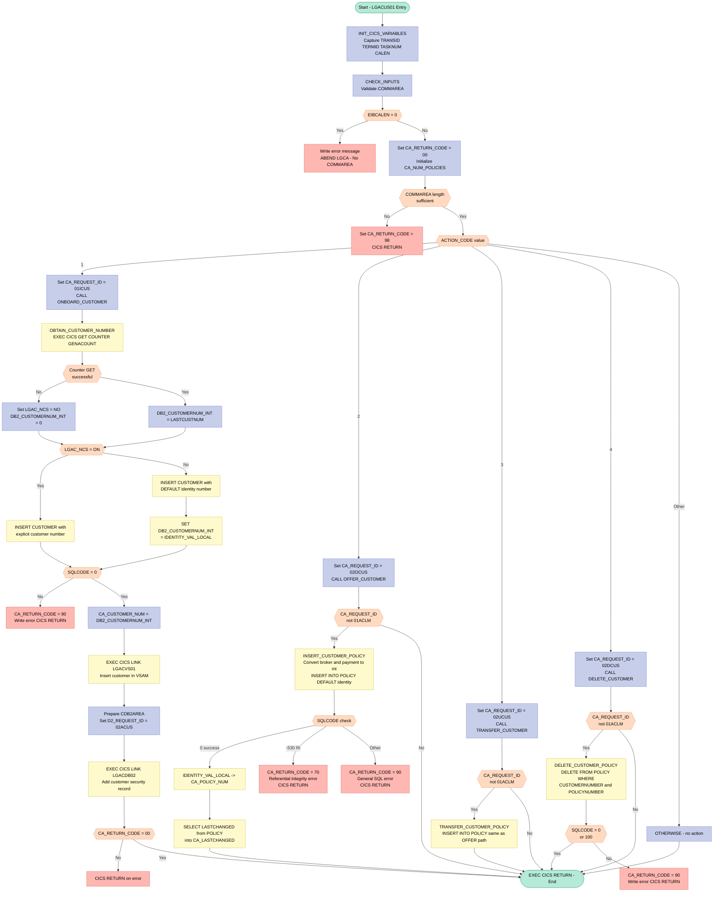
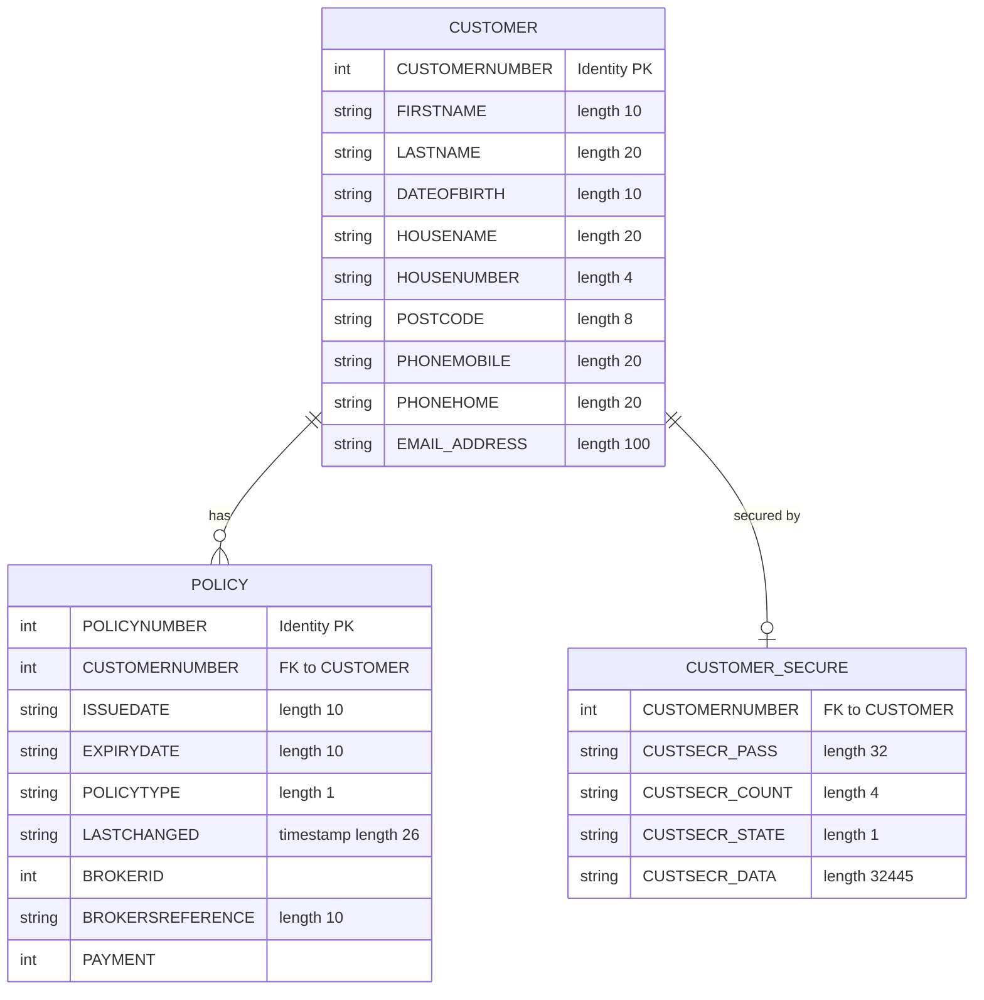

## Table of Contents

- [1. Purpose](#1-purpose)
- [2. Inputs](#2-inputs)
  - [2.1 CICS Communication Area (COMMAREA)](#21-cics-communication-area-commarea)
  - [2.2 CICS System Fields (EIB)](#22-cics-system-fields-eib)
  - [2.3 CICS Named Counter Facility](#23-cics-named-counter-facility)
  - [2.4 Linked Program COMMAREAs](#24-linked-program-commareas)
  - [2.5 DB2 Database](#25-db2-database)
- [3. Outputs](#3-outputs)
  - [3.1 Communication Area (COMMAREA) — Returned to the Caller](#31-communication-area-commarea--returned-to-the-caller)
  - [3.2 DB2 Database Writes](#32-db2-database-writes)
  - [3.3 CICS Program Links (Side Effects to Downstream Programs)](#33-cics-program-links-side-effects-to-downstream-programs)
  - [3.4 CICS Abnormal Termination](#34-cics-abnormal-termination)
- [4. Processing Logic](#4-processing-logic)
  - [4.1 Mermaid Flow Diagram](#41-mermaid-flow-diagram)
  - [4.2 Processing Logic Description](#42-processing-logic-description)
  - [4.3 Database Tables](#43-database-tables)
- [5. Paragraphs](#5-paragraphs)
- [6. Dependencies](#6-dependencies)
  - [6.1 CICS Resources](#61-cics-resources)
  - [6.2 External Programs (CICS LINK Targets)](#62-external-programs-cics-link-targets)
  - [6.3 DB2 Database Objects](#63-db2-database-objects)
  - [6.4 Copybooks / Include Members](#64-copybooks--include-members)
  - [6.5 Input Data / Communication Area Fields](#65-input-data--communication-area-fields)
- [7. Constraints](#7-constraints)
  - [7.1 Communication Area (COMMAREA) Constraints](#71-communication-area-commarea-constraints)
  - [7.2 Routing and Action Code Constraints](#72-routing-and-action-code-constraints)
  - [7.3 Customer Number Generation Constraints](#73-customer-number-generation-constraints)
  - [7.4 DB2 Data Integrity Constraints](#74-db2-data-integrity-constraints)
  - [7.5 Sequencing Constraints](#75-sequencing-constraints)
  - [7.6 Field Format and Size Constraints](#76-field-format-and-size-constraints)
  - [7.7 CICS Link Constraints](#77-cics-link-constraints)
- [8. Error Handling](#8-error-handling)
  - [8.1 Communication Area (COMMAREA) Validation](#81-communication-area-commarea-validation)
  - [8.2 CICS Named Counter Error Handling](#82-cics-named-counter-error-handling)
  - [8.3 DB2 SQL Error Handling](#83-db2-sql-error-handling)
  - [8.4 Post-Operation Return Code Check](#84-post-operation-return-code-check)
  - [8.5 Error Logging and Notification](#85-error-logging-and-notification)
  - [8.6 Program Termination Strategy](#86-program-termination-strategy)
- [9. Examples](#9-examples)
  - [9.1 Example 1 — New Customer Onboarding (`ACTION_CODE = '1'`, named counter available)](#91-example-1--new-customer-onboarding-action_code--1-named-counter-available)
  - [9.2 Example 2 — New Customer Onboarding (named counter unavailable — DB2 IDENTITY fallback)](#92-example-2--new-customer-onboarding-named-counter-unavailable--db2-identity-fallback)
  - [9.3 Example 3 — Insufficient COMMAREA Length](#93-example-3--insufficient-commarea-length)
  - [9.4 Example 4 — Policy Offer for Existing Customer (`ACTION_CODE = '2'`)](#94-example-4--policy-offer-for-existing-customer-action_code--2)

## 1. Purpose

`LGACUS01` is a CICS-hosted Enterprise PL/I program that manages the full lifecycle of customers and their associated insurance policies within a general insurance application. It serves as the central business-logic module for customer administration, capable of onboarding a new customer (inserting a record into the DB2 CUSTOMER table, assigning a sequential customer number via a CICS named counter or DB2 identity, and establishing a security record by linking to `LGACDB02`), offering a new insurance policy to an existing customer, transferring a customer's policy to a new owner, and deleting a customer's policy from the DB2 POLICY table. The program validates the inbound CICS communication area for correctness before dispatching to one of these four operations, returns structured outcome codes to the caller, and logs diagnostic error messages — including DB2 SQLCODE details — to a transient data queue via the `LGSTSQ` utility program whenever an operation fails.

## 2. Inputs

### 2.1 CICS Communication Area (COMMAREA)

The primary input channel is the CICS COMMAREA passed by pointer (`COMM_AREA_PTR`) at program entry. Its fields are consumed across all business operations.

**Request Routing**
- `CA_REQUEST_ID` — 6-character field identifying the type of business request (e.g., `01ICUS`, `02OCUS`, `02UCUS`, `02DCUS`). Used to route execution to the appropriate customer or policy operation and to guard against claim-type requests in transfer/delete/offer paths.

**Request/Response Control**
- `CA_RETURN_CODE` — 2-digit return code field. Read on entry to detect prior errors and written back to communicate operation outcome (`00` success, `70` referential integrity violation, `90` SQL/system error, `98` insufficient COMMAREA length).

**Customer Identity**
- `CA_CUSTOMER_NUM` — 10-digit customer number. Written back to the caller after a successful customer insert with the newly assigned identifier.

**Customer Personal Details** — used as DB2 host variables in `INSERT INTO CUSTOMER`
- `CA_FIRST_NAME` — customer first name (10 chars)
- `CA_LAST_NAME` — customer last name (20 chars)
- `CA_DOB` — date of birth (10 chars)
- `CA_HOUSE_NAME` — house/property name (20 chars)
- `CA_HOUSE_NUM` — house number (4 chars)
- `CA_POSTCODE` — postal code (8 chars)
- `CA_PHONE_MOBILE` — mobile phone number (20 chars)
- `CA_PHONE_HOME` — home phone number (20 chars)
- `CA_EMAIL_ADDRESS` — email address (100 chars)

**Policy Common Fields** — used as DB2 host variables in `INSERT INTO POLICY`
- `CA_POLICY_NUM` — 10-digit policy number; written back after successful policy insert with the DB2-assigned value
- `CA_ISSUE_DATE` — policy issue date (10 chars)
- `CA_EXPIRY_DATE` — policy expiry date (10 chars)
- `CA_LASTCHANGED` — 26-char timestamp; populated by DB2 SELECT after policy insert and returned to caller
- `CA_BROKERID` — 10-digit broker identifier; converted to `DB2_BROKERID_INT` for the policy INSERT
- `CA_BROKERSREF` — broker's reference (10 chars); used directly in the policy INSERT
- `CA_PAYMENT` — 6-digit payment amount; converted to `DB2_PAYMENT_INT` for the policy INSERT

**Policy Type Selection**
- `DB2_POLICYTYPE` (mapped from COMMAREA policy request area) — single character specifying the insurance policy category (e.g., endowment, house, motor, commercial, claim); used in the `POLICYTYPE` column of the policy INSERT

**Policy-Specific Detail Overlays** — overlapping UNION fields within `CA_POLICY_SPECIFIC`; the active overlay is determined by policy type:
- `CA_ENDOWMENT` — endowment policy fields (`CA_E_WITH_PROFITS`, `CA_E_EQUITIES`, `CA_E_MANAGED_FUND`, `CA_E_FUND_NAME`, `CA_E_TERM`, `CA_E_SUM_ASSURED`, `CA_E_LIFE_ASSURED`)
- `CA_HOUSE` — house policy fields (`CA_H_PROPERTY_TYPE`, `CA_H_BEDROOMS`, `CA_H_VALUE`, `CA_H_HOUSE_NAME`, `CA_H_HOUSE_NUMBER`, `CA_H_POSTCODE`)
- `CA_MOTOR` — motor policy fields (`CA_M_MAKE`, `CA_M_MODEL`, `CA_M_VALUE`, `CA_M_REGNUMBER`, `CA_M_COLOUR`, `CA_M_CC`, `CA_M_MANUFACTURED`, `CA_M_PREMIUM`, `CA_M_ACCIDENTS`)
- `CA_COMMERCIAL` — commercial policy fields (`CA_B_Address`, `CA_B_Postcode`, `CA_B_Latitude`, `CA_B_Longitude`, `CA_B_Customer`, `CA_B_PropType`, perils and premiums for fire/crime/flood/weather, `CA_B_Status`, `CA_B_RejectReason`)
- `CA_CLAIM` — claim fields (`CA_C_Num`, `CA_C_Date`, `CA_C_Paid`, `CA_C_Value`, `CA_C_Cause`, `CA_C_Observations`)

---

### 2.2 CICS System Fields (EIB)

Read from the CICS Execute Interface Block at initialisation and during input validation:
- `EIBCALEN` — length of the received COMMAREA; tested to detect a missing or undersized COMMAREA and trigger an ABEND or early return
- `EIBTRNID` — CICS transaction identifier; captured into `WS_TRANSID` for diagnostics
- `EIBTRMID` — CICS terminal identifier; captured into `WS_TERMID` for diagnostics
- `EIBTASKN` — CICS task number; captured into `WS_TASKNUM` for diagnostics

---

### 2.3 CICS Named Counter Facility

- `GENACOUNT` / `GENAPOOL` (`GENACUSTNUM` / `GENA`) — pool and counter name used in `EXEC CICS GET COUNTER` to obtain a system-generated sequential customer number (`LASTCUSTNUM`). When the counter is unavailable the program falls back to DB2 `IDENTITY_VAL_LOCAL()`.

---

### 2.4 Linked Program COMMAREAs

- `CDB2AREA` (passed to `LGACDB02`) — the commarea for the customer security add sub-program. Fields `D2_REQUEST_ID`, `D2_CUSTOMER_NUM`, `D2_CUSTSECR_COUNT`, and `D2_CUSTSECR_STATE` are set by this program before the `EXEC CICS LINK`; the sub-program's return code (`D2_RETURN_CODE`) and security data fields represent data returned from that linked program back into this execution context.
- `COMM_AREA` (passed to `LGACVS01`) — the full COMMAREA is forwarded unchanged to the VSAM handler linked program `LGACVS01` (length 225) during customer onboarding.

---

### 2.5 DB2 Database

- `CUSTOMER` table — queried via `INSERT` using customer personal detail fields from the COMMAREA; auto-generated `CUSTOMERNUMBER` retrieved via `IDENTITY_VAL_LOCAL()` when the named counter is not used
- `POLICY` table — queried via `INSERT` using policy common fields from the COMMAREA; auto-generated `POLICYNUMBER` and `LASTCHANGED` timestamp retrieved via `IDENTITY_VAL_LOCAL()` and a subsequent `SELECT`; also targeted by `DELETE` during customer/policy removal

## 3. Outputs

### 3.1 Communication Area (COMMAREA) — Returned to the Caller

- **`CA_RETURN_CODE`** — Two-digit outcome code written back into the COMMAREA before `EXEC CICS RETURN`. Possible values:
  - `'00'` — operation completed successfully
  - `'70'` — referential integrity violation (SQLCODE -530) on POLICY INSERT
  - `'90'` — general SQL or system error on any DB2 operation
  - `'98'` — COMMAREA length is too short to satisfy the minimum required length

- **`CA_CUSTOMER_NUM`** — Ten-digit customer number returned to the caller after a successful customer INSERT. It is populated from `DB2_CUSTOMERNUM_INT`, which holds either the CICS named-counter value or the value returned by `IDENTITY_VAL_LOCAL()`.

- **`CA_POLICY_NUM`** — Ten-digit policy number returned to the caller after a successful POLICY INSERT. It is populated from `DB2_POLICYNUM_INT` via `IDENTITY_VAL_LOCAL()`.

- **`CA_LASTCHANGED`** — 26-character timestamp returned to the caller after a policy INSERT. It is retrieved from the `LASTCHANGED` column of the POLICY table via a follow-up `SELECT` and reflects the exact moment the new policy row was committed.

- **`CA_REQUEST_ID`** — Six-character request identifier written into the COMMAREA before each routing branch (`'01ICUS'`, `'02OCUS'`, `'02UCUS'`, `'02DCUS'`). It tags the COMMAREA with the operation that was executed, allowing the caller to confirm which branch ran.

### 3.2 DB2 Database Writes

- **CUSTOMER table INSERT** — A new row is inserted with `CUSTOMERNUMBER`, `FIRSTNAME`, `LASTNAME`, `DATEOFBIRTH`, `HOUSENAME`, `HOUSENUMBER`, `POSTCODE`, `PHONEMOBILE`, `PHONEHOME`, and `EMAILADDRESS`. The customer number is either supplied from the CICS named counter (`DB2_CUSTOMERNUM_INT`) or assigned by DB2 identity (`DEFAULT`).

- **POLICY table INSERT** — A new row is inserted with `POLICYNUMBER` (identity-generated), `CUSTOMERNUMBER`, `ISSUEDATE`, `EXPIRYDATE`, `POLICYTYPE`, `LASTCHANGED` (DB2 `CURRENT TIMESTAMP`), `BROKERID`, `BROKERSREFERENCE`, and `PAYMENT`. Performed by both `INSERT_CUSTOMER_POLICY` (offer) and `TRANSFER_CUSTOMER_POLICY` (transfer).

- **POLICY table DELETE** — An existing policy row is deleted matching both `CUSTOMERNUMBER` and `POLICYNUMBER`. Performed by `DELETE_CUSTOMER_POLICY`. SQLCODE 0 and 100 are both treated as success; any other code results in `CA_RETURN_CODE = '90'`.

### 3.3 CICS Program Links (Side Effects to Downstream Programs)

- **`LGACVS01`** (via `EXEC CICS LINK`) — Called during customer onboarding with the full COMMAREA. Its role is to perform VSAM-related processing for the new customer record.

- **`LGACDB02`** (via `EXEC CICS LINK`) — Called during customer onboarding with `CDB2AREA`. It adds a customer security record. Key fields passed include `D2_CUSTOMER_NUM` (the new customer number), `D2_REQUEST_ID` (`'02ACUS'`), `D2_CUSTSECR_COUNT` (`'0000'`), and `D2_CUSTSECR_STATE` (`'N'`).

- **`LGSTSQ`** (via `EXEC CICS LINK`, called twice per error) — Called inside `WRITE_ERROR_MESSAGE` to write diagnostic messages to a Transient Data Queue (TDQ):
  - First call writes `ERROR_MSG` — a structured record containing date, time, program name (`LGACUS01`), customer number, policy number, SQL request label, and SQLCODE.
  - Second call writes `CA_ERROR_MSG` — up to 90 bytes of raw COMMAREA content at the time of the error.

### 3.4 CICS Abnormal Termination

- **`EXEC CICS ABEND ABCODE('LGCA') NODUMP`** — Issued when no COMMAREA is received (`EIBCALEN = 0`). This is an observable side effect: it terminates the CICS task with abend code `LGCA` and suppresses a dump.

## 4. Processing Logic

### 4.1 Mermaid Flow Diagram

---

### 4.2 Processing Logic Description

#### 4.2.1 High-level Summary

`LGACUS01` is a CICS PL/I orchestrator program for customer and policy management in the IBM General Insurance Application. It receives a COMMAREA from an upstream caller, validates inputs, and routes processing to one of four business operations — customer onboarding, policy offering, customer/policy transfer, or customer/policy deletion — via an `ACTION_CODE` switch. It directly accesses DB2 (CUSTOMER and POLICY tables), calls VSAM backend `LGACVS01`, and calls the customer security module `LGACDB02`. **Critically, `ACTION_CODE` is always initialized to `'0'` and never changed at runtime, so none of the four routing branches are ever entered in the current implementation** — a known porting artifact noted in the program header.

---

#### 4.2.2 Execution Flow

**Step 1 — Initialization (`INIT_CICS_VARIABLES`)**
Captures CICS Execution Interface Block (EIB) fields: transaction ID (`EIBTRNID`), terminal ID (`EIBTRMID`), task number (`EIBTASKN`), and COMMAREA length (`EIBCALEN`) into working storage for diagnostics and validation.

**Step 2 — Input Validation (`CHECK_INPUTS`)**
- If `EIBCALEN = 0` (no COMMAREA passed), writes an error message and issues `EXEC CICS ABEND ABCODE('LGCA') NODUMP`, terminating the task abnormally.
- Initializes `CA_RETURN_CODE` to `'00'` and `CA_NUM_POLICIES` to zero.
- Calculates the minimum required COMMAREA length as the header length (18 bytes) plus customer data length (72 bytes) = 90 bytes. If the received COMMAREA is shorter, sets `CA_RETURN_CODE = '98'` and returns immediately to the caller.

**Step 3 — Action Routing (`SELECT` on `ACTION_CODE`)**
Routes to one of four internal procedures based on `ACTION_CODE`:
| Value | Action | Procedure |
|-------|--------|-----------|
| `'1'` | Onboard new customer | `ONBOARD_CUSTOMER` |
| `'2'` | Offer policy to customer | `OFFER_CUSTOMER` |
| `'3'` | Transfer customer and policy | `TRANSFER_CUSTOMER` |
| `'4'` | Delete customer and policy | `DELETE_CUSTOMER` |
| Other | No operation | Falls through to `EXEC CICS RETURN` |

Since `ACTION_CODE` is hardcoded to `'0'`, the `OTHERWISE` branch is always taken and the program effectively does nothing beyond validation before returning.

---

**Branch 1 — `ONBOARD_CUSTOMER` (ACTION_CODE = '1')**

*Sub-step: `OBTAIN_CUSTOMER_NUMBER`*
Issues `EXEC CICS GET COUNTER` against the named counter `GENACUSTNUM` in pool `GENA`. If the counter is successfully retrieved, its value is stored in `DB2_CUSTOMERNUM_INT` for use as the explicit customer number. If the counter call fails (`WS_RESP ≠ DFHRESP(NORMAL)`), `LGAC_NCS` is set to `'NO'` and `DB2_CUSTOMERNUM_INT` is zeroed — signalling that DB2's own IDENTITY column should assign the number.

*Sub-step: `INSERT_CUSTOMER`*
- **If `LGAC_NCS = 'ON'`** (named counter succeeded): Inserts the customer row into the `CUSTOMER` table with the explicit `DB2_CUSTOMERNUM_INT` value as the `CUSTOMERNUMBER`. If `SQLCODE ≠ 0`, sets `CA_RETURN_CODE = '90'`, logs the error, and returns.
- **If `LGAC_NCS ≠ 'ON'`** (counter failed): Inserts with `DEFAULT` for `CUSTOMERNUMBER`, letting DB2's IDENTITY column auto-generate it. On success, immediately calls `SET :DB2_CUSTOMERNUM_INT = IDENTITY_VAL_LOCAL()` to retrieve the generated number.
- In both paths, `CA_CUSTOMER_NUM` is updated with the final customer number so the caller receives it.

*Sub-step: VSAM Insert*
Issues `EXEC CICS LINK PROGRAM(LGACVS01)` passing the original COMMAREA (225 bytes), persisting the customer to VSAM as well as DB2 (dual-write pattern).

*Sub-step: Customer Security (`LGACDB02`)*
Populates the `CDB2AREA` commarea: sets `D2_CUSTOMER_NUM` to the new customer number, `D2_REQUEST_ID` to `'02ACUS'`, `D2_CUSTSECR_COUNT` to `'0000'`, and `D2_CUSTSECR_STATE` to `'N'`. Issues `EXEC CICS LINK PROGRAM(LGACDB02)` to create a customer security record. If `CA_RETURN_CODE ≠ '00'` afterward, returns immediately.

---

**Branch 2 — `OFFER_CUSTOMER` / `INSERT_CUSTOMER_POLICY` (ACTION_CODE = '2')**

Guards execution with a check that `CA_REQUEST_ID ≠ '01ACLM'` (not a claim request). If that guard passes, `INSERT_CUSTOMER_POLICY` is called:
- Converts `CA_BROKERID` and `CA_PAYMENT` to `FIXED BIN(31)` integers (`DB2_BROKERID_INT`, `DB2_PAYMENT_INT`).
- Issues `INSERT INTO POLICY` using `DEFAULT` for `POLICYNUMBER` (DB2 assigns it), and `CURRENT TIMESTAMP` for `LASTCHANGED`. Customer number, issue date, expiry date, policy type, broker ID, broker reference, and payment come from the COMMAREA.
- **SQLCODE handling:**
  - `0` → success, `CA_RETURN_CODE = '00'`
  - `-530` → referential integrity violation (parent customer row missing), `CA_RETURN_CODE = '70'`, writes error and returns
  - Anything else → general SQL error, `CA_RETURN_CODE = '90'`, writes error and returns
- On success, retrieves the auto-generated policy number via `IDENTITY_VAL_LOCAL()` → `CA_POLICY_NUM`.
- Issues a `SELECT LASTCHANGED FROM POLICY WHERE POLICYNUMBER = :DB2_POLICYNUM_INT` to retrieve the exact DB2-assigned timestamp, returning it in `CA_LASTCHANGED`.

---

**Branch 3 — `TRANSFER_CUSTOMER` / `TRANSFER_CUSTOMER_POLICY` (ACTION_CODE = '3')**

Guarded by `CA_REQUEST_ID ≠ '01ACLM'`. Executes `TRANSFER_CUSTOMER_POLICY`, which is structurally identical to `INSERT_CUSTOMER_POLICY`: inserts a new POLICY row (with `DEFAULT` identity), retrieves the generated policy number via `IDENTITY_VAL_LOCAL()`, and fetches the `LASTCHANGED` timestamp. The distinguishing semantic is that this is intended for transferring an existing customer's policy rather than offering a new one.

---

**Branch 4 — `DELETE_CUSTOMER` / `DELETE_CUSTOMER_POLICY` (ACTION_CODE = '4')**

Guarded by `CA_REQUEST_ID ≠ '01ACLM'`. Executes `DELETE_CUSTOMER_POLICY`:
- Issues `DELETE FROM POLICY WHERE CUSTOMERNUMBER = :DB2_CUSTOMERNUM_INT AND POLICYNUMBER = :DB2_POLICYNUM_INT`.
- **Both `SQLCODE = 0` (deleted) and `SQLCODE = 100` (row not found) are treated as success** — the desired end-state (record absent) is achieved in either case. Any other non-zero `SQLCODE` sets `CA_RETURN_CODE = '90'`, logs the error, and returns.
- Because of defined DB2 foreign key cascade rules on the POLICY table, deletion propagates to the appropriate policy-type subtable (ENDOWMENT, HOUSE, MOTOR, COMMERCIAL, CLAIM).

---

**Error Handling — `WRITE_ERROR_MESSAGE`**

All error paths call this shared procedure:
1. Issues `EXEC CICS ASKTIME` then `EXEC CICS FORMATTIME` to obtain a formatted date and time.
2. Populates the `ERROR_MSG` structure (date, time, program name `LGACUS01`, customer number, policy number, SQL request label, SQLCODE).
3. Calls `LGSTSQ` (the shared error queue writer) via `EXEC CICS LINK` to write the diagnostic message to the CICS transient data queue.
4. Also dumps up to 90 bytes of the raw COMMAREA to the same queue for context.

---

#### 4.2.3 External Interactions

| System | Mechanism | Purpose |
|---|---|---|
| **CICS Named Counter** (`GENACUSTNUM` / `GENA` pool) | `EXEC CICS GET COUNTER` | Obtains a system-managed sequential customer number to use as the DB2 primary key |
| **DB2 CUSTOMER table** | `EXEC SQL INSERT` | Persists customer demographic data (name, DOB, address, phone, email) |
| **DB2 POLICY table** | `EXEC SQL INSERT / DELETE / SELECT` | Creates, transfers, or removes insurance policy records |
| **LGACVS01** (VSAM add customer) | `EXEC CICS LINK` | Writes the new customer to VSAM — dual-write for VSAM/DB2 parity |
| **LGACDB02** (DB2 customer security add) | `EXEC CICS LINK` | Creates a security/access record for the new customer |
| **LGSTSQ** (TS queue writer) | `EXEC CICS LINK` | Writes diagnostic error messages to CICS transient data queue |

---

#### 4.2.4 Plain Language Summary

`LGACUS01` is the main controller program for customer and policy operations in the General Insurance system. When called, it first checks that the incoming data package (COMMAREA) is present and large enough — if not, it either crashes with an error code or returns a `'98'` bad-length indicator to the caller.

It then looks at an internal action code to decide what to do: add a brand-new customer, offer them a policy, transfer a policy, or delete a policy. For adding a customer, it tries to get a unique ID from a central counter; if that fails, it lets the database assign one automatically. It then saves the customer to both the DB2 database and the VSAM file, and creates a customer security record.

For policy operations (offer or transfer), it saves a new policy row into DB2, automatically gets the assigned policy number and timestamp, and returns them to the caller. For deletion, it removes the policy row and trusts database referential integrity rules to clean up related records.

All errors are logged with timestamps, program name, customer/policy numbers, and the SQL error code to a diagnostic queue before returning an appropriate error code.

**Important note:** The routing action code (`ACTION_CODE`) is permanently set to `'0'` in this version of the program and is never changed, so in practice none of the business operations are ever executed — this is a known, documented behaviour carried over from the original COBOL program.

---

### 4.3 Database Tables

## 5. Paragraphs

- **INIT_CICS_VARIABLES** — Captures CICS execution context into working-storage fields at program entry.
  - Reads the EIB (Execute Interface Block) fields `EIBTRNID`, `EIBTRMID`, `EIBTASKN`, and `EIBCALEN` and copies them into `WS_TRANSID`, `WS_TERMID`, `WS_TASKNUM`, and `WS_CALEN` respectively.
  - These fields are used throughout the program for diagnostics and commarea length validation.
  - No conditional logic; no external system interaction.

- **CHECK_INPUTS** — Validates the inbound CICS COMMAREA before any business processing begins.
  - Checks `EIBCALEN`: if it is zero (no commarea passed), writes an error message via `WRITE_ERROR_MESSAGE` and issues `EXEC CICS ABEND ABCODE('LGCA') NODUMP` to terminate abnormally.
  - Initialises `CA_RETURN_CODE` to `'00'` and `CA_NUM_POLICIES` to zero.
  - Saves the commarea pointer into `WS_ADDR_DFHCOMMAREA`.
  - Computes the minimum required commarea length by adding `WS_CA_HEADER_LEN` (18) and `WS_CUSTOMER_LEN` (72) to `WS_REQUIRED_CA_LEN`.
  - If the received commarea length (`WS_CALEN`) is less than the computed minimum, sets `CA_RETURN_CODE` to `'98'` and issues `EXEC CICS RETURN` to return immediately to the caller without further processing.
  - Contains two conditional branches (no-commarea ABEND path and short-commarea early return path).

- **ONBOARD_CUSTOMER** — Orchestrates the full customer onboarding sequence: number assignment, database insertion, VSAM record creation, and security setup.
  - Zeroes out `DB2_OUT_INTEGERS` to clear host variable state before processing.
  - Calls `OBTAIN_CUSTOMER_NUMBER` to retrieve a system-generated customer number from the CICS named counter facility.
  - Calls `INSERT_CUSTOMER` to write the new customer record to the DB2 CUSTOMER table.
  - Issues `EXEC CICS LINK` to program `LGACVS01` (passing the full COMMAREA, length 225) to create a corresponding VSAM customer record.
  - Populates `CDB2AREA` fields (`D2_CUSTOMER_NUM`, `D2_REQUEST_ID = '02ACUS'`, `D2_CUSTSECR_COUNT = '0000'`, `D2_CUSTSECR_STATE = 'N'`) to prepare the security add request.
  - Issues `EXEC CICS LINK` to program `LGACDB02` (passing `CDB2AREA`, length 32500) to add a customer security record.
  - After the security link, checks `CA_RETURN_CODE`: if not `'00'`, issues `EXEC CICS RETURN` to abort.
  - Interacts with two external CICS programs (`LGACVS01`, `LGACDB02`) and the DB2 CUSTOMER table (indirectly via called procedures).

- **OBTAIN_CUSTOMER_NUMBER** — Retrieves the next available customer number from the CICS Named Counter Service.
  - Issues `EXEC CICS GET COUNTER(GENACOUNT) POOL(GENAPOOL) VALUE(LASTCUSTNUM) RESP(WS_RESP)` to fetch the next sequential value from the `GENACUSTNUM` counter in the `GENA` pool.
  - Conditional branch on `WS_RESP`: if the response is not `DFHRESP(NORMAL)` (counter unavailable or error), sets `LGAC_NCS` to `'NO'` and `DB2_CUSTOMERNUM_INT` to zero, signalling the INSERT_CUSTOMER procedure to use DB2's identity column default instead.
  - If successful, copies `LASTCUSTNUM` into `DB2_CUSTOMERNUM_INT` for use as an explicit customer number in the DB2 INSERT.
  - Interacts with the CICS Named Counter Service (external CICS resource).

- **INSERT_CUSTOMER** — Inserts a new row into the DB2 CUSTOMER table, selecting between explicit and identity-generated customer number strategies.
  - Sets the diagnostic label `EM_SQLREQ` to `' INSERT CUSTOMER'`.
  - Conditional branch on `LGAC_NCS`: if `'ON'` (named counter was available), executes an `EXEC SQL INSERT INTO CUSTOMER` using `DB2_CUSTOMERNUM_INT` as an explicit `CUSTOMERNUMBER` value, along with all customer detail host variables from the COMMAREA (`CA_FIRST_NAME`, `CA_LAST_NAME`, `CA_DOB`, `CA_HOUSE_NAME`, `CA_HOUSE_NUM`, `CA_POSTCODE`, `CA_PHONE_MOBILE`, `CA_PHONE_HOME`, `CA_EMAIL_ADDRESS`). If `SQLCODE <> 0`, sets `CA_RETURN_CODE = '90'`, calls `WRITE_ERROR_MESSAGE`, and issues `EXEC CICS RETURN`.
  - If `LGAC_NCS` is `'NO'` (counter unavailable), executes an `EXEC SQL INSERT INTO CUSTOMER` supplying `DEFAULT` for `CUSTOMERNUMBER`, allowing DB2 to auto-generate the identity value. If `SQLCODE <> 0`, same error handling applies. On success, executes `EXEC SQL SET :DB2_CUSTOMERNUM_INT = IDENTITY_VAL_LOCAL()` to retrieve the DB2-assigned customer number.
  - After either path, assigns `DB2_CUSTOMERNUM_INT` back to `CA_CUSTOMER_NUM` in the COMMAREA to return the new customer number to the caller.
  - Interacts with the DB2 CUSTOMER table (INSERT) and uses DB2's `IDENTITY_VAL_LOCAL()` scalar function in the fallback path.

- **TRANSFER_CUSTOMER** — Acts as a dispatcher for the customer transfer operation.
  - Checks whether `CA_REQUEST_ID` is not equal to `'01ACLM'`; if so, delegates to `TRANSFER_CUSTOMER_POLICY`.
  - The guard condition prevents claim-type requests from triggering a policy transfer.
  - No direct database or external system interaction; logic is entirely conditional routing.

- **DELETE_CUSTOMER** — Acts as a dispatcher for the customer deletion operation.
  - Checks whether `CA_REQUEST_ID` is not equal to `'01ACLM'`; if so, delegates to `DELETE_CUSTOMER_POLICY`.
  - Mirrors the structure of `TRANSFER_CUSTOMER`, guarding against claim requests.
  - No direct database or external system interaction.

- **OFFER_CUSTOMER** — Acts as a dispatcher for the policy offering operation.
  - Checks whether `CA_REQUEST_ID` is not equal to `'01ACLM'`; if so, delegates to `INSERT_CUSTOMER_POLICY`.
  - Same guard pattern as `TRANSFER_CUSTOMER` and `DELETE_CUSTOMER`.
  - No direct database or external system interaction.

- **INSERT_CUSTOMER_POLICY** — Inserts a new policy row into the DB2 POLICY table and retrieves the auto-assigned policy number and timestamp.
  - Converts `CA_BROKERID` and `CA_PAYMENT` to integer host variables `DB2_BROKERID_INT` and `DB2_PAYMENT_INT`.
  - Sets `EM_SQLREQ` to `' INSERT POLICY  '` for diagnostics.
  - Executes `EXEC SQL INSERT INTO POLICY` with `DEFAULT` for `POLICYNUMBER` (DB2 identity column), populating `CUSTOMERNUMBER`, `ISSUEDATE`, `EXPIRYDATE`, `POLICYTYPE`, `LASTCHANGED` (using `CURRENT TIMESTAMP`), `BROKERID`, `BROKERSREFERENCE`, and `PAYMENT` from host variables.
  - Evaluates `SQLCODE` via a `SELECT (SQLCODE)` construct:
    - `0`: sets `CA_RETURN_CODE = '00'` (success).
    - `-530`: sets `CA_RETURN_CODE = '70'` (referential integrity violation — customer FK not found), writes error message, and issues `EXEC CICS RETURN`.
    - Any other non-zero: sets `CA_RETURN_CODE = '90'` (general DB2 error), writes error message, and issues `EXEC CICS RETURN`.
  - Retrieves the DB2-assigned policy number using `EXEC SQL SET :DB2_POLICYNUM_INT = IDENTITY_VAL_LOCAL()`, copies it to `CA_POLICY_NUM` and `EM_POLNUM`.
  - Executes `EXEC SQL SELECT LASTCHANGED INTO :CA_LASTCHANGED FROM POLICY WHERE POLICYNUMBER = :DB2_POLICYNUM_INT` to retrieve the server-assigned timestamp and return it to the caller.
  - Interacts with the DB2 POLICY table (INSERT and SELECT).

- **TRANSFER_CUSTOMER_POLICY** — Inserts a policy record as part of a customer transfer; functionally identical to `INSERT_CUSTOMER_POLICY`.
  - Performs the same steps: integer conversion of broker ID and payment, `EXEC SQL INSERT INTO POLICY` with `DEFAULT` policy number and `CURRENT TIMESTAMP`, three-way `SQLCODE` evaluation, `IDENTITY_VAL_LOCAL()` retrieval, and a SELECT to obtain the assigned `LASTCHANGED` timestamp.
  - Return code and error handling logic mirrors `INSERT_CUSTOMER_POLICY` exactly.
  - Interacts with the DB2 POLICY table (INSERT and SELECT).

- **DELETE_CUSTOMER_POLICY** — Deletes a specific policy row from the DB2 POLICY table using both customer and policy number keys.
  - Sets `EM_SQLREQ` to `' DELETE POLICY  '` for diagnostics.
  - Executes `EXEC SQL DELETE FROM POLICY WHERE (CUSTOMERNUMBER = :DB2_CUSTOMERNUM_INT AND POLICYNUMBER = :DB2_POLICYNUM_INT)` to remove the targeted policy row. Due to DB2 foreign key cascade definitions, the delete is expected to propagate to the appropriate policy-type subtable (endowment, house, motor, etc.).
  - Checks `SQLCODE` after the delete: if non-zero (note: SQLCODE 0 and 100 — record not found — are both treated as success by intent, but only `<> 0` that is non-100 will trigger the error path), sets `CA_RETURN_CODE = '90'`, calls `WRITE_ERROR_MESSAGE`, and issues `EXEC CICS RETURN`.
  - Interacts with the DB2 POLICY table (DELETE with FK cascade side-effect).

- **WRITE_ERROR_MESSAGE** — Formats and writes diagnostic error information to CICS transient data queues via the shared logging utility.
  - Issues `EXEC CICS ASKTIME ABSTIME(WS_ABSTIME)` to obtain the current absolute time, then `EXEC CICS FORMATTIME` to produce a human-readable date (`WS_DATE` in MMDDYYYY format) and time (`WS_TIME`), which are copied into the `ERROR_MSG` structure fields `EM_DATE` and `EM_TIME`.
  - Issues `EXEC CICS LINK PROGRAM('LGSTSQ') COMMAREA(ERROR_MSG) LENGTH(STG(ERROR_MSG))` to write the formatted error message to the transient data queue.
  - Conditional logic checks `EIBCALEN` to determine whether commarea data is available: if greater than zero and less than 91, copies exactly `EIBCALEN` bytes of the raw commarea into `CA_DATA`; otherwise, copies the first 90 bytes. In either case, issues a second `EXEC CICS LINK` to `LGSTSQ` to write the commarea snapshot.
  - Interacts with one external CICS program (`LGSTSQ`) called twice — once for the error message record and once for the commarea dump record.

## 6. Dependencies

### 6.1 CICS Resources

- **CICS Transaction (`DSC1`)**
  - The transaction ID `DSC1` (stored in `ATRANID`) is referenced as the CICS transaction under which the program executes
  - CICS EIB fields (`EIBTRNID`, `EIBTRMID`, `EIBTASKN`, `EIBCALEN`) are read at startup to populate working-storage header fields and to validate that a COMMAREA was passed

- **CICS Named Counter (`GENACUSTNUM` / pool `GENA`)**
  - Accessed via `EXEC CICS GET COUNTER` to obtain a sequential customer number before inserting into the DB2 `CUSTOMER` table
  - If the counter is unavailable (`WS_RESP ≠ NORMAL`), the program falls back to DB2 `IDENTITY_VAL_LOCAL()` for customer-number assignment

- **CICS COMMAREA (caller-supplied)**
  - The program receives its input and returns its output through a pointer-based COMMAREA (`COMM_AREA_PTR`) mapped by the `COMM_AREA` structure (from inline include `LGCMAREA`)
  - Must be at least the combined header + customer-record length (18 + 72 = 90 bytes); a shorter COMMAREA causes an immediate return with code `98`
  - If no COMMAREA is present (`EIBCALEN = 0`), the program issues `EXEC CICS ABEND ABCODE('LGCA') NODUMP`

---

### 6.2 External Programs (CICS LINK Targets)

- **`LGACVS01`** — linked via `EXEC CICS LINK` during customer onboarding; receives the full `COMM_AREA` (length 225) and is responsible for VSAM-related customer processing
- **`LGACDB02`** — linked via `EXEC CICS LINK` during customer onboarding; receives the `CDB2AREA` commarea (length 32500) and handles customer security record creation (request ID `02ACUS`)
- **`LGSTSQ`** — linked via `EXEC CICS LINK` whenever an error occurs; receives formatted error messages (`ERROR_MSG` and `CA_ERROR_MSG`) and writes them to a Transient Data Queue (TDQ) for diagnostic logging

---

### 6.3 DB2 Database Objects

- **`CUSTOMER` table**
  - Columns accessed: `CUSTOMERNUMBER`, `FIRSTNAME`, `LASTNAME`, `DATEOFBIRTH`, `HOUSENAME`, `HOUSENUMBER`, `POSTCODE`, `PHONEMOBILE`, `PHONEHOME`, `EMAILADDRESS`
  - Operations: `INSERT` (with explicit customer number when CICS counter is available, or with `DEFAULT` identity assignment when it is not); `IDENTITY_VAL_LOCAL()` used to retrieve the auto-assigned number

- **`POLICY` table**
  - Columns accessed: `POLICYNUMBER`, `CUSTOMERNUMBER`, `ISSUEDATE`, `EXPIRYDATE`, `POLICYTYPE`, `LASTCHANGED`, `BROKERID`, `BROKERSREFERENCE`, `PAYMENT`
  - Operations: `INSERT` (policy number assigned by DB2 identity, timestamp set to `CURRENT TIMESTAMP`); `SELECT` to retrieve the generated `LASTCHANGED` timestamp; `DELETE` by `CUSTOMERNUMBER` and `POLICYNUMBER`
  - A foreign-key relationship to policy-type sub-tables is noted in comments; a cascade delete propagates to those sub-tables on `DELETE`

- **DB2 SQL Communications Area (`SQLCA`)**
  - Included via `EXEC SQL INCLUDE SQLCA`; `SQLCODE` is checked after every SQL statement to detect errors (0 = success, −530 = referential integrity violation, other non-zero = general error)

---

### 6.4 Copybooks / Include Members

- **`LGPOLICY`** (inline expanded from `plinc/LGPOLICY.inc`)
  - Provides data structure declarations for all policy types: `DB2_CUSTOMER`, `DB2_POLICY`, `DB2_ENDOWMENT`, `DB2_HOUSE`, `DB2_MOTOR`, `DB2_COMMERCIAL`, `DB2_CLAIM`, and the shared policy-length constants (`WS_POLICY_LENGTHS`)

- **`LGCMAREA`** (inline expanded from `plinc/LGCMAREA.inc`)
  - Defines the `COMM_AREA` pointer-based structure covering all request types: customer add/inquiry, customer security, and all policy subtypes (endowment, house, motor, commercial, claim)

- **`SQLCA`** (DB2 system include)
  - Provides the SQL Communications Area fields including `SQLCODE`, used throughout for error detection

---

### 6.5 Input Data / Communication Area Fields

- **`CA_REQUEST_ID`** — 6-character field identifying the business operation to perform; drives conditional routing (`01ICUS`, `02OCUS`, `02UCUS`, `02DCUS`, `01ACLM`)
- **`CA_CUSTOMER_NUM`** — 10-digit customer identifier returned to the caller after successful insert
- **`CA_POLICY_NUM`** — 10-digit policy identifier returned to the caller after successful policy insert
- **`CA_FIRST_NAME`, `CA_LAST_NAME`, `CA_DOB`, `CA_HOUSE_NAME`, `CA_HOUSE_NUM`, `CA_POSTCODE`, `CA_PHONE_MOBILE`, `CA_PHONE_HOME`, `CA_EMAIL_ADDRESS`** — customer demographic fields passed in via COMMAREA; used directly as DB2 host variables in the `CUSTOMER` INSERT
- **`CA_ISSUE_DATE`, `CA_EXPIRY_DATE`** — policy date fields supplied by the caller; used as DB2 host variables in `POLICY` INSERT
- **`CA_BROKERID`** — 10-digit broker identifier; converted to `DB2_BROKERID_INT` (FIXED BIN(31)) before use in SQL
- **`CA_PAYMENT`** — 6-digit payment amount; converted to `DB2_PAYMENT_INT` (FIXED BIN(31)) before use in SQL
- **`CA_BROKERSREF`** — broker's reference string; used directly in `POLICY` INSERT
- **`CA_LASTCHANGED`** — 26-character timestamp field; populated from a DB2 `SELECT` after policy insert and returned to the caller
- **`CA_RETURN_CODE`** — 2-digit return code written by the program to signal outcome to the caller (`00`=success, `70`=RI violation, `90`=SQL/system error, `98`=COMMAREA too short)

## 7. Constraints

### 7.1 Communication Area (COMMAREA) Constraints

- **COMMAREA must be present at invocation**: `EIBCALEN` is tested in `CHECK_INPUTS`; if it equals `0` (no COMMAREA received), the program writes an error message and issues `EXEC CICS ABEND ABCODE('LGCA') NODUMP`, terminating the task immediately with a named abend code.
  - This is an absolute pre-condition — no processing of any kind proceeds without a COMMAREA.

- **COMMAREA minimum length must be met**: `WS_REQUIRED_CA_LEN` is computed as `WS_CA_HEADER_LEN` (18) + `WS_CUSTOMER_LEN` (72) = **90 bytes minimum**. If `WS_CALEN` (set from `EIBCALEN`) is less than 90, `CA_RETURN_CODE` is set to `'98'` and the program returns immediately to the caller without performing any business operation.

- **Maximum COMMAREA size is bounded**: The COMMAREA structure `COMM_AREA` is declared as `CHAR(32500)` via the `COMM_AREA_RAW` union member, establishing a hard upper limit of 32,500 bytes on the COMMAREA that can be accepted or passed to linked programs.

---

### 7.2 Routing and Action Code Constraints

- **`ACTION_CODE` is hardcoded to `'0'` and never modified at runtime**: The `SELECT` block routes to `ONBOARD_CUSTOMER`, `OFFER_CUSTOMER`, `TRANSFER_CUSTOMER`, or `DELETE_CUSTOMER` only when `ACTION_CODE` is `'1'`, `'2'`, `'3'`, or `'4'` respectively. Because `ACTION_CODE` is initialised to `'0'` and never changed, the `OTHERWISE` branch is always taken and no business operation is ever executed.
  - This is explicitly noted in the program header as a known defect ported from the original COBOL.

- **Claim request IDs are excluded from policy operations**: In `OFFER_CUSTOMER`, `TRANSFER_CUSTOMER`, and `DELETE_CUSTOMER`, if `CA_REQUEST_ID = '01ACLM'` the respective sub-procedure (`INSERT_CUSTOMER_POLICY`, `TRANSFER_CUSTOMER_POLICY`, `DELETE_CUSTOMER_POLICY`) is **not** called. Claim-type requests are thus explicitly blocked from triggering policy insert, transfer, or delete logic.

---

### 7.3 Customer Number Generation Constraints

- **Customer number assignment depends on CICS Named Counter availability**: `OBTAIN_CUSTOMER_NUMBER` issues `EXEC CICS GET COUNTER` against pool `GENA` / counter `GENACUSTNUM`. If the response is not `DFHRESP(NORMAL)`, `LGAC_NCS` is set to `'NO'` and `DB2_CUSTOMERNUM_INT` is set to `0`.

- **DB2 insert path is conditional on Named Counter availability**:
  - If `LGAC_NCS = 'ON'` (counter obtained successfully), the customer is inserted with the explicit counter value supplied as `CUSTOMERNUMBER`.
  - If `LGAC_NCS` is `'NO'` (counter unavailable), `CUSTOMERNUMBER` is inserted as `DEFAULT`, delegating number assignment to DB2's identity column; the assigned number is then retrieved via `IDENTITY_VAL_LOCAL()`.
  - In either case, `CA_CUSTOMER_NUM` is populated from `DB2_CUSTOMERNUM_INT` after the insert.

---

### 7.4 DB2 Data Integrity Constraints

- **Customer insert must succeed before further processing**: After `INSERT_CUSTOMER`, if `SQLCODE <> 0`, `CA_RETURN_CODE` is set to `'90'`, an error message is written, and the program returns immediately — no VSAM file update (`LGACVS01`) or security add (`LGACDB02`) is performed.

- **Policy insert is blocked by a referential integrity violation (SQLCODE -530)**: In both `INSERT_CUSTOMER_POLICY` and `TRANSFER_CUSTOMER_POLICY`, `SQLCODE = -530` (foreign key constraint violation) sets `CA_RETURN_CODE = '70'` and terminates the transaction. This enforces that a policy cannot be inserted unless its parent `CUSTOMERNUMBER` exists in the CUSTOMER table.

- **Any other non-zero SQLCODE on policy insert is a fatal error**: `SQLCODE` values other than `0` or `-530` set `CA_RETURN_CODE = '90'` and trigger immediate return.

- **Policy delete treats both SQLCODE 0 and SQLCODE 100 as success**: `DELETE_CUSTOMER_POLICY` checks `IF (SQLCODE <> 0)` — meaning a "row not found" (`SQLCODE 100`) is treated as an acceptable outcome. Any other non-zero SQLCODE sets `CA_RETURN_CODE = '90'` and terminates.

- **Policy delete requires both `CUSTOMERNUMBER` and `POLICYNUMBER` to match**: The `WHERE` clause in `DELETE_CUSTOMER_POLICY` is `CUSTOMERNUMBER = :DB2_CUSTOMERNUM_INT AND POLICYNUMBER = :DB2_POLICYNUM_INT`, enforcing that only the policy belonging to that specific customer is removed.

- **`LASTCHANGED` timestamp is system-generated**: Both policy insert procedures use `CURRENT TIMESTAMP` for the `LASTCHANGED` column — the caller cannot supply this value; it is always set by DB2 at insert time.

- **Policy number is always DB2-generated**: `POLICYNUMBER` is always inserted as `DEFAULT`, meaning the caller cannot pre-assign a policy number. The assigned value is retrieved via `IDENTITY_VAL_LOCAL()` after every policy insert.

---

### 7.5 Sequencing Constraints

- **`CHECK_INPUTS` must execute before any business logic**: `INIT_CICS_VARIABLES` is called first, then `CHECK_INPUTS`. Only after `CHECK_INPUTS` completes without aborting does the `SELECT` on `ACTION_CODE` execute.

- **Customer number must be obtained before customer insert**: `OBTAIN_CUSTOMER_NUMBER` is called unconditionally before `INSERT_CUSTOMER` within `ONBOARD_CUSTOMER`.

- **Customer insert must precede VSAM file update and security add**: Within `ONBOARD_CUSTOMER`, the order is strictly: `INSERT_CUSTOMER` → `EXEC CICS LINK LGACVS01` → `EXEC CICS LINK LGACDB02`. If the DB2 insert fails, the VSAM and security calls are never reached.

- **`CA_RETURN_CODE` is checked after `LGACDB02` returns**: If the security-add sub-program sets a non-`'00'` return code, the program returns without any further action, preventing downstream steps from executing on a failed security setup.

- **Policy number retrieval via `IDENTITY_VAL_LOCAL()` must immediately follow the policy INSERT**: The `SET :DB2_POLICYNUM_INT = IDENTITY_VAL_LOCAL()` statement is placed directly after each policy INSERT SQL to capture the identity value before any other SQL could change it. The subsequent `SELECT LASTCHANGED` then uses that captured policy number.

---

### 7.6 Field Format and Size Constraints

- **`CA_REQUEST_ID` is limited to 6 characters**: Declared as `CHAR(6)`; request type strings longer than 6 characters are silently truncated. The program header explicitly notes this as an inherited COBOL truncation behaviour.

- **`CA_RETURN_CODE` is a 2-digit picture field (`PIC '99'`)**: Only numeric 2-digit values can be held; the program uses `'00'`, `'70'`, `'90'`, and `'98'` as the defined return codes.

- **`CA_CUSTOMER_NUM` is a 10-digit picture field (`PIC '9999999999'`)**: Customer numbers are constrained to at most 10 decimal digits.

- **`CA_POLICY_NUM` is a 10-digit picture field (`PIC '9999999999'`)**: Policy numbers are constrained to at most 10 decimal digits.

- **`CA_PAYMENT` is a 6-digit picture field (`PIC '999999'`)**: Payment amounts are constrained to at most 6 decimal digits (maximum value 999999).

- **`CA_BROKERID` is a 10-digit picture field (`PIC '9999999999'`)**: Broker identifiers are constrained to at most 10 decimal digits.

- **`DB2_CUSTOMERNUM_INT` and `DB2_POLICYNUM_INT` are `FIXED BIN(31)`**: These DB2 host variables can hold integer values up to 2,147,483,647; customer and policy numbers exceeding this range cannot be represented.

- **`DB2_BROKERID_INT` and `DB2_PAYMENT_INT` are `FIXED BIN(31)`**: Broker ID and payment values are similarly bounded to the 32-bit signed integer range when passed to DB2.

- **Error message commarea dump is capped at 90 bytes**: In `WRITE_ERROR_MESSAGE`, if `EIBCALEN >= 91`, only the first 90 bytes of `COMM_AREA_RAW` are written to the TDQ. If `EIBCALEN < 91`, only `EIBCALEN` bytes are written.

---

### 7.7 CICS Link Constraints

- **`LGACVS01` is linked with a fixed COMMAREA length of 225 bytes**: The `EXEC CICS LINK PROGRAM(LGACVS01)` specifies `LENGTH(225)`, constraining the data visible to that sub-program to the first 225 bytes of the COMMAREA regardless of actual COMMAREA size.

- **`LGACDB02` is linked with a fixed COMMAREA length of 32,500 bytes**: The `EXEC CICS LINK PROGRAM(LGACDB02)` specifies `LENGTH(32500)`, passing the full `CDB2AREA` structure.

- **`D2_REQUEST_ID` must be set to `'02ACUS'` before linking to `LGACDB02`**: The program explicitly sets `D2_REQUEST_ID = '02ACUS'` in `ONBOARD_CUSTOMER` immediately before the `EXEC CICS LINK` to `LGACDB02`, making this a fixed, non-configurable request type for the security-add operation.

## 8. Error Handling

### 8.1 Communication Area (COMMAREA) Validation

- **Missing COMMAREA detection:** In the `CHECK_INPUTS` procedure, the program inspects `EIBCALEN` (the CICS-supplied length of the incoming communication area). If `EIBCALEN` equals zero, meaning no COMMAREA was passed by the caller, the program writes a descriptive error message (`NO COMMAREA RECEIVED`) to the error logging facility and then issues an `EXEC CICS ABEND ABCODE('LGCA') NODUMP` command. This unconditionally terminates the task with a named abend code `LGCA`, suppressing a dump.
- **Insufficient COMMAREA length detection:** Still within `CHECK_INPUTS`, the actual COMMAREA length held in `WS_CALEN` is compared against the minimum required length (`WS_CA_HEADER_LEN` plus `WS_CUSTOMER_LEN`). If the received length is shorter than required, `CA_RETURN_CODE` is set to `'98'` and `EXEC CICS RETURN` is issued immediately, returning control to the caller with the error code set, without logging to the queue.

---

### 8.2 CICS Named Counter Error Handling

- **Named counter facility failure:** In the `OBTAIN_CUSTOMER_NUMBER` procedure, an `EXEC CICS GET COUNTER` command retrieves the next sequential customer number from the `GENACOUNT` pool. The `RESP` option captures the CICS response code into `WS_RESP`. If `WS_RESP` is not equal to `DFHRESP(NORMAL)`, the program sets the flag `LGAC_NCS` to `'NO'` and zeroes `DB2_CUSTOMERNUM_INT`.
- **Fallback behaviour:** When the named counter is unavailable (`LGAC_NCS = 'NO'`), the program falls back silently — the DB2 INSERT into the CUSTOMER table is performed using `DEFAULT` for `CUSTOMERNUMBER`, allowing DB2's own identity column mechanism to generate the number automatically. No error is reported to the caller for this condition; the flow continues normally.

---

### 8.3 DB2 SQL Error Handling

- **Customer INSERT failure (named counter path):** In `INSERT_CUSTOMER`, after the INSERT with an explicit customer number, `SQLCODE` is tested. If it is not zero, `CA_RETURN_CODE` is set to `'90'`, the error message logging routine `WRITE_ERROR_MESSAGE` is called, and `EXEC CICS RETURN` terminates processing.
- **Customer INSERT failure (default/identity path):** The same pattern applies when the INSERT uses `DEFAULT` for the customer number. A non-zero `SQLCODE` again sets `CA_RETURN_CODE` to `'90'`, triggers the error logger, and issues `EXEC CICS RETURN`.
- **Policy INSERT — referential integrity violation:** In both `INSERT_CUSTOMER_POLICY` and `TRANSFER_CUSTOMER_POLICY`, after the INSERT into the POLICY table, `SQLCODE` is evaluated using a `SELECT` construct:
  - A `SQLCODE` of `0` sets `CA_RETURN_CODE` to `'00'` (success).
  - A `SQLCODE` of `-530` (foreign key constraint violation — referential integrity failure) sets `CA_RETURN_CODE` to `'70'`, calls the error logger, and issues `EXEC CICS RETURN`.
  - Any other non-zero `SQLCODE` sets `CA_RETURN_CODE` to `'90'`, calls the error logger, and issues `EXEC CICS RETURN`.
- **Policy DELETE failure:** In `DELETE_CUSTOMER_POLICY`, after the DELETE from the POLICY table, `SQLCODE` is tested. A comment explicitly notes that both `SQLCODE 0` (success) and `SQLCODE 100` (record not found) are treated as successful outcomes. Any other non-zero `SQLCODE` sets `CA_RETURN_CODE` to `'90'`, calls the error logger, and issues `EXEC CICS RETURN`.

---

### 8.4 Post-Operation Return Code Check

- **LGACDB02 link result check:** After the `EXEC CICS LINK` to the `LGACDB02` program (which adds customer security), the program tests `CA_RETURN_CODE`. If it is not `'00'`, `EXEC CICS RETURN` is issued immediately, propagating the downstream failure back to the original caller without further processing.

---

### 8.5 Error Logging and Notification

- **Centralised error message writer:** The `WRITE_ERROR_MESSAGE` procedure is the sole error notification mechanism. It is called from multiple points across the program whenever a fatal error is detected. It performs the following steps:
  - Obtains the current date and time via `EXEC CICS ASKTIME` and `EXEC CICS FORMATTIME`, and populates the `EM_DATE` and `EM_TIME` fields of the `ERROR_MSG` structure.
  - The error message structure includes the program name (`LGACUS01`), the customer number (`EM_CUSNUM`), the policy number (`EM_POLNUM`), the name of the failing SQL operation (`EM_SQLREQ`), and the `SQLCODE` value (`EM_SQLRC`).
  - Calls the `LGSTSQ` program via `EXEC CICS LINK` with the formatted error message as the COMMAREA, writing the error details to a transient data queue (TDQ).
  - Additionally logs up to 90 bytes of the raw COMMAREA content: if `EIBCALEN` is between 1 and 90, the exact number of bytes available is written; if `EIBCALEN` exceeds 90, the first 90 bytes are written. This COMMAREA dump is also sent to the TDQ via a second `EXEC CICS LINK` to `LGSTSQ`.

---

### 8.6 Program Termination Strategy

- **Controlled return on error:** For all DB2 and post-link errors, the program uses `EXEC CICS RETURN` as its termination mechanism rather than abending, allowing the error code in `CA_RETURN_CODE` to be inspected by the caller.
- **Hard abend on missing input:** The sole use of `EXEC CICS ABEND` (with code `LGCA` and `NODUMP`) is reserved exclusively for the case where no COMMAREA exists at all, which represents an unrecoverable invocation error.

## 9. Examples

### 9.1 Example 1 — New Customer Onboarding (`ACTION_CODE = '1'`, named counter available)

**Input COMMAREA fields:**

| Field | Value |
|---|---|
| `ACTION_CODE` | `'1'` *(note: always `'0'` at runtime — see caveat below)* |
| `CA_FIRST_NAME` | `'John      '` |
| `CA_LAST_NAME` | `'Smith              '` |
| `CA_DOB` | `'1980-05-12'` |
| `CA_HOUSE_NAME` | `'Maple House         '` |
| `CA_HOUSE_NUM` | `'42  '` |
| `CA_POSTCODE` | `'SW1A 1AA'` |
| `CA_PHONE_MOBILE` | `'07700900123         '` |
| `CA_PHONE_HOME` | `'02071234567         '` |
| `CA_EMAIL_ADDRESS` | `'john.smith@email.com'` |
| CICS named counter (`GENACOUNT`/`GENA` pool) | returns `1042` |

**Processing flow:**

1. `CHECK_INPUTS` verifies `EIBCALEN` ≥ 90 (header 18 + customer 72). `CA_RETURN_CODE` is initialized to `'00'`.
2. `ACTION_CODE = '1'` routes to `ONBOARD_CUSTOMER`, which sets `CA_REQUEST_ID = '01ICUS'`.
3. `OBTAIN_CUSTOMER_NUMBER` calls `EXEC CICS GET COUNTER` — succeeds, so `DB2_CUSTOMERNUM_INT = 1042`.
4. `INSERT_CUSTOMER` executes `INSERT INTO CUSTOMER` with `CUSTOMERNUMBER = 1042` and all personal fields. On success (`SQLCODE = 0`), `CA_CUSTOMER_NUM = 1042`.
5. `EXEC CICS LINK LGACVS01` is called (VSAM file write).
6. `EXEC CICS LINK LGACDB02` is called with `D2_CUSTOMER_NUM = 1042` and `D2_REQUEST_ID = '02ACUS'` to create the customer security record.

**Expected output COMMAREA:**

| Field | Value |
|---|---|
| `CA_RETURN_CODE` | `'00'` |
| `CA_CUSTOMER_NUM` | `0000001042` |

---

### 9.2 Example 2 — New Customer Onboarding (named counter unavailable — DB2 IDENTITY fallback)

**Input:** Same personal data as Example 1, but the CICS named counter call returns a non-NORMAL response.

**Processing flow:**

1. `OBTAIN_CUSTOMER_NUMBER` detects `WS_RESP ≠ DFHRESP(NORMAL)`, sets `LGAC_NCS = 'NO'` and `DB2_CUSTOMERNUM_INT = 0`.
2. `INSERT_CUSTOMER` takes the `ELSE` branch: executes `INSERT INTO CUSTOMER ... VALUES (DEFAULT, ...)`, letting DB2 auto-generate the customer number via the IDENTITY column.
3. After the insert, `SET :DB2_CUSTOMERNUM_INT = IDENTITY_VAL_LOCAL()` retrieves the generated number (e.g., `5001`).
4. `CA_CUSTOMER_NUM = 5001` is returned to the caller.

**Expected output COMMAREA:**

| Field | Value |
|---|---|
| `CA_RETURN_CODE` | `'00'` |
| `CA_CUSTOMER_NUM` | `0000005001` *(DB2-generated)* |

---

### 9.3 Example 3 — Insufficient COMMAREA Length

**Input:** A COMMAREA passed to the program with `EIBCALEN = 10` (less than the required 90 bytes).

**Processing flow:**

1. `CHECK_INPUTS` computes `WS_REQUIRED_CA_LEN = 0 + 18 + 72 = 90`.
2. Since `EIBCALEN (10) < 90`, the program sets `CA_RETURN_CODE = '98'` and immediately issues `EXEC CICS RETURN`.
3. No DB2 or downstream CICS calls are made.

**Expected output COMMAREA:**

| Field | Value |
|---|---|
| `CA_RETURN_CODE` | `'98'` |

---

### 9.4 Example 4 — Policy Offer for Existing Customer (`ACTION_CODE = '2'`)

**Input COMMAREA fields (policy section):**

| Field | Value |
|---|---|
| `ACTION_CODE` | `'2'` |
| `CA_CUSTOMER_NUM` | `0000001042` |
| `DB2_CUSTOMERNUM_INT` | `1042` |
| `CA_ISSUE_DATE` | `'2024-01-01'` |
| `CA_EXPIRY_DATE` | `'2025-01-01'` |
| `DB2_POLICYTYPE` | `'H'` (house) |
| `CA_BROKERID` | `0000000099` |
| `CA_PAYMENT` | `001200` |
| `CA_BROKERSREF` | `'REF001    '` |

**Processing flow:**

1. `ACTION_CODE = '2'` sets `CA_REQUEST_ID = '02OCUS'` and calls `OFFER_CUSTOMER`.
2. Since `CA_REQUEST_ID ≠ '01ACLM'`, `INSERT_CUSTOMER_POLICY` is called.
3. `DB2_BROKERID_INT = 99`, `DB2_PAYMENT_INT = 1200`.
4. `INSERT INTO POLICY ... VALUES (DEFAULT, 1042, '2024-01-01', '2025-01-01', 'H', CURRENT TIMESTAMP, 99, 'REF001', 1200)` is executed.
5. On `SQLCODE = 0`: `IDENTITY_VAL_LOCAL()` returns the new policy number (e.g., `3007`). A subsequent `SELECT LASTCHANGED` populates `CA_LASTCHANGED`.

**Expected output COMMAREA:**

| Field | Value |
|---|---|
| `CA_RETURN_CODE` | `'00'` |
| `CA_POLICY_NUM` | `0000003007` |
| `CA_LASTCHANGED` | `'2024-06-15-10.30.00.123456   '` *(DB2 timestamp)* |

---

> **Runtime note:** As documented in the program header, `ACTION_CODE` is initialized to `'0'` and is **never changed at runtime**, so none of the `SELECT/WHEN` branches (`'1'`–`'4'`) is actually selected. The examples above illustrate the intended logic of each branch as designed.

---

Generated by IBM Bob Premium Package for Z
