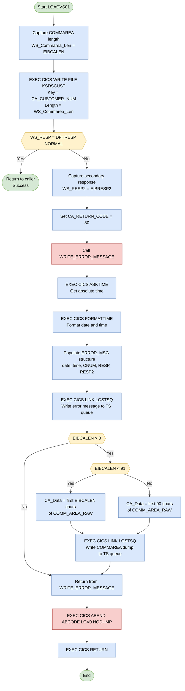

## Table of Contents

- [1. Purpose](#1-purpose)
- [2. Inputs](#2-inputs)
- [3. Outputs](#3-outputs)
  - [3.1 VSAM KSDS File Write — KSDSCUST](#31-vsam-ksds-file-write--ksdscust)
  - [3.2 Communication Area (COMMAREA) — Returned to Caller](#32-communication-area-commarea--returned-to-caller)
  - [3.3 Error Handling Outputs](#33-error-handling-outputs)
  - [3.4 CICS ABEND](#34-cics-abend)
  - [3.5 Summary of Output Variables by Category](#35-summary-of-output-variables-by-category)
- [4. Processing Logic](#4-processing-logic)
  - [4.1 Mermaid Flow Diagram](#41-mermaid-flow-diagram)
  - [4.2 Processing Logic Description](#42-processing-logic-description)
  - [4.3 Database Tables](#43-database-tables)
- [5. Paragraphs](#5-paragraphs)
- [6. Dependencies](#6-dependencies)
  - [6.1 CICS runtime and middleware dependencies](#61-cics-runtime-and-middleware-dependencies)
  - [6.2 Data structure and input dependencies](#62-data-structure-and-input-dependencies)
  - [6.3 External data store dependencies](#63-external-data-store-dependencies)
  - [6.4 Program-to-program and operational dependencies](#64-program-to-program-and-operational-dependencies)
  - [6.5 Configuration and definition dependencies](#65-configuration-and-definition-dependencies)
  - [6.6 Implicit behavioral dependencies](#66-implicit-behavioral-dependencies)
- [7. Constraints](#7-constraints)
  - [7.1 Data Format & Type Constraints](#71-data-format--type-constraints)
  - [7.2 Input Presence / COMMAREA Length Constraints](#72-input-presence--commarea-length-constraints)
  - [7.3 VSAM Write Constraints](#73-vsam-write-constraints)
  - [7.4 Error Handling & Flow-Control Constraints](#74-error-handling--flow-control-constraints)
  - [7.5 Sequencing / Ordering Constraints](#75-sequencing--ordering-constraints)
- [8. Error Handling](#8-error-handling)
  - [8.1 CICS Write Response Check](#81-cics-write-response-check)
  - [8.2 Error State Signalling to the Caller](#82-error-state-signalling-to-the-caller)
  - [8.3 Secondary Diagnostic Code Capture](#83-secondary-diagnostic-code-capture)
  - [8.4 Error Message Construction and Logging](#84-error-message-construction-and-logging)
  - [8.5 COMMAREA Diagnostic Dump](#85-commarea-diagnostic-dump)
  - [8.6 Abnormal Termination](#86-abnormal-termination)
- [9. Examples](#9-examples)
  - [9.1 Example 1: Successful Customer Record Addition](#91-example-1-successful-customer-record-addition)
  - [9.2 Example 2: Failed Write — Duplicate Key (Record Already Exists)](#92-example-2-failed-write--duplicate-key-record-already-exists)

## 1. Purpose

LGACVS01 is a CICS-hosted PL/I program that adds a new customer record to the insurance application's VSAM Key-Sequenced Data Set (KSDS) file named KSDSCUST. It receives customer demographic and policy data through a CICS communication area, uses the 10-digit customer number as the record key, and writes the entire communication area as a new record to the file. If the write operation fails, the program sets a return code of '80' in the communication area, logs a structured error message containing the timestamp, customer number, and CICS response codes by linking to the LGSTSQ logging program, and then issues a CICS ABEND before returning control to the caller.

## 2. Inputs

**CICS COMMAREA — Passed via `COMM_AREA_PTR` parameter**

- `CA_REQUEST_ID` — 6-character operation code that identifies the type of request (e.g., add customer, inquire policy); received from the calling program through the COMMAREA
- `CA_RETURN_CODE` — 2-digit return code field within the COMMAREA; read on entry and written on exit to communicate success or failure back to the caller
- `CA_CUSTOMER_NUM` — 10-digit numeric customer identifier supplied by the caller; used as both the data source (`FROM`) and the VSAM KSDS record key (`RIDFLD`) in the CICS WRITE to file `KSDSCUST`
- `CA_REQUEST_SPECIFIC` — union overlay covering all request-type-specific sub-structures; the entire COMMAREA (up to `WS_COMMAREA_LEN` bytes) is written as the VSAM record, so all populated fields flow into the file
  - `CA_CUSTOMER_REQUEST` — customer demographic sub-structure populated by the caller when performing an add-customer operation
    - `CA_FIRST_NAME` — customer's first (given) name (10 chars)
    - `CA_LAST_NAME` — customer's last (family) name (20 chars)
    - `CA_DOB` — customer's date of birth (10 chars)
    - `CA_HOUSE_NAME`, `CA_HOUSE_NUM`, `CA_POSTCODE` — customer address fields
    - `CA_NUM_POLICIES` — number of policies associated with the customer (PIC '999')
    - `CA_PHONE_MOBILE`, `CA_PHONE_HOME` — customer contact telephone numbers
    - `CA_EMAIL_ADDRESS` — customer e-mail address (100 chars)
    - `CA_POLICY_DATA` — raw policy data block appended to the customer record (32267 chars)
  - `CA_POLICY_REQUEST` — policy-level sub-structure populated by the caller for policy operations
    - `CA_POLICY_NUM` — 10-digit policy identifier
    - `CA_POLICY_COMMON` — common policy fields shared across all policy types
      - `CA_ISSUE_DATE` — policy issue date (10 chars)
      - `CA_EXPIRY_DATE` — policy expiry date (10 chars)
      - `CA_BROKERID` — 10-digit broker identifier
      - `CA_PAYMENT` — payment amount (PIC '999999')
      - `CA_POLICY_SPECIFIC` — union overlay for policy-type-specific details (endowment, house, motor, commercial, claim)
- `COMM_AREA_RAW` — unstructured 32,500-character view of the entire COMMAREA; used in error reporting to capture a printable snapshot of the inbound data passed to the logging program `LGSTSQ`

**CICS Execution Interface Block (EIB) — Runtime-provided by CICS**

- `EIBCALEN` — length of the inbound COMMAREA provided by CICS at program invocation; assigned to `WS_COMMAREA_LEN` and used as the `LENGTH` parameter on the CICS WRITE FILE command, and also governs how many bytes of `COMM_AREA_RAW` are logged on error
- `EIBRESP2` — secondary CICS response code captured from the EIB after a failed CICS WRITE FILE; stored in `WS_RESP2` and forwarded to the error logging program `LGSTSQ`

**VSAM File — `KSDSCUST`**

- The target KSDS VSAM file itself is an implicit input in the sense that a duplicate-key condition (non-NORMAL `RESP`) from the CICS WRITE constitutes external state that drives the program's error path; no data is read from it, but its current content determines whether the write succeeds

## 3. Outputs

### 3.1 VSAM KSDS File Write — KSDSCUST

- **KSDSCUST VSAM file record** — the primary output of the program. An `EXEC CICS WRITE FILE('KSDSCUST')` writes a customer record to the KSDSCUST VSAM KSDS file.
  - **FROM(CA_Customer_Num)** — the data written starts at `CA_CUSTOMER_NUM` within the `COMM_AREA` structure, encompassing the customer number and subsequent customer data fields (first name, last name, date of birth, address, phone, email, policy data, etc.).
  - **RIDFLD(CA_Customer_Num)** — the 10-digit customer number serves as the record key for the VSAM KSDS file.
  - **LENGTH(WS_Commarea_Len)** — the byte length of the record written, derived from `EIBCALEN`.
  - **KEYLENGTH(10)** — the key is 10 bytes long.
  - **RESP(WS_RESP)** — captures the CICS primary response code to determine success or failure.

### 3.2 Communication Area (COMMAREA) — Returned to Caller

- **CA_RETURN_CODE** — a 2-digit return code passed back to the calling program via the COMMAREA.
  - Set to `'80'` when the VSAM WRITE fails, signalling an error to the caller.
  - On success, it remains unchanged (retains whatever value the caller set).

### 3.3 Error Handling Outputs

These outputs are produced only when the CICS WRITE to KSDSCUST fails (`WS_RESP ≠ DFHRESP(NORMAL)`):

- **ERROR_MSG (passed to LGSTSQ via EXEC CICS LINK)** — a structured error message written to a CICS Transient Storage queue by linking to program `LGSTSQ`.
  - **EM_DATE** — date of the error (formatted via `EXEC CICS FORMATTIME`).
  - **EM_TIME** — time of the error.
  - **EM_CUSNUM** — the customer number that caused the failure (copied from `CA_CUSTOMER_NUM`).
  - **EM_RESPRC** — the primary CICS response code (`WS_RESP`).
  - **EM_RESP2RC** — the secondary CICS response code (`WS_RESP2`, from `EIBRESP2`).

- **CA_ERROR_MSG (passed to LGSTSQ via EXEC CICS LINK)** — a second diagnostic message containing a snapshot of the inbound COMMAREA, also written to the TS queue via `LGSTSQ`.
  - **CA_Data** — up to 90 characters extracted from `COMM_AREA_RAW` for diagnostic purposes. The exact length copied depends on `EIBCALEN` (capped at 90 bytes).

### 3.4 CICS ABEND

- **ABEND with code 'LGV0'** — issued via `EXEC CICS ABEND ABCODE('LGV0') NODUMP` when the VSAM WRITE fails. This abnormally terminates the CICS task with a user abend code of `LGV0`. The `NODUMP` option suppresses a transaction dump. This abend is observable in CICS system logs and monitoring.

### 3.5 Summary of Output Variables by Category

**VSAM File Output**
- `CA_CUSTOMER_NUM` — record key written to KSDSCUST
- `COMM_AREA` fields starting from `CA_CUSTOMER_NUM` — the full customer record data written to the file
- `WS_Commarea_Len` — determines the length of the record written

**Return to Caller (COMMAREA)**
- `CA_RETURN_CODE` — operation result indicator (`'80'` = failure)

**Error Logging (via LGSTSQ)**
- `ERROR_MSG` — structured error message containing date, time, customer number, and CICS response codes
  - `EM_DATE`, `EM_TIME`, `EM_CUSNUM`, `EM_RESPRC`, `EM_RESP2RC`
- `CA_ERROR_MSG` — COMMAREA snapshot for diagnostics
  - `CA_Data` — first 90 bytes (or fewer) of the raw COMMAREA

**CICS Task Abend**
- Abend code `'LGV0'` — observable in CICS logs when the WRITE fails

## 4. Processing Logic

### 4.1 Mermaid Flow Diagram

---

### 4.2 Processing Logic Description

#### 4.2.1 High-level Summary

`LGACVS01` is a CICS PL/I program whose sole purpose is to **add (write) a new customer record to the VSAM KSDS file `KSDSCUST`**. It receives a fully populated communication area (COMMAREA) from its caller, writes the entire COMMAREA as a new keyed record using the customer number as the KSDS key, and either returns normally on success or signals the caller of a failure via `CA_RETURN_CODE = '80'` and issues a CICS ABEND `LGV0`.

According to the application architecture documented in `AGENTS.md`, `LGACVS01` is invoked via `EXEC CICS LINK` from `LGACDB01` (the DB2 Add-Customer back-end), meaning it acts as the **VSAM mirror write** for every new customer that is also stored in DB2.

---

#### 4.2.2 Execution Flow

**Step 1 — Initialise COMMAREA Length**
The program begins by reading `EIBCALEN` (the length of the inbound COMMAREA supplied by CICS) into the working-storage variable `WS_Commarea_Len`. This value is later used as the byte count for the VSAM write, ensuring that exactly the number of bytes received are stored in the file.

**Step 2 — Write customer record to VSAM KSDS**
An `EXEC CICS WRITE FILE('KSDSCUST')` is issued with:
- `FROM(CA_CUSTOMER_NUM)` — the start of the COMMAREA record to write (the 10-digit customer number field acts as the anchor of the record layout)
- `LENGTH(WS_Commarea_Len)` — dynamic length taken from `EIBCALEN`
- `RIDFLD(CA_CUSTOMER_NUM)` — the 10-digit numeric key for the KSDS record
- `KEYLENGTH(10)` — explicit key length
- `RESP(WS_RESP)` — primary response code captured for inline checking

**Step 3 — Check write response**
The primary CICS response `WS_RESP` is compared against `DFHRESP(NORMAL)`:
- **Success path (WS_RESP = NORMAL):** The program falls through to `RETURN`, giving control back to the caller with no change to `CA_RETURN_CODE` (implying success).
- **Error path (WS_RESP ≠ NORMAL):** Error handling is initiated.

**Step 4 — Error handling (WRITE_ERROR_MESSAGE procedure)**
When the write fails:
1. `WS_RESP2` is populated from `EIBRESP2` (CICS secondary response code for supplementary diagnostics).
2. `CA_RETURN_CODE` is set to `'80'` — the agreed signal back to the caller that the VSAM write failed.
3. The internal `WRITE_ERROR_MESSAGE` procedure is called.

Inside `WRITE_ERROR_MESSAGE`:
- **Time-stamp acquisition:** `EXEC CICS ASKTIME` retrieves the current absolute time into `WS_ABSTIME`; `EXEC CICS FORMATTIME` converts it to a human-readable date (`MMDDYYYY` → `WS_DATE`) and time (`WS_TIME`).
- **Error message assembly:** The `ERROR_MSG` structure is populated with the date, time, the customer number (`EM_CUSNUM`), and both response codes (`EM_RESPRC`, `EM_RESP2RC`). The literal labels `LGACVS01`, `CNUM=`, `Write file KSDSCUST`, `RESP=`, `RESP2=` are baked into the structure initialisers, forming a self-describing diagnostic line.
- **First CICS LINK to LGSTSQ:** The assembled error message is passed to the utility program `LGSTSQ` (a CICS Temporary Storage queue logger) via `EXEC CICS LINK PROGRAM('LGSTSQ') COMMAREA(ERROR_MSG) LENGTH(STG(ERROR_MSG))`.
- **COMMAREA dump (conditional):**
  - If `EIBCALEN > 0` (a COMMAREA was present), the raw COMMAREA bytes are also logged.
  - If `EIBCALEN < 91`, only the actual `EIBCALEN` bytes are extracted with `LEFT(COMM_AREA_RAW, EIBCALEN)`.
  - Otherwise the first 90 bytes are taken as a snapshot.
  - A second `EXEC CICS LINK` to `LGSTSQ` logs this COMMAREA dump prefixed with `'COMMAREA='`.
- The procedure returns to the main-line code.

**Step 5 — ABEND and RETURN**
After error logging, the program issues:
- `EXEC CICS ABEND ABCODE('LGV0') NODUMP` — terminates the task with a four-character abend code `LGV0`; `NODUMP` suppresses the system dump to reduce overhead.
- `EXEC CICS RETURN` — included as a defensive measure to cleanly return control to CICS if the ABEND is intercepted.

---

#### 4.2.3 External Interactions

| Interaction | Type | Purpose |
|---|---|---|
| **KSDSCUST** VSAM KSDS file | CICS WRITE FILE | Stores the full COMMAREA as a new customer record, keyed by the 10-digit `CA_CUSTOMER_NUM` |
| **LGSTSQ** program | EXEC CICS LINK | Utility logging program; receives error message structures and writes them to a CICS Temporary Storage queue for operational diagnostics |

---

#### 4.2.4 Plain Language Summary

`LGACVS01` does one specific job: it takes the customer information handed to it in memory and saves it permanently into the VSAM customer file (`KSDSCUST`), using the customer number as the record key. If the save succeeds, it quietly hands control back to whoever called it. If the save fails — for example, because the record already exists or the file is unavailable — it records exactly what went wrong (including error codes, a timestamp, and a copy of the data it tried to write) into a diagnostic log, tells the caller the operation failed by setting a return code of `80`, and then abends the CICS task with code `LGV0` so that the failure is visible in operational monitoring.

---

### 4.3 Database Tables

`LGACVS01` does not interact with any DB2 tables. Its only data store interaction is with the VSAM KSDS file **KSDSCUST**, which is a CICS-managed file rather than a relational database table. No `erDiagram` is applicable for this program.

## 5. Paragraphs

**Main Procedure Body (LGACVS01)**

- This is the program's sole executable mainline, entered via `Proc(COMM_AREA_PTR) Options(Main)`. It contains all top-level executable statements before the `RETURN` statement.
- Initialization:
  - `WS_Commarea_Len` is assigned the value of `EIBCALEN`, capturing the byte length of the inbound COMMAREA passed by the CICS caller. This value is used to control exactly how many bytes are written to the VSAM file.
- VSAM Write operation (interaction with external system — VSAM KSDS file):
  - Issues `EXEC CICS WRITE FILE('KSDSCUST')` to add a new customer record to the VSAM KSDS file named `KSDSCUST`.
  - `FROM(CA_Customer_Num)` specifies the data source as the customer number field within the COMMAREA.
  - `LENGTH(WS_Commarea_Len)` controls the number of bytes written, derived from `EIBCALEN`.
  - `RIDFLD(CA_Customer_Num)` sets the record key (VSAM KSDS key) to the 10-digit customer number (`CA_CUSTOMER_NUM`).
  - `KEYLENGTH(10)` explicitly declares the key length for the KSDS file.
  - `RESP(WS_RESP)` captures the primary CICS response code for subsequent error checking.
- Post-write conditional error handling:
  - Checks `WS_RESP` against `DFHRESP(NORMAL)`; if the write did not succeed:
    - `WS_RESP2` is populated from `EIBRESP2` to capture the secondary (supplementary) CICS response code.
    - `CA_RETURN_CODE` is set to `'80'` to signal a write failure back to the calling program.
    - Calls the internal `WRITE_ERROR_MESSAGE` subroutine to log diagnostic information.
    - Issues `EXEC CICS ABEND ABCODE('LGV0') NODUMP` to abnormally terminate the transaction with a specific abend code (`LGV0`), suppressing dump generation.
    - Issues `EXEC CICS RETURN` as a safeguard after the abend instruction.
- On success, falls through to `RETURN`, giving control back to the CICS caller.

---

**WRITE_ERROR_MESSAGE**

- An internal subroutine (`PROCEDURE`) invoked only when the VSAM write fails. Its purpose is to format and log a diagnostic error message to a CICS temporary storage queue via the `LGSTSQ` logging program.
- Timestamp retrieval (interaction with CICS):
  - Issues `EXEC CICS ASKTIME ABSTIME(WS_ABSTIME)` to obtain the current absolute time from CICS, storing it as a binary value in `WS_ABSTIME`.
  - Issues `EXEC CICS FORMATTIME ABSTIME(WS_ABSTIME) MMDDYYYY(WS_DATE) TIME(WS_TIME)` to convert the absolute time into a human-readable date (`WS_DATE`, MM/DD/YYYY format) and time (`WS_TIME`).
- Error message assembly:
  - Populates the `ERROR_MSG` structure fields:
    - `EM_DATE` ← `WS_DATE` (formatted date)
    - `EM_TIME` ← `WS_TIME` (formatted time)
    - `EM_CUSNUM` ← `CA_Customer_Num` (the customer number involved in the failed write)
    - `EM_RESPRC` ← `WS_RESP` (primary CICS response code)
    - `EM_RESP2RC` ← `WS_RESP2` (secondary CICS response code)
  - The structure already contains static literal text such as `' LGACVS01'`, `' CNUM='`, `' Write file KSDSCUST'`, `' RESP='`, and `' RESP2='`, providing full context in the log output.
- Error message logging — first call (interaction with `LGSTSQ`):
  - Issues `EXEC CICS LINK PROGRAM('LGSTSQ') COMMAREA(ERROR_MSG) LENGTH(STG(ERROR_MSG))` to pass the complete formatted error message to the `LGSTSQ` logging utility program. `STG(ERROR_MSG)` uses the PL/I `STG` built-in to derive the exact byte size of the structure at compile time.
- COMMAREA diagnostic logging — conditional logic:
  - Checks `EIBCALEN > 0` to confirm a COMMAREA was passed before attempting to log its contents.
  - If `EIBCALEN < 91` (COMMAREA is 90 bytes or fewer):
    - Sets `CA_Data` to `LEFT(COMM_AREA_RAW, EIBCALEN)` — extracts the exact number of bytes of the raw COMMAREA.
    - Issues a second `EXEC CICS LINK PROGRAM('LGSTSQ')` passing `CA_ERROR_MSG` (prefixed with the literal `'COMMAREA='`) to log the raw COMMAREA bytes.
  - Otherwise (COMMAREA is larger than 90 bytes):
    - Sets `CA_Data` to `LEFT(COMM_AREA_RAW, 90)` — truncates to the first 90 characters.
    - Issues the same second `EXEC CICS LINK PROGRAM('LGSTSQ')` call to log the truncated snapshot.
  - This branching ensures the log always captures a bounded, printable view of the inbound COMMAREA regardless of its actual length.
- Returns to the caller (mainline) after logging is complete.

## 6. Dependencies

### 6.1 CICS runtime and middleware dependencies
- CICS execution environment
  - The program is a CICS PL/I transaction program and depends on CICS-provided control blocks and services such as `EIBCALEN`, `EIBRESP2`, and `DFHRESP(NORMAL)`.
  - It uses multiple `EXEC CICS` commands, so it must run in a CICS region with CICS translation/compilation support enabled.

- CICS file resource `KSDSCUST`
  - Accessed by `EXEC CICS WRITE FILE('KSDSCUST')`.
  - This is the VSAM KSDS customer file that receives the new customer record.
  - The write uses `CA_CUSTOMER_NUM` as the record key via `RIDFLD`, with `KEYLENGTH(10)`.

- CICS-linked program `LGSTSQ`
  - Invoked through `EXEC CICS LINK PROGRAM('LGSTSQ')`.
  - Used by the local `WRITE_ERROR_MESSAGE` procedure to log formatted error information.
  - Called once with the `ERROR_MSG` structure and, when COMMAREA data exists, again with the `CA_ERROR_MSG` structure containing a snapshot of the inbound COMMAREA.

- CICS time services
  - `EXEC CICS ASKTIME` obtains the current absolute time.
  - `EXEC CICS FORMATTIME` formats that time into `WS_DATE` and `WS_TIME`.
  - Required for timestamping error messages sent to `LGSTSQ`.

- CICS abnormal termination support
  - Uses `EXEC CICS ABEND ABCODE('LGV0') NODUMP` when the VSAM write fails.
  - Depends on CICS abend handling to terminate the task with application abend code `LGV0`.

- CICS task return service
  - Uses `EXEC CICS RETURN` after error handling.
  - Depends on normal CICS task completion behavior.

### 6.2 Data structure and input dependencies
- Input COMMAREA pointer `COMM_AREA_PTR`
  - The procedure signature is `Proc(COMM_AREA_PTR) Options(Main)`.
  - The caller must pass a valid pointer to the communication area.
  - The program overlays this pointer with the `COMM_AREA` structure and uses it as both input data and the output area for return code updates.

- COMMAREA layout from include `LGCMAREA`
  - The source shows the expanded contents of `%INCLUDE LGCMAREA;`.
  - The program depends on this shared copybook/interface definition for the structure and field positions of the communication area.
  - It specifically relies on fields such as:
    - `CA_CUSTOMER_NUM`
    - `CA_RETURN_CODE`
    - `COMM_AREA_RAW`

- COMMAREA length from `EIBCALEN`
  - `WS_Commarea_Len = EIBCALEN`.
  - The inbound COMMAREA length is required to determine how many bytes are written to the `KSDSCUST` file.
  - Also used to decide how much COMMAREA content to copy into `CA_ERROR_MSG` for diagnostics.

- Required customer key/input field `CA_CUSTOMER_NUM`
  - Serves as the VSAM record key and also as the `FROM` source for the file write.
  - Essential for successful record creation in `KSDSCUST`.
  - Also included in the logged error message on failure.

### 6.3 External data store dependencies
- VSAM KSDS dataset behind CICS file `KSDSCUST`
  - The logical CICS file name implies an underlying VSAM KSDS dataset defined to CICS.
  - The program depends on that dataset existing, being correctly defined, and being available for write access.
  - Record format and key definition must be compatible with:
    - record image written from the COMMAREA starting at `CA_CUSTOMER_NUM`
    - key length of 10 bytes

### 6.4 Program-to-program and operational dependencies
- Calling program or transaction flow
  - `LGACVS01` is not standalone in practical use; it expects to be invoked by another CICS program with a populated COMMAREA.
  - The caller must provide:
    - a valid COMMAREA pointer
    - a correctly populated customer number
    - a COMMAREA length consistent with the record image intended for VSAM write

- Error logging contract with `LGSTSQ`
  - `LGSTSQ` must accept the linked COMMAREA formats used here:
    - `ERROR_MSG`
    - `CA_ERROR_MSG`
  - Successful diagnostics depend on `LGSTSQ` being present and compatible with these structures.

### 6.5 Configuration and definition dependencies
- CICS resource definitions
  - The following CICS resources must be defined and available in the target region:
    - program `LGACVS01`
    - file `KSDSCUST`
    - program `LGSTSQ`
  - The file definition must support keyed writes with a 10-byte customer key.

- CICS/PL/I build configuration
  - Because the program contains `EXEC CICS` statements, it depends on CICS-aware PL/I compilation and translation support.
  - It also depends on the include path resolving `LGCMAREA` during preprocessing/compilation.

### 6.6 Implicit behavioral dependencies
- Successful CICS response handling
  - The logic assumes `DFHRESP(NORMAL)` indicates a successful file write.
  - Non-normal `RESP` values trigger the error path, populate `CA_RETURN_CODE = '80'`, log diagnostics, and abend.

- Availability of COMMAREA content for diagnostic logging
  - If `EIBCALEN > 0`, the program copies up to 90 bytes of `COMM_AREA_RAW` into `CA_ERROR_MSG`.
  - Diagnostic completeness depends on the inbound COMMAREA actually containing meaningful data in that range.

## 7. Constraints

### 7.1 Data Format & Type Constraints

- **Customer number (`CA_CUSTOMER_NUM`) must be a 10-digit numeric value**
  - Declared as `PIC '9999999999'` — the PL/I picture clause restricts the field to exactly 10 numeric characters (digits 0–9); non-numeric content is a data-type violation at the point of assignment or use.
  - It also serves as the VSAM KSDS record key (`RIDFLD`) with `KeyLength(10)` explicitly enforced on the `EXEC CICS WRITE FILE` command; the key length supplied to CICS must exactly match the 10-byte key defined on the KSDS cluster.

- **Return code (`CA_RETURN_CODE`) is a 2-digit numeric field**
  - Declared as `PIC '99'`; only values `'00'`–`'99'` are structurally valid. The program writes exactly `'80'` to signal a write failure — no other value is assigned by this program.

- **Payment, broker ID, policy number, and numeric policy sub-fields are all picture-constrained**
  - `CA_PAYMENT` (`PIC '999999'`): 6-digit numeric only, range 0–999999.
  - `CA_BROKERID` (`PIC '9999999999'`): 10-digit numeric only.
  - `CA_POLICY_NUM` (`PIC '9999999999'`): 10-digit numeric only.
  - Policy-specific numeric fields (e.g., `CA_E_TERM PIC '99'`, `CA_H_BEDROOMS PIC '999'`, `CA_M_VALUE PIC '999999'`, etc.) carry their own digit-count and range limits as declared.

- **COMMAREA total size is bounded to 32,500 bytes**
  - `COMM_AREA_RAW` is declared `CHAR(32500)`, establishing the absolute upper limit of the communication area that can be referenced. Any COMMAREA passed by the caller that exceeds this size would overflow the declared structure.

- **Customer demographic fields have fixed maximum lengths**
  - `CA_FIRST_NAME`: 10 characters; `CA_LAST_NAME`: 20 characters; `CA_DOB`: 10 characters; `CA_HOUSE_NAME`: 20 characters; `CA_HOUSE_NUM`: 4 characters; `CA_POSTCODE`: 8 characters; `CA_PHONE_MOBILE`/`CA_PHONE_HOME`: 20 characters each; `CA_EMAIL_ADDRESS`: 100 characters. Values supplied by the caller must fit within these fixed-length fields; excess data is silently truncated by PL/I string assignment.

---

### 7.2 Input Presence / COMMAREA Length Constraints

- **A non-zero COMMAREA length is implicitly required for normal processing**
  - `WS_Commarea_Len` is initialised from `EIBCALEN` (line 179). If `EIBCALEN` is zero (no COMMAREA passed), `WS_Commarea_Len` will be zero and the `EXEC CICS WRITE FILE … LENGTH(WS_Commarea_Len)` will attempt to write a zero-length record — a structural precondition violation. Although this program does not explicitly abort on `EIBCALEN = 0` (unlike the pattern described for other programs in the suite), a zero-length write to a KSDS would return a non-`NORMAL` response and trigger the error path.

- **Diagnostic COMMAREA dump is conditionally capped at 90 characters**
  - Inside `WRITE_ERROR_MESSAGE`, a COMMAREA snapshot is only written to the log if `EIBCALEN > 0` (line 217). If `EIBCALEN < 91`, the actual length is used (`LEFT(COMM_AREA_RAW, EIBCALEN)`); otherwise exactly 90 characters are extracted (`LEFT(COMM_AREA_RAW, 90)`). This enforces a hard upper limit of 90 bytes on the diagnostic excerpt regardless of true COMMAREA size.

---

### 7.3 VSAM Write Constraints

- **The VSAM KSDS file targeted is exclusively `KSDSCUST`**
  - The `EXEC CICS WRITE FILE('KSDSCUST')` command hard-codes the target file name; no other file may be written by this program. The file must be open and available in the CICS region at the time of the call.

- **Record key must be unique in the KSDS**
  - VSAM KSDS semantics prohibit duplicate primary keys. If a record with the same `CA_CUSTOMER_NUM` already exists, the write will fail with a non-`NORMAL` CICS response, which this program detects and handles as an error.

- **Write length is derived from, and bounded by, `EIBCALEN`**
  - `LENGTH(WS_Commarea_Len)` (set from `EIBCALEN`) controls exactly how many bytes are written to the file. The written record length is therefore constrained to the byte count of the inbound COMMAREA, which cannot exceed 32,500 bytes (the size of `COMM_AREA_RAW`).

- **`FROM` parameter anchors the write at `CA_CUSTOMER_NUM`, not the start of the COMMAREA header**
  - The `From(CA_Customer_Num)` clause means the bytes written to the KSDS begin at the `CA_CUSTOMER_NUM` field offset within the COMMAREA, not at `CA_REQUEST_ID`. This implies the caller must construct the COMMAREA so that the customer data starts at the correct offset.

---

### 7.4 Error Handling & Flow-Control Constraints

- **Any non-normal CICS WRITE response halts normal processing immediately**
  - If `WS_RESP ≠ DFHRESP(NORMAL)` (line 190), the program sets `CA_RETURN_CODE = '80'`, invokes `WRITE_ERROR_MESSAGE`, issues `EXEC CICS ABEND ABCODE('LGV0') NODUMP`, and then `EXEC CICS RETURN`. Normal program logic is abandoned; no partial success path exists.

- **ABEND code is fixed to `'LGV0'`**
  - The abend code is hard-coded as a 4-character literal (`'LGV0'`), which is the CICS maximum for a user abend code. No dynamic abend code is generated.

- **Error logging is sequenced before the abend**
  - `WRITE_ERROR_MESSAGE` must complete (including two potential CICS LINK calls to `LGSTSQ`) before `EXEC CICS ABEND` is issued. This ordering guarantees diagnostics are persisted prior to task termination.

- **`WRITE_ERROR_MESSAGE` captures both primary and secondary response codes**
  - `WS_RESP2` is set from `EIBRESP2` only after a write failure is confirmed. The values are embedded in the structured error message (`EM_RESPRC`, `EM_RESP2RC`) before being passed to `LGSTSQ`. This means full diagnostic data (both response codes plus up to 90 bytes of COMMAREA) is always available when a write error occurs.

- **`NODUMP` suppresses transaction dump generation on abend**
  - The `NODUMP` option on `EXEC CICS ABEND` constrains the system not to produce a CICS transaction dump when the abend fires, relying solely on the error message written to `LGSTSQ` for diagnosis.

---

### 7.5 Sequencing / Ordering Constraints

- **COMMAREA length must be captured before the VSAM write**
  - `WS_Commarea_Len = EIBCALEN` (line 179) is the very first executable statement, ensuring the length is recorded before any CICS command that could alter EIB fields.

- **Time and date are fetched inside the error path only**
  - `EXEC CICS ASKTIME` and `EXEC CICS FORMATTIME` are called only within `WRITE_ERROR_MESSAGE`, meaning timestamp acquisition occurs exclusively when an error has been confirmed — not during normal processing.

- **Error message to `LGSTSQ` must be sent before COMMAREA diagnostic**
  - Within `WRITE_ERROR_MESSAGE`, the structured `ERROR_MSG` (containing customer number and response codes) is linked first (line 213–215), and only then is the raw COMMAREA excerpt linked (lines 220–228). This ordering ensures the primary diagnostic record always precedes the supplementary COMMAREA dump.

## 8. Error Handling

### 8.1 CICS Write Response Check

- After the `EXEC CICS WRITE FILE` command targeting the `KSDSCUST` VSAM KSDS file, the program explicitly inspects the primary CICS response code stored in `WS_RESP`
  - The check compares `WS_RESP` against `DFHRESP(NORMAL)`, which represents a successful CICS operation
  - If the response is anything other than normal, the program treats the write as a failure and enters error handling logic

### 8.2 Error State Signalling to the Caller

- When the VSAM write fails, `CA_RETURN_CODE` is set to the sentinel value `'80'`
  - This value is written back into the `COMM_AREA` structure, which is shared with the calling program
  - The calling program can inspect this field upon return to determine that the customer record creation did not succeed

### 8.3 Secondary Diagnostic Code Capture

- Immediately upon detecting a write failure, the secondary CICS response code is captured from the Execute Interface Block field `EIBRESP2` into `WS_RESP2`
  - This secondary code provides supplementary detail about the specific nature of the VSAM failure (e.g., duplicate record, file not open) beyond what the primary response code alone can convey
  - Both `WS_RESP` and `WS_RESP2` are subsequently embedded in the error message structure (`EM_RESPRC` and `EM_RESP2RC`) for diagnostic logging

### 8.4 Error Message Construction and Logging

- The `WRITE_ERROR_MESSAGE` internal procedure is invoked when an error is detected, assembling a structured diagnostic message before forwarding it to a logging program
  - **Timestamp acquisition:** `EXEC CICS ASKTIME` retrieves the current absolute time, and `EXEC CICS FORMATTIME` converts it into human-readable date (`WS_DATE`, formatted as MMDDYYYY) and time (`WS_TIME`) values; both are placed into the error message structure fields `EM_DATE` and `EM_TIME`
  - **Error context fields:** The failing customer number (`CA_Customer_Num`), primary response code, and secondary response code are written into the error message structure (`EM_CUSNUM`, `EM_RESPRC`, `EM_RESP2RC` respectively), clearly identifying which record triggered the failure and what CICS reported
  - **Log dispatch:** `EXEC CICS LINK PROGRAM('LGSTSQ')` is called with the fully populated `ERROR_MSG` structure passed as the `COMMAREA`, delegating the physical logging action to the external program `LGSTSQ`

### 8.5 COMMAREA Diagnostic Dump

- After logging the primary error message, the `WRITE_ERROR_MESSAGE` procedure also logs a snapshot of the raw incoming `COMM_AREA` to aid diagnosis
  - `EIBCALEN` (the length of the inbound communication area from the EIB) is checked to confirm a `COMM_AREA` was actually passed (value greater than zero)
  - If `EIBCALEN` is less than 91 bytes, the entire raw `COMM_AREA` content is extracted using the `LEFT` built-in function and placed into `CA_Data`
  - If `EIBCALEN` is 91 bytes or greater, only the first 90 characters of `COMM_AREA_RAW` are captured, preventing buffer overrun into the fixed 90-character `CA_Data` field
  - In either case, `EXEC CICS LINK PROGRAM('LGSTSQ')` is called a second time with `CA_ERROR_MSG` as the `COMMAREA`, logging the raw communication area snapshot alongside the structured error message

### 8.6 Abnormal Termination

- Following the invocation of `WRITE_ERROR_MESSAGE`, the program issues `EXEC CICS ABEND ABCODE('LGV0') NODUMP`
  - This forces an abnormal termination of the CICS task with the custom abend code `LGV0`, which serves as a recognisable marker in CICS logs and monitoring tools indicating a failure in this specific program
  - The `NODUMP` option suppresses the generation of a system dump, avoiding unnecessary overhead given that the diagnostic information has already been captured via the logging mechanism
  - `EXEC CICS RETURN` follows the abend instruction as a defensive measure to ensure control is explicitly returned to CICS should the abend not fully terminate the task

## 9. Examples

### 9.1 Example 1: Successful Customer Record Addition

**Input COMMAREA:**

| Field | Value |
|---|---|
| `CA_REQUEST_ID` | `ACUST0` |
| `CA_RETURN_CODE` | `00` |
| `CA_CUSTOMER_NUM` | `0000000042` |
| `CA_FIRST_NAME` | `JOHN      ` |
| `CA_LAST_NAME` | `SMITH               ` |
| `CA_DOB` | `1980-03-15` |
| `CA_HOUSE_NAME` | `ROSE COTTAGE           ` |
| `CA_HOUSE_NUM` | `12  ` |
| `CA_POSTCODE` | `SW1A 2AA` |
| `CA_NUM_POLICIES` | `000` |
| `CA_PHONE_MOBILE` | `07700900000         ` |
| `CA_PHONE_HOME` | `02079460000         ` |
| `CA_EMAIL_ADDRESS` | `john.smith@example.com` |

**Program flow:**
1. `WS_Commarea_Len` is set from `EIBCALEN` (e.g., `215`).
2. `EXEC CICS WRITE FILE('KSDSCUST')` is issued with `RIDFLD(CA_CUSTOMER_NUM)` = `0000000042` and `LENGTH(215)`.
3. `WS_RESP` receives `DFHRESP(NORMAL)` (value `0`).
4. The `IF` condition is false — no error handling is triggered.
5. The program returns normally via `RETURN`.

**Expected output:**
- A new record keyed `0000000042` is written to the `KSDSCUST` VSAM KSDS file.
- `CA_RETURN_CODE` remains `00` — the caller receives a success indication.
- No messages are written to the log queue.

---

### 9.2 Example 2: Failed Write — Duplicate Key (Record Already Exists)

**Input COMMAREA:**

| Field | Value |
|---|---|
| `CA_REQUEST_ID` | `ACUST0` |
| `CA_RETURN_CODE` | `00` |
| `CA_CUSTOMER_NUM` | `0000000042` |
| `CA_FIRST_NAME` | `JANE      ` |
| `CA_LAST_NAME` | `DOE                 ` |
| `CA_DOB` | `1975-07-22` |
| *(remaining customer fields)* | *(populated as above)* |

**Program flow:**
1. `WS_Commarea_Len` is set from `EIBCALEN`.
2. `EXEC CICS WRITE FILE('KSDSCUST')` is issued with `RIDFLD` = `0000000042` — but this key already exists in `KSDSCUST`.
3. CICS returns a non-normal response (e.g., `DUPREC`); `WS_RESP` ≠ `DFHRESP(NORMAL)`.
4. `WS_RESP2` is captured from `EIBRESP2`.
5. `CA_RETURN_CODE` is set to `80`, signalling a write failure to the caller.
6. `WRITE_ERROR_MESSAGE` is called:
   - CICS `ASKTIME` / `FORMATTIME` populate `EM_DATE` and `EM_TIME`.
   - `EM_CUSNUM` = `0000000042`, `EM_RESPRC` = the primary CICS response code, `EM_RESP2RC` = the secondary code.
   - `EXEC CICS LINK PROGRAM('LGSTSQ')` writes the structured error message to the log queue.
   - Because `EIBCALEN` ≥ 91, the first 90 characters of `COMM_AREA_RAW` are copied into `CA_Data` and a second `LGSTSQ` link writes the COMMAREA snapshot.
7. `EXEC CICS ABEND ABCODE('LGV0') NODUMP` abends the task without a dump.
8. `EXEC CICS RETURN` is issued for safety.

**Expected output:**
- No new record is written to `KSDSCUST`.
- `CA_RETURN_CODE` = `80` is visible in the COMMAREA returned to the caller (before the ABEND terminates the task).
- Two diagnostic messages are written to the CICS log queue via `LGSTSQ`:
  - Message 1: `MM/DD/YYYY HH:MM:SS  LGACVS01 CNUM=0000000042 Write file KSDSCUST RESP= <n> RESP2= <n>`
  - Message 2: `COMMAREA=ACUST000000000000042JANE      DOE …` (first 90 bytes of the inbound COMMAREA).
- The CICS task abends with code `LGV0`.

---

Generated by IBM Bob Premium Package for Z
