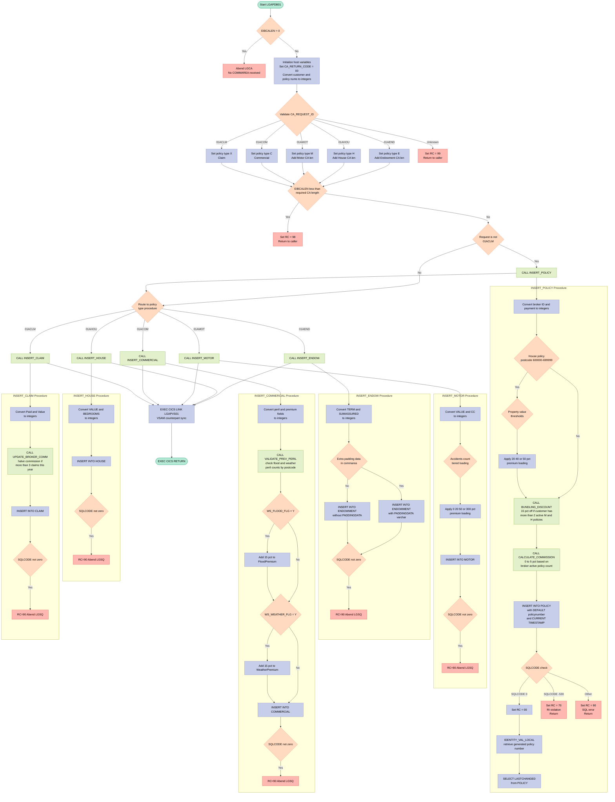
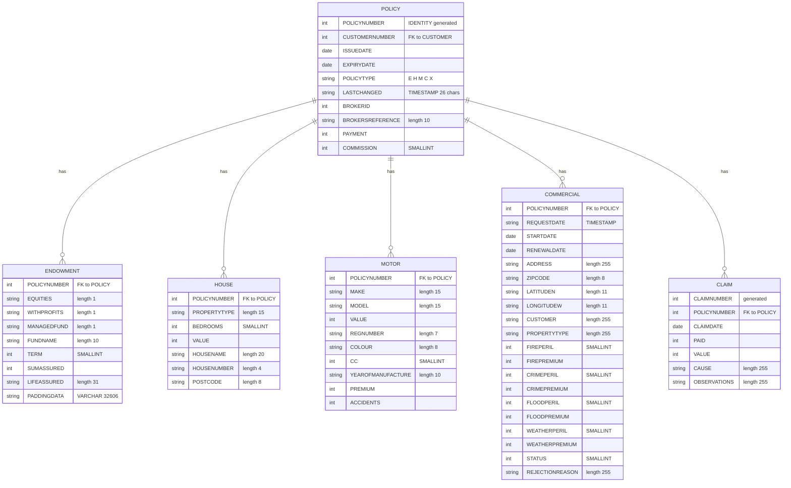

## Table of Contents

- [1. Purpose](#1-purpose)
- [2. Inputs](#2-inputs)
  - [2.1 CICS Communication Area (COMMAREA)](#21-cics-communication-area-commarea)
  - [2.2 CICS System Fields](#22-cics-system-fields)
  - [2.3 DB2 Tables (Read)](#23-db2-tables-read)
- [3. Outputs](#3-outputs)
  - [3.1 Communication Area (COMMAREA) — Returned to the Caller](#31-communication-area-commarea--returned-to-the-caller)
  - [3.2 DB2 Database Writes](#32-db2-database-writes)
  - [3.3 CICS Program Calls (Side Effects)](#33-cics-program-calls-side-effects)
  - [3.4 CICS Abend (Observable Error Side Effect)](#34-cics-abend-observable-error-side-effect)
- [4. Processing Logic](#4-processing-logic)
  - [4.1 Mermaid Flow Diagram](#41-mermaid-flow-diagram)
  - [4.2 Processing Logic Description](#42-processing-logic-description)
  - [4.3 Database Tables](#43-database-tables)
- [5. Paragraphs](#5-paragraphs)
- [6. Dependencies](#6-dependencies)
  - [6.1 DB2 Database Tables](#61-db2-database-tables)
  - [6.2 CICS Middleware](#62-cics-middleware)
  - [6.3 External Programs / Modules](#63-external-programs--modules)
  - [6.4 Copybooks / Include Members](#64-copybooks--include-members)
  - [6.5 Input Parameters / Communication Area](#65-input-parameters--communication-area)
- [7. Constraints](#7-constraints)
  - [7.1 COMMAREA Presence and Structure](#71-commarea-presence-and-structure)
  - [7.2 Request Identifier Validity](#72-request-identifier-validity)
  - [7.3 Policy Insertion Sequencing](#73-policy-insertion-sequencing)
  - [7.4 Database Referential Integrity](#74-database-referential-integrity)
  - [7.5 Payment / Premium Calculation Rules](#75-payment--premium-calculation-rules)
  - [7.6 Broker Commission Rules](#76-broker-commission-rules)
  - [7.7 SQL Error Handling and Processing Termination](#77-sql-error-handling-and-processing-termination)
  - [7.8 Endowment VARCHAR Data Constraint](#78-endowment-varchar-data-constraint)
  - [7.9 Data Field Size Constraints (Structural)](#79-data-field-size-constraints-structural)
  - [7.10 Post-Processing Delegation](#710-post-processing-delegation)
- [8. Error Handling](#8-error-handling)
  - [8.1 COMMAREA Validation](#81-commarea-validation)
  - [8.2 Request Identifier Validation](#82-request-identifier-validation)
  - [8.3 DB2 SQL Error Handling](#83-db2-sql-error-handling)
  - [8.4 SQL Error Handling in Supporting Procedures](#84-sql-error-handling-in-supporting-procedures)
  - [8.5 Transactional Backout via CICS Abend](#85-transactional-backout-via-cics-abend)
  - [8.6 Error Notification and Logging](#86-error-notification-and-logging)
- [9. Examples](#9-examples)
  - [9.1 Example 1: Adding a Motor Policy with Accident-Based Premium Loading](#91-example-1-adding-a-motor-policy-with-accident-based-premium-loading)
  - [9.2 Example 2: Adding a House Policy with Postcode-Based Premium Surcharge and Bundling Discount](#92-example-2-adding-a-house-policy-with-postcode-based-premium-surcharge-and-bundling-discount)
  - [9.3 Example 3: Adding a Claim that Triggers Broker Commission Halving](#93-example-3-adding-a-claim-that-triggers-broker-commission-halving)

## 1. Purpose

`LGAPDB01` is a CICS-hosted Enterprise PL/I program that serves as the DB2 database insertion engine for the General Insurance sample application's policy management system. Its primary responsibility is to accept a communication area (COMMAREA) from a calling program and persist a new insurance record — covering one of five policy types (Endowment, House, Motor, Commercial, or Claim) — into the appropriate DB2 tables. Before writing any data, the program applies a set of business rules to the payment amount: house policies in certain postcode ranges attract premium surcharges based on property value; customers holding multiple active motor and house policies receive a 15% bundling discount; commercial policies in postcodes with a high concentration of existing flood or weather peril claims incur a 15% peril surcharge; and motor policy premiums are loaded tiered by accident history. Broker commission is calculated dynamically based on the number of active policies the broker currently manages, and is halved on the parent policy record when a claim being added brings the annual claim count for that policy above three. Upon successful insertion, the DB2-generated policy number is returned to the caller via the COMMAREA, and the program delegates to a downstream validation service (`LGAPVS01`) before returning control to the caller.

## 2. Inputs

Based on the full program reading, here is the complete inputs section:

### 2.1 CICS Communication Area (COMMAREA)

The program receives all external input through a CICS COMMAREA passed by pointer (`COMM_AREA_PTR`). The fields below are the external inputs read from it.

**Control Fields**
- `CA_REQUEST_ID` — 6-character request type code that determines which policy type to insert (`01AEND`, `01AHOU`, `01AMOT`, `01ACOM`, `01ACLM`); drives the entire main control flow
- `CA_RETURN_CODE` — 2-digit return code; initialized by the caller and used to communicate the outcome back on return

**Customer & Policy Identity**
- `CA_CUSTOMER_NUM` — 10-digit customer number identifying the customer for whom the policy is being added
- `CA_POLICY_NUM` — 10-digit policy number supplied by the caller; used as the claim's parent policy reference for `01ACLM` requests, and overwritten on return with the DB2-generated policy number for new policy inserts

**Common Policy Fields** (used for all non-claim policy types)
- `CA_ISSUE_DATE` — Issue date of the policy inserted into the POLICY table
- `CA_EXPIRY_DATE` — Expiry date of the policy inserted into the POLICY table
- `CA_LASTCHANGED` — Timestamp of the last change; also used as the RequestDate for commercial inserts
- `CA_BROKERID` — 10-digit broker identifier; used to insert the broker reference into the POLICY table and to calculate broker commission
- `CA_BROKERSREF` — 10-character broker reference string stored in the POLICY table
- `CA_PAYMENT` — 6-digit payment amount; base premium before any surcharge adjustments (house location loading, bundling discount)

**Endowment-Specific Fields** (used when `CA_REQUEST_ID = '01AEND'`)
- `CA_E_WITH_PROFITS` — Single-character with-profits flag stored in the ENDOWMENT table
- `CA_E_EQUITIES` — Single-character equities flag stored in the ENDOWMENT table
- `CA_E_MANAGED_FUND` — Single-character managed fund flag stored in the ENDOWMENT table
- `CA_E_FUND_NAME` — 10-character fund name stored in the ENDOWMENT table
- `CA_E_TERM` — 2-digit policy term stored in the ENDOWMENT table
- `CA_E_SUM_ASSURED` — 6-digit sum assured amount stored in the ENDOWMENT table
- `CA_E_LIFE_ASSURED` — 31-character life assured name stored in the ENDOWMENT table
- `CA_E_PADDING_DATA` — Variable-length padding data stored as a VARCHAR in the ENDOWMENT table (used only when COMMAREA is large enough to contain it)

**House-Specific Fields** (used when `CA_REQUEST_ID = '01AHOU'`)
- `CA_H_PROPERTY_TYPE` — 15-character property type stored in the HOUSE table
- `CA_H_BEDROOMS` — 3-digit bedroom count stored in the HOUSE table
- `CA_H_VALUE` — 8-digit property value stored in the HOUSE table; also used to apply premium surcharges based on value bands
- `CA_H_HOUSE_NAME` — 20-character house name stored in the HOUSE table
- `CA_H_HOUSE_NUMBER` — 4-character house number stored in the HOUSE table
- `CA_H_POSTCODE` — 8-character postcode stored in the HOUSE table; also used to apply premium loading when it falls in the `600000`–`699999` range

**Motor-Specific Fields** (used when `CA_REQUEST_ID = '01AMOT'`)
- `CA_M_MAKE` — 15-character vehicle make stored in the MOTOR table
- `CA_M_MODEL` — 15-character vehicle model stored in the MOTOR table
- `CA_M_VALUE` — 6-digit vehicle value stored in the MOTOR table
- `CA_M_REGNUMBER` — 7-character registration number stored in the MOTOR table
- `CA_M_COLOUR` — 8-character vehicle colour stored in the MOTOR table
- `CA_M_CC` — 4-digit engine capacity stored in the MOTOR table
- `CA_M_MANUFACTURED` — 10-character year of manufacture stored in the MOTOR table
- `CA_M_PREMIUM` — 6-digit motor premium; subject to tiered loading based on accident count before being stored in the MOTOR table
- `CA_M_ACCIDENTS` — 6-digit accident count; drives tiered premium loading (0–2: no loading; 3–5: +20%; 6–8: +50%; >8: +300%) and is stored in the MOTOR table

**Commercial-Specific Fields** (used when `CA_REQUEST_ID = '01ACOM'`)
- `CA_B_Address` — 255-character property address stored in the COMMERCIAL table
- `CA_B_Postcode` — 8-character postcode used both for DB2 flood/weather peril lookup queries and stored as the ZIPCODE in the COMMERCIAL table
- `CA_B_Latitude` — 11-character latitude coordinate stored in the COMMERCIAL table
- `CA_B_Longitude` — 11-character longitude coordinate stored in the COMMERCIAL table
- `CA_B_Customer` — 255-character customer description stored in the COMMERCIAL table
- `CA_B_PropType` — 255-character property type description stored in the COMMERCIAL table
- `CA_B_FirePeril` — 4-digit fire peril indicator stored in the COMMERCIAL table
- `CA_B_FirePremium` — 8-digit fire premium stored in the COMMERCIAL table
- `CA_B_CrimePeril` — 4-digit crime peril indicator stored in the COMMERCIAL table
- `CA_B_CrimePremium` — 8-digit crime premium stored in the COMMERCIAL table
- `CA_B_FloodPeril` — 4-digit flood peril indicator stored in the COMMERCIAL table
- `CA_B_FloodPremium` — 8-digit flood premium; subject to a 15% surcharge if existing active policies for the same postcode sum to more than 3 flood perils
- `CA_B_WeatherPeril` — 4-digit weather peril indicator stored in the COMMERCIAL table
- `CA_B_WeatherPremium` — 8-digit weather premium; subject to a 15% surcharge if existing active policies for the same postcode sum to more than 3 weather perils
- `CA_B_Status` — 4-digit status code stored in the COMMERCIAL table
- `CA_B_RejectReason` — 255-character rejection reason stored in the COMMERCIAL table

**Claim-Specific Fields** (used when `CA_REQUEST_ID = '01ACLM'`)
- `CA_C_Num` — 10-digit claim number stored in the CLAIM table
- `CA_C_Date` — 10-character claim date stored in the CLAIM table
- `CA_C_Paid` — 8-digit amount paid on the claim stored in the CLAIM table
- `CA_C_Value` — 8-digit claim value stored in the CLAIM table
- `CA_C_Cause` — 255-character cause description stored in the CLAIM table
- `CA_C_Observations` — 255-character observations text stored in the CLAIM table

### 2.2 CICS System Fields

- `EIBCALEN` — CICS Executive Interface Block field providing the length of the received COMMAREA; used to validate that the COMMAREA is present and sufficiently long for the requested policy type
- `EIBTRNID` — CICS transaction identifier read at startup and stored in the working-storage header for diagnostics
- `EIBTRMID` — CICS terminal identifier read at startup and stored in the working-storage header for diagnostics
- `EIBTASKN` — CICS task number read at startup and stored in the working-storage header for diagnostics

### 2.3 DB2 Tables (Read)

- **POLICY table** — Queried by `BUNDLING_DISCOUNT` to count active motor and house policies for the same customer (to determine whether a 15% bundling discount applies), and by `CALCULATE_COMMISSION` to count the broker's active policies (to determine the commission tier)
- **COMMERCIAL table** — Queried by `VALIDATE_PREV_PERIL` to sum existing active flood and weather peril values for the same postcode, determining whether a 15% surcharge is applied to the incoming commercial policy premiums
- **CLAIM table** — Queried by `UPDATE_BROKER_COMM` to count the number of claims filed in the current year for the referenced policy, determining whether the broker commission on that policy should be halved

## 3. Outputs

### 3.1 Communication Area (COMMAREA) — Returned to the Caller

- **`CA_RETURN_CODE`** — The primary status indicator returned to the calling program. Set to `'00'` on success, `'70'` for a DB2 referential integrity violation (SQLCODE -530), `'90'` for any other SQL error, `'98'` when the COMMAREA is too short for the requested policy type, and `'99'` for an unrecognised request identifier.

- **`CA_POLICY_NUM`** — Populated with the DB2-generated policy number (retrieved via `IDENTITY_VAL_LOCAL()`) after a successful INSERT into the POLICY table. This is how the auto-assigned policy number is handed back to the caller.
  - Relevant for request types: `01AEND`, `01AHOU`, `01AMOT`, `01ACOM` (not `01ACLM`, which supplies the policy number as input).

- **`CA_C_Num`** — Written back to the COMMAREA after an INSERT into the CLAIM table, returning the claim number to the caller for `01ACLM` requests.

- **`CA_LASTCHANGED`** — Populated by a SELECT on the POLICY table immediately after INSERT, retrieving the DB2-generated `LASTCHANGED` timestamp and returning it to the caller in the COMMAREA.

---

### 3.2 DB2 Database Writes

- **POLICY table INSERT** — A new row is written for every non-claim request (`01AEND`, `01AHOU`, `01AMOT`, `01ACOM`). Columns written include: `CUSTOMERNUMBER`, `ISSUEDATE`, `EXPIRYDATE`, `POLICYTYPE`, `LASTCHANGED` (DB2 `CURRENT TIMESTAMP`), `BROKERID`, `BROKERSREFERENCE`, `PAYMENT` (potentially adjusted for house-location loading and/or bundling discount), and `COMMISSION` (broker commission calculated from active broker policy count).

- **ENDOWMENT table INSERT** — Written for `01AEND` requests. Columns include policy number, equities/withprofits/managed-fund flags, fund name, term, sum assured, life assured name, and optional padding data (VARCHAR).

- **HOUSE table INSERT** — Written for `01AHOU` requests. Columns include policy number, property type, number of bedrooms, property value, house name/number, and postcode.

- **MOTOR table INSERT** — Written for `01AMOT` requests. Columns include policy number, make, model, vehicle value, registration number, colour, engine size (CC), year of manufacture, premium (adjusted for accident history), and accident count.

- **COMMERCIAL table INSERT** — Written for `01ACOM` requests. Columns include policy number, request/start/renewal dates, address, postcode, latitude/longitude, customer, property type, fire/crime/flood/weather perils and premiums (flood and weather premiums potentially uplifted by 15% based on existing peril concentration in the same postcode), status, and rejection reason.

- **CLAIM table INSERT** — Written for `01ACLM` requests. Columns include claim number, policy number, claim date, paid amount, claim value, cause, and observations.

- **POLICY table UPDATE** — A conditional UPDATE sets `COMMISSION = COMMISSION / 2` for the policy identified by `DB2_C_Policynum_INT` when more than three claims exist for that policy in the current year. Executed as part of the `01ACLM` flow before the CLAIM INSERT.

---

### 3.3 CICS Program Calls (Side Effects)

- **CICS LINK to `LGAPVS01`** — Unconditionally called at the end of every successful path, passing the full COMMAREA (32,500 bytes). This triggers a parallel VSAM-side add operation.

- **CICS LINK to `LGSTSQ`** (via `WRITE_ERROR_MESSAGE`) — Called on any SQL error or on COMMAREA absence to write a diagnostic message record to a CICS Transient Data Queue (TDQ). Each invocation may write up to two records: the structured error message (date, time, program name, customer number, policy number, SQLCODE) and a raw COMMAREA dump (up to 90 bytes).

---

### 3.4 CICS Abend (Observable Error Side Effect)

- **`EXEC CICS ABEND ABCODE('LGCA')`** — Issued when no COMMAREA is received (`EIBCALEN = 0`), producing a CICS task abend with code `LGCA` (NODUMP).
- **`EXEC CICS ABEND ABCODE('LGSQ')`** — Issued after any SQL error in the insert/update procedures to force DB2 unit-of-work backout, producing a CICS task abend with code `LGSQ` (NODUMP). This ensures partial inserts are rolled back.

## 4. Processing Logic

### 4.1 Mermaid Flow Diagram

---

### 4.2 Processing Logic Description

#### 4.2.1 High-level Summary

`LGAPDB01` is the DB2 backend program for adding insurance policies in the GenApp General Insurance application. It is invoked via a CICS LINK from the policy orchestrator (`LGAPOL01`) and handles five policy types: **Endowment**, **House**, **Motor**, **Commercial**, and **Claim**. For each type it applies business rule calculations (premium loading, bundling discounts, broker commission), then executes the appropriate DB2 INSERT statements. After the DB2 work completes, it calls the VSAM counterpart program `LGAPVS01` before returning control to the caller.

---

#### 4.2.2 Execution Flow

**Step 1 — Initialization and COMMAREA Validation**

On entry the program reads the CICS EIB fields (`EIBTRNID`, `EIBTRMID`, `EIBTASKN`, `EIBCALEN`) into working-storage header fields for diagnostic purposes, then zeroes out all DB2 host variable groups. If `EIBCALEN = 0` (no COMMAREA was passed), the program writes an error message and immediately abends with code `LGCA` (no dump), protecting against a null-pointer dereference.

**Step 2 — Request Identification and CA Length Check**

The COMMAREA field `CA_REQUEST_ID` is evaluated in a `SELECT/WHEN` construct:

| Request ID | Policy Type | DB2_POLICYTYPE | Required CA length added |
|---|---|---|---|
| `01AEND` | Endowment | `E` | `WS_FULL_ENDOW_LEN` (124) |
| `01AHOU` | House | `H` | `WS_FULL_HOUSE_LEN` (130) |
| `01AMOT` | Motor | `M` | `WS_FULL_MOTOR_LEN` (137) |
| `01ACOM` | Commercial | `C` | *(no length addition)* |
| `01ACLM` | Claim | `X` | *(no length addition)* |
| Unknown | — | — | `CA_RETURN_CODE = '99'`, immediate `EXEC CICS RETURN` |

After routing, if the actual COMMAREA length (`EIBCALEN`) is less than the computed minimum required length, `CA_RETURN_CODE` is set to `'98'` and the program returns immediately.

**Step 3 — INSERT_POLICY (all types except Claim)**

For all request types except `01ACLM`, the program calls `INSERT_POLICY`. This procedure:

1. **House premium loading by postcode and value** — if the request is for a house policy and the postcode falls in the range `600000`–`699999`, a surcharge is applied to `DB2_PAYMENT_INT`:
   - Property value £10M–£15M: +20%
   - Property value £15M–£20M: +40%
   - Property value > £20M: +50%

2. **Bundling discount** (`BUNDLING_DISCOUNT` sub-procedure) — counts active Motor and House policies (type `'M'` or `'H'`) for the same customer. If the count exceeds 2, a **15% discount** is applied to `DB2_PAYMENT_INT`. An SQL error here causes abend `LGSQ` (forcing DB2 rollback).

3. **Broker commission calculation** (`CALCULATE_COMMISSION` sub-procedure) — counts all currently active policies managed by the same broker. The commission percentage scales as:
   - 0 policies → 0%
   - 1 policy → 1%
   - 2 policies → 2%
   - 3 policies → 3%
   - 4 policies → 4%
   - ≥5 policies → 5%
   The resulting `WS_COMMISSION` is stored in the `COMMISSION` column of the POLICY row.

4. **INSERT INTO POLICY** — inserts a new row with `POLICYNUMBER DEFAULT` (DB2 IDENTITY), `CURRENT TIMESTAMP` for `LASTCHANGED`, and all other commarea values. On `SQLCODE = 0` → `CA_RETURN_CODE = '00'`. On `SQLCODE = -530` (referential integrity violation, i.e. customer does not exist) → `CA_RETURN_CODE = '70'` and `EXEC CICS RETURN`. Any other non-zero SQLCODE → `CA_RETURN_CODE = '90'` and `EXEC CICS RETURN`.

5. **Retrieve generated policy number** — `SET :DB2_POLICYNUM_INT = IDENTITY_VAL_LOCAL()` retrieves the auto-assigned policy number and writes it back to `CA_POLICY_NUM` so the caller receives it.

6. **Retrieve LASTCHANGED timestamp** — a `SELECT LASTCHANGED FROM POLICY` fetches the DB2-generated timestamp and stores it in `CA_LASTCHANGED`.

**Step 4 — Policy-type-specific INSERT procedures**

After `INSERT_POLICY` succeeds, the second `SELECT/WHEN` on `CA_REQUEST_ID` routes execution to the matching detail procedure:

- **INSERT_ENDOW** — converts `CA_E_TERM` and `CA_E_SUM_ASSURED` to integer host variables. If the commarea contains extra data beyond the minimum length (`WS_VARY_LEN > 0`), the excess bytes are placed into the `PADDINGDATA` VARCHAR column; otherwise the column is omitted. Any SQL error causes abend `LGSQ`.

- **INSERT_HOUSE** — converts `CA_H_VALUE` and `CA_H_BEDROOMS` to integer host variables, then INSERTs into the HOUSE table. SQL errors cause abend `LGSQ`.

- **INSERT_MOTOR** — converts value and engine CC, then applies **tiered accident loading** to the premium:
  - ≤2 accidents: no change
  - 3–5 accidents: ×1.20 (+20%)
  - 6–8 accidents: ×1.50 (+50%)
  - \>8 accidents: ×3.00 (+200%)
  INSERTs into the MOTOR table. SQL errors cause abend `LGSQ`.

- **INSERT_COMMERCIAL** — converts all peril and premium fields to integers, then calls `VALIDATE_PREV_PERIL`:
  - Queries `SUM(FLOODPERIL)` for active policies at the same postcode (`ZIPCODE`). If the total exceeds 3, sets `WS_FLOOD_FLG = 'Y'` → flood premium is increased by **15%**.
  - Queries `SUM(WEATHERPERIL)` for the same scope. If total exceeds 3, sets `WS_WEATHER_FLG = 'Y'` → weather premium is increased by **15%**.
  Then INSERTs the full record into the COMMERCIAL table. SQL errors cause abend `LGSQ`.

- **INSERT_CLAIM** — converts paid amount and claim value to integers, then calls `UPDATE_BROKER_COMM`:
  - Counts claims for the same policy in the current calendar year. If the count exceeds 3, **halves the broker commission** with `UPDATE POLICY SET COMMISSION = (COMMISSION / 2)`.
  Then INSERTs the new claim row into the CLAIM table. SQL errors cause abend `LGSQ`.

**Step 5 — VSAM sync and return**

After all DB2 INSERTs are complete, the program issues `EXEC CICS LINK PROGRAM('LGAPVS01')` passing the full COMMAREA (32,500 bytes). This ensures the VSAM data store is kept in sync with DB2. Finally, `EXEC CICS RETURN` passes control back to the calling orchestrator.

**Error handling pattern**

All SQL errors write a diagnostic message to a CICS TDQ via the `WRITE_ERROR_MESSAGE` internal procedure, which uses `EXEC CICS ASKTIME`/`FORMATTIME` to timestamp the message and `EXEC CICS LINK PROGRAM('LGSTSQ')` to write it. Errors within detail insert procedures issue `EXEC CICS ABEND ABCODE('LGSQ') NODUMP` to force a CICS UOW backout before returning, ensuring the POLICY row is rolled back atomically with its detail row.

---

#### 4.2.3 External Interactions

| System | Operation | Purpose |
|---|---|---|
| DB2 — POLICY table | INSERT | Creates the parent policy row; policy number generated via IDENTITY |
| DB2 — POLICY table | SELECT LASTCHANGED | Retrieves the DB2-assigned timestamp |
| DB2 — POLICY table | UPDATE COMMISSION | Halves broker commission when claim frequency exceeds threshold |
| DB2 — ENDOWMENT table | INSERT | Stores endowment-specific policy details |
| DB2 — HOUSE table | INSERT | Stores house-specific policy details |
| DB2 — MOTOR table | INSERT | Stores motor-specific policy details |
| DB2 — COMMERCIAL table | INSERT | Stores commercial property policy details |
| DB2 — COMMERCIAL table | SELECT SUM | Checks existing peril exposure by postcode for surcharge |
| DB2 — CLAIM table | INSERT | Stores a new claim record |
| DB2 — CLAIM table | SELECT COUNT | Counts current-year claims for broker commission adjustment |
| CICS program LGAPVS01 | EXEC CICS LINK | Synchronises the equivalent VSAM policy record |
| CICS program LGSTSQ | EXEC CICS LINK | Writes error/diagnostic messages to a transient data queue |

---

#### 4.2.4 Plain Language Summary

`LGAPDB01` is the database worker that saves a new insurance policy into the system. When a request arrives it first checks that the caller has provided the right amount of data. It then figures out what kind of policy is being added — endowment (savings/life), house, motor, commercial property, or a claim against an existing policy.

For any new policy it applies a series of business adjustments before saving: house policies in certain high-value postcodes get a premium surcharge; customers who already hold both a motor and a house policy qualify for a 15% bundling discount; and the broker's commission percentage is set by how many active policies they already manage.

For motor policies the premium is raised automatically based on the driver's accident history. For commercial policies the program checks whether nearby properties (same postcode) have high flood or weather peril scores, and if so adds a 15% surcharge to the relevant premiums. When a claim is filed, if the policy already has more than three claims in the current year the broker's commission on that policy is cut in half.

Once all the database records are written, the program also updates a VSAM-based copy of the data to keep the two storage systems in step, then hands control back to the calling program.

---

### 4.3 Database Tables

## 5. Paragraphs

- **LGAPDB01 (Main Procedure / Mainline Logic)**
  - Serves as the program entry point and overall controller for the policy add operation.
  - Captures CICS execution context fields (`EIBTRNID`, `EIBTRMID`, `EIBTASKN`, `EIBCALEN`) into working-storage header variables, and zeroes all DB2 host-variable groups.
  - **Commarea validation:** Checks `EIBCALEN`; if zero, writes an error message and issues `EXEC CICS ABEND ABCODE('LGCA') NODUMP` to terminate abnormally. If non-zero, sets `CA_RETURN_CODE` to `'00'`, saves the commarea pointer, and converts `CA_CUSTOMER_NUM` and `CA_POLICY_NUM` into their binary integer counterparts (`DB2_CUSTOMERNUM_INT`, `DB2_C_PolicyNum_INT`).
  - **Request routing (first SELECT/WHEN):** Evaluates `CA_REQUEST_ID` to accumulate the minimum required commarea length (`WS_REQUIRED_CA_LEN`) and assign `DB2_POLICYTYPE`:
    - `'01AEND'` → adds endowment length, sets type `'E'`
    - `'01AHOU'` → adds house length, sets type `'H'`
    - `'01AMOT'` → adds motor length, sets type `'M'`
    - `'01ACOM'` → sets type `'C'`
    - `'01ACLM'` → sets type `'X'`
    - Otherwise → sets `CA_RETURN_CODE = '99'` and issues `EXEC CICS RETURN`.
  - If `EIBCALEN` is shorter than the computed minimum length, sets `CA_RETURN_CODE = '98'` and returns immediately.
  - **Insert dispatch:** Calls `INSERT_POLICY` for all non-claim requests. A second `SELECT/WHEN` on `CA_REQUEST_ID` then calls the appropriate type-specific insert procedure (`INSERT_ENDOW`, `INSERT_HOUSE`, `INSERT_MOTOR`, `INSERT_COMMERCIAL`, or `INSERT_CLAIM`). An unrecognised request sets `CA_RETURN_CODE = '99'`.
  - After the insert chain completes, links to the audit/validation program `LGAPVS01` via `EXEC CICS LINK` passing the full commarea, then issues `EXEC CICS RETURN` to hand control back to the caller.

- **INSERT_POLICY**
  - Responsible for inserting a new row into the `POLICY` table and retrieving the system-assigned policy number and timestamp.
  - Converts `CA_BROKERID` and `CA_PAYMENT` to binary integer host variables.
  - **House premium loading:** For house requests (`CA_REQUEST_ID = '01AHOU'`), converts `CA_H_VALUE` to `DB2_H_VALUE_INT` and applies a postcode-range surcharge (postcodes `600000`–`699999`): 20% loading for values between 10 M and 15 M, 40% for 15 M–20 M, and 50% above 20 M.
  - Calls `BUNDLING_DISCOUNT` to potentially reduce the payment, then calls `CALCULATE_COMMISSION` to set the broker commission amount.
  - Executes `INSERT INTO POLICY` using `DEFAULT` for `POLICYNUMBER` (identity column), `CURRENT TIMESTAMP` for `LASTCHANGED`, and all populated host variables.
  - **SQL error handling:** `SQLCODE 0` → `CA_RETURN_CODE = '00'`; `SQLCODE -530` (referential integrity) → `CA_RETURN_CODE = '70'`, writes error, returns; any other non-zero code → `CA_RETURN_CODE = '90'`, writes error, returns.
  - Retrieves the generated policy number via `SET :DB2_POLICYNUM_INT = IDENTITY_VAL_LOCAL()` and copies it back to `CA_POLICY_NUM` and the error-message field.
  - Retrieves the assigned `LASTCHANGED` timestamp back into `CA_LASTCHANGED` with a `SELECT … FROM POLICY WHERE POLICYNUMBER = :DB2_POLICYNUM_INT`.

- **BUNDLING_DISCOUNT**
  - Applies a cross-product discount when the same customer holds multiple active motor and house policies.
  - Executes a `SELECT COUNT(POLICYNUMBER)` against `POLICY` filtered by `DB2_CUSTOMERNUM_INT`, current date (between `ISSUEDATE` and `EXPIRYDATE`), and `POLICYTYPE IN ('M','H')`.
  - If `SQLCODE = 0` and the count exceeds 2, reduces `DB2_PAYMENT_INT` by 15%.
  - On any non-zero `SQLCODE`, sets `CA_RETURN_CODE = '90'`, writes an error message, and issues `EXEC CICS ABEND ABCODE('LGSQ') NODUMP` to force transaction backout.

- **CALCULATE_COMMISSION**
  - Determines the broker commission amount based on the broker's current active policy portfolio.
  - Executes `SELECT COUNT(POLICYNUMBER)` from `POLICY` filtered by `DB2_BROKERID_INT` and policies currently in force (between `ISSUEDATE` and `EXPIRYDATE`).
  - Uses a `SELECT/WHEN` on the returned count to set `WS_COMMISSION` as a percentage of `DB2_PAYMENT_INT`:
    - 0 policies → 0%
    - 1 → 1%, 2 → 2%, 3 → 3%, 4 → 4%, 5 or more → 5%.
  - On SQL error, sets `CA_RETURN_CODE = '90'`, writes error, and issues `EXEC CICS ABEND ABCODE('LGSQ') NODUMP`.

- **INSERT_ENDOW**
  - Inserts a new row into the `ENDOWMENT` table for an endowment policy.
  - Converts `CA_E_TERM` and `CA_E_SUM_ASSURED` to their binary integer counterparts.
  - **VARCHAR handling:** Computes the available length for the optional padding `VARCHAR` field (`WS_VARY_LEN = EIBCALEN - WS_REQUIRED_CA_LEN`). If positive, extracts the padding data via `SUBSTR` into `WS_VARCHAR` and executes a full `INSERT INTO ENDOWMENT` including the `PADDINGDATA` column; otherwise executes the insert without it.
  - On `SQLCODE <> 0`, sets `CA_RETURN_CODE = '90'`, writes error, and issues `EXEC CICS ABEND ABCODE('LGSQ') NODUMP`.

- **INSERT_HOUSE**
  - Inserts a new row into the `HOUSE` table for a house policy.
  - Converts `CA_H_VALUE` and `CA_H_BEDROOMS` to binary integer host variables.
  - Executes `INSERT INTO HOUSE` with policy number, property type, bedrooms, value, house name, house number, and postcode columns.
  - On `SQLCODE <> 0`, sets `CA_RETURN_CODE = '90'`, writes error, and issues `EXEC CICS ABEND ABCODE('LGSQ') NODUMP`.

- **INSERT_MOTOR**
  - Inserts a new row into the `MOTOR` table for a motor policy.
  - Converts `CA_M_VALUE` and `CA_M_CC` to binary integer host variables.
  - **Accident-based premium loading:** Applies a tiered multiplier to `CA_M_PREMIUM` based on `CA_M_ACCIDENTS`:
    - 0–2 accidents → ×1.00 (no change)
    - 3–5 → ×1.20 (20% loading)
    - 6–8 → ×1.50 (50% loading)
    - >8 → ×3.00 (300% loading)
  - Assigns the adjusted premium and accident count to their integer host variables, then executes `INSERT INTO MOTOR`.
  - On `SQLCODE <> 0`, sets `CA_RETURN_CODE = '90'`, writes error, and issues `EXEC CICS ABEND ABCODE('LGSQ') NODUMP`.

- **INSERT_COMMERCIAL**
  - Inserts a new row into the `COMMERCIAL` table for a commercial property policy.
  - Converts all peril and premium picured fields from the commarea to their binary integer host variables.
  - Calls `VALIDATE_PREV_PERIL` to set `WS_FLOOD_FLG` and `WS_WEATHER_FLG` based on historical peril exposure in the same postcode.
  - If `WS_FLOOD_FLG = 'Y'`, applies a 15% surcharge to `DB2_B_FloodPremium_INT`; if `WS_WEATHER_FLG = 'Y'`, applies a 15% surcharge to `DB2_B_WeatherPremium_INT`.
  - Executes `INSERT INTO COMMERCIAL` with all columns including address, coordinates, customer name, property type, all four peril/premium pairs, status, and rejection reason.
  - On `SQLCODE <> 0`, sets `CA_RETURN_CODE = '90'`, writes error, and issues `EXEC CICS ABEND ABCODE('LGSQ') NODUMP`.

- **VALIDATE_PREV_PERIL**
  - Queries existing active commercial policies at the same postcode to determine whether flood or weather peril surcharges should be applied.
  - **Flood check:** Executes `SELECT SUM(FLOODPERIL)` from `COMMERCIAL` where the policy is currently active (`STARTDATE < CURRENT DATE OR RENEWALDATE > CURRENT DATE`) and `ZIPCODE` matches. If `SQLCODE = 0` and the sum exceeds 3, sets `WS_FLOOD_FLG = 'Y'`.
  - **Weather check:** Repeats the same pattern with `SUM(WEATHERPERIL)`; if sum exceeds 3, sets `WS_WEATHER_FLG = 'Y'`.
  - On SQL error for either query, sets `CA_RETURN_CODE = '90'`, writes error, and issues `EXEC CICS ABEND ABCODE('LGSQ') NODUMP`.

- **INSERT_CLAIM**
  - Inserts a new claim record into the `CLAIM` table against an existing policy.
  - Converts `CA_C_Paid` and `CA_C_Value` to binary integer host variables.
  - Calls `UPDATE_BROKER_COMM` to assess whether the broker's commission on the associated policy should be penalised before inserting the claim.
  - Executes `INSERT INTO CLAIM` with claim number, policy number, claim date, paid amount, value, cause, and observations.
  - Copies the generated claim number back to `CA_C_Num`.
  - On `SQLCODE <> 0`, sets `CA_RETURN_CODE = '90'`, writes error, and issues `EXEC CICS ABEND ABCODE('LGSQ') NODUMP`.

- **UPDATE_BROKER_COMM**
  - Evaluates whether the broker's commission on a policy should be halved due to a high frequency of claims.
  - Executes `SELECT COUNT(CLAIMNUMBER)` from `CLAIM` filtered by `DB2_C_Policynum_INT` and `YEAR(CLAIMDATE) = YEAR(CURRENT DATE)` to count claims raised in the current calendar year.
  - On SQL error from the count query, sets `CA_RETURN_CODE = '90'`, writes error, and issues `EXEC CICS ABEND ABCODE('LGSQ') NODUMP`.
  - If the count exceeds 3, executes `UPDATE POLICY SET COMMISSION = (COMMISSION / 2) WHERE POLICYNUMBER = :DB2_C_Policynum_INT` to halve the stored commission.
  - On SQL error from the update, applies the same error-handling and abend sequence.

- **WRITE_ERROR_MESSAGE**
  - Centralised diagnostic routine that writes error details to a transient data queue via the `LGSTSQ` program.
  - Captures the current `SQLCODE` into `EM_SQLRC`.
  - Issues `EXEC CICS ASKTIME ABSTIME(ABS_TIME)` to obtain an absolute timestamp, then `EXEC CICS FORMATTIME` to produce a formatted date (`MMDDYYYY`) and time string, which are placed in `EM_DATE` and `EM_TIME`.
  - Links to `LGSTSQ` with the `ERROR_MSG` structure (containing date, time, program name, customer number, policy number, SQL request label, and SQLCODE) as the commarea.
  - If the commarea is available (`EIBCALEN > 0`), also writes up to 90 bytes of the raw commarea to the queue via a second `EXEC CICS LINK` to `LGSTSQ`, using `CA_ERROR_MSG`.
  - Contains no conditional error branching of its own; returns control to the calling routine after all writes complete.

## 6. Dependencies

### 6.1 DB2 Database Tables

- **POLICY** — Core policy table; records are inserted with customer number, policy type, dates, broker ID, payment amount, and commission. After insert, `IDENTITY_VAL_LOCAL()` retrieves the auto-generated policy number, and a subsequent SELECT retrieves the assigned timestamp. Also read via SELECT COUNT for bundling-discount and broker-commission calculations, and updated (COMMISSION halved) when a policy accumulates excessive claims.
- **ENDOWMENT** — Policy-type-specific table; a child row is inserted (linked by `POLICYNUMBER` foreign key) when the request type is `01AEND`. Supports an optional `PADDINGDATA` VARCHAR column populated when the commarea contains extra data beyond the fixed-length portion.
- **HOUSE** — Policy-type-specific table; a child row is inserted when the request type is `01AHOU`, carrying property type, bedroom count, value, address, and postcode.
- **MOTOR** — Policy-type-specific table; a child row is inserted when the request type is `01AMOT`, carrying vehicle details and an accident-adjusted premium.
- **COMMERCIAL** — Policy-type-specific table; a child row is inserted when the request type is `01ACOM`, carrying address, geo-coordinates, peril indicators, and premiums. Also queried (SELECT SUM of `FLOODPERIL` / `WEATHERPERIL` by postcode) to determine whether peril surcharges apply.
- **CLAIM** — Claim table; a child row is inserted when the request type is `01ACLM`, carrying claim number, policy number, date, paid amount, value, cause, and observations. Also queried (SELECT COUNT of claims by policy number and current year) to trigger broker commission reduction.

### 6.2 CICS Middleware

- **EXEC CICS ABEND (LGCA / LGSQ)** — Issues a transaction abend with a specific abend code; `LGCA` is used when no commarea is received, and `LGSQ` is used to force a DB2 backout on SQL errors, ensuring transactional integrity.
- **EXEC CICS RETURN** — Returns control to the CICS caller after normal completion or error conditions.
- **EXEC CICS LINK PROGRAM('LGAPVS01')** — Links to the external program `LGAPVS01` after the policy insert logic completes, passing the full commarea (32,500 bytes). This call is unconditional and occurs for every successful add request.
- **EXEC CICS LINK PROGRAM('LGSTSQ')** — Links to the error-logging utility program `LGSTSQ`, called from `WRITE_ERROR_MESSAGE` to write diagnostic information (error message structure and commarea dump) to a transient data queue (TDQ).
- **EXEC CICS ASKTIME / FORMATTIME** — Used within `WRITE_ERROR_MESSAGE` to obtain and format the current date and time for inclusion in error log entries.
- **CICS EIB Fields** (`EIBTRNID`, `EIBTRMID`, `EIBTASKN`, `EIBCALEN`) — CICS Execute Interface Block fields read at program start to capture the current transaction ID, terminal ID, task number, and commarea length. `EIBCALEN` is also used to validate commarea length and to size the VARCHAR padding field.

### 6.3 External Programs / Modules

- **LGAPVS01** — External CICS program linked to unconditionally at the end of every add-policy execution. Receives the full commarea and performs post-add processing (e.g., audit or notification); its name is held in the working-storage variable `LGAPVS1`.
- **LGSTSQ** — External CICS error-logging utility program. Invoked multiple times from `WRITE_ERROR_MESSAGE` to write the error message structure and a commarea snapshot to a transient data queue for diagnostic purposes.

### 6.4 Copybooks / Include Members

- **LGPOLICY** (`plinc/LGPOLICY.inc`) — Defines the lengths of all policy-related DB2 table structures and the data layouts for `DB2_CUSTOMER`, `DB2_POLICY`, `DB2_ENDOWMENT`, `DB2_HOUSE`, `DB2_MOTOR`, `DB2_COMMERCIAL`, and `DB2_CLAIM`. Included inline in the expanded source.
- **LGCMAREA** (`plinc/LGCMAREA.inc`) — Defines the `COMM_AREA` structure (UNION-based, pointer-addressed) covering all request types: customer, policy (endowment, house, motor, commercial, claim), and customer-security requests. Included inline in the expanded source.
- **DCLPOLIC** (`plinc/DCLPOLIC.inc`) — DCLGEN-generated PL/I declaration for the DB2 `GENASA1.POLICY` table, providing the `DCLPOLICY` host-variable structure.
- **DCLENDOW** (`plinc/DCLENDOW.inc`) — DCLGEN-generated PL/I declaration for the DB2 `GENASA1.ENDOWMENT` table, providing the `DCLENDOWMENT` host-variable structure including the `PADDINGDATA VARCHAR` column.
- **SQLCA** — Standard DB2 SQL Communications Area (`EXEC SQL INCLUDE SQLCA`), providing `SQLCODE` and related fields used throughout the program for SQL error detection and reporting.

### 6.5 Input Parameters / Communication Area

- **COMM_AREA (via COMM_AREA_PTR)** — The CICS commarea passed as the main procedure parameter. Contains the request identifier (`CA_REQUEST_ID`), return code (`CA_RETURN_CODE`), customer number (`CA_CUSTOMER_NUM`), and a UNION of policy-type-specific request fields. Its length is validated against type-specific minimums before processing begins.
  - **CA_REQUEST_ID** — 6-character field that selects the policy type to process (`01AEND`, `01AHOU`, `01AMOT`, `01ACOM`, `01ACLM`).
  - **CA_RETURN_CODE** — Output field written back to the caller indicating success (`00`), referential integrity error (`70`), SQL error (`90`), insufficient commarea (`98`), or unrecognised request (`99`).
  - **CA_CUSTOMER_NUM** — Customer identifier forwarded as a DB2 host variable.
  - **CA_POLICY_NUM** — Policy number field; on input used as the claim's target policy reference, and on output populated with the DB2-generated policy number after a successful insert.
  - **CA_PAYMENT** — Base premium amount supplied by the caller, subject to house-location surcharges and bundling discounts before insertion.
  - **CA_BROKERID / CA_BROKERSREF** — Broker identifier and reference string stored in the POLICY table and used for commission calculation queries.
  - **CA_ISSUE_DATE / CA_EXPIRY_DATE / CA_LASTCHANGED** — Policy date fields passed directly as DB2 host variables.
  - **Policy-type-specific fields** — `CA_ENDOWMENT`, `CA_HOUSE`, `CA_MOTOR`, `CA_COMMERCIAL`, `CA_CLAIM` sub-structures, each containing the data columns required for the corresponding DB2 INSERT statement.

## 7. Constraints

### 7.1 COMMAREA Presence and Structure

- **COMMAREA must be present at invocation**
  - Enforced by checking `EIBCALEN = 0` at program entry; if no COMMAREA is received the program issues `EXEC CICS ABEND ABCODE('LGCA') NODUMP`, terminating execution unconditionally (line 477–481).

- **COMMAREA must meet a minimum length for the requested policy type**
  - A base header length of 28 bytes (`WS_CA_HEADER_LEN`) is always required.
  - For Endowment (`01AEND`) an additional 124 bytes (`WS_FULL_ENDOW_LEN`) is required.
  - For House (`01AHOU`) an additional 130 bytes (`WS_FULL_HOUSE_LEN`) is required.
  - For Motor (`01AMOT`) an additional 137 bytes (`WS_FULL_MOTOR_LEN`) is required.
  - For Commercial (`01ACOM`) and Claim (`01ACLM`) only the base header length applies.
  - If `EIBCALEN < WS_REQUIRED_CA_LEN`, `CA_RETURN_CODE` is set to `'98'` and the program returns immediately without performing any database operation (lines 529–532).

---

### 7.2 Request Identifier Validity

- **`CA_REQUEST_ID` must be one of five recognised values**
  - Accepted values: `'01AEND'` (Endowment), `'01AHOU'` (House), `'01AMOT'` (Motor), `'01ACOM'` (Commercial), `'01ACLM'` (Claim).
  - Any other value causes `CA_RETURN_CODE = '99'` and an immediate `EXEC CICS RETURN` — no database operation is attempted (lines 521–524).
  - The same SELECT/WHEN guard is repeated at the dispatch point (lines 566–568), ensuring a late unrecognised value is also rejected.

---

### 7.3 Policy Insertion Sequencing

- **INSERT_POLICY must precede the type-specific INSERT for all non-claim requests**
  - `INSERT_POLICY` is called only when `CA_REQUEST_ID <> '01ACLM'` (line 538–540).
  - The DB2-generated policy number is retrieved via `IDENTITY_VAL_LOCAL()` (line 656) after the POLICY INSERT succeeds, and that value is used as the foreign key in the subsequent type-specific INSERT (ENDOWMENT, HOUSE, MOTOR, or COMMERCIAL). The type-specific INSERT therefore cannot execute without a prior successful POLICY INSERT.

- **Claims do not insert a new POLICY row**
  - For `'01ACLM'`, `INSERT_POLICY` is explicitly bypassed; `DB2_C_Policynum_INT` is initialised from the incoming `CA_POLICY_NUM`, which must reference an already-existing POLICY row. A referential integrity violation (SQLCODE `-530`) on the CLAIM INSERT would result in `CA_RETURN_CODE = '70'` and an immediate return (lines 640–644).

---

### 7.4 Database Referential Integrity

- **Customer number must reference an existing CUSTOMER row**
  - `DB2_CUSTOMERNUM_INT` is passed as the `CUSTOMERNUMBER` in the INSERT INTO POLICY statement. DB2 enforces the foreign key; a violation returns SQLCODE `-530`, which the program maps to `CA_RETURN_CODE = '70'` followed by an immediate return (lines 640–644).

- **Policy number must reference an existing POLICY row for claims**
  - `DB2_C_Policynum_INT` is used as the `POLICYNUMBER` foreign key in INSERT INTO CLAIM. A referential integrity violation is handled identically (SQLCODE `-530` → `CA_RETURN_CODE = '70'`).

---

### 7.5 Payment / Premium Calculation Rules

- **House premium loading based on postcode range and property value**
  - Loading applies only when the house postcode falls in the range `'600000'` to `'699999'` (exclusive).
    - Property value > 10,000,000 and < 15,000,000 → 20% surcharge added to `DB2_PAYMENT_INT`.
    - Property value > 15,000,000 and < 20,000,000 → 40% surcharge.
    - Property value > 20,000,000 → 50% surcharge.
  - Implemented in `INSERT_POLICY` (lines 592–601).

- **Bundling discount: 15% reduction when customer holds more than two active motor/house policies**
  - Before the POLICY INSERT, `BUNDLING_DISCOUNT` queries the count of active (`ISSUEDATE < CURRENT DATE AND EXPIRYDATE > CURRENT DATE`) policies of type `'M'` or `'H'` for the same customer.
  - If the count exceeds 2, `DB2_PAYMENT_INT` is reduced by 15% (lines 689–690).
  - An SQL error during this check causes an ABEND (`LGSQ`) to roll back any prior changes (lines 692–698).

- **Motor premium loading based on accident history**
  - 0–2 accidents: no adjustment (multiplier 1.00).
  - 3–5 accidents: 20% loading (multiplier 1.20).
  - 6–8 accidents: 50% loading (multiplier 1.50).
  - More than 8 accidents: 300% loading (multiplier 3.00).
  - Applied to `CA_M_PREMIUM` before storing it as `DB2_M_PREMIUM_INT` (lines 858–866).

- **Commercial flood premium surcharge when aggregate flood peril at the same postcode exceeds 3**
  - `VALIDATE_PREV_PERIL` sums `FLOODPERIL` across active commercial policies sharing the same `ZIPCODE`.
  - If the sum > 3, `WS_FLOOD_FLG = 'Y'` and `DB2_B_FloodPremium_INT` is increased by 15% (lines 921–923).

- **Commercial weather premium surcharge when aggregate weather peril at the same postcode exceeds 3**
  - Same mechanism as flood: `WEATHERPERIL` is summed; if > 3, `WS_WEATHER_FLG = 'Y'` and `DB2_B_WeatherPremium_INT` is increased by 15% (lines 925–927).

---

### 7.6 Broker Commission Rules

- **Commission rate is tiered by the number of active policies the broker currently holds**
  - Queried in `CALCULATE_COMMISSION` by counting active (`ISSUEDATE < CURRENT DATE AND EXPIRYDATE > CURRENT DATE`) policies for `DB2_BROKERID_INT`.
    - 0 active policies → 0% commission (`WS_COMMISSION = 0`).
    - 1 active policy → 1% of `DB2_PAYMENT_INT`.
    - 2 active policies → 2%.
    - 3 active policies → 3%.
    - 4 active policies → 4%.
    - 5 or more active policies → 5% (maximum rate).
  - Implemented at lines 718–726. An SQL error triggers ABEND `LGSQ` (lines 729–735).

- **Commission is halved when a policy accumulates more than 3 claims in the current calendar year**
  - `UPDATE_BROKER_COMM` counts existing claims for the same `POLICYNUMBER` where `YEAR(CLAIMDATE) = YEAR(CURRENT DATE)`.
  - If the count exceeds 3, `UPDATE POLICY SET COMMISSION = (COMMISSION / 2)` is executed (lines 1106–1111).
  - This check and update precede the INSERT INTO CLAIM, so the reduction is applied before the new claim row is committed.

---

### 7.7 SQL Error Handling and Processing Termination

- **Any SQL error in a sub-procedure causes an immediate ABEND and rollback**
  - All internal procedures (`INSERT_ENDOW`, `INSERT_HOUSE`, `INSERT_MOTOR`, `INSERT_COMMERCIAL`, `INSERT_CLAIM`, `BUNDLING_DISCOUNT`, `CALCULATE_COMMISSION`, `VALIDATE_PREV_PERIL`, `UPDATE_BROKER_COMM`) test `SQLCODE <> 0` after each SQL statement.
  - On failure: `CA_RETURN_CODE = '90'`, `WRITE_ERROR_MESSAGE` is called, then `EXEC CICS ABEND ABCODE('LGSQ') NODUMP` is issued to force a CICS task-level backout of all uncommitted DB2 changes.

- **POLICY INSERT SQL error distinctions**
  - SQLCODE `0` → success, `CA_RETURN_CODE = '00'`.
  - SQLCODE `-530` (referential integrity violation) → `CA_RETURN_CODE = '70'`, immediate return without ABEND.
  - Any other SQLCODE → `CA_RETURN_CODE = '90'`, immediate return without ABEND (lines 636–651).

---

### 7.8 Endowment VARCHAR Data Constraint

- **PADDINGDATA (VARCHAR) is only populated when the COMMAREA contains extra data beyond the minimum required length**
  - `WS_VARY_LEN = EIBCALEN - WS_REQUIRED_CA_LEN` is computed in `INSERT_ENDOW`.
  - If `WS_VARY_LEN > 0`, the extra bytes from `CA_E_PADDING_DATA` are inserted into the `PADDINGDATA` VARCHAR column; otherwise the column is omitted from the INSERT entirely (lines 754–799).
  - The length of VARCHAR data is implicitly bounded by the maximum COMMAREA size (32,500 bytes) minus the fixed prefix length.

---

### 7.9 Data Field Size Constraints (Structural)

- **All commarea fields are fixed-width PIC or CHAR declarations that impose hard upper bounds on input data**
  - `CA_CUSTOMER_NUM`: 10-digit numeric picture — values must fit in 10 digits.
  - `CA_POLICY_NUM`: 10-digit numeric picture.
  - `CA_PAYMENT`: 6-digit numeric picture — maximum payment value 999,999.
  - `CA_M_ACCIDENTS`: 6-digit numeric picture — maximum value 999,999.
  - `CA_H_VALUE`: 8-digit numeric picture — maximum property value 99,999,999.
  - `CA_M_PREMIUM`: 6-digit numeric picture — maximum motor premium 999,999.
  - `CA_B_FirePeril`, `CA_B_CrimePeril`, `CA_B_FloodPeril`, `CA_B_WeatherPeril`: 4-digit numeric picture — maximum peril value 9,999.
  - `CA_B_FirePremium`, `CA_B_CrimePremium`, `CA_B_FloodPremium`, `CA_B_WeatherPremium`: 8-digit numeric picture — maximum premium 99,999,999.
  - `CA_E_TERM`: 2-digit numeric picture — maximum term 99 years.
  - `CA_E_SUM_ASSURED`: 6-digit numeric picture — maximum sum assured 999,999.
  - Character address and descriptive fields (`CA_B_Address`, `CA_B_Customer`, `CA_B_PropType`, `CA_B_RejectReason`, `CA_C_Cause`, `CA_C_Observations`) are bounded at 255 characters each.

---

### 7.10 Post-Processing Delegation

- **Control must be passed to `LGAPVS01` after every request, regardless of outcome**
  - `EXEC CICS LINK PROGRAM('LGAPVS01') COMMAREA(COMM_AREA) LENGTH(32500)` is unconditionally executed at lines 572–574 before the final `EXEC CICS RETURN`. This means `LGAPVS01` always receives the COMMAREA including the set `CA_RETURN_CODE` and any populated `CA_POLICY_NUM`.

## 8. Error Handling

### 8.1 COMMAREA Validation

- **Missing COMMAREA check**: At program entry, the CICS field `EIBCALEN` is tested for a value of zero, indicating that no communication area was passed to the program. If this condition is met, an error message is populated with the text "NO COMMAREA RECEIVED", the `WRITE_ERROR_MESSAGE` procedure is called to log the incident, and an `EXEC CICS ABEND` is issued with abend code `LGCA` and the `NODUMP` option, forcibly terminating the task.
- **Insufficient COMMAREA length check**: After the request type is identified, the actual COMMAREA length (`EIBCALEN`) is compared against the minimum required length for the given policy type. If the received length is less than the required minimum, `CA_RETURN_CODE` is set to `'98'` and `EXEC CICS RETURN` is issued immediately to return control to the caller without processing the request.

### 8.2 Request Identifier Validation

- **Unrecognised request ID — first routing pass**: The initial `SELECT (CA_REQUEST_ID)` block routes execution based on the incoming request identifier. If the value does not match any of the five known codes (`01AEND`, `01AHOU`, `01AMOT`, `01ACOM`, `01ACLM`), the `OTHERWISE` branch sets `CA_RETURN_CODE` to `'99'` and issues `EXEC CICS RETURN` to terminate processing immediately.
- **Unrecognised request ID — second routing pass**: A second `SELECT (CA_REQUEST_ID)` block dispatches to the appropriate INSERT procedure. An `OTHERWISE` branch here also sets `CA_RETURN_CODE` to `'99'` as a fallback safeguard in the event an unrecognised request code reaches this stage.

### 8.3 DB2 SQL Error Handling

- **INSERT POLICY — referential integrity violation (SQLCODE -530)**: After the INSERT into the POLICY table, `SQLCODE` is evaluated using a `SELECT (SQLCODE)` construct. A value of `-530` specifically indicates a referential integrity violation (invalid foreign key). The program sets `CA_RETURN_CODE` to `'70'`, calls `WRITE_ERROR_MESSAGE` to log the diagnostic details, and then issues `EXEC CICS RETURN` to end the transaction cleanly without abending.
- **INSERT POLICY — general SQL error**: Any other non-zero `SQLCODE` after the POLICY INSERT causes `CA_RETURN_CODE` to be set to `'90'`, followed by `WRITE_ERROR_MESSAGE` and `EXEC CICS RETURN`.
- **INSERT ENDOWMENT — SQL error**: A non-zero `SQLCODE` after the ENDOWMENT INSERT sets `CA_RETURN_CODE` to `'90'`, invokes `WRITE_ERROR_MESSAGE`, issues `EXEC CICS ABEND` with abend code `LGSQ` and `NODUMP` to force a DB2 unit-of-work backout of the already-inserted POLICY row, and then issues `EXEC CICS RETURN`.
- **INSERT HOUSE — SQL error**: The same pattern as the ENDOWMENT error path is applied: `CA_RETURN_CODE` set to `'90'`, error message written, abend `LGSQ` issued to back out the POLICY row, and `EXEC CICS RETURN`.
- **INSERT MOTOR — SQL error**: Identical pattern to HOUSE and ENDOWMENT: `CA_RETURN_CODE` to `'90'`, `WRITE_ERROR_MESSAGE`, abend `LGSQ`, and `EXEC CICS RETURN`.
- **INSERT COMMERCIAL — SQL error**: The same pattern: `CA_RETURN_CODE` to `'90'`, `WRITE_ERROR_MESSAGE`, abend `LGSQ`, and `EXEC CICS RETURN`.
- **INSERT CLAIM — SQL error**: The same pattern: `CA_RETURN_CODE` to `'90'`, `WRITE_ERROR_MESSAGE`, abend `LGSQ`, and `EXEC CICS RETURN`.

### 8.4 SQL Error Handling in Supporting Procedures

- **BUNDLING_DISCOUNT — SQL error**: After the SELECT COUNT on the POLICY table to check for existing active motor and house policies, if `SQLCODE` is non-zero, `CA_RETURN_CODE` is set to `'90'`, `WRITE_ERROR_MESSAGE` is called, abend `LGSQ` is issued to trigger backout of any prior work, and `EXEC CICS RETURN` follows.
- **CALCULATE_COMMISSION — SQL error**: After the SELECT COUNT on the POLICY table for broker commission determination, a non-zero `SQLCODE` triggers the same response: return code `'90'`, error message logging, abend `LGSQ`, and `EXEC CICS RETURN`.
- **VALIDATE_PREV_PERIL — flood peril SQL error**: After the SELECT SUM on FLOODPERIL in the COMMERCIAL table, a non-zero `SQLCODE` causes return code `'90'`, a call to `WRITE_ERROR_MESSAGE`, abend `LGSQ`, and `EXEC CICS RETURN`.
- **VALIDATE_PREV_PERIL — weather peril SQL error**: The same handling is applied immediately after the separate SELECT SUM on WEATHERPERIL; the two peril queries are guarded independently, each with its own `SQLCODE` check and identical error response.
- **UPDATE_BROKER_COMM — claim count SQL error**: After the SELECT COUNT on the CLAIM table, a non-zero `SQLCODE` sets return code `'90'`, calls `WRITE_ERROR_MESSAGE`, abends with `LGSQ`, and returns.
- **UPDATE_BROKER_COMM — UPDATE POLICY SQL error**: After the conditional UPDATE POLICY (halving commission when claim count exceeds three), `SQLCODE` is checked again independently; a non-zero value triggers the same return code `'90'`, error message logging, abend `LGSQ`, and `EXEC CICS RETURN` sequence.

### 8.5 Transactional Backout via CICS Abend

- **Abend code LGSQ as a backout mechanism**: In every INSERT and supporting procedure (ENDOWMENT, HOUSE, MOTOR, COMMERCIAL, CLAIM, BUNDLING_DISCOUNT, CALCULATE_COMMISSION, VALIDATE_PREV_PERIL, and UPDATE_BROKER_COMM), a SQL error on a secondary operation triggers `EXEC CICS ABEND ABCODE('LGSQ') NODUMP`. The intent, documented explicitly in the code comments, is to cause CICS to back out the DB2 unit of work, thereby rolling back any INSERT already performed against the POLICY table in the same transaction. The `NODUMP` option suppresses a system dump, keeping the abend lightweight.
- **POLICY INSERT errors use RETURN not ABEND**: Uniquely, errors on the initial POLICY table INSERT (both the `-530` referential integrity case and the general error case) use `EXEC CICS RETURN` rather than an abend, because there is no prior POLICY row to back out at that stage.

### 8.6 Error Notification and Logging

- **WRITE_ERROR_MESSAGE procedure**: A dedicated internal procedure is called whenever a SQL or system error is detected. It captures the current `SQLCODE` value into the error message structure, obtains the current date and time via `EXEC CICS ASKTIME` and `EXEC CICS FORMATTIME`, and constructs a diagnostic message containing the program name, customer number, policy number, the SQL request name (populated in `EM_SQLREQ` before each SQL statement), and the SQLCODE. This message is written to a CICS Transient Data Queue by calling the shared utility program `LGSTSQ` via `EXEC CICS LINK`.
- **COMMAREA content logging**: As a second step within `WRITE_ERROR_MESSAGE`, up to 90 bytes of the raw COMMAREA content is also written to the TDQ via `LGSTSQ`, provided the COMMAREA is non-empty. If the COMMAREA is shorter than 91 bytes the entire content is written; otherwise the first 90 bytes are used. This gives a complete diagnostic snapshot for investigation.
- **EM_SQLREQ pre-population**: Before every SQL statement in the program, the `EM_SQLREQ` field of the error message structure is set to a short label identifying the operation (e.g., `' INSERT POLICY'`, `' INSERT ENDOW '`, `'BUNDLE DISCNT '`). This ensures that if the subsequent SQL fails and `WRITE_ERROR_MESSAGE` is called, the logged message unambiguously identifies which operation failed.
- **CA_RETURN_CODE as caller notification**: All error paths set `CA_RETURN_CODE` to a specific non-zero value (`'70'` for referential integrity, `'90'` for SQL errors, `'98'` for insufficient COMMAREA length, `'99'` for unrecognised request ID) before returning or abending. This communicates the outcome to the calling program through the shared COMMAREA.

## 9. Examples

Now I have enough information to construct representative examples.

### 9.1 Example 1: Adding a Motor Policy with Accident-Based Premium Loading

**Input (COMMAREA fields):**

| Field | Value |
|---|---|
| `CA_REQUEST_ID` | `01AMOT` |
| `CA_CUSTOMER_NUM` | `0000001234` |
| `CA_BROKERID` | `0000000010` |
| `CA_PAYMENT` | `001200` |
| `CA_M_MAKE` | `Ford` |
| `CA_M_MODEL` | `Focus` |
| `CA_M_VALUE` | `015000` |
| `CA_M_REGNUMBER` | `AB12CDE` |
| `CA_M_COLOUR` | `Blue` |
| `CA_M_CC` | `1600` |
| `CA_M_MANUFACTURED` | `2019-06-01` |
| `CA_M_PREMIUM` | `000800` |
| `CA_M_ACCIDENTS` | `000004` |

**Expected Output:**

- `CA_RETURN_CODE` = `00`
- `CA_POLICY_NUM` is populated with the DB2-generated policy number (e.g., `0000007891`)
- A row is inserted into the **POLICY** table with `POLICYTYPE = 'M'` and `PAYMENT = 1200` (no bundling discount, as the customer has fewer than 3 active motor+house policies).
- A row is inserted into the **MOTOR** table with `PREMIUM = 960` (800 × 1.20 = 960, because `CA_M_ACCIDENTS = 4`, which falls in the 3–5 range, triggering the 20% surcharge).
- `COMMISSION` is set based on the broker's active policy count (e.g., if broker 10 holds 2 active policies, `WS_COMMISSION = 1200 × 0.02 = 24`).

**Explanation:**
`CA_REQUEST_ID = '01AMOT'` routes execution to `INSERT_POLICY` (which sets `DB2_POLICYTYPE = 'M'`) and then to `INSERT_MOTOR`. Inside `INSERT_MOTOR`, because `CA_M_ACCIDENTS = 4` (between 3 and 5 inclusive), `CA_M_PREMIUM` is multiplied by 1.20, raising it from 800 to 960. The bundling discount check finds fewer than 3 combined active motor/house policies for the customer, so `DB2_PAYMENT_INT` stays at 1200. The broker's commission tier is looked up by counting their active policies, and the result is written to the POLICY row.

---

### 9.2 Example 2: Adding a House Policy with Postcode-Based Premium Surcharge and Bundling Discount

**Input (COMMAREA fields):**

| Field | Value |
|---|---|
| `CA_REQUEST_ID` | `01AHOU` |
| `CA_CUSTOMER_NUM` | `0000005678` |
| `CA_BROKERID` | `0000000020` |
| `CA_PAYMENT` | `002000` |
| `CA_H_PROPERTY_TYPE` | `Detached` |
| `CA_H_BEDROOMS` | `004` |
| `CA_H_VALUE` | `12000000` |
| `CA_H_HOUSE_NAME` | `Elm House` |
| `CA_H_HOUSE_NUMBER` | `42` |
| `CA_H_POSTCODE` | `650000` |

**Assumed DB state:** Customer 5678 already has 3 active motor+house policies. Broker 20 has 5 active policies.

**Expected Output:**

- `CA_RETURN_CODE` = `00`
- `CA_POLICY_NUM` is populated with the auto-generated policy number.
- **Postcode surcharge applied:** Postcode `650000` is between `600000` and `699999`, and property value `12000000` is between `10000000` and `15000000`, so `DB2_PAYMENT_INT = 2000 + (2000 × 0.20) = 2400`.
- **Bundling discount applied:** The customer already has 3+ active motor/house policies, so the payment is reduced by 15%: `2400 − (2400 × 0.15) = 2040`.
- **Commission:** Broker 20 has 5 active policies (≥ 5), so `WS_COMMISSION = 2040 × 0.05 = 102`.
- Rows are inserted into both the **POLICY** and **HOUSE** tables.

**Explanation:**
`CA_REQUEST_ID = '01AHOU'` routes to `INSERT_POLICY` and then `INSERT_HOUSE`. During `INSERT_POLICY`, the postcode and value checks load the base payment by 20% (postcode in the `600000–699999` band, value in the `10M–15M` range). The `BUNDLING_DISCOUNT` procedure then finds more than 2 active motor+house policies for the customer, applying a 15% reduction. The `CALCULATE_COMMISSION` procedure finds 5 active policies for broker 20, awarding the maximum 5% commission tier. The HOUSE-specific details (property type, bedrooms, address) are written in a separate INSERT to the HOUSE table using the DB2-generated policy number.

---

### 9.3 Example 3: Adding a Claim that Triggers Broker Commission Halving

**Input (COMMAREA fields):**

| Field | Value |
|---|---|
| `CA_REQUEST_ID` | `01ACLM` |
| `CA_CUSTOMER_NUM` | `0000009999` |
| `CA_POLICY_NUM` | `0000007891` |
| `CA_C_Num` | `0000000001` |
| `CA_C_Date` | `2024-03-15` |
| `CA_C_Paid` | `00000500` |
| `CA_C_Value` | `00001000` |
| `CA_C_Cause` | `Water damage` |
| `CA_C_Observations` | `Burst pipe in basement` |

**Assumed DB state:** Policy `7891` already has 3 claims recorded in the current year.

**Expected Output:**

- `CA_RETURN_CODE` = `00`
- No INSERT into the POLICY table (claims skip `INSERT_POLICY`).
- A row is inserted into the **CLAIM** table for policy `7891`.
- Because the claim count for policy `7891` in the current year exceeds 3 (i.e., this is the 4th+), the **POLICY** table is updated: `COMMISSION = COMMISSION / 2` for that policy row.

**Explanation:**
`CA_REQUEST_ID = '01ACLM'` bypasses `INSERT_POLICY` entirely (the `If CA_REQUEST_ID <> '01ACLM'` guard). `INSERT_CLAIM` calls `UPDATE_BROKER_COMM`, which counts existing claims for policy `7891` in the current year. Finding more than 3, it issues an `UPDATE POLICY SET COMMISSION = (COMMISSION / 2)` for that policy, halving the broker's commission as a penalty for frequent claims. The new claim record is then inserted into the CLAIM table.

---

Generated by IBM Bob Premium Package for Z
