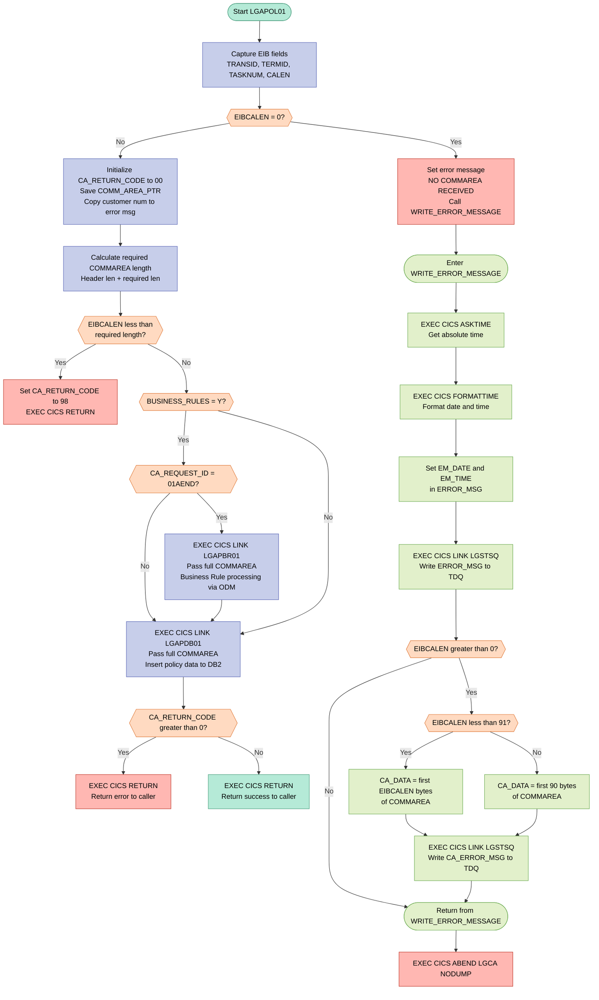
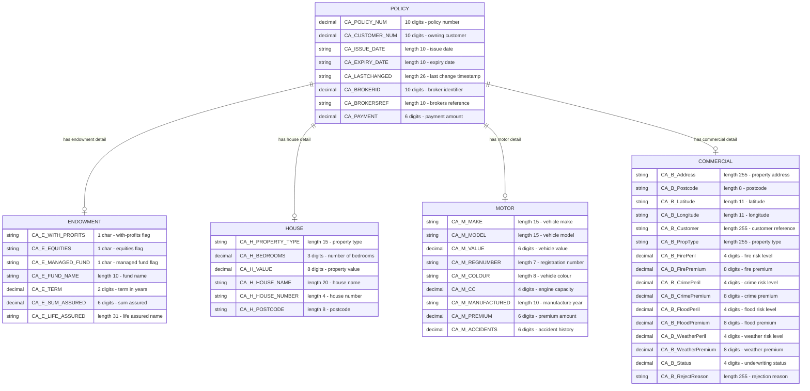

## Table of Contents

- [1. Purpose](#1-purpose)
- [2. Inputs](#2-inputs)
  - [2.1 CICS Execution Block Fields (EIB — CICS-Provided)](#21-cics-execution-block-fields-eib--cics-provided)
  - [2.2 COMMAREA — Passed by the Calling Program via `COMM_AREA_PTR`](#22-commarea--passed-by-the-calling-program-via-comm_area_ptr)
  - [2.3 Internal Feature Toggle (Statically Initialized)](#23-internal-feature-toggle-statically-initialized)
- [3. Outputs](#3-outputs)
- [4. Processing Logic](#4-processing-logic)
  - [4.1 Mermaid Flow Diagram](#41-mermaid-flow-diagram)
  - [4.2 Processing Logic Description](#42-processing-logic-description)
  - [4.3 Database Tables (if applicable)](#43-database-tables-if-applicable)
- [5. Paragraphs](#5-paragraphs)
- [6. Dependencies](#6-dependencies)
  - [6.1 Linked / Invoked Programs](#61-linked--invoked-programs)
  - [6.2 CICS Runtime Services](#62-cics-runtime-services)
  - [6.3 Communication Area (COMMAREA)](#63-communication-area-commarea)
  - [6.4 Copybook / Include Member](#64-copybook--include-member)
  - [6.5 Feature Toggle / Configuration Variable](#65-feature-toggle--configuration-variable)
- [7. Constraints](#7-constraints)
  - [7.1 Communication Area (COMMAREA) Constraints](#71-communication-area-commarea-constraints)
  - [7.2 Request Routing / Processing-Flow Constraints](#72-request-routing--processing-flow-constraints)
  - [7.3 Return Code Constraints](#73-return-code-constraints)
  - [7.4 Diagnostic Logging Constraints](#74-diagnostic-logging-constraints)
  - [7.5 Data Type and Field-Size Constraints](#75-data-type-and-field-size-constraints)
  - [7.6 Sequencing Constraints](#76-sequencing-constraints)
- [8. Error Handling](#8-error-handling)
  - [8.1 Communication area validation and early termination](#81-communication-area-validation-and-early-termination)
  - [8.2 Downstream program error propagation](#82-downstream-program-error-propagation)
  - [8.3 Diagnostic logging and notification](#83-diagnostic-logging-and-notification)
  - [8.4 Termination behavior](#84-termination-behavior)
  - [8.5 Not present in this program](#85-not-present-in-this-program)
- [9. Examples](#9-examples)
  - [9.1 Example 1: Add a motor policy successfully](#91-example-1-add-a-motor-policy-successfully)
  - [9.2 Example 2: Add an endowment policy with business rules disabled](#92-example-2-add-an-endowment-policy-with-business-rules-disabled)
  - [9.3 Example 3: COMMAREA too short](#93-example-3-commarea-too-short)

## 1. Purpose

`LGAPOL01` is a CICS-hosted PL/I program responsible for orchestrating the addition of insurance policies — covering Endowment, House, Motor, and Commercial policy types — on behalf of a customer in the General Insurance (GenApp) application. It receives a structured communication area containing a request identifier, customer number, and policy-specific data, validates that the communication area is present and of sufficient length, and then conditionally invokes an IBM Operational Decision Manager (ODM) business rules program (`LGAPBR01`) when the request is for an Endowment policy and the business rules feature flag is enabled. Regardless of policy type, it delegates the actual database persistence to a downstream data program (`LGAPDB01`) via a CICS LINK, returning control to the caller with an appropriate return code upon completion or on detection of an error.

## 2. Inputs

### 2.1 CICS Execution Block Fields (EIB — CICS-Provided)
- **EIBCALEN** — Length of the COMMAREA passed by the caller; used at program entry to validate that a COMMAREA was received (abend `LGCA` if zero) and to verify minimum required length before processing
- **EIBTRNID** — CICS transaction identifier of the currently executing transaction; captured into working storage for diagnostics
- **EIBTRMID** — CICS terminal identifier of the invoking terminal; captured into working storage for diagnostics
- **EIBTASKN** — CICS task number for the current transaction; captured into working storage for diagnostics

### 2.2 COMMAREA — Passed by the Calling Program via `COMM_AREA_PTR`
- **CA_REQUEST_ID** — 6-character operation code that drives all conditional branching (e.g., `'01AEND'` selects the Endowment path and optionally triggers business rule processing)
- **CA_RETURN_CODE** — 2-digit return code; initialized to `'00'` on entry and set to `'98'` if the COMMAREA is too short; also checked after the call to `LGAPDB01` to decide whether to return early
- **CA_CUSTOMER_NUM** — 10-digit customer identifier; echoed into the error-message structure for diagnostic logging
- **CA_POLICY_REQUEST** — Outer policy request group containing all policy-related fields passed to downstream programs:
  - **CA_POLICY_NUM** — 10-digit policy number identifying the specific policy being processed
  - **CA_ISSUE_DATE** — 10-character policy issue date
  - **CA_EXPIRY_DATE** — 10-character policy expiry date
  - **CA_BROKERID** — 10-digit broker identifier associated with the policy
  - **CA_PAYMENT** — 6-digit payment amount for the policy
  - **CA_ENDOWMENT** — Policy-type-specific structure for Endowment policies, containing investment options (with-profits, equities, managed fund), fund name, term, sum assured, and life assured details; activates optional business rule processing when `CA_REQUEST_ID = '01AEND'`
  - **CA_MOTOR** — Policy-type-specific structure for Motor policies, containing make, model, value, registration number, colour, engine size, year of manufacture, premium, and accident history
  - **CA_HOUSE** — Policy-type-specific structure for House policies, containing property type, number of bedrooms, property value, house name, house number, and postcode
  - **CA_COMMERCIAL** — Policy-type-specific structure for Commercial policies, containing address, postcode, geolocation, customer reference, property type, peril risk levels and premiums (fire, crime, flood, weather), underwriting status, and rejection reason
- **COMM_AREA_RAW** — Raw 32,500-byte overlay of the entire COMMAREA; the first 90 bytes are extracted and written to a transient data queue during error logging

### 2.3 Internal Feature Toggle (Statically Initialized)
- **BUSINESS_RULES** — Single-character flag initialized to `'N'` in working storage; when manually changed to `'Y'` (via a source-code edit), it enables the optional call to the ODM business rules program `LGAPBR01` for Endowment policy additions; acts as a compile-time/deployment-time feature switch rather than a runtime external input

## 3. Outputs

**Communication Area (COMMAREA) — Outputs Returned to the Caller**

- `CA_RETURN_CODE` — The primary output status indicator returned to the calling program via the COMMAREA. Set to `'00'` on successful initialisation, set to `'98'` if the COMMAREA length is insufficient. After linking to `LGAPDB01`, its value (as modified by the database program) determines whether processing continues or control is returned immediately.

- `CA_POLICY_REQUEST` — The full policy data structure returned to the caller via COMMAREA after database processing by `LGAPDB01`. Contains all fields populated or updated by the downstream program, including:
  - `CA_POLICY_NUM` — The policy number, assigned or confirmed by the database program.
  - `CA_ISSUE_DATE`, `CA_EXPIRY_DATE` — Policy lifecycle dates, potentially populated by the database layer.
  - `CA_BROKERID`, `CA_PAYMENT` — Broker and payment fields, persisted and echoed back through the COMMAREA.
  - `CA_ENDOWMENT` — Endowment-specific fields (investment options, fund name, term, sum assured, life assured), returned after DB processing and optionally after business rule evaluation by `LGAPBR01`.
  - `CA_MOTOR` — Motor policy fields (make, model, value, registration, colour, engine size, year, premium, accident history), returned after DB processing.
  - `CA_HOUSE` — House policy fields (property type, bedrooms, value, address, postcode), returned after DB processing.
  - `CA_COMMERCIAL` — Commercial policy fields including peril risk levels, premiums per peril (fire, crime, flood, weather), and underwriting decision fields:
    - `CA_B_Status` — Underwriting status code set during policy evaluation.
    - `CA_B_RejectReason` — Rejection reason text communicated back to the caller when a commercial policy is declined.

**CICS Abend — Terminal Error Output**

- `EXEC CICS ABEND ABCODE('LGCA') NODUMP` — Issued when no COMMAREA is received (`EIBCALEN = 0`). Terminates the CICS task with abend code `LGCA`, without producing a system dump. This is an observable side effect signalling a fatal error condition to the CICS runtime and any monitoring infrastructure.

**Diagnostic Messages Written to Transient Data Queue (TDQ)**

These outputs are written via `EXEC CICS LINK PROGRAM('LGSTSQ')` and represent diagnostic records sent to a CICS Transient Data Queue for error logging:

- `ERROR_MSG` — A structured error message written to the TDQ on error conditions. Contains:
  - `EM_DATE` / `EM_TIME` — Timestamp of the error event (formatted via `EXEC CICS ASKTIME` / `EXEC CICS FORMATTIME`).
  - Program identifier literal `' LGAPOL01'` embedded in the structure.
  - `EM_CUSNUM` — Customer number copied from `CA_CUSTOMER_NUM`, identifying the customer associated with the failed request.
  - `EM_POLNUM` — Policy number, available for inclusion in the error record.
  - `EM_SQLREQ` / `EM_SQLRC` — SQL request name and SQLCODE, providing database error context.
  - `EM_MSG_TEXT` — Free-text message (e.g., `' NO COMMAREA RECEIVED'`) describing the error condition.

- `CA_ERROR_MSG` — A secondary TDQ record written immediately after `ERROR_MSG`, containing up to 90 bytes of raw COMMAREA content (`COMM_AREA_RAW`) prefixed with the literal `'COMMAREA='`. Provides a snapshot of the COMMAREA at the time of the error for diagnostics. Written in two variants:
  - Full content if `EIBCALEN` is less than 91 bytes.
  - First 90 bytes if `EIBCALEN` is 91 or more bytes.

## 4. Processing Logic

### 4.1 Mermaid Flow Diagram



---

### 4.2 Processing Logic Description

#### 4.2.1 High-level Summary

`LGAPOL01` is the **Add Policy orchestrator** in the IBM GenApp insurance application. Running as a CICS program on z/OS, it receives a communication area (COMMAREA) describing a new insurance policy — Endowment, House, Motor, or Commercial — validates the request, optionally invokes an ODM-based business rules program for Endowment policies, and then links to the DB2 backend program to persist the policy data. It returns a success or error code to the caller.

---

#### 4.2.2 Execution Flow

**Step 1 — Initialisation (Capture EIB fields)**
On entry, the program captures CICS Executive Interface Block (EIB) values into working-storage: `EIBTRNID` → `WS_TRANSID`, `EIBTRMID` → `WS_TERMID`, `EIBTASKN` → `WS_TASKNUM`, `EIBCALEN` → `WS_CALEN`. These are used for diagnostic identification (the `WS_EYECATCHER` also acts as a dump anchor).

**Step 2 — COMMAREA presence check**
`EIBCALEN` (the CICS-supplied length of the passed COMMAREA) is tested. If it equals zero, no COMMAREA was passed at all. In this case the program:
1. Populates `EM_MSG_TEXT` with `' NO COMMAREA RECEIVED'`.
2. Calls the internal `WRITE_ERROR_MESSAGE` procedure to log the error to a transient data queue via `LGSTSQ`.
3. Issues `EXEC CICS ABEND ABCODE('LGCA') NODUMP` — a hard, non-dumpable abend, terminating the task immediately.

**Step 3 — COMMAREA initialisation**
`CA_RETURN_CODE` is set to `'00'` (success), the COMMAREA pointer is stored in `WS_ADDR_DFHCOMMAREA`, and `CA_CUSTOMER_NUM` is copied to `EM_CUSNUM` so the customer identifier is available in any subsequent error message.

**Step 4 — COMMAREA length validation**
`WS_REQUIRED_CA_LEN` is computed as the sum of the fixed header length (`WS_CA_HEADER_LEN = 28`) plus any request-specific required length. If `EIBCALEN` is less than this computed minimum, `CA_RETURN_CODE` is set to `'98'` and `EXEC CICS RETURN` is issued immediately, passing the error code back to the caller without further processing.

**Step 5 — Business Rules gate (ODM, optional)**
The flag `BUSINESS_RULES` is initialised to `'N'` (disabled). If changed to `'Y'` (by uncommenting the assignment in the source), and if `CA_REQUEST_ID = '01AEND'` (Add Endowment policy), the program issues:
```
EXEC CICS LINK Program('LGAPBR01') COMMAREA(COMM_AREA) LENGTH(32500)
```
`LGAPBR01` applies ODM (Operational Decision Manager) business rules against the Endowment policy data and may modify or reject the request by updating fields in the COMMAREA (including `CA_RETURN_CODE`). The result is carried forward into the next step transparently.

> **Business rule**: This feature is a **feature-toggle pattern** — the flag `BUSINESS_RULES` acts as a compile-time/configuration switch that can enable mandatory underwriting rules for Endowment policies without changing program flow.

**Step 6 — DB2 data insert (LGAPDB01)**
Unconditionally (regardless of policy type), the program links to the database backend:
```
EXEC CICS LINK Program('LGAPDB01') COMMAREA(COMM_AREA) LENGTH(32500)
```
`LGAPDB01` inspects `CA_REQUEST_ID` to determine which policy type is being added and performs the appropriate DB2 INSERT operations for the `POLICY` table and the policy-type-specific table (ENDOWMENT, HOUSE, MOTOR, or COMMERCIAL). On completion, `CA_RETURN_CODE` in the shared COMMAREA reflects the outcome.

**Step 7 — DB2 return code check**
After the link to `LGAPDB01` returns, `CA_RETURN_CODE` is tested. If it is greater than `0` (any non-zero value indicating a DB2 or processing error from the backend), `EXEC CICS RETURN` is issued immediately, passing the error code back to the menu/caller without further steps.

**Step 8 — Normal return**
If `CA_RETURN_CODE` is `0`, the program issues `EXEC CICS RETURN` to return control to the caller (typically a BMS menu program such as `LGTESTP1`–`LGTESTP4`) with `CA_RETURN_CODE = '00'` indicating success.

---

#### 4.2.3 WRITE_ERROR_MESSAGE Subroutine

This internal `PROCEDURE` is called only when a fatal COMMAREA absence is detected. Its steps are:

1. `EXEC CICS ASKTIME ABSTIME(ABS_TIME)` — retrieves the current CICS absolute time into `ABS_TIME`.
2. `EXEC CICS FORMATTIME ABSTIME(ABS_TIME) MMDDYYYY(DATE1) TIME(TIME1)` — formats the absolute time into a human-readable date (`MM/DD/YYYY`) and time (`HH:MM:SS`).
3. Sets `EM_DATE` and `EM_TIME` in the `ERROR_MSG` structure.
4. `EXEC CICS LINK PROGRAM('LGSTSQ') COMMAREA(ERROR_MSG) LENGTH(STG(ERROR_MSG))` — writes the formatted error message (including program name `LGAPOL01`, customer number, and message text) to a CICS transient data queue via the `LGSTSQ` utility program.
5. If `EIBCALEN > 0`, writes up to 90 bytes of the raw COMMAREA to the same queue using `CA_ERROR_MSG` — either the exact COMMAREA content if shorter than 91 bytes, or the first 90 bytes otherwise. This provides a hex/character dump of the COMMAREA for diagnostic use.

---

#### 4.2.4 External Interactions

| Program / Resource | Type | Purpose |
|---|---|---|
| `LGAPBR01` | `EXEC CICS LINK` (conditional) | Applies ODM business rules to Endowment policy data; only invoked when `BUSINESS_RULES='Y'` and request is `'01AEND'` |
| `LGAPDB01` | `EXEC CICS LINK` (always) | DB2 backend; performs INSERT into `POLICY` and the appropriate policy-type table (ENDOWMENT, HOUSE, MOTOR, COMMERCIAL) |
| `LGSTSQ` | `EXEC CICS LINK` (on error only) | Utility program that writes formatted messages to a CICS transient data queue for error logging |
| CICS EIB | Runtime fields | `EIBCALEN`, `EIBTRNID`, `EIBTRMID`, `EIBTASKN` — provides task context and COMMAREA length |

---

#### 4.2.5 Plain Language Summary

`LGAPOL01` acts as a **traffic controller** for adding insurance policies. When called by a menu screen, it first checks that valid data was passed in. If the data is missing entirely, it logs an error and terminates with an abend. If the data is too short, it returns an error code `98` to the screen.

For valid requests, it optionally passes the data through an IBM ODM business rules engine (currently switched off by default) that can apply underwriting rules — for example, checking if an Endowment policy meets specific criteria. It then always hands the data to a dedicated database program (`LGAPDB01`) that saves the new policy into DB2. If the database step succeeds, a success code is returned to the caller; if it fails, the error code from the database program is passed straight back.

Any errors encountered before the database call are written to an internal log queue so operations staff can diagnose problems without restarting the transaction.

---

### 4.3 Database Tables (if applicable)

The tables are accessed indirectly through `LGAPDB01` (not via direct SQL in `LGAPOL01` itself). Based on the COMMAREA structures and project documentation:



## 5. Paragraphs

The program `LGAPOL01` is structured as a single PL/I `PROC` with inline main logic (no named internal paragraphs in the traditional COBOL sense) and one internal subroutine (`WRITE_ERROR_MESSAGE`). The breakdown below treats the distinct logical blocks of the main procedure as named sections and covers the one explicit internal procedure.

---

- **Main Procedure Entry Block (lines 10–23)**
  - This is the top-level procedure entry point declared as `LGAPOL01: Proc(COMM_AREA_PTR) Options(Main)`.
  - Declares all working storage variables: the `WS_HEADER` eyecatcher block (used for dump identification), time/date work fields (`ABS_TIME`, `TIME1`, `DATE1`), the `BUSINESS_RULES` flag (initialized to `'N'`), the `ERROR_MSG` and `CA_ERROR_MSG` error logging structures, and program name literals for linked programs (`LGAPDB1`, `LGAPBR1`, `LGAPVS1`).
  - Declares the `COMM_AREA` structure (via expanded `%INCLUDE LGCMAREA`) as a `UNION` based on `COMM_AREA_PTR`, providing both raw (`COMM_AREA_RAW`) and structured field-level access to the full 32,500-byte communication area, including all policy-type sub-structures (`CA_ENDOWMENT`, `CA_HOUSE`, `CA_MOTOR`, `CA_COMMERCIAL`, `CA_CLAIM`).
  - No conditional logic; purely declarative.

---

- **EIB Capture Block (lines 198–201)**
  - Captures CICS Execution Interface Block (EIB) fields into working storage for later use in diagnostics and validation.
  - Assigns `EIBTRNID` → `WS_TRANSID`, `EIBTRMID` → `WS_TERMID`, `EIBTASKN` → `WS_TASKNUM`, and `EIBCALEN` → `WS_CALEN`.
  - Straight sequential assignments; no branching.

---

- **COMMAREA Presence Check (lines 207–211)**
  - Guards against execution with no communication area passed by the CICS caller.
  - Checks `EIBCALEN = 0`; if true, sets the error message text to `' NO COMMAREA RECEIVED'`, calls the internal `WRITE_ERROR_MESSAGE` procedure to log diagnostics, then issues `EXEC CICS ABEND ABCODE('LGCA') NODUMP` to immediately terminate the task with abend code `LGCA` without producing a system dump.
  - Contains a single `IF/DO` conditional block; the ABEND path is non-recoverable.

---

- **COMMAREA Initialization and Length Validation (lines 214–228)**
  - Initializes `CA_RETURN_CODE` to `'00'` (success) in the communication area.
  - Saves the COMMAREA pointer into `WS_ADDR_DFHCOMMAREA` for reference.
  - Copies `CA_CUSTOMER_NUM` into `EM_CUSNUM` in the error message structure for pre-emptive diagnostic readiness.
  - Computes `WS_REQUIRED_CA_LEN` by adding `WS_CA_HEADER_LEN` (28 bytes) to the current value of `WS_REQUIRED_CA_LEN` (initialized to 0, representing the minimum acceptable COMMAREA length).
  - Checks `EIBCALEN < WS_REQUIRED_CA_LEN`; if the received COMMAREA is too short, sets `CA_RETURN_CODE = '98'` and issues `EXEC CICS RETURN` to return control to the caller immediately without further processing.
  - Contains one `IF/DO` conditional block for the length guard.

---

- **Business Rules Conditional Invocation (lines 240–246)**
  - Optionally invokes the ODM (Operational Decision Manager) business rules program `LGAPBR01` before database processing, controlled by the `BUSINESS_RULES` flag.
  - Outer condition: `BUSINESS_RULES = 'Y'` — by default this is `'N'`, so this block is effectively dormant unless the flag is manually changed to `'Y'` in source (the activating assignment `MOVE 'Y' TO BUSINESS_RULES` is commented out).
  - Inner condition: `CA_REQUEST_ID = '01AEND'` — restricts business rule processing exclusively to the Add Endowment policy request type.
  - When both conditions are met, executes `EXEC CICS LINK Program('LGAPBR01') Commarea(COMM_AREA) LENGTH(32500)` to synchronously call the business rules program, passing the full 32,500-byte COMMAREA.
  - Nested `IF/DO` blocks; no return code check follows this LINK call.

---

- **Database Insert Invocation and Return (lines 251–262)**
  - Unconditionally calls the DB2 database backend program `LGAPDB01` via `EXEC CICS LINK Program('LGAPDB01') Commarea(COMM_AREA) LENGTH(32500)` to persist the policy data for whichever policy type is being added.
  - After the LINK returns, checks `CA_RETURN_CODE > 0`; if the database program reported an error (any non-zero return code), issues `EXEC CICS RETURN` immediately to propagate the error back to the caller without further processing.
  - If `CA_RETURN_CODE` is zero (success), falls through to a final unconditional `EXEC CICS RETURN` to return control normally to the CICS caller.
  - A `RETURN` PL/I statement follows as a safeguard, though it is unreachable due to the preceding `EXEC CICS RETURN`.
  - Contains one `IF/DO` conditional for the error return-code check.

---

- **WRITE_ERROR_MESSAGE (lines 269–303)**
  - Internal subroutine responsible for writing diagnostic error information to a CICS transient data queue (TDQ) via the shared queue-writing program `LGSTSQ`.
  - Obtains the current timestamp via `EXEC CICS ASKTIME ABSTIME(ABS_TIME)`, then formats it into `DATE1` (MM/DD/YYYY) and `TIME1` (HH:MM:SS) using `EXEC CICS FORMATTIME`.
  - Assigns formatted date and time into `EM_DATE` and `EM_TIME` within the `ERROR_MSG` structure.
  - Calls `EXEC CICS LINK PROGRAM('LGSTSQ') COMMAREA(ERROR_MSG) LENGTH(STG(ERROR_MSG))` to write the primary error message (containing program name, customer number, policy number, SQL request, and SQLCODE fields) to the TDQ.
  - Conditionally writes a secondary COMMAREA dump record: if `EIBCALEN > 0`, checks whether `EIBCALEN < 91`; if so, uses `LEFT(COMM_AREA_RAW, EIBCALEN)` to extract only the available bytes; otherwise extracts the first 90 bytes via `LEFT(COMM_AREA_RAW, 90)`. In both cases, the extracted data is placed in `CA_DATA` and written via another `EXEC CICS LINK PROGRAM('LGSTSQ')` call using `CA_ERROR_MSG` as the COMMAREA.
  - Contains nested `IF/DO/ELSE` blocks governing the COMMAREA dump logic; ends with a `RETURN` statement back to the caller.

## 6. Dependencies

### 6.1 Linked / Invoked Programs

- **LGAPDB01** — The primary database program, always invoked via `EXEC CICS LINK` with the full 32,500-byte communication area. It performs the actual persistence (INSERT) of policy data into the backend database for all policy types (Endowment, House, Motor, Commercial). Its return code is checked in `CA_RETURN_CODE` to decide whether to continue or abort processing.

- **LGAPBR01** — The business rules program, conditionally invoked via `EXEC CICS LINK` only when `BUSINESS_RULES = 'Y'` and the request ID is `'01AEND'` (Add Endowment). It applies ODM (Operational Decision Manager) business rule logic to the endowment policy data before it is persisted by LGAPDB01.

- **LGSTSQ** — A shared utility/logging program invoked via `EXEC CICS LINK` from within the `WRITE_ERROR_MESSAGE` internal procedure. It is called twice: once to write a formatted error message (date, time, program name, customer/policy numbers) and again to write up to 90 bytes of the raw communication area content to a transient data queue (TDQ) for diagnostic purposes.

---

### 6.2 CICS Runtime Services

- **EXEC CICS LINK** — Used to invoke all three external programs (LGAPDB01, LGAPBR01, LGSTSQ), passing the communication area and its length as the inter-program data channel.

- **EXEC CICS RETURN** — Used to return control to the calling CICS program or terminal, invoked both on normal completion and on error (when `CA_RETURN_CODE > 0` or COMMAREA length is insufficient).

- **EXEC CICS ABEND ABCODE('LGCA') NODUMP** — Triggered when no communication area is received (`EIBCALEN = 0`); abnormally terminates the task with the abend code `LGCA` and suppresses a system dump.

- **EXEC CICS ASKTIME / FORMATTIME** — Used inside `WRITE_ERROR_MESSAGE` to obtain the current absolute time and format it into `DATE1` (MM/DD/YYYY) and `TIME1` (HH:MM:SS) for inclusion in error log entries.

- **CICS Execute Interface Block (EIB)** — The following EIB fields are read at program initialization and during error handling:
  - `EIBTRNID` — the current transaction identifier, stored in `WS_TRANSID`
  - `EIBTRMID` — the current terminal identifier, stored in `WS_TERMID`
  - `EIBTASKN` — the current CICS task number, stored in `WS_TASKNUM`
  - `EIBCALEN` — the length of the passed communication area, used to validate that sufficient data was received

---

### 6.3 Communication Area (COMMAREA)

- **COMM_AREA / COMM_AREA_PTR** — A pointer-based, union-structured 32,500-byte communication area (expanded inline from the `LGCMAREA` copybook) that is the sole inter-program data-passing mechanism. It carries the request identifier, return code, customer number, and all policy-type-specific fields. It is passed as-is to both LGAPDB01 and LGAPBR01.
  - `CA_REQUEST_ID` — drives branching logic to determine the policy operation type and triggers optional business rule invocation for `'01AEND'`
  - `CA_RETURN_CODE` — set to `'00'` on entry, `'98'` on COMMAREA length failure; checked after LGAPDB01 returns to decide whether to short-circuit
  - `CA_CUSTOMER_NUM` — copied into the error message structure for diagnostic logging
  - `CA_POLICY_REQUEST` — contains `CA_POLICY_NUM`, common policy fields (`CA_ISSUE_DATE`, `CA_EXPIRY_DATE`, `CA_BROKERID`, `CA_PAYMENT`), and the policy-type-specific union (`CA_ENDOWMENT`, `CA_HOUSE`, `CA_MOTOR`, `CA_COMMERCIAL`)
  - `COMM_AREA_RAW` — overlaid raw 32,500-character view of the COMMAREA used to extract diagnostic bytes for TDQ logging

---

### 6.4 Copybook / Include Member

- **LGCMAREA** (`%INCLUDE LGCMAREA`) — The PL/I include member that defines the full `COMM_AREA` structure. It is expanded inline in the source at compile time and provides all COMMAREA field declarations shared across the GenApp application programs.

---

### 6.5 Feature Toggle / Configuration Variable

- **BUSINESS_RULES** — An in-program single-character flag initialized to `'N'`. Setting it to `'Y'` (via a manual code change, as indicated by the commented-out assignment) enables the conditional invocation of the LGAPBR01 business rules program. This acts as a compile/deploy-time feature toggle for ODM integration.

## 7. Constraints

### 7.1 Communication Area (COMMAREA) Constraints

- **COMMAREA must be present on entry**
  - Enforced by checking `EIBCALEN = 0` immediately upon entry (line 207)
  - If no COMMAREA was passed, the program writes an error message and issues `EXEC CICS ABEND ABCODE('LGCA') NODUMP`, terminating the CICS task immediately with abend code `LGCA`; no further processing occurs

- **COMMAREA must meet a minimum length**
  - A minimum required length is computed as `WS_CA_HEADER_LEN` (fixed at 28 bytes, the size of the fixed header fields: `CA_REQUEST_ID` + `CA_RETURN_CODE` + `CA_CUSTOMER_NUM`) plus any additional policy-specific length requirement held in `WS_REQUIRED_CA_LEN` (lines 63–65, 221)
  - If `EIBCALEN < WS_REQUIRED_CA_LEN`, `CA_RETURN_CODE` is set to `'98'` and `EXEC CICS RETURN` is issued immediately, returning control to the caller without performing any database or business-rule operations (lines 225–228)

- **COMMAREA total capacity is fixed at 32,500 bytes**
  - The `COMM_AREA_RAW` overlay declaration is `CHAR(32500)` (line 92), establishing the absolute upper bound on COMMAREA data
  - All `EXEC CICS LINK` calls pass `LENGTH(32500)`, so the full COMMAREA is always transmitted to linked programs; no partial COMMAREA is ever passed

---

### 7.2 Request Routing / Processing-Flow Constraints

- **Request type (`CA_REQUEST_ID`) is the sole routing key**
  - `CA_REQUEST_ID` is a 6-character field (line 95); the only value explicitly tested in this program is `'01AEND'` (Add Endowment policy, line 241)
  - Routing to the business-rules program is conditioned exclusively on this value; all other request types bypass the business-rules path entirely

- **Business-rule processing is disabled by default**
  - `BUSINESS_RULES` is initialised to `'N'` (line 33) and is never programmatically set to `'Y'` in the source; the comment on line 238 notes the assignment is intentionally commented out
  - The ODM-linked business-rules program `LGAPBR01` is therefore never invoked unless the application binary is recompiled with the flag set — it acts as a compile-time feature toggle, not a runtime switch

- **Business-rule invocation is restricted to Endowment add requests only**
  - Even if `BUSINESS_RULES` were enabled, the inner guard `CA_REQUEST_ID = '01AEND'` (line 241) ensures `LGAPBR01` is called only for Endowment policy additions; House, Motor, Commercial, and all other request types never reach the business-rules program

- **Database program (`LGAPDB01`) is unconditionally called for all valid requests**
  - After the COMMAREA and optional business-rule checks, `EXEC CICS LINK Program('LGAPDB01')` (line 251) is always executed regardless of policy type
  - There is no conditional branch that would skip the database call for any supported request type

- **Non-zero return code from the database program causes immediate return**
  - After `LGAPDB01` returns, `CA_RETURN_CODE > 0` is tested (line 255); any non-zero value causes `EXEC CICS RETURN` without additional output processing
  - This means downstream success handling (or further chained calls) is entirely suppressed if the database layer signals any error

---

### 7.3 Return Code Constraints

- **`CA_RETURN_CODE` is always initialised to `'00'` on successful COMMAREA validation**
  - Set unconditionally at line 214, ensuring callers always receive a clean success indicator unless a subsequent step overwrites it

- **`CA_RETURN_CODE = '98'` signals an insufficient COMMAREA**
  - This is the only error code explicitly set by this program; `'98'` is a reserved sentinel value for COMMAREA length failure per the project convention (AGENTS.md)

- **`CA_RETURN_CODE` values from `LGAPDB01` are not translated**
  - The return code written by the database program is passed back to the original caller unmodified; LGAPOL01 performs no mapping or re-coding of database-layer errors

---

### 7.4 Diagnostic Logging Constraints

- **Error messages are capped at 90 bytes of COMMAREA content**
  - Inside `WRITE_ERROR_MESSAGE`, the raw COMMAREA is written to the transient data queue only if `EIBCALEN > 0` (line 288)
  - If `EIBCALEN < 91`, only the actual available bytes are written (line 290); otherwise exactly the first 90 bytes are captured (line 296)
  - The `CA_DATA` field holding this snapshot is declared as `CHAR(90)` (line 54), imposing an absolute hard ceiling on logged COMMAREA data regardless of actual COMMAREA size

- **Error logging always records timestamp, program name, customer number, and policy number**
  - The `ERROR_MSG` structure is fixed at compile time with labeled sub-fields (`EM_CUSNUM`, `EM_POLNUM`, `EM_SQLREQ`, `EM_SQLRC`); the calling code must populate these fields before invoking `WRITE_ERROR_MESSAGE` or the logged diagnostic will contain uninitialised/blank values

---

### 7.5 Data Type and Field-Size Constraints

- **`CA_CUSTOMER_NUM` is constrained to 10 numeric digits** (`PIC '9999999999'`, line 97); non-numeric or values with more than 10 digits cannot be represented in this field

- **`CA_POLICY_NUM` is constrained to 10 numeric digits** (`PIC '9999999999'`, line 121); policy numbers outside this range are structurally unrepresentable

- **`CA_PAYMENT` is constrained to 6 numeric digits** (`PIC '999999'`, line 129), capping payment values at 999,999

- **`CA_BROKERID` is constrained to 10 numeric digits** (`PIC '9999999999'`, line 127)

- **`CA_ISSUE_DATE` and `CA_EXPIRY_DATE` are each constrained to 10 characters** (`CHAR(10)`, lines 124–125); no format validation is performed within this program — date validity is the responsibility of the caller or downstream programs

- **Endowment-specific fields**:
  - `CA_E_TERM` is 2 numeric digits (`PIC '99'`, line 138), limiting policy term to 0–99
  - `CA_E_SUM_ASSURED` is 6 numeric digits (`PIC '999999'`, line 139), capping sum assured at 999,999
  - Investment-option flags (`CA_E_WITH_PROFITS`, `CA_E_EQUITIES`, `CA_E_MANAGED_FUND`) are each single characters (`CHAR`, lines 134–136); valid values are not validated in this program

- **Motor-specific fields**:
  - `CA_M_VALUE` and `CA_M_PREMIUM` and `CA_M_ACCIDENTS` are each 6 numeric digits (`PIC '999999'`, lines 155, 160, 161)
  - `CA_M_CC` (engine capacity) is 4 numeric digits (`PIC '9999'`, line 158), capping engine size at 9,999 cc
  - `CA_M_REGNUMBER` is 7 characters (`CHAR(7)`, line 156), limiting registration numbers to 7 characters

- **Commercial-specific fields**:
  - Risk-level fields (`CA_B_FirePeril`, `CA_B_CrimePeril`, `CA_B_FloodPeril`, `CA_B_WeatherPeril`) are each 4 numeric digits (`PIC '9999'`, lines 171, 173, 175, 177)
  - Premium fields for each peril are 8 numeric digits (`PIC '99999999'`, lines 172, 174, 176, 178), capping each peril premium at 99,999,999
  - `CA_B_Status` is 4 numeric digits (`PIC '9999'`, line 179); valid status values are not range-checked in this program
  - Address, customer, property-type, and rejection-reason fields are each `CHAR(255)` (lines 165, 169, 170, 180), capping textual content at 255 characters

- **House-specific fields**:
  - `CA_H_BEDROOMS` is 3 numeric digits (`PIC '999'`, line 145), capping bedroom count at 999
  - `CA_H_VALUE` is 8 numeric digits (`PIC '99999999'`, line 146), capping property value at 99,999,999
  - `CA_H_POSTCODE` is 8 characters (`CHAR(8)`, line 149)

---

### 7.6 Sequencing Constraints

- **Initialisation must precede any business logic**
  - `CA_RETURN_CODE` is set to `'00'` and `EM_CUSNUM` is populated before the COMMAREA length check and before any LINK calls; this ordering ensures the return code field and error diagnostics are always in a known state

- **Business-rule program (`LGAPBR01`) must execute before the database program (`LGAPDB01`)**
  - The conditional LINK to `LGAPBR01` (lines 240–246) always precedes the unconditional LINK to `LGAPDB01` (line 251); the code structure enforces this ordering — there is no path by which the database write can occur before business-rule validation when the flag is active

- **`LGAPDB01` return-code check must follow the LINK call**
  - The `CA_RETURN_CODE > 0` test (line 255) can only be evaluated after `LGAPDB01` has returned; the sequential structure of the program makes any re-ordering impossible at runtime

## 8. Error Handling

### 8.1 Communication area validation and early termination

- Missing COMMAREA detection
  - The program explicitly checks whether the incoming CICS COMMAREA length is zero.
  - When this condition occurs, it treats it as a fatal invocation error.
  - The handling sequence is:
    - populate the internal error text with a message indicating that no COMMAREA was received
    - call the local error-writing routine to record diagnostic information
    - issue a CICS ABEND with abend code `LGCA` and `NODUMP`
  - This is the strongest error path in the program because it terminates processing abnormally rather than returning normally to the caller.

- Insufficient COMMAREA length check
  - The program validates that the received COMMAREA length is at least the required minimum header length.
  - If the actual length is below the required threshold, it does not abend.
  - Instead, it sets the communication-area return code to `98` and immediately returns to the caller through CICS.
  - This is a defensive input-validation mechanism that rejects malformed or incomplete requests using a controlled return path.

- Default success initialization with later override
  - At the start of normal processing, the program initializes the return code in the COMMAREA to `00`.
  - This establishes a success default that can later be overridden by validation failures or downstream program errors.
  - This is part of the program’s error signaling strategy because callers can distinguish success from failure based on the final return code.

### 8.2 Downstream program error propagation

- Return-code check after database program call
  - After linking to the database update program, the program checks the COMMAREA return code.
  - If that return code is greater than zero, it assumes an error or non-success condition has been set by the called program.
  - In that case, it immediately returns to the caller without further processing.
  - This is a pass-through error handling mechanism where the orchestrating program does not attempt recovery, but honors and propagates the backend failure status.

- Conditional business-rules invocation as controlled fallback behavior
  - Business rule processing is controlled by a flag initialized to `N`.
  - Because the default is disabled, the program avoids calling the business-rules component unless the flag is explicitly enabled and the request is for adding an endowment policy.
  - This acts as a safe default path rather than a strict error handler, but it is still a recovery/fallback style mechanism because the system can proceed without optional rule enforcement when the feature is not enabled.
  - There is no explicit check of a separate return status after the business-rules call in this module; any resulting status would need to be reflected through shared COMMAREA fields.

### 8.3 Diagnostic logging and notification

- Centralized internal error logging routine
  - The program implements a dedicated local procedure to write error information to a queue through another CICS-linked program.
  - This routine is used when a serious invocation problem is detected, and it prepares structured diagnostic data including date, time, program identity, and key business identifiers.
  - The mechanism provides system-level notification rather than user-facing messaging.

- Timestamp enrichment for error records
  - Before writing the error record, the logging procedure obtains the current absolute time and formats it into readable date and time fields.
  - This ensures that logged errors carry temporal context for operational diagnosis and traceability.

- Inclusion of business identifiers in error diagnostics
  - The program copies the customer number from the COMMAREA into the error message structure early in processing.
  - The error message structure also supports policy number and SQL-related fields for diagnostic correlation.
  - This is not itself an error trigger, but it is part of the program’s error handling design because it enriches recorded failures with identifying context.

- Logging of raw COMMAREA content for troubleshooting
  - The error-writing procedure conditionally captures the inbound COMMAREA contents and sends them to the queue as an additional diagnostic record.
  - This only happens when some COMMAREA data exists.
  - The logic limits the amount logged:
    - if the COMMAREA is shorter than 91 bytes, it logs only the available portion
    - otherwise, it logs the first 90 bytes
  - This is a bounded diagnostic fallback that avoids overlogging while still preserving request context for failure analysis.

### 8.4 Termination behavior

- Controlled normal return on recoverable or propagated errors
  - For invalid COMMAREA length and for backend-signaled failure, the program exits through `EXEC CICS RETURN`.
  - This allows the caller to inspect the COMMAREA return code and handle the outcome.

- Abnormal termination on unrecoverable invocation error
  - When no COMMAREA is supplied at all, the program does not attempt to continue or return a normal status.
  - It logs the problem and forces a CICS abend.
  - This distinguishes a structurally invalid invocation from ordinary business or backend failures.

### 8.5 Not present in this program

- No explicit file-status or sequential I/O error handling
  - The program does not perform direct file operations, so there are no file-status checks, `AT END`, or similar file-I/O handlers.

- No PL/I condition handlers or exception blocks
  - The program does not define PL/I `ON` conditions or similar exception-style constructs.
  - Error handling is implemented through explicit conditional checks, return codes, logging, and CICS abend/return actions.

## 9. Examples

### 9.1 Example 1: Add a motor policy successfully

**Sample input data**
- `CA_REQUEST_ID = '01AMOT'`
- `CA_CUSTOMER_NUM = 1234567890`
- `CA_POLICY_NUM = 2000001234`
- `CA_ISSUE_DATE = '2026-01-01'`
- `CA_EXPIRY_DATE = '2027-01-01'`
- `CA_BROKERID = 3000000001`
- `CA_PAYMENT = 000250`
- Motor details:
  - `CA_M_MAKE = 'TOYOTA'`
  - `CA_M_MODEL = 'COROLLA'`
  - `CA_M_VALUE = 015000`
  - `CA_M_REGNUMBER = 'AB12CDE'`
  - `CA_M_COLOUR = 'BLUE'`
  - `CA_M_CC = 1800`
  - `CA_M_MANUFACTURED = '2022-05-10'`
  - `CA_M_PREMIUM = 000600`
  - `CA_M_ACCIDENTS = 000000`
- Valid COMMAREA length supplied

**Expected output**
- `CA_RETURN_CODE = '00'`

**Explanation**
- The program initializes `CA_RETURN_CODE` to `'00'`.
- The request is not an endowment request, so no business-rules call is attempted.
- It links to `LGAPDB01` to perform the add.
- If the database program leaves the return code as success, `LGAPOL01` simply returns with `CA_RETURN_CODE = '00'`.

### 9.2 Example 2: Add an endowment policy with business rules disabled

**Sample input data**
- `CA_REQUEST_ID = '01AEND'`
- `CA_CUSTOMER_NUM = 5550001112`
- `CA_POLICY_NUM = 7000004321`
- `CA_ISSUE_DATE = '2026-03-15'`
- `CA_EXPIRY_DATE = '2046-03-15'`
- `CA_BROKERID = 4000000002`
- `CA_PAYMENT = 001000`
- Endowment details:
  - `CA_E_WITH_PROFITS = 'Y'`
  - `CA_E_EQUITIES = 'N'`
  - `CA_E_MANAGED_FUND = 'N'`
  - `CA_E_FUND_NAME = 'GROWTH'`
  - `CA_E_TERM = 20`
  - `CA_E_SUM_ASSURED = 250000`
  - `CA_E_LIFE_ASSURED = 'JANE SMITH'`
- Valid COMMAREA length supplied

**Expected output**
- `CA_RETURN_CODE = '00'`

**Explanation**
- Even though this is an endowment add request, `BUSINESS_RULES` is initialized to `'N'` and the code that would switch it to `'Y'` is commented out.
- That means `LGAPBR01` is not called.
- The program directly links to `LGAPDB01` to add the policy data.
- With no error returned from the database program, the final return code remains `'00'`.

### 9.3 Example 3: COMMAREA too short

**Sample input data**
- `CA_REQUEST_ID = '01AHOU'`
- `CA_CUSTOMER_NUM = 1112223334`
- Partial policy data present
- `EIBCALEN` smaller than the required minimum header length

**Expected output**
- `CA_RETURN_CODE = '98'`

**Explanation**
- After setting the default success code, the program validates the COMMAREA length.
- If the received length is shorter than the required minimum, it sets `CA_RETURN_CODE` to `'98'` and immediately returns.
- No business-rules call or database insert call is performed in this case.

---

Generated by IBM Bob Premium Package for Z
