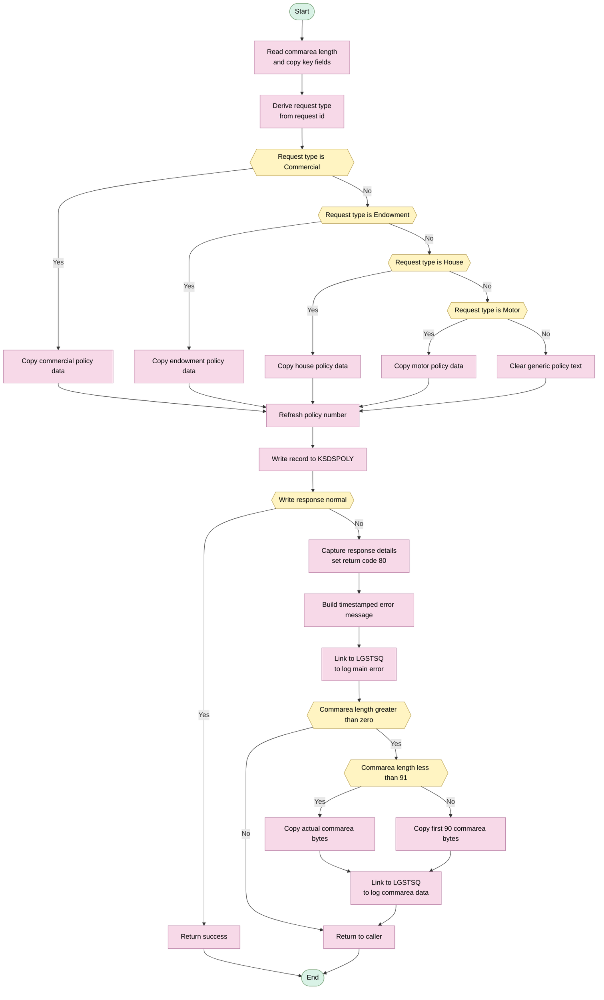

## Table of Contents

- [1. Purpose](#1-purpose)
- [2. Inputs](#2-inputs)
  - [2.1 Program Parameter](#21-program-parameter)
  - [2.2 Communication Area Fields (`COMM_AREA` via `COMM_AREA_PTR`)](#22-communication-area-fields-comm_area-via-comm_area_ptr)
  - [2.3 CICS Runtime Inputs](#23-cics-runtime-inputs)
  - [2.4 External Data Store](#24-external-data-store)
- [3. Outputs](#3-outputs)
- [4. Processing Logic](#4-processing-logic)
  - [4.1 Mermaid Flow Diagram](#41-mermaid-flow-diagram)
  - [4.2 Processing Logic Description](#42-processing-logic-description)
  - [4.3 High level Summary](#43-high-level-summary)
  - [4.4 Execution Flow](#44-execution-flow)
  - [4.5 Validations and Error Handling](#45-validations-and-error-handling)
  - [4.6 Important Business Rules](#46-important-business-rules)
  - [4.7 External Interactions](#47-external-interactions)
  - [4.8 Plain Language Summary](#48-plain-language-summary)
  - [4.9 Database Tables if applicable](#49-database-tables-if-applicable)
- [5. Paragraphs](#5-paragraphs)
- [6. Dependencies](#6-dependencies)
  - [6.1 CICS Files (VSAM Datasets)](#61-cics-files-vsam-datasets)
  - [6.2 CICS Runtime Services](#62-cics-runtime-services)
  - [6.3 External Programs Invoked](#63-external-programs-invoked)
  - [6.4 Input Parameters / COMMAREA](#64-input-parameters--commarea)
  - [6.5 Include / Copybook Files](#65-include--copybook-files)
  - [6.6 Calling Programs (Inbound Dependency)](#66-calling-programs-inbound-dependency)
- [7. Constraints](#7-constraints)
  - [7.1 Data Validation Constraints](#71-data-validation-constraints)
  - [7.2 Structural / Composite Key Constraints](#72-structural--composite-key-constraints)
  - [7.3 Sequencing and Ordering Constraints](#73-sequencing-and-ordering-constraints)
  - [7.4 Resource and Size Constraints](#74-resource-and-size-constraints)
  - [7.5 Error Handling and Return-Code Constraints](#75-error-handling-and-return-code-constraints)
- [8. Error Handling](#8-error-handling)
  - [8.1 CICS File Write Response Check](#81-cics-file-write-response-check)
  - [8.2 Return Code Signalling to Caller](#82-return-code-signalling-to-caller)
  - [8.3 Error Logging and Diagnostic Notification](#83-error-logging-and-diagnostic-notification)
  - [8.4 Program Termination on Error](#84-program-termination-on-error)
  - [8.5 Fallback / Default Value Logic](#85-fallback--default-value-logic)
- [9. Examples](#9-examples)
  - [9.1 Example 1: Adding a Motor Insurance Policy (Success Path)](#91-example-1-adding-a-motor-insurance-policy-success-path)
  - [9.2 Example 2: Adding a House Insurance Policy (Success Path)](#92-example-2-adding-a-house-insurance-policy-success-path)
  - [9.3 Example 3: VSAM Write Failure (Error Path)](#93-example-3-vsam-write-failure-error-path)

## 1. Purpose

`LGAPVS01` is a CICS PL/I program that adds a new insurance policy record to a VSAM KSDS dataset named `KSDSPOLY`. It receives policy details through a Communication Area, extracts the policy type indicator from the request ID, and selects the appropriate policy-specific data fields — Commercial (`C`), Endowment (`E`), House (`H`), or Motor (`M`) — to populate a 64-byte working record structure. Using the customer number, policy number, and policy type as a composite 21-byte KSDS key, the program issues a CICS `WRITE FILE` command to persist the new policy record. If the write operation fails, the program sets a return code of `80` in the Communication Area, logs a timestamped diagnostic error message (including RESP codes and raw Communication Area content) by linking to the `LGSTSQ` logging program, and returns control to CICS.

## 2. Inputs

### 2.1 Program Parameter

- **`COMM_AREA_PTR`** — Pointer parameter passed to `LGAPVS01` at invocation. It addresses the CICS Communication Area (`COMM_AREA`) in memory, providing all caller-supplied inputs to the program.

### 2.2 Communication Area Fields (`COMM_AREA` via `COMM_AREA_PTR`)

#### 2.2.1 Core Request Fields
- **`CA_REQUEST_ID`** — 6-character request identifier supplied by the calling program. The 4th character is extracted to classify the policy type (`C`=Commercial, `E`=Endowment, `H`=House, `M`=Motor), driving the main `SELECT` branch.
- **`CA_CUSTOMER_NUM`** — 10-digit customer number identifying the policyholder. Copied into the VSAM key and used in error message diagnostics.
- **`CA_POLICY_NUM`** — 10-digit policy number supplied by the caller. Copied into the VSAM key (`WF_POLICY_KEY`) and used as the record identifier for the CICS `WRITE FILE` operation.
- **`CA_RETURN_CODE`** — 2-digit return code field; written back to the caller (`'80'` on failure). Serves as both an input (caller-initialised context) and an output channel.
- **`COMM_AREA_RAW`** — Raw 32,500-character overlay of the entire Communication Area. Read during error logging to capture and forward up to 90 bytes of raw COMMAREA content to diagnostic program `LGSTSQ`.

#### 2.2.2 Commercial Policy Fields (`CA_COMMERCIAL`, when `CA_REQUEST_ID[4] = 'C'`)
- **`CA_B_Postcode`** — 8-character postcode of the insured commercial property.
- **`CA_B_Status`** — 4-digit status code reflecting the approval/standing state of the commercial policy.
- **`CA_B_Customer`** — 255-character customer descriptor for the commercial policy.

#### 2.2.3 Endowment Policy Fields (`CA_ENDOWMENT`, when `CA_REQUEST_ID[4] = 'E'`)
- **`CA_E_WITH_PROFITS`** — Single-character flag indicating whether the endowment is with-profits.
- **`CA_E_EQUITIES`** — Single-character flag indicating equities participation.
- **`CA_E_MANAGED_FUND`** — Single-character flag indicating managed fund participation.
- **`CA_E_FUND_NAME`** — 10-character name of the investment fund.
- **`CA_E_LIFE_ASSURED`** — 31-character name of the life assured person.

#### 2.2.4 House Policy Fields (`CA_HOUSE`, when `CA_REQUEST_ID[4] = 'H'`)
- **`CA_H_PROPERTY_TYPE`** — 15-character classification of the residential property (e.g., `DETACHED`, `BUNGALOW`).
- **`CA_H_BEDROOMS`** — 3-digit number of bedrooms in the property.
- **`CA_H_VALUE`** — 8-digit insured value of the property.
- **`CA_H_POSTCODE`** — 8-character postcode of the insured property.
- **`CA_H_HOUSE_NAME`** — 20-character name or identifier of the insured house.

#### 2.2.5 Motor Policy Fields (`CA_MOTOR`, when `CA_REQUEST_ID[4] = 'M'`)
- **`CA_M_MAKE`** — 15-character vehicle manufacturer.
- **`CA_M_MODEL`** — 15-character vehicle model.
- **`CA_M_VALUE`** — 6-digit insured value of the vehicle.
- **`CA_M_REGNUMBER`** — 7-character vehicle registration number.

### 2.3 CICS Runtime Inputs
- **`EIBCALEN`** — CICS Execution Interface Block field providing the length of the Communication Area passed by the caller. Used to guard against zero-length COMMAREA and to bound raw COMMAREA logging in the error handler.
- **`EIBRESP2`** — CICS EIB field providing the secondary response code from the `WRITE FILE` command. Captured on failure and included in the error message forwarded to `LGSTSQ`.

### 2.4 External Data Store
- **`KSDSPOLY`** (VSAM KSDS file) — The target VSAM Key-Sequenced Dataset to which the new policy record is written via `EXEC CICS WRITE FILE`. While it is an output destination, its availability and response (`WS_RESP`) directly govern the program's success path and error-handling behaviour, making it a runtime environmental dependency.

## 3. Outputs

**VSAM KSDS File Write — `KSDSPOLY`**
- `WF_POLICY_INFO` — the 64-byte record buffer written to the VSAM KSDS dataset `KSDSPOLY` via `EXEC CICS WRITE FILE`; it is the primary output of the program and contains:
  - `WF_POLICY_KEY` — the 21-byte composite record key used as `RIDFLD`, made up of:
    - `WF_REQUEST_ID` — 1-byte policy-type classifier (`C`, `E`, `H`, or `M`) extracted from position 4 of `CA_REQUEST_ID`
    - `WF_CUSTOMER_NUM` — 10-character customer number copied from `CA_CUSTOMER_NUM`
    - `WF_POLICY_NUM` — 10-character policy number copied from `CA_POLICY_NUM`
  - `WF_POLICY_DATA` (UNION) — 43-byte policy-type-specific payload, populated based on `WF_REQUEST_ID`:
    - Commercial (`C`): `WF_B_POSTCODE`, `WF_B_STATUS`, `WF_B_CUSTOMER`
    - Endowment (`E`): `WF_E_WITH_PROFITS`, `WF_E_EQUITIES`, `WF_E_MANAGED_FUND`, `WF_E_FUND_NAME`, `WF_E_LIFE_ASSURED`
    - House (`H`): `WF_H_PROPERTY_TYPE`, `WF_H_BEDROOMS`, `WF_H_VALUE`, `WF_H_POSTCODE`, `WF_H_HOUSE_NAME`
    - Motor (`M`): `WF_M_MAKE`, `WF_M_MODEL`, `WF_M_VALUE`, `WF_M_REGNUMBER`

**Communication Area Return Code**
- `CA_RETURN_CODE` — set to `'80'` and returned to the calling program when the `EXEC CICS WRITE FILE` command fails (i.e., `WS_RESP` ≠ `DFHRESP(NORMAL)`); the sole mechanism by which the program signals an error condition back to its caller

**Diagnostic Error Logging via `LGSTSQ`**
- `ERROR_MSG` — structured error message passed via `EXEC CICS LINK` to program `LGSTSQ` on write failure; contains:
  - `EM_DATE` / `EM_TIME` — timestamp of the error obtained via `EXEC CICS ASKTIME` and `EXEC CICS FORMATTIME`
  - `EM_CUSNUM` — customer number (`CA_CUSTOMER_NUM`) identifying the failing request
  - `EM_RESPRC` / `EM_RESP2RC` — CICS `RESP` and `RESP2` codes (`WS_RESP`, `WS_RESP2`) pinpointing the exact failure reason from the `EXEC CICS WRITE FILE` call; literal text `' Write file KSDSPOLY'` is embedded to identify the failing operation
- `CA_ERROR_MSG` — secondary message passed in a follow-up `EXEC CICS LINK` to `LGSTSQ`; contains up to 90 bytes of the raw Communication Area (`COMM_AREA_RAW`) prefixed with the literal `'COMMAREA='`, providing input context for the failing transaction

## 4. Processing Logic

### 4.1 Mermaid Flow Diagram

### 4.2 Processing Logic Description

### 4.3 High level Summary

LGAPVS01 adds a policy record to a VSAM KSDS file named KSDSPOLY. It receives policy details in the CICS COMMAREA, determines the policy type from the request identifier, moves the matching policy-specific fields into a compact working record, and writes a 64 byte record using a 21 byte composite key. If the VSAM write fails, it sets an error return code, logs diagnostic information, and returns control to the caller.

### 4.4 Execution Flow

1. **Program starts and reads incoming data**
   - The program is a CICS PL I program and receives a pointer to the COMMAREA.
   - It stores the current COMMAREA length from `EIBCALEN` into `WS_Commarea_Len`.
   - It builds the VSAM key fields by copying:
     - `CA_REQUEST_ID` position 4 into `WF_Request_ID`
     - `CA_POLICY_NUM` into `WF_Policy_Num`
     - `CA_CUSTOMER_NUM` into `WF_Customer_Num`
   - These fields form the KSDS key:
     - request type
     - customer number
     - policy number

2. **Determine policy type**
   - The program uses the 4th character of `CA_REQUEST_ID` as the policy type selector.
   - This is the main business control field.
   - Supported values are:
     - `C` commercial
     - `E` endowment
     - `H` house
     - `M` motor

3. **Populate commercial policy data when type is C**
   - If the request type is commercial:
     - `WF_B_Postcode` gets `CA_B_Postcode`
     - `WF_B_Status` gets `CA_B_Status`
     - `WF_B_Customer` gets `CA_B_Customer`
   - This means only the commercial segment of the policy union is populated for the record body.

4. **Populate endowment policy data when type is E**
   - If the request type is endowment:
     - copy with profits flag
     - copy equities flag
     - copy managed fund flag
     - copy fund name
     - copy life assured
   - This prepares the endowment layout of the union for storage.

5. **Populate house policy data when type is H**
   - If the request type is house:
     - copy property type
     - copy bedrooms
     - copy property value
     - copy postcode
     - copy house name
   - This prepares the house layout of the union.

6. **Populate motor policy data when type is M**
   - If the request type is motor:
     - copy make
     - copy model
     - copy vehicle value
     - copy registration number
   - This prepares the motor layout of the union.

7. **Handle any other request type**
   - If the request type is not one of the supported values, the program clears `WF_Policy_Text` to blanks.
   - There is no explicit rejection for an unknown type.
   - The record can still proceed to the VSAM write with a valid key and blank policy data area.
   - This is an important business behavior because unsupported request types are not blocked here.

8. **Refresh the policy number**
   - After the select block, `WF_Policy_Num` is assigned from `CA_Policy_Num` again.
   - This appears to reinforce that the final key contains the intended policy number before the write.

9. **Write the policy record to VSAM**
   - The program issues:
     - `EXEC CICS WRITE FILE('KSDSPOLY')`
   - It writes:
     - `FROM(WF_Policy_Info)`
     - `LENGTH(64)`
   - It uses:
     - `RIDFLD(WF_Policy_Key)`
     - `KEYLENGTH(21)`
   - So the output record is a fixed 64 byte structure containing:
     - a 21 byte key
     - a 43 byte policy data area
   - The CICS response code is returned in `WS_RESP`.

10. **Check whether the write succeeded**
    - The program tests whether `WS_RESP` equals `DFHRESP(NORMAL)`.
    - If the response is normal:
      - no return code is changed
      - the program simply returns to the caller
    - If the response is not normal:
      - `WS_RESP2` is set from `EIBRESP2`
      - `CA_RETURN_CODE` is set to `80`
      - `WRITE_ERROR_MESSAGE` is called
      - the program issues `EXEC CICS RETURN`

### 4.5 Validations and Error Handling

- **CICS response validation**
  - The only explicit runtime validation in this program is the result of the CICS `WRITE FILE`.
  - A non normal response is treated as a failure.

- **Caller return code**
  - On write failure, the caller receives `CA_RETURN_CODE = '80'`.
  - This signals that the add to VSAM did not complete successfully.

- **Error logging procedure**
  - `WRITE_ERROR_MESSAGE` captures the current date and time using:
    - `EXEC CICS ASKTIME`
    - `EXEC CICS FORMATTIME`
  - It populates an error structure containing:
    - date
    - time
    - program identifier
    - customer number
    - response code
    - secondary response code
    - static text indicating failure during write to KSDSPOLY
  - It sends this structure to program `LGSTSQ` using `EXEC CICS LINK`.
  - This is the main logging mechanism.

- **Raw COMMAREA logging**
  - If `EIBCALEN > 0`, the program also logs COMMAREA content for diagnostics.
  - If the COMMAREA length is less than 91 bytes:
    - it copies exactly that many bytes into `CA_Data`
  - Otherwise:
    - it copies the first 90 bytes
  - It then links again to `LGSTSQ` to store that diagnostic text.
  - This helps support teams see what input data caused the failure.

### 4.6 Important Business Rules

- The **policy type is determined only by the 4th character** of `CA_REQUEST_ID`.
- The VSAM key is a **composite business key**:
  - 1 byte request type
  - 10 byte customer number
  - 10 byte policy number
- Only the **policy specific subset** matching the request type is moved into the data portion of the record.
- An **unsupported request type is not rejected** in this program; the data area is blanked and the write is still attempted.
- A failed VSAM write results in **return code 80** and diagnostic logging.

### 4.7 External Interactions

- **CICS VSAM file access**
  - `EXEC CICS WRITE FILE('KSDSPOLY')`
  - Purpose:
    - adds a new policy record to the VSAM KSDS policy store

- **CICS system services**
  - `EXEC CICS ASKTIME`
  - `EXEC CICS FORMATTIME`
  - Purpose:
    - obtain a formatted timestamp for error logging

- **CICS LINK to LGSTSQ**
  - Called from the error routine
  - Purpose:
    - write operational error details and partial COMMAREA contents to a logging facility, likely a temporary storage queue based logger

- **No DB2 access**
  - This program does not execute SQL and does not use database tables.

### 4.8 Plain Language Summary

This program saves a new insurance policy into a VSAM file. It looks at the request code to decide whether the policy is commercial, endowment, house, or motor, then copies only the relevant details for that kind of policy into the record it stores. It builds a unique key from the policy type, customer number, and policy number, then asks CICS to write the record. If that write fails, it marks the request as failed, records an error message with the time and technical response codes, logs part of the incoming data for troubleshooting, and returns to the calling program.

### 4.9 Database Tables if applicable

Not applicable.

## 5. Paragraphs

- **Main procedure LGAPVS01**
  - Purpose: Adds a policy record to the VSAM KSDS file `KSDSPOLY` using data passed in the CICS COMMAREA.
  - Operations performed:
    - Declares working storage for CICS response codes, COMMAREA length, timestamp formatting, error text, and the output policy record structure.
    - Defines `WF_POLICY_INFO`, including:
      - `WF_POLICY_KEY` composed of `WF_REQUEST_ID`, `WF_CUSTOMER_NUM`, and `WF_POLICY_NUM`.
      - A union of policy-type-specific data areas for commercial, endowment, house, and motor policies.
    - Maps the COMMAREA through the included `LGCMAREA` layout, including raw access through `COMM_AREA_RAW`.
    - Initializes key working fields from the COMMAREA:
      - Extracts `WF_REQUEST_ID` from the 4th character of `CA_REQUEST_ID`.
      - Copies `CA_POLICY_NUM` to `WF_POLICY_NUM`.
      - Copies `CA_CUSTOMER_NUM` to `WF_CUSTOMER_NUM`.
    - Uses `SELECT (WF_REQUEST_ID)` to populate the appropriate policy-specific portion of `WF_POLICY_INFO`:
      - `'C'`: copies commercial fields such as postcode, status, and customer name.
      - `'E'`: copies endowment fields such as fund flags, fund name, and life assured.
      - `'H'`: copies house fields such as property type, bedrooms, value, postcode, and house name.
      - `'M'`: copies motor fields such as make, model, value, and registration number.
      - `OTHERWISE`: clears `WF_POLICY_TEXT`.
    - Reassigns `WF_POLICY_NUM` from `CA_POLICY_NUM` before issuing the write.
    - Executes `EXEC CICS WRITE FILE('KSDSPOLY')`:
      - Writes `WF_POLICY_INFO` as a 64-byte record.
      - Uses `WF_POLICY_KEY` as the KSDS key with key length 21.
      - Captures the CICS response in `WS_RESP`.
    - Checks the write result:
      - If `WS_RESP` is not `DFHRESP(NORMAL)`, captures `EIBRESP2`, sets `CA_RETURN_CODE` to `'80'`, calls `WRITE_ERROR_MESSAGE`, and returns to CICS.
    - Ends with a normal `RETURN`.
  - Control flow elements:
    - `SELECT`/`WHEN`/`OTHERWISE` branch based on policy type.
    - `IF` test on CICS write response to handle error versus normal completion.
  - External interactions:
    - CICS file I/O through `EXEC CICS WRITE FILE` to VSAM KSDS file `KSDSPOLY`.
    - CICS return to caller with `EXEC CICS RETURN`.
    - Invokes internal error logging paragraph `WRITE_ERROR_MESSAGE` when the write fails.

- **WRITE_ERROR_MESSAGE**
  - Purpose: Builds and sends diagnostic error information to the error logging program when the VSAM write fails.
  - Operations performed:
    - Calls `EXEC CICS ASKTIME` to obtain the current absolute time.
    - Calls `EXEC CICS FORMATTIME` to derive formatted date and time values.
    - Populates the structured error message fields:
      - `EM_DATE` and `EM_TIME`
      - `EM_CUSNUM` from `CA_CUSTOMER_NUM`
      - `EM_RESPRC` from `WS_RESP`
      - `EM_RESP2RC` from `WS_RESP2`
    - Links to external program `LGSTSQ` with `ERROR_MSG` to record the primary error details.
    - If a COMMAREA is present (`EIBCALEN > 0`), captures part of the raw COMMAREA into `CA_DATA` for additional diagnostics:
      - If COMMAREA length is less than 91, copies exactly `EIBCALEN` bytes.
      - Otherwise, copies the first 90 bytes.
    - Links again to `LGSTSQ` with `CA_ERROR_MSG` to log the COMMAREA snapshot.
    - Returns to the caller.
  - Control flow elements:
    - Outer `IF (EIBCALEN > 0)` to determine whether COMMAREA data should be logged.
    - Nested `IF (EIBCALEN < 91)` / `ELSE` to choose between full available COMMAREA bytes or truncation to 90 bytes.
    - No loops.
  - External interactions:
    - CICS time services via `EXEC CICS ASKTIME` and `EXEC CICS FORMATTIME`.
    - CICS program calls via `EXEC CICS LINK PROGRAM('LGSTSQ')` for error logging.
    - Reads raw COMMAREA content through `COMM_AREA_RAW` for diagnostic output.

## 6. Dependencies

### 6.1 CICS Files (VSAM Datasets)

- **`KSDSPOLY`** — VSAM KSDS dataset targeted by `EXEC CICS WRITE FILE`. Receives a 64-byte policy record keyed on the 21-byte composite key (`WF_POLICY_KEY`). This is the primary data store written by the program; write failure causes an error return to the caller.

### 6.2 CICS Runtime Services

- **`EXEC CICS WRITE FILE`** — Inserts the new policy record into `KSDSPOLY` using `WF_POLICY_INFO` as the source buffer and `WF_POLICY_KEY` (21 bytes) as the RIDFLD; the RESP value is captured in `WS_RESP` for error detection.
- **`EXEC CICS RETURN`** — Terminates the CICS task and returns control to the calling transaction; invoked unconditionally at normal completion and after error handling.
- **`EXEC CICS ASKTIME`** — Retrieves the current absolute time into `WS_ABSTIME`; used inside `WRITE_ERROR_MESSAGE` to timestamp diagnostic log entries.
- **`EXEC CICS FORMATTIME`** — Formats `WS_ABSTIME` into `WS_DATE` (MMDDYYYY) and `WS_TIME` (HH:MM:SS) for inclusion in the error message written to the TS queue.
- **CICS EIB (Execute Interface Block)** — The following EIB fields are referenced at runtime:
  - `EIBCALEN` — read at program entry to capture the COMMAREA length and again inside `WRITE_ERROR_MESSAGE` to determine how many bytes of raw COMMAREA to log.
  - `EIBRESP2` — captured into `WS_RESP2` on a failed CICS WRITE to provide the secondary response code for diagnostics.

### 6.3 External Programs Invoked

- **`LGSTSQ`** — Logging/diagnostics utility called via `EXEC CICS LINK` (up to three times inside `WRITE_ERROR_MESSAGE`):
  - First call passes `ERROR_MSG` containing timestamp, program name, policy number, customer number, RESP/RESP2 codes, and the literal `Write file KSDSPOLY`.
  - Second and third calls (conditional on `EIBCALEN`) pass `CA_ERROR_MSG` containing the first 90 bytes (or `EIBCALEN` bytes, whichever is smaller) of the raw COMMAREA for context.

### 6.4 Input Parameters / COMMAREA

- **`COMM_AREA` (via `COMM_AREA_PTR`)** — The CICS COMMAREA passed by the calling program (e.g., the policy orchestrator `LGAPOL01`). It is the sole input to `LGAPVS01` and supplies all data needed to build the VSAM record:
  - `CA_REQUEST_ID` (6 chars) — position 4 determines the policy type (`C`, `E`, `H`, or `M`).
  - `CA_CUSTOMER_NUM` — 10-digit customer identifier used in the VSAM key and error messages.
  - `CA_POLICY_NUM` — 10-digit policy number used in the VSAM key.
  - `CA_RETURN_CODE` — written back to `'80'` on VSAM write failure to signal the error to the caller.
  - **Commercial (`CA_COMMERCIAL`)** — `CA_B_Postcode`, `CA_B_Status`, `CA_B_Customer` used when request type is `'C'`.
  - **Endowment (`CA_ENDOWMENT`)** — `CA_E_WITH_PROFITS`, `CA_E_EQUITIES`, `CA_E_MANAGED_FUND`, `CA_E_FUND_NAME`, `CA_E_LIFE_ASSURED` used when request type is `'E'`.
  - **House (`CA_HOUSE`)** — `CA_H_PROPERTY_TYPE`, `CA_H_BEDROOMS`, `CA_H_VALUE`, `CA_H_POSTCODE`, `CA_H_HOUSE_NAME` used when request type is `'H'`.
  - **Motor (`CA_MOTOR`)** — `CA_M_MAKE`, `CA_M_MODEL`, `CA_M_VALUE`, `CA_M_REGNUMBER` used when request type is `'M'`.

### 6.5 Include / Copybook Files

- **`LGCMAREA.inc`** (`%INCLUDE LGCMAREA`) — Defines the `COMM_AREA` UNION structure (based on `COMM_AREA_PTR`) that maps all COMMAREA fields across all policy types, customer request, security request, and claim structures. The `%INCLUDE` directive is commented out in source and the copybook content is expanded inline in the expanded source file.

### 6.6 Calling Programs (Inbound Dependency)

- **`LGAPOL01`** (policy orchestrator) — The expected upstream caller that prepares the COMMAREA and issues `EXEC CICS LINK` or `EXEC CICS START` targeting `LGAPVS01`. `LGAPVS01` depends on this caller having correctly populated all COMMAREA fields before invocation.

## 7. Constraints

### 7.1 Data Validation Constraints

**Policy Type (Request ID)**
- The 4th character of `CA_REQUEST_ID` is extracted into `WF_Request_ID` (line 202) and must be one of exactly four values to trigger a recognised processing branch: `'C'` (Commercial), `'E'` (Endowment), `'H'` (House), or `'M'` (Motor).
- An unrecognised value falls to the `OTHERWISE` branch, which simply blanks `WF_Policy_Text`; no error is raised and no data is rejected — processing continues to the VSAM write with an empty policy data area, meaning invalid policy types silently produce a record containing only the key.

**Numeric Fields (PIC format)**
- `CA_CUSTOMER_NUM` is declared `PIC '9999999999'` — exactly 10 decimal digits; only numeric character values are structurally valid.
- `CA_POLICY_NUM` is declared `PIC '9999999999'` — same 10-digit numeric constraint.
- Policy-type-specific numeric PIC fields impose implicit range ceilings:
  - `CA_B_Status` / `CA_B_FirePeril` / `CA_B_CrimePeril` / `CA_B_FloodPeril` / `CA_B_WeatherPeril`: max 4 digits (`PIC '9999'`).
  - `CA_B_FirePremium`, `CA_B_CrimePremium`, `CA_B_FloodPremium`, `CA_B_WeatherPremium`, `CA_H_VALUE`, `CA_M_VALUE` (and their equivalents as stored): max 8 digits (`PIC '99999999'` / `PIC '(8)9'` / `PIC '(6)9'`).
  - `CA_E_TERM`, `CA_H_BEDROOMS` / working-field `WF_H_BEDROOMS` (`PIC '(3)9'`): 3-digit maximum.

**Fixed-Length Character Fields**
- All character fields in the Communication Area and working storage have fixed, declared lengths enforced by the PL/I runtime (truncation or padding on assignment):
  - `WF_Request_ID`: 1 character.
  - `WF_Customer_Num` / `WF_Policy_Num`: 10 characters each.
  - `WF_H_PROPERTY_TYPE`: 15 characters; `CA_H_PROPERTY_TYPE` same — no free-text overflow is possible.
  - `WF_M_REGNUMBER`: 7 characters; `CA_M_REGNUMBER` same.
  - `WF_E_LIFE_ASSURED`: 30 characters; `CA_E_LIFE_ASSURED` is 31 characters — only the first 30 characters are stored in the working field (truncation on assignment, line 219).
  - `WF_B_Postcode`: 8 characters; `WF_B_Customer`: 31 characters (source `CA_B_Customer` is 255 — truncated to 31 on assignment, line 211).
  - `CA_M_MAKE` / `WF_M_MAKE` and `CA_M_MODEL` / `WF_M_MODEL`: 15 characters each.

---

### 7.2 Structural / Composite Key Constraints

- The VSAM KSDS record key (`WF_Policy_Key`) is a strict composite of exactly 21 bytes: `WF_Request_ID` (1) + `WF_Customer_Num` (10) + `WF_Policy_Num` (10); declared at line 21–24 and passed as `RIDFLD` with `KeyLength(21)` (line 247–248).
  - All three components must be populated before the write; the program enforces this by copying their values from the Communication Area prior to entering the SELECT block (lines 202–204) and again reassigning `WF_Policy_Num` after the SELECT (line 242).
- The record written to `KSDSPOLY` is hardcoded to exactly **64 bytes** via `LENGTH(64)` in the `EXEC CICS WRITE FILE` command (line 246); the `WF_Policy_Info` structure must fit this boundary — the union data area is 43 bytes plus the 21-byte key = 64 bytes total, enforcing a fixed record size.
- The KSDS file `KSDSPOLY` is the only permitted target for the write; no alternative file or dataset is referenced.

---

### 7.3 Sequencing and Ordering Constraints

- **Key population must precede the VSAM write**: `WF_Request_ID`, `WF_Customer_Num`, and `WF_Policy_Num` are assigned from the Communication Area (lines 202–204) before the SELECT block and before the `EXEC CICS WRITE FILE`. `WF_Policy_Num` is additionally re-assigned at line 242 immediately before the write, ensuring the latest value is in place.
- **Policy-type branch must execute before the write**: The SELECT/WHEN block (lines 206–240) that populates the policy-specific data area (`WF_Policy_Data`) must complete before the `EXEC CICS WRITE FILE` (line 244); the sequential flow of the program enforces this.
- **Error handling must follow the write**: The `EXEC CICS WRITE FILE` (line 244) must complete before `WS_RESP` is tested (line 251). The response check, error logging, and `EXEC CICS RETURN` are strictly post-write steps.
- **WRITE_ERROR_MESSAGE must be called before EXEC CICS RETURN on failure**: When `WS_RESP ≠ DFHRESP(NORMAL)`, the program calls `WRITE_ERROR_MESSAGE` to log diagnostics, then issues `EXEC CICS RETURN` — the error message is guaranteed to be written before the task terminates (lines 254–255).
- **Time/date retrieval is internal to error logging only**: `EXEC CICS ASKTIME` and `EXEC CICS FORMATTIME` are invoked only inside `WRITE_ERROR_MESSAGE`; they are never called on the normal (success) path.

---

### 7.4 Resource and Size Constraints

- **VSAM record size is fixed at 64 bytes** (`LENGTH(64)`, line 246); no variable-length records are permitted.
- **KSDS key length is fixed at 21 bytes** (`KeyLength(21)`, line 248); no partial or extended keys are used.
- **Communication Area raw overlay is bounded at 32,500 bytes** (`COMM_AREA_RAW CHAR(32500)`, line 100); any caller supplying a COMMAREA larger than 32,500 bytes would overflow this declared overlay.
- **Error diagnostic logging is capped at 90 bytes of COMMAREA data**: In `WRITE_ERROR_MESSAGE`, if `EIBCALEN ≥ 91`, only the first 90 bytes of `COMM_AREA_RAW` are copied into `CA_Data` (line 285); if `EIBCALEN < 91`, only `EIBCALEN` bytes are copied (line 279). No COMMAREA content beyond 90 bytes is ever logged.
- **Error logging requires EIBCALEN > 0**: The COMMAREA dump inside `WRITE_ERROR_MESSAGE` is conditionally guarded by `IF (EIBCALEN > 0)` (line 277); if the COMMAREA length is zero, the raw COMMAREA is not logged (only the structured `ERROR_MSG` is written to `LGSTSQ`).

---

### 7.5 Error Handling and Return-Code Constraints

- **The only recognised success condition is `DFHRESP(NORMAL)`**: Any other CICS response from `EXEC CICS WRITE FILE` is treated as a fatal error (line 251).
- **On failure, `CA_RETURN_CODE` is set to `'80'`**: This is the sole return-code value written by this program to the caller on error (line 253); no finer-grained codes are issued regardless of the specific CICS RESP value.
- **`WS_RESP2` is captured only on failure**: The supplementary CICS response (`EIBRESP2`) is read into `WS_RESP2` exclusively inside the failure branch (line 252); it is not captured on the normal path.
- **On failure, the program always returns via `EXEC CICS RETURN`** (line 255), never via the normal `RETURN` statement (line 258) — ensuring no further processing occurs after a write error.
- **No explicit COMMAREA-length validation at program entry**: Unlike the pattern described in `AGENTS.md` (which states programs should abend `LGCA` if `EIBCALEN = 0`), this program does not check `EIBCALEN` before accessing the COMMAREA; there is no guard against a zero-length or absent COMMAREA at the main logic level.

## 8. Error Handling

### 8.1 CICS File Write Response Check

- **Explicit RESP check after EXEC CICS WRITE FILE** — After issuing the `EXEC CICS WRITE FILE` command to write a 64-byte policy record to the VSAM KSDS dataset `KSDSPOLY`, the program captures the CICS response code in `WS_RESP` using the `RESP` option. Immediately after the write, the value of `WS_RESP` is compared against `DFHRESP(NORMAL)`. If they differ, the write is considered to have failed and an error path is taken. This is the sole I/O error detection mechanism in the program.

- **Secondary response code capture** — On detecting a non-normal RESP, the program immediately reads `EIBRESP2` into `WS_RESP2`. This secondary CICS response code provides additional diagnostic detail (e.g., the specific reason the write failed) and is preserved for inclusion in the error log message.

### 8.2 Return Code Signalling to Caller

- **Setting CA_RETURN_CODE to '80'** — When the VSAM write fails, `CA_RETURN_CODE` in the Communication Area is set to the literal value `'80'` before the program terminates. Because the Communication Area is passed by reference via `COMM_AREA_PTR`, this value is visible to the calling program after control is returned, acting as a standardised error signal to the upstream caller.

### 8.3 Error Logging and Diagnostic Notification

- **Structured error message construction** — The `ERROR_MSG` structure is pre-populated with a fixed program identifier (`LGAPVS01`), and on error it is further populated with the current date (`EM_DATE`), current time (`EM_TIME`), the customer number (`EM_CUSNUM`), the CICS primary response code (`EM_RESPRC`), and the secondary response code (`EM_RESP2RC`). The fixed literal `Write file KSDSPOLY` is embedded in the structure, identifying the failing operation contextually.

- **Timestamp retrieval for error messages** — Inside `WRITE_ERROR_MESSAGE`, `EXEC CICS ASKTIME` retrieves the current absolute time into `WS_ABSTIME`, and `EXEC CICS FORMATTIME` formats it into a human-readable date (`WS_DATE`, MM/DD/YYYY) and time (`WS_TIME`). These are stamped into the error message to provide a precise point-in-time record of the failure.

- **Delegation to logging program LGSTSQ via EXEC CICS LINK** — The fully populated `ERROR_MSG` structure is passed via `EXEC CICS LINK PROGRAM('LGSTSQ')` to a dedicated logging/queuing program. This externalises the logging concern and allows centralised, consistent error recording across multiple programs.

- **Communication Area dump for diagnostics** — After logging the primary error message, the program checks `EIBCALEN` (the length of the Communication Area passed by the caller) to determine whether raw Communication Area content is available:
  - If `EIBCALEN` is greater than zero but less than 91, the exact number of bytes indicated by `EIBCALEN` is extracted from `COMM_AREA_RAW` and placed into `CA_Data`, then forwarded to `LGSTSQ` via a second `EXEC CICS LINK` call.
  - If `EIBCALEN` is 91 or greater, the first 90 bytes of `COMM_AREA_RAW` are extracted into `CA_Data` and similarly forwarded to `LGSTSQ`.
  - If `EIBCALEN` is zero (no Communication Area), the raw dump step is skipped entirely.
  - This mechanism ensures that diagnostic context — including the raw input that triggered the failure — is captured alongside the error details.

### 8.4 Program Termination on Error

- **EXEC CICS RETURN after error handling** — After `WRITE_ERROR_MESSAGE` completes, the program issues `EXEC CICS RETURN` to terminate the CICS task and return control to CICS. This prevents any further processing after a failed write, ensuring the program does not proceed in an inconsistent state.

### 8.5 Fallback / Default Value Logic

- **OTHERWISE branch in the SELECT block** — The `SELECT` statement that dispatches on `WF_REQUEST_ID` (policy type discriminator) includes an `OTHERWISE` clause. If the request type character does not match any of the known values (`C`, `E`, `H`, `M`), the `WF_Policy_Text` field is cleared to spaces. This acts as a silent fallback that prevents uninitialised or stale data from being written into the policy data portion of the VSAM record, though no error is raised or returned to the caller for an unrecognised policy type.

## 9. Examples

### 9.1 Example 1: Adding a Motor Insurance Policy (Success Path)

**Input (Communication Area fields):**

| Field | Value |
|---|---|
| `CA_REQUEST_ID` | `'01AMOT'` |
| `CA_CUSTOMER_NUM` | `'0000001234'` |
| `CA_POLICY_NUM` | `'0000009901'` |
| `CA_M_MAKE` | `'TOYOTA         '` |
| `CA_M_MODEL` | `'COROLLA        '` |
| `CA_M_VALUE` | `'015000'` |
| `CA_M_REGNUMBER` | `'AB12CDE'` |

**Program logic:**
1. `WF_REQUEST_ID` is set to character 4 of `CA_REQUEST_ID` → `'M'`.
2. `WF_POLICY_NUM` = `'0000009901'`, `WF_CUSTOMER_NUM` = `'0000001234'`.
3. The `SELECT` block matches `WHEN ('M')` — motor fields (`MAKE`, `MODEL`, `VALUE`, `REGNUMBER`) are copied into `WF_M_POLICY_DATA`.
4. `WF_POLICY_NUM` is set a second time (to ensure correctness in the key).
5. `EXEC CICS WRITE FILE('KSDSPOLY')` writes the 64-byte `WF_POLICY_INFO` record, keyed by the 21-byte composite `WF_POLICY_KEY` = `'M' || '0000001234' || '0000009901'`.
6. `WS_RESP` = `DFHRESP(NORMAL)` → success; program returns without setting any error code.

**Expected output:**
- A new VSAM KSDS record is written to `KSDSPOLY` for the Motor policy.
- `CA_RETURN_CODE` is **not** set (remains at its caller-supplied value, typically `'00'`).
- Control returns normally to the calling program.

---

### 9.2 Example 2: Adding a House Insurance Policy (Success Path)

**Input (Communication Area fields):**

| Field | Value |
|---|---|
| `CA_REQUEST_ID` | `'01AHSE'` |
| `CA_CUSTOMER_NUM` | `'0000005678'` |
| `CA_POLICY_NUM` | `'0000002200'` |
| `CA_H_PROPERTY_TYPE` | `'DETACHED       '` |
| `CA_H_BEDROOMS` | `'004'` |
| `CA_H_VALUE` | `'00250000'` |
| `CA_H_POSTCODE` | `'SW1A 1AA'` |
| `CA_H_HOUSE_NAME` | `'ROSE COTTAGE '` |

**Program logic:**
1. `WF_REQUEST_ID` = character 4 of `'01AHSE'` → `'H'`.
2. Key fields are initialised: `WF_CUSTOMER_NUM` = `'0000005678'`, `WF_POLICY_NUM` = `'0000002200'`.
3. `SELECT` matches `WHEN ('H')` — all five house fields are copied into `WF_H_POLICY_DATA`.
4. The composite KSDS key is `'H' || '0000005678' || '0000002200'` (21 bytes).
5. CICS WRITE succeeds → normal return, no error code set.

**Expected output:**
- A new 64-byte house policy record is written to `KSDSPOLY`.
- Caller receives a successful return with no change to `CA_RETURN_CODE`.

---

### 9.3 Example 3: VSAM Write Failure (Error Path)

**Input:** Same as Example 1, but the VSAM file `KSDSPOLY` already contains a record with the same key (duplicate key condition), causing the CICS WRITE to return a non-normal `RESP`.

**Program logic:**
1. Steps 1–4 execute identically to Example 1.
2. `EXEC CICS WRITE FILE('KSDSPOLY')` fails; `WS_RESP` ≠ `DFHRESP(NORMAL)` (e.g., `DUPREC`).
3. `WS_RESP2` is captured from `EIBRESP2` for diagnostic detail.
4. `CA_RETURN_CODE` is set to `'80'`.
5. `WRITE_ERROR_MESSAGE` is called: it timestamps the error via `EXEC CICS ASKTIME`/`FORMATTIME`, formats a message containing policy number, customer number, `RESP`, and `RESP2`, then links to `LGSTSQ` to write the message to a CICS TS queue. Up to 90 bytes of the raw COMMAREA are also logged.
6. `EXEC CICS RETURN` terminates the program immediately.

**Expected output:**
- No record is written to `KSDSPOLY`.
- `CA_RETURN_CODE` = `'80'` is returned to the caller, signalling the failure.
- An error diagnostic entry is written to the CICS TS queue via `LGSTSQ`, containing the timestamp, program name `LGAPVS01`, policy number, customer number, RESP and RESP2 values, and the first 90 bytes of the COMMAREA.

---

Generated by IBM Bob Premium Package for Z
