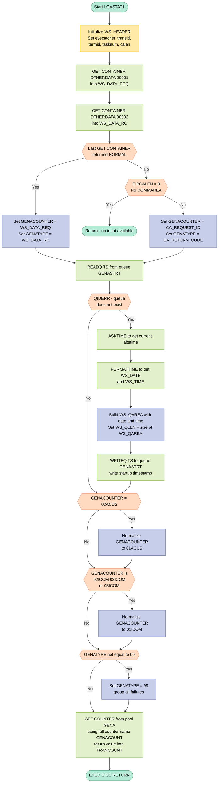

## Table of Contents

- [1. Purpose](#1-purpose)
- [2. Inputs](#2-inputs)
- [3. Outputs](#3-outputs)
  - [3.1 Named Counter Retrieval (`TRANCOUNT`)](#31-named-counter-retrieval-trancount)
  - [3.2 Temporary-Storage Queue Write (`WS_QAREA` → queue `GENASTRT`)](#32-temporary-storage-queue-write-ws_qarea--queue-genastrt)
  - [3.3 CICS Named Counter Increment (side effect)](#33-cics-named-counter-increment-side-effect)
  - [3.4 Early Return (no output)](#34-early-return-no-output)
- [4. Processing Logic](#4-processing-logic)
  - [4.1 Mermaid Flow Diagram](#41-mermaid-flow-diagram)
  - [4.2 Processing Logic Description](#42-processing-logic-description)
  - [4.3 Database Tables (if applicable)](#43-database-tables-if-applicable)
- [5. Paragraphs](#5-paragraphs)
- [6. Dependencies](#6-dependencies)
  - [6.1 CICS Middleware](#61-cics-middleware)
  - [6.2 Input Data Sources](#62-input-data-sources)
  - [6.3 Include Files / Copybooks](#63-include-files--copybooks)
  - [6.4 Runtime / Configuration Values](#64-runtime--configuration-values)
- [7. Constraints](#7-constraints)
  - [7.1 Input Source Constraints](#71-input-source-constraints)
  - [7.2 Data Format and Field-Size Constraints](#72-data-format-and-field-size-constraints)
  - [7.3 Counter Normalization Constraints](#73-counter-normalization-constraints)
  - [7.4 Sequencing and Ordering Constraints](#74-sequencing-and-ordering-constraints)
  - [7.5 Resource and Structural Constraints](#75-resource-and-structural-constraints)
- [8. Error Handling](#8-error-handling)
  - [8.1 Channel Container Read Failure with COMMAREA Fallback](#81-channel-container-read-failure-with-commarea-fallback)
  - [8.2 Temporary Storage Queue Initialization Guard](#82-temporary-storage-queue-initialization-guard)
  - [8.3 Counter Type Normalization (Defensive Input Handling)](#83-counter-type-normalization-defensive-input-handling)
  - [8.4 RESP-Based Error Suppression (Global Pattern)](#84-resp-based-error-suppression-global-pattern)
  - [8.5 Graceful Task Termination on Unrecoverable Input](#85-graceful-task-termination-on-unrecoverable-input)
- [9. Examples](#9-examples)
  - [9.1 Example 1: Channel-Based Input — Successful Counter Lookup for a Motor Policy Inquiry](#91-example-1-channel-based-input--successful-counter-lookup-for-a-motor-policy-inquiry)
  - [9.2 Example 2: COMMAREA Fallback — Failed Add Customer Request (Counter Normalization Applied)](#92-example-2-commarea-fallback--failed-add-customer-request-counter-normalization-applied)
  - [9.3 Example 3: No Channel, No COMMAREA — Early Return](#93-example-3-no-channel-no-commarea--early-return)

## 1. Purpose

LGASTAT1 is a CICS PL/I statistics counter update program that serves as an event-processing adapter for tracking transaction activity within a general insurance application. It accepts a request identifier and return code — sourced either from CICS channel containers (populated by an event-processing adapter) or, as a fallback, directly from a passed communication area — and uses those values to construct a named counter key of the form `GENA<request><type>` within the `GENA` counter pool. Before retrieving the counter, the program normalizes certain request codes to canonical equivalents and collapses all non-success return codes into a generic failure suffix, ensuring consistent bucketing of statistics across related transaction variants. It also performs a one-time initialization check using a CICS temporary storage queue (`GENASTRT`), recording the startup date and time the first time the statistics environment is accessed. The net effect is that every invocation increments (via `GET COUNTER`) the appropriate named counter, providing a running tally of business events — such as customer additions, policy inquiries, and commercial requests — categorized by both request type and success or failure outcome.

## 2. Inputs

**Communication Area (COMMAREA) — passed via `COMM_AREA_PTR` procedure parameter**

- `CA_REQUEST_ID` — 6-character business operation code (e.g. `'01IMOT'`) identifying the type of transaction; used as the statistics counter base name when channel container data is unavailable
- `CA_RETURN_CODE` — 2-digit picture field indicating the outcome of the calling transaction; used to derive the counter suffix when the CICS channel is not present
- `CA_CUSTOMER_NUM` — 10-digit customer identifier present in the shared COMMAREA structure; not directly used in counter logic but forms part of the full transaction payload passed into the program
- `CA_POLICY_NUM` — 10-digit policy identifier within the policy-request overlay of the COMMAREA; present in the inbound data structure though not consumed by the statistics routine itself

**CICS Channel Containers — runtime data injected by the CICS event-processing adapter**

- `WS_CHANNAME1` (`DFHEP.DATA.00001`) — first channel container; carries the 6-character request identifier (`WS_DATA_REQ`) that is the primary source for the counter base name, taking precedence over the COMMAREA value
- `WS_CHANNAME2` (`DFHEP.DATA.00002`) — second channel container; carries the 2-character return code (`WS_DATA_RC`) that is the primary source for the counter outcome suffix

**CICS Temporary Storage — external queue read at runtime**

- `WS_QNAME` (`GENASTRT`) — names the temporary storage queue that holds statistics subsystem initialization records; the program reads this queue to detect whether the counter environment has already been initialized, and writes a startup record (date and time) if the queue does not yet exist

**CICS Named Counter Service — external counter store**

- `GENAPOOL` (`GENA`) — identifies the named counter pool from which the transaction count value is retrieved; supplied to `EXEC CICS GET COUNTER` as the pool parameter alongside the constructed counter name (`GENACOUNT`)

**CICS Execution Interface Block (EIB) — implicitly available CICS runtime fields**

- `EIBCALEN` — length of the passed COMMAREA; used to determine whether a valid COMMAREA is present when channel container retrieval fails; if zero, the program returns immediately without processing
- `EIBTRNID` — current CICS transaction identifier; captured into working storage at entry for dump/diagnostic identification
- `EIBTRMID` — current CICS terminal identifier; captured into working storage at entry for dump/diagnostic identification
- `EIBTASKN` — current CICS task number; captured into working storage at entry for dump/diagnostic identification

## 3. Outputs

### 3.1 Named Counter Retrieval (`TRANCOUNT`)

- **`TRANCOUNT`** — the primary computed output of the program
  - Populated by `EXEC CICS GET COUNTER` against pool `GENAPOOL` (`'GENA'`) using the fully constructed counter name (`GENACOUNT_STR`), which is built from the fixed prefix `'GENA'`, the normalized request identifier (`GENACOUNTER`), and the normalized outcome type (`GENATYPE`)
  - Holds the current value of the statistics counter for the specific request-type / outcome combination that was invoked (e.g. `GENA01ACUS00` for a successful add-customer request)
  - This value is left in working storage; no explicit `PUT CONTAINER` or `RETURN DATA` is issued, so the counter value is observable only via the CICS named-counter service itself after the call

### 3.2 Temporary-Storage Queue Write (`WS_QAREA` → queue `GENASTRT`)

- **`WS_QAREA`** — written to CICS temporary storage queue `GENASTRT` on first use
  - Written only when `READQ TS` returns `QIDERR`, i.e. the queue does not yet exist (first-time initialization of the statistics subsystem)
  - Contains the formatted startup date (`WS_AREA_D` ← `WS_DATE`, DD/MM/YYYY) and startup time (`WS_AREA_T` ← `WS_TIME`, HH:MM:SS) obtained via `EXEC CICS ASKTIME` / `EXEC CICS FORMATTIME`
  - Serves as a persistent marker recording when the statistics counter environment was first activated; subsequent invocations read but do not rewrite this queue record

### 3.3 CICS Named Counter Increment (side effect)

- **Named counter `GENA<counter><type>`** in pool `GENA` — incremented as a side effect of `EXEC CICS GET COUNTER`
  - The counter name is resolved at runtime from `GENACOUNT_STR` (16-character string overlaying `GENACOUNT`)
  - Counter identifier (`GENACOUNTER`) is sourced from channel container `DFHEP.DATA.00001` or, if unavailable, from `CA_REQUEST_ID` in the COMMAREA; certain identifiers are normalized (e.g. `02ACUS` → `01ACUS`, `02ICOM`/`03ICOM`/`05ICOM` → `01ICOM`)
  - Outcome suffix (`GENATYPE`) is sourced from channel container `DFHEP.DATA.00002` or from `CA_RETURN_CODE`; any non-`'00'` value is normalized to `'99'` (failure bucket)
  - The incremented counter value is the business-observable statistic representing how many times a given transaction type / outcome has occurred

### 3.4 Early Return (no output)

- If channel containers are absent **and** `EIBCALEN = 0` (no COMMAREA), the program issues `EXEC CICS RETURN` immediately — no counter is updated, no queue is written, and no output is produced

## 4. Processing Logic

### 4.1 Mermaid Flow Diagram

---

### 4.2 Processing Logic Description

#### 4.2.1 High-level Summary

`LGASTAT1` is a CICS statistics counter update program for the GenApp insurance application. It acts as an **event-processing adapter target**: it receives a business request identifier and a return code (either from a CICS channel or from the COMMAREA), normalises both values, initialises a startup tracking queue the first time it runs, and then retrieves the current value of the matching named counter from the `GENA` counter pool. Its purpose is to classify and count transactions by request type and outcome (success vs. failure) for operational statistics reporting.

---

#### 4.2.2 Execution Flow

**Step 1 — Initialise Working Storage Header**
The program begins by blanking `WS_HEADER` and repopulating it with the current CICS environment information: transaction ID (`EIBTRNID`), terminal ID (`EIBTRMID`), task number (`EIBTASKN`), and COMMAREA length (`EIBCALEN`). The eye-catcher `'LGASTAT1------WS'` is set for dump identification.

**Step 2 — Read Input from CICS Channel Containers**
The program issues two `EXEC CICS GET CONTAINER` calls to read from the CICS event processing channel:
- Container `DFHEP.DATA.00001` → `WS_DATA_REQ` (6-char request identifier)
- Container `DFHEP.DATA.00002` → `WS_DATA_RC` (2-char return code)

Both are read sequentially; only the final `WS_RESP` from the second call is evaluated.

**Step 3 — Determine Input Source (Channel vs. COMMAREA)**
- **If `WS_RESP = DFHRESP(NORMAL)`** (channel data was available): `GENACOUNTER` is set to `WS_DATA_REQ` and `GENATYPE` is set to `WS_DATA_RC`.
- **If not NORMAL** (no channel data): the program falls back to the COMMAREA.
  - **If `EIBCALEN = 0`** (no COMMAREA either): the program issues `EXEC CICS RETURN` immediately — there is no usable input.
  - **If COMMAREA is present**: `GENACOUNTER` is set to `CA_REQUEST_ID` and `GENATYPE` is set to `CA_RETURN_CODE`.

**Step 4 — Check and Initialise the Startup Tracking Queue**
The program reads the TS queue `GENASTRT` to check whether the statistics subsystem has been previously initialised. 
- **If `QIDERR`** (queue does not exist — first invocation): the program obtains the current date and time via `EXEC CICS ASKTIME` / `EXEC CICS FORMATTIME` (producing `WS_DATE` in `DDMMYYYY` format and `WS_TIME`), stores them in `WS_QAREA`, and writes the record to the `GENASTRT` queue. This stamps the exact date and time when statistics collection began.
- **If the queue already exists**: no action is taken; processing continues.

**Step 5 — Normalise the Counter Identifier (Business Rules)**
Three normalisation rules are applied to consolidate related request codes into a single counter:
1. `GENACOUNTER = '02ACUS'` → reclassified as `'01ACUS'` (Add Customer variant 2 merged into variant 1).
2. `GENACOUNTER` is `'02ICOM'`, `'03ICOM'`, or `'05ICOM'` → reclassified as `'01ICOM'` (Inquire Commercial variants 2, 3, and 5 merged into variant 1).

**Step 6 — Normalise the Outcome Type Code**
- If `GENATYPE ≠ '00'` (anything other than success): `GENATYPE` is set to `'99'`, grouping all error/failure outcomes under a single failure counter. Only success (`'00'`) retains its specific code; every non-zero return code is collapsed to `'99'`.

**Step 7 — Retrieve the Named Counter**
`EXEC CICS GET COUNTER` is called using the fully assembled counter name in `GENACOUNT_str` — a 16-character string composed of:
- Prefix: `'GENA'` (4 chars, constant)
- `GENACOUNTER`: the normalised 6-char request code
- `GENATYPE`: the normalised 2-char outcome code
- Trailing spaces: 4 chars

The counter is fetched from pool `'GENA'`, and the current counter value is returned into `TRANCOUNT`. This read effectively retrieves the running transaction count for that specific request/outcome combination. (Note: `GET COUNTER` without `INCREMENT` only reads the current value — it does not increment it; the incrementing is assumed to be performed by the event processor itself or a companion program.)

**Step 8 — Return**
`EXEC CICS RETURN` ends the program.

---

#### 4.2.3 External Interactions

| Interaction | Command | Purpose |
|---|---|---|
| CICS Channel Container `DFHEP.DATA.00001` | `GET CONTAINER` | Read the triggering event's request identifier |
| CICS Channel Container `DFHEP.DATA.00002` | `GET CONTAINER` | Read the triggering event's return code |
| CICS TS Queue `GENASTRT` | `READQ TS` / `WRITEQ TS` | Track statistics subsystem initialisation date and time |
| CICS Named Counter Pool `GENA` | `GET COUNTER` | Retrieve the current count for the classified transaction event |
| CICS Time Services | `ASKTIME` / `FORMATTIME` | Obtain formatted current date and time for startup record |

---

#### 4.2.4 Plain Language Summary

`LGASTAT1` is the statistics bookkeeper for the GenApp insurance system. Every time a business transaction completes — such as adding a customer or inquiring about a policy — this program is triggered. It looks at what kind of transaction occurred and whether it succeeded or failed. It uses that information to build the name of a counter (like a tally mark) and reads the current tally from a shared counter pool called `GENA`.

Before it does that, the very first time it runs it stamps the current date and time into a special queue so the system knows when statistics collection started.

It also applies a few housekeeping rules: some request types that have multiple variants are consolidated to a single counter to avoid fragmented counts, and any failed transaction — regardless of the specific error — is counted under one common "failure" bucket rather than many individual error codes. This gives operations staff a clean, consistent view of transaction volumes and error rates.

---

### 4.3 Database Tables (if applicable)

`LGASTAT1` does not access any DB2 database tables. It interacts exclusively with CICS services (channel containers, temporary storage queues, and named counters). No `erDiagram` is applicable.

## 5. Paragraphs

`LGASTAT1` is a single main PL/I procedure with no separately named internal paragraphs or sub-procedures. The logic is structured as a flat inline sequence of steps within the `LGASTAT1` procedure body. The following breakdown treats each logical phase as a distinct section, aligned with the code's natural block structure.

- **Program Initialization Block** (lines 162–167)
  - Clears `WS_HEADER` to spaces and then stamps it with the fixed eyecatcher string `'LGASTAT1------WS'`.
  - Captures the current CICS execution context by copying `EIBTRNID` (transaction ID), `EIBTRMID` (terminal ID), `EIBTASKN` (task number), and `EIBCALEN` (COMMAREA length) into the working-storage header structure.
  - No conditional logic; this is a straight-line initialization sequence executed unconditionally at entry.
  - No external system interaction at this stage; it reads CICS EIB fields directly.

- **Channel Container Read Block** (lines 169–188)
  - Issues two `EXEC CICS GET CONTAINER` calls to read channel containers `DFHEP.DATA.00001` and `DFHEP.DATA.00002` into `WS_DATA_REQ` and `WS_DATA_RC` respectively; the second call's `RESP` value in `WS_RESP` is the one tested.
  - **Conditional logic:**
    - If the last `GET CONTAINER` returned `DFHRESP(NORMAL)`, `GENACOUNTER` is set from `WS_DATA_REQ` (the channel-supplied request identifier) and `GENATYPE` is set from `WS_DATA_RC` (the channel-supplied return code).
    - Otherwise (containers absent or on a non-channel invocation):
      - If `EIBCALEN = 0` (no COMMAREA was passed), the program issues `EXEC CICS RETURN` immediately, terminating without further processing.
      - If a COMMAREA is present, `GENACOUNTER` and `GENATYPE` are populated from `CA_REQUEST_ID` and `CA_RETURN_CODE` in the COMMAREA instead.
  - Interacts with CICS channel infrastructure for event-processing adapter data; falls back to the COMMAREA as a secondary input source.

- **Temporary Storage Initialization Check Block** (lines 190–206)
  - Issues `EXEC CICS READQ TS` against the queue named `GENASTRT` to determine whether the statistics subsystem has already been initialized in this CICS region.
  - **Conditional logic:** If the response is `DFHRESP(QIDERR)` (queue does not exist, meaning first-time initialization):
    - Calls `EXEC CICS ASKTIME` to obtain the current absolute time into `WS_ABSTIME`.
    - Calls `EXEC CICS FORMATTIME` to convert `WS_ABSTIME` into a human-readable date (`WS_DATE`, DDMMYYYY format) and time (`WS_TIME`).
    - Copies the formatted date into `WS_AREA_D` and the time into `WS_AREA_T` within the `WS_QAREA` structure.
    - Sets `WS_QLEN` using `STG(WS_QAREA)` to capture the storage size of the queue area.
    - Issues `EXEC CICS WRITEQ TS` to write the initialized queue record to `GENASTRT`, recording the startup timestamp for subsequent invocations.
  - If the queue already exists, this entire block is skipped; no update is made.
  - Interacts with CICS Temporary Storage for persistence of initialization state across transactions.

- **Counter Name Normalization Block** (lines 208–215)
  - Applies business-rule normalization to `GENACOUNTER` and `GENATYPE` before the counter lookup:
    - If `GENACOUNTER = '02ACUS'`, it is remapped to `'01ACUS'` (consolidates add-customer variant codes under a single counter).
    - If `GENACOUNTER` is any of `'02ICOM'`, `'03ICOM'`, or `'05ICOM'`, it is remapped to `'01ICOM'` (consolidates multiple inquiry-commercial variant codes under a single counter).
    - If `GENATYPE` is not `'00'` (i.e., not a success code), it is overwritten with `'99'` (groups all non-success outcomes into a single generic failure bucket).
  - Pure in-memory conditional logic; no external I/O.
  - Ensures that logically equivalent request variants or failure outcomes share a common named counter rather than fragmenting statistics across many keys.

- **Named Counter Retrieval and Return Block** (lines 217–222)
  - Builds the full 16-character counter name by combining the hard-coded prefix `'GENA'` (4 chars), the normalized `GENACOUNTER` (6 chars), and the normalized `GENATYPE` (2 chars), plus 4 trailing spaces — accessed as `GENACOUNT_STR` via the `BASED` overlay declaration.
  - Issues `EXEC CICS GET COUNTER` against pool `GENA` using the composed counter name, retrieving the current transaction count into `TRANCOUNT`.
  - Issues `EXEC CICS RETURN` to return control to CICS, ending the transaction.
  - Interacts with the CICS Named Counter Service to read the statistics count for the specific request/outcome combination determined earlier in the program.

## 6. Dependencies

### 6.1 CICS Middleware

- **CICS runtime environment** — The program runs as a CICS transaction. It relies on the CICS Executive Interface Block (EIB) for task-level context:
  - `EIBTRNID` — current transaction identifier
  - `EIBTRMID` — current terminal identifier
  - `EIBTASKN` — current task number
  - `EIBCALEN` — length of the passed COMMAREA (used to detect whether a COMMAREA was supplied)

- **CICS Channel Containers (Event Processing interface)**
  - `DFHEP.DATA.00001` (`WS_CHANNAME1`) — first channel container; carries the 6-character business request identifier (`WS_DATA_REQ`) populated by the CICS Event Processing (EP) adapter when the program is driven as an event-processing target
  - `DFHEP.DATA.00002` (`WS_CHANNAME2`) — second channel container; carries the 2-character return code (`WS_DATA_RC`) for the event
  - Accessed via `EXEC CICS GET CONTAINER … INTO … RESP(WS_RESP)`; if either GET fails (response is not `DFHRESP(NORMAL)`), the program falls back to the COMMAREA

- **CICS Named Counter Service**
  - Counter pool `GENA` (`GENAPOOL`) — a named counter pool defined in the CICS region; holds the individual statistics counters
  - Counter name `GENA<GENACOUNTER><GENATYPE>` (16 characters) — composed of the literal prefix `GENA`, a 6-character request code, and a 2-character outcome type; retrieved via `EXEC CICS GET COUNTER … POOL … VALUE … RESP`
  - The retrieved value is stored in `TRANCOUNT`

- **CICS Temporary Storage (TS)**
  - Queue `GENASTRT` (`WS_QNAME`) — a TS queue used to record the date and time of first statistics initialisation in the current CICS region; read with `EXEC CICS READQ TS`; written with `EXEC CICS WRITEQ TS` if the queue does not yet exist (`DFHRESP(QIDERR)`)

- **CICS Time Services**
  - `EXEC CICS ASKTIME ABSTIME` — retrieves the current absolute time (stored in `WS_ABSTIME`); used only during first-time initialisation
  - `EXEC CICS FORMATTIME … DDMMYYYY … TIME` — formats the absolute time into date (`WS_DATE`) and time (`WS_TIME`) strings for writing to the TS queue

---

### 6.2 Input Data Sources

- **COMMAREA (`COMM_AREA`)** — passed by the invoking CICS task via the procedure parameter `COMM_AREA_PTR`; used as a fallback when channel containers are unavailable (`EIBCALEN > 0`):
  - `CA_REQUEST_ID` (6 chars) — business request code mapped to `GENACOUNTER`
  - `CA_RETURN_CODE` (2 chars PIC) — outcome code mapped to `GENATYPE`
  - The COMMAREA structure is defined by the include file `LGCMAREA.inc` (expanded inline at compile time)

- **CICS Event Processing channel** — primary input path; the program is designed to be invoked as an EP adapter target, with `DFHEP.DATA.00001` and `DFHEP.DATA.00002` carrying the request and return-code data respectively

---

### 6.3 Include Files / Copybooks

- **`plinc/LGCMAREA.inc`** — defines the `COMM_AREA` structure (`%INCLUDE LGCMAREA`) shared across all CICS programs in the application; provides all `CA_*` field layouts including customer, policy, endowment, house, motor, commercial, and claim sub-structures

---

### 6.4 Runtime / Configuration Values

- **Counter pool name `GENA`** — a static literal compiled into the program; the named counter pool must be defined in the CICS region's system definition (CSD) before the program can successfully retrieve counters
- **TS queue name `GENASTRT`** — a static literal compiled into the program; the queue resides in CICS auxiliary or main temporary storage
- **Channel container names `DFHEP.DATA.00001` / `DFHEP.DATA.00002`** — static EP adapter container names conforming to the CICS Event Processing naming convention; must match the EP adapter configuration in the CICS region
- **Counter normalization rules** (embedded logic, not external config):
  - `02ACUS` is remapped to `01ACUS`
  - `02ICOM`, `03ICOM`, `05ICOM` are remapped to `01ICOM`
  - Any non-zero (`^= '00'`) outcome type is remapped to `99` (generic failure bucket)

## 7. Constraints

### 7.1 Input Source Constraints

- **Dual input source requirement**: The program requires input from exactly one of two sources — a CICS channel (containers `DFHEP.DATA.00001` and `DFHEP.DATA.00002`) or a COMMAREA passed at invocation. Both sources are tried in order; the channel is attempted first.
  - Channel container `DFHEP.DATA.00001` must supply a 6-character request identifier (`WS_DATA_REQ`), and container `DFHEP.DATA.00002` must supply a 2-character return code (`WS_DATA_RC`).
  - If the channel GET does not return `DFHRESP(NORMAL)`, the program falls back to the COMMAREA (`CA_REQUEST_ID`, `CA_RETURN_CODE`).
- **COMMAREA presence is mandatory when channel data is absent**: If the channel read fails (i.e., `WS_RESP ≠ DFHRESP(NORMAL)`) and `EIBCALEN = 0` (no COMMAREA was passed), the program issues `EXEC CICS RETURN` immediately — processing is entirely abandoned. There is no error message and no counter update.
  - Implemented at lines 182–183: `IF EIBCALEN = 0 THEN EXEC CICS RETURN;`

### 7.2 Data Format and Field-Size Constraints

- **Request identifier (`GENACOUNTER`) must be exactly 6 characters**: Declared as `CHAR(6)`; populated from either `WS_DATA_REQ` (channel) or `CA_REQUEST_ID` (COMMAREA), both also 6 characters wide.
- **Return/outcome code (`GENATYPE`) must be exactly 2 characters**: Declared as `CHAR(2)`; populated from either `WS_DATA_RC` (channel) or `CA_RETURN_CODE` (COMMAREA picture `PIC '99'`), both 2 characters wide.
- **Counter name is fixed at 16 characters**: `GENACOUNT` is a structure whose total width is `4 ('GENA') + 6 (GENACOUNTER) + 2 (GENATYPE) + 4 (padding spaces) = 16 chars`. The overlay alias `GENACOUNT_STR CHAR(16)` enforces this fixed width when passed to `EXEC CICS GET COUNTER`.
- **Counter pool identifier is fixed**: `GENAPOOL` is declared `CHAR(8) STATIC INIT('GENA')` — no other pool is ever used; the pool name cannot be changed at runtime.
- **COMMAREA maximum raw size is 32,500 bytes**: `COMM_AREA_RAW CHAR(32500)` sets the upper bound on the COMMAREA that can be mapped. Data beyond this boundary is inaccessible to the program.
- **Temporary storage queue record length is fixed at 16 bytes**: `WS_QLEN FIXED BIN(15) INIT(16)` and later reassigned via `WS_QLEN = STG(WS_QAREA)` (which also evaluates to 16, matching the size of `WS_QAREA`: `8 + 2 + 6 = 16` bytes).

### 7.3 Counter Normalization Constraints

The program enforces business rules that collapse several request codes into canonical forms before the counter lookup. These normalizations are mandatory and unconditional once the counter identifiers are populated.

- **`02ACUS` is remapped to `01ACUS`**: Any "Add Customer" request arriving with request code `02ACUS` is treated identically to `01ACUS` for statistics purposes.
  - Implemented at line 208–209: `IF GENACOUNTER = '02ACUS' THEN GENACOUNTER = '01ACUS';`
- **`02ICOM`, `03ICOM`, and `05ICOM` are all remapped to `01ICOM`**: Multiple variants of the "Inquire Commercial" request code are collapsed into a single counter.
  - Implemented at lines 210–213: three-way OR condition remapping to `'01ICOM'`.
- **Any non-success outcome code is remapped to `'99'`**: If `GENATYPE ≠ '00'` (i.e., anything other than the success code), it is overwritten with `'99'`, grouping all failure/error outcomes under a single counter suffix.
  - Implemented at line 214–215: `IF GENATYPE ^= '00' THEN GENATYPE = '99';`
  - This means the named counter system will only ever see outcome codes `'00'` (success) or `'99'` (any failure); no granular per-error-code counters exist.

### 7.4 Sequencing and Ordering Constraints

- **Channel read must precede COMMAREA fallback evaluation**: The two `EXEC CICS GET CONTAINER` calls (lines 169–175) must complete before the `WS_RESP` check at line 177, because `WS_RESP` is set by the second GET and determines whether the COMMAREA path is taken. The second container read always overwrites `WS_RESP` from the first; only the final `WS_RESP` is tested.
- **TS queue initialization must precede the counter GET**: The `EXEC CICS READQ TS` / conditional `WRITEQ TS` sequence (lines 190–206) is executed before the `EXEC CICS GET COUNTER` (line 217). The TS queue records the startup timestamp of the statistics subsystem; the counter update proceeds regardless of whether the write succeeds.
- **Counter name normalization must occur before `GET COUNTER`**: The three normalization `IF` statements (lines 208–215) rewrite `GENACOUNTER` and `GENATYPE` in place. Since `GENACOUNT_STR` is a `BASED` overlay on `GENACOUNT`, the `GET COUNTER` call at line 217 automatically uses the already-normalized name. Reversing this order would look up the un-normalized counter name.
- **`EXEC CICS RETURN` is the sole exit point for all paths**: Every code path (early exit on missing COMMAREA or successful counter retrieval) terminates via `EXEC CICS RETURN`, ensuring no fall-through to subsequent logic.

### 7.5 Resource and Structural Constraints

- **Temporary storage queue name is hardcoded**: `WS_QNAME CHAR(8) STATIC INIT('GENASTRT')` — the queue name is fixed at compile time and cannot vary between invocations.
- **TS queue write occurs only once (on first use)**: The `WRITEQ TS` is guarded by `IF WS_RESP = DFHRESP(QIDERR)` — the record is written only if the queue does not yet exist. Subsequent invocations read the existing record without writing.
- **`WS_ABSTIME` is scoped to initialization only**: `FIXED BIN(31) INIT(0)` — the absolute time is acquired (`ASKTIME`) and formatted (`FORMATTIME`) solely within the `QIDERR` branch; it is not used elsewhere and is not persisted beyond the queue record.
- **No looping or iterative processing**: The program is strictly linear with no DO loops, no recursive calls, and no batch iteration. It processes exactly one counter increment per invocation.
- **Channel container names are compile-time constants**: `WS_CHANNAME1 CHAR(16) STATIC INIT('DFHEP.DATA.00001')` and `WS_CHANNAME2 CHAR(16) STATIC INIT('DFHEP.DATA.00002')` are static; the program cannot be redirected to different containers at runtime.

## 8. Error Handling

### 8.1 Channel Container Read Failure with COMMAREA Fallback

- After each `EXEC CICS GET CONTAINER` call (for both the request identifier container and the return code container), the response code is captured into `WS_RESP` using the `RESP` option, suppressing any automatic CICS exception handling and placing full control in the program.
- The response of the second `GET CONTAINER` call (for the return code container) is evaluated against `DFHRESP(NORMAL)`:
  - If the response is `NORMAL`, the channel data is used directly to populate the counter name components (`GENACOUNTER` and `GENATYPE`).
  - If the response is not `NORMAL` (i.e., either container was unavailable or the channel was not present), the program falls back to reading the counter components from the communication area fields `CA_REQUEST_ID` and `CA_RETURN_CODE`.
    - Before using the COMMAREA fallback, the program first checks `EIBCALEN` — the Execute Interface Block field that holds the length of the passed communication area:
      - If `EIBCALEN` equals zero, no COMMAREA was passed to the program, and there is no usable input at all. In this case, the program immediately issues `EXEC CICS RETURN` to terminate the task without performing any counter update.
      - If `EIBCALEN` is non-zero, the COMMAREA is considered valid and its fields are used as the fallback data source.

### 8.2 Temporary Storage Queue Initialization Guard

- After populating the counter name components, the program attempts to read the initialization tracking queue `GENASTRT` from CICS temporary storage using `EXEC CICS READQ TS`, again capturing the outcome in `WS_RESP` via the `RESP` option.
- The response is explicitly checked against `DFHRESP(QIDERR)`, which is the CICS condition indicating the named queue does not exist:
  - If the queue is absent (`QIDERR`), the program treats this as a first-run initialization scenario. It obtains the current date and time via `EXEC CICS ASKTIME` and `EXEC CICS FORMATTIME`, constructs a queue record from those values, and writes it to temporary storage with `EXEC CICS WRITEQ TS`. This serves as a one-time initialization marker.
  - If the queue already exists (any other response), no action is taken and normal processing continues. The `WRITEQ TS` response is also captured in `WS_RESP` but not explicitly evaluated, meaning write errors are silently ignored.

### 8.3 Counter Type Normalization (Defensive Input Handling)

- Before submitting the counter name for lookup, the program applies normalization logic to guard against unexpected or aliased counter identifier values:
  - The counter identifier `02ACUS` is remapped to `01ACUS`, consolidating a variant request code into the canonical counter.
  - The counter identifiers `02ICOM`, `03ICOM`, and `05ICOM` are all remapped to `01ICOM`, collapsing multiple sub-variants into a single counter.
  - These remappings prevent counter lookups for non-existent or undefined named counters, acting as a defensive guard against invalid or unsupported input values.
- The outcome type code (`GENATYPE`) is also normalized: if it is anything other than `'00'` (the success indicator), it is unconditionally overwritten with `'99'`, grouping all non-success outcomes into a single failure category. This prevents any unexpected or unrecognized return code from causing a lookup failure against an undefined counter name.

### 8.4 RESP-Based Error Suppression (Global Pattern)

- Every `EXEC CICS` command in the program (`GET CONTAINER`, `READQ TS`, `WRITEQ TS`, `GET COUNTER`) specifies the `RESP` option. In CICS, using `RESP` suppresses the default CICS condition handling (which would otherwise abend the task) and routes the response code into the named variable for programmatic inspection. This is a deliberate and consistent strategy throughout the program to retain control over all CICS interactions rather than relying on CICS default abend behavior.

### 8.5 Graceful Task Termination on Unrecoverable Input

- When both channel containers are unavailable and no COMMAREA has been provided (evidenced by `EIBCALEN = 0`), the program issues `EXEC CICS RETURN` to end the task cleanly. This avoids any undefined or erroneous counter update that would result from processing with no valid input, and prevents a CICS abend or uncontrolled failure.

## 9. Examples

### 9.1 Example 1: Channel-Based Input — Successful Counter Lookup for a Motor Policy Inquiry

**Input:**
- CICS channel container `DFHEP.DATA.00001` contains: `01IMOT` (6-char request ID for "Inquire Motor Policy")
- CICS channel container `DFHEP.DATA.00002` contains: `00` (return code = success)
- Named counter pool `GENA` exists with a counter named `GENA01IMOT00    `

**Processing:**
1. Both containers are read successfully (`DFHRESP(NORMAL)`), so `GENACOUNTER = '01IMOT'` and `GENATYPE = '00'`.
2. The temporary storage queue `GENASTRT` is checked. Assuming it already exists, no initialization is performed.
3. The normalization checks do not match `'01IMOT'`, so `GENACOUNTER` remains unchanged.
4. `GENATYPE` equals `'00'`, so it is not changed to `'99'`.
5. The full counter name becomes `GENA` + `01IMOT` + `00` + `    ` → `GENA01IMOT00    `.
6. `EXEC CICS GET COUNTER` retrieves the current count from pool `GENA` into `TRANCOUNT`.

**Output:**
- `TRANCOUNT` is populated with the current cumulative count of successful motor policy inquiries.
- Program performs `EXEC CICS RETURN` — no COMMAREA output is written; the counter value is held internally for statistics tracking only.

---

### 9.2 Example 2: COMMAREA Fallback — Failed Add Customer Request (Counter Normalization Applied)

**Input:**
- Channel containers `DFHEP.DATA.00001` / `DFHEP.DATA.00002` are **not present** (GET CONTAINER returns non-NORMAL response).
- `EIBCALEN > 0` (COMMAREA is present).
- COMMAREA fields: `CA_REQUEST_ID = '02ACUS'`, `CA_RETURN_CODE = '01'` (non-zero = failure).

**Processing:**
1. Container GET fails, so the program falls back to the COMMAREA: `GENACOUNTER = '02ACUS'`, `GENATYPE = '01'`.
2. `GENASTRT` queue is checked; assume it does not exist yet — the program calls `ASKTIME` / `FORMATTIME`, records the current date/time, and writes the startup record to `GENASTRT`.
3. Normalization: `GENACOUNTER = '02ACUS'` matches the first rule → it is reassigned to `'01ACUS'`.
4. `GENATYPE = '01'` is not equal to `'00'`, so it is reassigned to `'99'` (generic failure bucket).
5. Counter name becomes `GENA` + `01ACUS` + `99` + `    ` → `GENA01ACUS99    `.
6. `EXEC CICS GET COUNTER` retrieves the failure count for "Add Customer" from pool `GENA`.

**Output:**
- `TRANCOUNT` holds the accumulated failure count for Add Customer requests.
- The `GENASTRT` queue is newly created with the current date/time, marking the first time statistics were collected in this CICS region session.
- The normalization of `'02ACUS'` → `'01ACUS'` means all "Add Customer" variants are tallied under a single counter, and all non-`'00'` return codes are consolidated into the `'99'` error counter.

---

### 9.3 Example 3: No Channel, No COMMAREA — Early Return

**Input:**
- Channel containers are absent (GET CONTAINER fails).
- `EIBCALEN = 0` (no COMMAREA passed — program was invoked directly with no data).

**Processing:**
1. Container GET returns a non-NORMAL response.
2. `EIBCALEN = 0` → the program immediately executes `EXEC CICS RETURN` without touching any counters.

**Output:**
- No counter is read or updated.
- Program exits silently. This guard prevents abends when LGASTAT1 is invoked in an unexpected context with no input data available.

---

Generated by IBM Bob Premium Package for Z
