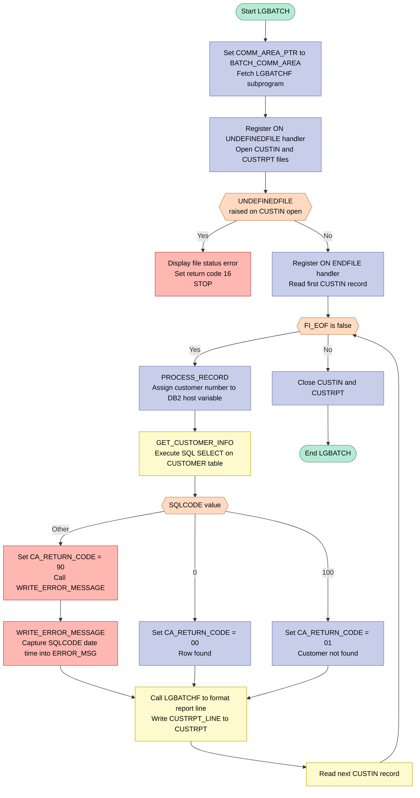
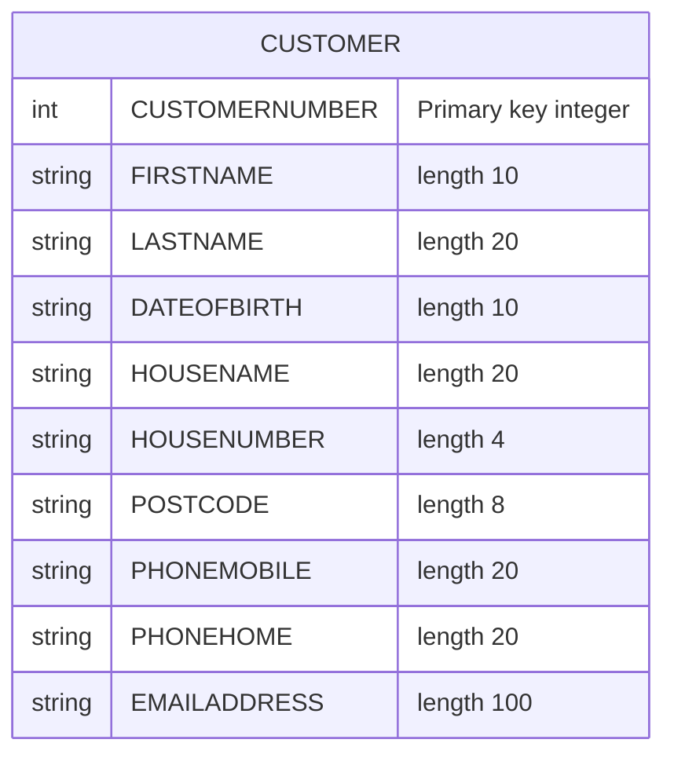

## Table of Contents

- [1. Purpose](#1-purpose)
- [2. Inputs](#2-inputs)
  - [2.1 Procedure and call inputs](#21-procedure-and-call-inputs)
  - [2.2 File inputs](#22-file-inputs)
  - [2.3 Database inputs](#23-database-inputs)
  - [2.4 Data returned from DB2 and consumed by the program](#24-data-returned-from-db2-and-consumed-by-the-program)
  - [2.5 Runtime and environment inputs](#25-runtime-and-environment-inputs)
  - [2.6 Derived status fields populated from external inputs](#26-derived-status-fields-populated-from-external-inputs)
- [3. Outputs](#3-outputs)
- [4. Processing Logic](#4-processing-logic)
  - [4.1 Mermaid Flow Diagram](#41-mermaid-flow-diagram)
  - [4.2 Processing Logic Description](#42-processing-logic-description)
  - [4.3 Database Tables](#43-database-tables)
- [5. Paragraphs](#5-paragraphs)
- [6. Dependencies](#6-dependencies)
  - [6.1 Files and data sets](#61-files-and-data-sets)
  - [6.2 Database dependencies](#62-database-dependencies)
  - [6.3 External program and include dependencies](#63-external-program-and-include-dependencies)
  - [6.4 Input data and execution inputs](#64-input-data-and-execution-inputs)
  - [6.5 Runtime and environment dependencies](#65-runtime-and-environment-dependencies)
  - [6.6 Configuration and allocation assumptions](#66-configuration-and-allocation-assumptions)
- [7. Constraints](#7-constraints)
  - [7.1 Input File Format & Record Structure](#71-input-file-format--record-structure)
  - [7.2 File Availability & Sequencing](#72-file-availability--sequencing)
  - [7.3 End-of-File Control](#73-end-of-file-control)
  - [7.4 DB2 Query Constraints](#74-db2-query-constraints)
  - [7.5 SQL Return Code Handling](#75-sql-return-code-handling)
  - [7.6 Communication Area (COMMAREA) Constraints](#76-communication-area-commarea-constraints)
  - [7.7 Subroutine Interface Constraints](#77-subroutine-interface-constraints)
  - [7.8 Error Message Constraints](#78-error-message-constraints)
- [8. Error Handling](#8-error-handling)
  - [8.1 File I/O Error Handling](#81-file-io-error-handling)
  - [8.2 DB2 SQL Error Handling](#82-db2-sql-error-handling)
  - [8.3 Program Termination and Return Code Control](#83-program-termination-and-return-code-control)
  - [8.4 Implicit / Absent Error Handling (Notable Gaps)](#84-implicit--absent-error-handling-notable-gaps)
- [9. Examples](#9-examples)
  - [9.1 Example 1 — Customer Found Successfully](#91-example-1--customer-found-successfully)
  - [9.2 Example 2 — Customer Number Not Found in DB2](#92-example-2--customer-number-not-found-in-db2)
  - [9.3 Example 3 — Unexpected SQL Error](#93-example-3--unexpected-sql-error)

## 1. Purpose

LGBATCH is a batch PL/I program that produces a formatted customer report by reading a sequential file of customer numbers (CUSTIN), querying the DB2 CUSTOMER table for each number to retrieve personal details such as name, date of birth, address, and contact information, and then invoking the LGBATCHF subroutine to format and write an 80-character report line for each customer to the CUSTRPT output file. It runs outside of CICS, uses a shared communication area structure (COMM_AREA) to pass DB2-retrieved data to the formatting subroutine, sets a return code reflecting the outcome of each DB2 lookup (success, not-found, or unexpected SQL error), and terminates cleanly after processing all input records.

## 2. Inputs

### 2.1 Procedure and call inputs
- No procedure parameters
  - `LGBATCH` is defined as `Proc Options(Main)` and does not receive input arguments from a caller.

- Static subprogram dependency
  - `LGBATCHF` call parameters are outbound from this program, not inbound inputs to `LGBATCH`.
  - The program depends on the called subprogram being available at runtime because report formatting is delegated to it.

### 2.2 File inputs
- `CUSTIN` sequential input file
  - External batch input file read by the program.
  - Supplies the customer records that drive the entire processing loop.
  - End-of-file on this file controls when processing stops.

- `CUSTIN_RECORD`
  - Record layout used to receive each row from `CUSTIN`.
  - Represents one externally supplied input record from the batch file.

- `CUSTIN_CUSTNUMBER`
  - Customer number read from each `CUSTIN` record.
  - Primary business input used to look up customer data in DB2.
  - Also passed to `LGBATCHF` so the report line can be formatted for that customer.

### 2.3 Database inputs
- DB2 `CUSTOMER` table
  - External database source queried for each input customer number.
  - Provides the customer details used in the report output.

- `DB2_CUSTOMERNUMBER_INT`
  - DB2 host variable populated from the input file customer number.
  - Used as the SQL predicate value in `WHERE CUSTOMERNUMBER = :DB2_CUSTOMERNUMBER_INT`.
  - Although stored locally, it represents externally supplied input transformed for DB2 type compatibility.

### 2.4 Data returned from DB2 and consumed by the program
- Customer identity and contact fields from the `CUSTOMER` table
  - `CA_FIRST_NAME`
  - `CA_LAST_NAME`
  - `CA_DOB`
  - `CA_HOUSE_NAME`
  - `CA_HOUSE_NUM`
  - `CA_POSTCODE`
  - `CA_PHONE_MOBILE`
  - `CA_PHONE_HOME`
  - `CA_EMAIL_ADDRESS`
  - These are populated by the SQL `SELECT` and used as externally sourced customer data for report generation.

### 2.5 Runtime and environment inputs
- `SQLCODE`
  - DB2 runtime status returned after the `SELECT`.
  - Drives success, not-found, and error-handling paths.

- End-of-file condition on `CUSTIN`
  - Runtime file status supplied by the file system/environment.
  - Used through the `ON ENDFILE(CUSTIN)` condition to terminate batch processing.

- Undefined-file condition on `CUSTIN`
  - Runtime file/open status supplied by the operating environment.
  - Determines whether the program displays an error and stops when `CUSTIN` cannot be opened.

### 2.6 Derived status fields populated from external inputs
- `CA_RETURN_CODE`
  - Status field set according to the DB2 result for the externally supplied customer number.
  - Indicates whether the customer was found, not found, or a DB2 error occurred.

- `EM_SQLRC`
  - Error message field populated from DB2 `SQLCODE`.
  - Captures external DB2 error status for diagnostic reporting.

## 3. Outputs

**`CUSTRPT` — Sequential Output Report File**
- The primary output of the batch program is a sequential fixed-block record file (`CUSTRPT`, RECSIZE=80), written once per input customer record
  - Each 80-character report line (`CUSTRPT_LINE`) is produced by calling the `LGBATCHF` subroutine, which formats the line using:
    - `CUSTIN_CUSTNUMBER` — the customer number read from the `CUSTIN` input file, passed directly as the first argument
    - `COMM_AREA_PTR` — pointer to `BATCH_COMM_AREA`, giving `LGBATCHF` access to the full COMMAREA, including all DB2-retrieved customer fields below:
      - `CA_RETURN_CODE` — indicates whether the DB2 SELECT succeeded (`00`), the customer was not found (`01`), or an unexpected SQL error occurred (`90`); drives the content and validity of the report line
      - `CA_FIRST_NAME` — customer first name retrieved from the `CUSTOMER` DB2 table
      - `CA_LAST_NAME` — customer surname retrieved from the `CUSTOMER` DB2 table
      - `CA_DOB` — customer date of birth retrieved from the `CUSTOMER` DB2 table
      - `CA_POSTCODE` — customer postal code retrieved from the `CUSTOMER` DB2 table
      - `CA_EMAIL_ADDRESS` — customer email address retrieved from the `CUSTOMER` DB2 table
      - `CA_NUM_POLICIES` — number of insurance policies associated with the customer
      - `CA_POLICY_NUM` — policy number, part of the policy-level data within the COMMAREA
      - `CA_PAYMENT` — payment amount associated with a policy, part of the policy common data within the COMMAREA

**`DISPLAY` Console Message — File Open Failure**
- If the `CUSTIN` file is undefined at open time, a console message `'FILE STATUS AT OPEN CUSTIN'` is displayed via `DISPLAY()`, a return code of 16 is set via `PLIRETC(16)`, and the program terminates; this is the only observable output when the input file cannot be opened

**`PLIRETC` — Program Return Code**
- Set to `16` via `CALL PLIRETC(16)` when the `CUSTIN` file cannot be opened, signalling a hard failure to the JCL step; under normal completion the return code is implicitly 0

**`ERROR_MSG` — In-Memory Error Diagnostic Structure (not written to any file or queue)**
- Built by `WRITE_ERROR_MESSAGE` when an unexpected SQL error (`CA_RETURN_CODE = '90'`) occurs; the structure is populated but, as noted in the program header, is never written to any output destination — it has no external observable effect beyond the in-memory state:
  - `EM_SQLRC` — the `SQLCODE` value at the time of the SQL failure
  - `EM_DATE` / `EM_TIME` — date and time captured at the point of the error (sourced from `WS_DATE` / `WS_TIME`)
  - `EM_CUSNUM` / `EM_POLNUM` — customer and policy numbers in context at error time
  - `EM_SQLREQ` — identifies the SQL statement that failed (set to `' SELECT CUSTOMER'`)

## 4. Processing Logic

### 4.1 Mermaid Flow Diagram



---

### 4.2 Processing Logic Description

#### 4.2.1 High-level Summary

`LGBATCH` is a non-CICS batch program that produces a customer report. It reads a sequential file (`CUSTIN`) containing customer numbers, queries DB2 for each customer's demographic details, and writes one formatted 80-byte report line per customer to the output file `CUSTRPT`. The actual line formatting is delegated to a dynamically loaded subprogram, `LGBATCHF`.

---

#### 4.2.2 Execution Flow

**1. Initialisation**

- `COMM_AREA_PTR` is set to the address of `BATCH_COMM_AREA` (a 32 500-character working storage buffer). This gives the pointer-based `COMM_AREA` structure a backing store so all its sub-fields can be addressed and populated.
- `LGBATCHF` is dynamically loaded into the address space using the `FETCH` statement before any file I/O begins.

**2. File Setup and Error Guard**

- An `ON UNDEFINEDFILE(CUSTIN)` handler is registered. If the input file cannot be opened (e.g., the DD is missing), the handler displays a message, sets return code 16 via `PLIRETC`, and issues `STOP` to terminate the program immediately.
- Both `CUSTIN` (sequential fixed-block, record size 10) and `CUSTRPT` (sequential fixed-block, record size 80) are opened.
- An `ON ENDFILE(CUSTIN)` handler is registered; it sets the bit flag `FI_EOF` to `'1'B` when the last record has been read.

**3. First Read**

- The first record is read from `CUSTIN` into `CUSTIN_RECORD` (a 10-digit picture field `CUSTIN_CUSTNUMBER`). If the file is empty, `FI_EOF` is raised immediately, and the main loop is skipped.

**4. Main Processing Loop — `DO WHILE (^FI_EOF)`**

The loop continues as long as `FI_EOF` is `'0'B`.

For each customer number read:

- **`PROCESS_RECORD`** is called:
  1. `DB2_CUSTOMERNUMBER_INT` (a `FIXED BIN(31)` host variable) is loaded from `CUSTIN_CUSTNUMBER`. This is necessary because the `CUSTOMERNUMBER` column in DB2 is an integer type, while the input field is a PL/I picture numeric.
  2. `GET_CUSTOMER_INFO` is called to retrieve customer data from DB2.
  3. `LGBATCHF` is called with the customer number, `COMM_AREA_PTR`, and the output line buffer `CUSTRPT_LINE` to format the report line.
  4. The formatted 80-byte line is written to `CUSTRPT`.

- **`GET_CUSTOMER_INFO`** procedure:
  - Sets `EM_SQLREQ` to `' SELECT CUSTOMER'` for error diagnostics.
  - Executes `EXEC SQL SELECT ... INTO ...` to retrieve `FIRSTNAME`, `LASTNAME`, `DATEOFBIRTH`, `HOUSENAME`, `HOUSENUMBER`, `POSTCODE`, `PHONEMOBILE`, `PHONEHOME`, and `EMAILADDRESS` from the `CUSTOMER` table, keyed by `CUSTOMERNUMBER = :DB2_CUSTOMERNUMBER_INT`.
  - Evaluates `SQLCODE` with a `SELECT … WHEN … OTHERWISE` construct:
    - **`SQLCODE = 0`** → `CA_RETURN_CODE = '00'` (success, customer found and data populated in `COMM_AREA`).
    - **`SQLCODE = 100`** → `CA_RETURN_CODE = '01'` (customer not found — a business note: the report line is still written using whatever data remains in `COMM_AREA` from the previous successful row).
    - **Any other SQLCODE** → `CA_RETURN_CODE = '90'` and `WRITE_ERROR_MESSAGE` is called.

- **`WRITE_ERROR_MESSAGE`** procedure:
  - Copies `SQLCODE` into `EM_SQLRC`, and copies `WS_DATE` / `WS_TIME` into the `ERROR_MSG` structure.
  - **Important limitation:** The error message is only built in memory and is never written to any output file, transient data queue, or system log. This is a known design note preserved from the original COBOL version.

- After `PROCESS_RECORD`, the next record is read from `CUSTIN`, potentially triggering the `ON ENDFILE` handler.

**5. Termination**

- When `FI_EOF` becomes `'1'B`, the loop exits.
- Both files are closed cleanly.
- `RETURN` ends the program.

---

#### 4.2.3 External Interactions

| System | Operation | Purpose |
|---|---|---|
| **DB2 CUSTOMER table** | `SELECT` (read) | Retrieves customer demographics (name, DOB, address, contact details) for each customer number from the input file |
| **CUSTIN (sequential file)** | `READ` | Provides the list of 10-digit customer numbers to process, one per 10-byte fixed-block record |
| **CUSTRPT (sequential file)** | `WRITE` | Receives one 80-byte formatted report line per customer, produced by `LGBATCHF` |
| **LGBATCHF (subprogram)** | `CALL` (static after `FETCH`) | Formats the customer data held in `COMM_AREA` into a printable 80-character report line |

---

#### 4.2.4 Plain Language Summary

`LGBATCH` is a batch reporting program for a general insurance application. It works like a production line: it reads a list of customer ID numbers from an input file, looks up each customer's details in a DB2 database, and then asks a formatting helper (`LGBATCHF`) to produce a tidy 80-character line, which it writes to a report file.

If a customer number is not in the database, the program still writes a line (using whatever data was left over from the previous customer — a known quirk). If a serious database error occurs, the error details are captured internally but are not printed anywhere, which limits runtime diagnostics. If the input file itself cannot be opened, the program halts immediately with an error code of 16.

---

### 4.3 Database Tables



## 5. Paragraphs

- **Main Procedure Body (LGBATCH)**
  - Serves as the program entry point, declared with `Options(Main)`.
  - Initialises the communication area overlay by setting `COMM_AREA_PTR` to the address of `BATCH_COMM_AREA`, making all `COMM_AREA` sub-fields addressable.
  - Dynamically loads the external subroutine `LGBATCHF` using a `FETCH` statement, enabling late binding of the report-formatting routine.
  - Registers an `ON UNDEFINEDFILE(CUSTIN)` handler: if the input file cannot be opened, a message is displayed, return code 16 is set via `PLIRETC`, and the program halts with `STOP`.
  - Opens both the `CUSTIN` (sequential input) and `CUSTRPT` (sequential output) files.
  - Registers an `ON ENDFILE(CUSTIN)` handler that sets the `FI_EOF` flag to `'1'B` when end-of-file is reached on `CUSTIN`.
  - Reads the first record from `CUSTIN` into `CUSTIN_RECORD` to prime the processing loop.
  - Executes a `DO WHILE (^FI_EOF)` loop: on each iteration it calls `PROCESS_RECORD` to handle the current customer, then reads the next record. The loop terminates when `FI_EOF` is set by the end-of-file handler.
  - After the loop, closes both files and returns normally.

- **PROCESS_RECORD**
  - Coordinates all processing for a single customer number read from `CUSTIN`.
  - Converts the picture-9 `CUSTIN_CUSTNUMBER` into the integer host variable `DB2_CUSTOMERNUMBER_INT` to satisfy the DB2 column data type requirement.
  - Calls `GET_CUSTOMER_INFO` to retrieve the customer's details from DB2 into the `COMM_AREA` fields.
  - Calls the external subroutine `LGBATCHF`, passing `CUSTIN_CUSTNUMBER`, `COMM_AREA_PTR`, and the output buffer `CUSTRPT_LINE`. `LGBATCHF` formats the customer data into the 80-character report line.
  - Writes the formatted `CUSTRPT_LINE` to the `CUSTRPT` output file.
  - No explicit conditional logic is present; control flow for SQL outcomes is delegated entirely to `GET_CUSTOMER_INFO`.

- **GET_CUSTOMER_INFO**
  - Retrieves a customer's demographic details from the DB2 `CUSTOMER` table using the integer customer number as the query key.
  - Sets `EM_SQLREQ` to `' SELECT CUSTOMER'` before the query executes, pre-populating the error message identifier for diagnostic use.
  - Executes an embedded `EXEC SQL SELECT … INTO` statement fetching `FIRSTNAME`, `LASTNAME`, `DATEOFBIRTH`, `HOUSENAME`, `HOUSENUMBER`, `POSTCODE`, `PHONEMOBILE`, `PHONEHOME`, and `EMAILADDRESS` into the corresponding `COMM_AREA` host variables (`CA_FIRST_NAME`, `CA_LAST_NAME`, `CA_DOB`, `CA_HOUSE_NAME`, `CA_HOUSE_NUM`, `CA_POSTCODE`, `CA_PHONE_MOBILE`, `CA_PHONE_HOME`, `CA_EMAIL_ADDRESS`) filtered by `CUSTOMERNUMBER = :DB2_CUSTOMERNUMBER_INT`.
  - After the SQL executes, a `SELECT (SQLCODE)` construct evaluates the outcome:
    - `WHEN (0)`: sets `CA_RETURN_CODE` to `'00'` indicating a successful retrieval.
    - `WHEN (100)`: sets `CA_RETURN_CODE` to `'01'` indicating the customer was not found (no rows). Per the program notes, the `COMM_AREA` fields retain whatever values were left from the previous successful row in this case.
    - `OTHERWISE`: sets `CA_RETURN_CODE` to `'90'` for any unexpected SQL error and calls `WRITE_ERROR_MESSAGE` to capture diagnostic details.

- **WRITE_ERROR_MESSAGE**
  - A diagnostic procedure invoked only when an unexpected SQL error occurs (SQLCODE not 0 or 100).
  - Captures the current `SQLCODE` value into `EM_SQLRC` within the `ERROR_MSG` structure.
  - Copies the current working-storage date (`WS_DATE`) and time (`WS_TIME`) into `EM_DATE` and `EM_TIME` respectively, timestamping the error.
  - Builds a complete `ERROR_MSG` record containing date, time, program name (`LGBATCH`), customer number (`EM_CUSNUM`), policy number (`EM_POLNUM`), SQL request identifier (`EM_SQLREQ`), and the SQL return code (`EM_SQLRC`).
  - Per the program's own design notes, the assembled `ERROR_MSG` structure is **not written** to any output file or display device; it is constructed in working storage only.

## 6. Dependencies

### 6.1 Files and data sets
- `CUSTIN`
  - Sequential fixed-block input file with `RECSIZE(10)`
  - Supplies the customer-number records that drive batch processing
  - Each input record is mapped to `CUSTIN_RECORD.CUSTIN_CUSTNUMBER`
  - Program cannot perform useful work without this file being allocated and readable

- `CUSTRPT`
  - Sequential fixed-block output file with `RECSIZE(80)`
  - Receives one formatted report line per processed input customer
  - Output line content is built through the `LGBATCHF` subroutine and written by `WRITE FILE(CUSTRPT)`

### 6.2 Database dependencies
- DB2 subsystem / SQL runtime
  - Required because the program uses embedded SQL and includes `SQLCA`
  - Executes the customer lookup for each input customer number
  - Provides `SQLCODE` values used for success, not-found, and error handling

- `CUSTOMER` table
  - Queried by `GET_CUSTOMER_INFO`
  - Used to retrieve:
    - `FIRSTNAME`
    - `LASTNAME`
    - `DATEOFBIRTH`
    - `HOUSENAME`
    - `HOUSENUMBER`
    - `POSTCODE`
    - `PHONEMOBILE`
    - `PHONEHOME`
    - `EMAILADDRESS`
  - Lookup key is `CUSTOMERNUMBER = :DB2_CUSTOMERNUMBER_INT`

### 6.3 External program and include dependencies
- `LGBATCHF`
  - External PL/I subroutine declared as `ENTRY(PIC '9999999999', PTR, CHAR(80))`
  - Explicitly fetched with `fetch lgbatchf`
  - Called once per customer to format the report line
  - Depends on:
    - input customer number
    - `COMM_AREA_PTR` containing customer data and return code
    - output buffer `CUSTRPT_LINE`

- `SQLCA`
  - Included with `EXEC SQL INCLUDE SQLCA`
  - Required DB2 communication area for embedded SQL processing
  - Provides `SQLCODE` checked after the `SELECT`

- `LGCMAREA` logical dependency
  - The program contains the expanded contents of the `LGCMAREA` include rather than using the include directly at runtime
  - Defines the COMMAREA layout used to hold customer and policy-related fields
  - Fields populated from DB2 and passed to `LGBATCHF` come from this structure

### 6.4 Input data and execution inputs
- Customer number input records
  - Each record must contain a 10-digit customer number compatible with `PIC '9999999999'`
  - This value is assigned to `DB2_CUSTOMERNUMBER_INT` and used in the DB2 `WHERE` clause
  - The same value is also passed to `LGBATCHF`

- COMMAREA backing storage
  - `BATCH_COMM_AREA CHAR(32500)` is required as working storage for the pointer-based `COMM_AREA` structure
  - `COMM_AREA_PTR = ADDR(BATCH_COMM_AREA)` must be established before customer data can be stored and passed onward

### 6.5 Runtime and environment dependencies
- PL/I runtime file handling
  - Needed for `OPEN`, `READ`, `WRITE`, and `CLOSE` on sequential files
  - Also required for condition handling:
    - `ON UNDEFINEDFILE(CUSTIN)`
    - `ON ENDFILE(CUSTIN)`

- PL/I built-in/runtime support for `PLIRETC`
  - Used in the `UNDEFINEDFILE(CUSTIN)` handler
  - Sets return code `16` before stopping when the input file cannot be opened correctly

### 6.6 Configuration and allocation assumptions
- DD/file allocation for `CUSTIN`
  - Must be present in the batch execution environment with attributes matching the program declaration
  - If missing or invalid, the `UNDEFINEDFILE` condition is raised and the program stops

- DD/file allocation for `CUSTRPT`
  - Must be present and writable in the batch execution environment with attributes matching the program declaration
  - Needed to persist the generated report output

- DB2 precompile/bind/execution environment
  - Required because the source contains embedded SQL
  - The program depends on successful SQL precompilation, package/plan availability, and a valid DB2 execution context at runtime

## 7. Constraints

### 7.1 Input File Format & Record Structure

- CUSTIN must be a **fixed-block sequential file with a record size of exactly 10 bytes** (`ENV(FB RECSIZE(10))`); any record that does not conform to this layout will produce an undefined read result.
- Each CUSTIN record is entirely consumed by a single field: `CUSTIN_CUSTNUMBER PIC '9999999999'` — a 10-digit, purely numeric picture field. Non-numeric data in any character position of an input record is implicitly invalid, as the PIC `'9999999999'` declaration enforces a numeric picture constraint.
- The report output file CUSTRPT is a **fixed-block sequential file with a record size of exactly 80 bytes** (`ENV(FB RECSIZE(80))`); every written report line must fit within this boundary — the `CUSTRPT_LINE CHAR(80)` declaration enforces this at the data-structure level.

### 7.2 File Availability & Sequencing

- CUSTIN **must exist and be accessible** at the time of `OPEN FILE(CUSTIN)`. The `ON UNDEFINEDFILE(CUSTIN)` handler enforces this: if the file cannot be resolved, the program displays an error message, sets return code 16 (`CALL PLIRETC(16)`), and terminates immediately via `STOP`. No processing of any records occurs unless this open succeeds.
- Both files **must be opened before any I/O is attempted**. The code enforces the strict sequence: `OPEN FILE(CUSTIN)` → `OPEN FILE(CUSTRPT)` → `ON ENDFILE` handler registration → first `READ` → processing loop. Reversing or skipping any of these steps is structurally prohibited by the program flow.
- The LGBATCHF submodule **must be successfully fetched** (`FETCH LGBATCHF`) before any record is processed. This call occurs before file open, making the presence of the dynamically loaded module a prerequisite for all subsequent processing.

### 7.3 End-of-File Control

- Processing **terminates unconditionally when the CUSTIN file reaches end-of-file**. The `ON ENDFILE(CUSTIN)` handler sets `FI_EOF = '1'B`, and the main `DO WHILE (^FI_EOF)` loop checks this flag after every `READ`. No mechanism exists to resume or restart once EOF is signalled.
- `FI_EOF` is initialised to `'0'B` and may only transition to `'1'B` — the transition is **irreversible** within a single program execution. Once end-of-file is detected, the loop exits, files are closed, and the program returns.

### 7.4 DB2 Query Constraints

- **Every customer lookup uses a strict single-row SELECT** (`WHERE CUSTOMERNUMBER = :DB2_CUSTOMERNUMBER_INT`). The query targets exactly one row; there is no cursor or multi-row fetch, so the DB2 CUSTOMER table is implicitly required to have a unique `CUSTOMERNUMBER` value for valid lookups.
- The customer number **must be converted to `FIXED BIN(31)` before use** in the SQL `WHERE` clause (`DB2_CUSTOMERNUMBER_INT = CUSTIN_CUSTNUMBER`). This imposes a numeric range constraint: valid customer numbers must be representable as a 31-bit signed integer (0 to 2,147,483,647). Any CUSTIN record containing a customer number exceeding this range would produce an incorrect or failing SQL lookup.
- The SQL `SELECT` retrieves exactly nine columns: `FIRSTNAME`, `LASTNAME`, `DATEOFBIRTH`, `HOUSENAME`, `HOUSENUMBER`, `POSTCODE`, `PHONEMOBILE`, `PHONEHOME`, `EMAILADDRESS`. No other CUSTOMER table columns are fetched; the program's view of a customer is constrained to these fields.

### 7.5 SQL Return Code Handling

- Only three SQLCODE outcomes are explicitly handled:
    - `SQLCODE = 0` → `CA_RETURN_CODE = '00'` (success)
    - `SQLCODE = 100` → `CA_RETURN_CODE = '01'` (customer not found)
    - Any other SQLCODE → `CA_RETURN_CODE = '90'` and `WRITE_ERROR_MESSAGE` is called
- **A "not found" customer (SQLCODE 100) does not halt processing** — the loop continues, but the COMMAREA retains whatever data was populated by the previous successful row. This is an explicitly documented design note in the program header: stale COMMAREA data is passed to `LGBATCHF` and written to the report for an unmatched customer number.
- **Unexpected SQL errors (`CA_RETURN_CODE = '90'`) do not abort the batch run.** The error message is built in-memory by `WRITE_ERROR_MESSAGE` but is never written to any file or CICS queue. Processing continues with the next record, meaning SQL errors are silently swallowed beyond internal state capture.

### 7.6 Communication Area (COMMAREA) Constraints

- The COMMAREA backing store `BATCH_COMM_AREA` is declared as `CHAR(32500)`, fixing the **maximum usable COMMAREA size at 32,500 bytes**. The `COMM_AREA UNION BASED(COMM_AREA_PTR)` structure must not exceed this boundary; all sub-structures (`CA_REQUEST_SPECIFIC`, `CA_POLICY_DATA`, etc.) are sized to remain within this limit via their own declared lengths and filler fields.
- `COMM_AREA_PTR` **must be set to `ADDR(BATCH_COMM_AREA)` before any COMMAREA sub-field is referenced**. This assignment occurs at line 191, immediately before `FETCH LGBATCHF`. Any deviation from this initialisation order would result in unresolved pointer-based structure references.
- The COMMAREA is **not reinitialised between records**. Data from one customer's DB2 fetch persists into the next iteration, which means a failed or "not found" query leaves the prior customer's data in place — a deliberate but constraint-inducing design.

### 7.7 Subroutine Interface Constraints

- `LGBATCHF` is declared with a fixed three-argument entry: `ENTRY(PIC '9999999999', PTR, CHAR(80))`. The calling convention strictly requires:
    - Argument 1: a 10-digit numeric picture field (CUSTIN_CUSTNUMBER)
    - Argument 2: a pointer to the COMMAREA (COMM_AREA_PTR)
    - Argument 3: an 80-character output line buffer (CUSTRPT_LINE)
- Any mismatch in argument type, length, or order at the call site (`CALL LGBATCHF(CUSTIN_CUSTNUMBER, COMM_AREA_PTR, CUSTRPT_LINE)`) would constitute an interface violation.

### 7.8 Error Message Constraints

- The `WRITE_ERROR_MESSAGE` procedure **only populates the in-memory `ERROR_MSG` structure**; it does not write the message to any file, queue, or system log. This means SQL error diagnostics are captured but **not persisted or surfaced** unless a calling agent explicitly reads `ERROR_MSG` from memory — which nothing in this program does.
- The `ERROR_MSG` structure imposes fixed-width field constraints on error information:
    - `EM_DATE`: 8 characters
    - `EM_TIME`: 6 characters
    - `EM_CUSNUM`: 10 characters
    - `EM_POLNUM`: 10 characters
    - `EM_SQLREQ`: 16 characters
    - `EM_SQLRC`: PIC `'+(5)9'` — a signed 5-digit numeric picture, constraining the displayable SQLCODE range to ±99999

## 8. Error Handling

### 8.1 File I/O Error Handling

- **`ON UNDEFINEDFILE(CUSTIN)` condition handler**
  - Established before the `OPEN FILE(CUSTIN)` statement to intercept any failure to open the CUSTIN input file (e.g., the dataset is not allocated or cannot be located)
  - When triggered, it displays the message `'FILE STATUS AT OPEN CUSTIN'` to the operator/sysout, sets the program return code to 16 via `PLIRETC(16)` to signal a severe error to the job scheduler, and then immediately terminates the program via `STOP`, preventing any further processing without the required input file
  - This is the only file-open guard in the program; no equivalent handler is established for CUSTRPT

- **`ON ENDFILE(CUSTIN)` condition handler**
  - Established after the file is successfully opened to detect the normal end-of-file condition on the CUSTIN sequential input file
  - When the last record has been read and a further READ is attempted, PL/I raises the ENDFILE condition, which sets the flag variable `FI_EOF` to `'1'B`
  - `FI_EOF` is used as the sole loop-termination condition for the `DO WHILE (^FI_EOF)` main processing loop, causing the program to exit the loop cleanly after all customer numbers have been processed

---

### 8.2 DB2 SQL Error Handling

- **Post-SQL `SELECT` SQLCODE evaluation via `SELECT/WHEN/OTHERWISE`**
  - After every DB2 `SELECT` statement in `GET_CUSTOMER_INFO`, the SQLCODE value in the SQLCA is evaluated using a PL/I `SELECT` statement acting as a multi-way branch:
    - **`WHEN (0)`** — SQL succeeded; `CA_RETURN_CODE` is set to `'00'` to signal a successful retrieval to downstream logic
    - **`WHEN (100)`** — no row was found (SQL "not found" code); `CA_RETURN_CODE` is set to `'01'` to indicate a customer-not-found condition; processing continues without termination, meaning the COMMAREA retains whatever values were populated from the previous record (as documented in the program header comment)
    - **`OTHERWISE`** — any other (unexpected) SQLCODE is treated as a hard error; `CA_RETURN_CODE` is set to `'90'` and `WRITE_ERROR_MESSAGE` is called to capture diagnostic context

- **`WRITE_ERROR_MESSAGE` procedure (diagnostic capture)**
  - Invoked only on unexpected SQL errors (the `OTHERWISE` branch)
  - Captures the current `SQLCODE` value into `EM_SQLRC`, and snapshots the current date and time into `EM_DATE` and `EM_TIME`
  - The `ERROR_MSG` structure also statically embeds the program name (`LGBATCH`), the SQL request identifier (`EM_SQLREQ`, pre-set to `' SELECT CUSTOMER'` before each query), and the current customer and policy numbers (`EM_CUSNUM`, `EM_POLNUM`) to support post-failure diagnosis
  - **Limitation:** as noted in the program header, `ERROR_MSG` is built in memory but is never written to any output file, queue, or log — the error information is therefore only accessible if a dump is captured at the time of failure

---

### 8.3 Program Termination and Return Code Control

- **`PLIRETC(16)` with `STOP`**
  - If the CUSTIN file cannot be opened, `PLIRETC` sets the job step return code to 16 (severe error) before `STOP` terminates the program, allowing JCL downstream steps or job scheduling tools to detect and react to the failure condition
  - No equivalent forced termination is coded for SQL errors; a `'90'` return code in the COMMAREA is set but the program continues processing subsequent input records

---

### 8.4 Implicit / Absent Error Handling (Notable Gaps)

- **No handler for CUSTRPT open failure** — if the output report file cannot be opened, no `ON UNDEFINEDFILE(CUSTRPT)` guard exists; a failure would result in an unhandled PL/I condition rather than a controlled shutdown
- **No handler for WRITE errors on CUSTRPT** — output write failures are not trapped
- **Customer-not-found continues silently** — when SQLCODE 100 is returned, `CA_RETURN_CODE` is set to `'01'` but no message is written and the LGBATCHF subroutine is still called, potentially writing a partially or incorrectly populated report line for the missing customer
- **Error message never externalized** — the `WRITE_ERROR_MESSAGE` procedure builds a fully formatted diagnostic message including date, time, SQLCODE, and customer context, but that message is never written to any output; it exists only in working storage and is lost when the program terminates normally

## 9. Examples

### 9.1 Example 1 — Customer Found Successfully

**Input (CUSTIN sequential file):**
| Field | Value |
|---|---|
| `CUSTIN_CUSTNUMBER` | `0000000042` |

**DB2 CUSTOMER table row for customer 42:**
| CUSTOMERNUMBER | FIRSTNAME | LASTNAME | DATEOFBIRTH | HOUSENAME | HOUSENUMBER | POSTCODE | PHONEMOBILE | PHONEHOME | EMAILADDRESS |
|---|---|---|---|---|---|---|---|---|---|
| 42 | `John` | `Smith` | `1975-06-15` | `OakCottage` | `12` | `SW1A 1AA` | `07700900001` | `02071234567` | `john.smith@example.com` |

**Processing flow:**
1. The program reads customer number `0000000042` from CUSTIN into `CUSTIN_CUSTNUMBER`.
2. `PROCESS_RECORD` assigns `DB2_CUSTOMERNUMBER_INT = 42` and calls `GET_CUSTOMER_INFO`.
3. The SQL SELECT matches the row; SQLCODE is 0, so `CA_RETURN_CODE` is set to `'00'` and all `CA_*` host variables (first name, last name, DOB, postcode, email, etc.) are populated with the retrieved values.
4. `LGBATCHF` is called with `CUSTIN_CUSTNUMBER`, `COMM_AREA_PTR`, and `CUSTRPT_LINE`; the subroutine formats an 80-character report line.
5. The formatted line is written to CUSTRPT.

**Expected output line in CUSTRPT (illustrative, formatted by LGBATCHF):**
```
0000000042 John       Smith                1975-06-15 SW1A 1AA
```

---

### 9.2 Example 2 — Customer Number Not Found in DB2

**Input (CUSTIN sequential file):**
| Field | Value |
|---|---|
| `CUSTIN_CUSTNUMBER` | `0000009999` |

**DB2 CUSTOMER table:** No row with CUSTOMERNUMBER = 9999.

**Processing flow:**
1. Customer number `0000009999` is read from CUSTIN.
2. `DB2_CUSTOMERNUMBER_INT` is set to `9999` and `GET_CUSTOMER_INFO` is called.
3. The SQL SELECT returns SQLCODE 100 (not found); `CA_RETURN_CODE` is set to `'01'`. The `CA_*` fields in COMM_AREA are **not updated** and retain whatever values were left from the previously processed customer.
4. `LGBATCHF` is still called and a report line is still written to CUSTRPT — but the demographic fields in that line will reflect stale data from the prior record (a documented known behaviour noted in the program header).

**Expected output line in CUSTRPT:**
```
0000009999 John       Smith                1975-06-15 SW1A 1AA
```
*(The name/DOB/postcode fields mirror the preceding customer's data because COMM_AREA was not refreshed.)*

---

### 9.3 Example 3 — Unexpected SQL Error

**Input (CUSTIN sequential file):**
| Field | Value |
|---|---|
| `CUSTIN_CUSTNUMBER` | `0000000007` |

**DB2 condition:** An unexpected SQL error occurs (e.g., SQLCODE `-911`, deadlock).

**Processing flow:**
1. `GET_CUSTOMER_INFO` executes the SELECT; SQLCODE is neither 0 nor 100.
2. The `OTHERWISE` branch fires: `CA_RETURN_CODE` is set to `'90'` and `WRITE_ERROR_MESSAGE` is called.
3. `WRITE_ERROR_MESSAGE` captures the current SQLCODE into `EM_SQLRC`, copies the current date/time into `EM_DATE`/`EM_TIME`, and records `' SELECT CUSTOMER'` in `EM_SQLREQ` — building a diagnostic ERROR_MSG structure in memory. Note that this message is **not written to any file or queue**; it exists only in working storage for potential dump analysis.
4. Processing continues: `LGBATCHF` is still invoked and a report line is still written using whatever stale COMM_AREA data is present.

**ERROR_MSG content (in memory):**
```
20250101 143022  LGBATCH CNUM=0000000007 PNUM=0000000000 SELECT CUSTOMER SQLCODE=  -911
```

---

Generated by IBM Bob Premium Package for Z
