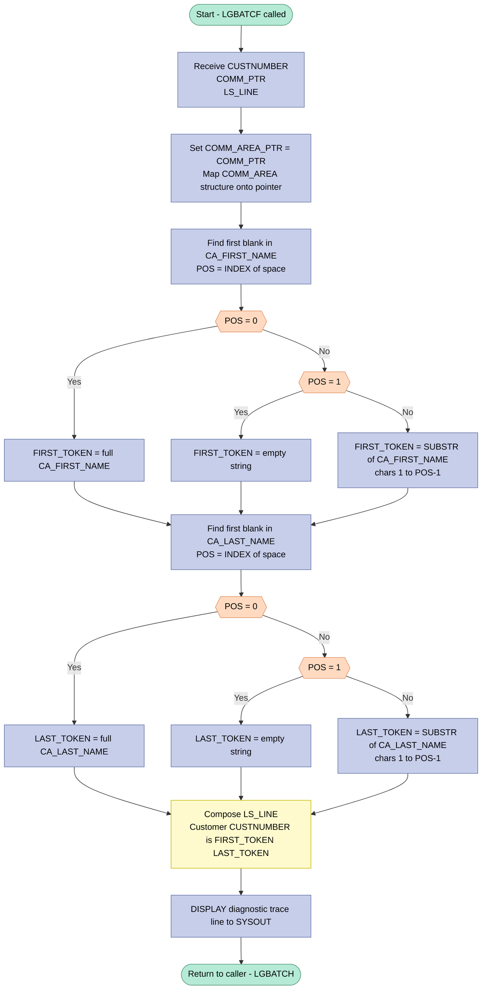

## Table of Contents

- [1. Purpose](#1-purpose)
- [2. Inputs](#2-inputs)
- [3. Outputs](#3-outputs)
- [4. Processing Logic](#4-processing-logic)
  - [4.1 Mermaid Flow Diagram](#41-mermaid-flow-diagram)
  - [4.2 Processing Logic Description](#42-processing-logic-description)
  - [4.3 Database Tables](#43-database-tables)
- [5. Paragraphs](#5-paragraphs)
- [6. Dependencies](#6-dependencies)
  - [6.1 Input Parameters](#61-input-parameters)
  - [6.2 Communication Area Structure (`LGCMAREA` Copybook)](#62-communication-area-structure-lgcmarea-copybook)
  - [6.3 Calling Program](#63-calling-program)
  - [6.4 Internal Working Variables](#64-internal-working-variables)
  - [6.5 Runtime Services](#65-runtime-services)
- [7. Constraints](#7-constraints)
  - [7.1 Input / Parameter Constraints](#71-input--parameter-constraints)
  - [7.2 Data Format and Content Constraints](#72-data-format-and-content-constraints)
  - [7.3 Output Constraints](#73-output-constraints)
  - [7.4 Sequencing and Control-Flow Constraints](#74-sequencing-and-control-flow-constraints)
  - [7.5 Structural / Storage Constraints](#75-structural--storage-constraints)
- [8. Error Handling](#8-error-handling)
  - [8.1 Implicit Boundary-Condition Handling (Explicit IF Checks on String Position)](#81-implicit-boundary-condition-handling-explicit-if-checks-on-string-position)
  - [8.2 Absence of Explicit Error Reporting or Recovery Mechanisms](#82-absence-of-explicit-error-reporting-or-recovery-mechanisms)
- [9. Examples](#9-examples)
  - [9.1 Example 1 — Standard First and Last Name (No Embedded Blanks)](#91-example-1--standard-first-and-last-name-no-embedded-blanks)
  - [9.2 Example 2 — Name Stored Without a Trailing Blank (Fills the Entire Field)](#92-example-2--name-stored-without-a-trailing-blank-fills-the-entire-field)
  - [9.3 Example 3 — First Name Field Starts With a Blank (Empty Token)](#93-example-3--first-name-field-starts-with-a-blank-empty-token)

## 1. Purpose

`LGBATCHF` is a PL/I batch subroutine that formats a single customer report line for use by the calling program `LGBATCH`. It accepts a customer number, a pointer to the `LGCMAREA` communication area containing full customer and policy data, and an 80-character output line variable. Using the communication area, it extracts the customer's first and last name by trimming each field at the first blank character, then constructs a human-readable summary string in the form `"Customer <number> is <first> <last>"` and writes it into the output line, which the caller uses to produce the batch report.

## 2. Inputs

**Procedure Parameters**

- `CUSTNUMBER` — A 10-digit numeric picture variable (`PIC '9999999999'`) passed by reference as the first procedure parameter. Supplies the customer's unique identifier, which is embedded directly into the formatted report line string.
- `COMM_PTR` — A pointer variable passed by reference as the second procedure parameter. Holds the address of the `LGCMAREA` communication area (`COMM_AREA`) structure. All customer and policy data fields are accessed through this pointer via PL/I based storage (`COMM_AREA_PTR = COMM_PTR`).
- `LS_LINE` — An 80-character variable (`CHAR(80)`) passed by reference as the third procedure parameter. Serves as the output carrier: the subroutine writes the fully formatted customer report line into this variable for the caller (`LGBATCH`) to consume.

**Communication Area Fields (accessed via `COMM_PTR` → `COMM_AREA`)**

These fields are overlaid onto the communication area through the `BASED` structure resolved from `COMM_PTR`. They represent data passed in from the calling batch program.

- `CA_REQUEST_ID` — A 6-character field encoding the type of business operation requested (e.g., `'01IMOT'`). Controls which branch of business logic is executed across the broader GenApp call chain.
- `CA_RETURN_CODE` — A 2-digit numeric picture field (`PIC '99'`) conveying the outcome status of the requested operation; `'00'` = success, `'99'` = system error.
- `CA_CUSTOMER_NUM` — A 10-digit numeric picture field (`PIC '9999999999'`) identifying the customer within the communication area, complementing the `CUSTNUMBER` parameter.
- Customer demographic fields (within `CA_CUSTOMER_REQUEST`):
  - `CA_FIRST_NAME` — A 10-character field holding the customer's first name. The subroutine extracts the token up to the first blank space for inclusion in the report line.
  - `CA_LAST_NAME` — A 20-character field holding the customer's last name. The subroutine similarly extracts the token up to the first blank space for the report line.
  - `CA_DOB` — A 10-character field storing the customer's date of birth; available in the communication area for identity and eligibility purposes.
  - `CA_POSTCODE` — An 8-character field storing the customer's postal code; available for address identification.
  - `CA_NUM_POLICIES` — A 3-digit numeric picture field (`PIC '999'`) indicating the total number of insurance policies associated with the customer.
- Policy identification and financial fields (within `CA_POLICY_REQUEST` / `CA_POLICY_COMMON`):
  - `CA_POLICY_NUM` — A 10-digit numeric picture field (`PIC '9999999999'`) uniquely identifying a specific insurance policy.
  - `CA_BROKERID` — A 10-digit numeric picture field (`PIC '9999999999'`) identifying the broker associated with a policy.
  - `CA_PAYMENT` — A 6-digit numeric picture field (`PIC '999999'`) representing the payment amount associated with an insurance policy.

## 3. Outputs

- **`LS_LINE` — Formatted Report Line (output parameter, passed by reference)**
  - An 80-character string returned to the caller (`LGBATCH`) via the by-reference parameter interface
  - Built by concatenating the literal `'Customer '`, the 10-digit customer number (`CUSTNUMBER`), the literal `' is '`, and the trimmed first and last name tokens extracted from `CA_FIRST_NAME` and `CA_LAST_NAME`
  - Serves as the single primary output of the subroutine; the caller uses this line to write the customer report

- **`DISPLAY` statement — Diagnostic Console Output**
  - Emits the message `'LGBATCHF WAS HERE... '` followed by the content of `LS_LINE` to the system operator console (SYSOUT / job log)
  - Acts as a trace/diagnostic side effect confirming the subroutine was invoked and showing the formatted line that was produced
  - Not returned to the caller; purely an observable side effect at execution time

## 4. Processing Logic

### 4.1 Mermaid Flow Diagram



---

### 4.2 Processing Logic Description

#### 4.2.1 High-level Summary

`LGBATCF` (source member `LGBATCHF`) is a **batch subroutine** of the GenApp insurance application. It has a single, focused responsibility: given a customer number and a pointer to the shared COMMAREA structure, it extracts the customer's first and last name, trims each to its first word (text before the first blank space), and assembles one 80-character report line of the form:

```
Customer 0000000042 is John Smith
```

The formatted line is returned to the caller (`LGBATCH`) via the `LS_LINE` output parameter. A diagnostic `DISPLAY` statement also writes the completed line to SYSOUT for trace purposes.

---

#### 4.2.2 Execution Flow

**Step 1 — Entry and parameter receipt**
The procedure `LGBATCF` is declared as a non-CICS subroutine (`Proc(CUSTNUMBER, COMM_PTR, LS_LINE)`) called statically from `LGBATCH`. Three parameters are received by reference:
- `CUSTNUMBER` — a 10-digit picture variable holding the customer number.
- `COMM_PTR` — a pointer to the `LGCMAREA` COMMAREA structure in the caller's storage.
- `LS_LINE` — an 80-character output variable to be filled before return.

**Step 2 — COMMAREA pointer initialisation**
```
COMM_AREA_PTR = COMM_PTR;
```
The local `COMM_AREA_PTR` is loaded from the passed `COMM_PTR`. The `COMM_AREA` based structure (included from `LGCMAREA.inc`) is then accessible via this pointer, exposing all COMMAREA fields such as `CA_FIRST_NAME` (10 chars) and `CA_LAST_NAME` (20 chars).

**Step 3 — Extract first-name token**
`POS = INDEX(CA_FIRST_NAME, ' ')` locates the position of the first blank in the 10-character first-name field. Three branches apply:
- **POS = 0** (no blank found): the entire `CA_FIRST_NAME` value is used as `FIRST_TOKEN`.
- **POS = 1** (blank is the very first character — name is empty): `FIRST_TOKEN` is set to an empty varying string `''`.
- **POS > 1** (blank found after at least one character): `FIRST_TOKEN = SUBSTR(CA_FIRST_NAME, 1, POS-1)` extracts only the leading word.

This logic mirrors the COBOL idiom `STRING field DELIMITED BY SPACE`, keeping only the significant text before any trailing blanks.

**Step 4 — Extract last-name token**
Identical three-way logic is applied to `CA_LAST_NAME` (20 chars) to produce `LAST_TOKEN`. The same rules govern whether the full field, an empty string, or the leading word is selected.

**Step 5 — Compose the output line**
```pli
LS_LINE = 'Customer ' || CUSTNUMBER || ' is ' ||
          FIRST_TOKEN || ' ' || LAST_TOKEN;
```
String concatenation (`||`) builds a single descriptive sentence. `CUSTNUMBER` (PIC 9(10)) is automatically converted to its character representation. The result is stored in the 80-character `LS_LINE` variable, which is passed back to `LGBATCH` by reference.

**Step 6 — Diagnostic display**
```pli
DISPLAY('LGBATCHF WAS HERE... ' || LS_LINE);
```
This DISPLAY statement writes the formatted line prefixed with a trace literal to the batch job's SYSOUT stream, providing a simple execution trace without requiring any additional log file.

**Step 7 — Return**
`RETURN` transfers control back to `LGBATCH`. No error codes are set because this subroutine performs no I/O or DB2 operations; it is a pure data-formatting utility.

---

#### 4.2.3 External Interactions

| Interaction | Detail |
|---|---|
| **Caller** | `LGBATCH` — the main batch program that calls `LGBATCF` via a static `CALL` statement, passing the customer number, COMMAREA pointer, and the output line variable. |
| **COMMAREA data** | The `LGCMAREA` structure (included via `%INCLUDE LGCMAREA`) provides customer name fields (`CA_FIRST_NAME`, `CA_LAST_NAME`). This data is assumed to have been populated by the caller prior to the call. |
| **SYSOUT** | The `DISPLAY` statement writes a trace message to the batch job log (DD SYSOUT). |

There are **no DB2 SQL statements, no CICS commands, no file I/O, and no MQ calls** in this subroutine.

---

#### 4.2.4 Plain Language Summary

When `LGBATCH` wants to print a line about a customer in a report, it calls `LGBATCHF` as a helper. The helper is handed the customer's number and access to the customer's details (name fields). It takes the first word of the first name and the first word of the last name — ignoring any trailing blanks — and glues them together with the customer number into a sentence like *"Customer 0000000042 is John Smith"*. That sentence is written back into the report line variable for `LGBATCH` to use. A brief trace message is also printed to the job log so operators can confirm the routine executed.

---

### 4.3 Database Tables

This subroutine performs **no direct database access**. It operates exclusively on data already present in the COMMAREA passed by its caller (`LGBATCH`). No `erDiagram` is applicable.

## 5. Paragraphs

**LGBATCF (Main Procedure Body)**

- This is the sole procedure in the subroutine. It is entered via the `LGBATCF: Proc(CUSTNUMBER, COMM_PTR, LS_LINE)` statement and exits via `RETURN`, making the entire program body a single logical unit with no internal sub-procedures or nested blocks.

- **Parameter setup and communication area binding:**
  - On entry, `COMM_AREA_PTR` is set to the value of the passed-in `COMM_PTR` pointer, anchoring all subsequent references to the `COMM_AREA` based structure onto the caller's communication area block.
  - This makes fields such as `CA_FIRST_NAME`, `CA_LAST_NAME`, and other `COMM_AREA` members directly addressable without further dereferencing.

- **First-name token extraction:**
  - `POS` is loaded with the result of `INDEX(CA_FIRST_NAME,' ')`, which locates the position of the first blank character within the 10-character `CA_FIRST_NAME` field.
  - Conditional logic branches on three cases:
    - If `POS = 0` (no blank found), the entire `CA_FIRST_NAME` value is used as `FIRST_TOKEN`.
    - If `POS = 1` (field begins with a blank), `FIRST_TOKEN` is set to an empty string, effectively treating the name as absent.
    - Otherwise, `FIRST_TOKEN` is assigned the substring from position 1 up to (but not including) the first blank, i.e., `SUBSTR(CA_FIRST_NAME, 1, POS-1)`.
  - This logic precisely replicates the COBOL `STRING ... DELIMITED BY SPACE` behaviour, as noted in the inline comment.

- **Last-name token extraction:**
  - The identical three-way conditional logic is repeated for `CA_LAST_NAME` using the same `POS` working variable.
  - The result is stored in the 20-character varying `LAST_TOKEN`.
  - Same blank-delimiting rules apply: no blank → full field; leading blank → empty; otherwise → substring up to first blank.

- **Report line construction:**
  - `LS_LINE` is assembled by concatenating the literal `'Customer '`, the 10-digit `CUSTNUMBER` picture variable, the literal `' is '`, `FIRST_TOKEN`, a single space `' '`, and `LAST_TOKEN`.
  - The resulting 80-character output string is passed back to the caller through the by-reference `LS_LINE` parameter.

- **Diagnostic display:**
  - A `DISPLAY` statement outputs the string `'LGBATCHF WAS HERE... '` concatenated with the just-built `LS_LINE` to the system console or job log, serving as a trace/debug message confirming execution of the subroutine.

- **No external system interactions** (no EXEC CICS, no EXEC SQL, no file I/O, no IMS or MQ calls) are present; all data access is purely through the in-memory based structure pointed to by `COMM_PTR`.

## 6. Dependencies

### 6.1 Input Parameters

- **CUSTNUMBER** — A 10-digit numeric picture (`PIC '9999999999'`) passed by reference from the calling program `LGBATCH`; provides the customer number used to compose the output report line.
- **COMM_PTR** — A pointer passed by reference from `LGBATCH`; holds the address of the `LGCMAREA` communication area (`COMM_AREA`) through which all customer and policy data fields are accessed via based storage.
- **LS_LINE** — An 80-character output variable passed by reference; receives the fully formatted customer report line built by this subroutine and returned to the caller.

### 6.2 Communication Area Structure (`LGCMAREA` Copybook)

- **LGCMAREA** (`%INCLUDE LGCMAREA`) — PL/I include member (`plinc/LGCMAREA.inc`) defining the `COMM_AREA` based structure; expanded inline at compile time.
  - **CA_REQUEST_ID** — 6-character field identifying the type of business request (e.g., inquiry, add, update, delete).
  - **CA_RETURN_CODE** — 2-digit numeric picture field conveying operation outcome status back to the caller.
  - **CA_CUSTOMER_NUM** — 10-digit numeric picture field carrying the customer identifier within the communication area.
  - **CA_CUSTOMER_REQUEST** structure fields:
    - **CA_FIRST_NAME** — 10-character field storing the customer's first name; used to extract the first name token for the report line.
    - **CA_LAST_NAME** — 20-character field storing the customer's last name; used to extract the last name token for the report line.
    - **CA_DOB** — 10-character field storing the customer's date of birth.
    - **CA_POSTCODE** — 8-character field storing the customer's postal code.
    - **CA_NUM_POLICIES** — 3-digit numeric picture field indicating the total number of policies associated with the customer.
  - **CA_POLICY_REQUEST** structure fields:
    - **CA_POLICY_NUM** — 10-digit numeric picture field uniquely identifying a specific insurance policy.
    - **CA_POLICY_COMMON** sub-structure fields:
      - **CA_BROKERID** — 10-digit numeric picture field storing the broker identifier associated with the policy.
      - **CA_PAYMENT** — 6-digit numeric picture field representing the payment amount for the policy.

### 6.3 Calling Program

- **LGBATCH** — The parent batch program that invokes `LGBATCF` as a subroutine, supplying all three parameters (`CUSTNUMBER`, `COMM_PTR`, `LS_LINE`) and consuming the formatted output line.

### 6.4 Internal Working Variables

- **POS** — A `FIXED BIN(15)` working variable used internally to locate the first blank character within `CA_FIRST_NAME` and `CA_LAST_NAME` for name token extraction; no external dependency.
- **FIRST_TOKEN** / **LAST_TOKEN** — `CHAR VAR` working variables used internally to stage the extracted name tokens before concatenation into `LS_LINE`; no external dependency.

### 6.5 Runtime Services

- **`DISPLAY`** — PL/I built-in runtime service used to write a diagnostic trace message (`'LGBATCHF WAS HERE... ' || LS_LINE`) to standard output or the system log at runtime.
- **`INDEX`** / **`SUBSTR`** — PL/I built-in string functions used internally for name-token parsing; resolved by the Enterprise PL/I runtime library.

## 7. Constraints

### 7.1 Input / Parameter Constraints

- **`CUSTNUMBER` must be a 10-digit numeric picture value (`PIC '9999999999'`)**
  - Declared as `PIC '9999999999'`; only digits 0–9 are valid in each position. Non-numeric content cannot be stored in a PIC variable and would cause a data exception at runtime.
  - Used directly in string concatenation to build the output report line; no additional validation is performed inside the subroutine itself — the caller (`LGBATCH`) is responsible for supplying a valid value.

- **`COMM_PTR` must be a valid, non-null pointer to a fully populated `LGCMAREA` communication area**
  - Declared as `PTR` and immediately assigned to `COMM_AREA_PTR` (line 155). The subroutine performs no null-pointer check or length guard.
  - If `COMM_PTR` is null or points to storage shorter than the `COMM_AREA` structure (up to 32,500 bytes), access to any member such as `CA_FIRST_NAME` or `CA_LAST_NAME` will cause a protection exception or produce garbage data.
  - The constraint is implicitly enforced by the calling program (`LGBATCH`), which must have previously populated the communication area before issuing the static `CALL`.

- **`LS_LINE` must be an 80-character character variable passed by reference**
  - Declared as `CHAR(80)` (line 29). The concatenated result is assigned unconditionally to `LS_LINE` (line 174–175). If the caller passes a shorter area the assignment will be truncated or cause storage overlay; the subroutine imposes no defensive check.

---

### 7.2 Data Format and Content Constraints

- **`CA_FIRST_NAME` is constrained to 10 characters (`CHAR(10)`)**
  - The field is fixed at 10 characters; any first name longer than 10 characters is silently truncated at storage time by the calling program. The subroutine treats the full 10-character field as the source for name extraction.

- **`CA_LAST_NAME` is constrained to 20 characters (`CHAR(20)`)**
  - Same truncation constraint applies; the subroutine works with at most 20 characters for the last name.

- **Name token extraction uses the first blank character as a delimiter**
  - `INDEX(CA_FIRST_NAME,' ')` and `INDEX(CA_LAST_NAME,' ')` locate the first space in each name field (lines 158, 166).
  - If no blank is found (`POS = 0`), the entire field content is used as the token — the full 10 or 20 characters including any trailing padding.
  - If the first character is a blank (`POS = 1`), the token is set to an empty string (`''`), effectively treating the name as absent.
  - If a blank is found at position > 1, only the substring up to (but not including) that blank is used (`SUBSTR(field, 1, POS-1)`).
  - This means names containing embedded spaces lose everything from the first space onward; the subroutine enforces a single-token (no-space) constraint on the usable part of each name field.

- **`CA_FIRST_NAME` and `CA_LAST_NAME` must not begin with a space if the name is to appear in the report line**
  - A leading space causes `FIRST_TOKEN` or `LAST_TOKEN` to be assigned `''`, resulting in the corresponding name portion being absent from the formatted line. No error is raised; the output simply omits the name.

---

### 7.3 Output Constraints

- **`LS_LINE` is always exactly 80 characters**
  - The assignment `LS_LINE = 'Customer ' || CUSTNUMBER || ' is ' || FIRST_TOKEN || ' ' || LAST_TOKEN` writes the entire concatenated string into a `CHAR(80)` fixed-length variable. Enterprise PL/I pads with blanks on the right or truncates on the left if the composed string is shorter or longer than 80 characters respectively.
  - The fixed prefix `'Customer '` (9 chars) plus the 10-digit `CUSTNUMBER` plus `' is '` (4 chars) accounts for 23 characters before the name tokens. With a maximum `FIRST_TOKEN` of 10 chars, one separator space, and a maximum `LAST_TOKEN` of 20 chars, the maximum composed length is 54 characters — well within the 80-character limit, so truncation of name data cannot occur.
  - The output line is unconditionally written; there is no conditional suppression even if both name tokens are empty.

- **A `DISPLAY` statement emits a diagnostic trace to SYSOUT unconditionally**
  - Line 177 always executes `DISPLAY('LGBATCHF WAS HERE... ' || LS_LINE)`. There is no flag or condition to suppress this trace output, making it a mandatory side-effect of every invocation.

---

### 7.4 Sequencing and Control-Flow Constraints

- **`COMM_AREA_PTR` must be set before any `COMM_AREA` member is accessed**
  - The based structure `COMM_AREA` is accessed only via `COMM_AREA_PTR`. The assignment `COMM_AREA_PTR = COMM_PTR` (line 155) must precede the `INDEX` calls on lines 158 and 166. This ordering is hard-coded in the source and cannot be reordered.

- **First-name extraction must complete before last-name extraction begins**
  - `POS` is a single shared `FIXED BIN(15)` work variable reused for both name fields (lines 158 and 166). The first-name logic reads and acts on `POS` (lines 158–164) before `POS` is overwritten for the last-name logic (lines 166–172). Reordering these two blocks would corrupt one of the name tokens.

- **`LS_LINE` must be constructed before `DISPLAY` is called**
  - The `DISPLAY` statement (line 177) references `LS_LINE` directly; `LS_LINE` must be fully assigned (line 174–175) before line 177 executes. This ordering is enforced by the sequential structure of the code.

- **The subroutine must be invoked via static `CALL` (not CICS LINK)**
  - The procedure is declared without `OPTIONS(MAIN)` and without any CICS scaffolding, confirming it is a linkage-convention subroutine. It has no `EXEC CICS` statements and no COMMAREA length guard; calling it via CICS LINK would bypass normal parameter passing and produce undefined behavior.

---

### 7.5 Structural / Storage Constraints

- **`COMM_AREA` union is 32,500 bytes; the pointer-based storage must cover at least this length**
  - `COMM_AREA_RAW CHAR(32500)` defines the total extent of the based structure. Any storage area shorter than 32,500 bytes that is addressed via `COMM_PTR` exposes the program to out-of-bounds access when the deeper union members are referenced by other callers of the same copybook.
  - For this subroutine specifically, only `CA_FIRST_NAME` (offset 18, 10 bytes) and `CA_LAST_NAME` (offset 28, 20 bytes) within `CA_CUSTOMER_REQUEST` are accessed, so the caller must supply at least ~48 bytes of valid storage for safe operation.

- **`POS` is `FIXED BIN(15)`, limiting the maximum addressable position to 32,767**
  - In practice the largest field searched (`CA_LAST_NAME`) is only 20 characters, so overflow is impossible. The constraint is implicitly satisfied by the field-size declarations.

## 8. Error Handling

LGBATCHF.pli is a lean batch subroutine with minimal dedicated error handling. The following mechanisms are present:

### 8.1 Implicit Boundary-Condition Handling (Explicit IF Checks on String Position)

- **First-name blank-position check:** After locating the first blank character in `CA_FIRST_NAME` via `INDEX`, the result stored in `POS` is tested for two edge cases before a substring is extracted:
  - If `POS` equals zero (no blank found at all), the entire `CA_FIRST_NAME` value is used as-is as the first token, preventing an invalid substring operation on a blank-free string.
  - If `POS` equals one (the very first character is a blank, meaning the field is effectively empty or leading-blank), the first token is set to an empty string, avoiding extraction of a zero-length or meaningless substring.
  - Only when `POS` is greater than one is a substring actually extracted, ensuring the `SUBSTR` call always receives a valid positive length argument.

- **Last-name blank-position check:** The identical three-way conditional logic is applied to `CA_LAST_NAME` using the same `POS` variable:
  - Zero position → entire field value used as the last token.
  - Position one → last token set to empty string.
  - Position greater than one → substring up to the character before the blank is extracted.
  - This guards against the same invalid-length `SUBSTR` edge cases for the surname field.

### 8.2 Absence of Explicit Error Reporting or Recovery Mechanisms

- There are no return-code checks or output status indicators; the subroutine does not set or inspect `CA_RETURN_CODE` and does not signal failure back to the caller (`LGBATCH`).
- There is no CICS or PL/I condition handling (no `ON ERROR`, `ON CONVERSION`, `ON STRINGRANGE`, or similar `ON`-unit declarations) to intercept runtime exceptions.
- There is no early `RETURN` or fallback path for anomalous input data beyond the blank-position guards described above.
- No user-facing or system-facing error messages are written; the single `DISPLAY` statement is a diagnostic trace line (echoing the formatted output line to the system console/log) rather than an error notification, and it fires unconditionally regardless of whether the input data was valid or not.
- There is no file or I/O error handling because the subroutine performs no file operations itself; all I/O resides in the calling program.

## 9. Examples

### 9.1 Example 1 — Standard First and Last Name (No Embedded Blanks)

**Input:**
| Parameter | Value |
|---|---|
| `CUSTNUMBER` | `0000000042` |
| `CA_FIRST_NAME` | `'John      '` (10 chars, blank-padded) |
| `CA_LAST_NAME` | `'Smith               '` (20 chars, blank-padded) |

**Expected Output (`LS_LINE`):**
```
Customer 0000000042 is John Smith
```
*(Remaining characters of the 80-char field are spaces.)*

**Explanation:**
`INDEX(CA_FIRST_NAME,' ')` finds the first blank at position 5, so `FIRST_TOKEN` is set to `SUBSTR('John      ',1,4)` → `'John'`. Likewise, `INDEX(CA_LAST_NAME,' ')` finds the first blank at position 6, yielding `LAST_TOKEN = 'Smith'`. The subroutine then concatenates the literal `'Customer '`, the 10-digit customer number, `' is '`, `FIRST_TOKEN`, `' '`, and `LAST_TOKEN` into `LS_LINE`.

---

### 9.2 Example 2 — Name Stored Without a Trailing Blank (Fills the Entire Field)

**Input:**
| Parameter | Value |
|---|---|
| `CUSTNUMBER` | `0000001234` |
| `CA_FIRST_NAME` | `'Jacqueline'` (exactly 10 chars, no blank at all) |
| `CA_LAST_NAME` | `'Vandenberghe'` (truncated to 20 chars, no blank present) |

**Expected Output (`LS_LINE`):**
```
Customer 0000001234 is Jacqueline Vandenberghe
```

**Explanation:**
`INDEX` returns `0` for both fields because no blank character exists. Both `POS = 0` branches fire, so `FIRST_TOKEN = CA_FIRST_NAME` (full 10-char value) and `LAST_TOKEN = CA_LAST_NAME` (full 20-char value). The concatenation proceeds as in Example 1.

---

### 9.3 Example 3 — First Name Field Starts With a Blank (Empty Token)

**Input:**
| Parameter | Value |
|---|---|
| `CUSTNUMBER` | `0000009999` |
| `CA_FIRST_NAME` | `' J        '` (first character is a blank) |
| `CA_LAST_NAME` | `'Doe                 '` |

**Expected Output (`LS_LINE`):**
```
Customer 0000009999 is  Doe
```
*(Note the double space between `'is'` and `'Doe'` because `FIRST_TOKEN` is empty.)*

**Explanation:**
`INDEX(CA_FIRST_NAME,' ')` returns `1` because the very first character is a blank. The `POS = 1` branch sets `FIRST_TOKEN = ''` (empty varying string). `CA_LAST_NAME` starts with `'D'` so `LAST_TOKEN = 'Doe'` normally. The final concatenation produces `'Customer 0000009999 is  Doe'` — the extra space comes from the literal `' '` separator between `FIRST_TOKEN` and `LAST_TOKEN`.

---

Generated by IBM Bob Premium Package for Z
