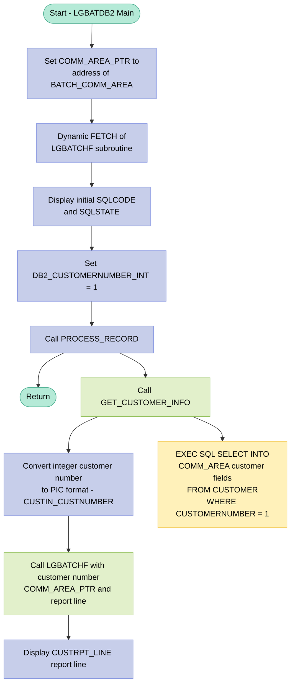
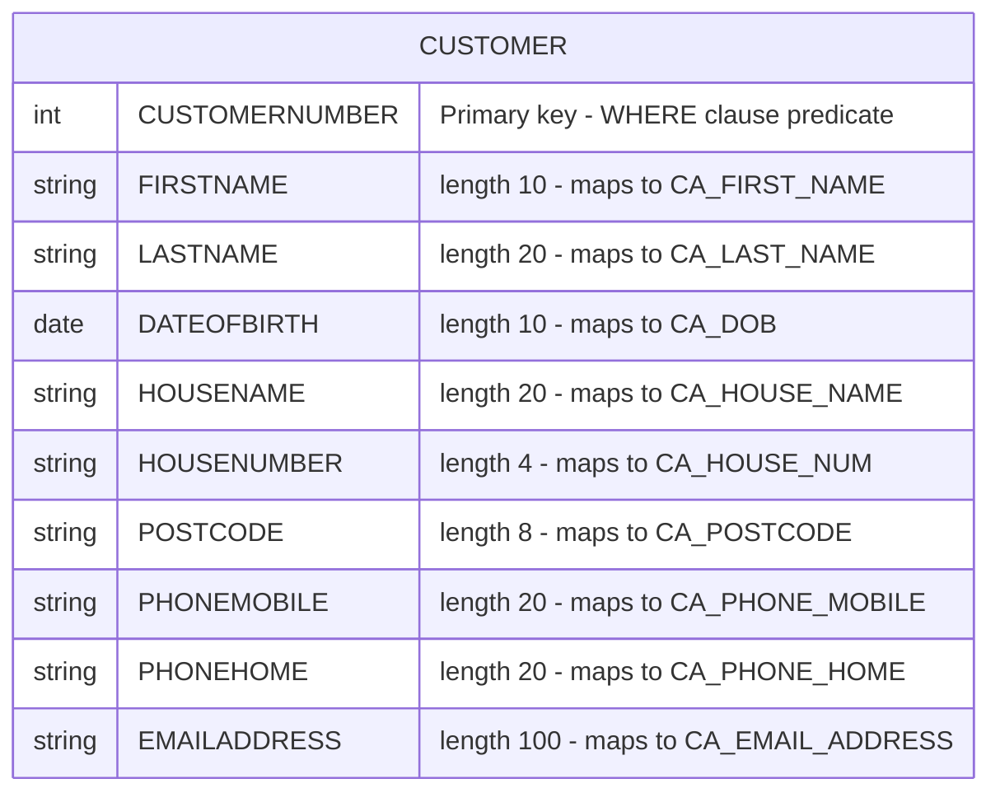

## Table of Contents

- [1. Purpose](#1-purpose)
- [2. Inputs](#2-inputs)
- [3. Outputs](#3-outputs)
  - [3.1 Console output](#31-console-output)
  - [3.2 Database-read-derived output content](#32-database-read-derived-output-content)
  - [3.3 Subprogram-call output](#33-subprogram-call-output)
  - [3.4 Interface/output-driving input values](#34-interfaceoutput-driving-input-values)
  - [3.5 Other observable side effects](#35-other-observable-side-effects)
- [4. Processing Logic](#4-processing-logic)
  - [4.1 Mermaid Flow Diagram](#41-mermaid-flow-diagram)
  - [4.2 Processing Logic Description](#42-processing-logic-description)
  - [4.3 Database Tables](#43-database-tables)
- [5. Paragraphs](#5-paragraphs)
- [6. Dependencies](#6-dependencies)
  - [6.1 DB2 Database](#61-db2-database)
  - [6.2 External Programs / Subroutines](#62-external-programs--subroutines)
  - [6.3 Include Members / Copybooks](#63-include-members--copybooks)
  - [6.4 Internal Data / Hardcoded Input](#64-internal-data--hardcoded-input)
- [7. Constraints](#7-constraints)
  - [7.1 Data Validation Constraints](#71-data-validation-constraints)
  - [7.2 Sequencing and Execution Order Constraints](#72-sequencing-and-execution-order-constraints)
  - [7.3 Resource and Scope Constraints](#73-resource-and-scope-constraints)
  - [7.4 DB2 Query Constraints](#74-db2-query-constraints)
- [8. Error Handling](#8-error-handling)
  - [8.1 DB2 SQL Error Visibility via SQLCA](#81-db2-sql-error-visibility-via-sqlca)
  - [8.2 Diagnostic Output](#82-diagnostic-output)
  - [8.3 Structural Absence of Error Handling](#83-structural-absence-of-error-handling)
- [9. Examples](#9-examples)
  - [9.1 Example 1 — Successful Customer Lookup and Report Line Display](#91-example-1--successful-customer-lookup-and-report-line-display)
  - [9.2 Example 2 — Customer Number Not Found in DB2](#92-example-2--customer-number-not-found-in-db2)

## 1. Purpose

`LGBATDB2` is a batch (non-CICS) PL/I test driver program that retrieves a specific customer's details from a DB2 database and produces a formatted customer report line. It queries the `CUSTOMER` table for the record with customer number 1, populating a shared communication area with personal details such as name, date of birth, address, phone, and email. It then delegates report formatting to the external subroutine `LGBATCHF`, passing the customer number and communication area pointer, and displays the resulting 80-character report line to standard output.

## 2. Inputs

**DB2 Database (CUSTOMER table)**
- `DB2_CUSTOMERNUMBER_INT` — Hard-coded integer value (`1`) used as the `WHERE CUSTOMERNUMBER = :DB2_CUSTOMERNUMBER_INT` predicate in the `SELECT` against the DB2 `CUSTOMER` table; drives which customer record is fetched
- Fields populated via `SELECT INTO` from the `CUSTOMER` table:
  - `CA_FIRST_NAME` — Customer's first name retrieved from the `FIRSTNAME` column
  - `CA_LAST_NAME` — Customer's last name retrieved from the `LASTNAME` column
  - `CA_DOB` — Customer's date of birth retrieved from the `DATEOFBIRTH` column
  - `CA_POSTCODE` — Customer's postcode retrieved from the `POSTCODE` column
  - `CA_PHONE_MOBILE` — Customer's mobile phone number retrieved from the `PHONEMOBILE` column
  - `CA_EMAIL_ADDRESS` — Customer's email address retrieved from the `EMAILADDRESS` column

**External Subroutine (`LGBATCHF`)**
- `CUSTRPT_LINE` — 80-byte character buffer passed by reference to `LGBATCHF`; on return it contains the formatted customer report line produced by the subroutine, which the program then displays
- `CUSTIN_CUSTNUMBER` — 10-digit picture variable derived from `DB2_CUSTOMERNUMBER_INT` and passed as the customer number argument to `LGBATCHF`, identifying which customer to report on
- `COMM_AREA_PTR` — Pointer to `BATCH_COMM_AREA` passed to `LGBATCHF`; the subroutine reads customer fields (populated from DB2) through this pointer, using the overlaid `COMM_AREA` structure to access `CA_FIRST_NAME`, `CA_LAST_NAME`, `CA_DOB`, `CA_POSTCODE`, `CA_PHONE_MOBILE`, `CA_EMAIL_ADDRESS`, `CA_NUM_POLICIES`, `CA_PAYMENT`, `CA_ISSUE_DATE`, and `CA_EXPIRY_DATE`

## 3. Outputs

### 3.1 Console output
- `DISPLAY('LGBATDB2 SQLCode : ' || SQLCODE)`
  - Prints the DB2 SQL return code at program startup.
  - Role:
    - Exposes the current SQL execution status for diagnostics.
    - Provides an observable batch log message.

- `DISPLAY('LGBATDB2 SQLState: ' || SQLSTATE)`
  - Prints the DB2 SQLSTATE at program startup.
  - Role:
    - Exposes DB2 status in standard SQLSTATE form.
    - Provides an observable batch log message.

- `DISPLAY(CUSTRPT_LINE)`
  - Prints the formatted customer report line returned from subroutine `LGBATCHF`.
  - Role:
    - This is the program’s main business output.
    - Presents the selected customer’s report data to the batch job output stream.

### 3.2 Database-read-derived output content
- Customer data fetched from DB2 `CUSTOMER` table
  - Variables populated by the `SELECT ... INTO` and used as output-driving data:
    - `CA_FIRST_NAME`
    - `CA_LAST_NAME`
    - `CA_DOB`
    - `CA_POSTCODE`
    - `CA_PHONE_MOBILE`
    - `CA_EMAIL_ADDRESS`
    - `CA_HOUSE_NAME`
    - `CA_HOUSE_NUM`
    - `CA_PHONE_HOME`
  - Role:
    - These fields are the retrieved customer attributes for customer number `1`.
    - They populate the communication area passed to `LGBATCHF`.
    - They indirectly determine the contents of the printed report line.

### 3.3 Subprogram-call output
- `CUSTRPT_LINE`
  - Filled by `CALL LGBATCHF(CUSTIN_CUSTNUMBER, COMM_AREA_PTR, CUSTRPT_LINE)`.
  - Role:
    - Receives the formatted 80-byte report output for the customer.
    - Serves as the immediate source for the final printed customer report.

### 3.4 Interface/output-driving input values
- Customer identification values
  - `DB2_CUSTOMERNUMBER_INT`
    - Set to `1` and used in the DB2 `WHERE CUSTOMERNUMBER = :DB2_CUSTOMERNUMBER_INT`.
    - Role:
      - Determines which customer record is retrieved from DB2.
      - Therefore determines all downstream observable output content.
  - `CUSTIN_CUSTNUMBER`
    - Derived from `DB2_CUSTOMERNUMBER_INT` and passed to `LGBATCHF`.
    - Role:
      - Identifies the customer to the reporting subroutine in display format.
      - Contributes to how the report line is built.

- Communication area passed to `LGBATCHF`
  - `BATCH_COMM_AREA` / `COMM_AREA_PTR`
    - Holds the customer data structure populated from DB2 and passed by pointer.
    - Role:
      - Carries the fetched customer details into `LGBATCHF`.
      - Indirectly drives the report line content.

### 3.5 Other observable side effects
- DB2 `SELECT` against `CUSTOMER`
  - Reads one customer row for customer number `1`.
  - Role:
    - Produces the business data used by the report.
    - Observable as a database access side effect, though it does not update the database.

- No file writes, database updates, or API outputs
  - The program does not write to files, update DB2 tables, or invoke external APIs for output.
  - Observable outputs are limited to:
    - DB2 status messages
    - the displayed customer report line

## 4. Processing Logic

### 4.1 Mermaid Flow Diagram



---

### 4.2 Processing Logic Description

#### 4.2.1 High-level Summary

`LGBATDB2` is a non-CICS batch DB2 test driver program. Its sole purpose is to retrieve the record for customer number **1** from the DB2 `CUSTOMER` table, pass the retrieved data to the `LGBATCHF` subroutine to format a report line, and then display that report line to standard output. It exercises the DB2-to-batch-report pipeline without any CICS infrastructure.

---

#### 4.2.2 Execution Flow

**Step 1 — Program Initialization**
The program entry point `LGBATDB2: Proc Options(Main)` begins execution. A 32,500-byte working character area (`BATCH_COMM_AREA`) is declared as physical storage. The `COMM_AREA_PTR` pointer is immediately set to the address of `BATCH_COMM_AREA`, causing the `COMM_AREA` `BASED` structure (the full COMMAREA layout including customer and policy fields) to overlay that storage. This is the standard GenApp COMMAREA pattern adapted for batch use.

**Step 2 — Dynamic Load of LGBATCHF**
A `FETCH LGBATCHF` statement dynamically loads the `LGBATCHF` subroutine into memory. `LGBATCHF` is declared as an `ENTRY` accepting a 10-digit PIC customer number, a pointer to the COMMAREA, and an 80-byte character report line output buffer.

**Step 3 — Initial Diagnostics Display**
The current values of `SQLCODE` and `SQLSTATE` from the SQLCA are displayed. At this point no SQL has been executed, so this serves as an initial baseline diagnostic to confirm the DB2 environment is properly connected and the SQLCA has been initialized.

**Step 4 — Set Target Customer Number**
`DB2_CUSTOMERNUMBER_INT` is set to `1`. This hard-coded integer is the DB2 host variable that will be used in the `WHERE` clause of the SQL query — meaning this program always processes customer number 1.

**Step 5 — Call PROCESS_RECORD**
The `PROCESS_RECORD` internal procedure is called. It orchestrates three sub-steps:

- **5a — GET_CUSTOMER_INFO:** Executes a DB2 `SELECT INTO` statement, fetching nine columns (`FIRSTNAME`, `LASTNAME`, `DATEOFBIRTH`, `HOUSENAME`, `HOUSENUMBER`, `POSTCODE`, `PHONEMOBILE`, `PHONEHOME`, `EMAILADDRESS`) from the `CUSTOMER` table where `CUSTOMERNUMBER = 1`. The results are placed directly into the COMMAREA host variable fields (`CA_FIRST_NAME`, `CA_LAST_NAME`, `CA_DOB`, `CA_HOUSE_NAME`, `CA_HOUSE_NUM`, `CA_POSTCODE`, `CA_PHONE_MOBILE`, `CA_PHONE_HOME`, `CA_EMAIL_ADDRESS`).

- **5b — Convert Customer Number Format:** `DB2_CUSTOMERNUMBER_INT` (a `FIXED BIN(31)` integer) is converted to `CUSTIN_CUSTNUMBER` (a `PIC '9999999999'` display-format variable). This conversion is necessary because `LGBATCHF` expects the customer number as a PIC numeric, not a binary integer.

- **5c — Call LGBATCHF:** The dynamically loaded `LGBATCHF` subroutine is called with the PIC customer number, the COMMAREA pointer (now populated with DB2 data), and an 80-byte output buffer `CUSTRPT_LINE`. `LGBATCHF` is responsible for formatting the customer data into a printable report line.

**Step 6 — Display Report Line**
The 80-byte `CUSTRPT_LINE` returned by `LGBATCHF` is displayed to standard output (SYSOUT).

**Step 7 — Return**
The program issues an explicit `RETURN` statement and terminates cleanly.

---

#### 4.2.3 Error Handling

This program has **no explicit SQL error handling**. There is no check of `SQLCODE` after the `SELECT INTO`. If the customer is not found (`SQLCODE = +100`) or a DB2 error occurs (negative `SQLCODE`), the program will continue with unpopulated or stale COMMAREA fields and pass them to `LGBATCHF` without signaling an error. The initial `DISPLAY` of `SQLCODE`/`SQLSTATE` is diagnostic only and does not gate further processing.

---

#### 4.2.4 External Interactions

| Interaction | Type | Purpose |
|---|---|---|
| `CUSTOMER` DB2 table | SQL `SELECT INTO` | Retrieves nine customer demographic fields for customer number 1 |
| `LGBATCHF` subroutine | Dynamic `FETCH` + `CALL` | Formats the retrieved customer data into an 80-byte report line |
| Standard output (`DISPLAY`) | Console/SYSOUT | Outputs SQLCA diagnostics and the final report line |

---

#### 4.2.5 Plain Language Summary

This program is a simple batch test tool. It connects to DB2, looks up the first customer in the system (customer number 1), reads their personal details (name, address, phone, email, date of birth), and hands that information to a formatting helper called `LGBATCHF`. That helper builds a neat 80-character report line, which the program then prints. The program always runs against the same fixed customer (number 1) and is designed for testing and verification purposes rather than production batch processing.

---

### 4.3 Database Tables



## 5. Paragraphs

**LGBATDB2 (Main Procedure)**
- This is the program's entry point, declared with `Options(Main)`, making it the executable starting point for the batch run.
- Establishes the communication area pointer by assigning `COMM_AREA_PTR` to the address of `BATCH_COMM_AREA` via `ADDR()`, causing the `COMM_AREA` `BASED` structure to overlay that 32,500-byte character buffer. This enables all downstream field references through `COMM_AREA` to operate directly against `BATCH_COMM_AREA` storage.
- Dynamically loads the external subroutine `LGBATCHF` using the `FETCH` statement, making it available for subsequent calls without static linking at compile time.
- Displays initial DB2 diagnostic values (`SQLCODE` and `SQLSTATE`) to confirm the state of the SQL environment at program startup.
- Sets the integer host variable `DB2_CUSTOMERNUMBER_INT` to `1`, targeting customer record number 1 for processing.
- Invokes the internal procedure `PROCESS_RECORD` to drive the main processing logic.
- Issues a `RETURN` to terminate the program after processing is complete.
- No looping is present; the program processes exactly one customer per execution.

**PROCESS_RECORD**
- An internal procedure that orchestrates the full processing sequence for a single customer record.
- Calls `GET_CUSTOMER_INFO` to retrieve the customer's details from DB2 into the `COMM_AREA` structure fields.
- After the DB2 retrieval, converts the integer customer number `DB2_CUSTOMERNUMBER_INT` into the picture-format variable `CUSTIN_CUSTNUMBER` using a direct assignment, making it compatible with the `LGBATCHF` subroutine's expected parameter type.
- Calls the dynamically fetched external subroutine `LGBATCHF`, passing three arguments:
  - `CUSTIN_CUSTNUMBER` — the 10-digit picture customer number
  - `COMM_AREA_PTR` — a pointer to the communication area containing the retrieved customer data
  - `CUSTRPT_LINE` — an 80-byte character buffer to receive the formatted report line
- Displays the populated `CUSTRPT_LINE` to standard output using `DISPLAY`, producing the batch customer report output.
- Control flow is linear; there are no conditionals or loops within this procedure.

**GET_CUSTOMER_INFO**
- An internal procedure responsible for retrieving a single customer's details from the DB2 `CUSTOMER` table.
- Executes a single `EXEC SQL SELECT INTO` statement that fetches nine columns — `FIRSTNAME`, `LASTNAME`, `DATEOFBIRTH`, `HOUSENAME`, `HOUSENUMBER`, `POSTCODE`, `PHONEMOBILE`, `PHONEHOME`, and `EMAILADDRESS` — directly into the corresponding `COMM_AREA` host variables:
  - `:CA_FIRST_NAME`, `:CA_LAST_NAME`, `:CA_DOB`, `:CA_HOUSE_NAME`, `:CA_HOUSE_NUM`, `:CA_POSTCODE`, `:CA_PHONE_MOBILE`, `:CA_PHONE_HOME`, `:CA_EMAIL_ADDRESS`
- The `WHERE` clause filters the result to the single row where `CUSTOMERNUMBER` equals the integer host variable `:DB2_CUSTOMERNUMBER_INT`, which is set to `1` in the main procedure.
- Because the `COMM_AREA` structure is `BASED` on `COMM_AREA_PTR` (which points to `BATCH_COMM_AREA`), the fetched values are written directly into the shared communication area buffer, making them immediately available to the calling procedure and subsequently to `LGBATCHF`.
- No explicit SQL error handling (e.g., `WHENEVER` clauses or `SQLCODE` checks) is present within this procedure; error diagnosis relies on the `SQLCODE`/`SQLSTATE` display performed at program startup in the main procedure body.
- Control flow is unconditional; the procedure performs exactly one DB2 read per invocation.

## 6. Dependencies

### 6.1 DB2 Database

- **CUSTOMER table** — The primary data source for the program. A `SELECT INTO` statement retrieves the following columns for a given customer number:
  - `FIRSTNAME` → mapped to `CA_FIRST_NAME`
  - `LASTNAME` → mapped to `CA_LAST_NAME`
  - `DATEOFBIRTH` → mapped to `CA_DOB`
  - `HOUSENAME` → mapped to `CA_HOUSE_NAME`
  - `HOUSENUMBER` → mapped to `CA_HOUSE_NUM`
  - `POSTCODE` → mapped to `CA_POSTCODE`
  - `PHONEMOBILE` → mapped to `CA_PHONE_MOBILE`
  - `PHONEHOME` → mapped to `CA_PHONE_HOME`
  - `EMAILADDRESS` → mapped to `CA_EMAIL_ADDRESS`
  - The `WHERE` predicate is `CUSTOMERNUMBER = :DB2_CUSTOMERNUMBER_INT` (hardcoded to `1` at runtime)

- **SQLCA (SQL Communication Area)** — Included via `EXEC SQL INCLUDE SQLCA`. Provides the standard DB2 feedback fields `SQLCODE` and `SQLSTATE`, which are checked and displayed after DB2 operations to report execution status.

### 6.2 External Programs / Subroutines

- **LGBATCHF** — An external subroutine declared as `ENTRY(PIC '9999999999', PTR, CHAR(80))` and dynamically loaded via `FETCH LGBATCHF`. It is called with three arguments:
  - `CUSTIN_CUSTNUMBER` — the customer number in display (picture) format
  - `COMM_AREA_PTR` — a pointer to the communication area holding the customer data retrieved from DB2
  - `CUSTRPT_LINE` — an 80-byte character buffer that receives the formatted customer report line produced by the subroutine

### 6.3 Include Members / Copybooks

- **LGCMAREA** (include member `LGCMAREA.inc`) — Defines the `COMM_AREA` structure (`BASED` on `COMM_AREA_PTR`) that overlays `BATCH_COMM_AREA`. It contains the full communication area layout covering:
  - Customer request fields (`CA_REQUEST_ID`, `CA_CUSTOMER_NUM`, `CA_FIRST_NAME`, `CA_LAST_NAME`, `CA_DOB`, `CA_POSTCODE`, `CA_NUM_POLICIES`, `CA_PHONE_MOBILE`, `CA_EMAIL_ADDRESS`, etc.)
  - Policy request fields common across all policy types (`CA_ISSUE_DATE`, `CA_EXPIRY_DATE`, `CA_PAYMENT`, etc.)
  - Policy-type-specific unions: endowment (`CA_ENDOWMENT`), house (`CA_HOUSE`), motor (`CA_MOTOR`), commercial (`CA_COMMERCIAL`), and claim (`CA_CLAIM`)
  - Customer security request fields (`CA_CUSTSECR_REQUEST`)

### 6.4 Internal Data / Hardcoded Input

- **Customer number = 1** — The value `DB2_CUSTOMERNUMBER_INT = 1` is hardcoded in the mainline logic. There is no external input file or parameter; the program always processes the single customer with `CUSTOMERNUMBER = 1`.

## 7. Constraints

### 7.1 Data Validation Constraints

**Customer Number**
- `DB2_CUSTOMERNUMBER_INT` is declared as `FIXED BIN(31)`, constraining the customer number to a signed 31-bit integer value range (0 to 2,147,483,647); it is hard-coded to `1` at runtime, meaning only customer number 1 is ever processed in this program
- `CUSTIN_CUSTNUMBER` is declared as `PIC '9999999999'` (10-digit numeric picture), restricting the display form of the customer number to exactly 10 decimal digits (0000000001 to 9999999999); non-numeric characters are structurally disallowed by the picture clause
- The conversion from `DB2_CUSTOMERNUMBER_INT` (integer) to `CUSTIN_CUSTNUMBER` (picture numeric) at line 171 enforces that the integer value must be representable as a 10-digit unsigned decimal; values exceeding 9,999,999,999 would cause a conversion error

**Communication Area (COMMAREA) Structure**
- `BATCH_COMM_AREA` is fixed at exactly 32,500 bytes (`CHAR(32500)`); the overlaid `COMM_AREA` structure must fit entirely within this 32,500-byte boundary — any field reference beyond this limit is structurally invalid
- `CA_REQUEST_ID` is limited to 6 characters; request type codes must conform to this fixed-width format
- `CA_RETURN_CODE` is declared `PIC '99'`, restricting it to exactly 2 decimal digits (values 00–99); only specific codes such as `00` (success), `98` (bad COMMAREA), and `99` (DB2/system error) are meaningful per application convention
- `CA_CUSTOMER_NUM` is `PIC '9999999999'`, constraining the COMMAREA customer number to exactly 10 decimal digits; non-numeric content cannot be represented
- `CA_NUM_POLICIES` is `PIC '999'`, restricting the policy count to a maximum of 999 policies per customer

**Customer Report Line**
- `CUSTRPT_LINE` is fixed at exactly 80 characters (`CHAR(80)`); the formatted output line produced by `LGBATCHF` must fit within 80 characters — content exceeding this width is truncated or not accommodated by the receiving field

**DB2 Host Variable Field Lengths**
- `CA_FIRST_NAME` is 10 bytes; any `FIRSTNAME` value from the `CUSTOMER` table exceeding 10 characters will be truncated on retrieval
- `CA_LAST_NAME` is 20 bytes; `LASTNAME` values beyond 20 characters will be truncated
- `CA_DOB` is 10 bytes; `DATEOFBIRTH` must fit within 10 characters (matching a date format such as `YYYY-MM-DD`)
- `CA_HOUSE_NAME` is 20 bytes; `HOUSENAME` values beyond 20 characters will be truncated
- `CA_HOUSE_NUM` is 4 bytes; `HOUSENUMBER` values beyond 4 characters will be truncated
- `CA_POSTCODE` is 8 bytes; `POSTCODE` values must fit within 8 characters
- `CA_PHONE_MOBILE` is 20 bytes; `PHONEMOBILE` values beyond 20 characters will be truncated
- `CA_PHONE_HOME` is 20 bytes; `PHONEHOME` values beyond 20 characters will be truncated
- `CA_EMAIL_ADDRESS` is 100 bytes; `EMAILADDRESS` values beyond 100 characters will be truncated

---

### 7.2 Sequencing and Execution Order Constraints

- `COMM_AREA_PTR` must be assigned to the address of `BATCH_COMM_AREA` (line 155) before any reference to `COMM_AREA` based-structure fields; accessing `COMM_AREA` fields prior to this pointer assignment yields undefined/invalid data because the structure is `BASED(COMM_AREA_PTR)`
- `LGBATCHF` must be loaded via `FETCH` (line 156) before `CALL LGBATCHF(...)` is invoked inside `PROCESS_RECORD`; invoking the `CALL` without a prior successful `FETCH` would result in an unresolved entry reference and program failure
- `GET_CUSTOMER_INFO` must be called before `CUSTIN_CUSTNUMBER` is converted and passed to `LGBATCHF`; the COMMAREA fields (`CA_FIRST_NAME`, `CA_LAST_NAME`, etc.) are only populated after the DB2 `SELECT INTO` completes — calling `LGBATCHF` before the DB2 retrieval would pass uninitialised customer data
- `PROCESS_RECORD` must be called after `DB2_CUSTOMERNUMBER_INT` is set to `1` (line 161–162); the `WHERE CUSTOMERNUMBER = :DB2_CUSTOMERNUMBER_INT` predicate depends on this initialisation

---

### 7.3 Resource and Scope Constraints

- The program is a non-CICS batch program (`Options(Main)` with no COMMAREA parameter); it cannot be invoked as a CICS transaction and has no access to CICS services such as `EXEC CICS LINK`, `EXEC CICS RETURN`, or CICS TS queues
- Only a single customer record is ever processed per execution — `DB2_CUSTOMERNUMBER_INT` is hard-coded to `1` and there is no loop, cursor, or iteration mechanism; the program is structurally limited to one DB2 row and one report line per run
- The `COMM_AREA` union overlays `BATCH_COMM_AREA`; only one of the union alternatives (`CA_CUSTOMER_REQUEST`, `CA_POLICY_REQUEST`, `CA_CUSTSECR_REQUEST`) can hold valid data at any time — simultaneous use of multiple union branches for different data types is mutually exclusive and would corrupt the overlapping storage
- The `CA_POLICY_DATA` field within `CA_CUSTOMER_REQUEST` occupies 32,267 bytes; combined with the preceding customer fields it must not exceed the 32,482-byte `CA_REQUEST_INITIALISER` boundary, which in turn must fit within the 32,500-byte `BATCH_COMM_AREA`

---

### 7.4 DB2 Query Constraints

- The `SELECT INTO` statement at `GET_CUSTOMER_INFO` retrieves exactly one row; DB2 enforces this implicitly — if the `CUSTOMER` table contains no row with `CUSTOMERNUMBER = 1`, DB2 sets `SQLCODE = +100` (not found) and the host variable fields remain unpopulated; the program does not check `SQLCODE` after the query and therefore proceeds to call `LGBATCHF` with uninitialised COMMAREA data in this condition
- The `WHERE CUSTOMERNUMBER = :DB2_CUSTOMERNUMBER_INT` predicate uses the integer host variable directly; the `CUSTOMER` table's `CUSTOMERNUMBER` column must be of a compatible integer type for the predicate to resolve correctly — a type mismatch would cause a DB2 bind or runtime error
- The `SELECT INTO` retrieves exactly the 9 columns listed; no other columns from the `CUSTOMER` table (e.g., policy counts, status flags) are fetched into the COMMAREA, meaning those fields remain at their default/initialised values

## 8. Error Handling

### 8.1 DB2 SQL Error Visibility via SQLCA

- **SQLCA inclusion** — The program includes the SQL Communication Area (SQLCA) via `EXEC SQL INCLUDE SQLCA`, which causes DB2 to automatically populate the `SQLCODE` and `SQLSTATE` fields after every SQL statement executes. These fields reflect whether the preceding SQL operation succeeded, encountered a warning, or failed.

- **Post-initialization display of SQLCA fields** — Immediately after the program starts (before any business logic executes), it displays both `SQLCODE` and `SQLSTATE` to the system output using `DISPLAY` statements. This provides a diagnostic snapshot of the DB2 connection state at program startup. A `SQLCODE` of zero indicates success; a positive value indicates a warning; a negative value indicates a DB2 error. `SQLSTATE` provides a standard five-character code with similar semantics.

- **Absence of SQL error branching logic** — The program does **not** inspect `SQLCODE` or `SQLSTATE` after the `EXEC SQL SELECT INTO` statement inside the `GET_CUSTOMER_INFO` procedure. There is no conditional branch, error message, or early termination triggered by a non-zero `SQLCODE`. If the `SELECT` fails (e.g., the customer row is not found, resulting in `SQLCODE +100`), or encounters a DB2 error (negative `SQLCODE`), execution continues silently into the report-formatting call without any corrective action or notification.

### 8.2 Diagnostic Output

- **Startup SQLCA display** — As noted above, `SQLCODE` and `SQLSTATE` are written to the program's output stream at startup using `DISPLAY`. This is a passive diagnostic mechanism; it does not gate program flow or trigger any response to error conditions. Its purpose is to assist in post-execution analysis if problems arise.

- **Report line display** — After calling the `LGBATCHF` subroutine, the formatted customer report line stored in `CUSTRPT_LINE` is written to output via `DISPLAY`. While this is not an error handler in itself, any failure upstream (such as a DB2 `SELECT` that returned no rows) would result in an empty or uninitialized report line being displayed without any accompanying error indication.

### 8.3 Structural Absence of Error Handling

- **No explicit return code checks** — `CA_RETURN_CODE` is declared within the `COMM_AREA` structure (as part of the included LGCMAREA copybook), but the program never checks it after calling `LGBATCHF`. If the subroutine sets a non-zero return code to signal failure, the batch driver ignores it.

- **No exception or condition handlers** — The program declares no `ON` condition handlers (e.g., for `ERROR`, `CONVERSION`, or `ZERODIVIDE` conditions). Any PL/I runtime exception raised during execution would propagate to the default system handler, typically causing an abnormal termination with a dump rather than a controlled recovery.

- **No file I/O error handling** — The program performs no direct file operations; all data access is through DB2. There are therefore no file status checks, `AT END` conditions, or I/O error branches present.

- **No retry or fallback logic** — There is no retry mechanism for the DB2 query, no default value population in the event of a failed `SELECT`, and no alternate execution path if `LGBATCHF` is unavailable or returns an unexpected result.

## 9. Examples

### 9.1 Example 1 — Successful Customer Lookup and Report Line Display

**Input (DB2 CUSTOMER table — row with `CUSTOMERNUMBER = 1`):**

| Column | Value |
|---|---|
| `CUSTOMERNUMBER` | `1` |
| `FIRSTNAME` | `John` |
| `LASTNAME` | `Smith` |
| `DATEOFBIRTH` | `1975-06-15` |
| `HOUSENAME` | `Maple House` |
| `HOUSENUMBER` | `42` |
| `POSTCODE` | `SW1A 1AA` |
| `PHONEMOBILE` | `07700900000` |
| `PHONEHOME` | `02071234567` |
| `EMAILADDRESS` | `john.smith@example.com` |

**Program execution flow:**
1. `DB2_CUSTOMERNUMBER_INT` is hard-coded to `1`.
2. `GET_CUSTOMER_INFO` issues the `SELECT INTO` against `CUSTOMER WHERE CUSTOMERNUMBER = 1`, populating the `COMM_AREA` fields (`CA_FIRST_NAME`, `CA_LAST_NAME`, `CA_DOB`, `CA_POSTCODE`, `CA_PHONE_MOBILE`, `CA_EMAIL_ADDRESS`, etc.).
3. `CUSTIN_CUSTNUMBER` is assigned the integer value `1` converted to its 10-digit picture format (`0000000001`).
4. `LGBATCHF` is called with `CUSTIN_CUSTNUMBER`, `COMM_AREA_PTR`, and the 80-byte `CUSTRPT_LINE` output buffer.

**Expected output (written to SYSPRINT/console via `DISPLAY`):**
```
LGBATDB2 SQLCode : 0
LGBATDB2 SQLState: 00000
John      Smith               1975-06-15  SW1A 1AA  john.smith@example.com
```
*(The exact format of the last line is determined by `LGBATCHF`, but it contains the customer details retrieved from DB2, formatted into 80 characters.)*

---

### 9.2 Example 2 — Customer Number Not Found in DB2

**Input:** The `CUSTOMER` table contains no row with `CUSTOMERNUMBER = 1` (table is empty or the row has been deleted).

**Program execution flow:**
1. `DB2_CUSTOMERNUMBER_INT` is set to `1`.
2. `GET_CUSTOMER_INFO` executes the `SELECT INTO`; DB2 finds no matching row and sets `SQLCODE = +100` (row not found) and `SQLSTATE = '02000'`.
3. The program does **not** check `SQLCODE` before continuing — it proceeds to convert `DB2_CUSTOMERNUMBER_INT` to `CUSTIN_CUSTNUMBER` and calls `LGBATCHF` with uninitialised / blank `COMM_AREA` customer fields.

**Expected output:**
```
LGBATDB2 SQLCode : 100
LGBATDB2 SQLState: 02000
                                                                                
```
*(The `DISPLAY` of `SQLCODE`/`SQLSTATE` reflects the not-found condition. The `CUSTRPT_LINE` output from `LGBATCHF` will contain spaces or default values because the `COMM_AREA` customer fields were never populated by DB2.)*

This example highlights a key behavioral characteristic of the program: there is **no error-handling guard** after `GET_CUSTOMER_INFO`, so `LGBATCHF` is always called regardless of whether the DB2 `SELECT` succeeded.

---

Generated by IBM Bob Premium Package for Z
