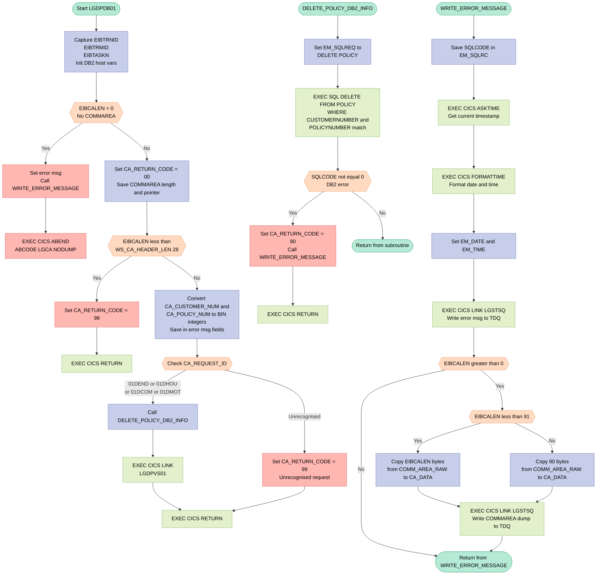
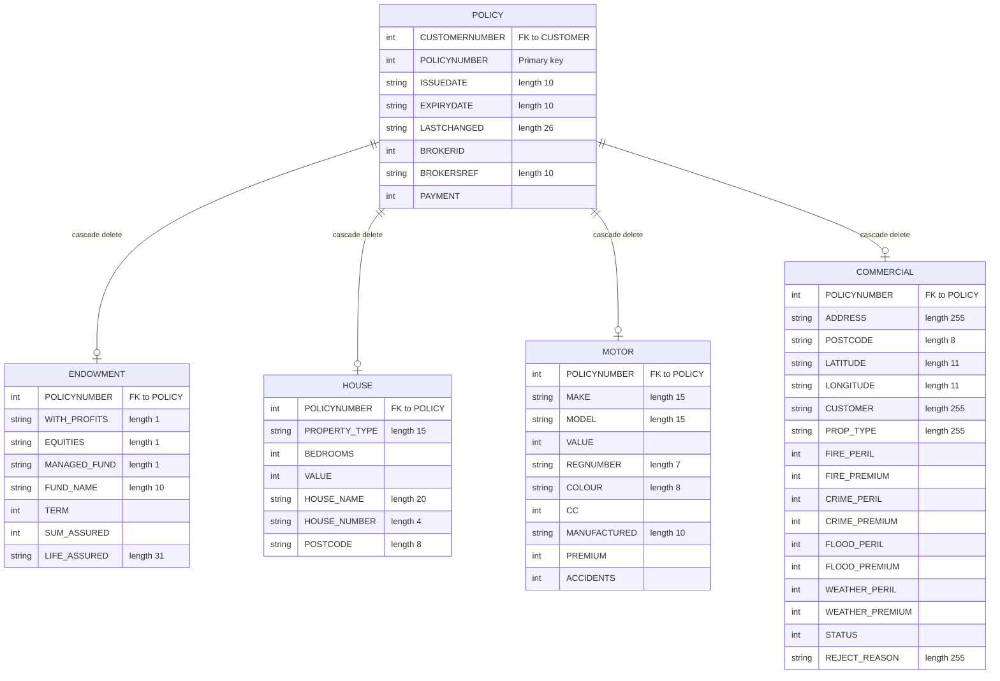

## Table of Contents

- [1. Purpose](#1-purpose)
- [2. Inputs](#2-inputs)
  - [2.1 CICS Communication Area (COMMAREA)](#21-cics-communication-area-commarea)
  - [2.2 DB2 Database](#22-db2-database)
  - [2.3 CICS Execution Environment](#23-cics-execution-environment)
  - [2.4 Linked Programs (external callers / downstream)](#24-linked-programs-external-callers--downstream)
- [3. Outputs](#3-outputs)
- [4. Processing Logic](#4-processing-logic)
  - [4.1 Mermaid Flow Diagram](#41-mermaid-flow-diagram)
  - [4.2 Processing Logic Description](#42-processing-logic-description)
  - [4.3 Database Tables](#43-database-tables)
- [5. Paragraphs](#5-paragraphs)
- [6. Dependencies](#6-dependencies)
  - [6.1 CICS Middleware](#61-cics-middleware)
  - [6.2 DB2 Database](#62-db2-database)
  - [6.3 Input Communication Area (COMMAREA)](#63-input-communication-area-commarea)
  - [6.4 Include / Copybook](#64-include--copybook)
  - [6.5 External Programs Invoked](#65-external-programs-invoked)
  - [6.6 Runtime / Environment](#66-runtime--environment)
- [7. Constraints](#7-constraints)
  - [7.1 Communication Area (COMMAREA) Constraints](#71-communication-area-commarea-constraints)
  - [7.2 Request Identifier Constraints](#72-request-identifier-constraints)
  - [7.3 Input Data Type Constraints](#73-input-data-type-constraints)
  - [7.4 DB2 Deletion Constraints](#74-db2-deletion-constraints)
  - [7.5 Processing Sequence Constraints](#75-processing-sequence-constraints)
  - [7.6 Error Logging Constraints](#76-error-logging-constraints)
  - [7.7 Return Code Constraints](#77-return-code-constraints)
- [8. Error Handling](#8-error-handling)
  - [8.1 Communication Area Validation](#81-communication-area-validation)
  - [8.2 Request Identifier Validation](#82-request-identifier-validation)
  - [8.3 DB2 SQL Error Handling](#83-db2-sql-error-handling)
  - [8.4 Error Logging and Notification](#84-error-logging-and-notification)
- [9. Examples](#9-examples)
  - [9.1 Example 1 — Successful Deletion of a Motor Policy](#91-example-1--successful-deletion-of-a-motor-policy)
  - [9.2 Example 2 — Unrecognised Request ID](#92-example-2--unrecognised-request-id)
  - [9.3 Example 3 — DB2 Delete Failure (e.g., DB2 Unavailable)](#93-example-3--db2-delete-failure-eg-db2-unavailable)

## 1. Purpose

`LGDPDB01` is a CICS-hosted PL/I program responsible for deleting an insurance policy record from the DB2 database on behalf of a calling application. It receives a communication area containing a request identifier, a customer number, and a policy number, and uses the request identifier — one of `01DEND` (endowment), `01DHOU` (house), `01DCOM` (commercial), or `01DMOT` (motor) — to confirm that a recognised policy-deletion operation has been requested. It validates that the communication area meets the minimum required length, converts the customer and policy numbers into binary integer host variables, and executes a DB2 `DELETE` against the `POLICY` table using those values; DB2's referential integrity cascades the delete to the appropriate policy-type table (endowment, house, commercial, or motor). On success, it links to the `LGDPVS01` program for any required post-deletion processing. If the communication area is absent or too short, the request identifier is unrecognised, or a DB2 error occurs, the program sets a corresponding return code (`98`, `99`, or `90` respectively) and, for DB2 failures, writes a structured diagnostic message containing the date, time, customer number, policy number, and SQL return code to a transient data queue via the `LGSTSQ` utility program before returning control to the caller.

## 2. Inputs

### 2.1 CICS Communication Area (COMMAREA)

The program receives its entire input through a pointer-based COMMAREA (`COMM_AREA_PTR`) passed as a procedure parameter at program entry (`Proc(DFHEIPTR, COMM_AREA_PTR)`). All external inputs are fields within this structure.

#### 2.1.1 Header Fields (always required)
- **`CA_REQUEST_ID`** (`CHAR(6)`) — Identifies the type of policy deletion to perform. Valid values are `'01DEND'` (endowment), `'01DHOU'` (house), `'01DCOM'` (commercial), and `'01DMOT'` (motor). Drives the main `SELECT` branch.
- **`CA_RETURN_CODE`** (`PIC '99'`) — Initialised to `'00'` on entry; set by the program to communicate the outcome back to the caller (`'00'` = success, `'90'` = DB2 error, `'98'` = COMMAREA too small, `'99'` = unrecognised request).
- **`CA_CUSTOMER_NUM`** (`PIC '9999999999'`) — The 10-digit customer identifier whose policy is to be deleted. Converted to `DB2_CUSTOMERNUM_INT` for use in the SQL `DELETE` predicate.

#### 2.1.2 Policy Request Fields (used when `CA_REQUEST_ID` is a recognised delete code)
- **`CA_POLICY_NUM`** (`PIC '9999999999'`) — The 10-digit policy identifier to be deleted. Converted to `DB2_POLICYNUM_INT` for use in the SQL `DELETE` predicate.
- **`CA_POLICY_COMMON`** — Grouped structure containing common policy attributes passed as part of the deletion request payload:
  - **`CA_ISSUE_DATE`** (`CHAR(10)`) — Original policy issue date.
  - **`CA_EXPIRY_DATE`** (`CHAR(10)`) — Policy expiry date.
  - **`CA_BROKERID`** (`PIC '9999999999'`) — Broker identifier associated with the policy.
  - **`CA_BROKERSREF`** (`CHAR(10)`) — Broker's own reference for the policy.
  - **`CA_PAYMENT`** (`PIC '999999'`) — Payment amount linked to the policy.

#### 2.1.3 Raw COMMAREA Buffer
- **`COMM_AREA_RAW`** (`CHAR(32500)`) — A union overlay providing unstructured access to the entire COMMAREA buffer. Up to 90 bytes are extracted and forwarded to the transient data queue during error logging.

### 2.2 DB2 Database
- **`POLICY` table** — The program issues a `DELETE` against this table using `CUSTOMERNUMBER` and `POLICYNUMBER` as predicates (supplied via `DB2_CUSTOMERNUM_INT` and `DB2_POLICYNUM_INT`, which are derived from the COMMAREA fields above). The DB2 foreign-key cascade propagates the delete to the appropriate policy-type table (ENDOWMENT, HOUSE, MOTOR, or COMMERCIAL).

### 2.3 CICS Execution Environment
- **`EIBCALEN`** (CICS EIB field) — The length of the received COMMAREA. Checked on entry: if zero, an `ABEND LGCA` is issued; if less than the minimum header length (`WS_CA_HEADER_LEN` = 28), `CA_RETURN_CODE` is set to `'98'` and the program returns immediately.
- **`EIBTRNID`**, **`EIBTRMID`**, **`EIBTASKN`** (CICS EIB fields) — Transaction ID, terminal ID, and task number read from the EIB at startup and stored in the working-storage header for diagnostic identification.

### 2.4 Linked Programs (external callers / downstream)
- **`LGDPVS01`** — Called via `EXEC CICS LINK` after a successful DB2 delete, receiving the same COMMAREA for further processing (e.g., VSAM counterpart deletion).
- **`LGSTSQ`** — Called via `EXEC CICS LINK` to write error and diagnostic messages to the transient data queue; receives `ERROR_MSG` and `CA_ERROR_MSG` commareas.

## 3. Outputs

**Communication Area (`COMM_AREA`) — Return to Caller**

- `CA_RETURN_CODE` — The primary outcome indicator written back into the communication area before returning to the caller via `EXEC CICS RETURN`. Possible values:
  - `'00'` — Successful policy deletion
  - `'90'` — DB2 error occurred during the `DELETE` SQL statement
  - `'98'` — Communication area received was too small to contain the mandatory header
  - `'99'` — Unrecognised request identifier in `CA_REQUEST_ID`

**DB2 Table Mutation — `POLICY` Table**

- `DELETE FROM POLICY WHERE CUSTOMERNUMBER = :DB2_CUSTOMERNUM_INT AND POLICYNUMBER = :DB2_POLICYNUM_INT` — The primary side-effect of the program. Removes a row from the `POLICY` table matching the supplied customer and policy numbers. Due to foreign key cascade rules, the corresponding child row in the appropriate policy-type table (Endowment, House, Motor, or Commercial) is also deleted automatically by DB2.

**CICS Linked Program — `LGDPVS01`**

- On a successful policy type match (`01DEND`, `01DHOU`, `01DCOM`, `01DMOT`) and successful DB2 deletion, the full `COMM_AREA` (32,500 bytes) is passed via `EXEC CICS LINK` to `LGDPVS01` for further downstream processing. The communication area at this point carries the input request fields and the updated `CA_RETURN_CODE`.

**CICS Transient Data Queue — Error Diagnostic Messages (via `LGSTSQ`)**

Written by the `WRITE_ERROR_MESSAGE` procedure whenever a DB2 error occurs or no communication area is received:

- `ERROR_MSG` — A structured diagnostic message linked to `LGSTSQ`, containing:
  - `EM_DATE` / `EM_TIME` — Timestamp of the error obtained via `EXEC CICS ASKTIME` / `EXEC CICS FORMATTIME`
  - `EM_CUSNUM` — Customer number copied from `CA_CUSTOMER_NUM`
  - `EM_POLNUM` — Policy number copied from `CA_POLICY_NUM`
  - `EM_SQLREQ` — Label of the SQL operation in progress (`' DELETE POLICY  '`)
  - `EM_SQLRC` — The DB2 `SQLCODE` value at the point of failure
  - Literal program name `LGDPDB01` embedded in the message structure

- `CA_ERROR_MSG` — A secondary diagnostic message also linked to `LGSTSQ`, containing up to 90 bytes of the raw communication area (`COMM_AREA_RAW`) prefixed with the literal `'COMMAREA='`, providing a snapshot of the received input at the time of failure

**CICS Abend**

- `EXEC CICS ABEND ABCODE('LGCA') NODUMP` — Issued when `EIBCALEN = 0` (no communication area received). This terminates the CICS task abnormally with abend code `LGCA`, suppressing a system dump. The abend code itself is an observable output visible in CICS logs and the CSMT transient data queue.

## 4. Processing Logic

### 4.1 Mermaid Flow Diagram

---

### 4.2 Processing Logic Description

#### 4.2.1 High-level Summary

`LGDPDB01` is a CICS-managed PL/I program that deletes an insurance policy record from the DB2 `POLICY` table. It acts as the DB2 back-end for the delete-policy operation in the GenApp insurance application. It receives a communication area (`COMMAREA`) from a calling orchestrator, validates it, identifies the policy type being deleted, executes a DB2 `DELETE`, and then hands control to `LGDPVS01` for any corresponding VSAM-side cleanup. All errors are logged to a transient data queue via the shared utility program `LGSTSQ`.

---

#### 4.2.2 Execution Flow

**Step 1 – Initialise working storage (nodes A → B)**
On entry the program captures the CICS transaction ID (`EIBTRNID`), terminal ID (`EIBTRMID`), and task number (`EIBTASKN`) into the working-storage header block for later dump identification. DB2 host-variable integers are zeroed.

**Step 2 – Guard: zero-length COMMAREA (node C)**
`EIBCALEN` is the CICS-provided length of the incoming `COMMAREA`. If it equals zero, no communication area was passed at all. The program writes the text `NO COMMAREA RECEIVED` to the error log and issues `EXEC CICS ABEND ABCODE('LGCA') NODUMP` — a hard abend that terminates the task immediately without producing a dump.

**Step 3 – Initialise return code and save COMMAREA details (node F)**
`CA_RETURN_CODE` is pre-set to `'00'` (success). The COMMAREA length and pointer are saved into working storage for use by the error-logging routine.

**Step 4 – Guard: COMMAREA too short (node G)**
The minimum valid header length is 28 bytes (`WS_CA_HEADER_LEN`). If the received COMMAREA is shorter, `CA_RETURN_CODE` is set to `'98'` and `EXEC CICS RETURN` is issued immediately — control returns to the caller with the error code without attempting any DB2 work.

**Step 5 – Convert identifiers to DB2 integer host variables (node J)**
`CA_CUSTOMER_NUM` (PIC `9999999999`) and `CA_POLICY_NUM` (PIC `9999999999`) are converted from their zoned-decimal picture form into `FIXED BIN(31)` integers (`DB2_CUSTOMERNUM_INT`, `DB2_POLICYNUM_INT`) for use as DB2 host variables. Both values are also copied into the error message structure so they appear in any subsequent diagnostic log entry.

**Step 6 – Route by request type (node K)**
A PL/I `SELECT` statement inspects `CA_REQUEST_ID` (6 characters):
- **`'01DEND'`** — Delete Endowment policy
- **`'01DHOU'`** — Delete House policy
- **`'01DCOM'`** — Delete Commercial policy
- **`'01DMOT'`** — Delete Motor policy

All four recognised codes share the same processing branch (nodes L → M). Any other value falls into the `OTHERWISE` clause, setting `CA_RETURN_CODE = '99'` (unrecognised request) and returning.

**Step 7 – Delete from DB2 POLICY table (subroutine `DELETE_POLICY_DB2_INFO`, nodes P → V)**
The `EM_SQLREQ` field is set to `' DELETE POLICY  '` for tracing. An `EXEC SQL DELETE FROM POLICY` statement removes the row whose `CUSTOMERNUMBER` and `POLICYNUMBER` match the supplied host variables. Because the DB2 schema defines the policy-type tables (`ENDOWMENT`, `HOUSE`, `MOTOR`, `COMMERCIAL`) with foreign keys referencing `POLICY`, the database engine cascades the delete automatically — no explicit deletes against the child tables are needed. Both `SQLCODE = 0` (success) and `SQLCODE = 100` (row not found, already gone) are considered acceptable outcomes. Any other non-zero `SQLCODE` sets `CA_RETURN_CODE = '90'`, writes an error message, and issues `EXEC CICS RETURN`.

**Step 8 – Link to VSAM counterpart LGDPVS01 (node M)**
After a successful DB2 delete, `EXEC CICS LINK PROGRAM('LGDPVS01')` passes the full COMMAREA (32,500 bytes) to the VSAM back-end program. This program performs any corresponding VSAM file maintenance, completing the dual-store deletion that the GenApp architecture requires.

**Step 9 – Return to caller (node O)**
`EXEC CICS RETURN` passes control back to the orchestrating caller with `CA_RETURN_CODE` set appropriately.

**Error-logging subroutine `WRITE_ERROR_MESSAGE` (nodes W → AH)**
This internal procedure is called whenever a diagnostic message must be written:
1. The current `SQLCODE` is captured into `EM_SQLRC`.
2. `EXEC CICS ASKTIME` retrieves the current absolute timestamp; `EXEC CICS FORMATTIME` converts it to a human-readable date (`MMDDYYYY`) and time string.
3. Date and time are stamped into the error message structure.
4. `EXEC CICS LINK PROGRAM('LGSTSQ')` writes the full error message (including program name, customer number, policy number, SQL request label, and SQL return code) to a CICS transient data queue.
5. Up to 90 bytes of the raw COMMAREA are then also written to the same queue for additional context. If the COMMAREA is shorter than 91 bytes the actual length is used; otherwise exactly 90 bytes are extracted using the PL/I `LEFT` built-in.

---

#### 4.2.3 External Interactions

| Interaction | Type | Purpose |
|---|---|---|
| `EXEC SQL DELETE FROM POLICY` | DB2 | Removes the policy row; foreign-key cascade deletes the child policy-type row |
| `EXEC CICS LINK LGDPVS01` | CICS program link | Deletes the corresponding VSAM record for the same policy |
| `EXEC CICS LINK LGSTSQ` | CICS program link | Utility program that writes messages to a CICS transient data queue (TDQ) for error logging |
| `EXEC CICS ABEND ABCODE('LGCA') NODUMP` | CICS | Hard task abend when no COMMAREA is present at all |
| `EXEC CICS ASKTIME` / `EXEC CICS FORMATTIME` | CICS | Obtain and format current date/time for error messages |

---

#### 4.2.4 Plain Language Summary

`LGDPDB01` is the DB2 deletion engine for insurance policies. When a user requests that a policy be cancelled, this program receives a message specifying the customer and policy numbers along with the type of policy (endowment, house, motor, or commercial). It first checks that the message is valid and long enough to read. It then removes the policy from the main DB2 policy database — because of database foreign-key rules, this automatically removes the associated type-specific record as well. After the DB2 deletion succeeds, the program calls a companion program to remove the same policy from the VSAM file store, keeping both data stores in sync. If anything goes wrong (missing message, unrecognised type, database error), the program sets an error code in the reply message and writes a detailed diagnostic entry — including the date, time, customer number, policy number, and database error code — to a logging queue for operations staff to review.

---

### 4.3 Database Tables

## 5. Paragraphs

**Main Procedure (LGDPDB01)**

- Purpose: Entry point of the program. Handles environment initialization, communication area (COMMAREA) validation, request routing, and program exit.
- Operations performed:
  - Captures the current CICS execution context by assigning `EIBTRNID` to `WS_TRANSID`, `EIBTRMID` to `WS_TERMID`, and `EIBTASKN` to `WS_TASKNUM`, establishing runtime identity for the current task.
  - Initializes the `DB2_IN_INTEGERS` structure to zero, clearing host variables before any DB2 interaction.
  - Validates the COMMAREA:
    - If `EIBCALEN` equals zero (no COMMAREA received), sets an error message text, calls `WRITE_ERROR_MESSAGE`, and issues `EXEC CICS ABEND ABCODE('LGCA') NODUMP` to terminate abnormally without producing a dump.
    - If `EIBCALEN` is less than `WS_CA_HEADER_LEN` (28 bytes), sets `CA_RETURN_CODE` to `'98'` and issues `EXEC CICS RETURN` to exit immediately.
  - Initializes `CA_RETURN_CODE` to `'00'`, stores `EIBCALEN` in `WS_CALEN`, and saves the COMMAREA pointer in `WS_ADDR_DFHCOMMAREA`.
  - Converts `CA_CUSTOMER_NUM` and `CA_POLICY_NUM` from picture-format decimals to `FIXED BIN(31)` integers (`DB2_CUSTOMERNUM_INT`, `DB2_POLICYNUM_INT`) for use as DB2 host variables. Copies both values into the error message structure (`EM_CUSNUM`, `EM_POLNUM`) for potential diagnostic logging.
- Control flow:
  - Uses a `SELECT ( CA_REQUEST_ID )` construct to route execution:
    - `WHEN ('01DEND','01DHOU','01DCOM','01DMOT')`: Calls `DELETE_POLICY_DB2_INFO` to delete the policy row from DB2, then issues `EXEC CICS LINK PROGRAM('LGDPVS01')` passing the full COMMAREA (length 32500) to the validation/post-processing program for further handling.
    - `OTHERWISE`: Sets `CA_RETURN_CODE` to `'99'` to indicate an unrecognised request identifier.
  - After the `SELECT` block, issues `EXEC CICS RETURN` to return control to the calling CICS program.

---

**DELETE_POLICY_DB2_INFO**

- Purpose: Deletes the appropriate policy record from the DB2 `POLICY` table using the customer and policy number provided in the COMMAREA. Foreign key constraints in the database are relied upon to cascade the deletion to the relevant policy-type sub-table (endowment, house, motor, or commercial).
- Operations performed:
  - Sets `EM_SQLREQ` to `' DELETE POLICY  '` to label the SQL operation in any subsequent error message.
  - Executes an `EXEC SQL DELETE FROM POLICY WHERE (CUSTOMERNUMBER = :DB2_CUSTOMERNUM_INT AND POLICYNUMBER = :DB2_POLICYNUM_INT)` statement, removing the row that matches both the customer number and policy number host variables.
- Control flow:
  - Checks `SQLCODE` after the DELETE:
    - If `SQLCODE` is non-zero (any SQL error, including anything other than a successful delete; `SQLCODE 100` — record not found — is explicitly documented as treated as success along with `SQLCODE 0`, though in practice the `<> 0` test would also catch 100), sets `CA_RETURN_CODE` to `'90'`, calls `WRITE_ERROR_MESSAGE` to log the failure, and issues `EXEC CICS RETURN` to exit the program immediately.
    - If `SQLCODE` is zero, the procedure ends normally and control returns to the caller (main procedure).
- External system interaction: Performs a direct DB2 DELETE operation against the `POLICY` table using two bound host variables. The foreign key cascade mechanism in DB2 is expected to handle deletion from the type-specific policy tables automatically.

---

**WRITE_ERROR_MESSAGE**

- Purpose: Constructs and writes a formatted diagnostic error message to a CICS Transient Data Queue (TDQ) via a linked utility program (`LGSTSQ`). It logs the time, date, program name, customer number, policy number, SQL request label, and SQLCODE, as well as a snapshot of the COMMAREA content.
- Operations performed:
  - Copies the current `SQLCODE` value into `EM_SQLRC` within the error message structure.
  - Retrieves the current absolute time using `EXEC CICS ASKTIME ABSTIME(WS_ABSTIME)`.
  - Formats the absolute time into a human-readable date (`MMDDYYYY` format into `WS_DATE`) and time string (`WS_TIME`) using `EXEC CICS FORMATTIME`.
  - Populates `EM_DATE` and `EM_TIME` in the `ERROR_MSG` structure with the formatted values.
  - Issues `EXEC CICS LINK PROGRAM('LGSTSQ') COMMAREA(ERROR_MSG) LENGTH(STG(ERROR_MSG))` to write the full error message (including customer number, policy number, SQL request, and SQLCODE) to the TDQ.
- Control flow:
  - Conditionally writes a COMMAREA snapshot to the TDQ:
    - If `EIBCALEN` is greater than zero:
      - If `EIBCALEN` is less than 91, extracts exactly `EIBCALEN` bytes from `COMM_AREA_RAW` using the `LEFT` built-in function into `CA_DATA`, then links to `LGSTSQ` with `CA_ERROR_MSG`.
      - Otherwise, extracts the first 90 bytes from `COMM_AREA_RAW` into `CA_DATA` and links to `LGSTSQ` similarly.
    - If `EIBCALEN` is zero, no COMMAREA snapshot is written.
  - Returns to the caller after all writes are complete.
- External system interaction: Calls the `LGSTSQ` utility program twice (once for the main error message and once for the COMMAREA snapshot) via `EXEC CICS LINK`, which writes entries to a CICS Transient Data Queue for operational logging and diagnostics.

## 6. Dependencies

### 6.1 CICS Middleware

- **CICS COMMAREA** — The program is invoked as a CICS linked program; it receives `DFHEIPTR` and `COMM_AREA_PTR` as procedure parameters, providing the CICS execution interface block (EIB) and the caller's communication area respectively
- **CICS EIB Fields** — Runtime execution context fields read from the EIB at program entry:
  - `EIBCALEN` — Length of the received COMMAREA; used to validate the COMMAREA is present (`= 0` triggers an abend) and large enough (`< WS_CA_HEADER_LEN` triggers return code `98`)
  - `EIBTRNID` — CICS transaction identifier, stored in `WS_TRANSID` for diagnostics
  - `EIBTRMID` — CICS terminal identifier, stored in `WS_TERMID` for diagnostics
  - `EIBTASKN` — CICS task number, stored in `WS_TASKNUM` for diagnostics
- **EXEC CICS ABEND** (`ABCODE('LGCA') NODUMP`) — Issued when no COMMAREA is received; terminates the transaction abnormally with a custom abend code
- **EXEC CICS RETURN** — Used at normal program exit and also on COMMAREA validation failure or DB2 error, returning control to the caller
- **EXEC CICS ASKTIME / FORMATTIME** — Called within `WRITE_ERROR_MESSAGE` to obtain and format the current timestamp for error log entries
- **EXEC CICS LINK to `LGDPVS01`** — Invoked after a successful DB2 DELETE to trigger VSAM-side deletion processing; passes the full COMMAREA (32,500 bytes) to the linked program
- **EXEC CICS LINK to `LGSTSQ`** — Called (twice) within `WRITE_ERROR_MESSAGE` to write the formatted error message and the raw COMMAREA snapshot to a CICS transient data queue (TDQ) for diagnostic logging

### 6.2 DB2 Database

- **DB2 `POLICY` table** — The sole table directly accessed; a `DELETE` statement removes the row matching both `CUSTOMERNUMBER` and `POLICYNUMBER`; due to foreign key cascade rules this deletion propagates automatically to the child type-specific tables (`ENDOWMENT`, `HOUSE`, `MOTOR`, `COMMERCIAL`)
- **EXEC SQL INCLUDE SQLCA** — Includes the SQL Communications Area, providing `SQLCODE` and related fields that are checked after every SQL operation to detect errors
- **DB2 host variables** (`DB2_CUSTOMERNUM_INT`, `DB2_POLICYNUM_INT`) — `FIXED BIN(31)` integers derived from the COMMAREA's `CA_CUSTOMER_NUM` and `CA_POLICY_NUM` picture fields; used directly as predicate values in the SQL `DELETE` statement

### 6.3 Input Communication Area (COMMAREA)

- **`CA_REQUEST_ID`** — 6-character request type code supplied by the caller; drives the main `SELECT` branch; recognised values are `'01DEND'` (delete endowment), `'01DHOU'` (delete house), `'01DCOM'` (delete commercial), and `'01DMOT'` (delete motor)
- **`CA_CUSTOMER_NUM`** — 10-digit customer identifier supplied by the caller; converted to a binary integer for DB2 and echoed into the error message structure
- **`CA_POLICY_NUM`** — 10-digit policy identifier supplied by the caller; converted to a binary integer for DB2 and echoed into the error message structure
- **`CA_RETURN_CODE`** — 2-digit return code field within the COMMAREA; set by this program to communicate the outcome back to the caller (`00` = success, `90` = DB2 error, `98` = COMMAREA too short, `99` = unrecognised request)

### 6.4 Include / Copybook

- **`LGCMAREA.inc`** (`EXEC SQL INCLUDE LGCMAREA` / `%INCLUDE LGCMAREA`) — PL/I include file defining the full `COMM_AREA` structure (inlined at lines 85–193); provides all `CA_*` field declarations covering customer, policy-common, endowment, house, motor, commercial, and claim sub-structures
- **`SQLCA`** (`EXEC SQL INCLUDE SQLCA`) — DB2-supplied SQL Communications Area copybook providing `SQLCODE` and supporting error fields

### 6.5 External Programs Invoked

- **`LGDPVS01`** (CICS LINK) — Post-DB2-delete VSAM processing program; called unconditionally after a successful policy deletion from DB2; receives the full 32,500-byte COMMAREA
- **`LGSTSQ`** (CICS LINK) — Shared service program that writes a message record to the CICS transient data queue; called up to twice during error handling — once for the formatted error message (`ERROR_MSG`) and once for the raw COMMAREA snapshot (`CA_ERROR_MSG`)

### 6.6 Runtime / Environment

- **CICS transaction runtime** — The program runs exclusively under CICS; all I/O (DB2 access, program links, error logging) is mediated through CICS services; no batch or standalone execution path exists
- **`WS_CA_HEADER_LEN`** (`FIXED BIN(15)`, initialised to `28`) — Internal constant defining the minimum acceptable COMMAREA length; any COMMAREA shorter than 28 bytes causes an immediate return with code `98`

## 7. Constraints

### 7.1 Communication Area (COMMAREA) Constraints

- **COMMAREA must be present (non-zero length)**
  - `EIBCALEN` is checked at program entry; if it equals `0`, a `WRITE_ERROR_MESSAGE` call is made and an `EXEC CICS ABEND ABCODE('LGCA') NODUMP` is issued — the program terminates immediately and no deletion is performed
- **COMMAREA must meet a minimum length of 28 bytes**
  - `EIBCALEN` is compared against `WS_CA_HEADER_LEN` (initialized to `28`); if the received area is shorter, `CA_RETURN_CODE` is set to `'98'` and `EXEC CICS RETURN` is issued — no further processing occurs
- **COMMAREA maximum addressable size is 32,500 bytes**
  - `COMM_AREA_RAW` is declared as `CHAR(32500)`; this is the absolute ceiling on the communication area structure the program can address

### 7.2 Request Identifier Constraints

- **`CA_REQUEST_ID` must be one of four recognized values**
  - The `SELECT (CA_REQUEST_ID)` statement accepts only `'01DEND'` (delete endowment), `'01DHOU'` (delete house), `'01DCOM'` (delete commercial), or `'01DMOT'` (delete motor)
  - Any other value falls through to the `OTHERWISE` branch, which sets `CA_RETURN_CODE = '99'` and returns — no DB2 deletion and no link to `LGDPVS01` are performed
- **`CA_REQUEST_ID` must be exactly 6 characters**
  - The field is declared `CHAR(6)`; the program makes no partial-match or wildcard comparison — the full 6-character value must exactly equal one of the accepted literals

### 7.3 Input Data Type Constraints

- **`CA_CUSTOMER_NUM` must be a 10-digit numeric value**
  - Declared as `PIC '9999999999'`; only digits `0–9` are valid at each position
  - Converted to `DB2_CUSTOMERNUM_INT` (a `FIXED BIN(31)` host variable) before use in the SQL `WHERE` clause — a non-numeric value would cause a conversion error before the SQL is executed
- **`CA_POLICY_NUM` must be a 10-digit numeric value**
  - Declared as `PIC '9999999999'`; same constraint and conversion path as `CA_CUSTOMER_NUM`
  - Assigned to `DB2_POLICYNUM_INT` (`FIXED BIN(31)`) for the SQL `WHERE` predicate
- **Both customer number and policy number must fit in a 31-bit signed binary integer**
  - `DB2_CUSTOMERNUM_INT` and `DB2_POLICYNUM_INT` are `FIXED BIN(31)`, limiting valid values to the range 0–2,147,483,647; a source value exceeding this range would cause arithmetic overflow during assignment

### 7.4 DB2 Deletion Constraints

- **Deletion is keyed on both `CUSTOMERNUMBER` and `POLICYNUMBER` together**
  - The SQL `DELETE FROM POLICY WHERE (CUSTOMERNUMBER = :DB2_CUSTOMERNUM_INT AND POLICYNUMBER = :DB2_POLICYNUM_INT)` requires both predicates to match; a correct customer number with a wrong policy number (or vice versa) will result in no row being deleted
- **`SQLCODE = 0` and `SQLCODE = 100` are both treated as success**
  - The check `IF (SQLCODE <> 0)` means `SQLCODE 100` ("row not found") is not handled as an error; the program continues normally whether or not a matching row actually existed
  - Any other non-zero `SQLCODE` sets `CA_RETURN_CODE = '90'`, writes an error message, and issues `EXEC CICS RETURN` — the link to `LGDPVS01` is never reached
- **Cascading deletion relies on DB2 foreign key definitions, not program logic**
  - The comment at line 260–262 explicitly states that deletion propagation to the subsidiary type-specific tables (ENDOWMENT, HOUSE, MOTOR, COMMERCIAL) is delegated entirely to DB2 referential integrity (foreign key cascade); no explicit `DELETE` SQL is issued for those tables

### 7.5 Processing Sequence Constraints

- **COMMAREA validation must complete before any DB2 or business logic executes**
  - The `EIBCALEN = 0` abort check, the minimum-length check, and the conversion of `CA_CUSTOMER_NUM`/`CA_POLICY_NUM` to integer host variables all occur before the `SELECT (CA_REQUEST_ID)` dispatch — out-of-order execution is structurally impossible
- **`DELETE_POLICY_DB2_INFO` must complete successfully before `LGDPVS01` is linked**
  - `EXEC CICS LINK PROGRAM('LGDPVS01')` is called only within the same `WHEN` block that called `CALL DELETE_POLICY_DB2_INFO`; if `DELETE_POLICY_DB2_INFO` issues `EXEC CICS RETURN` on a DB2 error, the link to `LGDPVS01` is bypassed
- **Error logging always precedes program termination on failure paths**
  - Every abnormal exit (`SQLCODE <> 0`, no COMMAREA) calls `WRITE_ERROR_MESSAGE` before issuing `EXEC CICS RETURN` or `EXEC CICS ABEND` — the message is always written first

### 7.6 Error Logging Constraints

- **Error messages are capped at 90 bytes of COMMAREA content**
  - In `WRITE_ERROR_MESSAGE`, if `EIBCALEN < 91`, exactly `EIBCALEN` bytes are logged; otherwise the first 90 bytes are used — no more than 90 bytes of the raw COMMAREA are ever forwarded to the transient data queue
- **Error logging to the TDQ is conditional on a non-zero COMMAREA length**
  - The COMMAREA excerpt is written only if `EIBCALEN > 0`; if the COMMAREA was absent (length = 0), the raw-area logging block is skipped entirely

### 7.7 Return Code Constraints

- **`CA_RETURN_CODE` is always initialized to `'00'` before any conditional processing**
  - Set at line 219 before the length check and request-ID dispatch; failure paths must explicitly overwrite it with `'98'`, `'90'`, or `'99'`
- **Only four discrete return code values are produced by the program**
  - `'00'` — successful deletion (and successful link to `LGDPVS01`)
  - `'90'` — DB2 error during `DELETE FROM POLICY`
  - `'98'` — COMMAREA too small (below 28-byte header minimum)
  - `'99'` — unrecognized `CA_REQUEST_ID`
  - No partial-success or intermediate codes are defined

## 8. Error Handling

### 8.1 Communication Area Validation

- **Missing communication area (EIBCALEN = 0)**
  - At program entry, the CICS-provided `EIBCALEN` field is tested to determine whether any communication area was passed by the caller
  - If `EIBCALEN` equals zero, the program treats this as a fatal, unrecoverable condition
  - An error message text (`' NO COMMAREA RECEIVED'`) is loaded into the error message structure and the `WRITE_ERROR_MESSAGE` internal procedure is called to log the event
  - The program then issues `EXEC CICS ABEND ABCODE('LGCA') NODUMP`, which forces an abnormal termination of the CICS task with abend code `LGCA` and suppresses the generation of a system dump, providing a controlled failure signal to the CICS environment

- **Insufficient communication area length (EIBCALEN < WS_CA_HEADER_LEN)**
  - After confirming a communication area exists, the program checks whether its length (from `EIBCALEN`) is at least 28 bytes, the minimum required to contain the mandatory header fields
  - If the communication area is too short to be safely interpreted, `CA_RETURN_CODE` is set to `'98'` and `EXEC CICS RETURN` is issued immediately, returning control to the caller without performing any deletion and without writing an error log entry

---

### 8.2 Request Identifier Validation

- **Unrecognised request identifier in CA_REQUEST_ID**
  - The `SELECT` statement dispatches processing based on the value of `CA_REQUEST_ID`
  - Valid values are `'01DEND'`, `'01DHOU'`, `'01DCOM'`, and `'01DMOT'`, each representing a supported policy deletion type
  - Any other value falls into the `OTHERWISE` branch, which sets `CA_RETURN_CODE` to `'99'` and allows the program to fall through to `EXEC CICS RETURN`
  - No error log is written for this condition; the return code alone signals the invalid request to the caller

---

### 8.3 DB2 SQL Error Handling

- **Non-zero SQLCODE after DELETE**
  - Inside the `DELETE_POLICY_DB2_INFO` procedure, after the `DELETE FROM POLICY` SQL statement executes, `SQLCODE` is inspected
  - Both `SQLCODE = 0` (successful deletion) and `SQLCODE = 100` (record not found — treated as a successful outcome because the end state is the same) are implicitly treated as non-errors; only a non-zero `SQLCODE` other than these triggers the error path
  - When `SQLCODE <> 0`, `CA_RETURN_CODE` is set to `'90'` to signal a DB2 error to the caller
  - `WRITE_ERROR_MESSAGE` is called to log the diagnostic details before the program exits
  - `EXEC CICS RETURN` is then issued immediately, preventing any subsequent downstream call to the `LGDPVS01` program

---

### 8.4 Error Logging and Notification

- **WRITE_ERROR_MESSAGE procedure**
  - This dedicated internal procedure is invoked for both the missing communication area condition and the DB2 SQL error condition
  - It captures the current `SQLCODE` into the error message structure field `EM_SQLRC`
  - It obtains the current timestamp via `EXEC CICS ASKTIME` and formats it into a human-readable date and time using `EXEC CICS FORMATTIME`, which are then placed in `EM_DATE` and `EM_TIME`
  - The fully populated `ERROR_MSG` structure (containing date, time, program name label, customer number, policy number, the SQL operation label from `EM_SQLREQ`, and the SQLCODE) is forwarded to the `LGSTSQ` program via `EXEC CICS LINK`, which acts as a transient data queue writer for persistent error logging

- **Communication area content logging**
  - After writing the primary error message, the procedure conditionally writes up to 90 bytes of the raw communication area content to the same logging destination
  - If `EIBCALEN` is between 1 and 90, only the actual received bytes are extracted and forwarded; if `EIBCALEN` exceeds 90, a fixed 90-byte excerpt is taken
  - This provides a second diagnostic log record containing the raw input payload at the time of failure, supporting post-failure analysis without requiring a system dump

## 9. Examples

### 9.1 Example 1 — Successful Deletion of a Motor Policy

**Input Communication Area**

| Field | Value |
|---|---|
| `CA_REQUEST_ID` | `01DMOT` |
| `CA_RETURN_CODE` | `00` (initial) |
| `CA_CUSTOMER_NUM` | `0000001234` |
| `CA_POLICY_NUM` | `0000005678` |
| COMMAREA length | 32500 bytes |

**Processing Flow**

1. `EIBCALEN` is non-zero, so no ABEND is raised.
2. The COMMAREA length (32500) is ≥ `WS_CA_HEADER_LEN` (28), so the size check passes.
3. `CA_CUSTOMER_NUM` and `CA_POLICY_NUM` are converted to `DB2_CUSTOMERNUM_INT = 1234` and `DB2_POLICYNUM_INT = 5678`.
4. The `SELECT (CA_REQUEST_ID)` matches `'01DMOT'`, so `DELETE_POLICY_DB2_INFO` is called.
5. A `DELETE FROM POLICY WHERE CUSTOMERNUMBER = 1234 AND POLICYNUMBER = 5678` is executed. Due to the DB2 foreign-key cascade, the related row in the MOTOR table is also deleted automatically.
6. `SQLCODE` is 0 (success), so the return code stays `'00'`.
7. `EXEC CICS LINK PROGRAM('LGDPVS01')` is called to complete post-deletion processing, then control returns to the caller.

**Output Communication Area**

| Field | Value |
|---|---|
| `CA_RETURN_CODE` | `00` |

---

### 9.2 Example 2 — Unrecognised Request ID

**Input Communication Area**

| Field | Value |
|---|---|
| `CA_REQUEST_ID` | `01XINV` *(unrecognised)* |
| `CA_CUSTOMER_NUM` | `0000009999` |
| `CA_POLICY_NUM` | `0000001111` |
| COMMAREA length | 32500 bytes |

**Processing Flow**

1. COMMAREA length passes the size check (≥ 28).
2. Customer and policy numbers are converted to integer host variables as usual.
3. The `SELECT (CA_REQUEST_ID)` falls through to the `OTHERWISE` branch because `'01XINV'` does not match any of `'01DEND'`, `'01DHOU'`, `'01DCOM'`, or `'01DMOT'`.
4. `CA_RETURN_CODE` is set to `'99'` and no DB2 DELETE is attempted.
5. `EXEC CICS RETURN` is issued immediately; `LGDPVS01` is **not** linked.

**Output Communication Area**

| Field | Value |
|---|---|
| `CA_RETURN_CODE` | `99` |

---

### 9.3 Example 3 — DB2 Delete Failure (e.g., DB2 Unavailable)

**Input Communication Area**

| Field | Value |
|---|---|
| `CA_REQUEST_ID` | `01DHOU` |
| `CA_CUSTOMER_NUM` | `0000007777` |
| `CA_POLICY_NUM` | `0000002222` |
| COMMAREA length | 32500 bytes |

**Processing Flow**

1. COMMAREA passes the header-length check.
2. The request ID `'01DHOU'` matches; `DELETE_POLICY_DB2_INFO` is called.
3. The SQL `DELETE FROM POLICY` executes but returns a non-zero `SQLCODE` (e.g., `-904` — resource unavailable).
4. Because `SQLCODE ≠ 0`, `CA_RETURN_CODE` is set to `'90'`.
5. `WRITE_ERROR_MESSAGE` is called: the current date/time is obtained via `EXEC CICS ASKTIME`/`FORMATTIME`, and a diagnostic message containing the customer number, policy number, SQL request label (`' DELETE POLICY  '`), and SQLCODE is written to the transient data queue via `LGSTSQ`. Up to 90 bytes of the raw COMMAREA content are also forwarded for diagnostics.
6. `EXEC CICS RETURN` is issued immediately; `LGDPVS01` is **not** linked.

**Output Communication Area**

| Field | Value |
|---|---|
| `CA_RETURN_CODE` | `90` |

---

Generated by IBM Bob Premium Package for Z
