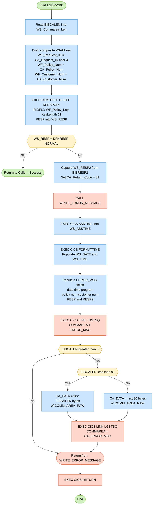

## Table of Contents

- [1. Purpose](#1-purpose)
- [2. Inputs](#2-inputs)
  - [2.1 Procedure input](#21-procedure-input)
  - [2.2 Communication area inputs](#22-communication-area-inputs)
  - [2.3 CICS system-provided inputs](#23-cics-system-provided-inputs)
  - [2.4 External data sources and services](#24-external-data-sources-and-services)
  - [2.5 Output-only field updated by the program](#25-output-only-field-updated-by-the-program)
- [3. Outputs](#3-outputs)
- [4. Processing Logic](#4-processing-logic)
  - [4.1 Mermaid Flow Diagram](#41-mermaid-flow-diagram)
  - [4.2 Processing Logic Description](#42-processing-logic-description)
  - [4.3 Database Tables](#43-database-tables)
- [5. Paragraphs](#5-paragraphs)
- [6. Dependencies](#6-dependencies)
  - [6.1 VSAM Files](#61-vsam-files)
  - [6.2 CICS Runtime Services](#62-cics-runtime-services)
  - [6.3 External Programs / Modules](#63-external-programs--modules)
  - [6.4 Include Members / Copybooks](#64-include-members--copybooks)
  - [6.5 Input Parameters / Communication Area](#65-input-parameters--communication-area)
- [7. Constraints](#7-constraints)
  - [7.1 Input structure and data format constraints](#71-input-structure-and-data-format-constraints)
  - [7.2 Validation and error-status constraints](#72-validation-and-error-status-constraints)
  - [7.3 Processing and control-flow constraints](#73-processing-and-control-flow-constraints)
  - [7.4 Resource and file-access constraints](#74-resource-and-file-access-constraints)
  - [7.5 Error message content and diagnostic constraints](#75-error-message-content-and-diagnostic-constraints)
  - [7.6 COMMAREA length and diagnostic capture constraints](#76-commarea-length-and-diagnostic-capture-constraints)
  - [7.7 Interface and implementation-specific constraints](#77-interface-and-implementation-specific-constraints)
- [8. Error Handling](#8-error-handling)
  - [8.1 CICS Command Response Checking](#81-cics-command-response-checking)
  - [8.2 Return Code Signalling to the Caller](#82-return-code-signalling-to-the-caller)
  - [8.3 Error Logging and Diagnostic Notification](#83-error-logging-and-diagnostic-notification)
  - [8.4 Communication Area Diagnostic Dump](#84-communication-area-diagnostic-dump)
  - [8.5 Program Termination After Error](#85-program-termination-after-error)
- [9. Examples](#9-examples)
  - [9.1 Example 1: Successful Policy Deletion](#91-example-1-successful-policy-deletion)
  - [9.2 Example 2: Failed Policy Deletion (Record Not Found / Other CICS Error)](#92-example-2-failed-policy-deletion-record-not-found--other-cics-error)

## 1. Purpose

LGDPVS01 is a CICS-hosted PL/I program that deletes a specific insurance policy record from a VSAM KSDS file named KSDSPOLY. It receives a communication area identifying the target policy by customer number, policy number, and a request-type indicator, assembles these into a 21-byte composite key, and issues a CICS DELETE command against the file. If the delete fails, the program sets a return code of `81` in the communication area and logs a structured error message — including the timestamp, policy and customer identifiers, and the CICS response codes — by linking to the diagnostic program LGSTSQ, along with a raw snapshot of the communication area for further diagnosis, before returning control to the caller.

## 2. Inputs

### 2.1 Procedure input
- `COMM_AREA_PTR`
  - Pointer parameter passed to the program.
  - Provides access to the CICS communication area that contains the request data and is also updated with the outcome of processing.

### 2.2 Communication area inputs
- `CA_REQUEST_ID`
  - Request identifier from the communication area.
  - The program uses its fourth character to derive `WF_REQUEST_ID`, which becomes the first part of the VSAM key used for the delete.

- `CA_CUSTOMER_NUM`
  - Customer number from the communication area.
  - Used as part of the composite VSAM key to identify which policy record to delete.
  - Also included in the error message when delete processing fails.

- `CA_POLICY_NUM`
  - Policy number from the communication area.
  - Used as part of the composite VSAM key for the VSAM delete operation.

- `COMM_AREA_RAW`
  - Raw overlay of the entire communication area.
  - Used only for diagnostics: when an error occurs, the program copies up to 90 bytes of the incoming commarea into an error record sent to the logging program.

### 2.3 CICS system-provided inputs
- `EIBCALEN`
  - CICS-provided length of the incoming communication area.
  - Used to determine how much of `COMM_AREA_RAW` can be copied into the diagnostic error payload.

- `EIBRESP2`
  - CICS-provided secondary response code from the failed CICS command.
  - Captured for error reporting when the VSAM delete does not complete normally.

### 2.4 External data sources and services
- VSAM file `KSDSPOLY`
  - External VSAM KSDS file accessed by `EXEC CICS DELETE`.
  - The program depends on the existence of a record matching the composite key built from request ID, customer number, and policy number.

- CICS program `LGSTSQ`
  - External logging program invoked through `EXEC CICS LINK`.
  - Receives the constructed error message and, when available, a snapshot of the incoming commarea for diagnostics.

### 2.5 Output-only field updated by the program
- `CA_RETURN_CODE`
  - Return code field in the communication area passed back to the caller.
  - Not an input used to drive delete logic, but part of the externally visible interface; set to `'81'` when the delete fails.

## 3. Outputs

**VSAM KSDS Record Deletion**
- The primary side effect of the program is the deletion of a policy record from the VSAM KSDS file `KSDSPOLY`
  - The record is located using the 21-byte composite key `WF_POLICY_KEY` (built from `WF_REQUEST_ID` + `WF_CUSTOMER_NUM` + `WF_POLICY_NUM`)
  - On success, the record identified by the policy number (`CA_POLICY_NUM`) and customer number (`CA_CUSTOMER_NUM`) is permanently removed from the file

**Communication Area Return Code (`CA_RETURN_CODE`)**
- The return code written back into the caller's communication area signals the outcome of the delete operation
  - Set to `'81'` when the `EXEC CICS DELETE` command fails (i.e., `WS_RESP` ≠ `DFHRESP(NORMAL)`), indicating a file delete error to the invoking program
  - Implicitly left at its original value (no error code set) when the delete succeeds, indicating normal completion

**Error Logging via LGSTSQ (on delete failure only)**
- When the delete fails, the program links to the `LGSTSQ` error-logging program twice via `EXEC CICS LINK`, producing two logged outputs:
  - **Primary error message (`ERROR_MSG`):** A structured record passed as COMMAREA containing:
    - Formatted date (`EM_DATE`) and time (`EM_TIME`) of the failure
    - Program identifier (`LGDPVS01`)
    - Policy number (`EM_POLNUM`) and customer number (`EM_CUSNUM`) identifying the affected record
    - Fixed descriptive text `"Delete file KSDSPOLY"`
    - Primary CICS response code (`EM_RESPRC` sourced from `WS_RESP`) and secondary response code (`EM_RESP2RC` sourced from `WS_RESP2` / `EIBRESP2`)
  - **Communication area diagnostic snapshot (`CA_ERROR_MSG`):** A supplementary record passed as COMMAREA containing:
    - The literal prefix `"COMMAREA="`
    - Up to 90 bytes of raw communication area content (`CA_DATA` sourced from `COMM_AREA_RAW`), capturing the exact input state at the time of failure for diagnostic purposes

## 4. Processing Logic

### 4.1 Mermaid Flow Diagram



---

### 4.2 Processing Logic Description

#### 4.2.1 High-level Summary

`LGDPVS01` is a CICS PL/I program that deletes a single insurance policy record from a VSAM KSDS file named **KSDSPOLY**. It is a VSAM back-end delete program, the VSAM counterpart to the DB2-based `LGDPDB01`. It receives a COMMAREA pointer identifying the customer and policy to be removed, constructs a 21-byte composite key, issues the CICS DELETE command, and either returns silently on success or logs a structured error message and sets a return code on failure.

---

#### 4.2.2 Execution Flow

**Step 1 — Initialisation and Key Construction**

The program begins by reading `EIBCALEN` into `WS_Commarea_Len` to record the inbound COMMAREA length. It then builds the 21-byte composite VSAM KSDS key (`WF_Policy_Key`) from three components:

| Component | Source | Width |
|---|---|---|
| `WF_Request_ID` | 4th character of `CA_Request_ID` | 1 byte |
| `WF_Customer_Num` | `CA_Customer_Num` from COMMAREA | 10 bytes |
| `WF_Policy_Num` | `CA_Policy_Num` from COMMAREA | 10 bytes |

This key uniquely identifies the policy record within the KSDS file.

**Step 2 — VSAM Delete**

`EXEC CICS DELETE FILE('KSDSPOLY') RIDFLD(WF_Policy_Key) KEYLENGTH(21) RESP(WS_RESP)` attempts to locate and delete the target record. The `RESP` option captures the primary CICS response code into `WS_RESP` without causing an implicit ABEND, giving the program full control over error handling.

**Step 3 — Response Check**

The program tests `WS_RESP` against `DFHRESP(NORMAL)`:

- **Success path** (`WS_RESP = DFHRESP(NORMAL)`): The program falls through to a plain `RETURN`, handing control back to the caller with no changes to `CA_RETURN_CODE` (implying the caller-set success code remains in place).
- **Failure path** (`WS_RESP ≠ DFHRESP(NORMAL)`): The secondary response code is captured from `EIBRESP2` into `WS_RESP2`, and `CA_RETURN_CODE` is set to `'81'` to signal a delete failure to the calling program. The internal subroutine `WRITE_ERROR_MESSAGE` is called, followed by `EXEC CICS RETURN`.

**Step 4 — Error Logging (WRITE_ERROR_MESSAGE subroutine)**

This subroutine constructs and dispatches diagnostic information:

1. **Timestamp acquisition**: `EXEC CICS ASKTIME ABSTIME(WS_ABSTIME)` retrieves the current absolute time, then `EXEC CICS FORMATTIME` converts it to a formatted date (`MMDDYYYY` in `WS_DATE`) and time (`WS_TIME`).

2. **ERROR_MSG population**: The structured `ERROR_MSG` record is populated with the date, time, the literal program identifier `LGDPVS01`, the customer number, the fixed text `Delete file KSDSPOLY`, the primary RESP code, and the secondary RESP2 code.

3. **First LINK to LGSTSQ**: `EXEC CICS LINK PROGRAM('LGSTSQ') COMMAREA(ERROR_MSG)` dispatches the formatted error record to the error-logging program.

4. **Conditional COMMAREA dump**: If `EIBCALEN > 0`, a raw snapshot of the COMMAREA is also sent to `LGSTSQ`:
   - If `EIBCALEN < 91`: `CA_DATA` is set to exactly `EIBCALEN` bytes from `COMM_AREA_RAW`.
   - Otherwise: `CA_DATA` is set to the first 90 bytes of `COMM_AREA_RAW`.
   A second `EXEC CICS LINK PROGRAM('LGSTSQ') COMMAREA(CA_ERROR_MSG)` sends this raw dump. This two-message strategy ensures both a formatted error and raw COMMAREA bytes are available for diagnosis.

---

#### 4.2.3 External Interactions

| Interaction | Command | Purpose |
|---|---|---|
| VSAM KSDS file `KSDSPOLY` | `EXEC CICS DELETE` | Physically deletes the target policy record using the 21-byte composite key |
| Error-logging program `LGSTSQ` | `EXEC CICS LINK` (up to twice) | Writes the formatted error message to a CICS TS queue; a second call dumps the raw COMMAREA bytes for diagnosis |

---

#### 4.2.4 Plain Language Summary

When an insurance policy needs to be deleted from the VSAM-backed store, `LGDPVS01` is called with details of the customer and policy. It constructs a unique 21-byte lookup key combining a request type indicator, the customer number, and the policy number, then asks CICS to delete the matching record from the `KSDSPOLY` file. If the deletion succeeds, the program returns quietly to its caller. If it fails, the program marks the response as error code `81` in the shared communication area, records a timestamped diagnostic message (including both CICS response codes and the raw content of the communication area), sends that diagnostic to a logging program, and then returns to the caller — ensuring the failure is both communicated upstream and captured for operational diagnosis.

---

### 4.3 Database Tables

This program does not interact with DB2 database tables. All data access is performed against the VSAM KSDS file **KSDSPOLY** via CICS file control commands. No `erDiagram` applies.

## 5. Paragraphs

- **Main Procedure Body (LGDPVS01 inline logic)**
  - Serves as the program entry point and primary execution path for deleting a VSAM KSDS policy record.
  - Reads `EIBCALEN` into `WS_Commarea_Len` to record the length of the passed communication area.
  - Extracts the fourth character of `CA_REQUEST_ID` and places it into `WF_Request_ID`, forming the leading byte of the composite KSDS key.
  - Copies `CA_Policy_Num` into `WF_Policy_Num` and `CA_Customer_Num` into `WF_Customer_Num`, completing the 21-byte composite key structure `WF_Policy_Key` (1-byte request type + 10-byte customer number + 10-byte policy number).
  - Issues `EXEC CICS DELETE FILE('KSDSPOLY') RIDFLD(WF_Policy_Key) KEYLENGTH(21) RESP(WS_RESP)` to remove the identified policy record from the VSAM KSDS file.
  - Conditional logic: if `WS_RESP` is not equal to `DFHRESP(NORMAL)`, the delete has failed — `EIBRESP2` is saved into `WS_RESP2`, `CA_RETURN_CODE` is set to `'81'` to signal the error to the caller, the internal `WRITE_ERROR_MESSAGE` procedure is invoked to log diagnostics, and `EXEC CICS RETURN` terminates the transaction immediately.
  - If the delete succeeds, control falls through to `RETURN`, ending the program normally with no return code modification.

- **WRITE_ERROR_MESSAGE**
  - An internal (nested) procedure invoked exclusively when the CICS DELETE command fails; its sole purpose is to construct and write a structured diagnostic error message to the CICS system.
  - Calls `EXEC CICS ASKTIME ABSTIME(WS_ABSTIME)` to capture the current absolute time into `WS_ABSTIME`.
  - Calls `EXEC CICS FORMATTIME ABSTIME(WS_ABSTIME) MMDDYYYY(WS_DATE) TIME(WS_TIME)` to convert the absolute time into a human-readable date (`WS_DATE`) and time (`WS_TIME`) string.
  - Populates the `ERROR_MSG` structure fields: `EM_DATE` and `EM_TIME` with the formatted timestamp, `EM_CUSNUM` with `CA_Customer_Num`, `EM_RESPRC` with the primary CICS response code (`WS_RESP`), and `EM_RESP2RC` with the secondary response code (`WS_RESP2`). The structure also contains static literals identifying the program (`LGDPVS01`) and the failing operation (`Delete file KSDSPOLY`).
  - Issues `EXEC CICS LINK PROGRAM('LGSTSQ') COMMAREA(ERROR_MSG) LENGTH(STG(ERROR_MSG))` to pass the fully populated error message to the shared error-logging program `LGSTSQ`.
  - Conditional logic for COMMAREA diagnostic dump:
    - Checks `EIBCALEN > 0` to confirm a communication area was actually passed.
    - If `EIBCALEN < 91`, copies exactly `EIBCALEN` bytes of `COMM_AREA_RAW` into `CA_DATA` (the 90-character capture field within `CA_ERROR_MSG`), then calls `EXEC CICS LINK PROGRAM('LGSTSQ') COMMAREA(CA_ERROR_MSG) LENGTH(STG(ERROR_MSG))` to log the raw COMMAREA snapshot.
    - If `EIBCALEN >= 91`, copies the first 90 bytes of `COMM_AREA_RAW` into `CA_DATA` and similarly links to `LGSTSQ`, ensuring the log entry is bounded to 90 characters regardless of actual COMMAREA size.
  - Returns control to the main procedure body after all logging is complete.

## 6. Dependencies

### 6.1 VSAM Files

- **KSDSPOLY** — VSAM KSDS file targeted by `EXEC CICS DELETE FILE('KSDSPOLY')`. The program uses a 21-byte composite key (`WF_Policy_Key`, built from `WF_Request_ID` + `WF_Customer_Num` + `WF_Policy_Num`) as the `RIDFLD` to locate and delete the policy record.

### 6.2 CICS Runtime Services

- **CICS Transaction Server runtime** — The program runs under CICS and relies on the following CICS commands and facilities:
  - `EXEC CICS DELETE` — issues the VSAM KSDS record delete against the `KSDSPOLY` file
  - `EXEC CICS ASKTIME` — retrieves the current absolute timestamp (`WS_ABSTIME`) for error message construction
  - `EXEC CICS FORMATTIME` — formats the absolute time into a human-readable date (`WS_DATE`) and time (`WS_TIME`) for the error message
  - `EXEC CICS RETURN` — returns control to CICS after processing or on error
  - `EXEC CICS LINK` — invokes the external error-logging program `LGSTSQ` (see External Programs below)
- **CICS Execute Interface Block (EIB)** — Implicitly available CICS control block providing:
  - `EIBCALEN` — length of the incoming communication area; used to validate COMMAREA presence and size before logging
  - `EIBRESP2` — secondary CICS response code captured after a failed DELETE and included in the error message
- **DFHRESP(NORMAL)** — CICS-supplied constant used to test whether the `EXEC CICS DELETE` command completed successfully

### 6.3 External Programs / Modules

- **LGSTSQ** — External CICS program invoked via `EXEC CICS LINK` for error logging. It is called up to twice on a delete failure:
  - First call passes `ERROR_MSG` (structured message with date, time, program ID, policy number, customer number, VSAM file name, and CICS response codes) as the COMMAREA
  - Second call passes `CA_ERROR_MSG` (a snapshot of up to 90 bytes of the raw COMMAREA content) as the COMMAREA for additional diagnostic context

### 6.4 Include Members / Copybooks

- **LGCMAREA** (`plinc/LGCMAREA.inc`) — PL/I include member (expanded inline via `%INCLUDE LGCMAREA`) that defines the entire `COMM_AREA` UNION structure. It provides all Communication Area field declarations (`CA_REQUEST_ID`, `CA_RETURN_CODE`, `CA_CUSTOMER_NUM`, `CA_POLICY_REQUEST`, `CA_POLICY_COMMON`, `COMM_AREA_RAW`, etc.) used throughout the program.

### 6.5 Input Parameters / Communication Area

- **COMM_AREA** (passed via `COMM_AREA_PTR`) — The program's sole input/output interface, received as a pointer parameter. The following fields within it are consumed at runtime:
  - `CA_REQUEST_ID` — 6-character request type; 4th character is extracted as the KSDS key prefix (`WF_Request_ID`)
  - `CA_CUSTOMER_NUM` — 10-digit customer identifier; copied into `WF_Customer_Num` and used as part of the composite KSDS key
  - `CA_POLICY_NUM` — 10-digit policy identifier; copied into `WF_Policy_Num` and used as part of the composite KSDS key
  - `CA_RETURN_CODE` — output field set to `'81'` by the program to signal a delete failure back to the caller

## 7. Constraints

### 7.1 Input structure and data format constraints
- The program requires a CICS COMMAREA pointer as its sole entry parameter and treats the storage it references as the `COMM_AREA` structure.
  - Enforced by `LGDPVS01: Proc(COMM_AREA_PTR) Options(Main);` and `DCL 1 COMM_AREA UNION BASED(COMM_AREA_PTR)`.
  - All business input is read directly from that based structure; there is no alternative input source.

- The delete key must be derivable from specific COMMAREA fields in fixed positions and lengths.
  - Enforced by copying:
    - `WF_Request_ID = SUBSTR(CA_Request_ID,4,1);`
    - `WF_Policy_Num = CA_Policy_Num;`
    - `WF_Customer_Num = CA_Customer_Num;`
  - This implies:
    - `CA_REQUEST_ID` must contain at least 4 characters, because the 4th character is extracted and used as part of the VSAM key.
    - `CA_CUSTOMER_NUM` must conform to the declared 10-digit picture.
    - `CA_POLICY_NUM` must conform to the declared 10-digit picture.

- The VSAM record key format is fixed at 21 bytes and must be composed in a specific order.
  - Enforced by the `WF_Policy_Key` structure:
    - `WF_Request_ID` as 1 byte
    - `WF_Customer_Num` as 10 bytes
    - `WF_Policy_Num` as 10 bytes
  - Used by `EXEC CICS Delete File('KSDSPOLY') Ridfld(WF_Policy_Key) KeyLength(21)`.
  - This implies the target KSDS file must be keyed exactly as request-type + customer-number + policy-number.

- The program assumes policy-delete requests use the policy request layout within the COMMAREA.
  - Implied by reading `CA_POLICY_NUM` from `CA_POLICY_REQUEST` and combining it with top-level `CA_CUSTOMER_NUM` and `CA_REQUEST_ID`.
  - If a caller populates a different union variant in `CA_REQUEST_SPECIFIC`, the delete key may be invalid.

### 7.2 Validation and error-status constraints
- Success or failure of the delete is determined solely by the primary CICS response code.
  - Enforced by `If (WS_RESP <> DFHRESP(NORMAL)) THEN DO;`.
  - No other checks are made on content or existence before attempting the delete.

- A failed delete always returns application return code `81`.
  - Enforced by `CA_RETURN_CODE = '81';` inside the non-normal response branch.
  - The program does not assign a success code locally, so successful completion depends on the caller or prior logic having set an appropriate value.

- Secondary diagnostic status is captured only when the delete fails.
  - Enforced by `WS_RESP2 = EIBRESP2;` only in the error path.
  - This means detailed CICS diagnostics are tied to a failed `DELETE` result.

### 7.3 Processing and control-flow constraints
- Key construction must occur before the CICS delete operation.
  - Enforced by the sequence:
    - assign `WF_Request_ID`
    - assign `WF_Policy_Num`
    - assign `WF_Customer_Num`
    - execute `EXEC CICS DELETE`
  - The program cannot delete without first building the composite key from the incoming COMMAREA.

- Error logging occurs only after a failed delete.
  - Enforced by the branch that calls `WRITE_ERROR_MESSAGE` only when `WS_RESP` is not `NORMAL`.
  - No informational or audit logging is done on successful deletion.

- After a failed delete, the program returns immediately to the caller.
  - Enforced by:
    - `CALL WRITE_ERROR_MESSAGE;`
    - `EXEC CICS RETURN;`
  - No retry, fallback processing, or alternate file access is attempted.

- On successful deletion, the program exits immediately without additional processing.
  - Enforced by the straight-line `RETURN;` after the failure branch.
  - This constrains the module to a single-purpose operation: build key, delete record, optionally log on failure, and exit.

### 7.4 Resource and file-access constraints
- Deletion is restricted to the VSAM file named `KSDSPOLY`.
  - Enforced by `EXEC CICS Delete File('KSDSPOLY')`.
  - The program cannot delete from any other file without code change.

- The delete operation is key-based only.
  - Enforced by use of `Ridfld(WF_Policy_Key)` and `KeyLength(21)`.
  - There is no browse, sequential scan, generic key, or alternate access path logic.

- The key length is fixed and non-negotiable at 21 bytes.
  - Enforced explicitly by `KeyLength(21)`.
  - Any mismatch between the actual file key definition and this 21-byte composite key would cause delete failure.

### 7.5 Error message content and diagnostic constraints
- Error messages always identify the operation as a `KSDSPOLY` delete failure.
  - Enforced by the constant text in `ERROR_MSG`:
    - `INIT(' Delete file KSDSPOLY')`
  - Logged diagnostics are therefore specialized to this file and operation.

- The logged diagnostic message includes customer number and response codes, but policy number is not populated by the code shown.
  - `EM_CUSNUM = CA_Customer_Num;`
  - `EM_RespRC = WS_RESP;`
  - `EM_Resp2RC = WS_RESP2;`
  - `EM_POLNUM` exists in the structure, but no assignment to it appears before the log call.
  - This implies a practical constraint: logged policy-number detail may remain blank unless set elsewhere.

- Timestamp fields in the error log are generated at the time of failure logging.
  - Enforced by:
    - `EXEC CICS ASKTIME ABSTIME(WS_ABSTIME);`
    - `EXEC CICS FORMATTIME ABSTIME(WS_ABSTIME) MMDDYYYY(WS_DATE) TIME(WS_TIME);`
  - Date/time in the log reflect logging time, not request creation time.

- Error logging is performed by linking to program `LGSTSQ`.
  - Enforced by `EXEC CICS LINK PROGRAM('LGSTSQ') COMMAREA(ERROR_MSG) ...`.
  - This creates a dependency that the logging program must be available for diagnostic processing to succeed.

### 7.6 COMMAREA length and diagnostic capture constraints
- Raw COMMAREA diagnostic capture is performed only when `EIBCALEN > 0`.
  - Enforced by `IF (EIBCALEN > 0) THEN DO;`.
  - If the COMMAREA length is zero, no raw request snapshot is logged.

- At most 90 bytes of COMMAREA data are copied into the diagnostic area.
  - Enforced by:
    - `IF (EIBCALEN < 91) THEN ... CA_DATA = LEFT(COMM_AREA_RAW,EIBCALEN);`
    - `ELSE ... CA_DATA = LEFT(COMM_AREA_RAW,90);`
  - This limits raw diagnostic payload size regardless of the declared 32,500-byte COMMAREA overlay.

- The amount of raw COMMAREA logged depends on actual COMMAREA length.
  - If `EIBCALEN` is less than 91, only the actual passed length is copied.
  - If `EIBCALEN` is 91 or greater, exactly 90 bytes are copied.
  - This avoids reading beyond the reported COMMAREA length while capping diagnostic volume.

- The program reads business fields from COMMAREA before checking `EIBCALEN`.
  - Implied by:
    - `WS_Commarea_Len = EIBCALEN;`
    - then immediate assignments from `CA_Request_ID`, `CA_Policy_Num`, and `CA_Customer_Num`
    - with no prior minimum-length validation
  - This means correct operation implicitly depends on the caller passing a COMMAREA long enough to contain at least those fields. Unlike the broader project convention, this module does not enforce a minimum COMMAREA length before using it.

### 7.7 Interface and implementation-specific constraints
- `CA_REQUEST_ID` influences the physical key used for deletion through its 4th character only.
  - Enforced by `SUBSTR(CA_Request_ID,4,1)`.
  - Other characters in the request ID do not affect the delete key in this program.

- Customer number and policy number are treated as character key components after assignment into `CHAR(10)` working fields.
  - Enforced by target definitions:
    - `WF_Customer_Num CHAR(10)`
    - `WF_Policy_Num CHAR(10)`
  - Although sourced from numeric picture fields in COMMAREA, they are used as fixed-length character bytes in the VSAM key.

- The module depends on CICS execution context.
  - Enforced by use of CICS facilities:
    - `DELETE`
    - `ASKTIME`
    - `FORMATTIME`
    - `LINK`
    - `RETURN`
    - `EIBCALEN`
    - `EIBRESP2`
    - `DFHRESP(NORMAL)`
  - The program cannot function correctly outside a CICS environment.

## 8. Error Handling

### 8.1 CICS Command Response Checking

- **RESP field on EXEC CICS DELETE**: The `EXEC CICS DELETE` command targeting the VSAM KSDS file `KSDSPOLY` is issued with a `RESP(WS_RESP)` option. This suppresses automatic CICS exception handling and instead deposits the primary response code into `WS_RESP` for explicit, in-line checking after the command completes.
  - **DFHRESP(NORMAL) comparison**: Immediately after the delete, `WS_RESP` is compared against `DFHRESP(NORMAL)`. Any non-normal response (e.g., record not found, I/O error, file unavailable) triggers the error path. This is the sole I/O error gate in the program.
  - **Secondary response code capture**: Upon detecting a failure, `WS_RESP2` is populated from the EIB field `EIBRESP2`, which carries the secondary CICS response code providing more granular diagnostic detail about why the delete failed.

### 8.2 Return Code Signalling to the Caller

- **CA_RETURN_CODE set to '81'**: When the CICS DELETE fails, the communication area field `CA_RETURN_CODE` is set to the literal value `'81'`. This value is returned to the invoking program via the shared communication area, communicating that the delete operation was unsuccessful and allowing the caller to take further action based on that code.

### 8.3 Error Logging and Diagnostic Notification

- **WRITE_ERROR_MESSAGE internal procedure**: When an error is detected, control is passed to the internal procedure `WRITE_ERROR_MESSAGE`, which orchestrates all diagnostic and notification steps. This procedure is only invoked on the failure path.
  - **Timestamp acquisition via EXEC CICS ASKTIME**: The procedure retrieves the current absolute time from CICS into `WS_ABSTIME`, providing an accurate timestamp for the error record.
  - **Timestamp formatting via EXEC CICS FORMATTIME**: The absolute time is formatted into human-readable date (`WS_DATE`, MM/DD/YYYY) and time (`WS_TIME`, HH:MM:SS) values, which are embedded in the error message structure.
  - **Structured error message assembly**: The `ERROR_MSG` structure is populated with the formatted date, time, program identifier (`LGDPVS01`), policy number (`EM_POLNUM`), customer number (`EM_CUSNUM`), a fixed descriptive text identifying the failing operation (`Delete file KSDSPOLY`), and both the primary (`WS_RESP`) and secondary (`WS_RESP2`) CICS response codes.
  - **Error logging via EXEC CICS LINK to LGSTSQ**: The fully assembled `ERROR_MSG` structure is passed as a communication area to the external error-logging program `LGSTSQ` via `EXEC CICS LINK`. This delegates the actual recording or display of the error message to a dedicated logging utility.

### 8.4 Communication Area Diagnostic Dump

- **Conditional COMMAREA snapshot logging**: After the primary error message is logged, the procedure checks `EIBCALEN` (the actual length of the incoming communication area) to determine whether a raw snapshot of the communication area can be captured.
  - **Guard on EIBCALEN > 0**: A first check ensures the communication area is non-empty before attempting to capture its contents, preventing any attempt to read a zero-length area.
  - **Length-bounded capture (EIBCALEN < 91)**: If the communication area is shorter than 91 bytes, exactly `EIBCALEN` bytes are extracted from `COMM_AREA_RAW` using the `LEFT` built-in function and placed into `CA_DATA`.
  - **Truncation to 90 bytes**: If the communication area is 91 bytes or longer, only the first 90 bytes are captured, matching the fixed size of `CA_DATA` and preventing overflow.
  - **Second EXEC CICS LINK to LGSTSQ**: The `CA_ERROR_MSG` structure (containing the label `COMMAREA=` and the captured raw bytes in `CA_DATA`) is sent to `LGSTSQ` in a second `EXEC CICS LINK` call, providing raw communication area content alongside the structured error message for full diagnostic traceability.

### 8.5 Program Termination After Error

- **EXEC CICS RETURN**: After setting the return code and invoking `WRITE_ERROR_MESSAGE`, the program issues `EXEC CICS RETURN` to terminate the CICS task and return control to CICS. This ensures the program does not continue processing after a failed delete and that the error return code in the communication area is available to the caller upon task termination.

## 9. Examples

### 9.1 Example 1: Successful Policy Deletion

**Input (COMMAREA fields):**

| Field | Value |
|---|---|
| `CA_REQUEST_ID` | `"DPV001"` (4th character = `'0'`) |
| `CA_CUSTOMER_NUM` | `"0000012345"` |
| `CA_POLICY_NUM` | `"0000098765"` |

**Composite VSAM key (`WF_POLICY_KEY`) built by the program:**

```
WF_REQUEST_ID   = '0'          (1 byte  — 4th char of CA_REQUEST_ID)
WF_CUSTOMER_NUM = '0000012345' (10 bytes)
WF_POLICY_NUM   = '0000098765' (10 bytes)
Total key       = 21 bytes
```

**Expected output:**

- `EXEC CICS DELETE FILE('KSDSPOLY') RIDFLD(WF_POLICY_KEY) KEYLENGTH(21)` completes with `DFHRESP(NORMAL)`.
- `CA_RETURN_CODE` is **not** set (retains its prior value — no error path is taken).
- Program returns to caller normally via `RETURN`.

**Explanation:**  
The program extracts the 4th character of `CA_REQUEST_ID` (`'0'`), copies the customer number and policy number from the COMMAREA into the 21-byte composite key, then issues the CICS DELETE against the `KSDSPOLY` VSAM KSDS file. Because the record exists and the DELETE succeeds (`WS_RESP = DFHRESP(NORMAL)`), execution falls through to `RETURN` with no error processing.

---

### 9.2 Example 2: Failed Policy Deletion (Record Not Found / Other CICS Error)

**Input (COMMAREA fields):**

| Field | Value |
|---|---|
| `CA_REQUEST_ID` | `"DPV001"` (4th character = `'0'`) |
| `CA_CUSTOMER_NUM` | `"0000099999"` |
| `CA_POLICY_NUM` | `"0000011111"` (does not exist in KSDSPOLY) |

**Composite VSAM key built:**

```
WF_REQUEST_ID   = '0'
WF_CUSTOMER_NUM = '0000099999'
WF_POLICY_NUM   = '0000011111'
Total key       = 21 bytes
```

**Expected output:**

- `EXEC CICS DELETE` returns a non-normal response (e.g., `NOTFND`), so `WS_RESP ≠ DFHRESP(NORMAL)`.
- `CA_RETURN_CODE` is set to **`'81'`**, signalling a delete failure to the caller.
- `WRITE_ERROR_MESSAGE` is called:
  - Current timestamp is obtained via `EXEC CICS ASKTIME` / `EXEC CICS FORMATTIME`.
  - An `ERROR_MSG` record is assembled containing the date, time, program name (`LGDPVS01`), policy number (`0000011111`), customer number (`0000099999`), the text `Delete file KSDSPOLY`, and the primary/secondary CICS response codes.
  - `EXEC CICS LINK PROGRAM('LGSTSQ')` is issued to log the error message.
  - Up to 90 bytes of the raw COMMAREA are also logged via a second `EXEC CICS LINK PROGRAM('LGSTSQ')` call.
- Program returns to caller via `EXEC CICS RETURN`.

**Explanation:**  
When the CICS DELETE fails (e.g., the policy record is absent from the KSDS), `WS_RESP` holds a non-normal response code. The program sets `CA_RETURN_CODE = '81'` to communicate the failure back to the invoking program, then calls the internal `WRITE_ERROR_MESSAGE` procedure. That procedure timestamps the error, populates the `ERROR_MSG` structure with diagnostic details (program ID, policy/customer numbers, RESP/RESP2 codes), and links to `LGSTSQ` twice — once with the structured error message and once with a raw dump of the COMMAREA — before returning control to the caller.

---

Generated by IBM Bob Premium Package for Z
