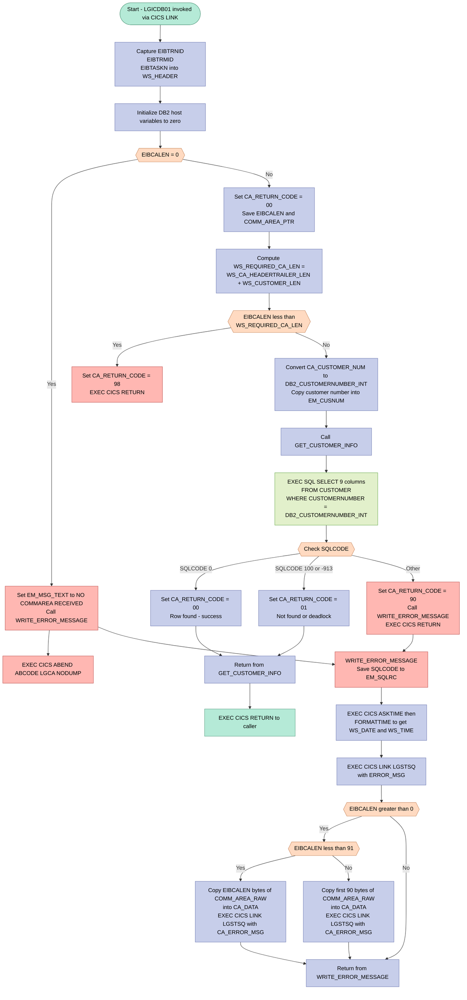
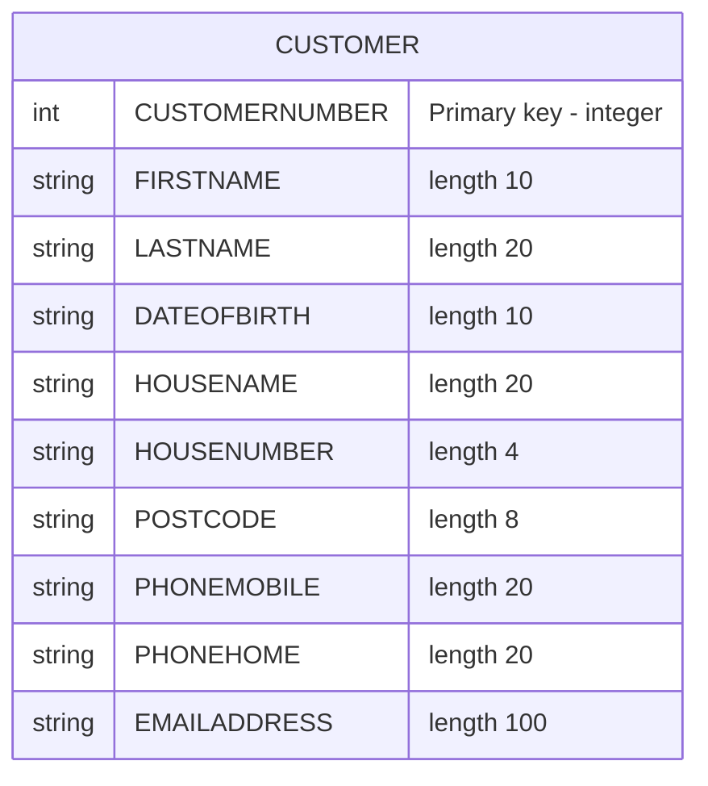

## Table of Contents

- [1. Purpose](#1-purpose)
- [2. Inputs](#2-inputs)
  - [2.1 Procedure and CICS invocation inputs](#21-procedure-and-cics-invocation-inputs)
  - [2.2 Inputs read from the COMMAREA](#22-inputs-read-from-the-commarea)
  - [2.3 External data sources](#23-external-data-sources)
  - [2.4 Runtime/system-provided values used as inputs](#24-runtimesystem-provided-values-used-as-inputs)
  - [2.5 External program interactions that supply data or services](#25-external-program-interactions-that-supply-data-or-services)
- [3. Outputs](#3-outputs)
- [4. Processing Logic](#4-processing-logic)
  - [4.1 Mermaid Flow Diagram](#41-mermaid-flow-diagram)
  - [4.2 Processing Logic Description](#42-processing-logic-description)
  - [4.3 Database Tables](#43-database-tables)
- [5. Paragraphs](#5-paragraphs)
- [6. Dependencies](#6-dependencies)
  - [6.1 CICS Runtime Environment](#61-cics-runtime-environment)
  - [6.2 External Programs / Subroutines](#62-external-programs--subroutines)
  - [6.3 DB2 Database](#63-db2-database)
  - [6.4 Communication Area (COMMAREA)](#64-communication-area-commarea)
  - [6.5 Copybooks / Include Members](#65-copybooks--include-members)
- [7. Constraints](#7-constraints)
  - [7.1 Input / Communication Area Constraints](#71-input--communication-area-constraints)
  - [7.2 DB2 Query Constraints](#72-db2-query-constraints)
  - [7.3 Output / Return Code Constraints](#73-output--return-code-constraints)
  - [7.4 Error Logging Constraints](#74-error-logging-constraints)
  - [7.5 Operational / Sequencing Constraints](#75-operational--sequencing-constraints)
- [8. Error Handling](#8-error-handling)
  - [8.1 Communication Area Validation](#81-communication-area-validation)
  - [8.2 DB2 Query Error Handling](#82-db2-query-error-handling)
  - [8.3 Error Logging and Diagnostics](#83-error-logging-and-diagnostics)
  - [8.4 Return Code Signalling to Caller](#84-return-code-signalling-to-caller)
- [9. Examples](#9-examples)
  - [9.1 Example 1: Successful Customer Retrieval](#91-example-1-successful-customer-retrieval)
  - [9.2 Example 2: Customer Not Found (SQLCODE 100)](#92-example-2-customer-not-found-sqlcode-100)
  - [9.3 Example 3: COMMAREA Too Short — Length Validation Failure](#93-example-3-commarea-too-short--length-validation-failure)

## 1. Purpose

`LGICDB01` is a CICS-hosted Enterprise PL/I program that retrieves a single customer's profile from a DB2 database in response to an inquiry request. It receives a communication area containing a 10-digit customer number, validates that the communication area meets the required minimum length, and then executes a DB2 `SELECT` against the `CUSTOMER` table to fetch the customer's personal and contact details — including name, date of birth, address, phone numbers, and email address — populating the corresponding communication area fields directly for return to the caller. The program sets a return code of `'00'` on success, `'98'` if the communication area is too short, `'01'` if no matching customer row is found or a deadlock occurs, and `'90'` for any other unexpected DB2 error; in error scenarios it captures a timestamped diagnostic message and forwards it, along with a dump of the communication area, to the `LGSTSQ` logging program via a CICS `LINK` call before returning control to the caller.

## 2. Inputs

### 2.1 Procedure and CICS invocation inputs
- `COMM_AREA_PTR`
  - Procedure parameter passed into `LGICDB01`.
  - Pointer to the incoming CICS COMMAREA buffer.
  - All request data is read from this external area, and response data is written back into it.

- `EIBCALEN`
  - CICS-provided execution input indicating the length of the received COMMAREA.
  - Used to detect a missing COMMAREA (`EIBCALEN = 0`) and to validate that the caller passed enough data for customer inquiry processing.

- `EIBTRNID`
  - CICS transaction identifier supplied by the runtime.
  - Captured for diagnostic and error logging context.

- `EIBTRMID`
  - CICS terminal identifier supplied by the runtime.
  - Captured for diagnostic and error logging context.

- `EIBTASKN`
  - CICS task number supplied by the runtime.
  - Captured for diagnostic and error logging context.

### 2.2 Inputs read from the COMMAREA
- `CA_CUSTOMER_NUM`
  - Customer number supplied by the caller in the COMMAREA.
  - Primary business input to the program.
  - Converted to an integer host variable and used in the DB2 `WHERE CUSTOMERNUMBER = ...` lookup.

- `COMM_AREA_RAW`
  - Raw view of the incoming COMMAREA buffer.
  - Used only for diagnostics when writing error information, by copying the received COMMAREA bytes to the logging program.

### 2.3 External data sources
- DB2 table `CUSTOMER`
  - External database source queried by the program.
  - Read using the incoming customer number to retrieve customer details.

- `CUSTOMER.FIRSTNAME`
  - Database column returned from DB2.
  - Used to populate `CA_FIRST_NAME` in the response COMMAREA.

- `CUSTOMER.LASTNAME`
  - Database column returned from DB2.
  - Used to populate `CA_LAST_NAME`.

- `CUSTOMER.DATEOFBIRTH`
  - Database column returned from DB2.
  - Used to populate `CA_DOB`.

- `CUSTOMER.HOUSENAME`
  - Database column returned from DB2.
  - Used to populate `CA_HOUSE_NAME`.

- `CUSTOMER.HOUSENUMBER`
  - Database column returned from DB2.
  - Used to populate `CA_HOUSE_NUM`.

- `CUSTOMER.POSTCODE`
  - Database column returned from DB2.
  - Used to populate `CA_POSTCODE`.

- `CUSTOMER.PHONEMOBILE`
  - Database column returned from DB2.
  - Used to populate `CA_PHONE_MOBILE`.

- `CUSTOMER.PHONEHOME`
  - Database column returned from DB2.
  - Used to populate `CA_PHONE_HOME`.

- `CUSTOMER.EMAILADDRESS`
  - Database column returned from DB2.
  - Used to populate `CA_EMAIL_ADDRESS`.

### 2.4 Runtime/system-provided values used as inputs
- `SQLCODE`
  - DB2 runtime status returned from the `SELECT` statement.
  - Drives success, not-found, lock/not-available, and error handling paths.

- Current CICS system time
  - Retrieved through `EXEC CICS ASKTIME`.
  - Used for timestamping error log messages.

### 2.5 External program interactions that supply data or services
- Program `LGSTSQ`
  - External CICS-linked logging program invoked by `WRITE_ERROR_MESSAGE`.
  - Receives the formatted error message and COMMAREA snapshot for diagnostic output.

## 3. Outputs

**Communication Area (COMMAREA) — returned to the caller via `EXEC CICS RETURN`**

- `CA_RETURN_CODE` — two-digit outcome code written back to the caller in all execution paths:
  - `'00'` — customer record successfully retrieved
  - `'98'` — incoming COMMAREA is too short to hold a customer request
  - `'01'` — no matching customer row found (SQLCODE 100 or -913)
  - `'90'` — unexpected DB2 error; error messages are also dispatched before returning

- Customer data populated from the DB2 `CUSTOMER` table `SELECT` result (only present when `CA_RETURN_CODE = '00'`):
  - `CA_FIRST_NAME` — customer's given name (FIRSTNAME column)
  - `CA_LAST_NAME` — customer's family name (LASTNAME column)
  - `CA_DOB` — customer's date of birth (DATEOFBIRTH column)
  - `CA_HOUSE_NAME` — residential property name (HOUSENAME column)
  - `CA_HOUSE_NUM` — street number of the customer's address (HOUSENUMBER column)
  - `CA_POSTCODE` — customer's postal code (POSTCODE column)
  - `CA_PHONE_MOBILE` — customer's mobile telephone number (PHONEMOBILE column)
  - `CA_PHONE_HOME` — customer's home telephone number (PHONEHOME column)
  - `CA_EMAIL_ADDRESS` — customer's email address (EMAILADDRESS column)

**CICS ABEND — triggered when no COMMAREA is received**

- `EXEC CICS ABEND ABCODE('LGCA') NODUMP` — issued when `EIBCALEN = 0`, terminating the task with abend code `LGCA` without producing a dump; this is an observable side effect that signals a severe invocation error to the CICS environment

**Error logging via CICS LINK to `LGSTSQ` — triggered on unexpected DB2 errors or missing COMMAREA**

- `ERROR_MSG` — structured diagnostic message written to the logging program `LGSTSQ` via `EXEC CICS LINK`; contains:
  - Formatted date (`EM_DATE`) and time (`EM_TIME`) of the error
  - Literal program identifier `LGICDB01`
  - Customer number (`EM_CUSNUM`)
  - SQL request label (`EM_SQLREQ`, fixed to `' SELECT CUSTOMER'`)
  - SQLCODE value (`EM_SQLRC`)

- `CA_ERROR_MSG` — secondary diagnostic message also sent to `LGSTSQ` via `EXEC CICS LINK`; contains the raw COMMAREA bytes (up to 90 bytes, or `EIBCALEN` if smaller) prefixed with the literal `'COMMAREA='`, providing a snapshot of the caller's input at the time of failure

## 4. Processing Logic

### 4.1 Mermaid Flow Diagram

---

### 4.2 Processing Logic Description

#### 4.2.1 High-level Summary

`LGICDB01` is a CICS PL/I program that retrieves a single customer record from the DB2 `CUSTOMER` table. It is invoked as a back-end DB2 handler via `CICS LINK` from the customer inquiry orchestrator (`LGICUS01`). The caller supplies a communication area (COMMAREA) containing a 10-digit customer number; the program looks up the matching row in DB2 and populates customer detail fields (name, address, contact information) directly back into the COMMAREA before returning.

---

#### 4.2.2 Execution Flow

**Step 1 — Initialisation**
Upon entry, the program captures the current CICS transaction ID (`EIBTRNID`), terminal ID (`EIBTRMID`), and task number (`EIBTASKN`) into the `WS_HEADER` diagnostic block. The DB2 host variable block `DB2_IN_INTEGERS` is zeroed out. This step establishes context for any subsequent error messages.

**Step 2 — COMMAREA presence check**
`EIBCALEN` (the CICS-provided length of the received COMMAREA) is tested. If it equals zero no COMMAREA was passed at all. In that case the program sets an error message text, calls `WRITE_ERROR_MESSAGE` to log diagnostics, and then issues `EXEC CICS ABEND ABCODE('LGCA') NODUMP` — a hard, non-dump abend — to signal a fatal programming error to CICS.

**Step 3 — Return code and length initialisation**
With a non-zero `EIBCALEN`, `CA_RETURN_CODE` is pre-set to `'00'` (success) and the COMMAREA length and pointer are saved into working-storage fields for later diagnostic use.

**Step 4 — COMMAREA length validation**
The minimum required COMMAREA length is computed as:
> `WS_REQUIRED_CA_LEN = WS_CA_HEADERTRAILER_LEN (18) + WS_CUSTOMER_LEN (72) = 90 bytes`

If `EIBCALEN` is less than this computed minimum, `CA_RETURN_CODE` is set to `'98'` (insufficient length) and `EXEC CICS RETURN` sends control back to the caller immediately without any DB2 access.

**Step 5 — Customer number conversion**
`CA_CUSTOMER_NUM` (a 10-digit picture clause field from the COMMAREA) is converted to `DB2_CUSTOMERNUMBER_INT` (a `FIXED BIN(31)` integer), which is the format required by the DB2 `WHERE` clause. The customer number is also copied into `EM_CUSNUM` in the error message structure so that it is pre-loaded for any error log that may follow.

**Step 6 — DB2 inquiry (`GET_CUSTOMER_INFO`)**
The internal procedure `GET_CUSTOMER_INFO` is called. It executes a single-row `SELECT` against the `CUSTOMER` table, fetching nine columns directly `INTO` the corresponding COMMAREA host-variable fields:

| DB2 Column | COMMAREA Field |
|---|---|
| `FIRSTNAME` | `CA_FIRST_NAME` |
| `LASTNAME` | `CA_LAST_NAME` |
| `DATEOFBIRTH` | `CA_DOB` |
| `HOUSENAME` | `CA_HOUSE_NAME` |
| `HOUSENUMBER` | `CA_HOUSE_NUM` |
| `POSTCODE` | `CA_POSTCODE` |
| `PHONEMOBILE` | `CA_PHONE_MOBILE` |
| `PHONEHOME` | `CA_PHONE_HOME` |
| `EMAILADDRESS` | `CA_EMAIL_ADDRESS` |

**Step 7 — SQLCODE handling**
After the SQL statement, a PL/I `SELECT (SQLCODE)` / `WHEN` construct evaluates the outcome:

| SQLCODE | Meaning | Action |
|---|---|---|
| `0` | Row found successfully | `CA_RETURN_CODE = '00'` |
| `100` | No row found (NOT FOUND) | `CA_RETURN_CODE = '01'` |
| `-913` | Deadlock / timeout | `CA_RETURN_CODE = '01'` |
| Any other | Unexpected DB2 error | `CA_RETURN_CODE = '90'`, call `WRITE_ERROR_MESSAGE`, `EXEC CICS RETURN` immediately |

Both SQLCODE `100` and `-913` are mapped to the same return code `'01'`, meaning the caller cannot distinguish between a missing record and a DB2 deadlock — both are treated as "customer not found."

**Step 8 — Return to caller**
After `GET_CUSTOMER_INFO` returns normally, `EXEC CICS RETURN` is issued. The COMMAREA — now populated with either customer data or an error return code — is returned to the calling program.

---

#### 4.2.3 Error Handling — `WRITE_ERROR_MESSAGE` Procedure

This shared procedure is invoked on unexpected DB2 errors and on the missing-COMMAREA path. It performs these steps:

1. Saves the current `SQLCODE` value into `EM_SQLRC` in the error message structure.
2. Issues `EXEC CICS ASKTIME ABSTIME(WS_ABSTIME)` to obtain a high-resolution absolute timestamp.
3. Issues `EXEC CICS FORMATTIME` to derive a human-readable date (`MMDDYYYY` → `WS_DATE`) and time (`WS_TIME`).
4. Populates `EM_DATE` and `EM_TIME` in the `ERROR_MSG` structure.
5. Calls the CICS logging utility `LGSTSQ` via `EXEC CICS LINK` passing the full `ERROR_MSG` structure (program eye-catcher, date, time, customer number, SQL request label, SQLCODE).
6. Additionally dumps up to 90 bytes of the raw COMMAREA bytes to `LGSTSQ` for diagnostic purposes: if `EIBCALEN < 91` the exact number of received bytes is copied; otherwise a fixed 90-byte prefix is used.

---

#### 4.2.4 External Interactions

| System | Interaction | Purpose |
|---|---|---|
| **DB2 — CUSTOMER table** | `SELECT` (single-row fetch) | Retrieve customer personal and contact details by customer number |
| **CICS — LGSTSQ** | `EXEC CICS LINK` (error path only) | Write error log entries (timestamped message + raw COMMAREA dump) to a transient data queue |
| **CICS EIB** | `EIBTRNID`, `EIBTRMID`, `EIBTASKN`, `EIBCALEN` | Read transaction context and COMMAREA length for validation and diagnostics |

---

#### 4.2.5 Plain Language Summary

When a calling program wants to look up a customer, it calls `LGICDB01` and passes the customer's 10-digit ID in a shared data area. This program first checks that the data area is large enough to hold a customer record. If it is, the program takes the customer ID, queries the IBM DB2 database, and fills in the customer's name, address, phone numbers, date of birth, and email address directly into the shared data area. It then tells the caller whether the lookup succeeded (`00`), the customer was not found (`01`), the data area was too short (`98`), or an unexpected database error occurred (`90`). If anything goes wrong, it writes a detailed timestamped error log — including the raw contents of the shared data area — to a CICS logging utility before returning.

---

### 4.3 Database Tables

## 5. Paragraphs

- **Main Procedure Body (LGICDB01)**
  - Serves as the program entry point; receives `COMM_AREA_PTR` as its parameter and executes with `Options(Main)`.
  - **Initialization:** Captures the current CICS execution context by assigning `EIBTRNID`, `EIBTRMID`, and `EIBTASKN` into working-storage fields (`WS_TRANSID`, `WS_TERMID`, `WS_TASKNUM`). Resets the DB2 host-variable group (`DB2_IN_INTEGERS = 0`).
  - **No-COMMAREA guard:** Checks `EIBCALEN = 0`; if true, sets `EM_MSG_TEXT` to a descriptive literal, calls `WRITE_ERROR_MESSAGE`, and issues `EXEC CICS ABEND ABCODE('LGCA') NODUMP` to terminate the task abnormally without producing a system dump.
  - **COMMAREA baseline setup:** Sets `CA_RETURN_CODE = '00'`, saves `EIBCALEN` into `WS_CALEN`, and records the COMMAREA pointer in `WS_ADDR_DFHCOMMAREA` for diagnostic traceability.
  - **Minimum-length validation:** Computes `WS_REQUIRED_CA_LEN` as the sum of the fixed header/trailer length (`WS_CA_HEADERTRAILER_LEN = 18`) and the customer data length (`WS_CUSTOMER_LEN = 72`). If `EIBCALEN` is smaller than this computed minimum, `CA_RETURN_CODE` is set to `'98'` and `EXEC CICS RETURN` exits the program immediately, avoiding any risk of reading beyond the COMMAREA boundary.
  - **Input conversion:** Converts the pictured decimal field `CA_CUSTOMER_NUM` to the binary integer `DB2_CUSTOMERNUMBER_INT` for use in the DB2 `WHERE` clause, and also copies it to `EM_CUSNUM` so it is pre-loaded in the error message should a subsequent failure occur.
  - **Core processing dispatch:** Calls the internal procedure `GET_CUSTOMER_INFO` to perform the DB2 lookup.
  - **Normal exit:** Issues `EXEC CICS RETURN` to hand control back to the calling CICS task, followed by a PL/I `RETURN` statement to satisfy the language runtime.

- **GET_CUSTOMER_INFO**
  - Encapsulates all DB2 interaction to retrieve a single customer row from the `CUSTOMER` table.
  - **SQL request label:** Sets `EM_SQLREQ = ' SELECT CUSTOMER'` before the SQL call so that any subsequently logged error message identifies the failing SQL operation.
  - **DB2 SELECT:** Executes a single-row `EXEC SQL SELECT … INTO` statement fetching nine columns — `FIRSTNAME`, `LASTNAME`, `DATEOFBIRTH`, `HOUSENAME`, `HOUSENUMBER`, `POSTCODE`, `PHONEMOBILE`, `PHONEHOME`, and `EMAILADDRESS` — directly into the corresponding COMMAREA host-variable fields (`CA_FIRST_NAME`, `CA_LAST_NAME`, `CA_DOB`, `CA_HOUSE_NAME`, `CA_HOUSE_NUM`, `CA_POSTCODE`, `CA_PHONE_MOBILE`, `CA_PHONE_HOME`, `CA_EMAIL_ADDRESS`). The predicate is `WHERE CUSTOMERNUMBER = :DB2_CUSTOMERNUMBER_INT`.
  - **SQLCODE evaluation:** Uses a PL/I `SELECT (SQLCODE)` construct (equivalent to a `CASE` statement) to branch on the outcome:
    - `WHEN (0)` — successful fetch; sets `CA_RETURN_CODE = '00'`.
    - `WHEN (100, -913)` — row not found (SQLCODE 100) or resource unavailable/deadlock (-913); sets `CA_RETURN_CODE = '01'` to signal a "not found" condition to the caller.
    - `OTHERWISE` — any other unexpected DB2 error; sets `CA_RETURN_CODE = '90'`, calls `WRITE_ERROR_MESSAGE` to log diagnostics, and issues `EXEC CICS RETURN` to abort further processing.

- **WRITE_ERROR_MESSAGE**
  - A diagnostic utility procedure that formats and writes error information to the CICS logging infrastructure via the `LGSTSQ` program.
  - **SQLCODE capture:** Saves the current `SQLCODE` value into `EM_SQLRC` within the `ERROR_MSG` structure so it appears in the logged message.
  - **Timestamp acquisition:** Issues `EXEC CICS ASKTIME ABSTIME(WS_ABSTIME)` to capture the current absolute time, then `EXEC CICS FORMATTIME ABSTIME(WS_ABSTIME) MMDDYYYY(WS_DATE) TIME(WS_TIME)` to convert it to human-readable date (`WS_DATE`) and time (`WS_TIME`) strings. These are then copied into `EM_DATE` and `EM_TIME` in the error message structure.
  - **Primary error message write:** Calls `EXEC CICS LINK PROGRAM('LGSTSQ') COMMAREA(ERROR_MSG) LENGTH(STG(ERROR_MSG))` to forward the structured error message (containing date, time, program eye-catcher `LGICDB01`, customer number, SQL request label, and SQLCODE) to the `LGSTSQ` logging program.
  - **COMMAREA dump:** Conditionally writes up to 90 bytes of the raw COMMAREA to provide additional diagnostic context:
    - If `EIBCALEN > 0` and `EIBCALEN < 91`, copies exactly `EIBCALEN` bytes from `COMM_AREA_RAW` into `CA_DATA` and links to `LGSTSQ` with `CA_ERROR_MSG`.
    - If `EIBCALEN >= 91`, copies the first 90 bytes into `CA_DATA` and links to `LGSTSQ` with `CA_ERROR_MSG`.
    - If `EIBCALEN = 0`, the COMMAREA dump step is skipped entirely.
  - Exits with a PL/I `RETURN` statement back to the calling procedure.

## 6. Dependencies

### 6.1 CICS Runtime Environment

- **CICS Transaction Server**
  - The program runs as a CICS-managed program, relying on CICS for invocation, task management, and return control
  - **EXEC CICS RETURN** — used at multiple points to end processing and return control to the CICS caller
  - **EXEC CICS ABEND ABCODE('LGCA') NODUMP** — issued when no communication area is received; triggers a CICS abend with code `LGCA` without producing a dump
  - **EXEC CICS ASKTIME ABSTIME(WS_ABSTIME)** — retrieves the current absolute timestamp for use in error logging
  - **EXEC CICS FORMATTIME ABSTIME(WS_ABSTIME) MMDDYYYY(WS_DATE) TIME(WS_TIME)** — formats the absolute timestamp into human-readable date and time strings written into the error message
  - **EXEC CICS LINK PROGRAM('LGSTSQ') COMMAREA(...) LENGTH(...)** — invokes the external logging program `LGSTSQ` to write diagnostic messages; called twice per error occurrence (once for the error message structure and once for the raw communication area data)

- **CICS Execute Interface Block (EIB)**
  - **EIBTRNID** — provides the current transaction identifier, stored in `WS_TRANSID` for diagnostic purposes
  - **EIBTRMID** — provides the current terminal identifier, stored in `WS_TERMID` for diagnostic purposes
  - **EIBTASKN** — provides the current task number, stored in `WS_TASKNUM` for diagnostic purposes
  - **EIBCALEN** — provides the length of the incoming communication area; used to validate that a COMMAREA was received and that it meets the minimum required length before processing

### 6.2 External Programs / Subroutines

- **LGSTSQ** — an external CICS program invoked via `EXEC CICS LINK` to write error and diagnostic messages to a Transient Data Queue (TDQ); called with either the `ERROR_MSG` structure or the `CA_ERROR_MSG` raw communication area fragment

### 6.3 DB2 Database

- **DB2 Subsystem**
  - **EXEC SQL INCLUDE SQLCA** — includes the SQL Communication Area, which provides `SQLCODE` and related fields used to evaluate the outcome of every DB2 call
  - **CUSTOMER table** — the target DB2 table; queried via a `SELECT` statement using `CUSTOMERNUMBER` as the lookup key; the following columns are read:
    - `FIRSTNAME` → `CA_FIRST_NAME`
    - `LASTNAME` → `CA_LAST_NAME`
    - `DATEOFBIRTH` → `CA_DOB`
    - `HOUSENAME` → `CA_HOUSE_NAME`
    - `HOUSENUMBER` → `CA_HOUSE_NUM`
    - `POSTCODE` → `CA_POSTCODE`
    - `PHONEMOBILE` → `CA_PHONE_MOBILE`
    - `PHONEHOME` → `CA_PHONE_HOME`
    - `EMAILADDRESS` → `CA_EMAIL_ADDRESS`

### 6.4 Communication Area (COMMAREA)

- **Caller-supplied COMMAREA** (mapped via `LGCMAREA` copybook / inline `COMM_AREA` structure)
  - Passed by pointer (`COMM_AREA_PTR`) as the program's main parameter
  - Provides all input to and receives all output from the program
  - **Input fields consumed by this program:**
    - `CA_REQUEST_ID` — request type identifier in the header
    - `CA_CUSTOMER_NUM` — the 10-digit customer number driving the DB2 lookup
  - **Output fields populated by this program:**
    - `CA_RETURN_CODE` — set to `'00'` (success), `'01'` (not found / deadlock), `'90'` (unexpected DB2 error), or `'98'` (COMMAREA too short)
    - `CA_FIRST_NAME`, `CA_LAST_NAME`, `CA_DOB`, `CA_HOUSE_NAME`, `CA_HOUSE_NUM`, `CA_POSTCODE`, `CA_PHONE_MOBILE`, `CA_PHONE_HOME`, `CA_EMAIL_ADDRESS` — customer detail fields populated from DB2

### 6.5 Copybooks / Include Members

- **LGCMAREA** (`plinc/LGCMAREA.inc`) — defines the full `COMM_AREA` structure (customer, policy, security, and claim layouts) used as the program's communication interface; expanded inline at compile time via `EXEC SQL INCLUDE` (commented out in source; content is physically included)
- **SQLCA** — DB2-supplied SQL Communication Area include member; provides `SQLCODE` and related diagnostics fields referenced throughout the program

## 7. Constraints

### 7.1 Input / Communication Area Constraints

- **COMMAREA must be present (non-zero length)**
  - Enforced at program entry: `IF ( EIBCALEN = 0 )` triggers `EXEC CICS ABEND ABCODE('LGCA') NODUMP`
  - The program cannot proceed under any circumstance without an incoming COMMAREA; the abend is unconditional and non-negotiable — no return code is set, the task is terminated immediately

- **COMMAREA must meet a minimum byte length of 90 bytes**
  - `WS_REQUIRED_CA_LEN` is computed as `WS_CA_HEADERTRAILER_LEN (18) + WS_CUSTOMER_LEN (72) = 90`
  - Enforced by: `IF (EIBCALEN < WS_REQUIRED_CA_LEN)` → `CA_RETURN_CODE = '98'` followed by `EXEC CICS RETURN`
  - Processing stops immediately; no DB2 access is attempted if this check fails

- **COMMAREA buffer is declared as CHAR(32500) maximum**
  - The `COMM_AREA_RAW` UNION alternative fixes the absolute upper bound on the COMMAREA buffer that the program can address; data beyond 32,500 bytes is not reachable

- **`CA_CUSTOMER_NUM` must be a 10-digit numeric picture field (`PIC '9999999999'`)**
  - Structural constraint enforced by the PL/I picture declaration itself; non-numeric content would cause a conversion error when assigned to `DB2_CUSTOMERNUMBER_INT` (FIXED BIN(31))
  - The value is implicitly required to represent a valid integer for the DB2 WHERE clause

### 7.2 DB2 Query Constraints

- **Exactly one customer row must exist for the given customer number**
  - The `SELECT … INTO` is a singleton fetch; DB2 requires exactly one matching row
  - SQLCODE = 0 → success (`CA_RETURN_CODE = '00'`)
  - SQLCODE = 100 (no row found) or -913 (deadlock/timeout/resource unavailable) → `CA_RETURN_CODE = '01'`; treated as a "not found" condition — no error message is logged, execution returns cleanly
  - Any other non-zero SQLCODE → `CA_RETURN_CODE = '90'`; error message is written and `EXEC CICS RETURN` is issued immediately

- **The customer lookup key must be expressed as a FIXED BIN(31) integer**
  - `DB2_CUSTOMERNUMBER_INT` is declared as `FIXED BIN(31)` and used directly in `WHERE CUSTOMERNUMBER = :DB2_CUSTOMERNUMBER_INT`
  - Customer numbers that exceed the 31-bit signed integer range (> 2,147,483,647) cannot be represented and would produce an incorrect or overflow result

- **The SELECT retrieves a fixed set of nine columns**
  - Only `FIRSTNAME`, `LASTNAME`, `DATEOFBIRTH`, `HOUSENAME`, `HOUSENUMBER`, `POSTCODE`, `PHONEMOBILE`, `PHONEHOME`, and `EMAILADDRESS` are fetched
  - No other columns from the CUSTOMER table are accessible through this program; callers cannot request additional fields

### 7.3 Output / Return Code Constraints

- **`CA_RETURN_CODE` must convey one of four defined outcome values**
  - `'00'` — successful retrieval
  - `'98'` — COMMAREA too short (processing aborted before DB2 access)
  - `'01'` — customer not found (SQLCODE 100) or DB2 resource conflict (SQLCODE -913)
  - `'90'` — unexpected DB2 error; error diagnostics are logged before return
  - No other return code values are set by this program

- **Output fields are fixed-length and constrained by their COMMAREA declarations**
  - `CA_FIRST_NAME`: max 10 characters
  - `CA_LAST_NAME`: max 20 characters
  - `CA_DOB`: max 10 characters
  - `CA_HOUSE_NAME`: max 20 characters
  - `CA_HOUSE_NUM`: max 4 characters
  - `CA_POSTCODE`: max 8 characters
  - `CA_PHONE_MOBILE`: max 20 characters
  - `CA_PHONE_HOME`: max 20 characters
  - `CA_EMAIL_ADDRESS`: max 100 characters
  - DB2 column values longer than these declared lengths will be truncated silently

### 7.4 Error Logging Constraints

- **Error diagnostic logging is conditional on COMMAREA presence**
  - Inside `WRITE_ERROR_MESSAGE`, the COMMAREA dump is only written if `EIBCALEN > 0`; this guard prevents a null-pointer reference when logging is triggered before the length check (e.g., for the ABEND path)

- **COMMAREA data captured in the error log is capped at 90 bytes**
  - `IF ( EIBCALEN < 91 )` → copies exactly `EIBCALEN` bytes via `LEFT(COMM_AREA_RAW, EIBCALEN)`
  - Otherwise → copies exactly 90 bytes via `LEFT(COMM_AREA_RAW, 90)`
  - `CA_DATA` is declared as `CHAR(90)`, so no more than 90 bytes are ever logged regardless of actual COMMAREA size

- **Error logging always calls the external program `LGSTSQ`**
  - Both the structured error message (`ERROR_MSG`) and the raw COMMAREA dump (`CA_ERROR_MSG`) are forwarded via `EXEC CICS LINK PROGRAM('LGSTSQ')`; the `LGSTSQ` program must be available in the CICS environment for logging to succeed

### 7.5 Operational / Sequencing Constraints

- **COMMAREA validation must precede DB2 access**
  - The program enforces a strict sequence: EIBCALEN = 0 check → minimum length check → customer number conversion → DB2 SELECT
  - The DB2 call (`GET_CUSTOMER_INFO`) is never reached unless both COMMAREA checks pass

- **`DB2_CUSTOMERNUMBER_INT` must be populated before the SQL SELECT executes**
  - The assignment `DB2_CUSTOMERNUMBER_INT = CA_CUSTOMER_NUM` is performed in the mainline before `CALL GET_CUSTOMER_INFO`; the procedure relies entirely on this pre-set value and performs no conversion internally

- **The program is designed for a single invocation per transaction**
  - There is no loop, cursor, or re-entry mechanism; the program executes once — performs one DB2 singleton SELECT — and returns; it cannot process multiple customers in a single invocation

- **This program operates only as a called (LINK target) program**
  - It is invoked via `EXEC CICS LINK` from a customer orchestrator (e.g., `LGICUS01`); it cannot be initiated as a transaction directly, since it depends entirely on a populated COMMAREA passed by the caller

## 8. Error Handling

### 8.1 Communication Area Validation

- **Zero-length COMMAREA check:** At program entry, `EIBCALEN` is tested for a value of zero. If no COMMAREA was passed by the caller, the program considers this a fatal, unrecoverable situation. It populates the `EM_MSG_TEXT` field with a descriptive message (`NO COMMAREA RECEIVED`), calls the `WRITE_ERROR_MESSAGE` subroutine to log the error, and then issues `EXEC CICS ABEND ABCODE('LGCA') NODUMP` to abnormally terminate the task with a custom four-character abend code. The `NODUMP` option suppresses a storage dump, keeping the abend lightweight.

- **Minimum COMMAREA length check:** After confirming that a COMMAREA exists, the program calculates the minimum acceptable length (`WS_REQUIRED_CA_LEN`) as the sum of the header/trailer length and the customer structure length. If `EIBCALEN` is less than this computed minimum, the program sets `CA_RETURN_CODE` to `'98'` and immediately issues `EXEC CICS RETURN` to return control to the caller with the error code. No error message is logged in this path; the return code alone signals the problem.

---

### 8.2 DB2 Query Error Handling

- **SQLCODE inspection after SELECT:** Immediately following the DB2 `SELECT` statement that retrieves customer details, the program uses a PL/I `SELECT` statement to branch on the value of `SQLCODE`, implementing a structured multi-way check:

  - **SQLCODE 0 (success):** `CA_RETURN_CODE` is set to `'00'`, indicating that the customer record was found and retrieved successfully. No further action is taken.

  - **SQLCODE 100 or -913 (not found / resource conflict):** Both of these codes are handled together in a single `WHEN` branch. `CA_RETURN_CODE` is set to `'01'` to signal to the caller that no matching customer record was available. No error message is written and execution proceeds normally back to the caller.
    - SQLCODE 100 represents the standard DB2 "no row found" condition for a singleton SELECT.
    - SQLCODE -913 represents an unsuccessful execution due to deadlock or timeout (resource unavailable).

  - **All other SQLCODEs (unexpected DB2 errors):** The `OTHERWISE` branch catches any remaining non-zero SQL return codes. `CA_RETURN_CODE` is set to `'90'` to indicate an unexpected database error. The `WRITE_ERROR_MESSAGE` subroutine is called to log full diagnostic details, and `EXEC CICS RETURN` is then issued to terminate the program and return control to the caller with the error code.

---

### 8.3 Error Logging and Diagnostics

- **`WRITE_ERROR_MESSAGE` subroutine:** This centralized error-logging procedure is called both when no COMMAREA is received and when an unexpected DB2 error occurs. It performs the following steps:
  - Captures the current `SQLCODE` value into the `EM_SQLRC` field of the `ERROR_MSG` structure for diagnostic traceability.
  - Obtains the current timestamp using `EXEC CICS ASKTIME` (storing the raw absolute time in `WS_ABSTIME`) and formats it into a human-readable date (`WS_DATE`) and time (`WS_TIME`) via `EXEC CICS FORMATTIME`.
  - Transfers the formatted date and time into the `ERROR_MSG` structure fields `EM_DATE` and `EM_TIME`.
  - Dispatches the fully constructed `ERROR_MSG` structure to the logging program `LGSTSQ` via `EXEC CICS LINK`, which writes the message to a transient data queue (TDQ).

- **COMMAREA dump in error log:** After writing the primary error message, the subroutine also attempts to log the raw contents of the incoming COMMAREA for further diagnosis:
  - If `EIBCALEN` is greater than zero but less than 91 bytes, the exact number of bytes present in `COMM_AREA_RAW` is copied into `CA_DATA` and forwarded to `LGSTSQ` via a second `EXEC CICS LINK` call.
  - If `EIBCALEN` is 91 bytes or greater, only the first 90 bytes are copied into `CA_DATA` and similarly forwarded to `LGSTSQ`. This caps the dump at 90 bytes to fit the fixed `CA_DATA` field.
  - If `EIBCALEN` is zero, no COMMAREA dump is attempted.

---

### 8.4 Return Code Signalling to Caller

- **`CA_RETURN_CODE` as the primary outcome indicator:** The program uses `CA_RETURN_CODE` as its standard mechanism for communicating the result of processing back to the caller. The possible values set across all error paths are:
  - `'00'` — successful customer retrieval
  - `'98'` — COMMAREA too short to be valid
  - `'01'` — customer record not found or DB2 resource conflict (SQLCODE 100 or -913)
  - `'90'` — unexpected DB2 error

- **Program termination via `EXEC CICS RETURN`:** In all non-abend error paths (insufficient COMMAREA length, and unexpected DB2 error), the program terminates by issuing `EXEC CICS RETURN`, which returns control cleanly to the CICS caller. The return code in `CA_RETURN_CODE` carries the error indicator back for the caller to act upon.

## 9. Examples

### 9.1 Example 1: Successful Customer Retrieval

**Input (COMMAREA fields supplied by the caller):**

| Field | Value |
|---|---|
| `CA_REQUEST_ID` | `'01ICDB'` |
| `CA_RETURN_CODE` | `'00'` *(initial, set by caller)* |
| `CA_CUSTOMER_NUM` | `'0000000042'` |
| COMMAREA total length (`EIBCALEN`) | 90 bytes *(≥ minimum of 18 + 72 = 90)* |

**Expected Output (COMMAREA fields returned to caller):**

| Field | Value (from DB2 CUSTOMER table row for customer 42) |
|---|---|
| `CA_RETURN_CODE` | `'00'` |
| `CA_FIRST_NAME` | `'John      '` |
| `CA_LAST_NAME` | `'Smith               '` |
| `CA_DOB` | `'1975-06-15'` |
| `CA_HOUSE_NAME` | `'Rose Cottage           '` |
| `CA_HOUSE_NUM` | `'12  '` |
| `CA_POSTCODE` | `'SW1A 1AA'` |
| `CA_PHONE_MOBILE` | `'07700900123         '` |
| `CA_PHONE_HOME` | `'02079460001         '` |
| `CA_EMAIL_ADDRESS` | `'john.smith@example.com'` |

**How input leads to output:**
The program validates that `EIBCALEN` (90) meets the minimum required length (18 header/trailer + 72 customer fields = 90). It converts `CA_CUSTOMER_NUM` (`'0000000042'`) to the integer `42` in `DB2_CUSTOMERNUMBER_INT`, then issues a DB2 `SELECT` against the `CUSTOMER` table `WHERE CUSTOMERNUMBER = 42`. DB2 returns `SQLCODE = 0`, so `CA_RETURN_CODE` is set to `'00'` and all nine customer columns are populated in the COMMAREA customer request section. The program then returns to the caller via `EXEC CICS RETURN`.

---

### 9.2 Example 2: Customer Not Found (SQLCODE 100)

**Input:**

| Field | Value |
|---|---|
| `CA_REQUEST_ID` | `'01ICDB'` |
| `CA_CUSTOMER_NUM` | `'9999999999'` |
| `EIBCALEN` | 90 bytes |

**Expected Output:**

| Field | Value |
|---|---|
| `CA_RETURN_CODE` | `'01'` |
| `CA_FIRST_NAME` … `CA_EMAIL_ADDRESS` | *(unchanged / spaces — not populated by DB2)* |

**How input leads to output:**
The COMMAREA length check passes (90 ≥ 90). `CA_CUSTOMER_NUM` `'9999999999'` is converted to integer `9999999999` and used in the `WHERE` clause. No row exists in the `CUSTOMER` table for that number, so DB2 returns `SQLCODE = 100` (not found). The `SELECT (SQLCODE)` block matches `WHEN (100, -913)` and sets `CA_RETURN_CODE = '01'`. No error message is written and no ABEND is issued; the program simply returns to the caller with the `'01'` code, signalling "customer not found."

---

### 9.3 Example 3: COMMAREA Too Short — Length Validation Failure

**Input:**

| Field | Value |
|---|---|
| `CA_CUSTOMER_NUM` | `'0000000001'` |
| `EIBCALEN` | 50 bytes *(below minimum of 90)* |

**Expected Output:**

| Field | Value |
|---|---|
| `CA_RETURN_CODE` | `'98'` |
| All customer fields | *(not populated — DB2 SELECT never executed)* |

**How input leads to output:**
At program entry `EIBCALEN` (50) is compared against `WS_REQUIRED_CA_LEN` (18 + 72 = 90). Because 50 < 90, the program immediately sets `CA_RETURN_CODE = '98'` and issues `EXEC CICS RETURN` without ever reaching the DB2 SELECT. This protects against buffer overruns caused by an undersized COMMAREA passed by the caller.

---

Generated by IBM Bob Premium Package for Z
