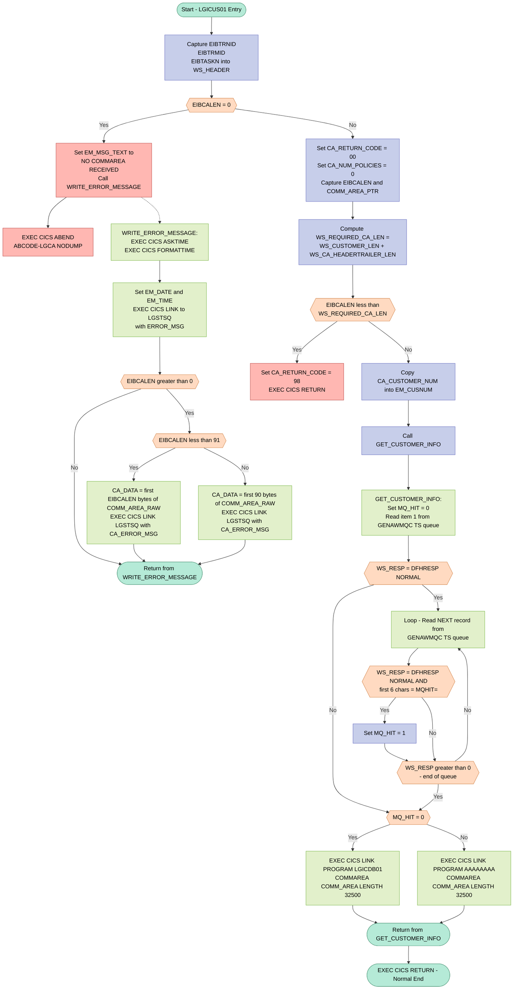

## Table of Contents

- [1. Purpose](#1-purpose)
- [2. Inputs](#2-inputs)
- [3. Outputs](#3-outputs)
- [4. Processing Logic](#4-processing-logic)
  - [4.1 Mermaid Flow Diagram](#41-mermaid-flow-diagram)
  - [4.2 Processing Logic Description](#42-processing-logic-description)
  - [4.3 Database Tables](#43-database-tables)
- [5. Paragraphs](#5-paragraphs)
- [6. Dependencies](#6-dependencies)
  - [6.1 CICS Runtime & Environment](#61-cics-runtime--environment)
  - [6.2 Called Programs (CICS LINK)](#62-called-programs-cics-link)
  - [6.3 CICS Temporary Storage (TS Queue)](#63-cics-temporary-storage-ts-queue)
  - [6.4 CICS Services Used](#64-cics-services-used)
  - [6.5 Communication Area (COMMAREA)](#65-communication-area-commarea)
  - [6.6 Copybook / Include Member](#66-copybook--include-member)
- [7. Constraints](#7-constraints)
  - [7.1 Communication Area (COMMAREA) Constraints](#71-communication-area-commarea-constraints)
  - [7.2 Data Initialisation Constraints](#72-data-initialisation-constraints)
  - [7.3 Data Format Constraints](#73-data-format-constraints)
  - [7.4 Routing and Processing Sequencing Constraints](#74-routing-and-processing-sequencing-constraints)
  - [7.5 Error Logging Constraints](#75-error-logging-constraints)
  - [7.6 Field-Length / Storage Constraints](#76-field-length--storage-constraints)
- [8. Error Handling](#8-error-handling)
  - [8.1 Communication Area Validation](#81-communication-area-validation)
  - [8.2 Temporary Storage Queue Response Code Checking](#82-temporary-storage-queue-response-code-checking)
  - [8.3 Routing Fallback Based on Control Flag](#83-routing-fallback-based-on-control-flag)
  - [8.4 Error Logging and Notification (WRITE_ERROR_MESSAGE Procedure)](#84-error-logging-and-notification-write_error_message-procedure)
- [9. Examples](#9-examples)
  - [9.1 Example 1: Successful Customer Inquiry via DB2 (Standard Path)](#91-example-1-successful-customer-inquiry-via-db2-standard-path)
  - [9.2 Example 2: COMMAREA Too Short — Validation Failure](#92-example-2-commarea-too-short--validation-failure)
  - [9.3 Example 3: MQ Routing Override Active](#93-example-3-mq-routing-override-active)
  - [9.4 Example 4: No COMMAREA Passed — Abend](#94-example-4-no-commarea-passed--abend)

## 1. Purpose

LGICUS01 is a CICS-hosted PL/I program that serves as the business logic entry point for customer inquiry operations within a generalised insurance application. When invoked, it validates that a sufficiently sized communication area has been provided, then determines the appropriate downstream processing path by scanning a CICS Temporary Storage queue (`GENAWMQC`) for a routing record prefixed with `MQHIT=`. If no such record is found, the program delegates the actual customer data retrieval to the DB2-layer program `LGICDB01` via an `EXEC CICS LINK`, passing the full communication area so that customer demographic details, policy counts, and associated policy data can be populated and returned to the caller. If the MQ routing flag is detected, an alternate program path is invoked instead. Throughout execution, any failure to receive a communication area triggers structured error logging through the `LGSTSQ` utility program, ensuring a timestamped diagnostic record — including customer number, policy number, and SQL return code — is written for audit and troubleshooting purposes.

## 2. Inputs

**CICS Communication Area (COMMAREA) — passed via `COMM_AREA_PTR` parameter**

- `COMM_AREA` — The full 32,500-character communication area received from the calling CICS program. Carries all request inputs and is passed through to downstream programs. Overlaid by the following structured fields:
  - `CA_REQUEST_ID` — 6-character operation identifier (e.g., `'01ICUS'`) that encodes the type of service request being processed; drives routing decisions
  - `CA_RETURN_CODE` — 2-digit return code field; initialised to `'00'` on entry and set to `'98'` if the COMMAREA is too short; returned to the caller as the operation outcome status
  - `CA_CUSTOMER_NUM` — 10-digit numeric customer identifier; the primary key used to identify which customer is being inquired upon; also echoed into the error message structure for diagnostics
  - `CA_NUM_POLICIES` — 3-digit count of insurance policies for the customer; initialised to zero before the downstream DB2 inquiry populates it
  - `CA_FIRST_NAME` — 10-character given name of the customer; populated by the DB2 layer and returned to the caller
  - `CA_LAST_NAME` — 20-character family name of the customer; populated by the DB2 layer and returned to the caller
  - `CA_POLICY_DATA` — 32,267-character payload buffer carrying serialised policy records returned by the DB2 retrieval program
  - `CA_POLICY_NUM` — 10-digit policy number within the policy request sub-structure; serves as the primary key for policy-level operations when present

**CICS Execution Interface Block (EIB) — provided automatically by CICS at runtime**

- `EIBCALEN` — Length of the incoming COMMAREA supplied by CICS; used to validate that the COMMAREA meets the minimum required length and to guard against a zero-length (absent) COMMAREA, which triggers an abend (`LGCA`)
- `EIBTRNID` — CICS transaction identifier captured into `WS_TRANSID` for diagnostic tracing
- `EIBTRMID` — CICS terminal identifier captured into `WS_TERMID` for diagnostic tracing
- `EIBTASKN` — CICS task number captured into `WS_TASKNUM` for diagnostic tracing

**CICS Temporary Storage (TS) Queue — external runtime data source**

- `MQ_CONTROL` (`'GENAWMQC'`) — Hardcoded name of the CICS TS queue read at runtime to detect MQ routing records; controls whether standard DB2-based or alternate MQ-based processing is invoked
- `MQ_READ_RECORD` — 80-character buffer populated by `EXEC CICS READQ TS`; its first 6 characters are inspected for the literal `'MQHIT='` to set the routing flag `MQ_HIT`

**Downstream CICS Programs (linked at runtime)**

- `LGICDB01` — Name of the DB2-layer customer inquiry program; invoked via `EXEC CICS LINK` when no `'MQHIT='` record is found in the TS queue; receives `COMM_AREA` as its COMMAREA
- `'AAAAAAAA'` (alternate program) — Placeholder target invoked via `EXEC CICS LINK` when `MQ_HIT = 1`; receives `COMM_AREA` as its COMMAREA

## 3. Outputs

**Communication Area (`COMM_AREA`) — returned to caller via `EXEC CICS RETURN`**

- `CA_RETURN_CODE` — Status code returned to the caller; set to `'00'` on successful initialisation or `'98'` if the supplied communication area is shorter than the minimum required length; drives caller-side error handling
- `CA_NUM_POLICIES` — Count of insurance policies for the inquired customer; initialised to zero before the DB2 layer populates it
- **Customer demographic data** — populated by the downstream DB2 program (`LGICDB01`) or the alternate MQ-routing program, and surfaced back to the caller through the shared `COMM_AREA`
  - `CA_FIRST_NAME` — Customer's given name
  - `CA_LAST_NAME` — Customer's family name
  - `CA_POLICY_DATA` — Serialised policy records buffer carrying all policy entries associated with the customer

**CICS Abend — `EXEC CICS ABEND ABCODE('LGCA') NODUMP`**

- Issued when no communication area is received (`EIBCALEN = 0`); terminates the task abnormally with abend code `LGCA` and no dump, constituting an observable runtime side-effect visible in CICS job logs and abend records

**Error / Diagnostic Logging — via `EXEC CICS LINK PROGRAM('LGSTSQ')`**

- `ERROR_MSG` — Structured diagnostic record passed as the `COMMAREA` to the `LGSTSQ` logging program; contains date, time, the program identifier (`LGICUS01`), customer number (`EM_CUSNUM`), policy number (`EM_POLNUM`), SQL request label (`EM_SQLREQ`), and SQL return code (`EM_SQLRC`); written to a transient data queue (TDQ) as a formatted audit trail entry
- `CA_ERROR_MSG` — A secondary logging record also passed to `LGSTSQ`; contains a `'COMMAREA='` prefix followed by up to 90 bytes of the raw communication area content (`CA_DATA`), providing a hex/character dump of the incoming request for diagnostic purposes

**Downstream CICS Program Invocation — `EXEC CICS LINK`**

- `COMM_AREA` (passed to `LGICDB01`) — When no `MQHIT=` routing record is found in the `GENAWMQC` TS queue, the full 32,500-byte communication area is passed to the DB2-layer program `LGICDB01`, which performs the actual customer database retrieval and writes its results back into `COMM_AREA`
- `COMM_AREA` (passed to `'AAAAAAAA'`) — When an `MQHIT=` record is detected, the same communication area is passed to the alternate placeholder program `'AAAAAAAA'`, routing the inquiry through a message-queue-based processing path

## 4. Processing Logic

### 4.1 Mermaid Flow Diagram



---

### 4.2 Processing Logic Description

#### 4.2.1 High-level Summary

`LGICUS01` is a CICS PL/I orchestrator program for the **Inquire Customer** operation within the GenApp general insurance application. Its primary responsibility is to validate the incoming communication area (COMMAREA), then route the customer inquiry either to the standard DB2 retrieval program (`LGICDB01`) or to an alternate MQ-based program (`AAAAAAAA`), depending on a routing flag stored in a CICS Temporary Storage (TS) queue. It does not perform any database access itself.

---

#### 4.2.2 Execution Flow

**Step 1 — Program Entry and Task Identification**
The program is entered via `EXEC CICS LINK` from a calling program (e.g., a customer menu). It captures the CICS EIB fields `EIBTRNID`, `EIBTRMID`, and `EIBTASKN` into working-storage (`WS_HEADER`) for diagnostic identification in any subsequent error messages.

**Step 2 — COMMAREA Null Check**
The program first checks whether `EIBCALEN = 0`, meaning no COMMAREA was passed at all. If true:
- An error message (`' NO COMMAREA RECEIVED'`) is placed in `EM_MSG_TEXT`.
- `WRITE_ERROR_MESSAGE` is called to log the condition.
- `EXEC CICS ABEND ABCODE('LGCA') NODUMP` is issued, terminating the task immediately with a custom abend code and without producing a dump.

**Step 3 — COMMAREA Initialisation**
Assuming a COMMAREA was received:
- `CA_RETURN_CODE` is set to `'00'` (success presumed).
- `CA_NUM_POLICIES` is zeroed out.
- `EIBCALEN` and `COMM_AREA_PTR` are saved for later use.

**Step 4 — Minimum Length Validation**
The required minimum COMMAREA length is calculated as:
```
WS_REQUIRED_CA_LEN = WS_CUSTOMER_LEN (72) + WS_CA_HEADERTRAILER_LEN (18) = 90 bytes
```
If `EIBCALEN < 90`, the program sets `CA_RETURN_CODE = '98'` and immediately issues `EXEC CICS RETURN`, rejecting the request without further processing.

**Step 5 — Customer Number Echo for Diagnostics**
The incoming `CA_CUSTOMER_NUM` is copied into `EM_CUSNUM` within the error message structure. This ensures that any subsequent error log will identify the customer being processed.

**Step 6 — Call GET_CUSTOMER_INFO**
The main processing is delegated to the internal procedure `GET_CUSTOMER_INFO`.

---

**GET_CUSTOMER_INFO Procedure**

**Step 6a — Initialise MQ Routing Flag**
`MQ_HIT` is set to `0` (no MQ routing by default).

**Step 6b — Read TS Queue Control Record (Item 1)**
`EXEC CICS READQ TS QUEUE('GENAWMQC') ITEM(1)` reads the first record from the control TS queue into `MQ_READ_RECORD`. The `RESP` code is captured in `WS_RESP`.

**Step 6c — Scan Queue for MQ Routing Record**
If the first read succeeded (`WS_RESP = DFHRESP(NORMAL)`), the program enters a loop using `READQ TS ... NEXT`, reading subsequent records sequentially until the queue is exhausted (`WS_RESP > 0`). For each successfully read record, the first 6 characters are compared to the literal `'MQHIT='`. If a match is found, `MQ_HIT` is set to `1`.

**Step 6d — Route the Request**
- **If `MQ_HIT = 0`** (normal path): `EXEC CICS LINK PROGRAM('LGICDB01')` is issued, delegating the full customer inquiry to the DB2 layer with the complete `COMM_AREA` (32,500 bytes).
- **If `MQ_HIT = 1`** (MQ routing path): `EXEC CICS LINK PROGRAM('AAAAAAAA')` is issued instead. This is a placeholder program name representing an alternate MQ-based processing path.

The called program populates the COMMAREA with customer data (name, address, policies, etc.) and returns. Control then returns to the mainline, which issues `EXEC CICS RETURN` to pass results back to the caller.

---

**WRITE_ERROR_MESSAGE Procedure**
Invoked only on the fatal no-COMMAREA error path:
1. Obtains the current absolute time via `EXEC CICS ASKTIME`.
2. Formats it into `WS_DATE` (MM/DD/YYYY) and `WS_TIME` via `EXEC CICS FORMATTIME`.
3. Populates `EM_DATE` and `EM_TIME` in the error message structure.
4. Calls `EXEC CICS LINK PROGRAM('LGSTSQ')` with `ERROR_MSG` to write the structured diagnostic record to the TS diagnostic queue.
5. If COMMAREA data is available (`EIBCALEN > 0`), up to 90 bytes of the raw COMMAREA content are also written to `'LGSTSQ'` via `CA_ERROR_MSG`, providing additional diagnostic context. If `EIBCALEN < 91`, only the available bytes are written; otherwise a fixed 90-byte slice is taken.

---

#### 4.2.3 External Interactions

| Interaction | Type | Details |
|---|---|---|
| `GENAWMQC` TS Queue | CICS Temporary Storage Read | Scanned at runtime to detect the `'MQHIT='` routing control record |
| `LGICDB01` | CICS LINK | Standard DB2 customer inquiry program — invoked when no MQ routing is active |
| `AAAAAAAA` | CICS LINK | Alternate (MQ-based) customer processing program — invoked when `'MQHIT='` is found in the control queue |
| `LGSTSQ` | CICS LINK | Centralised error logging program — receives formatted error messages and raw COMMAREA dumps for diagnostic recording |

---

#### 4.2.4 Plain Language Summary

`LGICUS01` is the "front door" for looking up a customer's details in the insurance system. When it receives a request, it first performs two safety checks: it verifies that a request block was actually passed to it, and that the block is large enough to hold a customer record. If either check fails, it either abends immediately or returns an error code `98` to the caller.

Once the request passes validation, the program checks a special control queue (`GENAWMQC`) to see if a routing override is active. If no override is found, it hands the request to `LGICDB01`, the DB2 database inquiry program, which fetches the customer's name, address, policy count, and policy data. If an override record beginning with `'MQHIT='` is found in the queue, an alternate program is called instead — this is a hook that allows the system to be reconfigured at runtime to route inquiries through a different (e.g., message-queue-based) channel without changing application code.

---

### 4.3 Database Tables

`LGICUS01` does not directly access any database tables. All DB2 interaction is performed by the downstream program `LGICDB01`, which is invoked via `EXEC CICS LINK`. The COMMAREA is passed through unchanged; therefore no `erDiagram` applies to this program directly.

## 5. Paragraphs

- **Main Procedure Body (LGICUS01 inline logic)**
  - Serves as the program entry point for the customer inquiry orchestrator. Executes sequentially from program start through to the final `EXEC CICS RETURN`.
  - Initialises runtime diagnostic fields by capturing `EIBTRNID`, `EIBTRMID`, and `EIBTASKN` into `WS_TRANSID`, `WS_TERMID`, and `WS_TASKNUM` respectively from the CICS Execute Interface Block.
  - **COMMAREA zero-length guard:** Checks `EIBCALEN = 0` immediately on entry. If no COMMAREA was passed, it sets `EM_MSG_TEXT` to a diagnostic literal, calls `WRITE_ERROR_MESSAGE` to log the condition, then issues `EXEC CICS ABEND ABCODE('LGCA') NODUMP` to terminate the task with a user-defined abend code without producing a dump.
  - **COMMAREA initialisation:** Sets `CA_RETURN_CODE` to `'00'` (success) and `CA_NUM_POLICIES` to zero, records the COMMAREA length in `WS_CALEN`, and stores the incoming COMMAREA pointer in `WS_ADDR_DFHCOMMAREA`.
  - **Minimum-length validation:** Computes `WS_REQUIRED_CA_LEN` as the sum of `WS_CUSTOMER_LEN` (72) and `WS_CA_HEADERTRAILER_LEN` (18). If `EIBCALEN` is less than the computed minimum, sets `CA_RETURN_CODE` to `'98'` and issues `EXEC CICS RETURN` immediately, rejecting the request without further processing.
  - **Customer number echo:** Copies `CA_CUSTOMER_NUM` from the COMMAREA into `EM_CUSNUM` in the error message structure, establishing the diagnostic context for any subsequent error logging.
  - Delegates all customer data retrieval by calling the internal `GET_CUSTOMER_INFO` procedure.
  - Terminates normally with `EXEC CICS RETURN`, handing control back to the CICS caller.

- **GET_CUSTOMER_INFO**
  - Internal procedure responsible for determining the correct processing route — either via the DB2 backend program or an alternate MQ-based program — and then invoking the selected downstream program via a CICS LINK.
  - **TS queue scan for MQ routing flag:** Resets `MQ_HIT` to `0`, then reads the first record from the Temporary Storage queue named by `MQ_CONTROL` (`'GENAWMQC'`) using `EXEC CICS READQ TS ... ITEM(1)`. The CICS response is captured in `WS_RESP`.
  - **Sequential browse loop:** If the initial read succeeds (`WS_RESP = DFHRESP(NORMAL)`), a `DO UNTIL (WS_RESP > 0)` loop iterates through subsequent TS queue records using `EXEC CICS READQ TS ... NEXT`. Within each iteration, if the read was successful and the first six characters of `MQ_READ_RECORD` equal `'MQHIT='`, the flag `MQ_HIT` is set to `1`. The loop terminates when `WS_RESP` becomes non-zero (e.g., `DFHRESP(QZERO)` or end-of-queue), ensuring all queue entries are scanned.
  - **Routing decision:** After the loop, tests `MQ_HIT`:
    - If `MQ_HIT = 0` (no routing record found), issues `EXEC CICS LINK PROGRAM(LGICDB01) COMMAREA(COMM_AREA) LENGTH(32500)` to invoke the standard DB2 customer inquiry program `LGICDB01`.
    - If `MQ_HIT = 1`, issues `EXEC CICS LINK PROGRAM('AAAAAAAA') COMMAREA(COMM_AREA) LENGTH(32500)` to invoke an alternate program (placeholder identifier `'AAAAAAAA'`), representing the MQ-based processing path.
  - In both branches the full 32,500-byte COMMAREA is passed, carrying the customer number and all request/response fields through to the linked program.

- **WRITE_ERROR_MESSAGE**
  - Internal procedure that constructs and writes a formatted diagnostic error record to the CICS logging subsystem. Called whenever an unrecoverable error condition is detected (e.g., missing COMMAREA).
  - **Timestamp acquisition:** Issues `EXEC CICS ASKTIME ABSTIME(WS_ABSTIME)` to obtain the current absolute time, then `EXEC CICS FORMATTIME ABSTIME(WS_ABSTIME) MMDDYYYY(WS_DATE) TIME(WS_TIME)` to format it into human-readable date (`MM/DD/YYYY`) and time (`HH:MM:SS`) strings. Both are written into the `ERROR_MSG` structure (`EM_DATE`, `EM_TIME`).
  - **Primary error record write:** Issues `EXEC CICS LINK PROGRAM('LGSTSQ') COMMAREA(ERROR_MSG) LENGTH(STG(ERROR_MSG))` to pass the fully populated `ERROR_MSG` structure — containing date, time, program identifier `'LGICUS01'`, customer number, policy number, SQL request label, and SQL return code — to the `LGSTSQ` queue-writing utility program.
  - **COMMAREA dump (conditional):** If `EIBCALEN > 0`, also writes up to 90 bytes of the raw COMMAREA for additional diagnostic context:
    - If `EIBCALEN < 91`, extracts exactly `EIBCALEN` bytes using `LEFT(COMM_AREA_RAW, EIBCALEN)` into `CA_DATA`.
    - Otherwise, extracts the first 90 bytes using `LEFT(COMM_AREA_RAW, 90)` into `CA_DATA`.
    - In either case, the `CA_ERROR_MSG` structure (prefixed with `'COMMAREA='`) is passed to `LGSTSQ` via a second `EXEC CICS LINK` call, providing a raw snapshot of the incoming COMMAREA alongside the structured error record.

## 6. Dependencies

### 6.1 CICS Runtime & Environment

- **CICS Execution Environment**
  - The program runs as a CICS transaction; the CICS runtime provides the execution context and all `EXEC CICS` command handling
  - **EIB (Execute Interface Block)** — CICS-supplied control block automatically available to the program; the following fields are read at startup:
    - `EIBCALEN` — length of the passed COMMAREA; used both to detect a missing COMMAREA (= 0 triggers ABEND) and to validate minimum length
    - `EIBTRNID` — current CICS transaction identifier; copied into `WS_TRANSID` for diagnostics
    - `EIBTRMID` — terminal identifier; copied into `WS_TERMID` for diagnostics
    - `EIBTASKN` — task number; copied into `WS_TASKNUM` for diagnostics
  - **`DFHRESP(NORMAL)`** — CICS-supplied response code constant used to evaluate the outcome of `READQ TS` operations

### 6.2 Called Programs (CICS LINK)

- **`LGICDB01`** — DB2-layer customer inquiry program
  - Invoked via `EXEC CICS LINK PROGRAM(LGICDB01) COMMAREA(COMM_AREA) LENGTH(32500)` when no `MQHIT=` routing record is found in the TS queue
  - Responsible for retrieving customer and policy data from DB2 and populating the COMMAREA for the caller
- **`AAAAAAAA`** — Alternate (MQ-routing) program
  - Invoked via `EXEC CICS LINK PROGRAM('AAAAAAAA') COMMAREA(COMM_AREA) LENGTH(32500)` when the `MQHIT=` routing indicator is detected in the TS queue
  - Serves as the message-queue-based processing path; its actual function is determined at runtime by the placeholder name
- **`LGSTSQ`** — Error/diagnostic logging program
  - Invoked via `EXEC CICS LINK PROGRAM('LGSTSQ')` (called up to three times within `WRITE_ERROR_MESSAGE`)
  - Receives `ERROR_MSG` (structured diagnostic record with date, time, program ID, customer number, policy number, SQL request, and SQL return code) as its COMMAREA
  - Also receives `CA_ERROR_MSG` (raw COMMAREA dump, up to 90 bytes) as a second COMMAREA in a subsequent call for additional diagnostic context

### 6.3 CICS Temporary Storage (TS Queue)

- **TS Queue `GENAWMQC`** (controlled by `MQ_CONTROL`)
  - Read sequentially via `EXEC CICS READQ TS QUEUE(MQ_CONTROL) INTO(MQ_READ_RECORD) RESP(WS_RESP) ITEM(1)` and `NEXT`
  - Each 80-character record is scanned for the literal `MQHIT=` in the first 6 characters
  - Determines the processing route: absence of `MQHIT=` → `LGICDB01` (DB2 path); presence → `AAAAAAAA` (MQ path)
  - This queue acts as a runtime routing-control switch, allowing the processing path to be changed without recompiling the program

### 6.4 CICS Services Used

- **`EXEC CICS ABEND ABCODE('LGCA') NODUMP`** — issued when no COMMAREA is received; terminates the task with abend code `LGCA` without producing a system dump
- **`EXEC CICS RETURN`** — used to return control to the CICS caller both on normal completion and on COMMAREA length validation failure (return code `98`)
- **`EXEC CICS ASKTIME ABSTIME(WS_ABSTIME)`** — retrieves the current absolute time into `WS_ABSTIME` for use in error message timestamps
- **`EXEC CICS FORMATTIME ABSTIME(WS_ABSTIME) MMDDYYYY(WS_DATE) TIME(WS_TIME)`** — formats the absolute time into human-readable date (`MM/DD/YYYY`) and time (`HH:MM:SS`) strings for inclusion in the error message

### 6.5 Communication Area (COMMAREA)

- **Caller-supplied COMMAREA** (mapped by `COMM_AREA` based on `LGCMAREA` copybook)
  - Passed by the invoking CICS program or transaction; its address is received via the `COMM_AREA_PTR` parameter
  - Must be at least 90 bytes (`WS_CUSTOMER_LEN(72) + WS_CA_HEADERTRAILER_LEN(18)`); if shorter, `CA_RETURN_CODE` is set to `'98'` and the program returns immediately
  - Carries the input `CA_REQUEST_ID`, `CA_CUSTOMER_NUM`, and request-specific fields
  - Passed unmodified (length 32,500) as the COMMAREA on all downstream `EXEC CICS LINK` calls, so downstream programs populate it with response data

### 6.6 Copybook / Include Member

- **`LGCMAREA`** (include member `plinc/LGCMAREA.inc`)
  - Defines the full generalised COMMAREA structure (`COMM_AREA`) as a UNION of 32,500 characters
  - Provides all `CA_*` field definitions used throughout the program
  - Expanded inline (via `%INCLUDE LGCMAREA`) at compile time; the physical file is `plinc/LGCMAREA.inc`

## 7. Constraints

### 7.1 Communication Area (COMMAREA) Constraints

- **COMMAREA must be present on entry**
  - `EIBCALEN` is tested immediately on program entry; if it equals `0`, the program logs an error message (`'NO COMMAREA RECEIVED'`) via `WRITE_ERROR_MESSAGE` and issues `EXEC CICS ABEND ABCODE('LGCA') NODUMP`, terminating the task unconditionally
  - No processing of any kind is permitted without a COMMAREA

- **COMMAREA must meet a minimum length**
  - `WS_REQUIRED_CA_LEN` is computed as `WS_CUSTOMER_LEN` (72) + `WS_CA_HEADERTRAILER_LEN` (18) = **90 bytes**
  - If `EIBCALEN < 90`, `CA_RETURN_CODE` is set to `'98'` and `EXEC CICS RETURN` is issued immediately; downstream processing is entirely skipped
  - The COMMAREA structure itself is declared as `CHAR(32500)`, placing an implicit upper bound of **32,500 bytes** on the data area passed between programs

- **COMMAREA structure is fixed and positional**
  - `CA_REQUEST_ID` (6 chars), `CA_RETURN_CODE` (2 digits), and `CA_CUSTOMER_NUM` (10 digits) occupy fixed offsets at the start of the COMMAREA; callers must lay out data in exactly this order or field interpretation will be incorrect
  - The `COMM_AREA` is declared as a `UNION BASED` structure, meaning the raw 32,500-byte view (`COMM_AREA_RAW`) and all named sub-structures (`CA_CUSTOMER_REQUEST`, `CA_POLICY_REQUEST`, `CA_CUSTSECR_REQUEST`) overlay the same storage — a caller supplying one view must not assume another view is populated

- **COMMAREA is passed at a fixed length of 32,500 bytes to all downstream programs**
  - Both `EXEC CICS LINK PROGRAM(LGICDB01)` and the alternate `EXEC CICS LINK PROGRAM('AAAAAAAA')` specify `LENGTH(32500)`; the full buffer is always forwarded regardless of actual data content

### 7.2 Data Initialisation Constraints

- **`CA_RETURN_CODE` must be initialised to `'00'` before processing**
  - Set unconditionally at program entry (line 214); any non-zero value in the return code field at exit signals a failure condition to the caller
- **`CA_NUM_POLICIES` must be initialised to `0` before processing**
  - Reset at program entry (line 215) so the count is not contaminated by residual values from a prior invocation
- **`MQ_HIT` must be initialised to `0` at the start of routing logic**
  - Reset inside `GET_CUSTOMER_INFO` (line 243) before the TS queue is read; ensures the routing flag is clean for each request

### 7.3 Data Format Constraints

- **`CA_CUSTOMER_NUM` must be a 10-digit numeric string** — declared `PIC '9999999999'`; only decimal digit characters are valid
- **`CA_RETURN_CODE` must be a 2-digit numeric string** — declared `PIC '99'`; valid programmatic values are `'00'` (success) and `'98'` (COMMAREA too short)
- **`CA_NUM_POLICIES` must be a 3-digit numeric string** — declared `PIC '999'`; constrains the reported policy count to the range 0–999
- **`CA_POLICY_NUM` must be a 10-digit numeric string** — declared `PIC '9999999999'`; only decimal digit characters are valid in the policy number field
- **`MQ_READ_RECORD` is fixed at 80 characters** — each TS queue record read into this buffer is truncated or padded to exactly 80 characters; records longer than 80 bytes cannot be fully examined

### 7.4 Routing and Processing Sequencing Constraints

- **TS queue must be read before any downstream LINK is issued**
  - `GET_CUSTOMER_INFO` reads the TS queue named `'GENAWMQC'` first; the routing decision (`MQ_HIT`) is derived entirely from queue content before `EXEC CICS LINK` is called — the LINK call cannot precede the queue scan
- **Queue scan uses item-based then sequential access in a specific order**
  - Item 1 is read first using `ITEM(1)`; only if that read returns `DFHRESP(NORMAL)` does the `DO UNTIL` loop proceed with `NEXT` reads — sequential scanning is conditional on the queue existing and being non-empty
- **MQ routing record identification requires exact prefix match**
  - A TS queue record activates MQ routing only if `SUBSTR(MQ_READ_RECORD,1,6) = 'MQHIT='`; the match is positional and case-sensitive — records with the flag in any other position or with different casing are ignored
- **Routing is mutually exclusive: DB2 path vs. MQ path**
  - If `MQ_HIT = 0` (no `'MQHIT='` record found), `LGICDB01` is called via CICS LINK
  - If `MQ_HIT = 1` (flag found), program `'AAAAAAAA'` is called instead — the two paths cannot both execute in a single invocation
- **Error logging must complete before `EXEC CICS RETURN`**
  - Within `WRITE_ERROR_MESSAGE`, `EXEC CICS LINK PROGRAM('LGSTSQ')` is called to persist the error record before control returns; this ordering ensures the audit trail is written prior to any return or abend

### 7.5 Error Logging Constraints

- **COMMAREA dump in error messages is capped at 90 bytes**
  - Inside `WRITE_ERROR_MESSAGE`, if `EIBCALEN < 91`, exactly `EIBCALEN` bytes are logged; otherwise exactly **90 bytes** are captured via `LEFT(COMM_AREA_RAW,90)` — content beyond 90 bytes is never included in the diagnostic log entry
- **Error message logging occurs only when EIBCALEN > 0**
  - The COMMAREA dump block is guarded by `IF (EIBCALEN > 0)` — if no COMMAREA was supplied, only the primary `ERROR_MSG` structure (date, time, program name, customer number, SQL code) is written to the log

### 7.6 Field-Length / Storage Constraints

- **Customer demographic fields have fixed maximum lengths**
  - `CA_FIRST_NAME`: 10 characters; `CA_LAST_NAME`: 20 characters; `CA_DOB`: 10 characters; `CA_HOUSE_NAME`: 20 characters; `CA_HOUSE_NUM`: 4 characters; `CA_POSTCODE`: 8 characters; `CA_PHONE_MOBILE`/`CA_PHONE_HOME`: 20 characters each; `CA_EMAIL_ADDRESS`: 100 characters — data exceeding these lengths will be silently truncated at assignment
- **Policy payload buffer is fixed at 32,267 bytes** (`CA_POLICY_DATA`) — this is the hard upper bound on the total serialised policy data that can be carried in a single customer inquiry response
- **Error message variable field is fixed at 63 characters** (`EM_MSG_TEXT`) — diagnostic text longer than 63 characters is truncated

## 8. Error Handling

### 8.1 Communication Area Validation

- **Zero-length COMMAREA check:** At program entry, the CICS-supplied execution interface block field `EIBCALEN` is tested for a value of zero, indicating that no communication area was passed by the caller.
  - If the check is triggered, the message `NO COMMAREA RECEIVED` is placed into the error message structure's text field (`EM_MSG_TEXT`) and the `WRITE_ERROR_MESSAGE` internal procedure is called to log the diagnostic record.
  - Following the log write, the program immediately issues `EXEC CICS ABEND ABCODE('LGCA') NODUMP` to terminate the transaction with a user-defined abend code (`LGCA`) without producing a dump, effectively preventing any further processing under an invalid invocation.

- **Minimum-length COMMAREA check:** After the zero-length guard, the program computes the minimum acceptable communication area length (`WS_REQUIRED_CA_LEN`) as the sum of a fixed header/trailer constant (`WS_CA_HEADERTRAILER_LEN`, 18 bytes) and the customer record size (`WS_CUSTOMER_LEN`, 72 bytes).
  - If `EIBCALEN` is less than this calculated minimum, `CA_RETURN_CODE` is set to the error value `'98'` and `EXEC CICS RETURN` is issued immediately, returning control to the caller with a non-zero return code to signal the short COMMAREA condition. No logging is performed for this path.

### 8.2 Temporary Storage Queue Response Code Checking

- **Initial TS queue read guard:** The `GET_CUSTOMER_INFO` procedure issues `EXEC CICS READQ TS` for item 1 of the `GENAWMQC` control queue and captures the response code in `WS_RESP`. The subsequent loop that scans for an `MQHIT=` record is entered only if `WS_RESP` equals `DFHRESP(NORMAL)`, meaning any non-normal response (e.g., queue not found) silently suppresses the loop and leaves `MQ_HIT` at its default value of zero. This acts as a passive fallback: a missing or inaccessible control queue is not treated as a fatal error but instead causes the program to proceed along the standard DB2-based path.

- **Loop-termination via non-normal response:** Inside the `DO UNTIL` loop, each successive `EXEC CICS READQ TS NEXT` call also writes its result into `WS_RESP`. The loop continues until `WS_RESP` is greater than zero (i.e., any non-normal response, such as end-of-queue). This prevents an infinite loop and ensures that exhaustion of queue items or any I/O error on the TS queue naturally terminates the scan. The response code is thus used both as an error indicator and as a loop-exit condition.

- **Conditional record matching within the loop:** Within each iteration, the `MQHIT=` prefix check on `MQ_READ_RECORD` is performed only when `WS_RESP` equals `DFHRESP(NORMAL)`, ensuring that a successfully read record is inspected and a failed read is not matched against a partial or corrupt buffer.

### 8.3 Routing Fallback Based on Control Flag

- **MQ_HIT-driven routing:** After the TS queue scan, the value of `MQ_HIT` governs which downstream program is invoked via `EXEC CICS LINK`. If `MQ_HIT` remains zero (because no `MQHIT=` record was found, or the queue was inaccessible), the standard DB2 inquiry program `LGICDB01` is linked. If `MQ_HIT` is set to one, an alternate program (`AAAAAAAA`) is linked instead. This provides a routing-level fallback so that the inability to find the MQ routing record defaults the request to the expected normal processing path rather than failing.

### 8.4 Error Logging and Notification (WRITE_ERROR_MESSAGE Procedure)

- **Structured error message construction:** When an error requiring logging is encountered (currently the zero-length COMMAREA path), the `WRITE_ERROR_MESSAGE` procedure is invoked. It obtains the current timestamp by issuing `EXEC CICS ASKTIME` followed by `EXEC CICS FORMATTIME` to produce formatted date (`WS_DATE`) and time (`WS_TIME`) values, which are written into the `ERROR_MSG` structure alongside the program identifier, customer number (`EM_CUSNUM`), policy number (`EM_POLNUM`), SQL request label (`EM_SQLREQ`), and SQL return code (`EM_SQLRC`).

- **Logging via EXEC CICS LINK to LGSTSQ:** The fully populated `ERROR_MSG` structure is passed as the COMMAREA to the logging program `LGSTSQ` via `EXEC CICS LINK`, which writes it to a transient data queue (TDQ). This externalises the error audit trail outside the failing transaction.

- **COMMAREA dump logging:** In addition to the primary error record, the procedure conditionally logs up to 90 bytes of the raw COMMAREA content (`COMM_AREA_RAW`) through a second `EXEC CICS LINK` to `LGSTSQ` using the `CA_ERROR_MSG` structure.
  - If `EIBCALEN` is greater than zero but less than 91, only the available bytes of the COMMAREA are copied into `CA_DATA` before logging.
  - If `EIBCALEN` is 91 or greater, exactly 90 bytes are extracted and logged.
  - This conditional sizing prevents reading beyond the actual COMMAREA length, ensuring the diagnostic log is always safe to write regardless of caller-supplied COMMAREA size.

## 9. Examples

### 9.1 Example 1: Successful Customer Inquiry via DB2 (Standard Path)

**Input:**
- `CA_REQUEST_ID` = `'ICUS01'`
- `CA_RETURN_CODE` = `'00'`
- `CA_CUSTOMER_NUM` = `'0000010001'`
- `EIBCALEN` = `200` (well above the required minimum of 90 bytes: `WS_CUSTOMER_LEN(72) + WS_CA_HEADERTRAILER_LEN(18)`)
- CICS Temporary Storage queue `GENAWMQC`: **empty** (no records present, or first READQ TS returns a non-NORMAL response)

**Expected Output:**
- `CA_RETURN_CODE` = `'00'`
- `CA_NUM_POLICIES` is initialised to `0` then populated by the downstream DB2 program `LGICDB01`
- `CA_FIRST_NAME`, `CA_LAST_NAME`, and other customer fields filled in by `LGICDB01`
- Control returned to the caller with the enriched COMMAREA

**Explanation:**  
The program first confirms that `EIBCALEN` (200) is ≥ 90 (the required minimum). It initialises `CA_RETURN_CODE` to `'00'` and `CA_NUM_POLICIES` to `0`, then calls `GET_CUSTOMER_INFO`. Because the TS queue `GENAWMQC` either has no records or the first READQ TS does not return NORMAL, `MQ_HIT` stays `0`. The program therefore issues `EXEC CICS LINK PROGRAM('LGICDB01')`, passing the full COMMAREA (32,500 bytes). `LGICDB01` performs the actual DB2 retrieval and populates the customer and policy fields before control returns.

---

### 9.2 Example 2: COMMAREA Too Short — Validation Failure

**Input:**
- `CA_REQUEST_ID` = `'ICUS01'`
- `CA_CUSTOMER_NUM` = `'0000010001'`
- `EIBCALEN` = `50` (below the required minimum of 90 bytes)

**Expected Output:**
- `CA_RETURN_CODE` = `'98'`
- Program issues `EXEC CICS RETURN` immediately; no downstream call is made

**Explanation:**  
`WS_REQUIRED_CA_LEN` is computed as `WS_CUSTOMER_LEN (72) + WS_CA_HEADERTRAILER_LEN (18) = 90`. Because `EIBCALEN (50) < 90`, the program sets `CA_RETURN_CODE = '98'` and returns at once. `GET_CUSTOMER_INFO` is never called, so neither `LGICDB01` nor the MQ routing path is invoked. The caller receives the COMMAREA back with the error indicator.

---

### 9.3 Example 3: MQ Routing Override Active

**Input:**
- `CA_REQUEST_ID` = `'ICUS01'`
- `CA_CUSTOMER_NUM` = `'0000020002'`
- `EIBCALEN` = `200`
- CICS TS queue `GENAWMQC`: contains at least one record whose first 6 characters are `'MQHIT='` (e.g., `'MQHIT=ALTERNATE_ROUTE...'`)

**Expected Output:**
- `CA_RETURN_CODE` = `'00'` (set during initialisation)
- `MQ_HIT` = `1`
- Program issues `EXEC CICS LINK PROGRAM('AAAAAAAA')` instead of `LGICDB01`
- Response fields populated (or not) by program `'AAAAAAAA'`

**Explanation:**  
After passing the length check, `GET_CUSTOMER_INFO` reads the TS queue `GENAWMQC` sequentially. When it encounters a record whose first 6 characters match `'MQHIT='`, it sets `MQ_HIT = 1`. At the end of the scan, because `MQ_HIT ≠ 0`, the program takes the alternate branch and links to the placeholder program `'AAAAAAAA'` rather than `LGICDB01`, routing the customer inquiry through the MQ-based processing path.

---

### 9.4 Example 4: No COMMAREA Passed — Abend

**Input:**
- `EIBCALEN` = `0` (no COMMAREA supplied by the caller)

**Expected Output:**
- `EM_MSG_TEXT` set to `' NO COMMAREA RECEIVED'`
- `WRITE_ERROR_MESSAGE` called: current date/time retrieved, error record written to TDQ via `LGSTSQ`
- Program issues `EXEC CICS ABEND ABCODE('LGCA') NODUMP` — transaction abends with code `LGCA`

**Explanation:**  
The very first check after capturing CICS EIB fields tests whether `EIBCALEN = 0`. With no COMMAREA, the program cannot safely address any customer data. It populates `EM_MSG_TEXT` with a diagnostic literal, calls `WRITE_ERROR_MESSAGE` to log the event (writing a formatted error record containing date, time, program name `'LGICUS01'`, and an empty customer number to the `LGSTSQ` logging program), then abends with `ABCODE('LGCA')` and suppresses the dump.

---

Generated by IBM Bob Premium Package for Z
