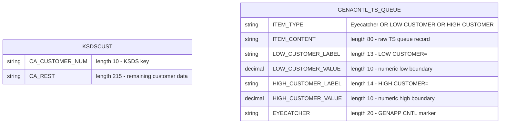

## Table of Contents

- [1. Purpose](#1-purpose)
- [2. Inputs](#2-inputs)
  - [2.1 CICS Execution Environment (EIB Fields)](#21-cics-execution-environment-eib-fields)
  - [2.2 CICS ASSIGN System Values](#22-cics-assign-system-values)
  - [2.3 Program Parameter (COMMAREA)](#23-program-parameter-commarea)
  - [2.4 Terminal Input](#24-terminal-input)
  - [2.5 CICS Temporary Storage Queue — `GENACNTL`](#25-cics-temporary-storage-queue--genacntl)
  - [2.6 VSAM File — `KSDSCUST`](#26-vsam-file--ksdscust)
- [3. Outputs](#3-outputs)
- [4. Processing Logic](#4-processing-logic)
  - [4.1 Mermaid Flow Diagram](#41-mermaid-flow-diagram)
  - [4.2 Processing Logic Description](#42-processing-logic-description)
  - [4.3 Database Tables](#43-database-tables)
- [5. Paragraphs](#5-paragraphs)
- [6. Dependencies](#6-dependencies)
  - [6.1 CICS Middleware](#61-cics-middleware)
  - [6.2 VSAM Files](#62-vsam-files)
  - [6.3 CICS Temporary Storage Queues](#63-cics-temporary-storage-queues)
  - [6.4 Input Parameters / Invocation Interface](#64-input-parameters--invocation-interface)
  - [6.5 PL/I Language Built-ins](#65-pli-language-built-ins)
- [7. Constraints](#7-constraints)
  - [7.1 Invocation Mode Constraints](#71-invocation-mode-constraints)
  - [7.2 TS Queue Serialization Constraints](#72-ts-queue-serialization-constraints)
  - [7.3 TS Queue Content Constraints](#73-ts-queue-content-constraints)
  - [7.4 Customer Number Range Constraints](#74-customer-number-range-constraints)
  - [7.5 VSAM File Access Constraints](#75-vsam-file-access-constraints)
  - [7.6 Output Format Constraints](#76-output-format-constraints)
- [8. Error Handling](#8-error-handling)
- [9. Examples](#9-examples)
  - [9.1 Example 1 — First-time invocation via CICS LINK (GENACNTL queue does not exist)](#91-example-1--first-time-invocation-via-cics-link-genacntl-queue-does-not-exist)
  - [9.2 Example 2 — Interactive terminal invocation (GENACNTL queue already populated)](#92-example-2--interactive-terminal-invocation-genacntl-queue-already-populated)

## 1. Purpose

`LGICVS01` is a CICS PL/I program that randomly selects a valid customer number from the General Insurance Application's VSAM customer file (`KSDSCUST`). It first determines whether it was invoked via a CICS LINK (COMMAREA-based) or directly from a terminal, then reads the `GENACNTL` temporary storage queue — protected by an ENQ/DEQ serialization lock — to retrieve the configured lower and upper boundaries of the customer number range, initializing and writing those control records to the queue if they are not yet present. Using the current task number as a random seed, it computes a random customer number within that range and performs a GTEQ read against the VSAM `KSDSCUST` file to resolve the nearest actual customer key. The resolved customer number is then returned either through the COMMAREA (for linked callers) or displayed on the terminal (for interactive users), after which the program issues `EXEC CICS RETURN`.

## 2. Inputs

### 2.1 CICS Execution Environment (EIB Fields)

- **EIBTASKN** — The CICS task number assigned to the current transaction instance. Used as the seed for the PL/I `RANDOM` built-in function to generate a pseudo-random customer number within the configured range.
- **EIBCALEN** — The length of the Communication Area (COMMAREA) passed to the program. When the program is invoked via CICS LINK with a COMMAREA, this value is assigned to `WS_RECV_LEN` to track the incoming data length.

### 2.2 CICS ASSIGN System Values

- **STARTCODE** (→ `WS_STARTCODE`) — A 2-character value retrieved via `EXEC CICS ASSIGN STARTCODE`. If the first character is `'D'`, it indicates the program was initiated by a distributed program link (DPL) or similar non-terminal start, causing the program to read input from the COMMAREA instead of the terminal.
- **INVOKINGPROG** (→ `WS_INVOKEPROG`) — An 8-character value retrieved via `EXEC CICS ASSIGN INVOKINGPROG`. Contains the name of the program that issued the CICS LINK to invoke this program. A non-blank value indicates COMMAREA-based invocation.
- **SYSID** (→ `WS_SYSID`) — A 4-character value retrieved via `EXEC CICS ASSIGN SYSID`. Identifies the local CICS system. Retrieved at startup but not used directly in program logic.

### 2.3 Program Parameter (COMMAREA)

- **COMM_AREA_PTR** (→ `COMMA_DATA` structure) — A pointer passed as the procedure parameter (`Proc(COMM_AREA_PTR) Options(Main)`), referencing the Communication Area supplied by the calling program via CICS LINK. The `COMMA_DATA` structure based on this pointer contains:
    - **COMMA_DATA_H** — A 14-character header field (e.g., `'HIGH CUSTOMER='`).
    - **COMMA_DATA_HIGH** — A 10-digit numeric field (`PIC '(10)9'`) that receives the resolved customer number on output.
    - **COMMA_DATA_FILL** — A 60-character filler.
    - This COMMAREA serves as both input (invocation context) and output (customer number result) when the program is called via LINK.

### 2.4 Terminal Input

- **Terminal RECEIVE data** (→ `WS_RECV`) — When the program is invoked interactively from a terminal (not via LINK/COMMAREA), it issues `EXEC CICS RECEIVE INTO(WS_RECV)` to read user-typed input. The received data is parsed into:
    - **WS_RECV_TRANID** — The first 5 characters, representing the transaction ID entered by the user.
    - **WS_RECV_DATA** — The remaining 74 characters of user-supplied data, which is copied into `WS_COMMAREA` for further processing.

### 2.5 CICS Temporary Storage Queue — `GENACNTL`

- **GENACNTL TS Queue** (queue name `STSQ_NAME = 'GENACNTL'`) — A CICS temporary storage queue that stores customer number range control records. The program reads all items sequentially using `EXEC CICS READQ TS QUEUE ... NEXT` to extract:
    - **LOW CUSTOMER record** (→ `READ_CUST_LOW` → `WS_CUST_LOW`) — A 10-digit numeric value representing the lower bound of the valid customer number range. Identified by the prefix `'LOW CUSTOMER'` in the queue message. Defaults to `1000001` if absent.
    - **HIGH CUSTOMER record** (→ `READ_CUST_HIGH` → `WS_CUST_HIGH`) — A 10-digit numeric value representing the upper bound of the valid customer number range. Identified by the prefix `'HIGH CUSTOMER'` in the queue message. Defaults to `1000001` if absent.

### 2.6 VSAM File — `KSDSCUST`

- **KSDSCUST** — A CICS-managed VSAM KSDS file containing customer records. The program issues `EXEC CICS READ FILE('KSDSCUST') ... GTEQ RIDFLD(WRITE_MSG_HIGH) KEYLENGTH(F10)` to locate the nearest customer record with a key greater than or equal to the randomly generated customer number. On a successful read:
    - **CA_AREA** — A 225-byte structure that receives the full customer record.
        - **CA_CUSTOMER_NUM** — The first 10 characters of `CA_AREA`, containing the actual customer number key from the VSAM file. This value is returned to the caller via COMMAREA or displayed on the terminal.

## 3. Outputs

**CICS Temporary Storage Queue — GENACNTL**

- **Eyecatcher record written to TS queue `GENACNTL`** (`WRITE_MSG_E`, 20 bytes): Written via `EXEC CICS WRITEQ TS` only when the queue does not already exist (`WS_FLAG_TSQE = 'Y'`). Seeds the queue with the `'**** GENAPP CNTL'` identifier record so subsequent reads can locate control records.
  - `WRITE_MSG_E` — the literal `'**** GENAPP CNTL'` eyecatcher content written as item 1

- **LOW CUSTOMER record written to TS queue `GENACNTL`** (`WRITE_MSG_L`, 23 bytes): Written via `EXEC CICS WRITEQ TS` only when no existing LOW CUSTOMER entry was found (`WS_FLAG_TSQL = 'Y'`). Persists the default lower customer number boundary (1000001) into the control queue.
  - `WRITE_MSG_L` — composed of the label `'LOW CUSTOMER='` (13 bytes) followed by `WRITE_MSG_LOW` (the low boundary value, 10 bytes)

- **HIGH CUSTOMER record written to TS queue `GENACNTL`** (`WRITE_MSG_H`, 24 bytes): Written via `EXEC CICS WRITEQ TS` only when no existing HIGH CUSTOMER entry was found (`WS_FLAG_TSQH = 'Y'`). Persists the default upper customer number boundary (1000001) into the control queue.
  - `WRITE_MSG_H` — composed of the label `'HIGH CUSTOMER='` (14 bytes) followed by `WRITE_MSG_HIGH` (the high boundary value, 10 bytes)

**COMMAREA Return (LINK / transaction-started invocation — `WS_FLAG = 'C'`)**

- **`COMMA_DATA_H`** — 14-byte header field in the caller's COMMAREA (mapped via `COMM_AREA_PTR`). Populated from `WRITE_MSG_H` (the `'HIGH CUSTOMER='` label). Returned directly to the linking program.
- **`COMMA_DATA_HIGH`** — 10-digit numeric field in the caller's COMMAREA. Populated with `WRITE_MSG_HIGH`, which holds the resolved VSAM customer number (the actual GTEQ key read from `KSDSCUST`, or the randomly generated number if the VSAM read failed). This is the primary customer number result returned to the caller.
- **`COMMA_DATA_FILL`** — 60-byte filler, blanked out (`(60)' '`) to clear any residual data before returning.

**Terminal Output (interactive / terminal invocation — `WS_FLAG = 'R'`)**

- **`WRITE_MSG_H`** sent via `EXEC CICS SEND TEXT` (24 bytes, `ERASE`, `FREEKB`, `WAIT`): Displays the resolved `'HIGH CUSTOMER='` label and the customer number (`WRITE_MSG_HIGH`) directly to the terminal. This is the only screen-visible output of the program, delivered when the program is initiated interactively rather than via a CICS LINK.

## 4. Processing Logic

### 4.1 Mermaid Flow Diagram

```mermaid
graph TD
    classDef startEnd fill:#b5ead7,stroke:#4caf82,color:#000
    classDef process fill:#c7ceea,stroke:#6c72cb,color:#000
    classDef decision fill:#ffdac1,stroke:#ff9966,color:#000
    classDef io fill:#fff1ba,stroke:#f0c040,color:#000
    classDef tsq fill:#e2f0cb,stroke:#78b159,color:#000

    A([Start LGICVS01]):::startEnd
    B[ASSIGN SYSID<br>ASSIGN STARTCODE<br>ASSIGN INVOKINGPROG]:::io
    C{{STARTCODE starts with D<br>OR INVOKINGPROG not blank}}:::decision
    D[WS_FLAG = C<br>Copy COMMAREA header<br>Set length from EIBCALEN]:::process
    E[EXEC CICS RECEIVE<br>from terminal<br>WS_FLAG = R]:::io
    F[Initialize customer range<br>WS_CUST_LOW = 1000001<br>WS_CUST_HIGH = 1000001<br>All TS flags = Y]:::process
    G[EXEC CICS ENQ<br>Resource GENACNTL]:::process
    H[READQ TS QUEUE GENACNTL<br>Item 1]:::io
    I{{RESP = NORMAL<br>Queue exists}}:::decision
    J[Mark eyecatcher flag off<br>WS_FLAG_TSQE = space]:::process
    K[READQ TS NEXT<br>Read next record]:::io
    L{{Record type is<br>LOW CUSTOMER}}:::decision
    M[Set WS_CUST_LOW<br>from record<br>WS_FLAG_TSQL = space]:::process
    N{{Record type is<br>HIGH CUSTOMER}}:::decision
    O[Set WS_CUST_HIGH<br>from record<br>WS_FLAG_TSQH = space]:::process
    P{{More records<br>RESP = NORMAL}}:::decision
    Q{{WS_FLAG_TSQE = Y<br>Eyecatcher missing}}:::decision
    R[WRITEQ TS<br>Eyecatcher record<br>GENAPP CNTL]:::tsq
    S{{WS_FLAG_TSQL = Y<br>LOW record missing}}:::decision
    T[WRITEQ TS<br>LOW CUSTOMER record]:::tsq
    U{{WS_FLAG_TSQH = Y<br>HIGH record missing}}:::decision
    V[WRITEQ TS<br>HIGH CUSTOMER record]:::tsq
    W[EXEC CICS DEQ<br>Resource GENACNTL]:::process
    X[Generate random number<br>RANDOM seeded with EIBTASKN<br>in range LOW to HIGH]:::process
    Y[READ FILE KSDSCUST GTEQ<br>using random number as key]:::io
    Z{{RESP = NORMAL<br>Record found}}:::decision
    AA[Update WRITE_MSG_HIGH<br>with actual CA_CUSTOMER_NUM]:::process
    AB{{WS_FLAG = C<br>COMMAREA invocation}}:::decision
    AC[Return result via COMMAREA<br>COMMA_DATA_HIGH = customer num]:::io
    AD[EXEC CICS SEND TEXT<br>Display on terminal]:::io
    AE([EXEC CICS RETURN<br>End]):::startEnd

    A --> B
    B --> C
    C -- Yes --> D
    C -- No --> E
    D --> F
    E --> F
    F --> G
    G --> H
    H --> I
    I -- Yes --> J
    J --> K
    K --> L
    L -- Yes --> M
    M --> N
    L -- No --> N
    N -- Yes --> O
    O --> P
    N -- No --> P
    P -- Yes --> K
    P -- No --> Q
    I -- No --> Q
    Q -- Yes --> R
    R --> S
    Q -- No --> S
    S -- Yes --> T
    T --> U
    S -- No --> U
    U -- Yes --> V
    V --> W
    U -- No --> W
    W --> X
    X --> Y
    Y --> Z
    Z -- Yes --> AA
    Z -- No --> AB
    AA --> AB
    AB -- Yes --> AC
    AB -- No --> AD
    AC --> AE
    AD --> AE
```



---

### 4.2 Processing Logic Description

#### 4.2.1 High-level Summary

`LGICVS01` is a CICS PL/I program that randomly selects a valid customer number from the VSAM KSDS file `KSDSCUST`. It uses a CICS Temporary Storage Queue (`GENACNTL`) to store and retrieve the permissible customer number range (low/high boundaries). The program can be invoked either by a CICS LINK (returning results via COMMAREA) or interactively from a terminal (returning results via screen display).

---

#### 4.2.2 Execution Flow

**Step 1 — Determine Invocation Mode**

The program opens by executing three `EXEC CICS ASSIGN` calls to retrieve:
- `SYSID` — the current CICS system ID
- `STARTCODE` — how the transaction was initiated (e.g., `'D'` = started by another transaction)
- `INVOKINGPROG` — the name of the calling program (non-blank if linked via `EXEC CICS LINK`)

A conditional check follows:
- If `STARTCODE` begins with `'D'` **or** `INVOKINGPROG` is not blank → `WS_FLAG = 'C'` (COMMAREA mode). The COMMAREA header is copied and the length is taken from `EIBCALEN`.
- Otherwise → `EXEC CICS RECEIVE` reads data from the terminal into `WS_RECV`, `WS_FLAG = 'R'` (terminal mode).

This determines whether the result is returned through COMMAREA or sent to a terminal screen.

---

**Step 2 — Initialize Customer Range Defaults**

`WS_CUST_LOW` and `WS_CUST_HIGH` are both initialized to `1000001`. All three TS queue flags (`WS_FLAG_TSQE`, `WS_FLAG_TSQH`, `WS_FLAG_TSQL`) are set to `'Y'`, indicating that the queue and its records may need to be written.

---

**Step 3 — Serialize Access and Read the Control Queue**

`EXEC CICS ENQ RESOURCE(GENACNTL)` serializes concurrent access to the TS queue, preventing race conditions when multiple tasks attempt to read or initialize it simultaneously.

`EXEC CICS READQ TS` attempts to read item 1 of the `GENACNTL` queue:
- **If the queue exists** (`RESP = NORMAL`): `WS_FLAG_TSQE` is cleared to `' '` (eyecatcher already present). The program then loops using `READQ TS NEXT` through all remaining records:
  - A record whose first 12 characters match `'LOW CUSTOMER'` populates `WS_CUST_LOW` and clears `WS_FLAG_TSQL`.
  - A record whose first 13 characters match `'HIGH CUSTOMER'` populates `WS_CUST_HIGH` and clears `WS_FLAG_TSQH`.
  - The loop continues until `WS_RESP > 0` (no more records, e.g., `ITEMERR`).
- **If the queue does not exist**: all three flags remain `'Y'`.

---

**Step 4 — Conditionally Write Missing Control Records**

After the read loop, the program writes any missing records to the TS queue using `EXEC CICS WRITEQ TS NOSUSPEND`:
- If `WS_FLAG_TSQE = 'Y'` → writes the eyecatcher record (`**** GENAPP CNTL`, 20 bytes).
- If `WS_FLAG_TSQL = 'Y'` → writes the `LOW CUSTOMER=` record (23 bytes) using the default value `1000001`.
- If `WS_FLAG_TSQH = 'Y'` → writes the `HIGH CUSTOMER=` record (24 bytes) using the default value `1000001`.

`NOSUSPEND` ensures the write does not block indefinitely if the queue is temporarily full.

`EXEC CICS DEQ RESOURCE(GENACNTL)` then releases the exclusive lock.

---

**Step 5 — Generate a Random Customer Number**

The random customer number is calculated as:

```
WS_RANDOM_NUMBER = FLOOR( RANDOM(EIBTASKN) × (WS_CUST_HIGH − WS_CUST_LOW) + WS_CUST_LOW )
```

`EIBTASKN` (the CICS task number) is used as the seed, producing a different value per task invocation. The result falls within `[WS_CUST_LOW, WS_CUST_HIGH]`.

---

**Step 6 — Look Up the Nearest Valid VSAM Customer Record**

`EXEC CICS READ FILE('KSDSCUST') GTEQ` uses the random number as the RIDFLD key with a key length of 10. The `GTEQ` option instructs CICS to return the record whose key is **greater than or equal to** the generated number, ensuring a real customer record is located even if the exact random number is not a valid key.

If the read succeeds (`RESP = NORMAL`), `CA_CUSTOMER_NUM` (the actual key from the record) replaces the random number in `WRITE_MSG_HIGH`.

---

**Step 7 — Return the Result**

A `SELECT` on `WS_FLAG` routes the result:
- `'C'` (COMMAREA mode): `COMMA_DATA_HIGH` is populated with the resolved customer number and returned to the caller via the COMMAREA pointer.
- Otherwise (terminal mode): `EXEC CICS SEND TEXT` displays the high customer number on the terminal, with `ERASE` to clear the screen, `FREEKB` to unlock the keyboard, and `WAIT` to synchronize output.

`EXEC CICS RETURN` ends the task.

---

#### 4.2.3 External Interactions

| Resource | Command | Purpose |
|---|---|---|
| `GENACNTL` TS Queue | `ENQ` / `READQ TS` / `WRITEQ TS` / `DEQ` | Reads and initializes the customer number range control records; serialized with ENQ/DEQ |
| `KSDSCUST` VSAM KSDS | `READ FILE GTEQ` | Retrieves the nearest real customer record at or above the generated random key |
| Terminal | `RECEIVE` / `SEND TEXT` | Accepts input and returns results when invoked interactively |
| COMMAREA | Pointer-based read/write | Receives request context and returns the selected customer number when invoked via CICS LINK |

---

#### 4.2.4 Plain Language Summary

When this program runs, it first determines whether it was called by another program or invoked directly from a terminal. It then checks a CICS control queue (`GENACNTL`) to find out the valid range of customer numbers (lowest and highest). If those range records don't exist yet, the program creates them with default values. Using the task number as a seed, it picks a random number within that range and looks up the VSAM customer file to find the nearest real customer whose record key is at or above that number. The actual customer number found is then either returned to the calling program through shared memory (COMMAREA) or displayed on the user's terminal screen.

---

### 4.3 Database Tables

> `LGICVS01` does not use DB2. It accesses a VSAM KSDS file (`KSDSCUST`) and a CICS Temporary Storage Queue (`GENACNTL`). These are represented below.



## 5. Paragraphs

LGICVS01 is a single-procedure PL/I program (no internal sub-procedures). Its logic is structured as one continuous mainline body with distinct logical phases. Each logical phase is described below as a paragraph equivalent.

- **Mainline – Invocation Mode Detection**
  - Executes immediately upon program entry after variable initialisation.
  - Issues `EXEC CICS ASSIGN SYSID`, `ASSIGN STARTCODE`, and `ASSIGN INVOKINGPROG` to collect environmental information into `WS_SYSID`, `WS_STARTCODE`, and `WS_INVOKEPROG` respectively; each call captures `WS_RESP` for response checking.
  - Evaluates an `IF` condition: if the first character of `WS_STARTCODE` is `'D'` (transaction started via START or terminal-driven start with data) **or** `WS_INVOKEPROG` is not blank (i.e., the program was invoked by a CICS LINK):
    - Sets `WS_FLAG = 'C'` to signal COMMAREA-based invocation.
    - Copies `COMMA_DATA_H` into `WS_COMMAREA` and sets `WS_RECV_LEN` to `EIBCALEN`.
  - Otherwise (interactive terminal invocation):
    - Issues `EXEC CICS RECEIVE INTO(WS_RECV) LENGTH(WS_RECV_LEN)` to read the terminal input.
    - Sets `WS_FLAG = 'R'`, copies `WS_RECV_DATA` into `WS_COMMAREA`, and adjusts `WS_RECV_LEN` by subtracting 5 (stripping the transaction ID prefix).
  - `WS_FLAG` governs the output path used later in the program.

- **Mainline – TS Queue Initialisation and Reset**
  - Resets customer boundary variables and TS queue presence flags to their default state:
    - `WS_CUST_LOW` and `WS_CUST_HIGH` both set to `1000001`.
    - `WS_FLAG_TSQE`, `WS_FLAG_TSQH`, and `WS_FLAG_TSQL` all set to `'Y'` (indicating all three records are assumed absent).
  - No external system interaction; purely prepares working-storage state for the TS queue read phase.

- **Mainline – TS Queue Read (ENQ / READQ TS Loop)**
  - Issues `EXEC CICS ENQ RESOURCE(STSQ_NAME) LENGTH(STG(STSQ_NAME))` to exclusively lock the `GENACNTL` TS queue, preventing concurrent modification by other tasks.
  - Reads item 1 of the queue with `EXEC CICS READQ TS QUEUE(STSQ_NAME) INTO(READ_MSG) ITEM(1)`:
    - If the response is `DFHRESP(NORMAL)` (queue exists), clears `WS_FLAG_TSQE` to `' '` (eyecatcher already present).
    - Enters a `DO UNTIL (WS_RESP > 0)` loop, reading subsequent items via `READQ TS … NEXT` until a non-normal response (end of queue or error) terminates the loop:
      - If the current record's first 12 characters equal `'LOW CUSTOMER'`: assigns `READ_CUST_LOW` (overlaid union view) to `WS_CUST_LOW` and clears `WS_FLAG_TSQL`.
      - If the current record's first 13 characters equal `'HIGH CUSTOMER'`: assigns `READ_CUST_HIGH` (overlaid union view) to `WS_CUST_HIGH` and clears `WS_FLAG_TSQH`.
  - Interaction: CICS Temporary Storage queue `GENACNTL`; exclusive enqueue via `ENQ`.

- **Mainline – TS Queue Write (Conditional WRITEQ TS)**
  - Propagates the resolved (or default) boundary values into `WRITE_MSG_LOW` and `WRITE_MSG_HIGH` from `WS_CUST_LOW` / `WS_CUST_HIGH`.
  - Issues up to three conditional `EXEC CICS WRITEQ TS QUEUE(STSQ_NAME) … NOSUSPEND` calls, each guarded by its corresponding flag:
    - If `WS_FLAG_TSQE = 'Y'`: writes the 20-byte eyecatcher record `WRITE_MSG_E` (`'**** GENAPP CNTL'`) — creates the queue if it did not previously exist.
    - If `WS_FLAG_TSQL = 'Y'`: writes the 23-byte LOW CUSTOMER record (`WRITE_MSG_L`, comprising the `'LOW CUSTOMER='` label plus the 10-digit low value).
    - If `WS_FLAG_TSQH = 'Y'`: writes the 24-byte HIGH CUSTOMER record (`WRITE_MSG_H`, comprising the `'HIGH CUSTOMER='` label plus the 10-digit high value).
  - `NOSUSPEND` ensures the write does not suspend the task if the TS queue is full; `WS_RESP` captures the outcome.
  - Issues `EXEC CICS DEQ RESOURCE(STSQ_NAME) LENGTH(STG(STSQ_NAME))` to release the exclusive lock on `GENACNTL` after all write operations are complete.

- **Mainline – Random Customer Number Generation**
  - Computes a random customer number within the validated boundary range using the PL/I `RANDOM` and `FLOOR` built-in functions:
    - `WS_RANDOM_NUMBER = FLOOR(RANDOM(EIBTASKN) * FLOAT(WS_CUST_HIGH - WS_CUST_LOW) + WS_CUST_LOW)`
    - `EIBTASKN` (the CICS task number) seeds the `RANDOM` function, ensuring per-task variation.
  - Stores the result in `WRITE_MSG_HIGH` (reused as the VSAM search key field) for the subsequent file read.
  - No external system interaction at this point; purely arithmetic.

- **Mainline – VSAM KSDS Read (READ FILE GTEQ)**
  - Issues `EXEC CICS READ FILE('KSDSCUST') INTO(CA_AREA) LENGTH(F82) RIDFLD(WRITE_MSG_HIGH) KEYLENGTH(F10) RESP(WS_RESP) GTEQ` to locate the nearest VSAM KSDS customer record whose key is greater than or equal to the randomly generated number.
    - `F82` = 225 bytes (length of `CA_AREA`); `F10` = 10 (customer key length).
    - `GTEQ` (Greater Than or Equal) allows the read to succeed even if the exact random key does not exist, returning the next higher key instead.
  - On `DFHRESP(NORMAL)`: copies `CA_CUSTOMER_NUM` (the actual key read from the file) back into `WRITE_MSG_HIGH`, replacing the random seed with the real, verified customer number.
  - Interaction: CICS-managed VSAM KSDS file `KSDSCUST`.

- **Mainline – Result Dispatch (COMMAREA or Terminal)**
  - Uses a `SELECT (WS_FLAG)` construct to route the resolved customer number to the correct output destination:
    - `WHEN ('C')` (COMMAREA invocation):
      - Populates the caller's COMMAREA via the based structure `COMMA_DATA`:
        - `COMMA_DATA_H` ← `WRITE_MSG_H` (the `'HIGH CUSTOMER='` label prefix).
        - `COMMA_DATA_HIGH` ← `WRITE_MSG_HIGH` (the resolved 10-digit customer number).
        - `COMMA_DATA_FILL` ← 60 spaces.
    - `OTHERWISE` (terminal/interactive invocation):
      - Issues `EXEC CICS SEND TEXT FROM(WRITE_MSG_H) LENGTH(24) WAIT ERASE TERMINAL FREEKB` to display the HIGH CUSTOMER label and resolved customer number directly on the terminal, erasing the screen and freeing the keyboard.
  - Issues `EXEC CICS RETURN` to return control to CICS, ending the transaction.

## 6. Dependencies

### 6.1 CICS Middleware

- **EXEC CICS ASSIGN SYSID** — retrieves the CICS system identifier into `WS_SYSID` at program startup
- **EXEC CICS ASSIGN STARTCODE** — retrieves the transaction start code into `WS_STARTCODE` to determine whether the program was initiated by a transaction (`'D'`) or interactively
- **EXEC CICS ASSIGN INVOKINGPROG** — retrieves the name of the calling program into `WS_INVOKEPROG`; a non-blank value signals a CICS LINK invocation and switches the output path to COMMAREA
- **EXEC CICS RECEIVE** — reads terminal input into `WS_RECV` when the program is invoked interactively (WS_FLAG = `'R'`)
- **EXEC CICS ENQ / DEQ** — serialises access to the `GENACNTL` TS queue using the queue name as the enqueue resource, preventing concurrent corruption of the control records
- **EXEC CICS READQ TS** — reads records sequentially from the `GENACNTL` TS queue to retrieve the eyecatcher, LOW CUSTOMER, and HIGH CUSTOMER control records
- **EXEC CICS WRITEQ TS** — writes the eyecatcher, LOW CUSTOMER, and HIGH CUSTOMER records to the `GENACNTL` TS queue when they are absent
- **EXEC CICS READ FILE (GTEQ)** — performs a generic-equal (GTEQ) read against the `KSDSCUST` VSAM file to locate the nearest valid customer record at or above the randomly generated customer number
- **EXEC CICS SEND TEXT** — sends the resolved customer number back to the terminal when the program is invoked interactively
- **EXEC CICS RETURN** — returns control to CICS after processing is complete
- **DFHRESP(NORMAL)** — CICS-supplied condition code constant used throughout to test whether each CICS command completed successfully
- **EIBCALEN** — CICS Execute Interface Block field providing the length of the passed COMMAREA; used to set `WS_RECV_LEN` when the program is invoked via LINK
- **EIBTASKN** — CICS Execute Interface Block field providing the current task number; used as the seed for the `RANDOM` built-in function to generate the random customer number

### 6.2 VSAM Files

- **KSDSCUST** — KSDS VSAM customer file accessed via `EXEC CICS READ FILE` with GTEQ positioning; the RIDFLD key is the randomly generated customer number and the returned record provides the actual valid customer number (`CA_CUSTOMER_NUM`) stored in `CA_AREA`

### 6.3 CICS Temporary Storage Queues

- **GENACNTL** (`STSQ_NAME`) — CICS TS queue used as a shared control store for the customer number range; contains three record types:
  - Eyecatcher record (`**** GENAPP CNTL`) — identifies the queue as a GenApp control queue
  - `LOW CUSTOMER` record — stores the lower boundary (`WS_CUST_LOW`, default `1000001`) of the valid customer number range
  - `HIGH CUSTOMER` record — stores the upper boundary (`WS_CUST_HIGH`, default `1000001`) of the valid customer number range

### 6.4 Input Parameters / Invocation Interface

- **COMM_AREA_PTR** — pointer parameter passed to the procedure; references the `COMMA_DATA` based structure through which the caller supplies input and receives the resolved customer number (`COMMA_DATA_HIGH`) on return
- **COMMAREA (`COMMA_DATA`)** — 84-byte structure based on `COMM_AREA_PTR`; fields `COMMA_DATA_H` (14 chars), `COMMA_DATA_HIGH` (10-digit PIC), and `COMMA_DATA_FILL` (60 chars); populated on return when WS_FLAG = `'C'`
- **Terminal input (`WS_RECV`)** — 80-byte receive buffer containing a 5-character transaction ID and 74-character data area; used when the program is invoked from a terminal rather than via CICS LINK

### 6.5 PL/I Language Built-ins

- **RANDOM(seed)** — PL/I built-in function seeded with `EIBTASKN` to generate a pseudo-random floating-point value; used to compute `WS_RANDOM_NUMBER` within the `[WS_CUST_LOW, WS_CUST_HIGH]` range
- **FLOOR(...)** — PL/I built-in function used to truncate the result of the random number computation to an integer customer number
- **FLOAT(...)** — PL/I built-in function used to convert the integer range width (`WS_CUST_HIGH - WS_CUST_LOW`) to floating-point for the random formula
- **SUBSTR(...)** — PL/I built-in function used to inspect the first 12 or 13 characters of a TS queue message to identify `'LOW CUSTOMER'` or `'HIGH CUSTOMER'` records
- **STG(...)** — PL/I built-in function used to supply the byte length of `STSQ_NAME` to the CICS ENQ/DEQ LENGTH operand

## 7. Constraints

### 7.1 Invocation Mode Constraints

- **COMMAREA vs. terminal invocation is mutually exclusive** — at startup the program checks `SUBSTR(WS_STARTCODE,1,1) = 'D'` (transaction initiated with a start code beginning with `'D'`) or `WS_INVOKEPROG ^= ' '` (program was CICS LINKed from another program). Exactly one branch is taken; both cannot be active simultaneously.
  - If either condition is true, `WS_FLAG` is set to `'C'` and input is taken from the COMMAREA pointed to by `COMM_AREA_PTR`.
  - Otherwise `WS_FLAG` is set to `'R'` and input is received from the terminal via `EXEC CICS RECEIVE INTO(WS_RECV) LENGTH(WS_RECV_LEN)`.
- **COMMAREA pointer must be valid when invoked via LINK** — the program dereferences `COMM_AREA_PTR` unconditionally to read `COMMA_DATA_H` when `WS_FLAG = 'C'`. No EIBCALEN guard is present, so a zero-length or absent COMMAREA would cause an invalid dereference.
- **Terminal receive buffer is fixed at 80 bytes** — `WS_RECV_LEN` is initialised to `80` and passed as the `LENGTH` parameter on `EXEC CICS RECEIVE`; received data exceeding 80 bytes will be truncated. After the receive, the transaction-ID prefix (5 characters in `WS_RECV_TRANID`) is subtracted, leaving at most 74 characters of usable data in `WS_RECV_DATA`.
- **Output path is determined solely by `WS_FLAG`** — the final `SELECT (WS_FLAG)` dispatches on `'C'` (populate COMMAREA fields) or any other value (issue `EXEC CICS SEND TEXT` to the terminal). No intermediate re-evaluation occurs; whatever value was assigned at invocation-time detection governs the entire transaction.

### 7.2 TS Queue Serialization Constraints

- **Exclusive enqueue on `GENACNTL` before any TS queue access** — `EXEC CICS ENQ RESOURCE(STSQ_NAME) LENGTH(STG(STSQ_NAME))` is issued unconditionally before reading or writing the `GENACNTL` TS queue. No other program may hold this enqueue concurrently; competing tasks will be suspended until the resource is released.
- **Dequeue must follow all TS queue operations** — `EXEC CICS DEQ RESOURCE(STSQ_NAME)` is issued after all `READQ TS` and `WRITEQ TS` operations complete, ensuring the lock is always released before the VSAM read. The DEQ and ENQ bracket the entire TS queue processing block; the VSAM file read and output steps occur outside this bracket.
- **TS queue reads must precede TS queue writes** — the program first attempts `READQ TS ITEM(1)` to determine whether the queue already exists, and only then conditionally writes missing records. Writing without reading first would always result in duplicate entries.

### 7.3 TS Queue Content Constraints

- **Eyecatcher record is written only once** — `WS_FLAG_TSQE` is initialised to `'Y'` and cleared to `' '` if item 1 is read successfully (`DFHRESP(NORMAL)`). The eyecatcher (`'**** GENAPP CNTL'`, 20 bytes) is appended via `WRITEQ TS LENGTH(23)` only when the flag remains `'Y'`, preventing duplicate eyecatcher entries.
- **LOW CUSTOMER record is written only if absent** — `WS_FLAG_TSQL` is cleared to `' '` only when a TS queue record whose first 12 characters equal `'LOW CUSTOMER'` is found during the sequential scan. The record (label `'LOW CUSTOMER='`, 13 bytes, followed by the 10-digit value) is written with `LENGTH(23)` only if the flag is still `'Y'`.
- **HIGH CUSTOMER record is written only if absent** — `WS_FLAG_TSQH` is cleared to `' '` only when a record whose first 13 characters equal `'HIGH CUSTOMER'` is found. The record (label `'HIGH CUSTOMER='`, 14 bytes, followed by the 10-digit value) is written with `LENGTH(24)` only if the flag is still `'Y'`.
- **TS queue scanning terminates on the first non-NORMAL response** — the `DO UNTIL (WS_RESP > 0)` loop reads sequentially via `READQ TS NEXT` and exits as soon as `WS_RESP` is non-zero (e.g., `ITEMERR` at end-of-queue). Records that raise a non-zero response are not processed by the conditional checks inside the loop.
- **WRITEQ TS uses NOSUSPEND** — if the CICS temporary storage is full or unavailable, the write is silently skipped rather than suspending the task. The resulting `WS_RESP` is captured but not checked, so a failed write leaves the queue in a partially initialised state with no error signalled to the caller.

### 7.4 Customer Number Range Constraints

- **Default customer range is `[1000001, 1000001]`** — both `WS_CUST_LOW` and `WS_CUST_HIGH` default to `1000001`. If neither the LOW CUSTOMER nor the HIGH CUSTOMER record is found in the TS queue (or the queue is absent), the formula collapses to a range of zero width and the randomly generated number equals `1000001`.
- **Generated customer number must fall within `[WS_CUST_LOW, WS_CUST_HIGH]`** — the formula `FLOOR(RANDOM(EIBTASKN) * FLOAT(WS_CUST_HIGH - WS_CUST_LOW) + WS_CUST_LOW)` constrains the output to this interval. `RANDOM` returns a value in `[0,1)`, so the generated number is in `[WS_CUST_LOW, WS_CUST_HIGH)`.
- **CICS task number (EIBTASKN) is the random seed** — the seed is fixed per task invocation; the same task number will always produce the same random number. No additional entropy is injected.
- **Customer number is used as a GTEQ key; exact match is not required** — `EXEC CICS READ FILE('KSDSCUST') RIDFLD(WRITE_MSG_HIGH) KEYLENGTH(F10) GTEQ` retrieves the record whose key is greater than or equal to the generated number. The actual key returned in `CA_CUSTOMER_NUM` (10 characters) may therefore be higher than the generated value.
- **No upper-bound guard on the GTEQ read** — if the generated random number exceeds the highest key in `KSDSCUST`, the read returns a non-NORMAL response and `WRITE_MSG_HIGH` retains the raw numeric random value rather than a real customer number. The program does not raise an error in this case; it proceeds to return the raw random value to the caller.

### 7.5 VSAM File Access Constraints

- **Record length for `KSDSCUST` read is fixed at 225 bytes** — `F82` is declared as `FIXED BIN(15) INIT(225)` and passed as the `LENGTH` parameter. The target buffer `CA_AREA` is exactly 225 bytes (`CA_CUSTOMER_NUM` 10 bytes + filler 215 bytes). A mismatch between the declared length and the actual VSAM record length could result in truncation or a LENGTH condition.
- **VSAM key length is fixed at 10 bytes** — `KEYLENGTH(F10)` (where `F10 = 10`) is specified on the READ. The RIDFLD `WRITE_MSG_HIGH` is a `PIC '(10)9'` field, which is exactly 10 digits. The key length must match the defined VSAM cluster key length; a mismatch causes a LENGERR response.
- **Only the customer number field is consumed from the VSAM record** — after a successful read, only `CA_CUSTOMER_NUM` (the first 10 bytes of `CA_AREA`) is transferred to `WRITE_MSG_HIGH` and subsequently to the COMMAREA or terminal output. The remaining 215 bytes of the record are ignored.

### 7.6 Output Format Constraints

- **COMMAREA return fields have fixed widths** — when `WS_FLAG = 'C'`, the program writes exactly: `COMMA_DATA_H` (14 characters, the `'HIGH CUSTOMER='` label), `COMMA_DATA_HIGH` (10-digit PIC field), and `COMMA_DATA_FILL` (60 spaces). The total COMMAREA output is 84 bytes; the caller must allocate at least this much.
- **Terminal send length is fixed at 24 bytes** — `EXEC CICS SEND TEXT FROM(WRITE_MSG_H) LENGTH(24)` sends exactly 24 bytes (the 14-byte label plus the 10-digit value). Data beyond byte 24 of `WRITE_MSG_H` is not transmitted.
- **Terminal send always erases the screen** — the `ERASE` and `FREEKB` options are unconditional; the screen is always cleared and the keyboard unlocked regardless of the content being sent.

## 8. Error Handling

**CICS Response Code Checking (WS_RESP / DFHRESP)**

- Every EXEC CICS command in the program captures its outcome into the `WS_RESP` fixed binary variable via the `RESP(WS_RESP)` option, making error detection explicit and non-disruptive (no implicit CICS condition raises)
- After `EXEC CICS READQ TS ITEM(1)`, `WS_RESP` is immediately compared to `DFHRESP(NORMAL)`
  - If the response is normal, the TS queue already exists and the eyecatcher-absent flag `WS_FLAG_TSQE` is cleared to `' '`; the loop to read further records begins
  - If the response is not normal (e.g., QIDERR — queue does not exist), the entire TS queue read loop is bypassed, and all three flags (`WS_FLAG_TSQE`, `WS_FLAG_TSQH`, `WS_FLAG_TSQL`) remain at their initial value `'Y'`, signalling that all three records must be written
- Inside the `DO UNTIL` loop over subsequent TS queue records (`READQ TS … NEXT`), `WS_RESP` is checked against `DFHRESP(NORMAL)` before each matched record's data is extracted
  - A non-normal response (e.g., ITEMERR at end-of-queue) causes the loop exit condition (`WS_RESP > 0`) to become true, terminating the loop without attempting to parse an invalid record
  - Individual content extraction for `LOW CUSTOMER` and `HIGH CUSTOMER` records is guarded by a combined condition requiring both a normal response and a matching content prefix, preventing extraction from error responses
- After `EXEC CICS READ FILE('KSDSCUST') … GTEQ`, `WS_RESP` is tested against `DFHRESP(NORMAL)` before the returned record key is accepted
  - On a normal response, `CA_CUSTOMER_NUM` from the VSAM record is written into `WRITE_MSG_HIGH` as the resolved customer number
  - If the response is not normal (e.g., NOTFND — no record at or above the generated random key), `WRITE_MSG_HIGH` retains the randomly generated number and the program continues without an error stop; no explicit error message or abend is issued for this condition
- ASSIGN commands (`SYSID`, `STARTCODE`, `INVOKINGPROG`) also carry `RESP(WS_RESP)`, but their responses are not subsequently tested; failures are silently absorbed

---

**Flag-Based Absence Detection and Fallback Initialization**

- Three boolean flags (`WS_FLAG_TSQE`, `WS_FLAG_TSQH`, `WS_FLAG_TSQL`) each default to `'Y'` at the start of every invocation, representing an assumed absent state for the TS queue eyecatcher, HIGH CUSTOMER record, and LOW CUSTOMER record respectively
- This pessimistic default acts as a recovery mechanism: if the TS queue read fails for any reason, or if a particular record is not found within the queue, the corresponding flag remains `'Y'` and the missing record is written by subsequent conditional WRITEQ TS operations
  - The eyecatcher write (`EXEC CICS WRITEQ TS … FROM(WRITE_MSG_E) LENGTH(20)`) is guarded by `IF WS_FLAG_TSQE = 'Y'`
  - The LOW CUSTOMER write (`EXEC CICS WRITEQ TS … FROM(WRITE_MSG_L) LENGTH(23)`) is guarded by `IF WS_FLAG_TSQL = 'Y'`
  - The HIGH CUSTOMER write (`EXEC CICS WRITEQ TS … FROM(WRITE_MSG_H) LENGTH(24)`) is guarded by `IF WS_FLAG_TSQH = 'Y'`
- Default boundary values (`WS_CUST_LOW = 1000001`, `WS_CUST_HIGH = 1000001`) are set at initialization and serve as safe fallback constants if the TS queue records cannot be read, ensuring that the random number generation formula always has valid bounds

---

**Invocation Mode Validation and Conditional Input Handling**

- The program determines its invocation context before processing any data by inspecting `WS_STARTCODE` (first character equals `'D'` for transaction start) and `WS_INVOKEPROG` (non-blank when linked from another program)
- `WS_FLAG` is set to `'C'` for COMMAREA-based invocation or `'R'` for terminal invocation; this flag drives a SELECT statement at output time, ensuring the correct return path is used
  - COMMAREA path (`WS_FLAG = 'C'`): results are placed into `COMMA_DATA_H`, `COMMA_DATA_HIGH`, and `COMMA_DATA_FILL` for return to the calling program
  - Terminal path (OTHERWISE): `EXEC CICS SEND TEXT` is issued to display the result on the terminal
- The OTHERWISE clause in the SELECT statement acts as a catch-all, covering any unexpected value of `WS_FLAG` and defaulting to the terminal send path rather than silently discarding output

---

**Resource Serialization via ENQ/DEQ**

- The GENACNTL TS queue is protected by `EXEC CICS ENQ RESOURCE(STSQ_NAME)` before any read or write operations and released by `EXEC CICS DEQ RESOURCE(STSQ_NAME)` after all updates are complete
- This serializes concurrent access to the shared TS queue across multiple task instances, preventing race conditions where two tasks could simultaneously determine that a record is absent and write duplicate entries
- Neither the ENQ nor the DEQ carries a `RESP` option, so failures in these operations would raise a CICS condition through the default condition-handling mechanism rather than being silently absorbed

---

**NOSUSPEND Guard on TS Queue Writes**

- All three `EXEC CICS WRITEQ TS` commands include the `NOSUSPEND` option
- This prevents the task from being suspended if the TS queue is full or auxiliary storage is unavailable; instead, a non-normal response is returned immediately
- The `WS_RESP` field captures this response, though the program does not branch on it after these specific writes; the practical effect is that the task continues to completion without hanging, trading silent write failure against potential data loss for the control queue records

## 9. Examples

### 9.1 Example 1 — First-time invocation via CICS LINK (GENACNTL queue does not exist)

**Scenario:** A calling program (e.g., `LGICUS01`) issues `EXEC CICS LINK PROGRAM('LGICVS01')` with a COMMAREA. The `GENACNTL` TS queue has never been written, so all three queue-flag variables start as `'Y'`. The VSAM file `KSDSCUST` contains a record with customer key `0001000050`.

| Variable | Value at entry |
|---|---|
| `WS_INVOKEPROG` | `'LGICUS01'` (non-blank → COMMAREA path) |
| `WS_STARTCODE` | `'SD'` |
| `GENACNTL` TS queue | *does not exist* |
| `KSDSCUST` record at/above random key | key = `0001000050` |
| `EIBTASKN` (task number used as seed) | `1234` |

**Processing steps:**

1. `EXEC CICS ASSIGN INVOKINGPROG` returns `'LGICUS01'` → `WS_FLAG` is set to `'C'` (COMMAREA mode).
2. `WS_CUST_LOW` and `WS_CUST_HIGH` are both initialised to `1000001`.
3. `EXEC CICS ENQ` serialises access to `GENACNTL`.
4. `EXEC CICS READQ TS ITEM(1)` returns a non-NORMAL response (queue absent) → all three flags remain `'Y'`.
5. The three `WRITEQ TS` calls execute, creating the queue with:
   - Item 1 — eyecatcher: `**** GENAPP CNTL`
   - Item 2 — `LOW CUSTOMER=0001000001`
   - Item 3 — `HIGH CUSTOMER=0001000001`
6. `EXEC CICS DEQ` releases the enqueue.
7. `WS_RANDOM_NUMBER` = `FLOOR(RANDOM(1234) × (1000001 − 1000001) + 1000001)` = `1000001` (range width is zero, so result is fixed at `1000001`).
8. `EXEC CICS READ FILE('KSDSCUST') GTEQ RIDFLD(1000001)` finds the nearest key ≥ `1000001`; the returned record has `CA_CUSTOMER_NUM` = `'0001000050'`.
9. Because `WS_FLAG = 'C'`, `COMMA_DATA_HIGH` is set to `0001000050` and the COMMAREA is returned to `LGICUS01`.

**Output (COMMAREA returned to caller):**

| Field | Value |
|---|---|
| `COMMA_DATA_H` (label, 14 chars) | `'HIGH CUSTOMER='` |
| `COMMA_DATA_HIGH` (10 digits) | `0001000050` |
| `COMMA_DATA_FILL` | 60 spaces |

---

### 9.2 Example 2 — Interactive terminal invocation (GENACNTL queue already populated)

**Scenario:** A user types transaction `LGIS` at a 3270 terminal. The `GENACNTL` TS queue already contains the eyecatcher, `LOW CUSTOMER=0001000001`, and `HIGH CUSTOMER=0001009999`. `KSDSCUST` contains a record at key `0001005500`.

| Variable | Value at entry |
|---|---|
| `WS_INVOKEPROG` | `'        '` (all spaces — no LINK caller) |
| `WS_STARTCODE` | `'TC'` (terminal start, not `'D'`) |
| `GENACNTL` queue item 2 | `'LOW CUSTOMER=0001000001'` |
| `GENACNTL` queue item 3 | `'HIGH CUSTOMER=0001009999'` |
| `EIBTASKN` | `5678` |

**Processing steps:**

1. `WS_INVOKEPROG` is blank and `WS_STARTCODE` does not begin with `'D'` → `EXEC CICS RECEIVE` reads terminal input; `WS_FLAG` is set to `'R'` (terminal mode).
2. `WS_CUST_LOW` = `1000001`, `WS_CUST_HIGH` = `1000001` (defaults).
3. After `ENQ`, `READQ TS ITEM(1)` succeeds → `WS_FLAG_TSQE` = `' '` (eyecatcher present, no re-write needed).
4. Loop reads subsequent items via `READQ TS NEXT`:
   - Record `'LOW CUSTOMER=0001000001'` is matched → `WS_CUST_LOW` = `1000001`, `WS_FLAG_TSQL` = `' '`.
   - Record `'HIGH CUSTOMER=0001009999'` is matched → `WS_CUST_HIGH` = `1009999`, `WS_FLAG_TSQH` = `' '`.
5. All three flags are `' '` → no `WRITEQ TS` calls execute.
6. `EXEC CICS DEQ` releases the enqueue.
7. Random number = `FLOOR(RANDOM(5678) × FLOAT(1009999 − 1000001) + 1000001)` — assume this evaluates to `1005482`.
8. `EXEC CICS READ FILE('KSDSCUST') GTEQ RIDFLD(1005482)` returns the record whose key is `0001005500`.
9. Because `WS_FLAG = 'R'`, `EXEC CICS SEND TEXT` displays `HIGH CUSTOMER=0001005500` on the terminal and clears the keyboard.

**Output (terminal screen):**

```
HIGH CUSTOMER=0001005500
```

The 24-character string `WRITE_MSG_H` (`'HIGH CUSTOMER='` + `0001005500`) is sent to the terminal with `ERASE` and `FREEKB`, erasing any previous screen content and unlocking the keyboard for the next operator action.

---

Generated by IBM Bob Premium Package for Z
