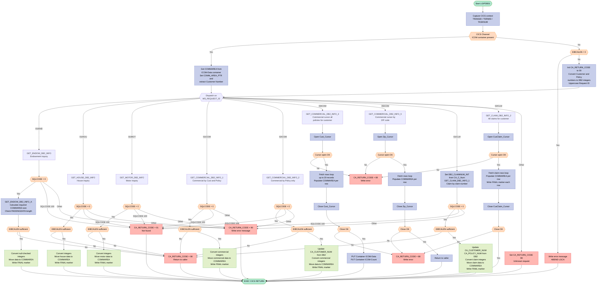
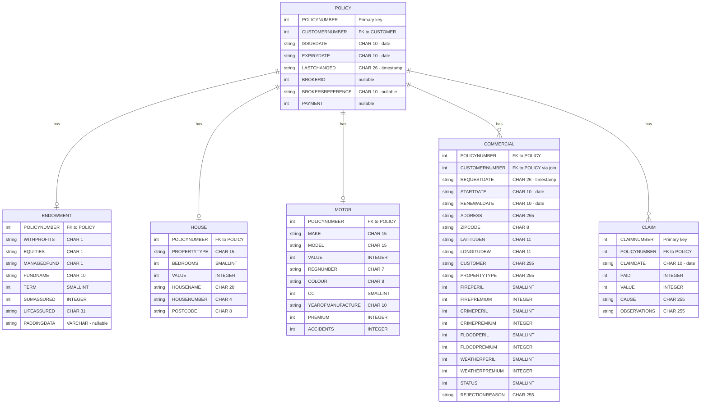

## Table of Contents

- [1. Purpose](#1-purpose)
- [2. Inputs](#2-inputs)
  - [2.1 Communication Area (COMMAREA / CICS Channel Container)](#21-communication-area-commarea--cics-channel-container)
  - [2.2 CICS Execution Interface Block (EIB)](#22-cics-execution-interface-block-eib)
  - [2.3 DB2 Tables](#23-db2-tables)
- [3. Outputs](#3-outputs)
  - [3.1 Communication Area (COMMAREA) — Returned to Calling Program](#31-communication-area-commarea--returned-to-calling-program)
  - [3.2 CICS Channel Containers — Returned for Multi-Row Commercial Queries (`03ICOM`)](#32-cics-channel-containers--returned-for-multi-row-commercial-queries-03icom)
  - [3.3 Diagnostic Output — Written to CICS Transient Data Queue via `LGSTSQ`](#33-diagnostic-output--written-to-cics-transient-data-queue-via-lgstsq)
  - [3.4 CICS ABEND](#34-cics-abend)
- [4. Processing Logic](#4-processing-logic)
  - [4.1 Mermaid Flow Diagram](#41-mermaid-flow-diagram)
  - [4.2 Processing Logic Description](#42-processing-logic-description)
  - [4.3 Database Tables](#43-database-tables)
- [5. Paragraphs](#5-paragraphs)
- [6. Dependencies](#6-dependencies)
  - [6.1 DB2 Database Tables](#61-db2-database-tables)
  - [6.2 DB2 Cursors](#62-db2-cursors)
  - [6.3 CICS Middleware](#63-cics-middleware)
  - [6.4 Linked / Called Programs](#64-linked--called-programs)
  - [6.5 Copybooks / Included Members](#65-copybooks--included-members)
  - [6.6 Input Parameters / Communication Area](#66-input-parameters--communication-area)
- [7. Constraints](#7-constraints)
  - [7.1 Request and dispatch constraints](#71-request-and-dispatch-constraints)
  - [7.2 Communication area and CICS channel constraints](#72-communication-area-and-cics-channel-constraints)
  - [7.3 Input filtering and database lookup constraints](#73-input-filtering-and-database-lookup-constraints)
  - [7.4 Data existence and error outcome constraints](#74-data-existence-and-error-outcome-constraints)
  - [7.5 COMMAREA size and returned-data length constraints](#75-commarea-size-and-returned-data-length-constraints)
  - [7.6 Multi-row result set constraints](#76-multi-row-result-set-constraints)
  - [7.7 Null-handling and field population constraints](#77-null-handling-and-field-population-constraints)
  - [7.8 Data format and type conversion constraints](#78-data-format-and-type-conversion-constraints)
  - [7.9 Processing sequence constraints](#79-processing-sequence-constraints)
  - [7.10 Return-code protocol constraints](#710-return-code-protocol-constraints)
  - [7.11 Diagnostic and logging constraints](#711-diagnostic-and-logging-constraints)
- [8. Error Handling](#8-error-handling)
  - [8.1 CICS Channel/Container Availability Check](#81-cics-channelcontainer-availability-check)
  - [8.2 Missing COMMAREA / No Input Data](#82-missing-commarea--no-input-data)
  - [8.3 Unrecognised Request Type](#83-unrecognised-request-type)
  - [8.4 DB2 SQL Error Handling — Singleton SELECT Statements](#84-db2-sql-error-handling--singleton-select-statements)
  - [8.5 DB2 SQL Error Handling — Cursor-Based Operations](#85-db2-sql-error-handling--cursor-based-operations)
  - [8.6 SQL NULL Indicator Variable Handling](#86-sql-null-indicator-variable-handling)
  - [8.7 COMMAREA Size Validation](#87-commarea-size-validation)
  - [8.8 Centralised Error Logging — WRITE_ERROR_MESSAGE Procedure](#88-centralised-error-logging--write_error_message-procedure)
- [9. Examples](#9-examples)
  - [9.1 Example 1 — Inquire Endowment Policy (`01IEND`)](#91-example-1--inquire-endowment-policy-01iend)
  - [9.2 Example 2 — Inquire Claim by Claim Number (`01ICLM`)](#92-example-2--inquire-claim-by-claim-number-01iclm)
  - [9.3 Example 3 — Unrecognised Request Code (error path)](#93-example-3--unrecognised-request-code-error-path)

## 1. Purpose

`LGIPDB01` is a CICS-hosted Enterprise PL/I program that serves as the DB2 data-retrieval back-end for an insurance policy inquiry system. Given a customer number, a policy number, and a request-type code supplied through a CICS communication area (or CICS channel/container), the program queries the appropriate DB2 tables — POLICY joined with ENDOWMENT, HOUSE, MOTOR, COMMERCIAL, or CLAIM — to retrieve the full details of a single insurance policy or claim record, then packages the results back into the communication area for the calling program to consume. It supports nine distinct inquiry variants (Endowment, House, Motor, four Commercial, and two Claim subtypes) dispatched by a six-character request identifier, and returns standardised return codes to signal success, no-data-found, insufficient communication-area size, or unexpected DB2 errors.

## 2. Inputs

### 2.1 Communication Area (COMMAREA / CICS Channel Container)

The program receives its primary inputs either through a CICS channel container (`ICOM` channel, `ICOM-Data` container) or through a conventional COMMAREA passed by the calling program (`LGIPOL01`). Both paths populate the same `COMM_AREA` structure.

- **`CA_REQUEST_ID`** (`CHAR(6)`) — Identifies the type of policy inquiry to perform. Drives the main dispatch logic. Valid values: `01IEND` (Endowment), `01IHOU` (House), `01IMOT` (Motor), `01ICOM` / `02ICOM` / `03ICOM` / `05ICOM` (Commercial variants), `01ICLM` / `02ICLM` (Claim variants).
- **`CA_CUSTOMER_NUM`** (`PIC '9999999999'`) — The ten-digit customer number identifying whose policies are to be retrieved. Converted to `DB2_CUSTOMERNUM_INT` and used as a WHERE predicate in all DB2 queries.
- **`CA_POLICY_NUM`** (`PIC '9999999999'`) — The ten-digit policy number for the specific policy record requested. Converted to `DB2_POLICYNUM_INT` and used as a WHERE predicate for single-policy lookups (Endowment, House, Motor, Commercial `01ICOM` / `02ICOM`, Claim `01ICLM`).
  - **`CA_C_Num`** (`PIC '9999999999'`) — Claim number supplied by the caller for request type `01ICLM`. Converted to `DB2_CLAIMNUM_INT` and used as the WHERE predicate on `CLAIM.ClaimNumber`.
  - **`CA_B_POSTCODE`** (`CHAR(8)`) — Commercial property postcode / ZIP code supplied by the caller for request type `05ICOM`. Used directly as the WHERE predicate on `COMMERCIAL.Zipcode` in the `Zip_Cursor` declaration.

### 2.2 CICS Execution Interface Block (EIB)

Read-only fields injected by CICS at program entry; the program has no control over their values.

- **`EIBCALEN`** — Length of the COMMAREA received. Checked at entry to detect a missing COMMAREA (value `0` triggers an ABEND) and later compared against the calculated required length to detect an undersized COMMAREA.
- **`EIBTRNID`** — Four-character CICS transaction identifier; copied to `WS_TRANSID` for diagnostic purposes.
- **`EIBTRMID`** — Four-character CICS terminal identifier; copied to `WS_TERMID` for diagnostic purposes.
- **`EIBTASKN`** — CICS task number; copied to `WS_TASKNUM` for diagnostic purposes.

### 2.3 DB2 Tables

All data is read-only; no inserts or updates are performed. The host variables that carry the query predicates into DB2 are described above under the COMMAREA inputs.

- **`POLICY` table** — Joined in every query. Supplies common policy fields (`ISSUEDATE`, `EXPIRYDATE`, `LASTCHANGED`, `BROKERID`, `BROKERSREFERENCE`, `PAYMENT`) and filters rows by `CUSTOMERNUMBER` and/or `POLICYNUMBER`.
- **`ENDOWMENT` table** — Joined with POLICY for `01IEND` requests. Supplies endowment-specific fields (`WITHPROFITS`, `EQUITIES`, `MANAGEDFUND`, `FUNDNAME`, `TERM`, `SUMASSURED`, `LIFEASSURED`, `PADDINGDATA`).
- **`HOUSE` table** — Joined with POLICY for `01IHOU` requests. Supplies house-specific fields (`PROPERTYTYPE`, `BEDROOMS`, `VALUE`, `HOUSENAME`, `HOUSENUMBER`, `POSTCODE`).
- **`MOTOR` table** — Joined with POLICY for `01IMOT` requests. Supplies motor-specific fields (`MAKE`, `MODEL`, `VALUE`, `REGNUMBER`, `COLOUR`, `CC`, `YEAROFMANUFACTURE`, `PREMIUM`, `ACCIDENTS`).
- **`COMMERCIAL` table** — Joined with POLICY for all `xxICOM` requests. Supplies commercial property fields (`ADDRESS`, `ZIPCODE`, `LATITUDEN`, `LONGITUDEW`, `CUSTOMER`, `PROPERTYTYPE`, `FirePeril`/`FirePremium`, `CrimePeril`/`CrimePremium`, `FloodPeril`/`FloodPremium`, `WeatherPeril`/`WeatherPremium`, `STATUS`, `REJECTIONREASON`).
- **`CLAIM` table** — Joined with POLICY for `01ICLM` and `02ICLM` requests. Supplies claim fields (`CLAIMNUMBER`, `POLICYNUMBER`, `CLAIMDATE`, `PAID`, `VALUE`, `CAUSE`, `OBSERVATIONS`).

## 3. Outputs

### 3.1 Communication Area (COMMAREA) — Returned to Calling Program

- **`CA_RETURN_CODE`** — Primary status indicator returned in the COMMAREA to signal the outcome of the policy inquiry:
  - `'00'` — Initialised on entry; implies success when data is also populated
  - `'01'` — No matching rows found (invalid customer or policy number)
  - `'88'` — Cursor close failure (Commercial or Claim multi-row queries)
  - `'89'` — Cursor open failure (Commercial or Claim multi-row queries)
  - `'90'` — Unexpected DB2 error during any SQL operation
  - `'98'` — COMMAREA supplied by caller is too small to hold the retrieved data
  - `'99'` — Unrecognised request identifier (`WS_REQUEST_ID` not matched)

- **`CA_CUSTOMER_NUM`** — Returned to the caller with the customer number resolved from DB2 when the query is by policy number alone (Commercial `02ICOM`, cursor-based Commercial `03ICOM`/`05ICOM`, and Claim `01ICLM`/`02ICLM`); confirms the owning customer of the looked-up policy or claim

- **`CA_POLICY_NUM`** — Returned to the caller with the policy number resolved from DB2 during Claim (`01ICLM`, `02ICLM`) and cursor-based Commercial (`03ICOM`, `05ICOM`) fetches; links the claim or commercial record back to its source policy

- **Common policy header fields** — Populated in the COMMAREA for all policy types (Endowment, House, Motor, Commercial, Claim) from the DB2 POLICY table:
  - **`CA_ISSUE_DATE`** — Date the policy was issued
  - **`CA_EXPIRY_DATE`** — Date the policy expires or is due for renewal
  - **`CA_LASTCHANGED`** — Timestamp of the most recent change to the policy record; serves as an audit trail
  - **`CA_BROKERID`** — Identifier of the broker associated with the policy (omitted when DB2 returns NULL)
  - **`CA_BROKERSREF`** — Broker's own reference string for the policy (omitted when DB2 returns NULL)
  - **`CA_PAYMENT`** — Periodic premium payment amount (omitted when DB2 returns NULL)

- **Endowment-specific fields** (`01IEND`) — Written into `CA_POLICY_RAW`/`CA_ENDOWMENT` area:
  - **`CA_E_WITH_PROFITS`**, **`CA_E_EQUITIES`**, **`CA_E_MANAGED_FUND`** — Fund-type indicator flags
  - **`CA_E_FUND_NAME`** — Name of the investment fund
  - **`CA_E_TERM`** — Term length of the endowment policy
  - **`CA_E_SUM_ASSURED`** — Guaranteed payout amount of the endowment contract
  - **`CA_E_LIFE_ASSURED`** — Name of the life assured
  - **`CA_E_PADDING_DATA`** — Variable-length VARCHAR padding data from DB2; a `'FINAL'` marker is written at the end to delimit the policy data

- **House-specific fields** (`01IHOU`) — Written into `CA_POLICY_RAW`/`CA_HOUSE` area:
  - **`CA_H_PROPERTY_TYPE`** — Type classification of the residential property
  - **`CA_H_BEDROOMS`** — Number of bedrooms
  - **`CA_H_VALUE`** — Insured value of the property
  - **`CA_H_HOUSE_NAME`**, **`CA_H_HOUSE_NUMBER`**, **`CA_H_POSTCODE`** — Property address details
  - **`CA_H_FILLER`** — A `'FINAL'` end-of-data marker is written at offset 1 of this filler

- **Motor-specific fields** (`01IMOT`) — Written into `CA_POLICY_RAW`/`CA_MOTOR` area:
  - **`CA_M_MAKE`**, **`CA_M_MODEL`** — Vehicle manufacturer and model name
  - **`CA_M_VALUE`** — Insured value of the vehicle
  - **`CA_M_REGNUMBER`** — Vehicle registration number
  - **`CA_M_COLOUR`** — Vehicle colour
  - **`CA_M_CC`** — Engine cubic capacity
  - **`CA_M_MANUFACTURED`** — Year of manufacture
  - **`CA_M_PREMIUM`** — Motor insurance premium amount
  - **`CA_M_ACCIDENTS`** — Number of recorded accidents
  - **`CA_M_FILLER`** — A `'FINAL'` end-of-data marker is written at offset 1 of this filler

- **Commercial-specific fields** (`01ICOM`, `02ICOM`, `03ICOM`, `05ICOM`) — Written into `CA_POLICY_RAW`/`CA_COMMERCIAL` area:
  - **`CA_B_Address`** — Street address of the commercial property
  - **`CA_B_Postcode`** — Postcode / ZIP code of the commercial property
  - **`CA_B_Latitude`**, **`CA_B_Longitude`** — Geolocation coordinates
  - **`CA_B_Customer`** — Customer/business name associated with the commercial property
  - **`CA_B_PropType`** — Property type classification
  - **`CA_B_FirePeril`**, **`CA_B_FirePremium`** — Fire peril flag and its premium
  - **`CA_B_CrimePeril`**, **`CA_B_CrimePremium`** — Crime peril flag and its premium
  - **`CA_B_FloodPeril`**, **`CA_B_FloodPremium`** — Flood peril flag and its premium
  - **`CA_B_WeatherPeril`**, **`CA_B_WeatherPremium`** — Weather peril flag and its premium
  - **`CA_B_Status`** — Approval status of the commercial policy
  - **`CA_B_RejectReason`** — Free-text rejection reason if the policy was declined
  - **`CA_B_FILLER`** — A `'FINAL'` end-of-data marker is written at offset 1 of this filler

- **Claim-specific fields** (`01ICLM`, `02ICLM`) — Written into `CA_POLICY_RAW`/`CA_CLAIM` area:
  - **`CA_C_Num`** — Claim number identifying the specific claim record
  - **`CA_C_Date`** — Date the claim was lodged
  - **`CA_C_Paid`** — Amount already paid against the claim
  - **`CA_C_Value`** — Total monetary value of the claim
  - **`CA_C_Cause`** — Free-text description of the cause of the claim
  - **`CA_C_Observations`** — Free-text observations or notes on the claim
  - **`CA_C_FILLER`** — A `'FINAL'` end-of-data marker is written at offset 1 of this filler

---

### 3.2 CICS Channel Containers — Returned for Multi-Row Commercial Queries (`03ICOM`)

- **`ICOM-Data` container (channel `ICOM`)** — Written via `EXEC CICS PUT CONTAINER`; holds a packed array of up to 20 commercial policy records (each 1202 bytes), serialised from successive cursor fetches of the `Cust_Cursor`; consumed by the calling program to render a list of commercial policies for a customer
- **`ICOM-Count` container (channel `ICOM`)** — Written via `EXEC CICS PUT CONTAINER`; holds the 2-byte `ICOM_Record_Count` integer indicating how many commercial records are present in `ICOM-Data`

---

### 3.3 Diagnostic Output — Written to CICS Transient Data Queue via `LGSTSQ`

- **`ERROR_MSG`** — Formatted error record linked to program `LGSTSQ` via `EXEC CICS LINK` whenever a DB2 error or operational fault occurs; contains:
  - **`EM_DATE`** / **`EM_TIME`** — Timestamp of the error (obtained from CICS `ASKTIME`/`FORMATTIME`)
  - **`EM_CUSNUM`** / **`EM_POLNUM`** — Customer and policy numbers in scope at the time of the error
  - **`EM_SQLREQ`** — Label identifying which SQL operation was in progress (e.g., `' SELECT ENDOW '`, `' SELECT HOUSE '`)
  - **`EM_SQLRC`** — The DB2 SQLCODE value that triggered the error write
- **`CA_ERROR_MSG`** — Up to 90 bytes of raw COMMAREA content, also linked to `LGSTSQ`, providing context for the error by showing the caller's input data at the time of failure

---

### 3.4 CICS ABEND

- **`ABCODE('LGCA')`** — Issued via `EXEC CICS ABEND ABCODE('LGCA') NODUMP` when `EIBCALEN = 0`, meaning the program was invoked with no COMMAREA at all; this is a hard termination signal to CICS that the calling environment is misconfigured

## 4. Processing Logic

### 4.1 Mermaid Flow Diagram

---

### 4.2 Processing Logic Description

#### 4.2.1 High-level Summary

LGIPDB01 is a CICS-attached DB2 back-end inquiry program for the GenApp insurance application. Its sole responsibility is to retrieve the full details of a single insurance policy — or a set of policies — from DB2 and return the data to its caller via the CICS COMMAREA or a CICS named channel/container. It handles five distinct insurance product types: **Endowment**, **House**, **Motor**, **Commercial**, and **Claim**. The request type is encoded in a 6-character field (`CA_REQUEST_ID`) that drives a `SELECT` dispatch to the appropriate internal procedure.

---

#### 4.2.2 Execution Flow

**Step 1 — Initialisation and Context Capture**

The program opens by capturing the CICS execution context into working-storage variables (`WS_TRANSID`, `WS_TERMID`, `WS_TASKNUM`) from the EIB fields `EIBTRNID`, `EIBTRMID`, and `EIBTASKN`. These are stored in the `WS_HEADER` eyecatcher area for diagnostic purposes during any subsequent dump analysis.

**Step 2 — COMMAREA vs. Channel/Container Routing**

The program checks whether data was delivered via a CICS **named channel** (`ICOM` channel, `ICOM-Data` container) using `EXEC CICS GET CONTAINER`:

- **If the container GET succeeds (`WS_RESP = DFHRESP(NORMAL)`):** The program uses the pointer returned from the container as its `COMM_AREA_PTR`, extracts `CA_REQUEST_ID` into `WS_Request_ID`, and converts `CA_Customer_Num` into the DB2 integer host variable `DB2_Customernum_Int`. No further COMMAREA length validation is performed on this path.
- **If the container GET fails (i.e., the caller used a traditional COMMAREA):** The program validates `EIBCALEN`. If zero, it writes an error message and issues `EXEC CICS ABEND ABCODE('LGCA') NODUMP`, immediately terminating the task. Otherwise, it initialises `CA_RETURN_CODE` to `'00'`, converts both `CA_CUSTOMER_NUM` and `CA_POLICY_NUM` to DB2 integer format, saves them in the error message area, and upper-cases `CA_REQUEST_ID` into `WS_REQUEST_ID`.

**Step 3 — Request Type Dispatch**

A PL/I `SELECT` statement dispatches on `WS_REQUEST_ID` to one of nine internal procedure calls:

| Request ID | Procedure | Description |
|---|---|---|
| `01IEND` | `GET_ENDOW_DB2_INFO` | Endowment — by customer + policy number |
| `01IHOU` | `GET_HOUSE_DB2_INFO` | House — by customer + policy number |
| `01IMOT` | `GET_MOTOR_DB2_INFO` | Motor — by customer + policy number |
| `01ICOM` | `GET_COMMERCIAL_DB2_INFO_1` | Commercial — by customer + policy number |
| `02ICOM` | `GET_COMMERCIAL_DB2_INFO_2` | Commercial — by policy number only |
| `03ICOM` | `GET_COMMERCIAL_DB2_INFO_3` | Commercial — all policies for a customer (cursor) |
| `05ICOM` | `GET_COMMERCIAL_DB2_INFO_5` | Commercial — by ZIP code (cursor) |
| `01ICLM` | `GET_CLAIM_DB2_INFO_1` | Claim — by claim number |
| `02ICLM` | `GET_CLAIM_DB2_INFO_2` | Claim — all claims for a customer (cursor) |
| _Other_ | — | Sets `CA_RETURN_CODE = '99'` (unrecognised request) |

**Step 4 — Single-Row Inquiry Procedures (Endowment, House, Motor, Commercial variants 1 & 2, Claim variant 1)**

All single-row procedures follow the same four-phase pattern:

1. **SQL SELECT** — A join of the `POLICY` table with the relevant entity table (`ENDOWMENT`, `HOUSE`, `MOTOR`, `COMMERCIAL`, or `CLAIM`) using customer number and/or policy number as predicates. Integer/smallint DB2 columns are fetched into `FIXED BIN` host variables; nullable columns use SQL **indicator variables** (`IND_BROKERID`, `IND_PAYMENT`, etc.). An indicator value of `-1` signals a DB2 NULL.

2. **SQLCODE check** — Three outcomes:
   - `SQLCODE = 0`: Row found; proceed.
   - `SQLCODE = 100`: No row found; set `CA_RETURN_CODE = '01'`.
   - Anything else: DB2 error; set `CA_RETURN_CODE = '90'` and call `WRITE_ERROR_MESSAGE`.

3. **COMMAREA size validation** — The program calculates the minimum COMMAREA needed (`WS_CA_HEADERTRAILER_LEN` + the appropriate full-policy length constant). For Endowment, the variable-length `PADDINGDATA` VARCHAR column's actual length (`DB2_E_PADDING_LEN`) is also added when not NULL. If `EIBCALEN` is less than the required length, `CA_RETURN_CODE = '98'` is set and `EXEC CICS RETURN` is issued immediately — no data is returned.

4. **Data population** — Integer host variables are converted to their display-numeric COMMAREA counterparts, conditionally skipping NULL-flagged fields. The full policy text area is copied via `SUBSTR(CA_POLICY_RAW,1,<length>) = DB2_<type>_TEXT`. A five-character `'FINAL'` sentinel is written to the filler area immediately after the policy data to mark its end.

   The `02ICOM` and `01ICLM` variants additionally write back `CA_CUSTOMER_NUM` and `CA_POLICY_NUM` from the DB2 output (since the caller may not have supplied the customer number).

**Step 5 — Cursor-Based Multi-Row Procedures (Commercial variants 3 & 5, Claim variant 2)**

These procedures retrieve multiple matching rows:

- **`GET_COMMERCIAL_DB2_INFO_3`** — Opens `Cust_Cursor` (POLICY ⨝ COMMERCIAL filtered by customer number). A `DO UNTIL (SQLCODE > 0)` loop calls the inner procedure `GET_COMMERCIAL_DB2_INFO_3_Cur` for each row. Each fetched row populates the COMMAREA at the current `ICOM_Pointer` position and advances the pointer. A hard cap of **20 records** is enforced: if `ICOM_Record_Count` exceeds 20, `SQLCODE` is manually set to `17` to break the loop. After the cursor is closed, the accumulated data is published to the CICS channel via `EXEC CICS PUT CONTAINER('ICOM-Data')` (total byte length = record count × 1202) and the count via `EXEC CICS PUT CONTAINER('ICOM-Count')`.

- **`GET_COMMERCIAL_DB2_INFO_5`** — Identical cursor pattern but uses `Zip_Cursor` (POLICY ⨝ COMMERCIAL filtered by `CA_B_POSTCODE` ZIP code). There is no explicit record count cap coded for this variant, and no container PUT — the fetched rows are written directly into the COMMAREA.

- **`GET_CLAIM_DB2_INFO_2`** — Opens `CusClaim_Cursor` (POLICY ⨝ CLAIM filtered by customer number). Each fetched row populates claim fields in the COMMAREA and writes a `'FINAL'` sentinel marker. No record count cap is enforced.

For all cursor procedures, if `OPEN` fails, `CA_RETURN_CODE = '89'` is set and `WRITE_ERROR_MESSAGE` is called. If `CLOSE` fails, `CA_RETURN_CODE = '88'` is used.

**Step 6 — Error Message Writing**

`WRITE_ERROR_MESSAGE` captures the current `SQLCODE` into `EM_SQLRC`, calls `EXEC CICS ASKTIME` and `EXEC CICS FORMATTIME` to obtain a formatted current date/time, then `EXEC CICS LINK PROGRAM('LGSTSQ')` to write the error message structure (including program name, customer number, policy number, SQL request name, and SQLCODE) to the CSMT transient data queue. If a COMMAREA is present, up to 90 bytes of its raw content are also written.

**Step 7 — Return**

All paths converge at `EXEC CICS RETURN`, which returns control to the calling program (the policy inquiry orchestrator, typically `LGIPOL01`).

---

#### 4.2.3 External Interactions

| Interaction | Detail |
|---|---|
| **DB2 — POLICY table** | Joined with all entity tables as the primary key anchor; provides `ISSUEDATE`, `EXPIRYDATE`, `LASTCHANGED`, `BROKERID`, `BROKERSREFERENCE`, `PAYMENT`, `CUSTOMERNUMBER`, `POLICYNUMBER` |
| **DB2 — ENDOWMENT table** | Joined for `01IEND`; provides fund type flags, term, sum assured, life assured name, and variable-length padding data |
| **DB2 — HOUSE table** | Joined for `01IHOU`; provides property type, bedrooms, insured value, address |
| **DB2 — MOTOR table** | Joined for `01IMOT`; provides make, model, value, registration, engine cc, premium, accident count |
| **DB2 — COMMERCIAL table** | Joined for all `xxICOM` variants; provides address, postcode, geolocation, property/customer descriptions, peril/premium data for fire/crime/flood/weather, approval status, and rejection reason |
| **DB2 — CLAIM table** | Joined for `xxICLM` variants; provides claim number, claim date, paid amount, claim value, cause, and observations |
| **CICS Channel/Container `ICOM`** | Used as an alternative high-capacity data transport for multi-row commercial results; the program reads input from `ICOM-Data` container and writes results back to it along with a record count in `ICOM-Count` |
| **LGSTSQ** (via `EXEC CICS LINK`) | Logging subprogram; receives the error message structure and writes it to the CICS transient data queue (CSMT) for operational monitoring |

---

#### 4.2.4 Plain Language Summary

LGIPDB01 is the database reader for insurance policy inquiries. When a caller wants to see the details of an insurance policy, it calls this program with a request code that says what type of policy it needs. The program looks up the matching record in the DB2 database, checks there is enough space to return the data, converts any numeric types, and fills in the response area for the caller to read.

For simple lookups (one policy), it runs a single SQL SELECT joining the shared POLICY table with the specific product table (Endowment, House, Motor, or Commercial). For requests that need multiple rows — such as "all commercial policies for this customer" or "all claims for this customer" — it uses a scrollable DB2 cursor to loop through the results, placing each record into the response area in turn, with a cap of 20 records for the customer-commercial variant.

If the policy is not found, it returns a "not found" code. If there is a DB2 error, it logs a diagnostic message including the SQL code, customer number, and policy number, and returns an error code. If the response area provided by the caller is too small to hold the data, it returns a "buffer too small" code without writing anything.

---

### 4.3 Database Tables

## 5. Paragraphs

- **Main Procedure Body (inline mainline code, lines 477–572)**
  - Serves as the program entry point, executing top-to-bottom before delegating to internal procedures.
  - Initialises runtime identification fields (`WS_TRANSID`, `WS_TERMID`, `WS_TASKNUM`) from CICS EIB fields (`EIBTRNID`, `EIBTRMID`, `EIBTASKN`).
  - Attempts to retrieve data from a CICS channel container (`ICOM-Data` on channel `ICOM`) using `EXEC CICS GET CONTAINER`. If the response is normal (`DFHRESP(NORMAL)`), the communication area pointer (`COMM_AREA_PTR`) is aimed at the retrieved container storage, the request ID and customer number are extracted, and processing continues without consulting the traditional COMMAREA.
  - If the channel container is not present, falls back to CICS COMMAREA processing:
    - Checks `EIBCALEN`; if zero, writes an error message and issues `EXEC CICS ABEND ABCODE('LGCA') NODUMP` to terminate abnormally.
    - Initialises `CA_RETURN_CODE` to `'00'`, stores COMMAREA length, and converts `CA_CUSTOMER_NUM` and `CA_POLICY_NUM` to DB2 integer host variables (`DB2_CUSTOMERNUM_INT`, `DB2_POLICYNUM_INT`).
    - Saves customer and policy numbers into the error message area for diagnostic use.
    - Upper-cases `CA_REQUEST_ID` into `WS_REQUEST_ID`.
  - Dispatches processing via a `SELECT (WS_REQUEST_ID)` statement (equivalent of a CASE/switch):
    - `'01IEND'` → calls `GET_ENDOW_DB2_INFO`
    - `'01IHOU'` → calls `GET_HOUSE_DB2_INFO`
    - `'01IMOT'` → calls `GET_MOTOR_DB2_INFO`
    - `'01ICOM'` → calls `GET_COMMERCIAL_DB2_INFO_1`
    - `'02ICOM'` → calls `GET_COMMERCIAL_DB2_INFO_2`
    - `'03ICOM'` → calls `GET_COMMERCIAL_DB2_INFO_3`
    - `'05ICOM'` → calls `GET_COMMERCIAL_DB2_INFO_5`
    - `'01ICLM'` → loads claim number from `CA_C_Num` into `DB2_CLAIMNUM_INT`, then calls `GET_CLAIM_DB2_INFO_1`
    - `'02ICLM'` → calls `GET_CLAIM_DB2_INFO_2`
    - `OTHERWISE` → sets `CA_RETURN_CODE = '99'` for an unrecognised request type.
  - Ends with `EXEC CICS RETURN` to return control to CICS.

- **GET_ENDOW_DB2_INFO (lines 582–641)**
  - Retrieves a single endowment policy record from DB2 by joining the `POLICY` and `ENDOWMENT` tables.
  - Executes a singleton `SELECT` filtering on both `DB2_CUSTOMERNUM_INT` and `DB2_POLICYNUM_INT`, fetching policy common fields (issue date, expiry date, last-changed timestamp, broker ID/reference, payment) plus endowment-specific fields (with-profits flag, equities flag, managed fund flag, fund name, term, sum assured, life assured, and padding VARCHAR data with its length).
  - Uses SQL NULL indicator variables (`IND_BROKERID`, `IND_BROKERSREF`, `IND_PAYMENT`, `IND_E_PADDINGDATA`, `IND_E_PADDINGDATAL`) to handle potentially null columns.
  - Dispatches on `SQLCODE` using a `SELECT (SQLCODE)` construct:
    - `SQLCODE = 0`: calls the helper `GET_ENDOW_DB2_INFO_A` to perform commarea length validation and data movement.
    - `SQLCODE = 100`: sets `CA_RETURN_CODE = '01'` (no matching row found).
    - Otherwise: sets `CA_RETURN_CODE = '90'` and calls `WRITE_ERROR_MESSAGE`.

- **GET_ENDOW_DB2_INFO_A (lines 644–697)**
  - Helper procedure called only when the endowment `SELECT` succeeds (SQLCODE=0).
  - Calculates the required COMMAREA length by adding `WS_CA_HEADERTRAILER_LEN`, `WS_FULL_ENDOW_LEN`, and, conditionally (if `IND_E_PADDINGDATAL <> MINUS_ONE`), the actual VARCHAR padding data length (`DB2_E_PADDING_LEN`); also advances `END_POLICY_POS` by the same amount.
  - If `EIBCALEN` is less than the required length, sets `CA_RETURN_CODE = '98'` and issues `EXEC CICS RETURN`.
  - Otherwise, conditionally converts integer host variables to display numerics (only when the NULL indicator is not −1): `DB2_BROKERID_INT` → `DB2_BROKERID`; `DB2_PAYMENT_INT` → `DB2_PAYMENT`. Always converts `DB2_E_TERM_SINT` → `DB2_E_TERM` and `DB2_E_SUMASSURED_INT` → `DB2_E_SUMASSURED`.
  - Moves all policy common fields and the fixed portion of the endowment text into the COMMAREA using direct assignment and `SUBSTR`.
  - Conditionally copies the VARCHAR padding data into `CA_E_PADDING_DATA` when `IND_E_PADDINGDATA <> MINUS_ONE`.
  - Writes the literal `'FINAL'` at `END_POLICY_POS` within `CA_E_PADDING_DATA` as an end-of-data marker.

- **GET_HOUSE_DB2_INFO (lines 705–793)**
  - Retrieves a single house policy record from DB2 by joining `POLICY` and `HOUSE`, filtered by `DB2_CUSTOMERNUM_INT` and `DB2_POLICYNUM_INT`.
  - Fetches policy common fields plus house-specific fields: property type, number of bedrooms (`FIXED BIN(15)` host variable), insured value (`FIXED BIN(31)`), house name, house number, and postcode.
  - On `SQLCODE = 0`:
    - Calculates required COMMAREA length (`WS_CA_HEADERTRAILER_LEN + WS_FULL_HOUSE_LEN`).
    - If COMMAREA is too small, sets `CA_RETURN_CODE = '98'` and issues `EXEC CICS RETURN`.
    - Otherwise, conditionally converts non-null integer fields (`DB2_BROKERID_INT`, `DB2_PAYMENT_INT`) to display numerics; converts `DB2_H_BEDROOMS_SINT` → `DB2_H_BEDROOMS` and `DB2_H_VALUE_INT` → `DB2_H_VALUE`; copies all policy common fields and the 73-byte house text block into the COMMAREA; writes `'FINAL'` into `CA_H_FILLER` as an end-of-data marker.
  - On `SQLCODE = 100`: sets `CA_RETURN_CODE = '01'`.
  - On any other SQLCODE: sets `CA_RETURN_CODE = '90'` and calls `WRITE_ERROR_MESSAGE`.

- **GET_MOTOR_DB2_INFO (lines 799–897)**
  - Retrieves a single motor policy record from DB2 by joining `POLICY` and `MOTOR`, filtered by `DB2_CUSTOMERNUM_INT` and `DB2_POLICYNUM_INT`.
  - Fetches policy common fields plus motor-specific fields: make, model, value, registration number, colour, engine CC (`FIXED BIN(15)`), year of manufacture, premium, and accident count (all numeric fields use `FIXED BIN` host variables).
  - On `SQLCODE = 0`:
    - Calculates required COMMAREA length (`WS_CA_HEADERTRAILER_LEN + WS_FULL_MOTOR_LEN`).
    - If too small, sets `CA_RETURN_CODE = '98'` and issues `EXEC CICS RETURN`.
    - Otherwise, conditionally converts non-null integer fields; converts all motor-specific integers to display numerics; copies all policy common fields and the 77-byte motor text block into the COMMAREA; writes `'FINAL'` into `CA_M_FILLER`.
  - On `SQLCODE = 100`: sets `CA_RETURN_CODE = '01'`.
  - On any other SQLCODE: sets `CA_RETURN_CODE = '90'` and calls `WRITE_ERROR_MESSAGE`.

- **GET_COMMERCIAL_DB2_INFO_1 (lines 903–1009)**
  - Retrieves a single commercial policy record by joining `POLICY` and `COMMERCIAL`, filtered by both `DB2_CUSTOMERNUM_INT` and `DB2_POLICYNUM_INT`.
  - Fetches commercial-specific fields (request date, start date, renewal date, address, postcode, latitude, longitude, customer name, property type, all four peril/premium pairs, status, and rejection reason) into working storage integer host variables.
  - On `SQLCODE = 0`:
    - Calculates required COMMAREA length (`WS_CA_HEADERTRAILER_LEN + WS_FULL_COMM_LEN`).
    - If too small, sets `CA_RETURN_CODE = '98'` and issues `EXEC CICS RETURN`.
    - Otherwise, converts all integer peril/premium/status fields to their display numeric equivalents and copies policy common and commercial data (1102-byte text block) into the COMMAREA; writes `'FINAL'` into `CA_B_FILLER`.
  - On `SQLCODE = 100`: sets `CA_RETURN_CODE = '01'`.
  - On any other SQLCODE: sets `CA_RETURN_CODE = '90'` and calls `WRITE_ERROR_MESSAGE`.

- **GET_COMMERCIAL_DB2_INFO_2 (lines 1015–1122)**
  - Similar to `GET_COMMERCIAL_DB2_INFO_1` but filters by `DB2_POLICYNUM_INT` only (no customer number predicate), allowing lookup by policy number alone.
  - Additionally retrieves `CustomerNumber` from DB2 and writes it back into `CA_CUSTOMER_NUM` in the COMMAREA on successful fetch.
  - Applies the same COMMAREA length check, integer conversion, and data-movement logic as INFO_1.
  - On `SQLCODE = 100`: sets `CA_RETURN_CODE = '01'`. On other errors: sets `CA_RETURN_CODE = '90'` and calls `WRITE_ERROR_MESSAGE`.

- **GET_COMMERCIAL_DB2_INFO_3 (lines 1128–1166)**
  - Retrieves all commercial policies for a given customer using the pre-declared `Cust_Cursor` (joins `POLICY` and `COMMERCIAL`, filtered by `DB2_CUSTOMERNUM_INT`).
  - Initialises `ICOM_Record_Count` to zero, then opens `Cust_Cursor`; sets `CA_RETURN_CODE = '89'` and calls `WRITE_ERROR_MESSAGE` if the cursor open fails.
  - Loops with `DO UNTIL (SQLCODE > 0)`, calling `GET_COMMERCIAL_DB2_INFO_3_Cur` for each iteration until end-of-data or an error.
  - Closes `Cust_Cursor`; sets `CA_RETURN_CODE = '88'` and calls `WRITE_ERROR_MESSAGE` if the close fails.
  - Calculates the total byte length of all retrieved records (`ICOM_Record_Count * 1202`) and writes the data block and the count to CICS channel containers (`ICOM-Data` and `ICOM-Count` on channel `ICOM`) using `EXEC CICS PUT CONTAINER`.

- **GET_COMMERCIAL_DB2_INFO_3_Cur (lines 1169–1227)**
  - Inner cursor-fetch procedure called iteratively by `GET_COMMERCIAL_DB2_INFO_3`.
  - Points `COMM_AREA_PTR` at the current position in the ICOM buffer (`ICOM_Pointer`) before the fetch.
  - Executes `FETCH Cust_Cursor` to retrieve the next commercial policy row (customer number, policy number, and all commercial fields) into DB2 integer host variables.
  - On `SQLCODE = 0`: converts integer peril/premium/status fields to display numerics; copies customer number, policy number, policy common fields, and the 1102-byte commercial text block into the COMMAREA overlay at the current buffer position; increments `ICOM_Record_Count` and advances `ICOM_Pointer` to `ADDR(CA_B_FILLER)` for the next record slot.
  - Enforces a hard cap of 20 records: if `ICOM_Record_Count > 20`, sets `SQLCODE = 17` to force the outer `DO UNTIL` loop to terminate.

- **GET_COMMERCIAL_DB2_INFO_5 (lines 1233–1257)**
  - Retrieves commercial policies matching a postcode using the pre-declared `Zip_Cursor` (joins `POLICY` and `COMMERCIAL`, filtered by `CA_B_POSTCODE`).
  - Opens `Zip_Cursor`; sets `CA_RETURN_CODE = '89'` and calls `WRITE_ERROR_MESSAGE` if open fails.
  - Loops with `DO UNTIL (SQLCODE > 0)`, calling `GET_COMMERCIAL_DB2_INFO_5_Cur` for each row.
  - Closes `Zip_Cursor`; sets `CA_RETURN_CODE = '88'` and calls `WRITE_ERROR_MESSAGE` if close fails.
  - Unlike INFO_3, does not write results to a CICS channel container; results are communicated via the COMMAREA directly.

- **GET_COMMERCIAL_DB2_INFO_5_Cur (lines 1260–1309)**
  - Inner cursor-fetch procedure called iteratively by `GET_COMMERCIAL_DB2_INFO_5`.
  - Executes `FETCH Zip_Cursor` to retrieve the next row (customer number, policy number, and all commercial fields) into DB2 integer host variables.
  - On `SQLCODE = 0`: converts integer peril/premium/status fields to display numerics; updates `CA_CUSTOMER_NUM` and `CA_POLICY_NUM` from the fetched integers; copies all policy common fields and the 1102-byte commercial text block into the COMMAREA.
  - No record count cap or pointer advancement is performed (unlike INFO_3_Cur); each fetched row simply overwrites the same COMMAREA area.

- **GET_CLAIM_DB2_INFO_1 (lines 1315–1391)**
  - Retrieves a single claim record by joining `POLICY` and `CLAIM`, filtered by `DB2_CLAIMNUM_INT` (the specific claim number).
  - Fetches the owning customer number, claim number, associated policy number, claim date, paid amount, value, cause, and observations into host variables.
  - On `SQLCODE = 0`:
    - Calculates required COMMAREA length (`WS_CA_HEADERTRAILER_LEN + WS_FULL_CLAIM_LEN`).
    - If too small, sets `CA_RETURN_CODE = '98'` and issues `EXEC CICS RETURN`.
    - Otherwise, writes back `CA_CUSTOMER_NUM` and `CA_POLICY_NUM` from the fetched DB2 integers; converts `DB2_C_Paid_INT` → `DB2_C_Paid` and `DB2_C_Value_INT` → `DB2_C_Value`; copies the 556-byte claim text block into `CA_POLICY_RAW`; writes `'FINAL'` into `CA_C_FILLER`.
  - On `SQLCODE = 100`: sets `CA_RETURN_CODE = '01'`.
  - On any other SQLCODE: sets `CA_RETURN_CODE = '90'` and calls `WRITE_ERROR_MESSAGE`.

- **GET_CLAIM_DB2_INFO_2 (lines 1397–1421)**
  - Retrieves all claims for a given customer using the pre-declared `CusClaim_Cursor` (joins `POLICY` and `CLAIM`, filtered by `DB2_CUSTOMERNUM_INT`).
  - Opens `CusClaim_Cursor`; sets `CA_RETURN_CODE = '89'` and calls `WRITE_ERROR_MESSAGE` if open fails.
  - Loops with `DO UNTIL (SQLCODE > 0)`, calling `GET_CLAIM_DB2_INFO_2_Cur` for each row.
  - Closes `CusClaim_Cursor`; sets `CA_RETURN_CODE = '88'` and calls `WRITE_ERROR_MESSAGE` if close fails.

- **GET_CLAIM_DB2_INFO_2_Cur (lines 1424–1456)**
  - Inner cursor-fetch procedure called iteratively by `GET_CLAIM_DB2_INFO_2`.
  - Executes `FETCH CusClaim_Cursor` to retrieve the next claim row (customer number, claim number, policy number, claim date, paid amount, value, cause, observations).
  - On `SQLCODE = 0`: writes back `CA_CUSTOMER_NUM` and `CA_POLICY_NUM`; converts `DB2_C_Paid_INT` → `DB2_C_Paid` and `DB2_C_Value_INT` → `DB2_C_Value`; copies policy common fields and the 556-byte claim text block into `CA_POLICY_RAW`; writes `'FINAL'` into `CA_C_FILLER` after each row.
  - No explicit record count limit is applied; the loop terminates when SQLCODE becomes non-zero (end-of-data or error).

- **WRITE_ERROR_MESSAGE (lines 1463–1493)**
  - Shared error-reporting utility invoked by all policy-type procedures on DB2 or CICS failures.
  - Captures the current `SQLCODE` into the `EM_SQLRC` field of the `ERROR_MSG` structure.
  - Obtains the current absolute time using `EXEC CICS ASKTIME ABSTIME(ABS_TIME)`, then formats it into date (`MMDDYYYY`) and time strings using `EXEC CICS FORMATTIME`, storing results in `EM_DATE` and `EM_TIME`.
  - Writes the formatted error message to the CICS transient data queue via `EXEC CICS LINK PROGRAM('LGSTSQ')` passing `ERROR_MSG` as the COMMAREA.
  - Conditionally dumps a portion of the COMMAREA: if `EIBCALEN > 0`, writes up to 90 bytes of the raw COMMAREA (`COMM_AREA_RAW`) into `CA_DATA` (using `LEFT` to trim to actual length if less than 91 bytes) and passes `CA_ERROR_MSG` to `LGSTSQ` via a second `EXEC CICS LINK`.

## 6. Dependencies

### 6.1 DB2 Database Tables

- **POLICY table**
  - Joined with all policy-type tables; supplies common policy fields: `POLICYNUMBER`, `CUSTOMERNUMBER`, `ISSUEDATE`, `EXPIRYDATE`, `LASTCHANGED`, `BROKERID`, `BROKERSREFERENCE`, `PAYMENT`
  - Used as the primary keying table in every SQL SELECT and in cursor declarations (`Cust_Cursor`, `Zip_Cursor`, `CusClaim_Cursor`)

- **ENDOWMENT table**
  - Joined with POLICY on `POLICYNUMBER`; supplies endowment-specific columns: `WITHPROFITS`, `EQUITIES`, `MANAGEDFUND`, `FUNDNAME`, `TERM`, `SUMASSURED`, `LIFEASSURED`, `PADDINGDATA`
  - Accessed for request type `01IEND`

- **HOUSE table**
  - Joined with POLICY on `POLICYNUMBER`; supplies house-specific columns: `PROPERTYTYPE`, `BEDROOMS`, `VALUE`, `HOUSENAME`, `HOUSENUMBER`, `POSTCODE`
  - Accessed for request type `01IHOU`

- **MOTOR table**
  - Joined with POLICY on `POLICYNUMBER`; supplies motor-specific columns: `MAKE`, `MODEL`, `VALUE`, `REGNUMBER`, `COLOUR`, `CC`, `YEAROFMANUFACTURE`, `PREMIUM`, `ACCIDENTS`
  - Accessed for request type `01IMOT`

- **COMMERCIAL table**
  - Joined with POLICY on `POLICYNUMBER`; supplies commercial property columns: `ADDRESS`, `ZIPCODE`, `LATITUDEN`, `LONGITUDEW`, `CUSTOMER`, `PROPERTYTYPE`, `FIREPERIL`, `FIREPREMIUM`, `CRIMEPERIL`, `CRIMEPREMIUM`, `FLOODPERIL`, `FLOODPREMIUM`, `WEATHERPERIL`, `WEATHERPREMIUM`, `STATUS`, `REJECTIONREASON`
  - Accessed for request types `01ICOM`, `02ICOM`, `03ICOM` (via `Cust_Cursor`), and `05ICOM` (via `Zip_Cursor`)

- **CLAIM table**
  - Joined with POLICY on `POLICYNUMBER`; supplies claim-specific columns: `CLAIMNUMBER`, `CLAIMDATE`, `PAID`, `VALUE`, `CAUSE`, `OBSERVATIONS`
  - Accessed for request types `01ICLM` (single-row SELECT) and `02ICLM` (via `CusClaim_Cursor`)

- **SQLCA (SQL Communications Area)**
  - Included via `EXEC SQL INCLUDE SQLCA`; provides `SQLCODE` and related DB2 feedback fields used for error checking after every SQL operation

### 6.2 DB2 Cursors

- **`Cust_Cursor`** — Insensitive Scroll cursor declared over a join of POLICY and COMMERCIAL, filtered by customer number (`DB2_CUSTOMERNUM_INT`); used by request type `03ICOM` to iterate over all commercial policies for a customer
- **`Zip_Cursor`** — Insensitive Scroll cursor declared over a join of POLICY and COMMERCIAL, filtered by postcode/zipcode (`CA_B_POSTCODE`); used by request type `05ICOM` to iterate over commercial policies matching a postcode
- **`CusClaim_Cursor`** — Insensitive Scroll cursor declared over a join of POLICY and CLAIM, filtered by customer number (`DB2_CUSTOMERNUM_INT`); used by request type `02ICLM` to iterate over all claims for a customer

### 6.3 CICS Middleware

- **CICS EIB (Execute Interface Block)**
  - `EIBTRNID` — transaction identifier, copied into `WS_TRANSID` at program start
  - `EIBTRMID` — terminal identifier, copied into `WS_TERMID`
  - `EIBTASKN` — task number, copied into `WS_TASKNUM`
  - `EIBCALEN` — communications area length, used to validate the COMMAREA is large enough to hold returned data
- **`EXEC CICS GET CONTAINER`** — retrieves the `ICOM-Data` container from the `ICOM` channel; when successful, sets `COMM_AREA_PTR` and bypasses COMMAREA-based input
- **`EXEC CICS PUT CONTAINER`** — writes cursor-fetched commercial records back to the `ICOM-Data` container and a record count to the `ICOM-Count` container (both on channel `ICOM`) at the end of `GET_Commercial_DB2_INFO_3`
- **`EXEC CICS RETURN`** — terminates the program and returns control to CICS; used both on normal exit and on early-exit error conditions (`CA_RETURN_CODE = '98'`)
- **`EXEC CICS ABEND ABCODE('LGCA') NODUMP`** — issues an abnormal termination when no COMMAREA and no channel container is received
- **`EXEC CICS ASKTIME` / `EXEC CICS FORMATTIME`** — obtains and formats the current date and time into `DATE1` and `TIME1` for use in error messages
- **`EXEC CICS LINK PROGRAM('LGSTSQ')`** — links to the external error-logging program `LGSTSQ`, passing the formatted error message or raw COMMAREA data as a COMMAREA

### 6.4 Linked / Called Programs

- **`LGSTSQ`** (external CICS program)
  - Called twice within `WRITE_ERROR_MESSAGE` via `EXEC CICS LINK`
  - First call passes `ERROR_MSG` (containing date, time, program name, customer number, policy number, and SQLCODE)
  - Second call passes `CA_ERROR_MSG` (containing up to 90 bytes of raw COMMAREA data)
  - Acts as a transient data queue (TDQ) writer for diagnostic/error logging

### 6.5 Copybooks / Included Members

- **`LGPOLICY`** (inline-expanded from `plinc/LGPOLICY.inc`)
  - Defines all DB2 output structures: `DB2_POLICY_LENGTHS`, `DB2_CUSTOMER`, `DB2_POLICY`, `DB2_ENDOWMENT`, `DB2_HOUSE`, `DB2_MOTOR`, `DB2_COMMERCIAL`, `DB2_CLAIM`
  - Referenced as `EXEC SQL INCLUDE LGPOLICY` (commented out; content is inline-expanded at line 220)

- **`LGCMAREA`** (inline-expanded from `plinc/LGCMAREA.inc`)
  - Defines the `COMM_AREA` UNION structure and `COMM_AREA_PTR` pointer, covering all request and response fields for all policy types and claims
  - Referenced as `EXEC SQL INCLUDE LGCMAREA` (commented out; content is inline-expanded at line 364)

### 6.6 Input Parameters / Communication Area

- **`COMM_AREA`** (based on `COMM_AREA_PTR`)
  - The primary input/output interface between the caller and `LGIPDB01`
  - Key input fields:
    - `CA_REQUEST_ID` — six-character code identifying the policy inquiry type (e.g., `01IEND`, `01IHOU`, `01IMOT`, `01ICOM`, `02ICOM`, `03ICOM`, `05ICOM`, `01ICLM`, `02ICLM`)
    - `CA_CUSTOMER_NUM` — ten-digit customer number used to filter DB2 queries
    - `CA_POLICY_NUM` — ten-digit policy number used to filter DB2 queries
    - `CA_C_Num` — claim number used as input for request type `01ICLM`
    - `CA_B_POSTCODE` — postcode used as a filter in the `Zip_Cursor` declaration for request type `05ICOM`
  - Key output fields: `CA_RETURN_CODE`, `CA_ISSUE_DATE`, `CA_EXPIRY_DATE`, `CA_LASTCHANGED`, `CA_BROKERID`, `CA_BROKERSREF`, `CA_PAYMENT`, and the policy-type-specific `CA_POLICY_SPECIFIC` union (endowment, house, motor, commercial, or claim fields)

- **CICS Channel/Container (`ICOM` / `ICOM-Data`)**
  - An alternative input mechanism; when present, the program reads the COMMAREA from the `ICOM-Data` container on the `ICOM` channel instead of the traditional COMMAREA
  - Output: populated back with cursor-fetched commercial records and a record count (`ICOM-Count`) for multi-record commercial responses

## 7. Constraints

### 7.1 Request and dispatch constraints

- Only specific request identifiers are accepted.
  - Enforced by `SELECT (WS_REQUEST_ID)` with explicit `WHEN` branches for:
    - `01IEND`
    - `01IHOU`
    - `01IMOT`
    - `01ICOM`
    - `02ICOM`
    - `03ICOM`
    - `05ICOM`
    - `01ICLM`
    - `02ICLM`
  - Any other request value falls into `OTHERWISE`, which sets `CA_RETURN_CODE = '99'` and performs no business retrieval processing.

- Request identifiers are treated case-insensitively when read from the COMMAREA path.
  - Enforced by `WS_REQUEST_ID = UPPERCASE(CA_REQUEST_ID)` before the `SELECT`.
  - This implies lower/mixed-case request ids are normalized and only their upper-case equivalent is evaluated.

- Claim-number input is required only for single-claim inquiry requests.
  - Enforced in `WHEN ('01ICLM')`, where `DB2_CLAIMNUM_INT = CA_C_Num` is set before calling `GET_CLAIM_DB2_INFO_1`.
  - Other request types do not populate `DB2_CLAIMNUM_INT`, so a claim number is only meaningful for `01ICLM`.

### 7.2 Communication area and CICS channel constraints

- Input must arrive either in a CICS container/channel or in a non-empty COMMAREA.
  - Enforced at program start:
    - `EXEC CICS GET CONTAINER(ICOM_Container) CHANNEL(ICOM_Channel) ... RESP(WS_RESP)`
    - If container retrieval succeeds, the program uses the container data as the request area.
    - If container retrieval fails, it falls back to COMMAREA processing.
    - If fallback COMMAREA length is zero (`EIBCALEN = 0`), the program logs an error and abends with `EXEC CICS ABEND ABCODE('LGCA') NODUMP`.

- The channel and container names are fixed.
  - Enforced by constants:
    - `ICOM_Container = 'ICOM-Data'`
    - `ICOM_Channel = 'ICOM'`
  - Cursor-based commercial result output is written back to:
    - container `ICOM-Data`
    - container `ICOM-Count`
    - channel `ICOM`
  - This implies callers must use these exact CICS names to exchange multi-row commercial data.

- The program assumes the request data begins at the same storage location as the retrieved container or COMMAREA pointer.
  - Enforced by assigning `COMM_AREA_PTR = ICOM_Pointer` when container retrieval succeeds, and by defining `COMM_AREA` as `BASED(COMM_AREA_PTR)`.
  - This implies the container payload must conform to the expected COMMAREA layout.

- A successful entry path initializes return code to success only on the COMMAREA fallback path.
  - Enforced by `CA_RETURN_CODE = '00'` in the non-container branch.
  - On the container path, no equivalent initialization occurs in this program, so success status there depends on existing contents unless later changed by processing.

### 7.3 Input filtering and database lookup constraints

- Endowment, house, and motor inquiries require both customer number and policy number to match the same joined DB2 row.
  - Enforced in each corresponding SQL statement with predicates:
    - `POLICY.CUSTOMERNUMBER = :DB2_CUSTOMERNUM_INT`
    - `POLICY.POLICYNUMBER = :DB2_POLICYNUM_INT`
    - joined to the type-specific table by policy number.
  - This means neither customer number alone nor policy number alone is sufficient for these requests.

- Commercial single-row inquiry `01ICOM` requires both customer number and policy number.
  - Enforced in `GET_Commercial_DB2_INFO_1` by:
    - `POLICY.CUSTOMERNUMBER = :DB2_CUSTOMERNUM_INT`
    - `POLICY.POLICYNUMBER = :DB2_POLICYNUM_INT`

- Commercial single-row inquiry `02ICOM` requires only policy number.
  - Enforced in `GET_Commercial_DB2_INFO_2` by:
    - `POLICY.POLICYNUMBER = :DB2_POLICYNUM_INT`
  - Customer number is returned from DB2 and copied back to `CA_CUSTOMER_NUM`, so the caller does not need to supply it for this request.

- Commercial multi-row inquiry `03ICOM` returns only commercial rows for the supplied customer number.
  - Enforced by cursor `Cust_Cursor`, whose `WHERE` clause includes:
    - `Policy.CustomerNumber = :DB2_CUSTOMERNUM_INT`

- Commercial multi-row inquiry `05ICOM` returns only commercial rows for the supplied postcode.
  - Enforced by cursor `Zip_Cursor`, whose `WHERE` clause includes:
    - `Commercial.Zipcode = :CA_B_POSTCODE`
  - This implies `CA_B_POSTCODE` must be populated for `05ICOM`.

- Single-claim inquiry `01ICLM` requires a claim number and ignores customer/policy as search predicates.
  - Enforced in `GET_Claim_DB2_INFO_1` by:
    - `CLAIM.ClaimNumber = :DB2_ClaimNum_INT`
  - The query joins `POLICY` and `CLAIM` to return associated customer and policy numbers, but only claim number controls selection.

- Multi-claim inquiry `02ICLM` returns claims only for the supplied customer number.
  - Enforced by cursor `CusClaim_Cursor`, whose `WHERE` clause includes:
    - `POLICY.CustomerNumber = :DB2_CUSTOMERNUM_INT`

- Each inquiry depends on the existence of matching rows in both `POLICY` and the type-specific table.
  - Enforced by inner-join style SQL in all selects/cursors:
    - `POLICY.POLICYNUMBER = <type table>.POLICYNUMBER`
  - If the join partner row is missing, the request is treated as not found.

### 7.4 Data existence and error outcome constraints

- No matching DB2 row is treated as an invalid customer/policy/claim request.
  - Enforced by checking `SQLCODE = 100` after each `SELECT` or after cursor fetch termination conditions.
  - For single-row queries, `CA_RETURN_CODE = '01'` is set on `SQLCODE = 100`.
  - Comments state this means invalid customer or policy number; for claim lookup it effectively also covers invalid claim number.

- Unexpected DB2 failures on single-row retrievals return a general DB2/system error.
  - Enforced by setting `CA_RETURN_CODE = '90'` when `SQLCODE` is neither `0` nor `100`, followed by `CALL WRITE_ERROR_MESSAGE`.

- Cursor open failures are reported distinctly.
  - Enforced in:
    - `GET_Commercial_DB2_INFO_3`
    - `GET_Commercial_DB2_INFO_5`
    - `GET_Claim_DB2_INFO_2`
  - If `OPEN ...` leaves `SQLCODE <> 0`, `CA_RETURN_CODE = '89'` and an error message is written.

- Cursor close failures are reported distinctly.
  - Enforced in the same cursor-based procedures.
  - If `CLOSE ...` leaves `SQLCODE <> 0`, `CA_RETURN_CODE = '88'` and an error message is written.

### 7.5 COMMAREA size and returned-data length constraints

- The caller must supply enough COMMAREA length to hold the response for single-row requests.
  - Enforced by comparing `EIBCALEN` with `WS_REQUIRED_CA_LEN` before populating the response.
  - If insufficient, `CA_RETURN_CODE = '98'` and the program returns immediately.

- Required COMMAREA length is type-specific.
  - Enforced through fixed constants:
    - `WS_FULL_ENDOW_LEN = 124`
    - `WS_FULL_HOUSE_LEN = 130`
    - `WS_FULL_MOTOR_LEN = 137`
    - `WS_FULL_COMM_LEN = 1174`
    - `WS_FULL_CLAIM_LEN = 618`
    - plus `WS_CA_HEADERTRAILER_LEN = 33`
  - The required total is computed from these constants before data movement.

- Endowment response length is variable because of optional padding data.
  - Enforced in `GET_ENDOW_DB2_INFO_A`:
    - base length includes `WS_FULL_ENDOW_LEN`
    - if `IND_E_PADDINGDATAL <> -1`, `DB2_E_PADDING_LEN` is added to `WS_REQUIRED_CA_LEN`
    - the end marker position is adjusted by the same length.
  - This implies the caller must allow for the varchar-like `PADDINGDATA` length actually returned by DB2.

- End-of-data markers are written into the trailing area of returned structures.
  - Enforced by literal `FINAL` written into:
    - `CA_E_PADDING_DATA` at computed `END_POLICY_POS` for endowment
    - `CA_H_FILLER` for house
    - `CA_M_FILLER` for motor
    - `CA_B_FILLER` for commercial
    - `CA_C_FILLER` for claim
  - This implies downstream consumers are expected to recognize `FINAL` as the logical end marker.

- Error logging captures at most 90 bytes of the COMMAREA image.
  - Enforced in `WRITE_ERROR_MESSAGE`:
    - if `EIBCALEN < 91`, `LEFT(COMM_AREA_RAW,EIBCALEN)` is logged
    - otherwise only `LEFT(COMM_AREA_RAW,90)` is logged
  - This is a diagnostic size limit, not a business response limit.

### 7.6 Multi-row result set constraints

- Customer-based commercial cursor output is limited to 20 records.
  - Enforced in `GET_Commercial_DB2_INFO_3_Cur`:
    - after each successful fetch, `ICOM_Record_Count = ICOM_Record_Count + 1`
    - if `ICOM_Record_Count > 20`, `SQLCODE = 17`
  - Because the loop in `GET_Commercial_DB2_INFO_3` continues `DO UNTIL (SQLCODE > 0)`, forcing `SQLCODE = 17` terminates retrieval after the twentieth stored record.
  - This is the clearest explicit row-count cap in the program.

- Each commercial multi-row output record occupies 1202 bytes in the container buffer.
  - Enforced by:
    - `DCL ICOM_Record CHAR(1202) BASED(ICOM_Pointer_Start);`
    - `ICOM_Data_Length = ICOM_Record_Count * 1202`
  - This implies the output container is a packed sequence of fixed-size 1202-byte records.

- Commercial multi-row output count is written separately as a 2-byte item.
  - Enforced by:
    - `EXEC CICS Put Container('ICOM-Count') ... From(ICOM_Record_Count) Flength(2);`
  - This limits the transmitted count field to two bytes of binary representation.

- Zip/postcode-based commercial cursor processing has no explicit in-program row-count cap.
  - Enforced by absence of a count check like the one in `GET_Commercial_DB2_INFO_3_Cur`.
  - Retrieval continues until DB2 returns a positive `SQLCODE`, typically end-of-cursor.
  - This means result volume is constrained only by DB2 result size and available container/storage, not by a coded business maximum.

- Claim cursor processing has no explicit in-program row-count cap.
  - Enforced by looping `DO UNTIL (SQLCODE > 0)` without any count threshold.
  - Only DB2 end-of-data or cursor errors stop retrieval.

### 7.7 Null-handling and field population constraints

- Nullable DB2 columns are only copied to returned numeric/character fields when the DB2 null indicator is not `-1`.
  - Enforced by checks against `MINUS_ONE` for:
    - `BROKERID`
    - `BROKERSREFERENCE`
    - `PAYMENT`
    - endowment `PADDINGDATA` and `LENGTH(PADDINGDATA)`
  - This prevents null fetch failures and suppresses movement of absent DB2 values.

- Broker ID is returned only when DB2 did not return null.
  - Enforced by:
    - fetch into `DB2_BROKERID_INT INDICATOR :IND_BROKERID`
    - move to display field only if `IND_BROKERID <> -1`

- Payment is returned only when DB2 did not return null.
  - Enforced by:
    - fetch into `DB2_PAYMENT_INT INDICATOR :IND_PAYMENT`
    - move only if `IND_PAYMENT <> -1`

- Endowment padding data is returned only when DB2 did not return null.
  - Enforced by:
    - `IF (IND_E_PADDINGDATA <> MINUS_ONE) THEN DO; SUBSTR(CA_E_PADDING_DATA,1,DB2_E_PADDING_LEN) = DB2_E_PADDINGDATA; END;`

- Several common policy fields are assumed to be available for claim and commercial responses even when the corresponding SQL does not fetch them in those procedures.
  - Enforced implicitly by unconditional moves such as:
    - `CA_BROKERID = DB2_BROKERID`
    - `CA_BROKERSREF = DB2_BROKERSREF`
    - `CA_PAYMENT = DB2_PAYMENT`
    - and, in claim paths, `CA_ISSUE_DATE`, `CA_EXPIRY_DATE`, `CA_LASTCHANGED`
  - Since those host variables are not populated by the claim and commercial SQL shown, the effective constraint is that callers cannot rely on those fields being freshly sourced from DB2 for those request paths.

### 7.8 Data format and type conversion constraints

- Customer number, policy number, and claim number must be convertible between the COMMAREA decimal picture fields and DB2 binary integer host variables.
  - Enforced by assignments such as:
    - `DB2_CUSTOMERNUM_INT = CA_CUSTOMER_NUM`
    - `DB2_POLICYNUM_INT = CA_POLICY_NUM`
    - `DB2_CLAIMNUM_INT = CA_C_Num`
  - This implies the inputs are expected to contain valid numeric content in the declared picture formats.

- Returned numeric DB2 values must fit into the program’s receiving picture fields.
  - Enforced by conversions such as:
    - `DB2_E_TERM_SINT` to `DB2_E_TERM PIC '(2)9'`
    - `DB2_E_SUMASSURED_INT` to `DB2_E_SUMASSURED PIC '(6)9'`
    - `DB2_H_BEDROOMS_SINT` to `DB2_H_BEDROOMS PIC '(3)9'`
    - `DB2_H_VALUE_INT` to `DB2_H_VALUE PIC '(8)9'`
    - commercial peril/status values to `PIC '(4)9'`
    - claim paid/value to `PIC '(8)9'`
  - The program does not perform explicit range checking, so valid operation implies DB2 data must already fit these target lengths.

- Date and timestamp output formats are fixed-length character fields.
  - Enforced by host variable declarations:
    - dates as `CHAR(10)`
    - timestamp as `CHAR(26)`
  - Returned date-like values must fit these exact lengths.

- Postcode input for postcode-based commercial search is exactly 8 characters.
  - Enforced by `CA_B_POSTCODE CHAR(8)` in the COMMAREA structure and use of `:CA_B_POSTCODE` in `Zip_Cursor`.

### 7.9 Processing sequence constraints

- Request identification and key-field initialization must occur before the request dispatch.
  - Enforced by the order of execution:
    - container/COMMAREA acquisition
    - loading `DB2_CUSTOMERNUM_INT`, `DB2_POLICYNUM_INT`, and `WS_REQUEST_ID`
    - then `SELECT (WS_REQUEST_ID)`

- For cursor-based processing, cursor open must succeed before fetch loop, and cursor close is always attempted after the loop.
  - Enforced by:
    - `OPEN ...`
    - `DO UNTIL (SQLCODE > 0)` fetch loop
    - `CLOSE ...`
  - This creates a strict lifecycle for each cursor request.

- For endowment variable-length output, padding-length computation must occur before COMMAREA size validation and before writing the `FINAL` marker.
  - Enforced by the sequence in `GET_ENDOW_DB2_INFO_A`:
    - compute base required length
    - add actual padding length if non-null
    - validate `EIBCALEN`
    - copy data
    - place `FINAL` at computed end position

### 7.10 Return-code protocol constraints

- Success is represented by return code `00`.
  - Enforced by initialization in the COMMAREA path and by leaving the code unchanged on successful retrieval.

- Not found / invalid key is represented by `01`.
  - Enforced on `SQLCODE = 100` in single-row lookup procedures.

- Insufficient COMMAREA length is represented by `98`.
  - Enforced wherever `EIBCALEN < WS_REQUIRED_CA_LEN`.

- Unrecognized request identifier is represented by `99`.
  - Enforced in the `SELECT` `OTHERWISE` branch.

- Unexpected DB2 error is represented by `90`.
  - Enforced for non-`0`, non-`100` SQLCODEs on single-row retrievals.

- Cursor open failure is represented by `89`.
  - Enforced after failed `OPEN`.

- Cursor close failure is represented by `88`.
  - Enforced after failed `CLOSE`.

### 7.11 Diagnostic and logging constraints

- Every logged error message includes SQLCODE, timestamp, and identifying request keys when available.
  - Enforced by:
    - `EM_SQLRC = SQLCODE`
    - `ASKTIME` and `FORMATTIME`
    - `EM_CUSNUM = CA_CUSTOMER_NUM`
    - `EM_POLNUM = CA_POLICY_NUM`
    - `EM_SQLREQ` set before each DB2 operation

- Errors are logged through program `LGSTSQ` rather than causing a dump, except for missing COMMAREA.
  - Enforced by `CALL WRITE_ERROR_MESSAGE`, which performs `EXEC CICS LINK PROGRAM('LGSTSQ')`.
  - The only explicit abend path is `EIBCALEN = 0` with no container data, which uses abend code `LGCA` and `NODUMP`.

## 8. Error Handling

### 8.1 CICS Channel/Container Availability Check

- **CICS GET CONTAINER with RESP check** — At program entry, the program attempts to retrieve input data from a CICS channel container. The RESP field (`WS_RESP`) is compared against `DFHRESP(NORMAL)`. If the GET CONTAINER succeeds, the pointer-based communication area is set up from the container. If it fails (i.e., no channel/container is present), execution falls through to the COMMAREA-based path.

---

### 8.2 Missing COMMAREA / No Input Data

- **EIBCALEN = 0 check** — When the channel-based path is not available, the program checks the CICS Execute Interface Block field `EIBCALEN` to determine whether a traditional COMMAREA was passed. If `EIBCALEN` equals zero, it means no COMMAREA was received.
  - An error message text is set to `'NO COMMAREA RECEIVED'` and stored in the `ERROR_MSG` structure.
  - `WRITE_ERROR_MESSAGE` is called to log the condition to a transient data queue via CICS LINK to program `LGSTSQ`.
  - `EXEC CICS ABEND ABCODE('LGCA') NODUMP` is issued, which immediately terminates the CICS task abnormally with abend code `LGCA` without producing a system dump.

---

### 8.3 Unrecognised Request Type

- **OTHERWISE branch in the main SELECT statement** — The program dispatches processing based on the upper-cased request identifier `WS_REQUEST_ID`. If the value does not match any of the recognised codes (`01IEND`, `01IHOU`, `01IMOT`, `01ICOM`, `02ICOM`, `03ICOM`, `05ICOM`, `01ICLM`, `02ICLM`), the `OTHERWISE` clause sets `CA_RETURN_CODE` to `'99'`, signalling to the caller that the request type was not recognised.

---

### 8.4 DB2 SQL Error Handling — Singleton SELECT Statements

These checks apply uniformly across all procedures that execute a single-row `SELECT` (Endowment, House, Motor, Commercial variants 1 and 2, and Claim variant 1):

- **SQLCODE = 0 (success)** — Normal processing continues: data is moved from DB2 host variables into the communication area.
- **SQLCODE = 100 (no rows found)** — Indicates that no record matched the supplied customer number and/or policy number. `CA_RETURN_CODE` is set to `'01'` and control returns to the caller without writing an error message.
- **Any other non-zero SQLCODE (unexpected DB2 error)** — Indicates an unexpected database failure. `CA_RETURN_CODE` is set to `'90'` and `WRITE_ERROR_MESSAGE` is called to log the error including the SQLCODE value.
  - For the Endowment path, the SQLCODE check uses a PL/I `SELECT (SQLCODE)` construct with explicit `WHEN (0)`, `WHEN (100)`, and `OTHERWISE` clauses.
  - For House, Motor, Commercial, and Claim paths, equivalent logic is implemented with `IF (SQLCODE = 0) … ELSE IF (SQLCODE = 100) … ELSE …` constructs.

---

### 8.5 DB2 SQL Error Handling — Cursor-Based Operations

These checks apply to procedures that use `OPEN`, `FETCH`, and `CLOSE` cursor operations (Commercial variants 3 and 5, and Claim variant 2):

- **Cursor OPEN failure** — After each `EXEC SQL OPEN` statement, `SQLCODE` is tested. If it is non-zero, `CA_RETURN_CODE` is set to `'89'` (cursor open failure) and `WRITE_ERROR_MESSAGE` is called to log the error.
- **Cursor FETCH** — The fetch loop runs `DO UNTIL (SQLCODE > 0)`. When `SQLCODE` returns 0 after a fetch, data is processed normally. When it becomes positive (e.g., 100 for end-of-data), the loop terminates. No explicit end-of-data return code is set for cursor fetches; exhaustion of rows is treated as normal termination of the loop.
- **Record count cap (Commercial variant 3)** — Within the cursor fetch loop for `GET_Commercial_DB2_INFO_3_Cur`, after processing each row, a check is made: if `ICOM_Record_Count` exceeds 20, `SQLCODE` is manually set to `17` (a non-zero positive value). This forces the fetch loop to terminate, acting as a safety cap to prevent excessive data accumulation. This is a form of programmatic boundary enforcement rather than a DB2-driven error.
- **Cursor CLOSE failure** — After each `EXEC SQL CLOSE` statement, `SQLCODE` is tested. If it is non-zero, `CA_RETURN_CODE` is set to `'88'` (cursor close failure) and `WRITE_ERROR_MESSAGE` is called.

---

### 8.6 SQL NULL Indicator Variable Handling

- **Indicator variables for nullable columns** — DB2 columns that may contain SQL NULL values (`BROKERID`, `BROKERSREFERENCE`, `PAYMENT`, `PADDINGDATA`, and its length) are retrieved with associated indicator variables (`IND_BROKERID`, `IND_BROKERSREF`, `IND_PAYMENT`, `IND_E_PADDINGDATA`, `IND_E_PADDINGDATAL`). Before assigning these values to the communication area, the program checks whether each indicator is not equal to `-1` (which signals a NULL). Only non-null values are moved. Null fields are silently skipped, leaving the corresponding communication area fields at their initialised defaults — acting as a silent default/fallback for missing optional data.

---

### 8.7 COMMAREA Size Validation

- **EIBCALEN < WS_REQUIRED_CA_LEN check** — After every successful DB2 `SELECT`, the program calculates the total communication area length required to hold the retrieved data (`WS_REQUIRED_CA_LEN`). This is compared against `EIBCALEN` (the actual length of the COMMAREA provided by the caller). If the provided COMMAREA is too small:
  - `CA_RETURN_CODE` is set to `'98'`.
  - `EXEC CICS RETURN` is issued immediately, returning control to CICS without further processing. No error message is logged to the queue in this case.
- This check is consistently applied across all policy types: Endowment, House, Motor, Commercial (variants 1 and 2), and Claim (variant 1).

---

### 8.8 Centralised Error Logging — WRITE_ERROR_MESSAGE Procedure

- **WRITE_ERROR_MESSAGE** — A shared internal procedure that handles all structured error message construction and logging. It is called whenever a non-zero unexpected SQLCODE or a cursor OPEN/CLOSE failure occurs, as well as when no COMMAREA is received.
  - The current `SQLCODE` value is captured into the `EM_SQLRC` field of the `ERROR_MSG` structure.
  - The current date and time are obtained via `EXEC CICS ASKTIME` and `EXEC CICS FORMATTIME`, then placed into `EM_DATE` and `EM_TIME`.
  - The `EM_SQLREQ` field (set at the start of each procedure to identify the SQL operation type) provides context about which SQL operation failed.
  - The complete error message (including program name, customer number, policy number, SQL request type, and SQLCODE) is written to the transient data queue by calling the external CICS program `LGSTSQ` via `EXEC CICS LINK`.
  - A secondary log entry containing up to 90 bytes of the raw communication area contents (`COMM_AREA_RAW`) is also written to the same queue via another `EXEC CICS LINK` to `LGSTSQ`, provided that `EIBCALEN` is greater than zero. If `EIBCALEN` is less than 91, only the actual COMMAREA bytes available are written.

## 9. Examples

Now I have enough information to produce the usage examples.

### 9.1 Example 1 — Inquire Endowment Policy (`01IEND`)

**Scenario:** A caller wants to retrieve the full details of an endowment policy for a known customer and policy number.

**Input COMMAREA fields:**

| Field | Value |
|---|---|
| `CA_REQUEST_ID` | `01IEND` |
| `CA_RETURN_CODE` | `00` |
| `CA_CUSTOMER_NUM` | `0000000042` |
| `CA_POLICY_NUM` | `0000000101` |

**Program logic:**
1. `WS_REQUEST_ID` is set to `'01IEND'` (upper-cased from `CA_REQUEST_ID`).
2. `DB2_CUSTOMERNUM_INT` = 42, `DB2_POLICYNUM_INT` = 101.
3. The `SELECT (WS_REQUEST_ID)` dispatcher calls `GET_ENDOW_DB2_INFO`.
4. A single-row SELECT joins the POLICY and ENDOWMENT tables on both `CUSTOMERNUMBER = 42` and `POLICYNUMBER = 101`.
5. DB2 returns the row (SQLCODE = 0). Integer/SMALLINT host variables are widened to picture fields (`DB2_E_TERM`, `DB2_E_SUMASSURED`, `DB2_BROKERID`, `DB2_PAYMENT`). All policy and endowment fields are written into the COMMAREA. The string `'FINAL'` is stamped into `CA_E_PADDING_DATA` to mark the end of the data.

**Expected output COMMAREA fields:**

| Field | Example value |
|---|---|
| `CA_RETURN_CODE` | `00` |
| `CA_ISSUE_DATE` | `2019-03-15` |
| `CA_EXPIRY_DATE` | `2029-03-15` |
| `CA_LASTCHANGED` | `2023-11-01-10.30.00.000000` |
| `CA_BROKERID` | `0000000007` |
| `CA_PAYMENT` | `000150` |
| `CA_E_WITH_PROFITS` | `Y` |
| `CA_E_TERM` | `10` |
| `CA_E_SUM_ASSURED` | `050000` |
| `CA_E_LIFE_ASSURED` | `John A Smith` |

If no matching row exists (SQLCODE = 100), `CA_RETURN_CODE` is set to `'01'` and no policy data is placed in the COMMAREA.

---

### 9.2 Example 2 — Inquire Claim by Claim Number (`01ICLM`)

**Scenario:** A caller wants to look up a specific insurance claim record by its claim number.

**Input COMMAREA fields:**

| Field | Value |
|---|---|
| `CA_REQUEST_ID` | `01ICLM` |
| `CA_RETURN_CODE` | `00` |
| `CA_CUSTOMER_NUM` | `0000000099` (ignored by the query, but present) |
| `CA_POLICY_NUM` | `0000000000` (will be populated on output) |
| `CA_C_Num` | `0000000055` |

**Program logic:**
1. `WS_REQUEST_ID` = `'01ICLM'`.
2. `DB2_CLAIMNUM_INT` = 55 (loaded from `CA_C_Num`).
3. `GET_CLAIM_DB2_INFO_1` is called. A SELECT joins POLICY and CLAIM on `POLICYNUMBER`, filtered by `CLAIM.ClaimNumber = 55`.
4. On success (SQLCODE = 0), the program writes back `CA_CUSTOMER_NUM` and `CA_POLICY_NUM` from the DB2 output (the claim record carries these), converts integer `Paid` and `Value` fields to picture format, copies claim fields into the COMMAREA, and stamps `'FINAL'` into `CA_C_FILLER`.

**Expected output COMMAREA fields:**

| Field | Example value |
|---|---|
| `CA_RETURN_CODE` | `00` |
| `CA_CUSTOMER_NUM` | `0000000099` (confirmed/updated from DB2) |
| `CA_POLICY_NUM` | `0000000101` (populated from DB2 CLAIM row) |
| `CA_C_Num` | `0000000055` |
| `CA_C_Date` | `2024-01-10` |
| `CA_C_Paid` | `00001000` |
| `CA_C_Value` | `00005000` |
| `CA_C_Cause` | `Storm damage to roof` |
| `CA_C_Observations` | `Assessment completed, payment approved` |

If no claim with that number exists, `CA_RETURN_CODE` = `'01'`. If an unexpected DB2 error occurs, `CA_RETURN_CODE` = `'90'` and an error message is written to the CICS TD queue `CSMT`.

---

### 9.3 Example 3 — Unrecognised Request Code (error path)

**Scenario:** The caller sends an unknown request type.

**Input COMMAREA fields:**

| Field | Value |
|---|---|
| `CA_REQUEST_ID` | `99XUNK` |
| `CA_CUSTOMER_NUM` | `0000000010` |
| `CA_POLICY_NUM` | `0000000200` |

**Program logic:**
The `SELECT (WS_REQUEST_ID)` statement reaches the `OTHERWISE` branch. `CA_RETURN_CODE` is set to `'99'` and the program returns immediately without querying DB2.

**Expected output:**

| Field | Value |
|---|---|
| `CA_RETURN_CODE` | `99` |

All other COMMAREA fields remain unchanged from input. No DB2 activity takes place.

---

Generated by IBM Bob Premium Package for Z
