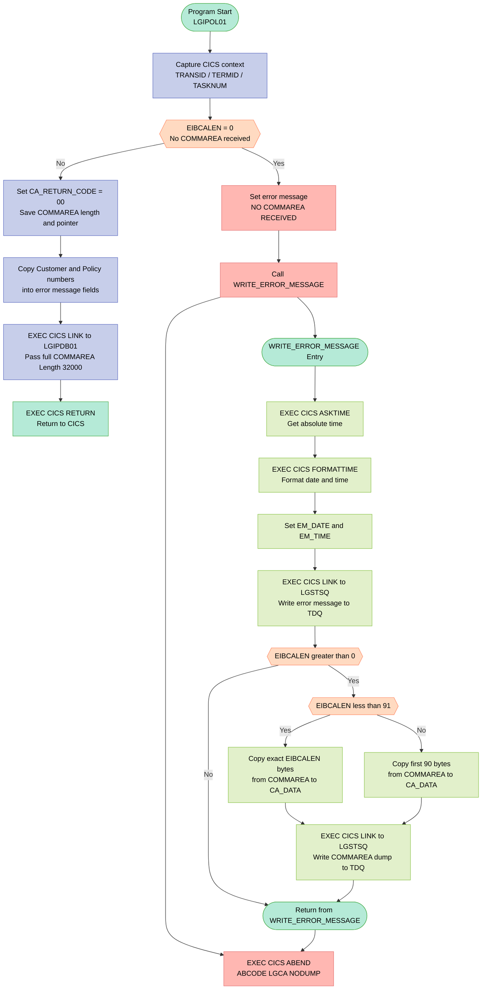
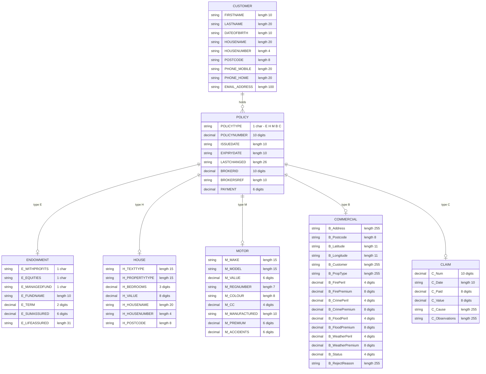

## Table of Contents

- [1. Purpose](#1-purpose)
- [2. Inputs](#2-inputs)
- [3. Outputs](#3-outputs)
- [4. Processing Logic](#4-processing-logic)
  - [4.1 Mermaid Flow Diagram](#41-mermaid-flow-diagram)
  - [4.2 Processing Logic Description](#42-processing-logic-description)
  - [4.3 Database Tables (if applicable)](#43-database-tables-if-applicable)
- [5. Paragraphs](#5-paragraphs)
- [6. Dependencies](#6-dependencies)
  - [6.1 CICS Middleware](#61-cics-middleware)
  - [6.2 Linked Programs (CICS LINK)](#62-linked-programs-cics-link)
  - [6.3 Input Parameters / COMMAREA](#63-input-parameters--commarea)
  - [6.4 Include Files (Copybooks)](#64-include-files-copybooks)
  - [6.5 DB2 Tables (accessed indirectly via `LGIPDB01`)](#65-db2-tables-accessed-indirectly-via-lgipdb01)
- [7. Constraints](#7-constraints)
  - [7.1 Communication Area (COMMAREA) Constraints](#71-communication-area-commarea-constraints)
  - [7.2 Return Code Constraints](#72-return-code-constraints)
  - [7.3 Policy Type and Data Structure Constraints](#73-policy-type-and-data-structure-constraints)
  - [7.4 Processing Sequencing Constraints](#74-processing-sequencing-constraints)
  - [7.5 Error Logging Constraints](#75-error-logging-constraints)
  - [7.6 DB2 Host Variable Size Constraints](#76-db2-host-variable-size-constraints)
- [8. Error Handling](#8-error-handling)
- [9. Examples](#9-examples)
  - [9.1 Example 1: Successful Motor Policy Inquiry](#91-example-1-successful-motor-policy-inquiry)
  - [9.2 Example 2: Missing COMMAREA — Abend Path](#92-example-2-missing-commarea--abend-path)

## 1. Purpose

`LGIPOL01` is a CICS-hosted PL/I program that serves as the business logic front-end for inquiring on the full details of an individual insurance policy. It receives a communication area containing a customer number and a policy number, validates that a communication area was passed (aborting with a CICS ABEND if not), initialises the return code to indicate success, and then delegates the actual database retrieval to a back-end DB2 inquiry program (`LGIPDB01`) via a CICS LINK call, passing the full communication area for population. The program supports multiple policy types — Endowment, House, Motor, Commercial, and Claim — whose detailed structures are defined in the communication area and DB2 host-variable layouts it references. An internal error-handling procedure is also provided that captures the current timestamp and writes diagnostic information, including the customer number, policy number, and a portion of the raw communication area, to a transient data queue via the `LGSTSQ` logging utility.

## 2. Inputs

**CICS Communication Area (COMMAREA) — passed via `COMM_AREA_PTR` parameter**

- `CA_REQUEST_ID` — 6-character field identifying the operation type (e.g. `'01IMOT'` for Inquire Motor); drives which policy sub-structure is active
- `CA_RETURN_CODE` — 2-digit numeric return code supplied by the caller; initialised to `'00'` (success) at program entry and updated before returning
- `CA_CUSTOMER_NUM` — 10-digit numeric identifier of the customer whose policy is being queried; echoed into the error message for diagnostic tracing
- `CA_POLICY_REQUEST` — top-level grouping of all policy-specific input fields:
  - `CA_POLICY_NUM` — 10-digit numeric identifier of the specific policy to be inquired upon; passed directly to the DB2 back-end program `LGIPDB01`
  - `CA_POLICY_COMMON` — common policy header fields carried in the request:
    - `CA_ISSUE_DATE` — 10-character issue date of the policy
    - `CA_EXPIRY_DATE` — 10-character expiry date of the policy
    - `CA_PAYMENT` — 6-digit premium payment amount
  - `CA_POLICY_SPECIFIC` (UNION) — policy-type-specific sub-structures, one of which is active depending on `CA_REQUEST_ID`:
    - `CA_ENDOWMENT` — endowment policy fields (with-profits flag, equities flag, managed fund flag, fund name, term, sum assured, life assured)
    - `CA_HOUSE` — house policy fields (property type, bedrooms, value, house name/number, postcode)
    - `CA_MOTOR` — motor policy fields (make, model, value, registration number, colour, cc, manufacture date, premium, accidents)
    - `CA_COMMERCIAL` — commercial policy fields (address, postcode, latitude/longitude, customer, property type, peril and premium amounts for fire/crime/flood/weather, status, reject reason)
    - `CA_CLAIM` — claim fields (claim number, date, paid amount, value, cause, observations)
- `COMM_AREA_RAW` — 32,500-character raw overlay of the entire COMMAREA union; read in error handling to extract up to 90 bytes for diagnostic logging to the transient data queue

**CICS Execution Interface Block (EIB) — implicitly provided by CICS at runtime**

- `EIBCALEN` — length of the received COMMAREA; tested at entry to abort (`LGCA`) if zero, and used in error handling to bound the raw COMMAREA dump
- `EIBTRNID` — CICS transaction identifier; stored in `WS_TRANSID` for diagnostics
- `EIBTRMID` — CICS terminal identifier; stored in `WS_TERMID` for diagnostics
- `EIBTASKN` — CICS task number; stored in `WS_TASKNUM` for diagnostics

**Linked Program Response — returned via COMMAREA by `LGIPDB01`**

- `COMM_AREA` (full structure, passed by reference via `EXEC CICS LINK`) — the DB2 back-end program `LGIPDB01` receives the entire COMMAREA and populates all response fields (policy common data, policy-type-specific data, return code) directly within it before control returns to `LGIPOL01`

## 3. Outputs

**Communication Area (COMMAREA) — returned to the caller via `EXEC CICS RETURN`**

- `CA_RETURN_CODE` — Two-digit return code set to `'00'` at the start of processing; reflects the outcome of the policy inquiry delegated to `LGIPDB01` and is the primary success/failure indicator returned to the calling program
- `CA_POLICY_NUM` — Policy number echoed back as part of the populated `CA_POLICY_REQUEST` structure within the COMMAREA after the `LGIPDB01` call
- `CA_ISSUE_DATE` — Issue date of the policy, populated by `LGIPDB01` and returned to the caller
- `CA_EXPIRY_DATE` — Expiry date of the policy, populated by `LGIPDB01` and returned to the caller
- `CA_PAYMENT` — Premium payment amount for the policy, populated by `LGIPDB01` and returned to the caller
- `CA_FIRST_NAME` — Customer first name, populated by `LGIPDB01` as part of the customer details returned in the COMMAREA
  - **Endowment-specific fields** (when `DB2_POLICYTYPE = 'E'`)
    - `CA_E_SUM_ASSURED` — Sum assured amount retrieved and returned for endowment policies, sourced from `DB2_E_SUMASSURED`
  - **House-specific fields** (when `DB2_POLICYTYPE = 'H'`)
    - `CA_H_VALUE` — Declared value of the insured property, sourced from `DB2_H_VALUE`
  - **Motor-specific fields** (when `DB2_POLICYTYPE = 'M'`)
    - `CA_M_VALUE` — Declared value of the insured motor vehicle, sourced from `DB2_M_VALUE`
  - **Commercial-specific fields** (when `DB2_POLICYTYPE = 'B'`)
    - `CA_B_Status` — Status code of the commercial policy, sourced from `DB2_B_STATUS`

**CICS Transient Data Queue (TDQ) — written via `EXEC CICS LINK PROGRAM('LGSTSQ')` on error path**

- `ERROR_MSG` — Diagnostic error message written to the TDQ when no COMMAREA is received; contains timestamp (`EM_DATE`, `EM_TIME`), program name (`LGIPOL01`), customer number (`EM_CUSNUM`), policy number (`EM_POLNUM`), SQL request label (`EM_SQLREQ`), and SQL return code (`EM_SQLRC`)
- `CA_ERROR_MSG` — Supplementary TDQ record containing the first 90 bytes (or fewer, if COMMAREA is shorter) of the raw COMMAREA (`COMM_AREA_RAW`), written immediately after `ERROR_MSG` to aid diagnostic tracing

**CICS ABEND — issued via `EXEC CICS ABEND ABCODE('LGCA') NODUMP`**

- Abend code `LGCA` — raised when `EIBCALEN = 0` (no COMMAREA received), terminating the transaction abnormally; the `NODUMP` option suppresses a full system dump

**Delegated program call — `EXEC CICS LINK Program(LGIPDB01)`**

- `COMM_AREA` (32,000 bytes) — the full COMMAREA passed as input/output to `LGIPDB01`; on return it carries all populated policy and customer data fields that are subsequently returned to the original caller

## 4. Processing Logic

### 4.1 Mermaid Flow Diagram

---

### 4.2 Processing Logic Description

**High-level Summary**

`LGIPOL01` is a CICS PL/I **policy inquiry orchestrator**. It acts as the thin business-logic layer between an external caller (a menu program or a higher-level transaction) and the DB2 back-end inquiry program `LGIPDB01`. Its responsibilities are: validate that a COMMAREA was passed, initialise the return code, forward the full COMMAREA to the DB2 program, and return control to CICS. It also owns the shared `WRITE_ERROR_MESSAGE` utility procedure used to log diagnostic information to a transient data queue.

---

**Execution Flow**

| Step | What happens | Why |
|------|-------------|-----|
| **1 – Capture CICS context** | `WS_TRANSID`, `WS_TERMID`, and `WS_TASKNUM` are populated from CICS EIB fields (`EIBTRNID`, `EIBTRMID`, `EIBTASKN`). | Stores diagnostic context so any subsequent error message is associated with this specific task invocation. |
| **2 – COMMAREA guard** | `EIBCALEN` is tested against zero. If zero, no COMMAREA was supplied by the caller. | A policy inquiry is meaningless without identifying data; the program cannot proceed safely. |
| **3a – Abend path (EIBCALEN = 0)** | The error text `' NO COMMAREA RECEIVED'` is placed into `EM_MSG_TEXT`, `WRITE_ERROR_MESSAGE` is called to log the condition, and then `EXEC CICS ABEND ABCODE('LGCA') NODUMP` is issued. | `NODUMP` suppresses a system dump (the error is already logged); abend code `LGCA` allows operations to identify the failure type quickly. |
| **3b – Normal path (EIBCALEN > 0)** | `CA_RETURN_CODE` is set to `'00'` (success assumed), `WS_CALEN` and `WS_ADDR_DFHCOMMAREA` are saved, and the customer/policy numbers are echoed into the error message structure (`EM_CUSNUM`, `EM_POLNUM`). | Pre-loading customer and policy numbers into the error structure means that if an error occurs downstream the log entry will already contain the relevant identifiers without needing further logic. |
| **4 – Delegate to DB2 back-end** | `EXEC CICS LINK Program(LGIPDB01) Commarea(COMM_AREA) Length(32000)` is executed. | The full COMMAREA — containing the policy number, customer number, and all policy-type-specific fields — is passed to `LGIPDB01`, which performs the actual DB2 `SELECT` statements and populates the response fields in place. |
| **5 – Return** | `EXEC CICS RETURN` hands control back to the calling CICS program. | The in-place COMMAREA now contains either the filled-in policy details (on success, `CA_RETURN_CODE = '00'`) or an error return code set by `LGIPDB01`. |

---

**`WRITE_ERROR_MESSAGE` Internal Procedure**

This procedure is only called from the abend path but is defined for reuse:

1. **Timestamp acquisition** – `EXEC CICS ASKTIME ABSTIME(ABS_TIME)` retrieves the current time as an absolute value; `EXEC CICS FORMATTIME` converts it into human-readable `MM/DD/YYYY` date (`DATE1`) and `HH:MM:SS` time (`TIME1`), which are stored in the error message structure.
2. **Primary error write** – `EXEC CICS LINK PROGRAM('LGSTSQ')` writes the full `ERROR_MSG` structure (date, time, program name `LGIPOL01`, customer number, policy number) to a CICS transient data queue (TDQ) via the helper program `LGSTSQ`.
3. **COMMAREA dump** – If `EIBCALEN > 0`, up to 90 bytes of the raw COMMAREA (`COMM_AREA_RAW`) are copied into `CA_DATA` using the `LEFT` built-in:
   - If `EIBCALEN < 91`, exactly `EIBCALEN` bytes are copied (avoids reading beyond the actual COMMAREA).
   - Otherwise, a fixed 90-byte prefix is copied.
   - The `CA_ERROR_MSG` structure (prefixed with `'COMMAREA='`) is then written to the TDQ via a second `EXEC CICS LINK PROGRAM('LGSTSQ')` call.

---

**External Interactions**

| Program / System | Interaction | Purpose |
|-----------------|-------------|---------|
| **LGIPDB01** | `EXEC CICS LINK` with full 32,000-byte COMMAREA | Performs DB2 `SELECT` on POLICY, ENDOWMENT, HOUSE, MOTOR, COMMERCIAL, or CLAIM tables and populates the COMMAREA response fields. |
| **LGSTSQ** | `EXEC CICS LINK` (called twice from `WRITE_ERROR_MESSAGE`) | Utility program that writes a message string to a CICS transient data queue for operational logging and diagnostics. |
| **CICS EIB** | Read-only (`EIBTRNID`, `EIBTRMID`, `EIBTASKN`, `EIBCALEN`) | Provides runtime context (transaction ID, terminal ID, task number, COMMAREA length) used for diagnostics and validation. |

---

**Plain Language Summary**

`LGIPOL01` is the "front door" for looking up an insurance policy. When a user requests policy details from a menu screen, this program is the first stop. It does three things: (1) it immediately checks that the request arrived with proper data attached — if not, it logs the problem and stops with an error code; (2) it marks the request as "in progress, no errors yet"; and (3) it hands the entire request off to a specialist database program (`LGIPDB01`) that fetches the actual policy details from DB2. Once that DB2 program has filled in all the policy information, `LGIPOL01` simply returns the enriched data back to whoever called it. The program itself contains no SQL — it is purely an orchestrator and safety gate.

---

### 4.3 Database Tables (if applicable)

`LGIPOL01` itself contains no SQL statements. All database access is delegated to `LGIPDB01`. The COMMAREA structures defined in `LGIPOL01` correspond to the following DB2 tables accessed by `LGIPDB01`:

## 5. Paragraphs

**LGIPOL01 (Main Procedure Body)**

- This is the main entry point of the program, declared as `LGIPOL01: Proc(COMM_AREA_PTR) Options(Main)`. It receives a pointer to the CICS communication area (`COMM_AREA_PTR`) and orchestrates the complete policy inquiry flow.
- **Initialization and Runtime Capture:**
  - Captures the CICS transaction ID, terminal ID, and task number from the Execute Interface Block (EIB) fields `EIBTRNID`, `EIBTRMID`, and `EIBTASKN` into `WS_HEADER` working storage fields for diagnostic identification purposes.
- **COMMAREA Validation:**
  - Checks `EIBCALEN` (the length of the incoming communication area as reported by CICS) against zero.
  - If no COMMAREA was passed (`EIBCALEN = 0`), an error message text `' NO COMMAREA RECEIVED'` is placed in `EM_MSG_TEXT`, the internal `WRITE_ERROR_MESSAGE` procedure is called to log the error, and then `EXEC CICS ABEND ABCODE('LGCA') NODUMP` is issued — abnormally terminating the task with a custom abend code `LGCA` without producing a system dump.
- **Return Code Initialization:**
  - Sets `CA_RETURN_CODE` to `'00'` in the COMMAREA to indicate an initial successful state before any processing.
  - Saves the COMMAREA length (`EIBCALEN`) into `WS_CALEN` and the COMMAREA pointer into `WS_ADDR_DFHCOMMAREA` for diagnostic reference.
- **Error Message Context Population:**
  - Copies `CA_CUSTOMER_NUM` and `CA_POLICY_NUM` from the COMMAREA into the error message structure fields `EM_CUSNUM` and `EM_POLNUM` so that any subsequent error log will contain identifying information about the request being processed.
- **Database Delegation via CICS LINK:**
  - Issues `EXEC CICS LINK Program(LGIPDB01) Commarea(COMM_AREA) Length(32000)` to synchronously transfer control to the DB2 back-end program `LGIPDB01`, passing the full COMMAREA (up to 32,000 bytes). `LGIPDB01` performs the actual DB2 SELECT operations for the requested policy and returns populated data in the same COMMAREA.
- **Return to Caller:**
  - Issues `EXEC CICS RETURN` to return control to the calling CICS program (typically a menu program such as `LGTESTP1–4`), at which point the COMMAREA contains either the retrieved policy data or an error return code set by `LGIPDB01`.
  - A PL/I `RETURN` statement follows as a structural terminator of the main procedure body.

---

**WRITE_ERROR_MESSAGE**

- An internal subroutine (`PROC ... RETURN; END`) responsible for formatting and writing diagnostic error messages to a CICS Transient Data Queue (TDQ) via a shared logging program. It is called whenever an error condition is detected in the main procedure.
- **Timestamp Acquisition:**
  - Calls `EXEC CICS ASKTIME ABSTIME(ABS_TIME)` to obtain the current absolute time from CICS into the `ABS_TIME` variable.
  - Calls `EXEC CICS FORMATTIME ABSTIME(ABS_TIME) MMDDYYYY(DATE1) TIME(TIME1)` to format the absolute time into a human-readable date (`DATE1`, MM/DD/YYYY format) and time (`TIME1`).
  - Moves the formatted date and time into the `EM_DATE` and `EM_TIME` fields of the `ERROR_MSG` structure.
- **Primary Error Message Write:**
  - Issues `EXEC CICS LINK PROGRAM('LGSTSQ') COMMAREA(ERROR_MSG) LENGTH(STG(ERROR_MSG))` to pass the full error message structure (including date, time, program identifier `LGIPOL01`, customer number, policy number, and SQLCODE) to the `LGSTSQ` logging utility program, which writes it to a TDQ.
- **COMMAREA Dump Write (Conditional):**
  - Checks `EIBCALEN > 0` to confirm a COMMAREA was present before attempting to dump its contents.
  - If `EIBCALEN` is between 1 and 90 (less than 91), uses `LEFT(COMM_AREA_RAW, EIBCALEN)` to extract only the actual bytes received and places them in `CA_DATA`, then calls `LGSTSQ` with `CA_ERROR_MSG` to log those bytes.
  - If `EIBCALEN` is 91 or greater, extracts the first 90 bytes using `LEFT(COMM_AREA_RAW, 90)` into `CA_DATA` and calls `LGSTSQ` similarly, capping the logged COMMAREA content at 90 bytes to avoid excessive output.
  - This conditional branching ensures that only a safe, bounded portion of the COMMAREA is logged regardless of the actual size.
- Returns to the caller via `RETURN` after all writes are complete.

## 6. Dependencies

### 6.1 CICS Middleware

- **CICS Transaction Manager**
  - The program runs as a CICS transaction and relies on the CICS runtime for execution control, communication area passing, and abend management
  - `EXEC CICS RETURN` — terminates the CICS task and returns control to the caller
  - `EXEC CICS ABEND ABCODE('LGCA') NODUMP` — issues a controlled CICS abend with code `LGCA` when no COMMAREA is received
  - `EXEC CICS ASKTIME` / `EXEC CICS FORMATTIME` — CICS services used within `WRITE_ERROR_MESSAGE` to obtain and format the current timestamp for diagnostic logging

- **CICS Execute Interface Block (EIB)**
  - `EIBTRNID` — supplies the current CICS transaction identifier, stored in `WS_TRANSID` at program entry
  - `EIBTRMID` — supplies the originating terminal identifier, stored in `WS_TERMID`
  - `EIBTASKN` — supplies the CICS task number, stored in `WS_TASKNUM`
  - `EIBCALEN` — supplies the length of the incoming COMMAREA; checked at entry to guard against a missing COMMAREA and used in `WRITE_ERROR_MESSAGE` to bound the diagnostic data written to the queue

---

### 6.2 Linked Programs (CICS LINK)

- **`LGIPDB01`** — the primary DB2 back-end program for policy inquiry
  - Invoked via `EXEC CICS LINK PROGRAM(LGIPDB01) COMMAREA(COMM_AREA) LENGTH(32000)`
  - Receives the full COMMAREA (containing customer number, policy number, and all policy-specific fields) and is responsible for executing the actual DB2 SELECT against the POLICY, ENDOWMENT, HOUSE, MOTOR, COMMERCIAL, and CLAIM tables; results are returned in the same COMMAREA
  - Its name is held in the local variable `LGIPDB01 CHAR(8) INIT('LGIPDB01')`

- **`LGSTSQ`** — transient data queue writer utility program
  - Invoked (up to three times) via `EXEC CICS LINK PROGRAM('LGSTSQ')` inside `WRITE_ERROR_MESSAGE`
  - First call passes `ERROR_MSG` (date, time, program name, customer number, policy number, SQLCODE) to write a diagnostic error record
  - Second/third call passes `CA_ERROR_MSG` (first 90 bytes of raw COMMAREA) to write the COMMAREA snapshot for diagnostic tracing

---

### 6.3 Input Parameters / COMMAREA

- **COMMAREA (`COMM_AREA`)** — passed by the calling CICS program (e.g., a menu program such as `LGTESTP1`–`LGTESTP4`) via `COMM_AREA_PTR`
  - `CA_REQUEST_ID` — 6-character request identifier that encodes the operation type (e.g., `'01IMOT'` for Inquire Motor)
  - `CA_RETURN_CODE` — 2-digit return code; initialised to `'00'` (success) at program entry and set by `LGIPDB01` if an error occurs
  - `CA_CUSTOMER_NUM` — 10-digit customer identifier; identifies the customer whose policy is being inquired and is echoed into the diagnostic error message
  - `CA_POLICY_NUM` — 10-digit policy identifier within `CA_POLICY_REQUEST`; passed to `LGIPDB01` as the key for DB2 retrieval
  - `CA_POLICY_COMMON` — common policy fields (`CA_ISSUE_DATE`, `CA_EXPIRY_DATE`, `CA_LASTCHANGED`, `CA_BROKERID`, `CA_BROKERSREF`, `CA_PAYMENT`) populated by `LGIPDB01` and returned to the caller
  - `CA_POLICY_SPECIFIC` — union overlay containing one of: `CA_ENDOWMENT`, `CA_HOUSE`, `CA_MOTOR`, `CA_COMMERCIAL`, or `CA_CLAIM`; the relevant sub-structure is populated by `LGIPDB01` according to the policy type
  - `COMM_AREA_RAW` — 32,500-byte raw character overlay of the entire COMMAREA union; used in error handling to extract and write the first 90 bytes to the diagnostic queue via `LGSTSQ`

---

### 6.4 Include Files (Copybooks)

- **`LGPOLICY.inc`** (`%INCLUDE LGPOLICY`) — defines all DB2 host-variable structures
  - `DB2_CUSTOMER` — maps the CUSTOMER table columns (name, date of birth, address, phone, e-mail)
  - `DB2_POLICY` — maps the POLICY table columns (`DB2_POLICYTYPE`, `DB2_POLICYNUMBER`, common date/payment fields)
  - `DB2_ENDOWMENT` — maps the ENDOWMENT table columns (`DB2_E_SUMASSURED`, fund name, term, life assured, etc.)
  - `DB2_HOUSE` — maps the HOUSE table columns (`DB2_H_VALUE`, property type, bedrooms, address)
  - `DB2_MOTOR` — maps the MOTOR table columns (`DB2_M_VALUE`, make, model, registration, premium, accidents)
  - `DB2_COMMERCIAL` — maps the COMMERCIAL table columns (`DB2_B_Status`, address, perils, premiums, reject reason)
  - `DB2_CLAIM` — maps the CLAIM table columns (claim number, date, paid amount, value, cause, observations)
  - Also declares null-indicator variables (`IND_BROKERID`, `IND_BROKERSREF`, `IND_PAYMENT`, etc.) used for nullable DB2 columns

- **`LGCMAREA.inc`** (`%INCLUDE LGCMAREA`) — defines the `COMM_AREA` union structure and `COMM_AREA_PTR` pointer; shared across all CICS programs in the application as the standard COMMAREA layout

---

### 6.5 DB2 Tables (accessed indirectly via `LGIPDB01`)

- **`POLICY`** — primary policy header table; queried by `LGIPDB01` using `CA_POLICY_NUM` and `CA_CUSTOMER_NUM` as keys; returns policy type, dates, payment, and broker details
- **`ENDOWMENT`** — endowment policy details table; queried when `DB2_POLICYTYPE = 'E'`; returns sum assured, fund, term, and life-assured data
- **`HOUSE`** — house policy details table; queried when `DB2_POLICYTYPE = 'H'`; returns property type, bedrooms, value, and address
- **`MOTOR`** — motor policy details table; queried when `DB2_POLICYTYPE = 'M'`; returns make, model, value, registration, and accident history
- **`COMMERCIAL`** — commercial policy details table; queried when `DB2_POLICYTYPE = 'B'`; returns address, peril/premium breakdown, status, and reject reason
- **`CLAIM`** — claim details table; queried when `DB2_POLICYTYPE = 'C'`; returns claim number, date, paid/value amounts, cause, and observations

## 7. Constraints

### 7.1 Communication Area (COMMAREA) Constraints

- **COMMAREA must be present at entry:** `EIBCALEN` is tested immediately on entry; if it equals `0` (no COMMAREA was passed), the program writes an error message and issues `EXEC CICS ABEND ABCODE('LGCA') NODUMP`, preventing any further processing. This is an absolute hard stop — the program cannot run without a COMMAREA.
  - Enforced at lines 318–322.

- **COMMAREA is declared as 32,500 characters (`COMM_AREA_RAW CHAR(32500)`):** The raw overlay defines the maximum permissible size of the communication area accepted by this program. Any data beyond this boundary is inaccessible.
  - Defined at line 210.

- **COMMAREA is passed to `LGIPDB01` with a fixed length of 32,000:** The `EXEC CICS LINK` call at line 332–334 specifies `Length(32000)`, meaning only the first 32,000 bytes of the COMMAREA are visible to the downstream database program, regardless of the actual COMMAREA size passed in.
  - Enforced at lines 332–334.

- **Header/trailer overhead is tracked separately:** `WS_CA_HEADERTRAILER_LEN` is initialized to 33, representing the fixed overhead bytes consumed by `CA_REQUEST_ID` (6), `CA_RETURN_CODE` (2), and `CA_CUSTOMER_NUM` (10) plus the leading policy number (10) fields, leaving 32,467 bytes for policy-specific data. This constant is declared but indirectly constrains how the required COMMAREA length (`WS_REQUIRED_CA_LEN`) must be calculated by callers.
  - Defined at lines 53–55.

---

### 7.2 Return Code Constraints

- **`CA_RETURN_CODE` is initialised to `'00'` before any DB2 call:** The program pre-sets the return code to `'00'` (success) at the start of processing (line 325). The actual outcome is determined and set by `LGIPDB01`; `LGIPOL01` itself does not validate or overwrite the return code after the LINK, meaning any error detection is entirely delegated to the downstream program.
  - Enforced at line 325.

- **`CA_RETURN_CODE` is a 2-digit numeric PIC `'99'` field:** The field accepts only values `00`–`99`. By convention (documented in AGENTS.md), `'00'` = success, `'98'` = bad COMMAREA length, `'99'` = DB2/system error.
  - Defined at line 214.

---

### 7.3 Policy Type and Data Structure Constraints

- **`DB2_POLICYTYPE` is a single character field:** Only one character is allocated to classify the policy type (e.g., `E`=Endowment, `H`=House, `M`=Motor, `B`=Commercial/Business, `C`=Claim). Any value outside the expected single-character type codes would result in unrecognised policy processing downstream.
  - Defined at line 107.

- **`DB2_POLICYNUMBER` is constrained to 10 digits (`PIC '(10)9'`):** The policy number must be a non-negative integer with at most 10 decimal digits (0–9999999999). The same 10-digit constraint applies to `CA_POLICY_NUM` in the COMMAREA.
  - Defined at lines 108 and 239.

- **`CA_CUSTOMER_NUM` is constrained to 10 digits (`PIC '9999999999'`):** The customer identifier must be a non-negative integer of exactly 10 digits.
  - Defined at line 215.

- **Policy-type-specific COMMAREA sub-structures share overlapping (UNION) storage:** All policy-specific variants (`CA_ENDOWMENT`, `CA_HOUSE`, `CA_MOTOR`, `CA_COMMERCIAL`, `CA_CLAIM`) map over the same 32,400-byte `CA_POLICY_RAW` area via a UNION. This means the data written for one policy type physically overwrites the area for all others — only the type indicated by `DB2_POLICYTYPE` is valid at any one time.
  - Defined at lines 248–308.

- **Field-level size constraints on policy-specific data:**
  - Endowment: `DB2_E_SUMASSURED` is 6 digits max (0–999999); term is 2 digits (0–99).
  - House: `DB2_H_VALUE` is 8 digits max (0–99999999); bedrooms is 3 digits (0–999).
  - Motor: `DB2_M_VALUE` and `DB2_M_PREMIUM` and `DB2_M_ACCIDENTS` are each 6 digits (0–999999); CC is 4 digits (0–9999).
  - Commercial: Peril fields are 4 digits (0–9999); premium fields are 8 digits (0–99999999); status is 4 digits (0–9999).
  - Claim: Claim number is 10 digits; paid and value are 8 digits each.

---

### 7.4 Processing Sequencing Constraints

- **Error message writing must precede ABEND:** The `WRITE_ERROR_MESSAGE` internal procedure is called before `EXEC CICS ABEND`, ensuring diagnostic information is queued to the transient data queue (via `LGSTSQ`) before the task is terminated.
  - Enforced at lines 319–321.

- **CICS context fields (`EIBTRNID`, `EIBTRMID`, `EIBTASKN`) must be captured before the LINK call:** Transaction ID, terminal ID, and task number are copied into working storage at lines 313–315, before any further processing, ensuring these values are available for diagnostic messages.
  - Enforced at lines 313–315.

- **`CA_RETURN_CODE` must be initialised before `EXEC CICS LINK` is issued:** The initialisation at line 325 must occur before the LINK to `LGIPDB01` (line 332), so the downstream program always receives a clean success indicator as its starting state.
  - Enforced by the sequential code order at lines 325 and 332.

- **`EXEC CICS RETURN` terminates the task after the LINK returns:** After `LGIPDB01` completes and control returns, `EXEC CICS RETURN` (line 337) is unconditionally executed, preventing any additional local processing of the result. The PL/I `RETURN` at line 339 is a defensive fall-through that is never reached under normal CICS execution.

---

### 7.5 Error Logging Constraints

- **COMMAREA data logged to the transient data queue is capped at 90 bytes:** In the `WRITE_ERROR_MESSAGE` procedure, if `EIBCALEN` is less than 91, only the actual bytes present are logged; otherwise exactly the first 90 bytes are extracted. No more than 90 bytes of COMMAREA content can appear in the error log.
  - Enforced at lines 361–373.

- **Error message writing only occurs when `EIBCALEN > 0`:** The COMMAREA diagnostic log is conditionally gated on a non-zero COMMAREA length (line 361), preventing an attempt to read COMMAREA data when none exists.
  - Enforced at lines 361–374.

- **Error messages are routed exclusively through `LGSTSQ`:** All diagnostic output — both the formatted error message and the COMMAREA dump — is sent via `EXEC CICS LINK PROGRAM('LGSTSQ')`. No other output mechanism (e.g., direct TD queue write, `EXEC CICS WRITEQ`) is used by this program directly.
  - Enforced at lines 357–373.

---

### 7.6 DB2 Host Variable Size Constraints

- **`DB2_PAYMENT` is 6 digits (`PIC '(6)9'`):** Premium payment values are bounded at 999,999.
  - Defined at line 115.

- **`DB2_BROKERID` is 10 digits (`PIC '(10)9'`):** Broker identifiers are constrained to the same 10-digit space as policy and customer numbers.
  - Defined at line 113.

- **`DB2_BROKERSREF` is 10 characters:** The broker's reference string may be at most 10 characters.
  - Defined at line 114.

- **Date fields (`DB2_ISSUEDATE`, `DB2_EXPIRYDATE`) are exactly 10 characters:** Dates are stored and returned as fixed-length 10-character strings (format implied by the CICS `FORMATTIME` usage elsewhere: `MMDDYYYY` = 8 chars + 2 separator chars, consistent with `CHAR(10)`). No format validation is performed within this program.
  - Defined at lines 110–111.

- **`DB2_LASTCHANGED` is exactly 26 characters:** The timestamp field for the last policy change occupies a fixed 26-character field, consistent with a DB2 TIMESTAMP column.
  - Defined at line 112.

## 8. Error Handling

- Entry validation and fail-fast handling
  - The program explicitly checks whether no COMMAREA was passed by testing the CICS length field for zero.
  - When that condition is true, it treats the request as invalid input, populates the error text with a “no commarea received” message, invokes its internal error logging routine, and then forces program termination through a CICS abend using abend code `LGCA`.
  - This is the strongest error response in the program and is triggered before any business processing occurs.

- Default status initialization and fallback outcome control
  - The communication area return code is initialized to `00` before the backend call.
  - This acts as a default success state and provides a fallback value if no later logic changes it.
  - In this module, there is no local post-call validation of the return code, so the program relies on the called backend program to update the shared COMMAREA if an error occurs.

- Error notification and diagnostic logging
  - The program contains a dedicated internal procedure for recording error details.
  - That routine builds a structured message containing the current date, time, program identity, customer number, policy number, and a free-form error text or SQL-related diagnostic area.
  - It obtains the timestamp through CICS time services, formats the values, and sends the assembled message to another CICS-linked service program responsible for writing to a transient data queue.
  - This mechanism is triggered explicitly by calls to the logging procedure, such as the missing-COMMAREA condition.

- Diagnostic capture of request data for recovery/support analysis
  - As part of the logging procedure, the program also captures raw inbound COMMAREA content for troubleshooting.
  - It checks whether any COMMAREA bytes are present before attempting this capture.
  - If the COMMAREA is shorter than 91 bytes, it logs only the available bytes.
  - If it is longer, it truncates the logged content to the first 90 bytes.
  - This is a defensive fallback mechanism that avoids overrunning the diagnostic field while still preserving request context for support staff.

- Defensive conditional handling inside the logger
  - The error-writing procedure includes explicit length-based branching around COMMAREA extraction.
  - The first guard prevents any attempt to log request data when the COMMAREA length is zero.
  - The second guard chooses between full available content and a fixed 90-byte truncated version based on actual size.
  - These checks are protective logic intended to avoid invalid data movement and to keep diagnostic output within expected limits.

- Program termination behavior after processing
  - After linking to the backend inquiry program, this module performs an unconditional CICS return.
  - There is no local exception clause, response-code check, or retry handling around the CICS LINK itself.
  - Error handling for backend/database failures is therefore delegated rather than implemented directly in this program.
  - Locally, the only direct termination-on-error path is the abend for a missing COMMAREA.

- Notably absent local mechanisms
  - There are no explicit checks of CICS response codes after the LINK, ASKTIME, FORMATTIME, or logging-service LINK operations.
  - There are no PL/I `ON` condition handlers, DB2 `SQLCODE` checks, retry loops, alternate backend paths, or user-facing recovery prompts in this module itself.
  - The implemented local error handling is therefore limited to input-presence validation, error logging, diagnostic data capture, and forced termination for the invalid-entry condition.

## 9. Examples

### 9.1 Example 1: Successful Motor Policy Inquiry

**Input (COMMAREA fields):**

| Field | Value |
|---|---|
| `CA_REQUEST_ID` | `'01IMOT'` |
| `CA_RETURN_CODE` | `'00'` *(will be set by program)* |
| `CA_CUSTOMER_NUM` | `0000012345` |
| `CA_POLICY_NUM` | `0000067890` |

**Expected Output (COMMAREA fields after return, populated by `LGIPDB01`):**

| Field | Value |
|---|---|
| `CA_RETURN_CODE` | `'00'` |
| `CA_ISSUE_DATE` | `'01/15/2020'` |
| `CA_EXPIRY_DATE` | `'01/15/2025'` |
| `CA_PAYMENT` | `001200` |
| `CA_M_MAKE` | `'Toyota'` |
| `CA_M_MODEL` | `'Corolla'` |
| `CA_M_VALUE` | `015000` |
| `CA_M_REGNUMBER` | `'AB12CDE'` |

**How it works:**
1. `LGIPOL01` is invoked via CICS LINK with the COMMAREA containing `CA_CUSTOMER_NUM = 0000012345` and `CA_POLICY_NUM = 0000067890`.
2. The program checks `EIBCALEN` is non-zero (COMMAREA present); otherwise it abends with `LGCA`.
3. `CA_RETURN_CODE` is initialised to `'00'`, and both numbers are copied into the diagnostic error-message fields (`EM_CUSNUM`, `EM_POLNUM`) for tracing.
4. The program immediately delegates to the DB2 back-end by calling `EXEC CICS LINK Program('LGIPDB01')`, passing the full COMMAREA (length 32,000 bytes).
5. `LGIPDB01` queries the POLICY and MOTOR tables, populates the `CA_MOTOR` sub-structure, and returns.
6. `LGIPOL01` issues `EXEC CICS RETURN`, handing the enriched COMMAREA back to the calling menu program (e.g., `LGTESTP1`).

---

### 9.2 Example 2: Missing COMMAREA — Abend Path

**Input:**

| Condition | Value |
|---|---|
| `EIBCALEN` | `0` *(no COMMAREA passed)* |

**Expected Output:**

| Outcome | Detail |
|---|---|
| Abend issued | CICS abend code `LGCA`, `NODUMP` |
| Error message written | `WRITE_ERROR_MESSAGE` is called; the text `' NO COMMAREA RECEIVED'` is formatted with the current date/time and the program name `'LGIPOL01'`, then written to the CICS transient data queue via `LGSTSQ`. |
| COMMAREA returned | None — processing halts at the abend. |

**How it works:**
1. On entry, `EIBCALEN` is tested. If it equals zero the program has no COMMAREA to work with.
2. `WRITE_ERROR_MESSAGE` is called: it obtains the current absolute time with `EXEC CICS ASKTIME`, formats it into `DATE1`/`TIME1` with `EXEC CICS FORMATTIME`, builds the `ERROR_MSG` structure, and LINKs to `LGSTSQ` to write the diagnostic record.
3. Because `EIBCALEN` is 0, the secondary branch that logs the raw COMMAREA bytes is skipped (the `IF EIBCALEN > 0` guard is false).
4. `EXEC CICS ABEND ABCODE('LGCA') NODUMP` is issued, terminating the task without a dump. No policy data is ever fetched.

---

Generated by IBM Bob Premium Package for Z
