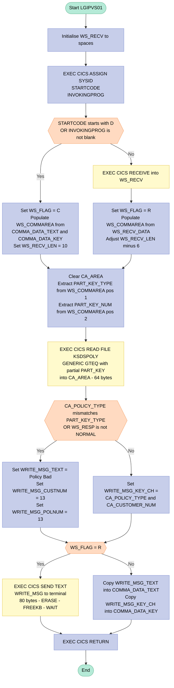

## Table of Contents

- [1. Purpose](#1-purpose)
- [2. Inputs](#2-inputs)
- [3. Outputs](#3-outputs)
  - [3.1 Terminal Output (Terminal-Invoked Path — `WS_FLAG = 'R'`)](#31-terminal-output-terminal-invoked-path--ws_flag--r)
  - [3.2 COMMAREA Response (LINK-Invoked Path — `WS_FLAG = 'C'`)](#32-commarea-response-link-invoked-path--ws_flag--c)
  - [3.3 VSAM File Read (Side Effect — Input to Output Construction)](#33-vsam-file-read-side-effect--input-to-output-construction)
- [4. Processing Logic](#4-processing-logic)
  - [4.1 Mermaid Flow Diagram](#41-mermaid-flow-diagram)
  - [4.2 Processing Logic Description](#42-processing-logic-description)
  - [4.3 Database Tables](#43-database-tables)
- [5. Paragraphs](#5-paragraphs)
- [6. Dependencies](#6-dependencies)
  - [6.1 CICS Runtime Environment](#61-cics-runtime-environment)
  - [6.2 VSAM File](#62-vsam-file)
  - [6.3 Inter-Program Communication](#63-inter-program-communication)
  - [6.4 Terminal Input](#64-terminal-input)
- [7. Constraints](#7-constraints)
  - [7.1 Invocation-Mode Constraints](#71-invocation-mode-constraints)
  - [7.2 Input Data Constraints](#72-input-data-constraints)
  - [7.3 VSAM File Read Constraints](#73-vsam-file-read-constraints)
  - [7.4 Post-Read Validation Constraints](#74-post-read-validation-constraints)
  - [7.5 Output Constraints](#75-output-constraints)
  - [7.6 Sequencing Constraints](#76-sequencing-constraints)
- [8. Error Handling](#8-error-handling)
  - [8.1 CICS Response Code Checking (RESP / DFHRESP)](#81-cics-response-code-checking-resp--dfhresp)
  - [8.2 VSAM File Read Validation (Combined Policy-Type and Response Check)](#82-vsam-file-read-validation-combined-policy-type-and-response-check)
  - [8.3 Error Fallback / Default Value Assignment](#83-error-fallback--default-value-assignment)
  - [8.4 User / Caller Notification of Error Result](#84-user--caller-notification-of-error-result)
  - [8.5 Invocation Mode Determination (Guard Against Incorrect Input Path)](#85-invocation-mode-determination-guard-against-incorrect-input-path)
- [9. Examples](#9-examples)
  - [9.1 Example 1 — Invoked via EXEC CICS LINK (COMMAREA mode) — Successful Record Found](#91-example-1--invoked-via-exec-cics-link-commarea-mode--successful-record-found)
  - [9.2 Example 2 — Invoked from Terminal (RECEIVE mode) — Policy Type Mismatch / Record Not Found](#92-example-2--invoked-from-terminal-receive-mode--policy-type-mismatch--record-not-found)

## 1. Purpose

LGIPVS01 is a CICS PL/I program that performs a generic greater-than-or-equal (GTEQ) key browse against a VSAM KSDS insurance policy file (`KSDSPOLY`) to locate the first policy record matching or following a supplied partial key. The program supports two invocation modes — it can be called programmatically via `EXEC CICS LINK` with a COMMAREA carrying a policy type and partial policy number, or it can be invoked directly from a terminal; in either case the input is normalised into a common working area before the file read is issued. After retrieving the record, the program validates that the returned record's policy type matches the requested type, then packages the result — either a successful policy key (type plus customer number) or an error indicator — and returns it to the caller via the COMMAREA or sends it as a formatted message to the terminal.

## 2. Inputs

**CICS Environment / Runtime Assignments**
- `WS_STARTCODE` — Populated by `EXEC CICS ASSIGN STARTCODE`; indicates how the CICS task was initiated. A value starting with `'D'` signals a LINK/XCTL invocation, driving the program's invocation-mode branch.
- `WS_INVOKEPROG` — Populated by `EXEC CICS ASSIGN INVOKINGPROG`; holds the name of the calling program. A non-blank value also signals COMMAREA-driven invocation.
- `WS_RESP` — Populated by the `RESP` option on each `EXEC CICS` command (`ASSIGN`, `RECEIVE`, `READ`); carries the numeric CICS response code used to detect success or failure of each API call.

**COMMAREA (EXEC CICS LINK Invocation Path)**
- `DFHCOMMAREA` — The CICS communication area passed by a calling program via `EXEC CICS LINK`; the primary input channel when the program is invoked programmatically.
  - `COMMA_DATA_TEXT` — 11-character text label portion of the COMMAREA (e.g. `'Policy Key='`); concatenated with `COMMA_DATA_KEY` to seed `WS_COMMAREA`.
  - `COMMA_DATA_KEY` — 21-character policy key portion of the COMMAREA; supplies the policy type and partial numeric key used to drive the VSAM GTEQ read.

**Terminal Input (Direct Terminal Invocation Path)**
- `WS_RECV` — Populated by `EXEC CICS RECEIVE`; holds the raw terminal input when the program is started from a terminal rather than via LINK.
  - `WS_RECV_TRANID` — First 5 characters of the received data; the transaction ID prefix, stripped from the effective input before key extraction.
  - `WS_RECV_DATA` — Remaining 74 characters of the received data; the actual user-typed input used to populate `WS_COMMAREA` on the terminal path.
- `WS_RECV_LEN` — Specifies and receives the length of terminal input from `EXEC CICS RECEIVE`; adjusted post-receive to reflect the data portion length.

**VSAM File Input (`KSDSPOLY`)**
- `CA_AREA` — 64-byte record area populated by `EXEC CICS READ FILE('KSDSPOLY')`; holds the matched VSAM KSDS policy record returned by the GENERIC GTEQ read.
  - `CA_POLICY_TYPE` — 1-character policy type code from the retrieved record; validated against `PART_KEY_TYPE` to confirm the correct record class was found.
  - `CA_CUSTOMER_NUM` — 10-character customer number from the retrieved record; included in the output key message.
  - `CA_POLICY_NUM` — 10-character policy number from the retrieved record; part of the full 64-byte record layout read from the file.

**Derived Search Key (Built from Input)**
- `PART_KEY` — 11-byte partial VSAM key passed as `RIDFLD` to `EXEC CICS READ FILE`; constructed from the normalised `WS_COMMAREA` content.
  - `PART_KEY_TYPE` — 1-character policy type, extracted from position 1 of `WS_COMMAREA`.
  - `PART_KEY_NUM` — 10-digit numeric portion of the partial key, extracted from position 2 onward of `WS_COMMAREA`.

## 3. Outputs

### 3.1 Terminal Output (Terminal-Invoked Path — `WS_FLAG = 'R'`)

- **`WRITE_MSG` — 80-byte formatted message sent to the terminal via `EXEC CICS SEND TEXT`**
  - **`WRITE_MSG_TEXT`** — 11-character label field; set to `'Policy Key='` on a successful VSAM read, or `'Policy Bad='` when the VSAM read fails or the retrieved policy type does not match the requested type
  - **`WRITE_MSG_KEY_CH`** — 21-character policy key field overlaying `WRITE_MSG_KEY`; on success, populated with the concatenation of `CA_POLICY_TYPE` and `CA_CUSTOMER_NUM` from the matched VSAM record; on failure, the embedded numeric subfields `WRITE_MSG_CUSTNUM` and `WRITE_MSG_POLNUM` are both set to `13`
    - `WRITE_MSG_TYPE` — 1-character policy type component within the key (union subfield of `WRITE_MSG_KEY_CH`)
    - `WRITE_MSG_CUSTNUM` — 10-digit customer number component within the key
    - `WRITE_MSG_POLNUM` — 10-digit policy number component within the key

---

### 3.2 COMMAREA Response (LINK-Invoked Path — `WS_FLAG = 'C'`)

- **`DFHCOMMAREA` (`COMMA_DATA`)** — the communication area passed by the calling program is updated in-place before `EXEC CICS RETURN`, returning results to the caller
  - **`COMMA_DATA_TEXT`** — 11-character label portion updated with `WRITE_MSG_TEXT`; returns `'Policy Key='` on success or `'Policy Bad='` on failure
  - **`COMMA_DATA_KEY`** — 21-character key portion updated with `WRITE_MSG_KEY_CH`; returns the matched policy type and customer number on success, or the error sentinel value (`13` in both numeric subfields) on failure

---

### 3.3 VSAM File Read (Side Effect — Input to Output Construction)

- **`KSDSPOLY` VSAM KSDS file** — read via `EXEC CICS READ FILE` using a GENERIC GTEQ partial key; the record read into `CA_AREA` drives the content of all output fields above
  - `CA_POLICY_TYPE`, `CA_CUSTOMER_NUM`, and `CA_POLICY_NUM` are retrieved from the matched record and used to populate the response message or COMMAREA key

## 4. Processing Logic

### 4.1 Mermaid Flow Diagram



---

### 4.2 Processing Logic Description

#### 4.2.1 High-level Summary

`LGIPVS01` is a CICS PL/I program that performs a **VSAM KSDS generic GTEQ (greater-than-or-equal) browse** against the `KSDSPOLY` file to locate a policy record by a partial key. It supports two invocation modes: **COMMAREA mode** (called via `EXEC CICS LINK` from another program) and **terminal mode** (invoked directly from a CICS terminal). The result — a found policy key or a "bad" indicator — is returned either via COMMAREA to the calling program, or displayed on the terminal screen.

---

#### 4.2.2 Execution Flow

**Step 1 — Initialisation**
`WS_RECV` is cleared to spaces, providing a clean receive buffer.

**Step 2 — CICS ASSIGN queries**
Three consecutive `EXEC CICS ASSIGN` commands populate:
- `WS_SYSID` — the current system ID (not used directly in branching logic but gathered for context).
- `WS_STARTCODE` — the CICS start code, indicating how the current task was initiated. A first character of `'D'` signals a LINK/XCTL-initiated invocation.
- `WS_INVOKEPROG` — the name of the program that linked to this one. Non-blank confirms a program-to-program LINK invocation.

**Step 3 — Invocation Mode Decision**
The program evaluates two conditions:
- `SUBSTR(WS_STARTCODE,1,1) = 'D'` — task was initiated via LINK/XCTL.
- `WS_INVOKEPROG ^= ' '` — a calling program name is present.

If **either condition is true**, the program takes the **COMMAREA path**:
- `WS_FLAG` is set to `'C'`.
- `WS_COMMAREA` is loaded from the 11-byte `COMMA_DATA_TEXT` concatenated with the 21-byte `COMMA_DATA_KEY` from `DFHCOMMAREA`.
- `WS_RECV_LEN` is set to 10 (the length of the numeric key portion in the COMMAREA).

If **neither condition is true**, the program takes the **terminal path**:
- `EXEC CICS RECEIVE` reads up to 80 bytes of terminal input into `WS_RECV` (which is split into a 5-byte transaction ID prefix `WS_RECV_TRANID` and 74-byte data `WS_RECV_DATA`).
- `WS_FLAG` is set to `'R'`.
- `WS_COMMAREA` is loaded from `WS_RECV_DATA`.
- `WS_RECV_LEN` is reduced by 6, stripping the transaction ID prefix from the effective data length.

**Step 4 — Partial Key Construction**
`CA_AREA` is cleared to spaces. The partial VSAM key is assembled:
- `PART_KEY_TYPE` ← first character of `WS_COMMAREA` (policy type code).
- `PART_KEY_NUM` ← remaining characters of `WS_COMMAREA` up to `WS_RECV_LEN` (the numeric key component).

Together, `PART_KEY` forms the 11-byte partial key used for the VSAM search.

**Step 5 — VSAM KSDS Generic GTEQ Read**
`EXEC CICS READ FILE('KSDSPOLY')` is issued with:
- `INTO(CA_AREA)` — the 64-byte target record area.
- `LENGTH(F64)` — read length of 64 bytes.
- `RIDFLD(PART_KEY)` — the 11-byte partial key as the record identifier.
- `KEYLENGTH(F11)` — specifies that only the first 11 bytes of the key are provided (partial match).
- `GENERIC` — enables partial-key matching.
- `GTEQ` — positions to the first record whose key is greater than or equal to the supplied partial key.
- `RESP(WS_RESP)` — captures the CICS response code for post-call validation.

**Step 6 — Post-Read Validation**
Two conditions are checked after the file read:
- `CA_POLICY_TYPE ^= PART_KEY_TYPE` — the retrieved record's policy type does not match the requested type (the GTEQ may have overshot into a different policy class).
- `WS_RESP ^= DFHRESP(NORMAL)` — the CICS file read did not complete normally (e.g., NOTFND, DISABLED).

If **either condition is true** (error/no-match path):
- `WRITE_MSG_TEXT` is set to `'Policy Bad='`.
- `WRITE_MSG_CUSTNUM` and `WRITE_MSG_POLNUM` are both set to `13`, acting as sentinel/error values.

If **both conditions are false** (success path):
- `WRITE_MSG_KEY_CH` is populated with `CA_POLICY_TYPE || CA_CUSTOMER_NUM` from the found record, building the 21-character output key string.

**Step 7 — Response Dispatch**
The `WS_FLAG` value determines how the result is returned:

- **Terminal mode (`WS_FLAG = 'R'`):** `EXEC CICS SEND TEXT` sends the 80-byte `WRITE_MSG` structure directly to the terminal with `ERASE` (clears the screen), `FREEKB` (unlocks the keyboard), and `WAIT` (synchronous send).
- **COMMAREA mode (`WS_FLAG = 'C'`):** `COMMA_DATA` is cleared, then `COMMA_DATA_TEXT` is set from `WRITE_MSG_TEXT` and `COMMA_DATA_KEY` is set from `WRITE_MSG_KEY_CH`, placing the result back into `DFHCOMMAREA` for the calling program to inspect.

**Step 8 — Return**
`EXEC CICS RETURN` ends the task, returning control to the CICS dispatcher (or back to the calling program in the LINK case).

---

#### 4.2.3 External Interactions

| Interaction | Type | Purpose |
|---|---|---|
| `EXEC CICS ASSIGN SYSID` | CICS API | Retrieves the system identifier of the current region |
| `EXEC CICS ASSIGN STARTCODE` | CICS API | Determines how the current task was initiated |
| `EXEC CICS ASSIGN INVOKINGPROG` | CICS API | Identifies the program that issued the LINK to this program |
| `EXEC CICS RECEIVE` | CICS Terminal I/O | Reads raw terminal input (transaction ID + data) from the operator |
| `EXEC CICS READ FILE('KSDSPOLY')` | VSAM KSDS | Performs a generic GTEQ partial-key browse of the insurance policy file |
| `EXEC CICS SEND TEXT` | CICS Terminal I/O | Returns the policy key result (or error) to the terminal screen |
| `EXEC CICS RETURN` | CICS API | Ends the CICS task and optionally returns to the linking program |

---

#### 4.2.4 Plain Language Summary

This program looks up an insurance policy record in a VSAM file using a partial key (policy type + partial number). It can be called in two ways: directly from a CICS terminal screen, or by another program passing data through a communication area. Either way, it builds a search key, searches the policy file for the nearest matching record (at or after the key provided), and checks that the found record actually belongs to the right policy class. If a valid match is found, it returns the policy type and customer number as the key result. If no valid match is found (or the search fails), it returns an error indicator with sentinel values (`13`). The result goes back to the calling program via the communication area, or is displayed directly on the terminal screen.

---

### 4.3 Database Tables

`LGIPVS01` does not interact with any DB2 relational database tables. All data access is performed against the **VSAM KSDS file `KSDSPOLY`** via CICS file control commands. No `erDiagram` applies for this program.

## 5. Paragraphs

`LGIPVS01` is a single PL/I procedure (`LGIPVS01: Proc … END LGIPVS01`) with no named internal procedures or labelled paragraphs. Its logic is structured as a linear sequence of inline code blocks within the main procedure body. Each logical block is described below.

- **Initialization and CICS Environment Interrogation** (lines 55–64)
  - Clears the `WS_RECV` buffer by assigning a space.
  - Issues three `EXEC CICS ASSIGN` commands in sequence: one for `SYSID` (populates `WS_SYSID`), one for `STARTCODE` (populates `WS_STARTCODE`), and one for `INVOKINGPROG` (populates `WS_INVOKEPROG`).
  - All three responses are captured in `WS_RESP` but not yet evaluated; the values collected here drive the invocation-mode decision in the next block.
  - No conditional logic or loops are present; this is purely an environment-probe sequence.

- **Invocation-Mode Decision and COMMAREA Normalisation** (lines 66–78)
  - Evaluates the invocation mode using a conditional `IF … THEN DO … ELSE DO` construct.
  - **COMMAREA path (WS_FLAG = 'C'):** Triggered when the first character of `WS_STARTCODE` is `'D'` (indicating the task was started by a LINK/XCTL) or `WS_INVOKEPROG` is non-blank (i.e., another program called this one via `EXEC CICS LINK`). Sets `WS_FLAG` to `'C'`, concatenates `COMMA_DATA_TEXT` and `COMMA_DATA_KEY` from `DFHCOMMAREA` into `WS_COMMAREA`, and sets `WS_RECV_LEN` to 10 to reflect the key-only input length.
  - **Terminal path (WS_FLAG = 'R'):** When neither condition is met, issues `EXEC CICS RECEIVE INTO(WS_RECV) LENGTH(WS_RECV_LEN)` to read raw terminal input. Sets `WS_FLAG` to `'R'`, copies `WS_RECV_DATA` into `WS_COMMAREA`, and subtracts 6 from `WS_RECV_LEN` to strip the 5-character transaction-ID prefix plus the space separator, leaving the effective data length.
  - After this block, `WS_COMMAREA` holds a normalised, mode-independent copy of the input regardless of how the program was invoked.

- **Partial Key Assembly** (lines 80–82)
  - Clears `CA_AREA` to spaces.
  - Extracts the first character of `WS_COMMAREA` into `PART_KEY_TYPE` (the policy type code).
  - Extracts the subsequent `WS_RECV_LEN` characters into `PART_KEY_NUM` (the numeric portion of the key), forming the complete 11-byte `PART_KEY` structure used as the VSAM RIDFLD.
  - No conditional logic; this is a straight assignment block that assembles the VSAM search key from the normalised input.

- **VSAM KSDS Generic GTEQ Read** (lines 84–91)
  - Issues a single `EXEC CICS READ FILE('KSDSPOLY')` with `INTO(CA_AREA)`, `LENGTH(F64)`, `RIDFLD(PART_KEY)`, `KEYLENGTH(F11)`, `GENERIC`, and `GTEQ`.
  - The `GENERIC` option instructs CICS to match on the 11-byte partial key prefix rather than the full key; `GTEQ` causes it to return the first record whose key is greater than or equal to the partial key supplied.
  - The 64-byte result is read into `CA_AREA`, populating `CA_POLICY_TYPE`, `CA_CUSTOMER_NUM`, and `CA_POLICY_NUM`.
  - The CICS response code is stored in `WS_RESP` for evaluation in the next block.
  - Interacts with the external VSAM KSDS file `KSDSPOLY`; this is the sole file I/O operation in the program.

- **Read Result Validation and Output Message Assembly** (lines 93–101)
  - Evaluates the VSAM read result using a conditional `IF … THEN DO … ELSE` construct.
  - **Error path:** If `CA_POLICY_TYPE` (the type code in the retrieved record) does not match `PART_KEY_TYPE` (the requested type) — indicating the GTEQ returned a record of a different policy class — or if `WS_RESP` is not `DFHRESP(NORMAL)`, the program treats the lookup as a failure: sets `WRITE_MSG_TEXT` to `'Policy Bad='` and fills `WRITE_MSG_CUSTNUM` and `WRITE_MSG_POLNUM` with the sentinel value `13`.
  - **Success path:** If both conditions are satisfied, assembles a success key by concatenating `CA_POLICY_TYPE` and `CA_CUSTOMER_NUM` into `WRITE_MSG_KEY_CH`, leaving `WRITE_MSG_TEXT` at its initialised value `'Policy Key='`.
  - No loops; this is a single conditional branch that produces the final `WRITE_MSG` output structure.

- **Response Dispatch** (lines 103–115)
  - Routes the assembled `WRITE_MSG` back to the caller using a conditional `IF WS_FLAG = 'R' THEN DO … ELSE DO` construct.
  - **Terminal path:** Issues `EXEC CICS SEND TEXT FROM(WRITE_MSG) TERMINAL WAIT ERASE LENGTH(80) FREEKB`, writing the 80-byte message to the terminal screen, erasing the display, waiting for completion, and releasing the keyboard.
  - **COMMAREA path:** Clears `COMMA_DATA` to spaces, then writes `WRITE_MSG_TEXT` back to `COMMA_DATA_TEXT` and `WRITE_MSG_KEY_CH` back to `COMMA_DATA_KEY`, populating the caller's `DFHCOMMAREA` with the result so the invoking program can read it on return.
  - Interacts with the CICS terminal interface (terminal path) or the calling program's COMMAREA (COMMAREA path).

- **Program Termination** (line 117)
  - Issues `EXEC CICS RETURN` to hand control back to CICS, ending the task cleanly.
  - No conditional logic; this is unconditional and always the final statement executed.

## 6. Dependencies

### 6.1 CICS Runtime Environment

- **CICS Transaction Server**
  - The program runs entirely within a CICS region and relies on the CICS runtime for task management, terminal I/O, file services, and inter-program communication
  - `EXEC CICS ASSIGN SYSID` — retrieves the CICS system ID of the executing region; used for environment awareness
  - `EXEC CICS ASSIGN STARTCODE` — retrieves the two-character start code indicating how the current task was initiated; a value beginning with `'D'` signals that the program was invoked via `EXEC CICS LINK` or `XCTL`, driving the invocation-mode branch
  - `EXEC CICS ASSIGN INVOKINGPROG` — retrieves the name of the calling program when the task was started by `EXEC CICS LINK`; a non-blank value also triggers the COMMAREA (linked) execution path
  - `EXEC CICS RECEIVE` — reads terminal input into `WS_RECV` when the program is invoked directly from a terminal; the received data provides the policy type and partial key used in the VSAM search
  - `EXEC CICS READ FILE('KSDSPOLY')` with `GENERIC GTEQ` — performs a generic greater-than-or-equal key browse against the `KSDSPOLY` VSAM KSDS file using the partial key `PART_KEY`; retrieves the first matching 64-byte policy record into `CA_AREA`
  - `EXEC CICS SEND TEXT` with `TERMINAL WAIT ERASE FREEKB` — writes the 80-byte result message (`WRITE_MSG`) back to the terminal when running in terminal-invocation mode (`WS_FLAG = 'R'`)
  - `EXEC CICS RETURN` — returns control to CICS at the end of processing, in both terminal and COMMAREA paths
  - `DFHRESP(NORMAL)` — CICS-supplied constant compared against `WS_RESP` to detect successful completion of the `READ FILE` command

### 6.2 VSAM File

- **KSDSPOLY** — VSAM Key-Sequenced Data Set (KSDS) containing insurance policy records
  - Accessed via `EXEC CICS READ FILE` using an 11-byte partial key (`PART_KEY`) composed of a 1-character policy type (`PART_KEY_TYPE`) and a 10-digit numeric key (`PART_KEY_NUM`)
  - Read with `GENERIC GTEQ` to locate the first record whose key is greater than or equal to the supplied partial key
  - Each record is 64 bytes; the first 21 bytes map to `CA_POLICY_TYPE` (1), `CA_CUSTOMER_NUM` (10), and `CA_POLICY_NUM` (10)
  - Must be defined in the CICS File Control Table (FCT) and backed by a VSAM cluster accessible to the CICS region

### 6.3 Inter-Program Communication

- **DFHCOMMAREA / `COMMA_PTR`** — communication area passed by a calling program via `EXEC CICS LINK`
  - Structured as `COMMA_DATA_TEXT` (11 characters, label) and `COMMA_DATA_KEY` (21 characters, policy key input)
  - On entry, used to populate `WS_COMMAREA` when the program is in COMMAREA mode (`WS_FLAG = 'C'`)
  - On exit, updated with the result label (`WRITE_MSG_TEXT`) in `COMMA_DATA_TEXT` and the found policy key (`WRITE_MSG_KEY_CH`) in `COMMA_DATA_KEY`, returning results to the caller
- **Calling/Invoking Program** — any program that invokes `LGIPVS01` via `EXEC CICS LINK`; it must supply a correctly formatted 32-byte COMMAREA containing a text label and an 11-character partial policy key

### 6.4 Terminal Input

- **CICS Terminal** — a CICS-attached terminal from which a user may invoke the program directly
  - Terminal input is received via `EXEC CICS RECEIVE` into `WS_RECV`, which is structured as a 5-character transaction ID prefix (`WS_RECV_TRANID`) followed by 74 characters of data (`WS_RECV_DATA`)
  - The data portion (`WS_RECV_DATA`) is used to derive the partial VSAM key; the effective data length is computed by subtracting 6 from the received length to strip the transaction ID prefix

## 7. Constraints

### 7.1 Invocation-Mode Constraints

- **Dual invocation paths are mutually exclusive**: The program must be invoked either via CICS LINK/XCTL (COMMAREA-driven) or from a terminal (RECEIVE path). The determination is made at startup by inspecting `WS_STARTCODE` (first character equals `'D'`) or `WS_INVOKEPROG` (non-blank). These two paths are enforced as an `IF/ELSE` branch — no mixed mode is possible.
  - **COMMAREA path (`WS_FLAG = 'C'`)**: Activated when `SUBSTR(WS_STARTCODE,1,1) = 'D'` OR `WS_INVOKEPROG ^= ' '`. The program reads input exclusively from `COMMA_DATA_TEXT || COMMA_DATA_KEY` (total 32 characters, used to populate the 80-character `WS_COMMAREA`).
  - **Terminal path (`WS_FLAG = 'R'`)**: Activated when neither condition above is true. The program issues `EXEC CICS RECEIVE` to collect terminal input.

- **COMMAREA structure is fixed**: `DFHCOMMAREA` must be exactly 90 bytes (11-byte `COMMA_DATA_TEXT` + 21-byte `COMMA_DATA_KEY` + 58 padding bytes). Any calling program must provide a COMMAREA of at least this layout; no length check is performed before dereferencing `COMMA_PTR`.

---

### 7.2 Input Data Constraints

- **Policy type is a mandatory 1-character field**: `PART_KEY_TYPE` is always extracted from `SUBSTR(WS_COMMAREA, 1, 1)`. No explicit blank or validity check is performed before use as the leading byte of the VSAM RIDFLD.

- **Numeric key portion must be a valid picture digit string**: `PART_KEY_NUM` is declared as `PIC '9999999999'` (10 digits). The value is extracted from `SUBSTR(WS_COMMAREA, 2, WS_RECV_LEN)`. If the source characters are non-numeric, a PL/I conversion error will occur at runtime, imposing an implicit constraint that bytes 2–11 of the input must be numeric digits.

- **Effective input length is governed by `WS_RECV_LEN`**:
  - On the COMMAREA path, `WS_RECV_LEN` is hardcoded to `10` immediately after detecting linked invocation (line 69), restricting the numeric key extraction to exactly 10 characters.
  - On the terminal path, `WS_RECV_LEN` is initialized to `80`, updated by `EXEC CICS RECEIVE` to the actual received length, then reduced by `6` (line 77) to strip the 5-character transaction-ID prefix (`WS_RECV_TRANID`). The resulting value governs how many bytes are used for `PART_KEY_NUM`.
  - Terminal input must therefore be at least 7 bytes (6 prefix + at least 1 character of key data) or the subtraction may produce a zero or negative length for `PART_KEY_NUM`.

- **`WS_COMMAREA` is capped at 80 bytes**: Declared as `CHAR(80)`. Only the first 80 characters of any input source are ever considered; any data beyond that is silently discarded.

---

### 7.3 VSAM File Read Constraints

- **File name is hardcoded**: The program exclusively reads the VSAM KSDS file named `'KSDSPOLY'`. No parameter or variable controls which file is accessed.

- **Read length is fixed at 64 bytes**: The `LENGTH(F64)` clause on `EXEC CICS READ FILE` enforces that exactly 64 bytes are read into `CA_AREA`. The `CA_AREA` structure is 64 bytes (1 + 10 + 10 + 43), so the record layout must match precisely.

- **Key length is fixed at 11 bytes**: `KEYLENGTH(F11)` specifies that exactly the first 11 bytes of `PART_KEY` (1-byte type + 10-digit number) are used as the generic partial key for the GTEQ search.

- **Read mode is GENERIC GTEQ**: The program does not perform an exact key match. It retrieves the first record whose key is greater than or equal to the supplied partial key. This means any record in the file that sorts at or after the partial key may be returned if an exact match does not exist.

- **No retry or multi-record browse**: Only a single `READ` is issued. If the first GTEQ candidate does not satisfy the policy-type check, the program immediately reports failure with no further browse iteration.

---

### 7.4 Post-Read Validation Constraints

- **Policy type match is mandatory**: After the VSAM read, the program checks `CA_POLICY_TYPE ^= PART_KEY_TYPE`. If the retrieved record's policy type does not match the requested type, the result is treated as a failure regardless of the CICS response code. This enforces that the returned record must belong to the requested policy classification.

- **CICS response must be NORMAL**: `WS_RESP ^= DFHRESP(NORMAL)` is checked alongside the type match. Any non-normal CICS response (e.g., NOTFND, DISABLED) also constitutes failure. Both conditions are evaluated together in a single `OR` expression — either one independently triggers the error path.

- **Error sentinel values are fixed**: On failure, `WRITE_MSG_CUSTNUM` and `WRITE_MSG_POLNUM` are both set to the literal value `13` (a hardcoded error indicator). No dynamic error code or condition detail is propagated.

---

### 7.5 Output Constraints

- **Output format is fixed at 80 bytes**: The `EXEC CICS SEND TEXT` on the terminal path specifies `LENGTH(80)`, so exactly 80 bytes of `WRITE_MSG` are sent regardless of actual data length.

- **Output text label is limited to 2 values**: `WRITE_MSG_TEXT` is either `'Policy Key='` (success) or `'Policy Bad='` (failure). No other label value is ever written.

- **Output key field is 21 characters**: `WRITE_MSG_KEY_CH` (and `COMMA_DATA_KEY`) is exactly 21 characters. On success it holds `CA_POLICY_TYPE` (1 char) concatenated with `CA_CUSTOMER_NUM` (10 chars), occupying only 11 of the 21 available characters; the remaining 10 characters are not explicitly set, retaining whatever was previously in the field.

- **COMMAREA response overwrites input fields**: On the COMMAREA path, `COMMA_DATA` is cleared with `' '` before writing the result (line 112), then `COMMA_DATA_TEXT` and `COMMA_DATA_KEY` are individually updated. The 58-byte padding portion of `DFHCOMMAREA` is not touched beyond the initial blank-fill.

---

### 7.6 Sequencing Constraints

- **CICS ASSIGN calls must precede mode determination**: `EXEC CICS ASSIGN STARTCODE` and `EXEC CICS ASSIGN INVOKINGPROG` must execute successfully before the `IF` branch that sets `WS_FLAG`. No error handling is applied to these ASSIGN calls; a failure would leave `WS_STARTCODE` and `WS_INVOKEPROG` at their initialized blank values, defaulting the program to the terminal (RECEIVE) path.

- **`CA_AREA` must be cleared before the READ**: Line 80 (`CA_AREA = ' '`) executes unconditionally before the VSAM read. The 64-byte area is always reset, so no residual data from a prior invocation can affect the post-read validation.

- **Partial key must be built before the READ**: `PART_KEY_TYPE` and `PART_KEY_NUM` are both populated from `WS_COMMAREA` before the `EXEC CICS READ FILE` call. The RIDFLD used in the read is therefore always derived from the current invocation's input.

- **`EXEC CICS RETURN` terminates processing unconditionally**: The program always ends with `EXEC CICS RETURN` (line 117) with no intervening error abend or conditional return. Control always returns to CICS after one complete execution path, whether successful or not.

## 8. Error Handling

### 8.1 CICS Response Code Checking (RESP / DFHRESP)

Every `EXEC CICS` command in the program specifies a `RESP(WS_RESP)` option. This suppresses the default CICS error-handling mechanism (which would abend the task on any abnormal condition) and instead places the numeric response code into `WS_RESP` after the command completes. The program then explicitly evaluates `WS_RESP` against `DFHRESP(NORMAL)` to determine whether a command succeeded.

- `EXEC CICS ASSIGN SYSID`, `EXEC CICS ASSIGN STARTCODE`, and `EXEC CICS ASSIGN INVOKINGPROG` all capture their response codes into `WS_RESP`, though the program does not individually evaluate each of those values — they serve as a passive safety net preventing CICS abends during the assignment phase.
- `EXEC CICS RECEIVE INTO(WS_RECV)` similarly captures its response into `WS_RESP` without a subsequent explicit check; its path is only taken when the program is invoked from a terminal.
- `EXEC CICS READ FILE('KSDSPOLY')` captures the file I/O response into `WS_RESP`, and this value is explicitly evaluated immediately after the read.

---

### 8.2 VSAM File Read Validation (Combined Policy-Type and Response Check)

After the VSAM KSDS read, the program performs a compound conditional check that acts as the program's primary error detection gate:

- The check evaluates two conditions simultaneously using a logical OR:
  - Whether `WS_RESP` is anything other than `DFHRESP(NORMAL)` — meaning the CICS READ FILE command did not complete successfully (e.g., record not found, file unavailable, or other CICS-level error).
  - Whether the `CA_POLICY_TYPE` field returned in the retrieved record does not match `PART_KEY_TYPE` — meaning the GENERIC GTEQ read returned a record of the wrong policy class, indicating no exact-type match exists at or above the requested partial key.
- If either condition is true, the program treats the result as a failure.

---

### 8.3 Error Fallback / Default Value Assignment

When the combined validation check detects a failure, a fallback path is taken to populate the output message with sentinel/error values rather than real policy data:

- `WRITE_MSG_TEXT` is overwritten with the literal `'Policy Bad='` instead of the success label `'Policy Key='`.
- `WRITE_MSG_CUSTNUM` and `WRITE_MSG_POLNUM` are both set to the numeric value `13`, serving as sentinel error indicators in place of real customer and policy numbers.
- This fallback ensures the output structure is always fully populated before being sent to either the terminal or the COMMAREA, preventing partially initialised data from being returned.

---

### 8.4 User / Caller Notification of Error Result

The error result propagated by the fallback logic is surfaced to the consumer through two distinct paths depending on the invocation mode:

- **Terminal path** (`WS_FLAG = 'R'`): `EXEC CICS SEND TEXT` transmits the full `WRITE_MSG` buffer (which will contain `'Policy Bad='` and the sentinel key values) to the terminal. The operator therefore sees an explicit textual indication that the policy lookup failed.
- **COMMAREA path** (`WS_FLAG = 'C'`): `COMMA_DATA_TEXT` is set from `WRITE_MSG_TEXT` (carrying `'Policy Bad='`) and `COMMA_DATA_KEY` is set from `WRITE_MSG_KEY_CH` (carrying the sentinel values). The calling program receives a clearly marked error indicator in the returned COMMAREA rather than valid policy key data.

---

### 8.5 Invocation Mode Determination (Guard Against Incorrect Input Path)

Before any data processing occurs, the program determines how it was invoked and adjusts data sourcing accordingly:

- `EXEC CICS ASSIGN STARTCODE` and `EXEC CICS ASSIGN INVOKINGPROG` are used together to detect whether the task was started by a `LINK` or programmatic invocation (start code beginning with `'D'`, or a non-blank invoking program name).
- If a COMMAREA-driven invocation is detected, `WS_COMMAREA` is populated from the COMMAREA fields; otherwise, a terminal `EXEC CICS RECEIVE` is performed and `WS_COMMAREA` is populated from the received data.
- This guard ensures the correct data source is used for constructing the VSAM partial key, preventing malformed key construction due to reading from the wrong input channel, which would itself cause a downstream read failure caught by the response check.

## 9. Examples

### 9.1 Example 1 — Invoked via EXEC CICS LINK (COMMAREA mode) — Successful Record Found

**Input (DFHCOMMAREA passed by calling program):**

| Field | Value |
|---|---|
| `COMMA_DATA_TEXT` | `'Policy Key='` (11 chars) |
| `COMMA_DATA_KEY` | `'E0000000010'` (policy type `'E'` = Endowment, partial customer number `0000000010`) |

**Program Logic Path:**
1. `EXEC CICS ASSIGN INVOKINGPROG` returns a non-blank name (e.g. `'LGIPOL01'`) → `WS_FLAG` is set to `'C'`.
2. `WS_COMMAREA` is populated as `COMMA_DATA_TEXT || COMMA_DATA_KEY` = `'Policy Key=E0000000010...'`.
3. `PART_KEY_TYPE` = `'E'`, `PART_KEY_NUM` = `0000000010` — forming an 11-byte partial VSAM key.
4. `EXEC CICS READ FILE('KSDSPOLY') GENERIC GTEQ` finds the first KSDS record whose key is ≥ `'E0000000010'` and still starts with `'E'`.
5. The retrieved record has `CA_POLICY_TYPE = 'E'`, `CA_CUSTOMER_NUM = '0000000010'`, `CA_POLICY_NUM = '0000000001'`.
6. `CA_POLICY_TYPE` matches `PART_KEY_TYPE`, and `WS_RESP = DFHRESP(NORMAL)` → success branch executes.
7. `WRITE_MSG_KEY_CH` = `'E' || '0000000010'` = `'E0000000010'`.
8. Because `WS_FLAG = 'C'`, the result is written back into the COMMAREA: `COMMA_DATA_TEXT = 'Policy Key='`, `COMMA_DATA_KEY = 'E0000000010'`.

**Output (DFHCOMMAREA on return):**

| Field | Value |
|---|---|
| `COMMA_DATA_TEXT` | `'Policy Key='` |
| `COMMA_DATA_KEY` | `'E0000000010'` |

---

### 9.2 Example 2 — Invoked from Terminal (RECEIVE mode) — Policy Type Mismatch / Record Not Found

**Input (terminal input buffer after transaction ID):**

The operator enters the transaction followed by data. After `EXEC CICS RECEIVE`, the 5-character `WS_RECV_TRANID` holds the transaction ID (e.g. `'LGVS '`) and `WS_RECV_DATA` holds `'M9999999990...'` (type `'M'` = Motor, customer number `9999999990`).

| Field | Value |
|---|---|
| `WS_RECV_TRANID` | `'LGVS '` |
| `WS_RECV_DATA` | `'M9999999990'` |

**Program Logic Path:**
1. `WS_INVOKEPROG` is blank and `WS_STARTCODE` does not begin with `'D'` → terminal path; `WS_FLAG = 'R'`.
2. `WS_COMMAREA` = `WS_RECV_DATA` = `'M9999999990...'`; `WS_RECV_LEN` reduced from 80 to 74, then by 6 → effective length 68, but only the first 11 bytes are significant for the key.
3. `PART_KEY_TYPE = 'M'`, `PART_KEY_NUM = 9999999990`.
4. `EXEC CICS READ FILE('KSDSPOLY') GENERIC GTEQ` finds no record with a key ≥ `'M9999999990'` that still has type `'M'` (e.g., the returned record has type `'X'`), or `WS_RESP ≠ DFHRESP(NORMAL)`.
5. Mismatch condition triggers the error branch: `WRITE_MSG_TEXT = 'Policy Bad='`, `WRITE_MSG_CUSTNUM = 13`, `WRITE_MSG_POLNUM = 13`.
6. Because `WS_FLAG = 'R'`, `EXEC CICS SEND TEXT` writes an 80-character message to the terminal.

**Output (terminal screen):**

```
Policy Bad=1300000000130000000000000000000000000000000000000000000000000000000000000000000
```
*(The text `'Policy Bad='` followed by the numeric value `13` occupying both the customer-number and policy-number picture fields, padded to 80 characters.)*

The `13` values in `WRITE_MSG_CUSTNUM` and `WRITE_MSG_POLNUM` serve as an error sentinel distinguishable from any valid customer or policy number, signalling to the operator (or calling program) that no matching policy record of the requested type was located in the VSAM KSDS file.

---

Generated by IBM Bob Premium Package for Z
