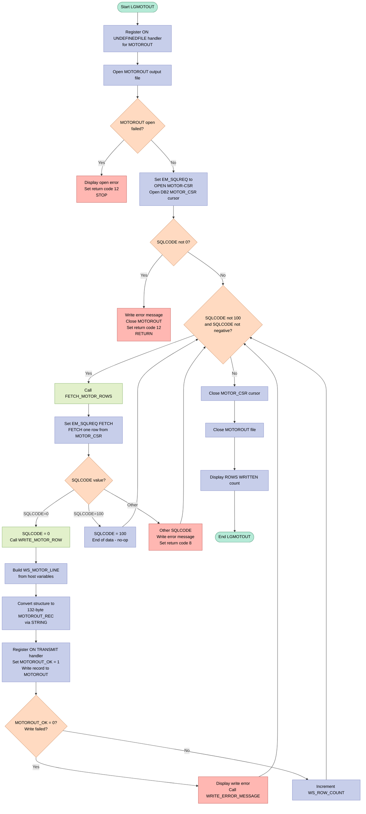
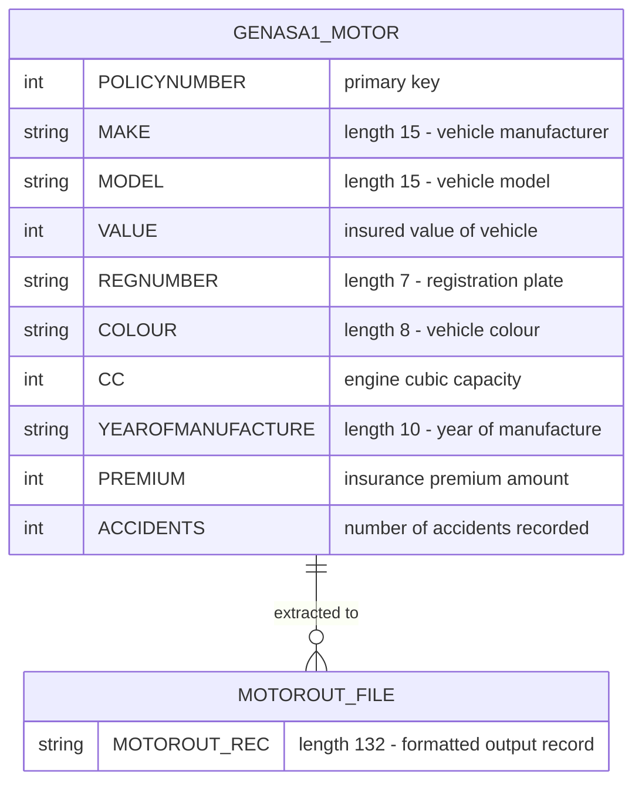

## Table of Contents

- [1. Purpose](#1-purpose)
- [2. Inputs](#2-inputs)
  - [2.1 DB2 Database — `GENASA1.MOTOR` Table](#21-db2-database--genasa1motor-table)
  - [2.2 Output File — `MOTOROUT`](#22-output-file--motorout)
- [3. Outputs](#3-outputs)
  - [3.1 MOTOROUT Sequential Output File](#31-motorout-sequential-output-file)
  - [3.2 Completion and Audit Display Messages](#32-completion-and-audit-display-messages)
  - [3.3 Error and Diagnostic Display Messages](#33-error-and-diagnostic-display-messages)
  - [3.4 Program Return Code](#34-program-return-code)
- [4. Processing Logic](#4-processing-logic)
  - [4.1 Mermaid Flow Diagram](#41-mermaid-flow-diagram)
  - [4.2 Processing Logic Description](#42-processing-logic-description)
  - [4.3 Database Tables](#43-database-tables)
- [5. Paragraphs](#5-paragraphs)
- [6. Dependencies](#6-dependencies)
  - [6.1 DB2 Database](#61-db2-database)
  - [6.2 Sequential Output File](#62-sequential-output-file)
  - [6.3 Runtime / z/OS Environment](#63-runtime--zos-environment)
  - [6.4 Internal Modules / Procedures](#64-internal-modules--procedures)
  - [6.5 Build & Deployment Infrastructure](#65-build--deployment-infrastructure)
- [7. Constraints](#7-constraints)
  - [7.1 Data Format & Field Size Constraints](#71-data-format--field-size-constraints)
  - [7.2 Output File Structure Constraints](#72-output-file-structure-constraints)
  - [7.3 DB2 Access Constraints](#73-db2-access-constraints)
  - [7.4 Sequencing & Operational Order Constraints](#74-sequencing--operational-order-constraints)
  - [7.5 Error Handling & Return Code Constraints](#75-error-handling--return-code-constraints)
  - [7.6 Error Diagnostic Constraints](#76-error-diagnostic-constraints)
- [8. Error Handling](#8-error-handling)
  - [8.1 File I/O Error Handling](#81-file-io-error-handling)
  - [8.2 DB2 SQL Error Handling](#82-db2-sql-error-handling)
  - [8.3 Centralised Error Reporting — `WRITE_ERROR_MESSAGE` Procedure](#83-centralised-error-reporting--write_error_message-procedure)
  - [8.4 Return Code and Program Termination Strategy](#84-return-code-and-program-termination-strategy)
- [9. Examples](#9-examples)
  - [9.1 Example 1: Successful Batch Export of Two Motor Policies](#91-example-1-successful-batch-export-of-two-motor-policies)
  - [9.2 Example 2: DB2 Cursor Open Failure](#92-example-2-db2-cursor-open-failure)
  - [9.3 Example 3: Write Failure for One Record](#93-example-3-write-failure-for-one-record)

## 1. Purpose

`LGMOTOUT` is a batch PL/I program that extracts all motor insurance policy records from the `GENASA1.MOTOR` DB2 table and writes them as formatted, fixed-length records to a sequential output file called `MOTOROUT`. For each policy row retrieved, the program captures key vehicle and policy details — including policy number, make, model, value, registration number, colour, engine cubic capacity, year of manufacture, premium, and accident history — and formats them into a 132-byte output record. Upon completion, it reports the total number of records successfully written, and throughout execution it handles DB2 and file I/O errors by displaying diagnostic messages that include the date, time, program name, and SQL return code, returning appropriate non-zero condition codes to signal failure to the calling environment.

## 2. Inputs

### 2.1 DB2 Database — `GENASA1.MOTOR` Table

All data processed by this program is sourced exclusively from the `GENASA1.MOTOR` DB2 table via the `MOTOR_CSR` cursor. There are no function/method parameters, user inputs, or other external data sources. The following columns are fetched using `EXEC SQL FETCH MOTOR_CSR INTO …` and populate the `WS_MOTOR_HV` host variable structure:

- **`POLICYNUMBER`** → `HV_POLICY_NUMBER` (`FIXED BIN(31)`) — Unique policy number; primary key linking a policy record to a vehicle.
- **`MAKE`** → `HV_MAKE` (`CHAR(15)`) — Manufacturer name of the insured vehicle (e.g., `FORD`, `TOYOTA`).
- **`MODEL`** → `HV_MODEL` (`CHAR(15)`) — Model designation of the insured vehicle (e.g., `FOCUS`, `COROLLA`).
- **`VALUE`** → `HV_VALUE` (`FIXED BIN(31)`) — Monetary value of the insured vehicle; central to premium calculation and claims valuation.
- **`REGNUMBER`** → `HV_REGNUMBER` (`CHAR(7)`) — Vehicle registration (licence plate) number; legal identifier for the insured vehicle.
- **`COLOUR`** → `HV_COLOUR` (`CHAR(8)`) — Descriptive colour attribute of the insured vehicle.
- **`CC`** → `HV_CC` (`FIXED BIN(15)`) — Engine cubic capacity; key risk factor for premium determination.
- **`YEAROFMANUFACTURE`** → `HV_YEAROFMANUFACTURE` (`CHAR(10)`) — Year the vehicle was manufactured; influences depreciation and risk profiling.
- **`PREMIUM`** → `HV_PREMIUM` (`FIXED BIN(31)`) — Insurance premium amount; core financial measure of the insurance contract.
- **`ACCIDENTS`** → `HV_ACCIDENTS` (`FIXED BIN(31)`) — Number of accidents on record for the vehicle/policyholder; key risk factor in premium pricing.

### 2.2 Output File — `MOTOROUT`

The program writes to a sequential fixed-block file (`MOTOROUT`, `FB RECSIZE(132)`). While this is an output destination rather than an input data source, its successful allocation is a prerequisite for program execution — an `UNDEFINEDFILE` condition on `OPEN FILE(MOTOROUT)` causes immediate termination with return code 12. The file is declared entirely within the program and is not passed in as a parameter.

## 3. Outputs

### 3.1 MOTOROUT Sequential Output File

- **MOTOROUT file** — the primary output of the program; a sequential fixed-block (FB) file with 132-byte records, written once per successfully fetched row from the `GENASA1.MOTOR` DB2 table
  - **MOTOROUT_REC** (`CHAR(132)`) — the physical record buffer written to the file via `WRITE FILE(MOTOROUT) FROM(MOTOROUT_REC)`; it is populated by stringifying the `WS_MOTOR_LINE` layout structure, which contains the following formatted fields:
    - **WS_OUT_POLNUM** — policy number (`PIC '999999999'`), sourced from `HV_POLICY_NUMBER`
    - **WS_OUT_MAKE** — vehicle manufacturer name (`CHAR(15)`), sourced from `HV_MAKE`
    - **WS_OUT_MODEL** — vehicle model name (`CHAR(15)`), sourced from `HV_MODEL`
    - **WS_OUT_VALUE** — insured vehicle value (`PIC '999999999'`), sourced from `HV_VALUE`
    - **WS_OUT_REGNUMBER** — vehicle registration number (`CHAR(7)`), sourced from `HV_REGNUMBER`
    - **WS_OUT_COLOUR** — vehicle colour (`CHAR(8)`), sourced from `HV_COLOUR`
    - **WS_OUT_CC** — engine cubic capacity (`PIC '9999'`), sourced from `HV_CC`
    - **WS_OUT_YEAROFMFR** — year of manufacture (`CHAR(10)`), sourced from `HV_YEAROFMANUFACTURE`
    - **WS_OUT_PREMIUM** — insurance premium amount (`PIC '999999999'`), sourced from `HV_PREMIUM`
    - **WS_OUT_ACCIDENTS** — number of accidents on record (`PIC '999999999'`), sourced from `HV_ACCIDENTS`

### 3.2 Completion and Audit Display Messages

- **`LGMOTOUT: ROWS WRITTEN=<WS_ROW_COUNT>`** — displayed to the operator/log upon normal completion; `WS_ROW_COUNT` holds the total number of records successfully written to the MOTOROUT file, providing a batch audit count

### 3.3 Error and Diagnostic Display Messages

- **`LGMOTOUT: OPEN MOTOROUT FAILED`** — emitted via `DISPLAY` when the `ON UNDEFINEDFILE` condition fires (i.e., the MOTOROUT file cannot be opened); the program then issues `PLIRETC(12)` and stops
- **`LGMOTOUT: WRITE FAILED`** — emitted via `DISPLAY` inside `WRITE_MOTOR_ROW` when the `ON TRANSMIT` condition fires for a write failure to the MOTOROUT file; followed by a call to `WRITE_ERROR_MESSAGE`
- **Structured DB2 error message** — emitted by `WRITE_ERROR_MESSAGE` via `DISPLAY` whenever an SQL error occurs; the formatted message contains:
  - **EM_DATE** — date at the time of the error
  - **EM_TIME** — time at the time of the error
  - Program identifier literal `'LGMOTOUT'`
  - **EM_SQLREQ** — the name of the DB2 operation in progress (e.g., `' OPEN MOTOR-CSR '`, `' FETCH MOTOR-CSR '`, `' CLOSE MOTOR-CSR '`), identifying the failing SQL step
  - **EM_SQLRC** — the DB2 `SQLCODE` value at the point of failure, providing the numeric diagnostic code

### 3.4 Program Return Code

- **`PLIRETC`** — the PL/I built-in used to set the program's batch return code, observable by the JCL caller:
  - `PLIRETC(0)` — implicit on normal `RETURN`; indicates successful completion
  - `PLIRETC(8)` — set when a `FETCH` SQL error occurs (non-zero, non-100 SQLCODE) during cursor processing
  - `PLIRETC(12)` — set when the cursor `OPEN` fails or when the MOTOROUT file cannot be opened

## 4. Processing Logic

### 4.1 Mermaid Flow Diagram



---

### 4.2 Processing Logic Description

#### 4.2.1 High-level Summary

`LGMOTOUT` is a batch (non-CICS) PL/I program that performs a full sequential read of all rows in the `GENASA1.MOTOR` DB2 table and writes each row as a formatted, fixed-length (132-byte) record to a sequential output file named `MOTOROUT`. It is a pure extract utility — no inserts, updates, or deletes are performed. Return codes signal success (`0`), fetch errors (`8`), or open/cursor errors (`12`).

---

#### 4.2.2 Execution Flow

**Step 1 — Initialization and File Open**
The program registers an `ON UNDEFINEDFILE(MOTOROUT)` condition handler before opening the output file. If the file cannot be opened (e.g., the DD statement is missing from the JCL), the handler fires: it displays an error message, sets the return code to `12` via `PLIRETC`, and issues `STOP` to terminate immediately.

**Step 2 — DB2 Cursor Open**
`EM_SQLREQ` is set to `' OPEN MOTOR-CSR '` for diagnostic purposes, then `MOTOR_CSR` is opened. The cursor is declared as `FOR READ ONLY` against `GENASA1.MOTOR`, selecting all ten policy-related columns. If `SQLCODE ≠ 0` after the open, the program writes an error message (containing date, time, program name, operation name, and SQLCODE), closes `MOTOROUT`, sets return code `12`, and returns.

**Step 3 — Fetch Loop**
The program enters a `DO WHILE` loop that continues as long as `SQLCODE ≠ 100` (not end-of-data) **and** `SQLCODE ≥ 0` (no error). Each iteration calls the internal procedure `FETCH_MOTOR_ROWS`.

**Step 4 — FETCH_MOTOR_ROWS (internal procedure)**
One row is fetched from `MOTOR_CSR` into the ten host variables of `WS_MOTOR_HV`. The SQLCODE result is evaluated with a `SELECT (SQLCODE)` construct:
- **`0` (success):** calls `WRITE_MOTOR_ROW` to format and write the record.
- **`100` (end-of-data):** a no-op — the loop condition will naturally terminate on the next evaluation.
- **Any other value (error):** the error message is written and return code `8` is set via `PLIRETC`. The loop still exits cleanly because a negative SQLCODE causes the `DO WHILE` condition to fail.

**Step 5 — WRITE_MOTOR_ROW (internal procedure)**
Each host variable value is moved into the corresponding field of the `WS_MOTOR_LINE` output layout structure. The entire structure is serialised into the 132-byte `MOTOROUT_REC` character variable using the `STRING` built-in function. Before writing, an `ON TRANSMIT(MOTOROUT)` handler is established: if the physical write fails, it sets the `MOTOROUT_OK` flag to `'0'B`. If the write succeeds, `MOTOROUT_OK` remains `'1'B` and `WS_ROW_COUNT` is incremented. On failure, a message is displayed and `WRITE_ERROR_MESSAGE` is called.

**Step 6 — Cursor and File Close, and Final Display**
After the loop exits, `MOTOR_CSR` is closed and `MOTOROUT` is closed. The total row count is displayed via `DISPLAY('LGMOTOUT: ROWS WRITTEN=' || WS_ROW_COUNT)` as an audit trail.

---

#### 4.2.3 External Interactions

| Interaction | Detail |
|---|---|
| **DB2 Table `GENASA1.MOTOR`** | Read-only cursor scan of all rows. Ten columns are fetched: `POLICYNUMBER`, `MAKE`, `MODEL`, `VALUE`, `REGNUMBER`, `COLOUR`, `CC`, `YEAROFMANUFACTURE`, `PREMIUM`, `ACCIDENTS`. |
| **Sequential File `MOTOROUT`** | Fixed-block (FB), 132-byte record-length output file. One record is written per successfully fetched DB2 row. Allocated via a JCL DD statement named `MOTOROUT`. |
| **SYSOUT / Operator Console** | `DISPLAY` calls emit diagnostic messages for open failures, write failures, SQL errors, and the final row count. Error messages include date, time, program name, SQL operation, and SQLCODE. |

---

#### 4.2.4 Plain Language Summary

The program acts as a **data extract job**: it connects to the DB2 motor insurance table, reads every vehicle policy record one at a time, formats each record into a neat 132-character line, and saves it to an output file. At the end it prints how many records were successfully written. If anything goes wrong — the file cannot be opened, the database cursor fails, or a record cannot be written — the program logs a diagnostic message and exits with a non-zero return code so the JCL job step is flagged as failed.

---

### 4.3 Database Tables



## 5. Paragraphs

- **LGMOTOUT**
  - Main procedure for the batch program that extracts all rows from `GENASA1.MOTOR` and writes formatted records to the `MOTOROUT` sequential output file.
  - Defines file structures, DB2 host variables, output record layout, row counter, and error message fields. Declares a DB2 cursor `MOTOR_CSR` over the MOTOR table with `FOR READ ONLY`.
  - Opens the output file with an `ON UNDEFINEDFILE(MOTOROUT)` condition handler that displays an error, sets return code 12 via `PLIRETC`, and stops if the file cannot be opened.
  - Opens the DB2 cursor and checks `SQLCODE`. On open failure, captures the SQL code, calls `WRITE_ERROR_MESSAGE`, closes the file, sets return code 12, and returns.
  - Runs a fetch loop using `DO WHILE (SQLCODE ^= 100 & SQLCODE >= 0)` and repeatedly calls `FETCH_MOTOR_ROWS`.
  - After the loop, closes the DB2 cursor, closes the output file, displays the final written-row count, and returns.
  - Control flow includes condition handling for file open failure, an `IF SQLCODE ^= 0` branch after cursor open, and a loop controlled by DB2 end-of-data and error status.
  - External interactions include sequential file I/O on `MOTOROUT`, DB2 cursor declaration/open/fetch/close against `GENASA1.MOTOR`, terminal/display output, and use of `PLIRETC` to set the program return code.

- **FETCH_MOTOR_ROWS**
  - Fetches a single row from the DB2 cursor and determines what action to take based on the fetch result.
  - Issues `FETCH MOTOR_CSR INTO` the host variables `HV_POLICY_NUMBER`, `HV_MAKE`, `HV_MODEL`, `HV_VALUE`, `HV_REGNUMBER`, `HV_COLOUR`, `HV_CC`, `HV_YEAROFMANUFACTURE`, `HV_PREMIUM`, and `HV_ACCIDENTS`.
  - Sets `EM_SQLREQ` before the fetch so any error message identifies the failing SQL request.
  - Uses a `SELECT (SQLCODE)` control structure:
    - `WHEN (0)`: calls `WRITE_MOTOR_ROW` to format and write the fetched record.
    - `WHEN (100)`: does nothing, allowing the main loop to terminate on end-of-data.
    - `OTHERWISE`: records the SQL code, calls `WRITE_ERROR_MESSAGE`, and sets return code 8 via `PLIRETC`.
  - Control flow is centered on DB2 status branching via `SELECT`.
  - External interactions include DB2 cursor fetch processing, error display through `WRITE_ERROR_MESSAGE`, and return-code setting through `PLIRETC`.

- **WRITE_MOTOR_ROW**
  - Formats the current fetched MOTOR row into the output layout and writes it to the `MOTOROUT` sequential file.
  - Moves each DB2 host variable into the corresponding output fields in `WS_MOTOR_LINE`, preserving the fixed-position formatted record structure.
  - Converts the structured line to the physical file buffer with `MOTOROUT_REC = STRING(WS_MOTOR_LINE)`.
  - Establishes an `ON TRANSMIT(MOTOROUT)` condition handler that sets `MOTOROUT_OK` to false if the write fails.
  - Initializes `MOTOROUT_OK` to true, performs `WRITE FILE(MOTOROUT) FROM(MOTOROUT_REC)`, and then checks the flag:
    - If the write failed, displays `LGMOTOUT: WRITE FAILED` and calls `WRITE_ERROR_MESSAGE`.
    - Otherwise, increments `WS_ROW_COUNT`.
  - Control flow includes condition handling for file transmit/write errors and an `IF ^MOTOROUT_OK` success/failure branch.
  - External interactions include sequential file output to `MOTOROUT` and display/error reporting.

- **WRITE_ERROR_MESSAGE**
  - Builds and displays a standardized diagnostic message for DB2 or file-processing errors.
  - Copies the current `SQLCODE` into `EM_SQLRC` and populates `EM_DATE` and `EM_TIME` from working-storage date/time fields.
  - Displays a concatenated message containing date, time, program name, SQL request name (`EM_SQLREQ`), and SQL return code.
  - Control flow is straightforward with no branching or looping.
  - External interactions consist of display output only; it does not perform file or DB2 operations itself.

## 6. Dependencies

### 6.1 DB2 Database

- **`GENASA1.MOTOR` table** — the sole data source for the program; read-only via a scrolling cursor (`MOTOR_CSR`). All ten columns are selected on every run:
  - `POLICYNUMBER` — unique policy identifier (primary key, maps to `HV_POLICY_NUMBER`)
  - `MAKE` — vehicle manufacturer name (maps to `HV_MAKE`)
  - `MODEL` — vehicle model designation (maps to `HV_MODEL`)
  - `VALUE` — insured vehicle monetary value (maps to `HV_VALUE`)
  - `REGNUMBER` — vehicle registration / licence-plate number (maps to `HV_REGNUMBER`)
  - `COLOUR` — vehicle colour (maps to `HV_COLOUR`)
  - `CC` — engine cubic capacity (maps to `HV_CC`)
  - `YEAROFMANUFACTURE` — year the vehicle was manufactured (maps to `HV_YEAROFMANUFACTURE`)
  - `PREMIUM` — insurance premium amount (maps to `HV_PREMIUM`)
  - `ACCIDENTS` — number of accidents recorded against the policy (maps to `HV_ACCIDENTS`)
- **`SQLCA` (SQL Communication Area)** — included via `EXEC SQL INCLUDE SQLCA`; provides `SQLCODE` used after every DB2 call to detect errors and drive the fetch loop and error-handling logic
- **DB2 plan / package** — the program must be bound to DB2 subsystem `DBD1` (as shown in `GenAppBind.jcl`) before execution; the bound plan governs cursor authorisation and access to `GENASA1.MOTOR`

### 6.2 Sequential Output File

- **`MOTOROUT`** — a fixed-block (FB), 132-byte record sequential output file declared with `DCL MOTOROUT FILE RECORD OUTPUT SEQUENTIAL ENV(FB RECSIZE(132))`; allocated via a JCL `DD` statement named `MOTOROUT` at runtime. Each fetched motor row is formatted into `WS_MOTOR_LINE`, serialised into the 132-byte `MOTOROUT_REC` buffer, and written to this file. The file is opened at program start and closed at normal or error termination.

### 6.3 Runtime / z/OS Environment

- **`PLIRETC` built-in** — used to set the job step return code (12 for cursor/open errors, 8 for fetch errors, 0 for success); the calling JCL relies on this return code for conditional step execution
- **`UNDEFINEDFILE` condition handler** — traps a failure to open `MOTOROUT` (e.g., missing DD statement or allocation error); if triggered, the program issues `DISPLAY` and terminates with `PLIRETC(12)`
- **`TRANSMIT` condition handler** — traps a physical write error on the `MOTOROUT` file; flips `MOTOROUT_OK` to `'0'B` to signal the failed write to `WRITE_MOTOR_ROW`
- **`WS_DATE` / `WS_TIME`** — character variables used as placeholders for date and time values that would be populated by the runtime environment or calling JCL; they appear in error-message output but are not explicitly set within the program itself, meaning the job step or a pre-call initialisation is expected to supply valid values

### 6.4 Internal Modules / Procedures

- **`FETCH_MOTOR_ROWS`** — internal subroutine that issues `EXEC SQL FETCH MOTOR_CSR INTO …` for a single row, then dispatches on `SQLCODE`: calls `WRITE_MOTOR_ROW` on success (`SQLCODE=0`), does nothing on end-of-data (`SQLCODE=100`), or calls `WRITE_ERROR_MESSAGE` and sets return code 8 on any other error
- **`WRITE_MOTOR_ROW`** — internal subroutine that maps the ten host variables into the `WS_MOTOR_LINE` output layout, serialises the structure via `STRING()` into `MOTOROUT_REC`, and writes the record to `MOTOROUT`; increments `WS_ROW_COUNT` on a successful write
- **`WRITE_ERROR_MESSAGE`** — internal subroutine that formats and `DISPLAY`s a diagnostic message containing the date, time, program name (`LGMOTOUT`), the SQL operation name (`EM_SQLREQ`), and the `SQLCODE` value; called from the main logic and from `FETCH_MOTOR_ROWS` and `WRITE_MOTOR_ROW` on error

### 6.5 Build & Deployment Infrastructure

- **IBM zAppBuild (DBB/Groovy pipeline)** — the build system that compiles and link-edits `LGMOTOUT`; compilation uses the Enterprise PL/I V52 compiler with `PP(INCLUDE('ID(++INCLUDE)'))` preprocessing; the linked load module is deployed to the `LOAD` library (batch program, not CICS)
- **`GenAppBind.jcl`** — JCL job that binds the DB2 DBRM produced during compilation to DB2 subsystem `DBD1`; must be run after every compile before the program can be executed
- **`GenAppDDL.jcl`** — JCL that creates the `GENASA1` database and all tables including `GENASA1.MOTOR`; a prerequisite for any execution of the program

## 7. Constraints

### 7.1 Data Format & Field Size Constraints

- **Policy Number (`HV_POLICY_NUMBER` / `WS_OUT_POLNUM`)**
  - Stored as `FIXED BIN(31)`, which constrains it to a signed 32-bit integer range (−2,147,483,648 to +2,147,483,647); negative values are technically representable in the host variable but would cause a data exception when assigned to the output PIC `'999999999'` field (which only accepts 0–999,999,999).
  - The output picture `PIC '999999999'` enforces a maximum display value of 999,999,999 (9 decimal digits, unsigned).

- **Vehicle Value (`HV_VALUE` / `WS_OUT_VALUE`)**
  - Held as `FIXED BIN(31)`; the same signed 32-bit range applies. Negative vehicle values would cause a conversion error when moved to `PIC '999999999'`.
  - The output picture `PIC '999999999'` limits the displayable value to a maximum of 999,999,999.

- **Premium (`HV_PREMIUM` / `WS_OUT_PREMIUM`)**
  - Stored as `FIXED BIN(31)` and output as `PIC '999999999'`; premium cannot exceed 999,999,999 in the output record and must be non-negative.

- **Accident Count (`HV_ACCIDENTS` / `WS_OUT_ACCIDENTS`)**
  - Stored as `FIXED BIN(31)` and output as `PIC '999999999'`; maximum representable count in the output is 999,999,999.

- **Engine Cubic Capacity (`HV_CC` / `WS_OUT_CC`)**
  - Stored as `FIXED BIN(15)`, constraining the host variable to a signed 16-bit range (−32,768 to +32,767); negative values would fail conversion to the unsigned output.
  - The output picture `PIC '9999'` restricts the displayed CC value to 0–9,999 (4 decimal digits). Any CC value exceeding 9,999 would cause a picture overflow condition.

- **Make (`HV_MAKE` / `WS_OUT_MAKE`)**
  - Fixed-length `CHAR(15)`; values longer than 15 characters are silently truncated on assignment from DB2.

- **Model (`HV_MODEL` / `WS_OUT_MODEL`)**
  - Fixed-length `CHAR(15)`; same truncation constraint as Make.

- **Registration Number (`HV_REGNUMBER` / `WS_OUT_REGNUMBER`)**
  - Fixed-length `CHAR(7)`; the registration number must fit within 7 characters; values exceeding this are truncated.

- **Colour (`HV_COLOUR` / `WS_OUT_COLOUR`)**
  - Fixed-length `CHAR(8)`; colour descriptions are limited to 8 characters.

- **Year of Manufacture (`HV_YEAROFMANUFACTURE` / `WS_OUT_YEAROFMFR`)**
  - Fixed-length `CHAR(10)`; the year field accommodates up to 10 characters (consistent with a date-format string), but no content-format or range validation is performed by the program itself.

- **Row Counter (`WS_ROW_COUNT`)**
  - Declared as `PIC '999999999'`; the maximum number of records that can be counted and displayed is 999,999,999. Exceeding this causes a picture overflow condition.

---

### 7.2 Output File Structure Constraints

- **Fixed-Block Format Enforced**
  - The MOTOROUT file is declared `RECORD OUTPUT SEQUENTIAL ENV(FB RECSIZE(132))`; every record written must be exactly 132 bytes. The program satisfies this by declaring `MOTOROUT_REC` as `CHAR(132)` and populating it via `STRING(WS_MOTOR_LINE)` before each write.

- **Output Line Layout (WS_MOTOR_LINE)**
  - The `WS_MOTOR_LINE` structure occupies 119 bytes of data fields and separators plus a 13-byte trailing filler (padded with spaces), fitting exactly within the 132-byte record boundary. The structure is implicitly immutable in layout; any change to field widths would break record alignment.

- **Single-Record-at-a-Time Write**
  - The `WRITE FILE(MOTOROUT) FROM(MOTOROUT_REC)` statement inside `WRITE_MOTOR_ROW` writes exactly one record per fetch. Bulk or multi-row writes are not permitted by this design.

---

### 7.3 DB2 Access Constraints

- **Read-Only Cursor**
  - The cursor `MOTOR_CSR` is declared with `FOR READ ONLY`; no inserts, updates, or deletes against `GENASA1.MOTOR` are permitted through this cursor during execution.

- **Full-Table Scan (No Filter)**
  - The `SELECT` statement contains no `WHERE` clause; all rows from `GENASA1.MOTOR` are unconditionally fetched. There is no mechanism to restrict processing to a subset of policies.

- **Sequential, Single-Row Fetch**
  - Rows are retrieved one at a time via `FETCH MOTOR_CSR INTO ...`; the program does not use array fetches or bulk retrieval.

- **Exact Column Set**
  - The cursor fetches exactly 10 columns (`POLICYNUMBER`, `MAKE`, `MODEL`, `VALUE`, `REGNUMBER`, `COLOUR`, `CC`, `YEAROFMANUFACTURE`, `PREMIUM`, `ACCIDENTS`). Adding or removing columns from the `GENASA1.MOTOR` table without corresponding program changes would break the fetch binding.

---

### 7.4 Sequencing & Operational Order Constraints

- **File Must Be Opened Before Cursor**
  - `OPEN FILE(MOTOROUT)` is performed before `OPEN MOTOR_CSR`. If the file open fails (UNDEFINEDFILE condition fires), the program terminates immediately with return code 12 before any DB2 operation occurs.

- **Cursor Must Open Successfully Before Fetching**
  - If `OPEN MOTOR_CSR` returns a non-zero SQLCODE, the program closes the output file, sets return code 12, and returns without entering the fetch loop. Fetch processing is strictly gated on successful cursor open.

- **Fetch Must Precede Write**
  - Each call to `WRITE_MOTOR_ROW` is only issued after `FETCH_MOTOR_ROWS` receives SQLCODE=0. A row is never written to MOTOROUT unless a successful DB2 fetch immediately preceded it.

- **Cursor Must Be Closed Before File Is Closed**
  - `CLOSE MOTOR_CSR` is performed before `CLOSE FILE(MOTOROUT)`, enforcing the correct resource release order.

- **Row Count Incremented Only on Successful Write**
  - `WS_ROW_COUNT` is incremented exclusively in the `ELSE` branch after the TRANSMIT flag check; a failed write does not increment the counter, so the displayed count reflects only successfully written records.

---

### 7.5 Error Handling & Return Code Constraints

- **Fatal File-Open Failure (Return Code 12)**
  - If MOTOROUT cannot be opened (UNDEFINEDFILE fires), the program calls `PLIRETC(12)` and `STOP`, terminating the entire job step immediately. No recovery or retry is possible.

- **Fatal Cursor-Open Failure (Return Code 12)**
  - If `OPEN MOTOR_CSR` returns any non-zero SQLCODE, the program sets return code 12, closes the output file, and returns. No records are written.

- **Non-Fatal Fetch Error (Return Code 8)**
  - Any SQLCODE other than 0 (success) or 100 (end-of-data) during `FETCH` causes return code 8 via `PLIRETC(8)`, but the fetch loop continues because the loop condition (`SQLCODE ^= 100 & SQLCODE >= 0`) re-evaluates on the next iteration. Once SQLCODE is negative after an error, the loop exits.

- **Write Failure Is Non-Fatal but Not Counted**
  - A TRANSMIT condition on `WRITE FILE` sets `MOTOROUT_OK = '0'B` and triggers a display message and error write, but does not halt the program or abort the fetch loop. Processing continues with the next fetched row.

- **Fetch Loop Termination**
  - The `DO WHILE` loop exits when either SQLCODE = 100 (end-of-data, normal end) or SQLCODE < 0 (DB2 error). It does not exit on a positive non-100 SQLCODE (warnings), which means unexpected DB2 warning codes could cause an infinite loop unless DB2 eventually returns 0 or 100.

---

### 7.6 Error Diagnostic Constraints

- **Error Message Field Width Limits**
  - `EM_SQLREQ` is `CHAR(16)`; SQL operation names longer than 16 characters are truncated in the error display.
  - `EM_SQLRC` is `PIC '+(5)9'`; only SQLCODE values in the range −99,999 to +99,999 are representable. SQLCODE values outside this range would cause a picture overflow in error reporting.
  - `EM_DATE` is `CHAR(8)` and `EM_TIME` is `CHAR(6)`, populated from `WS_DATE` and `WS_TIME`; these fields are declared but never explicitly populated from system clock values within the visible code, so error messages may contain blank date/time values.

## 8. Error Handling

### 8.1 File I/O Error Handling

**Output File Open Failure — `ON UNDEFINEDFILE` Condition**
- An `ON UNDEFINEDFILE(MOTOROUT)` condition handler is established immediately before the `OPEN FILE(MOTOROUT)` statement.
- If the MOTOROUT file cannot be opened (e.g., the DD statement is missing or the allocation fails), the PL/I runtime raises the `UNDEFINEDFILE` condition, which transfers control to this handler.
  - A descriptive failure message `"LGMOTOUT: OPEN MOTOROUT FAILED"` is displayed to the system console/log.
  - The program return code is set to **12** via the `PLIRETC` built-in, signalling a fatal open/cursor error to the job.
  - Execution is terminated immediately via `STOP`, preventing any further processing.

**Output File Write Failure — `ON TRANSMIT` Condition**
- Inside the `WRITE_MOTOR_ROW` procedure, an `ON TRANSMIT(MOTOROUT)` condition handler is established before each `WRITE FILE(MOTOROUT)` statement.
- If a physical I/O transmission error occurs during the write, the `TRANSMIT` condition is raised and the handler sets the `MOTOROUT_OK` flag to `'0'B`.
- After the write attempt, the `MOTOROUT_OK` flag is explicitly checked:
  - If `MOTOROUT_OK` is false, a `"LGMOTOUT: WRITE FAILED"` message is displayed and the centralised error message procedure `WRITE_ERROR_MESSAGE` is called.
  - If `MOTOROUT_OK` is true, the row counter `WS_ROW_COUNT` is incremented, confirming successful output.
- This flag-based pattern provides a recoverable, non-terminating response to write errors — the program logs the failure but continues processing remaining rows rather than aborting.

---

### 8.2 DB2 SQL Error Handling

**Cursor Open Error Check**
- Immediately after the `EXEC SQL OPEN MOTOR_CSR` statement, `SQLCODE` is explicitly tested with `IF SQLCODE ^= 0`.
- Any non-zero return code (including negative error codes) triggers the following response:
  - The failing operation identifier `' OPEN MOTOR-CSR '` is captured in `EM_SQLREQ` before the call, providing context in the error message.
  - `WRITE_ERROR_MESSAGE` is called to display a diagnostic message including the date, time, program name, operation name, and `SQLCODE` value.
  - The MOTOROUT output file is cleanly closed before exiting.
  - Return code **12** is set via `PLIRETC`, and the procedure returns, terminating the run gracefully.

**Fetch Loop Guard — SQLCODE Boundary Condition**
- The `DO WHILE` fetch loop is controlled by the condition `SQLCODE ^= 100 & SQLCODE >= 0`.
  - This prevents entry into the loop if any error condition (`SQLCODE < 0`) exists, and terminates the loop naturally when the end-of-result-set sentinel (`SQLCODE = 100`) is reached.
  - This acts as a dual-purpose guard: normal end-of-data detection and pre-emptive error containment.

**Fetch Error Handling via SELECT/WHEN**
- Within the `FETCH_MOTOR_ROWS` procedure, a `SELECT (SQLCODE)` construct evaluates the outcome of each `EXEC SQL FETCH` call:
  - `WHEN (0)` — successful fetch; the row is passed to `WRITE_MOTOR_ROW` for output.
  - `WHEN (100)` — end of data (no more rows); the branch is a no-op (silent normal termination of the fetch loop).
  - `OTHERWISE` — any other SQLCODE, representing an unexpected or error condition:
    - The SQLCODE value is captured into `EM_SQLRC`.
    - `WRITE_ERROR_MESSAGE` is called to emit a diagnostic display.
    - Return code **8** is set via `PLIRETC`, indicating a fetch-level error to the calling job.

---

### 8.3 Centralised Error Reporting — `WRITE_ERROR_MESSAGE` Procedure

- A dedicated procedure `WRITE_ERROR_MESSAGE` centralises diagnostic output for all SQL-related errors.
- When called, it assembles and displays a single-line message containing:
  - The current date (`EM_DATE`) and time (`EM_TIME`) for timestamping.
  - The fixed program identifier `LGMOTOUT`.
  - The value of `EM_SQLREQ`, which is pre-set by the calling code to identify the specific DB2 operation that was in progress (e.g., `' OPEN MOTOR-CSR '`, `' FETCH MOTOR-CSR '`).
  - The `SQLCODE` value (`EM_SQLRC`) for the precise DB2 error code.
- This procedure is invoked from three distinct points: cursor open failure, fetch failure, and write failure, providing consistent diagnostic output regardless of where the error originates.

---

### 8.4 Return Code and Program Termination Strategy

- The program uses `PLIRETC` to set distinct numeric return codes that communicate severity to the batch job scheduler:
  - **Return code 12** — assigned for fatal initialisation failures: inability to open the output file or failure to open the DB2 cursor. Execution stops or returns immediately.
  - **Return code 8** — assigned for fetch-level errors encountered mid-processing, allowing the job to detect that the output file may be incomplete.
  - **Return code 0 (implicit)** — the normal completion path, where `DISPLAY` confirms the count of rows written and the procedure returns without any `PLIRETC` call.
- On cursor open failure, the output file is explicitly closed before returning, ensuring no partially-open resources are abandoned.
- On output file open failure, `STOP` is used (rather than `RETURN`) to immediately halt the entire program, as no further processing is meaningful without the output file.

## 9. Examples

### 9.1 Example 1: Successful Batch Export of Two Motor Policies

**GENASA1.MOTOR table rows (input):**

| POLICYNUMBER | MAKE    | MODEL   | VALUE     | REGNUMBER | COLOUR | CC   | YEAROFMANUFACTURE | PREMIUM  | ACCIDENTS |
|-------------|---------|---------|-----------|-----------|--------|------|-------------------|----------|-----------|
| 100000001   | FORD    | FOCUS   | 15000     | AB12CDE   | BLUE   | 1600 | 2018-01-01        | 1200     | 0         |
| 100000002   | TOYOTA  | COROLLA | 18000     | XY99ZZZ   | RED    | 1800 | 2020-06-15        | 1500     | 2         |

**Expected MOTOROUT file records (output, 132-byte fixed-block):**

```
100000001 FORD            FOCUS           000015000 AB12CDE BLUE     1600 2018-01-01 000001200 000000000               
100000002 TOYOTA          COROLLA         000018000 XY99ZZZ RED      1800 2020-06-15 000001500 000000002               
```

**Console display at end of run:**
```
LGMOTOUT: ROWS WRITTEN=000000002
```

**How the input leads to the output:**
1. The program opens the `MOTOROUT` sequential file and the `MOTOR_CSR` DB2 cursor.
2. For each row fetched (`SQLCODE = 0`), `WRITE_MOTOR_ROW` maps each host variable into the corresponding `WS_MOTOR_LINE` picture/character fields (e.g., `HV_POLICY_NUMBER → WS_OUT_POLNUM` as a 9-digit picture, `HV_MAKE → WS_OUT_MAKE` as 15-char, etc.).
3. The assembled line is converted to a 132-byte string via `STRING(WS_MOTOR_LINE)` and written to `MOTOROUT`.
4. Each successful write increments `WS_ROW_COUNT` by 1.
5. When the cursor is exhausted (`SQLCODE = 100`), the loop ends, both the cursor and file are closed, and the final row count (`000000002`) is displayed.

---

### 9.2 Example 2: DB2 Cursor Open Failure

**Scenario:** The DB2 cursor `MOTOR_CSR` fails to open (e.g., table `GENASA1.MOTOR` does not exist), returning `SQLCODE = -204`.

**Input:** No motor rows — the failure occurs before any fetch.

**Expected console output:**
```
20240101 103045 LGMOTOUT OPEN MOTOR-CSR  SQLCODE= -204
```

**Expected return code:** `12`

**How the input leads to the output:**
1. After opening `MOTOROUT` successfully, the program executes `OPEN MOTOR_CSR`.
2. DB2 returns `SQLCODE = -204` (object not defined), so the `IF SQLCODE ^= 0` branch is taken.
3. `EM_SQLRC` is set to `-204` and `WRITE_ERROR_MESSAGE` is called, displaying the date, time, program name (`LGMOTOUT`), the operation (`OPEN MOTOR-CSR`), and the SQLCODE.
4. `MOTOROUT` is closed, `PLIRETC(12)` sets the program return code to `12`, and the program returns immediately — no records are written.

---

### 9.3 Example 3: Write Failure for One Record

**Scenario:** Two rows are in `GENASA1.MOTOR` (same as Example 1), but the write of the second record fails due to an I/O error on `MOTOROUT` (`TRANSMIT` condition is raised).

**Expected console output:**
```
LGMOTOUT: WRITE FAILED
20240101 103045 LGMOTOUT FETCH MOTOR-CSR  SQLCODE=    0
LGMOTOUT: ROWS WRITTEN=000000001
```

**How the input leads to the output:**
1. The first record writes successfully → `WS_ROW_COUNT` becomes `1`.
2. For the second record, `WRITE FILE(MOTOROUT)` triggers the `TRANSMIT` condition, setting `MOTOROUT_OK = '0'B`.
3. The `IF ^MOTOROUT_OK` check is true: `LGMOTOUT: WRITE FAILED` is displayed and `WRITE_ERROR_MESSAGE` is called. The row count is **not** incremented.
4. The fetch loop continues until `SQLCODE = 100`, then the cursor and file are closed.
5. The final display shows only `000000001` row written, providing an accurate audit trail of successful writes.

---

Generated by IBM Bob Premium Package for Z
