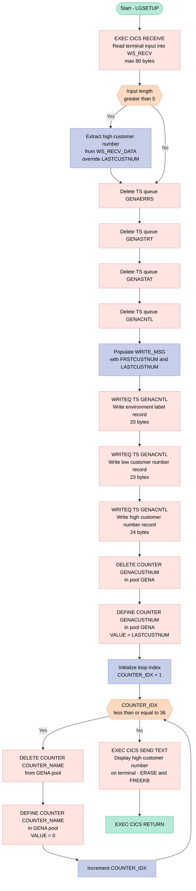

## Table of Contents

- [1. Purpose](#1-purpose)
- [2. Inputs](#2-inputs)
- [3. Outputs](#3-outputs)
  - [3.1 CICS Temporary Storage Queue Writes (`GENACNTL`)](#31-cics-temporary-storage-queue-writes-genacntl)
  - [3.2 CICS Temporary Storage Queue Deletions](#32-cics-temporary-storage-queue-deletions)
  - [3.3 CICS Named Counter Operations (Pool `GENA`)](#33-cics-named-counter-operations-pool-gena)
  - [3.4 Terminal Display](#34-terminal-display)
- [4. Processing Logic](#4-processing-logic)
  - [4.1 Mermaid Flow Diagram](#41-mermaid-flow-diagram)
  - [4.2 Processing Logic Description](#42-processing-logic-description)
  - [4.3 Database Tables (if applicable)](#43-database-tables-if-applicable)
- [5. Paragraphs](#5-paragraphs)
- [6. Dependencies](#6-dependencies)
  - [6.1 CICS Services](#61-cics-services)
  - [6.2 Runtime Input](#62-runtime-input)
  - [6.3 Internal Program Logic / Configuration](#63-internal-program-logic--configuration)
- [7. Constraints](#7-constraints)
  - [7.1 Input / Data Validation Constraints](#71-input--data-validation-constraints)
  - [7.2 Named Counter Constraints](#72-named-counter-constraints)
  - [7.3 Temporary Storage Queue Constraints](#73-temporary-storage-queue-constraints)
  - [7.4 Sequencing / Ordering Constraints](#74-sequencing--ordering-constraints)
  - [7.5 Resource / Structural Limits](#75-resource--structural-limits)
- [8. Error Handling](#8-error-handling)
  - [8.1 CICS Response Code Capture (Passive Error Collection)](#81-cics-response-code-capture-passive-error-collection)
  - [8.2 Conditional Input Validation](#82-conditional-input-validation)
  - [8.3 Tolerance of Non-Existent Resources During Deletion](#83-tolerance-of-non-existent-resources-during-deletion)
  - [8.4 Write Contention Prevention](#84-write-contention-prevention)
  - [8.5 Terminal Feedback as Implicit Completion Signal](#85-terminal-feedback-as-implicit-completion-signal)
  - [8.6 No Active Error Branching or Abend Logic](#86-no-active-error-branching-or-abend-logic)
- [9. Examples](#9-examples)
  - [9.1 Example 1: Default Setup (No High Customer Number Supplied)](#91-example-1-default-setup-no-high-customer-number-supplied)
  - [9.2 Example 2: Custom High Customer Number Supplied](#92-example-2-custom-high-customer-number-supplied)

## 1. Purpose

LGSETUP is a CICS PL/I program that initialises (or re-initialises) the GenApp insurance application environment. When invoked from a terminal, it accepts an optional high customer number from the operator, then tears down and rebuilds all GenApp CICS infrastructure: it deletes and recreates the four GenApp temporary storage queues (control, statistics, start, and errors), writes the environment label and the customer number range (low and high) into the control queue, deletes and redefines the named customer-number counter (`GENACUSTNUM`) in the `GENA` pool seeded with the configured upper bound, and resets all 36 transaction statistics counters (covering insert, add, delete, and update operations for customers, motor, endowment, house, and commercial policies) to zero — ensuring every subsequent GenApp transaction starts from a clean, consistent state.

## 2. Inputs

**Terminal / CICS Input**

- `WS_RECV` — The 80-byte buffer populated by `EXEC CICS RECEIVE`. It captures the raw terminal input that triggers the setup transaction.
  - `WS_RECV_DATA` — The 74-character data portion of the received input (bytes 6–80). If the operator supplies a numeric value after the transaction ID (e.g. `LGSE 0000000011`), this field carries that value, which is converted and used to override the default high customer number (`LASTCUSTNUM`).

**Optional Operator-Supplied Parameter**

- `LASTCUSTNUM` — Although initialized to `11` in working storage, its effective value is determined at runtime by the operator input found in `WS_RECV_DATA`. If the input length exceeds 5 characters (i.e., data follows the transaction ID), the trailing portion is extracted and assigned to `LASTCUSTNUM`, making it a runtime input that controls the upper bound of the customer number counter (`GENACUSTNUM`) created via `EXEC CICS DEFINE COUNTER`.

## 3. Outputs

### 3.1 CICS Temporary Storage Queue Writes (`GENACNTL`)

- **`STSQ_NAME` (`GENACNTL`) — Control Queue**
  - The existing queue is first deleted via `EXEC CICS DELETEQ TS`, then three records are written to it via `EXEC CICS WRITEQ TS`:
    - **`WRITE_MSG_E`** — Environment label record: the fixed 20-character string `'**** GENAPP CNTL    '`, identifying this as the GenApp control entry.
    - **`WRITE_MSG_L`** — Low customer record: the 23-character string `'LOW CUSTOMER='` concatenated with `WRITE_MSG_LOW` (the numeric value of `FRSTCUSTNUM`, always `1`), recording the lower boundary of the customer number range.
    - **`WRITE_MSG_H`** — High customer record: the 24-character string `'HIGH CUSTOMER='` concatenated with `WRITE_MSG_HIGH` (the numeric value of `LASTCUSTNUM`, defaulting to `11` or overridden from terminal input), recording the upper boundary of the customer number range.

### 3.2 CICS Temporary Storage Queue Deletions

- **`STSQ_ERRS` (`GENAERRS`)** — The GenApp error queue is purged unconditionally as part of the environment reset.
- **`STSQ_STRT` (`GENASTRT`)** — The GenApp start queue is purged unconditionally as part of the environment reset.
- **`STSQ_STAT` (`GENASTAT`)** — The GenApp transaction statistics queue is purged unconditionally as part of the environment reset.

### 3.3 CICS Named Counter Operations (Pool `GENA`)

- **`GENACOUNT` (`GENACUSTNUM`) — Customer Number Counter**
  - Deleted then redefined via `EXEC CICS DELETE COUNTER` / `EXEC CICS DEFINE COUNTER`, with its initial `VALUE` set to `LASTCUSTNUM`. This resets the customer number sequence to the configured upper bound.
- **36 Transaction Statistics Counters (`COUNTER_TABLE` / `COUNTER_ARRAY`)** — Each of the 36 named counters (covering Insert, Add, Delete, Update operations for Customer, Motor, Endowment, House, and Commercial policy types, with `00`/`99` success/failure suffixes) is deleted and redefined with `VALUE(ZERO_VALUE)` (`0`), resetting all transaction statistics to zero.

### 3.4 Terminal Display

- **`WRITE_MSG_H`** — The high customer number record (`'HIGH CUSTOMER='` + `WRITE_MSG_HIGH`) is sent to the initiating terminal via `EXEC CICS SEND TEXT … TERMINAL WAIT ERASE FREEKB`, providing the operator with a visible confirmation of the configured upper customer number boundary after setup completes.

## 4. Processing Logic

### 4.1 Mermaid Flow Diagram



---

### 4.2 Processing Logic Description

#### 4.2.1 High-level Summary

`LGSETUP` is a CICS terminal-driven utility program that initialises (or re-initialises) the GenApp insurance application's CICS runtime environment. It resets all four GenApp temporary storage (TS) queues, rebuilds the control queue with the customer number range boundaries, and resets all 37 named counters (one customer-numbering counter plus 36 transaction-statistics counters) in the `GENA` named counter pool. The high water mark for customer numbers can optionally be passed in from the terminal at invocation time; otherwise it defaults to 11.

---

#### 4.2.2 Execution Flow

**Step 1 — Receive terminal input**
`EXEC CICS RECEIVE INTO(WS_RECV) LENGTH(WS_RECV_LEN) RESP(WS_RESP)` reads up to 80 characters from the terminal. `WS_RECV` is split into a 5-character transaction-ID sub-field (`WS_RECV_TRANID`) and a 74-character data sub-field (`WS_RECV_DATA`).

**Step 2 — Optional high customer number override**
After the RECEIVE, the returned `WS_RECV_LEN` reflects how many bytes were actually entered. If `WS_RECV_LEN > 5`, the operator typed something beyond the transaction ID. The program strips the transaction-ID prefix (subtracts 5 from the length) and converts the remainder of `WS_RECV_DATA` into `LASTCUSTNUM`, overriding the default value of 11. If nothing was appended, `LASTCUSTNUM` stays at 11.

**Step 3 — Delete all four GenApp TS queues**
Four `EXEC CICS DELETEQ TS` calls purge the existing queues unconditionally (RESP is captured but not tested, so errors — including QIDERR for a non-existent queue — are silently tolerated):
- `GENAERRS` — error log queue
- `GENASTRT` — start/heartbeat queue
- `GENASTAT` — transaction-statistics queue
- `GENACNTL` — control queue (will be rebuilt next)

**Step 4 — Rebuild the control queue (GENACNTL)**
`WRITE_MSG_LOW` and `WRITE_MSG_HIGH` are stamped with `FRSTCUSTNUM` (= 1) and `LASTCUSTNUM` (default 11 or the operator-supplied value). Three `EXEC CICS WRITEQ TS` calls append records to the freshly deleted `GENACNTL` queue with `NOSUSPEND` (so the write fails immediately rather than waiting if the queue is temporarily full, keeping setup non-blocking):
1. Environment label record — `'**** GENAPP CNTL    '` (20 bytes)
2. Low customer number label + value — `'LOW CUSTOMER=0000000001'` (23 bytes)
3. High customer number label + value — `'HIGH CUSTOMER=0000000011'` (24 bytes, or the overridden high value)

**Step 5 — Reset the customer-number counter**
`EXEC CICS DELETE COUNTER(GENACUSTNUM) POOL(GENA)` removes any prior counter (silently tolerating NOTFND). `EXEC CICS DEFINE COUNTER(GENACUSTNUM) POOL(GENA) VALUE(LASTCUSTNUM)` recreates it, seeding it at `LASTCUSTNUM`. All new customer adds will increment this counter sequentially to generate unique customer IDs.

**Step 6 — Reset the 36 transaction-statistics counters (loop)**
A `DO` loop iterates `COUNTER_IDX` from 1 to 36. For each element of `COUNTER_ARRAY` (the array overlay on `COUNTER_TABLE`), the program issues:
- `EXEC CICS DELETE COUNTER` — removes the existing counter from pool `GENA`
- `EXEC CICS DEFINE COUNTER … VALUE(ZERO_VALUE)` — recreates it at zero

The 36 counters track success (`00` suffix) and failure (`99` suffix) counts for every policy-type operation (Inquire/Add/Delete/Update × Customer/Motor/Endowment/House/Commercial).

**Step 7 — Confirm to the terminal**
`EXEC CICS SEND TEXT FROM(WRITE_MSG_H) TERMINAL WAIT ERASE LENGTH(24) FREEKB` displays the high customer number record on the terminal, erases the screen first (`ERASE`), waits for the output to complete (`WAIT`), and releases the keyboard (`FREEKB`) so the operator sees the confirmation message.

**Step 8 — Return**
`EXEC CICS RETURN` ends the task cleanly.

---

#### 4.2.3 External Interactions

| Interaction | Resource | Purpose |
|---|---|---|
| `EXEC CICS RECEIVE` | Terminal | Reads optional high customer number from operator input |
| `EXEC CICS DELETEQ TS` × 4 | TS queues: `GENAERRS`, `GENASTRT`, `GENASTAT`, `GENACNTL` | Purge old GenApp runtime queues |
| `EXEC CICS WRITEQ TS` × 3 | TS queue: `GENACNTL` | Recreate the control queue with environment label and customer number range |
| `EXEC CICS DELETE COUNTER` | Named counter pool `GENA`, counter `GENACUSTNUM` | Remove the old customer-ID sequence counter |
| `EXEC CICS DEFINE COUNTER` | Named counter pool `GENA`, counter `GENACUSTNUM` | Recreate the customer-ID sequence counter seeded at `LASTCUSTNUM` |
| `EXEC CICS DELETE COUNTER` × 36 | Named counter pool `GENA`, 36 stat counters | Remove all old transaction-statistics counters |
| `EXEC CICS DEFINE COUNTER` × 36 | Named counter pool `GENA`, 36 stat counters | Recreate all statistics counters reset to zero |
| `EXEC CICS SEND TEXT` | Terminal | Display setup confirmation to the operator |

---

#### 4.2.4 Plain Language Summary

When a system administrator wants to reset or freshly configure the GenApp insurance environment, they run the `LGSE` transaction from a CICS terminal. They can optionally type a maximum customer number (e.g. `LGSE 0000000050`) to set how many customers the system can hold; if they leave it blank, the system defaults to 11.

The program then wipes and rebuilds four internal queues that GenApp uses to track what it is doing, writing a fresh label that records the minimum and maximum customer numbers. It also resets a counter that assigns new customer IDs — seeding it at the supplied (or default) upper limit — and resets all 36 operation-tracking counters (for motor, endowment, house, commercial, and customer operations) back to zero.

Once everything is reset, the screen clears and shows the confirmed high customer number, letting the operator know the setup completed successfully.

---

### 4.3 Database Tables (if applicable)

`LGSETUP` does not access any DB2 tables. All external interactions are exclusively via CICS Temporary Storage queues and CICS Named Counters; no `EXEC SQL` statements are present.

## 5. Paragraphs

`LGSETUP` is a single PL/I main procedure with no internal sub-procedures or named paragraph labels. All executable logic flows sequentially from the top of the `LGSETUP: Proc Options(Main)` body to `EXEC CICS RETURN`. The logical sections below correspond to the coherent functional blocks within that single procedure body.

- **Input Reception and High Customer Number Override**
  - Issues `EXEC CICS RECEIVE INTO(WS_RECV) LENGTH(WS_RECV_LEN) RESP(WS_RESP)` to read the terminal input into the 80-byte `WS_RECV` buffer (5-character transaction ID + 74-character data area).
  - Applies a conditional check: if `WS_RECV_LEN > 5`, meaning extra data was typed after the transaction ID, it subtracts 5 from the received length and converts the data portion (`WS_RECV_DATA`) into `LASTCUSTNUM`, overriding the default value of 11. This allows the operator to specify a custom upper boundary for the customer number range at startup.
  - If no extra data is present, `LASTCUSTNUM` retains its compile-time initialization of 11.

- **Temporary Storage Queue Cleanup**
  - Deletes four GenApp TS queues in sequence using `EXEC CICS DELETEQ TS QUEUE(...)  RESP(WS_RESP)`:
    - `GENAERRS` — the error-tracking queue (`STSQ_ERRS`)
    - `GENASTRT` — the start-event queue (`STSQ_STRT`)
    - `GENASTAT` — the transaction statistics queue (`STSQ_STAT`)
    - `GENACNTL` — the environment control queue (`STSQ_NAME`)
  - Responses are captured in `WS_RESP` but no error-branching logic is applied; the program continues regardless of whether a queue existed prior to deletion (tolerate `QIDERR`).

- **Control Queue Reconstruction**
  - Populates `WRITE_MSG_LOW` and `WRITE_MSG_HIGH` (PIC fields within the `WRITE_MSG` structure) with `FRSTCUSTNUM` (1) and `LASTCUSTNUM` (the resolved high customer number) respectively.
  - Writes three separate records to the `GENACNTL` TS queue via `EXEC CICS WRITEQ TS QUEUE(STSQ_NAME) FROM(...) NOSUSPEND LENGTH(...)`:
    - Record 1 (20 bytes): the environment label `**** GENAPP CNTL    ` from `WRITE_MSG_E`.
    - Record 2 (23 bytes): the low customer label and numeric value (`LOW CUSTOMER=` + 10-digit number) from `WRITE_MSG_L`.
    - Record 3 (24 bytes): the high customer label and numeric value (`HIGH CUSTOMER=` + 10-digit number) from `WRITE_MSG_H`.
  - The `NOSUSPEND` option ensures the write returns immediately with an error response rather than waiting if storage is unavailable.

- **Customer Number Counter Reset**
  - Deletes the existing `GENACUSTNUM` named counter in the `GENA` pool via `EXEC CICS DELETE COUNTER(GENACOUNT) POOL(GENAPOOL) RESP(WS_RESP)`.
  - Immediately redefines it via `EXEC CICS DEFINE COUNTER(GENACOUNT) POOL(GENAPOOL) VALUE(LASTCUSTNUM) RESP(WS_RESP)`, seeding the counter with the resolved high customer number. This counter governs the next customer number assigned during GenApp policy operations.

- **Transaction Statistics Counters Reset (Loop)**
  - Iterates through all 36 entries in `COUNTER_TABLE` using a `DO COUNTER_IDX = 1 TO COUNTER_COUNT` loop, accessing each counter name via the `COUNTER_ARRAY` based-overlay (`COUNTER_NAME(COUNTER_IDX)`).
  - For each counter, performs two CICS operations against the `GENA` pool:
    - `EXEC CICS DELETE COUNTER(...)` — removes the existing counter if present.
    - `EXEC CICS DEFINE COUNTER(...) VALUE(ZERO_VALUE)` — recreates it initialized to 0.
  - Counters cover all policy operation types (customer, motor, endowment, house, commercial) and both success (`00`) and failure (`99`) variants (e.g., `GENA01ICUS00`, `GENA01IMOT99`).

- **Terminal Display and Return**
  - Sends the high customer number message (`WRITE_MSG_H`, 24 bytes) to the operator terminal via `EXEC CICS SEND TEXT FROM(WRITE_MSG_H) TERMINAL WAIT ERASE LENGTH(24) FREEKB`, erasing the screen, writing the confirmation text, waiting for the send to complete, and unlocking the keyboard (`FREEKB`).
  - Issues `EXEC CICS RETURN` to hand control back to CICS and end the transaction cleanly.

## 6. Dependencies

### 6.1 CICS Services

- **CICS Transaction Manager**
  - The program runs as a CICS transaction (invoked via transaction ID `LGSE` or similar) and depends on the CICS runtime to dispatch and manage its execution
  - `EXEC CICS RECEIVE` — reads terminal input at program startup; the 80-byte input buffer (`WS_RECV`) captures the transaction ID and optional high customer number supplied by the operator
  - `EXEC CICS SEND TEXT` — sends the high-customer-number confirmation message back to the initiating terminal upon completion
  - `EXEC CICS RETURN` — signals CICS to end the transaction and return control to CICS

- **CICS Temporary Storage (TS) Facility**
  - `EXEC CICS DELETEQ TS` / `EXEC CICS WRITEQ TS` — the program deletes and recreates four named TS queues as part of environment reset:
    - **`GENACNTL`** (`STSQ_NAME`) — GenApp control queue; receives the environment label, low customer number, and high customer number records after reset
    - **`GENASTAT`** (`STSQ_STAT`) — GenApp transaction statistics queue; deleted to clear accumulated statistics
    - **`GENASTRT`** (`STSQ_STRT`) — GenApp start queue; deleted to reset start-up tracking
    - **`GENAERRS`** (`STSQ_ERRS`) — GenApp error queue; deleted to clear previously recorded errors

- **CICS Named Counter Service (pool `GENA`)**
  - `EXEC CICS DELETE COUNTER` / `EXEC CICS DEFINE COUNTER` — the program deletes and recreates counters in the named counter pool `GENA`:
    - **`GENACUSTNUM`** — customer number sequence counter; redefined with the operator-supplied (or default) high customer number as its initial value, establishing the upper bound for new customer IDs
    - **36 transaction statistics counters** (`GENA01ICUS00`, `GENA01ICUS99`, … `GENA01UCUS99`) — one counter per operation type (Insert, Add, Delete, Update) per policy entity (Customer, Motor, Endowment, House, Commercial) and per outcome (success `00` / failure `99`); all reset to zero

### 6.2 Runtime Input

- **Operator terminal input** — the operator may supply an optional high customer number value after the transaction ID on the terminal command line (e.g., `LGSE 0000000011`); if present, this overrides the default `LASTCUSTNUM` value of `11` and is used as the upper bound of the customer counter

### 6.3 Internal Program Logic / Configuration

- **`FRSTCUSTNUM`** (hardcoded `1`) — lower bound of the customer number range; written to the `GENACNTL` control queue as a fixed configuration value; not overridable at runtime
- **`LASTCUSTNUM`** (default `11`, overridable via terminal input) — upper bound of the customer number range; written to the `GENACNTL` control queue and used as the initial value of the `GENACUSTNUM` named counter
- **`COUNTER_TABLE` / `COUNTER_ARRAY`** — static, compile-time list of the 36 named counter identifiers iterated over during counter reset; defines the complete set of GenApp transaction statistics counters

## 7. Constraints

### 7.1 Input / Data Validation Constraints

- **Receive buffer fixed at 80 bytes**
  - `WS_RECV` is declared as a two-part structure totalling exactly 80 characters (`WS_RECV_TRANID` CHAR(5) + `WS_RECV_DATA` CHAR(74)); `WS_RECV_LEN` is initialised to `80` and passed to `EXEC CICS RECEIVE LENGTH(WS_RECV_LEN)`, meaning no more than 80 bytes of terminal input will be accepted into the buffer
  - Any terminal input longer than 80 characters is silently truncated to the buffer boundary

- **Optional high-customer-number override validated by length only**
  - The override value is accepted only when the received length (`WS_RECV_LEN`) is strictly greater than 5 (i.e., something beyond the 5-character transaction ID was typed)
  - No format, range, or sign validation is applied to the supplied override string before it is converted with `SUBSTR(WS_RECV_DATA,1,WS_RECV_LEN-5)` and assigned to `LASTCUSTNUM` (a `FIXED BIN(31)` variable); a non-numeric string will cause a PL/I conversion error at runtime
  - The maximum meaningful override length is implicitly constrained to 74 characters by the size of `WS_RECV_DATA`, but no explicit upper-bound check on the numeric value itself is coded

- **Low customer number is hardcoded to 1**
  - `FRSTCUSTNUM` is declared `FIXED BIN(31) INIT(1)` and never modified; the lower boundary of the customer number range cannot be changed without a code change

- **Default high customer number is 11**
  - `LASTCUSTNUM` defaults to `11` (`INIT(11)`); if no override is supplied the counter and control queue are always seeded with this value

- **Customer number display fields are 10-digit numeric picture**
  - `WRITE_MSG_LOW` and `WRITE_MSG_HIGH` are both declared `PIC '9999999999'`; they can only hold unsigned integers in the range 0–9999999999, imposing an implicit ceiling on any customer number written to the control queue or displayed on the terminal

---

### 7.2 Named Counter Constraints

- **Exactly 36 transaction-statistics counters must exist**
  - `COUNTER_COUNT` is declared `FIXED BIN(15) STATIC INIT(36)` and drives the `DO` loop bounds; the loop always iterates over all 36 entries — no partial resets are possible

- **All transaction-statistics counters are reset to zero**
  - `ZERO_VALUE` is `FIXED BIN(31) INIT(0)`; every counter in `COUNTER_TABLE` is redefined with `VALUE(ZERO_VALUE)`, enforcing that no prior counts survive a setup run

- **Customer number counter is seeded to the high customer number value**
  - `EXEC CICS DEFINE COUNTER(GENACOUNT) … VALUE(LASTCUSTNUM)` means the counter starts at the value of `LASTCUSTNUM` (default 11 or the supplied override), not at 1 or 0; new customer numbers are derived by incrementing from this seed

- **All counters must reside in the single pool named `GENA`**
  - `GENAPOOL` is `CHAR(8) STATIC INIT('GENA')`; every `DELETE COUNTER` and `DEFINE COUNTER` call specifies this pool, making all GenApp counters dependent on that named counter pool being available in CICS

- **Counter names are fixed-length 16-character strings padded with blanks**
  - Each entry in `COUNTER_TABLE` is `CHAR(16)` with an initialiser shorter than 16 characters; PL/I pads with blanks on the right, so the counter name passed to CICS always occupies the full 16-character field

---

### 7.3 Temporary Storage Queue Constraints

- **Four TS queue names are hardcoded**
  - `STSQ_NAME` (`GENACNTL`), `STSQ_STAT` (`GENASTAT`), `STSQ_STRT` (`GENASTRT`), and `STSQ_ERRS` (`GENAERRS`) are all declared `CHAR(8) STATIC`; the queue names cannot be changed at runtime

- **Control queue records have fixed, predetermined lengths**
  - Environment label (`WRITE_MSG_E`) is always written as exactly 20 bytes (`LENGTH(20)`)
  - Low-customer record (`WRITE_MSG_L` + `WRITE_MSG_LOW` + separator = 13+10+1) is always written as exactly 23 bytes (`LENGTH(23)`)
  - High-customer record (`WRITE_MSG_H` + `WRITE_MSG_HIGH` = 14+10) is always written as exactly 24 bytes (`LENGTH(24)`)
  - Consumers of the `GENACNTL` queue must parse records at these exact offsets and lengths

- **TS queue writes use NOSUSPEND**
  - All three `EXEC CICS WRITEQ TS` calls specify `NOSUSPEND`; if the TS queue storage is full CICS returns a non-normal `RESP` rather than waiting, but the program does not check `WS_RESP` after these writes, meaning a failure silently leaves the control queue incomplete

- **RESP codes from all CICS operations are not checked**
  - `WS_RESP` is populated after every CICS call (`DELETEQ TS`, `WRITEQ TS`, `DELETE COUNTER`, `DEFINE COUNTER`, `RECEIVE`) but is never tested; an error in any step (e.g., counter pool unavailable, queue write failure) does not halt execution or produce a diagnostic, allowing the program to continue in a partially initialised state

---

### 7.4 Sequencing / Ordering Constraints

- **Input must be received before any environment reset begins**
  - `EXEC CICS RECEIVE` is the very first executable statement; the optional `LASTCUSTNUM` override is extracted from the input before any queue or counter operations, because those operations depend on the final value of `LASTCUSTNUM`

- **TS queues must be deleted before being recreated**
  - All four `EXEC CICS DELETEQ TS` calls complete before the `EXEC CICS WRITEQ TS` sequence begins, ensuring the control queue starts fresh and does not append to stale records

- **Control queue must be populated before the customer number counter is defined**
  - The three `WRITEQ TS` operations for `GENACNTL` occur before `EXEC CICS DEFINE COUNTER(GENACOUNT)`; this ordering ensures the queue boundary values are visible to other programs before the counter becomes active, though it is not enforced by any explicit synchronisation mechanism

- **Customer number counter is reset before the statistics counters loop**
  - `DELETE COUNTER / DEFINE COUNTER` for `GENACUSTNUM` always precedes the 36-entry `DO` loop, establishing the sequence counter independently from the statistics counters

- **Terminal send is the last operation before EXEC CICS RETURN**
  - `EXEC CICS SEND TEXT … ERASE WAIT FREEKB` is issued only after all queue and counter setup is complete, ensuring the operator only sees the confirmation display once the environment is fully (re)initialised

---

### 7.5 Resource / Structural Limits

- **Counter table is statically sized at exactly 36 entries**
  - Adding or removing a policy operation type requires both a source code change to `COUNTER_TABLE` and a corresponding update to `COUNTER_COUNT`; the two are not automatically kept in sync

- **Receive data field is limited to 74 characters of user-supplied data**
  - The numeric override for `LASTCUSTNUM` may be at most 74 digits long; however, `FIXED BIN(31)` can hold at most a 10-digit signed integer (~2.1 billion), so values exceeding that range will overflow without an explicit guard

- **Terminal display shows only the high-customer record**
  - `EXEC CICS SEND TEXT FROM(WRITE_MSG_H) LENGTH(24)` sends only the 24-byte high-customer field to the terminal; the environment label and low-customer records are written to the queue but not echoed to the screen

## 8. Error Handling

### 8.1 CICS Response Code Capture (Passive Error Collection)

- Every EXEC CICS command in the program specifies `RESP(WS_RESP)`, directing CICS to store the response code in the `WS_RESP` variable rather than raising an exception condition
  - This applies to `EXEC CICS RECEIVE`, all four `EXEC CICS DELETEQ TS` calls, all three `EXEC CICS WRITEQ TS` calls, `EXEC CICS DELETE COUNTER` and `EXEC CICS DEFINE COUNTER` for both the customer number counter and all 36 statistics counters
  - Using `RESP` suppresses the default CICS condition handling mechanism, meaning abnormal responses do not automatically cause a task abend or branch to an error handler
  - The program captures these codes silently but does **not** inspect `WS_RESP` after any individual command; responses are collected but never evaluated or acted upon

### 8.2 Conditional Input Validation

- After `EXEC CICS RECEIVE`, the program checks whether `WS_RECV_LEN` is greater than 5
  - If true, this indicates the operator supplied additional data after the transaction ID on the terminal input, and the program extracts that data as the high customer number override for `LASTCUSTNUM`
  - If false (i.e., only the transaction ID was entered), the `LASTCUSTNUM` default value of 11 is retained
  - This acts as a guard against applying an empty or absent override value to the counter range

### 8.3 Tolerance of Non-Existent Resources During Deletion

- The four `EXEC CICS DELETEQ TS` calls targeting the `GENAERRS`, `GENASTRT`, `GENASTAT`, and `GENACNTL` queues are issued unconditionally during environment reset
  - Any queue that does not exist at the time of deletion would produce a non-normal RESP code, but since `WS_RESP` is never tested after these calls, the program silently absorbs the failure and continues
  - This constitutes implicit tolerance of a "queue not found" condition, treating deletion of a pre-existing queue as a best-effort cleanup step
- Similarly, `EXEC CICS DELETE COUNTER` is called for the customer number counter and each of the 36 statistics counters before redefining them
  - If a counter does not yet exist, the resulting RESP value is captured in `WS_RESP` but ignored, allowing the subsequent `EXEC CICS DEFINE COUNTER` to proceed regardless

### 8.4 Write Contention Prevention

- All three `EXEC CICS WRITEQ TS` calls to the control queue `GENACNTL` include the `NOSUSPEND` option
  - This prevents the task from being suspended if the queue storage is temporarily unavailable, instead causing CICS to return immediately with a non-normal response code
  - Combined with the `RESP(WS_RESP)` capture, any write failure is recorded in `WS_RESP` but not acted upon; the program proceeds to the next write unconditionally

### 8.5 Terminal Feedback as Implicit Completion Signal

- Upon completing all setup operations, the program issues `EXEC CICS SEND TEXT` to display the high customer number confirmation message on the operator's terminal with `ERASE`, `WAIT`, and `FREEKB`
  - While not an error-reporting mechanism in isolation, this serves as an implicit success notification — the operator receives a terminal display only if execution reached the end of the setup logic without being interrupted by any unhandled abend
  - The absence of this display would signal to the operator that setup did not complete

### 8.6 No Active Error Branching or Abend Logic

- The program contains no `IF WS_RESP = ...` condition checks, no `EXEC CICS ABEND`, no `ON ERROR` or `ON CONDITION` PL/I condition handlers, and no error message writing routines
  - This is a deliberate design choice for an administrative setup transaction: failures in deleting or redefining resources are tolerated, and the program always attempts to complete the full sequence of operations regardless of intermediate RESP outcomes

## 9. Examples

### 9.1 Example 1: Default Setup (No High Customer Number Supplied)

**Input:**
Terminal input: `LGSE ` (transaction ID only, 5 characters — no trailing data)

**Processing:**
- `WS_RECV_LEN` = 5, so the `IF WS_RECV_LEN > 5` branch is **not** taken.
- `LASTCUSTNUM` retains its default value of **11**.
- All four TS queues (`GENAERRS`, `GENASTRT`, `GENASTAT`, `GENACNTL`) are deleted.
- The `GENACNTL` queue is repopulated with three records:
  - `**** GENAPP CNTL    ` (20 bytes)
  - `LOW CUSTOMER=0000000001` (23 bytes)
  - `HIGH CUSTOMER=0000000011` (24 bytes)
- The named counter `GENACUSTNUM` in pool `GENA` is deleted and redefined with **VALUE(11)**.
- All 36 transaction statistics counters (e.g., `GENA01ICUS00`, `GENA01IMOT99`, …) are deleted and redefined with **VALUE(0)**.

**Expected Output (terminal display):**
```
HIGH CUSTOMER=0000000011
```
The terminal receives the `WRITE_MSG_H` field (24 bytes), confirming the high customer number boundary.

---

### 9.2 Example 2: Custom High Customer Number Supplied

**Input:**
Terminal input: `LGSE 0000000050` (transaction ID + space + `0000000050`, total length = 15 characters)

**Processing:**
- `WS_RECV_LEN` = 15, which is `> 5`, so the override branch **is** taken.
  - `WS_RECV_LEN` is adjusted to `15 − 5 = 10`.
  - `LASTCUSTNUM` is set from `SUBSTR(WS_RECV_DATA, 1, 10)` → **50**.
- All four TS queues are deleted and `GENACNTL` is rebuilt with:
  - `LOW CUSTOMER=0000000001`
  - `HIGH CUSTOMER=0000000050`
- `GENACUSTNUM` counter is deleted and redefined with **VALUE(50)**, establishing customer numbers 1–50 as the valid range.
- All 36 statistics counters are reset to **0**.

**Expected Output (terminal display):**
```
HIGH CUSTOMER=0000000050
```
Any new customer created after this setup will be assigned a number drawn from the counter sequence up to 50, and the `GENACNTL` TS queue will reflect this range for any program that reads it to determine valid customer number boundaries.

---

Generated by IBM Bob Premium Package for Z
