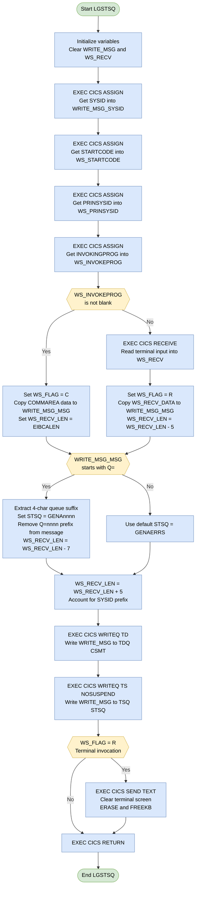

## Table of Contents

- [1. Purpose](#1-purpose)
- [2. Inputs](#2-inputs)
- [3. Outputs](#3-outputs)
  - [3.1 Logged message outputs](#31-logged-message-outputs)
  - [3.2 Terminal-facing output](#32-terminal-facing-output)
  - [3.3 Invocation-dependent output content](#33-invocation-dependent-output-content)
  - [3.4 Control values that affect observable outputs](#34-control-values-that-affect-observable-outputs)
  - [3.5 Return / completion behavior](#35-return--completion-behavior)
- [4. Processing Logic](#4-processing-logic)
  - [4.1 Mermaid Flow Diagram](#41-mermaid-flow-diagram)
  - [4.2 Processing Logic Description](#42-processing-logic-description)
  - [4.3 Database Tables](#43-database-tables)
- [5. Paragraphs](#5-paragraphs)
- [6. Dependencies](#6-dependencies)
  - [6.1 CICS Runtime Environment](#61-cics-runtime-environment)
  - [6.2 CICS Queues (Output Destinations)](#62-cics-queues-output-destinations)
  - [6.3 Inter-Program Communication](#63-inter-program-communication)
  - [6.4 Terminal Interface](#64-terminal-interface)
- [7. Constraints](#7-constraints)
  - [7.1 Data Size & Field Length Constraints](#71-data-size--field-length-constraints)
  - [7.2 Invocation-Path Constraints](#72-invocation-path-constraints)
  - [7.3 Queue-Name Override Constraints](#73-queue-name-override-constraints)
  - [7.4 Sequencing Constraints](#74-sequencing-constraints)
  - [7.5 Resource-Usage Constraints](#75-resource-usage-constraints)
  - [7.6 Output Formatting Constraints](#76-output-formatting-constraints)
- [8. Error Handling](#8-error-handling)
  - [8.1 RESP-Based Response Code Capture on CICS Commands](#81-resp-based-response-code-capture-on-cics-commands)
  - [8.2 Invocation-Mode Detection as Defensive Logic](#82-invocation-mode-detection-as-defensive-logic)
  - [8.3 NOSUSPEND Option on Temporary Storage Queue Write](#83-nosuspend-option-on-temporary-storage-queue-write)
  - [8.4 Conditional Terminal Response](#84-conditional-terminal-response)
  - [8.5 Queue Name Override Validation](#85-queue-name-override-validation)
  - [8.6 Absence of Explicit Error Reporting or Abend Logic](#86-absence-of-explicit-error-reporting-or-abend-logic)
- [9. Examples](#9-examples)
  - [9.1 Example 1 — Called by Another Program (COMMAREA, no queue override)](#91-example-1--called-by-another-program-commarea-no-queue-override)
  - [9.2 Example 2 — Called by Another Program (COMMAREA, with queue-name override `Q=nnnn`)](#92-example-2--called-by-another-program-commarea-with-queue-name-override-qnnnn)
  - [9.3 Example 3 — Invoked Directly from a Terminal](#93-example-3--invoked-directly-from-a-terminal)

## 1. Purpose

`LGSTSQ` is a CICS PL/I error message logging utility that accepts a text message — either passed via a communication area from a calling program or typed directly at a terminal — and writes it to two CICS queues: the standard Transient Data Queue (`CSMT`) for system-level logging and a Temporary Storage Queue (defaulting to `GENAERRS`, but dynamically overridable to `GENAnnnn` via a `Q=nnnn` prefix in the message text) for application-level error tracking. Each logged entry is prefixed with the CICS system identifier to identify the originating region, and when invoked interactively from a terminal, the program clears the screen after writing the message before returning control to CICS.

## 2. Inputs

**Procedure Parameters**

- `COMM_AREA_PTR` — PL/I pointer passed as the main procedure parameter; addresses the CICS COMMAREA supplied by the calling program
  - `COMMA_DATA` — 90-byte message text extracted from the COMMAREA via the `COMMA` based structure; used as the message body when the program is invoked by another program (`WS_FLAG = 'C'`)

**CICS Environment / Runtime Assignments**

- `WRITE_MSG_SYSID` — 4-character CICS region identifier retrieved via `EXEC CICS ASSIGN SYSID`; prefixes every logged message record to identify its origin
- `WS_STARTCODE` — 2-character task start code retrieved via `EXEC CICS ASSIGN STARTCODE`; indicates how the current CICS task was initiated
- `WS_PRINSYSID` — 4-character principal facility system ID retrieved via `EXEC CICS ASSIGN PRINSYSID`; identifies the owning CICS region in a multi-region environment
- `WS_INVOKEPROG` — 8-character invoking program name retrieved via `EXEC CICS ASSIGN INVOKINGPROG`; a non-blank value signals that the program was called via `EXEC CICS LINK` rather than from a terminal, driving the invocation-path decision
- `EIBCALEN` — CICS Execute Interface Block field providing the length of the passed COMMAREA; used to set `WS_RECV_LEN` when the program is called-path invoked

**Terminal / User Input**

- `WS_RECV` — 80-byte structure populated by `EXEC CICS RECEIVE` when the program is invoked directly from a terminal (`WS_FLAG = 'R'`)
  - `WS_RECV_DATA` — 74-byte user-entered data portion (after the 5-character transaction ID prefix); assigned to the output message field for logging

**Embedded Input Parameters within Message Text**

- `WRITE_MSG_MSG` — 90-byte message text field; when it begins with `Q=nnnn`, the leading 7 bytes act as an inline parameter that overrides the target Temporary Storage Queue name (`STSQ`) to `GENAnnnn`, and the remainder becomes the actual log message

## 3. Outputs

### 3.1 Logged message outputs
- `WRITE_MSG`
  - Composite message record written to both CICS queues.
  - Structure:
    - `WRITE_MSG_SYSID`
      - 4-character CICS system identifier placed at the start of the logged record.
      - Identifies which CICS region produced the message.
    - `WRITE_MSG_MSG`
      - Main message text content.
      - Sourced from:
        - `COMMA_DATA` when invoked by another program
        - `WS_RECV_DATA` when invoked from a terminal
      - If the text begins with `Q=nnnn`, the prefix is removed before logging and only the remaining message text is written.

- Transient Data Queue write
  - Destination queue: `STDQ_NAME`
    - Fixed as `CSMT`
  - Data written: `WRITE_MSG`
  - Length written: `WS_RECV_LEN`
  - Role:
    - Sends the message to the standard CICS message log for operational visibility.

- Temporary Storage Queue write
  - Destination queue: `STSQ`
    - Defaults to `GENAERRS`
    - Can be overridden to `GENAnnnn` when the input message starts with `Q=nnnn`
  - Data written: `WRITE_MSG`
  - Length written: `WS_RECV_LEN`
  - Options: `NOSUSPEND`
  - Role:
    - Persists the error or status message in a GenApp temporary storage queue for later retrieval or review.

### 3.2 Terminal-facing output
- `SEND TEXT` response to terminal
  - Data sent: `FILLER_X`
    - A single blank character
  - Sent only when `WS_FLAG = 'R'`
    - Meaning the program was started directly from a terminal rather than linked from another program
  - Role:
    - Clears or refreshes the terminal interaction and ends the user-facing transaction with a minimal response.

### 3.3 Invocation-dependent output content
- Program-linked invocation output
  - Relevant inputs affecting final outputs:
    - `COMMA_DATA`
    - `WS_INVOKEPROG`
  - Role:
    - When the program is called by another program, the logged message text comes from the COMMAREA and is written to both queues.

- Terminal invocation output
  - Relevant inputs affecting final outputs:
    - `WS_RECV_DATA`
    - `WS_FLAG`
  - Role:
    - When the program is entered from a terminal, the typed input becomes the logged message text, is written to both queues, and also causes the blank terminal text response to be sent.

### 3.4 Control values that affect observable outputs
- `STSQ`
  - Determines which temporary storage queue receives the logged message.
  - Observable because it changes the destination of persisted output.

- `WS_RECV_LEN`
  - Determines the exact number of bytes written to both queues.
  - Adjusted based on:
    - COMMAREA length or received terminal length
    - optional removal of `Q=nnnn` prefix
    - addition of 5 bytes for the `SYSID` and separator portion of `WRITE_MSG`
  - Observable because it controls how much data is actually recorded.

### 3.5 Return / completion behavior
- `EXEC CICS RETURN`
  - Ends the transaction and returns control to CICS.
  - No application data return value is produced by the PL/I procedure itself.
  - Observable as the program’s completion side effect after logging and optional terminal response.

## 4. Processing Logic

### 4.1 Mermaid Flow Diagram



---

### 4.2 Processing Logic Description

#### 4.2.1 High-level Summary

`LGSTSQ` is a reusable CICS error/message logging utility. Its sole purpose is to accept a message (either from a calling program's COMMAREA or from direct terminal input) and write that message to two CICS destinations: the Transient Data Queue (TDQ) **CSMT** (the standard CICS system log) and a Temporary Storage Queue (TSQ) named **GENAERRS** (or a dynamically overridden name). It acts as a centralized logging hub for the GenApp application.

---

#### 4.2.2 Execution Flow

**Step 1 – Initialization**
Variables `WRITE_MSG` and `WS_RECV` are blanked. This ensures no stale data contaminates the output message structure before it is populated.

**Step 2 – Gather CICS Environment Information**
Four `EXEC CICS ASSIGN` calls retrieve runtime attributes:
- `SYSID` → stored in `WRITE_MSG_SYSID` to prefix the logged message with the originating CICS region identifier.
- `STARTCODE` → stored in `WS_STARTCODE`; records how the task was initiated (terminal input, START command, etc.).
- `PRINSYSID` → stored in `WS_PRINSYSID`; identifies the owning CICS system of the principal facility in a multi-region environment.
- `INVOKINGPROG` → stored in `WS_INVOKEPROG`; a non-blank value means the program was called via `EXEC CICS LINK` from another program.

**Step 3 – Determine Invocation Method**
A branch on `WS_INVOKEPROG` controls how the message text is obtained:

- **Called by another program (`WS_INVOKEPROG ≠ ' '`):**
  - `WS_FLAG` is set to `'C'` (Called).
  - The message is read directly from `COMMA_DATA` (the COMMAREA passed by the caller).
  - `WS_RECV_LEN` is set to `EIBCALEN` (the actual COMMAREA length as reported by the CICS Execute Interface Block), ensuring only the true data length is used.

- **Invoked from a terminal (`WS_INVOKEPROG = ' '`):**
  - `EXEC CICS RECEIVE` reads up to 80 bytes of terminal input into `WS_RECV`, which consists of a 5-character transaction ID prefix followed by 74 bytes of user data.
  - `WS_FLAG` is set to `'R'` (Received from terminal).
  - The message text is taken from `WS_RECV_DATA` (the 74-byte data portion, skipping the transaction ID).
  - `WS_RECV_LEN` is decremented by 5 to strip the transaction ID length.

**Step 4 – Queue Name Override Check**
The TSQ name defaults to `'GENAERRS'`. If the first two characters of the message text are `'Q='`, the program interprets the next 4 characters as a queue suffix:
- `STSQ` is updated from `'GENAERRS'` to `'GENAnnnn'` (where `nnnn` is the 4-character suffix from the message).
- The message text is shifted left by 7 characters (removing the `'Q=nnnn '` prefix) so that the actual log text (starting at position 8) is what gets written, not the routing directive.
- `WS_RECV_LEN` is decremented by 7 to reflect the shorter effective message.

This mechanism allows callers to dynamically direct messages to different named TSQs within the `GENA` namespace without requiring separate program calls.

**Step 5 – Adjust Length for SYSID Prefix**
`WS_RECV_LEN` is incremented by 5 (4-byte SYSID + 1-byte filler) to account for the `WRITE_MSG_SYSID` and `FILLER_X` fields prepended to the message before writing.

**Step 6 – Write to Transient Data Queue (TDQ CSMT)**
`EXEC CICS WRITEQ TD` writes the complete `WRITE_MSG` structure (SYSID + space + message text) to the CICS Transient Data Queue named `CSMT`. CSMT is the standard CICS auxiliary trace/log destination, making the message visible in the CICS system log for operator and support review.

**Step 7 – Write to Temporary Storage Queue (TSQ)**
`EXEC CICS WRITEQ TS` writes the same `WRITE_MSG` structure to the TSQ identified by `STSQ` (either `GENAERRS` or the dynamically determined `GENAnnnn`). The `NOSUSPEND` option is critical: if no CICS storage is available to queue the item, the write is silently ignored rather than suspending the task. This prevents the logging utility from becoming a blocking dependency that could stall application transactions.

**Step 8 – Terminal Response (Conditional)**
If the program was invoked from a terminal (`WS_FLAG = 'R'`), `EXEC CICS SEND TEXT` is issued with `TERMINAL`, `WAIT`, `ERASE`, and `FREEKB` options. This clears the terminal screen and unlocks the keyboard, providing a clean visual response to the operator after the message has been logged.

**Step 9 – Return**
`EXEC CICS RETURN` ends the CICS task cleanly. No ABEND is issued; the program always exits normally regardless of the write outcomes.

---

#### 4.2.3 External Interactions

| Interaction | Command | Purpose |
|---|---|---|
| CICS Environment Query | `EXEC CICS ASSIGN SYSID` | Obtain the CICS region name for message prefixing |
| CICS Environment Query | `EXEC CICS ASSIGN STARTCODE` | Record how the current task was started |
| CICS Environment Query | `EXEC CICS ASSIGN PRINSYSID` | Identify the principal system in a multi-region setup |
| CICS Environment Query | `EXEC CICS ASSIGN INVOKINGPROG` | Distinguish program linkage from terminal invocation |
| Terminal Input | `EXEC CICS RECEIVE` | Read user-typed message text when invoked from a terminal |
| TDQ Write | `EXEC CICS WRITEQ TD QUEUE(CSMT)` | Write logged message to the CICS system message log |
| TSQ Write | `EXEC CICS WRITEQ TS QUEUE(STSQ)` | Write logged message to the GenApp application TSQ (GENAERRS or GENAnnnn) |
| Terminal Output | `EXEC CICS SEND TEXT` | Clear and unlock terminal screen after terminal-initiated logging |

---

#### 4.2.4 Plain Language Summary

`LGSTSQ` is a simple but important logging helper. When any other GenApp program encounters an error or needs to record a message, it calls `LGSTSQ` and passes the message text. The program figures out whether it was called by another program or typed directly at a terminal, collects the message, stamps it with the CICS system name, and writes it to two places: the standard CICS system log (CSMT) and a GenApp-specific message queue (GENAERRS). If the message starts with `Q=xxxx`, the caller can redirect the log entry to a different named queue, which is useful for separating messages from different parts of the application. If a terminal operator ran it directly, the screen is cleared at the end so it looks tidy. The program never crashes — even if there is no space to write to the queue, it moves on silently.

---

### 4.3 Database Tables

`LGSTSQ` does not interact with any DB2 database tables. It operates exclusively with CICS Transient Data Queues and Temporary Storage Queues. No `erDiagram` is applicable for this program.

## 5. Paragraphs

The LGSTSQ program is a single monolithic PL/I procedure (`LGSTSQ: Proc … End LGSTSQ`) with no separately named internal subroutines or labelled paragraphs. All logic flows inline from top to bottom. The logical sections described below correspond to the distinct functional blocks within that single procedure.

- **LGSTSQ (Main Procedure — Initialization Block)**
  - Serves as the program entry point, receiving `COMM_AREA_PTR` as the sole parameter, which is used to base the `COMMA` structure and access any inbound communication area data.
  - Clears `WRITE_MSG` and `WS_RECV` to blanks to ensure no residual data contaminates output records.
  - Issues four consecutive `EXEC CICS ASSIGN` calls to populate environmental context:
    - `SYSID` → `WRITE_MSG_SYSID`: captures the 4-character CICS region identifier, which becomes the prefix of every logged message.
    - `STARTCODE` → `WS_STARTCODE`: retrieves the 2-character code indicating how the current CICS task was initiated.
    - `PRINSYSID` → `WS_PRINSYSID`: retrieves the owning system identifier of the principal facility.
    - `INVOKINGPROG` → `WS_INVOKEPROG`: retrieves the name of the calling program, or blanks if the task was not invoked by another program.
  - No control flow branching occurs here; all four ASSIGN calls execute unconditionally.

- **Invocation-Mode Detection and Message Population Block**
  - Tests `WS_INVOKEPROG` to determine how the program was invoked, then populates `WRITE_MSG_MSG` and sets `WS_FLAG` accordingly.
  - **Called-program path (`WS_INVOKEPROG <> ' '`)**:
    - Sets `WS_FLAG = 'C'` to mark program-linkage invocation.
    - Copies `COMMA_DATA` (the 90-byte communication area payload) directly into `WRITE_MSG_MSG`.
    - Sets `WS_RECV_LEN` from `EIBCALEN` (the CICS-supplied communication area length field) to reflect the actual passed data length.
  - **Terminal path (ELSE)**:
    - Executes `EXEC CICS RECEIVE INTO(WS_RECV) LENGTH(WS_RECV_LEN)` to read the terminal-typed input into the 79-byte `WS_RECV` structure (5-char transaction ID + 74-char data).
    - Sets `WS_FLAG = 'R'` to mark terminal invocation.
    - Assigns `WS_RECV_DATA` (the 74-byte data portion, excluding the transaction ID) to `WRITE_MSG_MSG`.
    - Subtracts 5 from `WS_RECV_LEN` to strip the transaction identifier from the reported length.

- **Queue-Name Override and Message Trimming Block**
  - Defaults `STSQ` to `'GENAERRS'` as the standard Temporary Storage Queue (TSQ) name.
  - Checks whether the first two characters of `WRITE_MSG_MSG` equal `'Q='`:
    - If true, extracts characters 3–6 of `WRITE_MSG_MSG` as a 4-character suffix and overlays positions 5–8 of `STSQ`, forming a dynamic queue name `GENAnnnn`.
    - Extracts the remaining text starting at position 8 of `WRITE_MSG_MSG` (83 characters) into the `TEMPO` buffer, then copies `TEMPO` back to `WRITE_MSG_MSG`, effectively removing the 7-byte `Q=nnnn` prefix from the logged message.
    - Decrements `WS_RECV_LEN` by 7 to account for the removed prefix.
  - After the conditional block, adds 5 to `WS_RECV_LEN` unconditionally to include the `WRITE_MSG_SYSID` + filler prefix in the final write length.

- **Transient Data Queue Write Block**
  - Writes the fully composed `WRITE_MSG` record (SYSID + filler + message text) to the CICS Transient Data Queue (TDQ) named `CSMT` via `EXEC CICS WRITEQ TD`.
  - Uses `WS_RECV_LEN` as the `LENGTH` parameter to write exactly the relevant portion of the record.
  - `CSMT` is the standard CICS system message log destination, making this write the primary audit trail entry.

- **Temporary Storage Queue Write Block**
  - Writes the same `WRITE_MSG` record to the dynamically resolved TSQ (`STSQ`, either `'GENAERRS'` or `'GENAnnnn'`) via `EXEC CICS WRITEQ TS`.
  - Specifies `NOSUSPEND`, meaning if CICS auxiliary storage is unavailable the write is silently abandoned rather than suspending the task and waiting for storage.
  - Uses the same `WS_RECV_LEN` as the TD write for consistency.

- **Terminal Response and Return Block**
  - Conditionally sends a terminal response only when `WS_FLAG = 'R'` (terminal invocation):
    - Issues `EXEC CICS SEND TEXT FROM(FILLER_X) TERMINAL WAIT ERASE LENGTH(1) FREEKB` to clear the terminal screen and unlock the keyboard, providing a minimal acknowledgement to the user.
    - No response is sent when the program was invoked via program link (`WS_FLAG = 'C'`), since the caller has its own output handling.
  - Unconditionally issues `EXEC CICS RETURN` to end the CICS task and return control to CICS, regardless of which invocation path was taken.

## 6. Dependencies

### 6.1 CICS Runtime Environment

- **CICS Region** — The program runs exclusively under CICS. It uses the CICS Execute Interface (EXEC CICS) for all I/O, task control, and inter-program communication. Without a running CICS region the program cannot execute.
  - **Execute Interface Block (EIB)** — The CICS-provided control block accessed implicitly throughout the program. The field `EIBCALEN` is read to determine the length of the communication area passed by the caller.
  - **CICS ASSIGN service** — Used at startup to interrogate CICS task attributes:
    - `SYSID` — returns the 4-character identifier of the local CICS region, used as a prefix on every logged message.
    - `STARTCODE` — returns a 2-character code describing how the task was initiated (e.g., terminal input, START command, DPL).
    - `PRINSYSID` — returns the 4-character identifier of the system owning the principal facility (used in multi-region environments).
    - `INVOKINGPROG` — returns the name of the program that issued the `EXEC CICS LINK`; a non-blank value indicates the program was called programmatically rather than from a terminal.

### 6.2 CICS Queues (Output Destinations)

- **Transient Data Queue (TDQ) `CSMT`** — A standard CICS intrapartition destination used for system message logging. The program writes every message to this queue via `EXEC CICS WRITEQ TD`. `CSMT` must be defined in the CICS TDQ definitions (DCT) for the region.
- **Temporary Storage Queue (TSQ) `GENAERRS`** (default) — An 8-character CICS Temporary Storage Queue used as the primary application error log. Written via `EXEC CICS WRITEQ TS` with `NOSUSPEND`, meaning the write is skipped rather than suspending the task if storage is unavailable. The queue name defaults to `GENAERRS` but can be dynamically overridden to `GENAnnnn` at runtime.
  - **Dynamic TSQ name (`GENAnnnn`)** — When the incoming message text begins with the prefix `Q=nnnn`, the last four characters are substituted into the TSQ name, directing output to an alternate queue `GENAnnnn`. The `nnnn` value is supplied at runtime by the caller or terminal user.

### 6.3 Inter-Program Communication

- **Calling Program (via `EXEC CICS LINK`)** — Any CICS program that invokes `LGSTSQ` by issuing an `EXEC CICS LINK` with a COMMAREA. The calling program passes up to 90 bytes of message text through the communication area. The program name is detected at runtime via `ASSIGN INVOKINGPROG`; no specific caller program name is hardcoded.
  - **COMMAREA (Communication Area)** — Up to 90 bytes of message text passed from the invoking program. Accessed through the PL/I pointer parameter `COMM_AREA_PTR` and the based structure `COMMA`. Its length is read from `EIBCALEN`.

### 6.4 Terminal Interface

- **CICS Terminal (3270 or compatible)** — When the program is invoked directly from a terminal (detected by `ASSIGN INVOKINGPROG` returning blank), it reads input via `EXEC CICS RECEIVE INTO(WS_RECV)`. The first 5 characters are the transaction identifier and the remaining 74 characters carry the message text. After logging, it responds via `EXEC CICS SEND TEXT` with `ERASE` and `FREEKB` to clear the screen and unlock the keyboard.
  - **CICS Transaction definition** — A CICS transaction must be defined in the PCT/Program Autoinstall to associate a transaction ID with the program `LGSTSQ`, enabling terminal-initiated invocation.

## 7. Constraints

### 7.1 Data Size & Field Length Constraints

- **Communication area message text is capped at 90 bytes**
  - `COMMA_DATA` is declared as `CHAR(90)`, so any caller invoking the program via `EXEC CICS LINK` can pass at most 90 bytes of message content; anything beyond that is silently truncated by PL/I character assignment
  - `WRITE_MSG_MSG` is also `CHAR(90)`, enforcing the same ceiling for the logged message text regardless of invocation path
  - `TEMPO` is `CHAR(90)`, so the extracted body after stripping the `Q=nnnn` prefix is also bounded at 90 characters

- **Terminal input is bounded at 79 bytes of user data (74 bytes of usable message text)**
  - `WS_RECV` is declared as `CHAR(5) + CHAR(74)` = 79 bytes total; the `EXEC CICS RECEIVE LENGTH(WS_RECV_LEN)` call uses this fixed structure as the receive buffer, so input beyond 79 bytes is not captured
  - The first 5 bytes of terminal input (`WS_RECV_TRANID`) are always the transaction identifier and are never forwarded to the log; only the trailing 74-byte `WS_RECV_DATA` becomes the message

- **`WS_RECV_LEN` is initialised to 80** and used as the LENGTH operand for both `WRITEQ TD` and `WRITEQ TS`; this is an absolute upper bound on the number of bytes written to either queue in a single call

- **`WRITE_MSG` output record is exactly 95 bytes** (4-byte SYSID + 1-byte filler + 90-byte message); the LENGTH passed to queue-write commands controls how many of those bytes are actually written, but the structure itself never exceeds 95 bytes

---

### 7.2 Invocation-Path Constraints

- **Invocation method is mutually exclusive**: the program follows exactly one of two paths and never both
  - If `WS_INVOKEPROG` (populated via `EXEC CICS ASSIGN INVOKINGPROG`) is non-blank, the program treats itself as called by another program (`WS_FLAG = 'C'`), reads the message from `COMMA_DATA`, and sets `WS_RECV_LEN` to `EIBCALEN` (the actual COMMAREA length supplied by the caller)
  - If `WS_INVOKEPROG` is blank (terminal invocation), the program issues `EXEC CICS RECEIVE` to read terminal input (`WS_FLAG = 'R'`) and subtracts 5 from the received length to exclude the transaction-ID prefix

- **A terminal response (`EXEC CICS SEND TEXT`) is sent only when invoked from a terminal** (`WS_FLAG = 'R'`); callers that invoke the program via LINK never receive a screen response

- **COMMAREA must be present when called programmatically**: the program unconditionally dereferences `COMM_AREA_PTR` and accesses `COMMA_DATA` when `WS_INVOKEPROG` is non-blank; if the calling program supplies a null or absent COMMAREA, the pointer dereference will cause an abend

---

### 7.3 Queue-Name Override Constraints

- **Queue-name override prefix must be exactly `Q=` in positions 1–2 of the message**
  - The check `SUBSTR(WRITE_MSG_MSG,1,2) = 'Q='` is strict; any other prefix (e.g., lowercase `q=`, extra leading spaces) bypasses the override and uses the default queue `GENAERRS`

- **The queue-name suffix must occupy exactly bytes 3–6 of the message** (`SUBSTR(WRITE_MSG_MSG,3,4)`); the value is taken verbatim and placed into positions 5–8 of `STSQ`, producing a queue name of the form `GENAnnnn`; no validation of the 4-character suffix is performed

- **The `Q=nnnn` prefix occupies exactly 7 bytes** (bytes 1–7); the actual message text begins at byte 8 (`SUBSTR(WRITE_MSG_MSG,8,83)`), and the effective message length is reduced by 7 (`WS_RECV_LEN = WS_RECV_LEN - 7`)

- **Default TSQ name is `GENAERRS`** — the first 4 characters (`GENA`) are hard-coded by the `INIT('GENAERRS')` assignment; only positions 5–8 can be overridden via the `Q=` prefix

---

### 7.4 Sequencing Constraints

- **CICS environment assignments must precede any message handling**: `EXEC CICS ASSIGN SYSID`, `ASSIGN STARTCODE`, `ASSIGN PRINSYSID`, and `ASSIGN INVOKINGPROG` are all executed before the invocation-path branch, ensuring `WRITE_MSG_SYSID` and `WS_INVOKEPROG` are populated before they are used

- **Message content must be set before queue writes**: the invocation-path branch (lines 68–82) populates `WRITE_MSG_MSG` before the optional `Q=` prefix extraction (lines 85–91) and before the `WRITEQ TD` / `WRITEQ TS` calls (lines 96–108); this ordering is mandatory

- **TDQ write precedes TSQ write**: `EXEC CICS WRITEQ TD` (CSMT) is always issued before `EXEC CICS WRITEQ TS` (STSQ); both writes use the same `WRITE_MSG` buffer and `WS_RECV_LEN`, so neither can be reordered without risk of different data being logged

- **Terminal send (`EXEC CICS SEND TEXT`) must follow both queue writes**: it is placed after all logging is complete and is conditioned on `WS_FLAG = 'R'`

- **`EXEC CICS RETURN` is unconditional and terminal**: it is always the final statement; no logic may execute after the CICS task is returned

---

### 7.5 Resource-Usage Constraints

- **TSQ write is non-blocking (`NOSUSPEND`)**: if CICS temporary storage is exhausted and no space is available, the `WRITEQ TS` request is silently discarded rather than suspending the task; this means TSQ logging is best-effort only and may silently drop messages under storage pressure

- **TDQ write (`WRITEQ TD` to CSMT) has no `NOSUSPEND` option**: a failure or suspension on the TDQ write will propagate normally via `WS_RESP`; no explicit error handling branch is coded, so CICS default condition handling applies

- **`WS_RECV_LEN` is adjusted but not bounds-checked**: the length is decremented by 5 for terminal input (to strip the transaction ID) and by a further 7 if the `Q=` prefix is detected, then incremented by 5 before queue writes; no guard prevents the value from going negative or exceeding the structure size if unusually short input is received

---

### 7.6 Output Formatting Constraints

- **SYSID prefix is always prepended to the logged message**: `WRITE_MSG_SYSID` (4 bytes, sourced from `EXEC CICS ASSIGN SYSID`) is always the first field of `WRITE_MSG`, ensuring every logged record is tagged with the originating CICS region identifier

- **A single blank byte (`FILLER_X`) always separates the SYSID from the message text** in the output record; this is a fixed structural constraint of the `WRITE_MSG` declaration

- **Terminal response is always a single blank byte**: `EXEC CICS SEND TEXT FROM(FILLER_X) LENGTH(1)` sends exactly 1 byte to the terminal with `ERASE` and `FREEKB`; no variable-length or formatted response is ever sent to the terminal

## 8. Error Handling

### 8.1 RESP-Based Response Code Capture on CICS Commands

- The program uses the `RESP(WS_RESP)` option on every EXEC CICS command it issues, including all four ASSIGN commands, the RECEIVE command, the WRITEQ TD command, and the WRITEQ TS command.
- By specifying `RESP`, the program suppresses CICS default exception handling (which would otherwise raise an ABEND) and instead captures the CICS response code into the `WS_RESP` variable (a FIXED BIN(31) field).
- This is a blanket error-suppression strategy: every CICS API call stores its outcome in `WS_RESP`, preventing any CICS-raised condition from terminating the task abnormally.
- **Notable gap:** Although `WS_RESP` is populated after each command, the program never explicitly inspects its value. There are no IF-checks on `WS_RESP` following any CICS command. This means errors from any of these operations (e.g., a failed ASSIGN, a failed RECEIVE, or a failed queue write) are silently absorbed and processing continues unconditionally.

### 8.2 Invocation-Mode Detection as Defensive Logic

- The program determines how it was invoked by examining `WS_INVOKEPROG`, which is populated via `EXEC CICS ASSIGN INVOKINGPROG`.
- If `WS_INVOKEPROG` is non-blank, the program treats the invocation as a program-to-program LINK (sets `WS_FLAG = 'C'`) and sources the message from the COMMAREA.
- If `WS_INVOKEPROG` is blank, the program treats the invocation as a terminal-originated transaction (sets `WS_FLAG = 'R'`) and issues `EXEC CICS RECEIVE` to obtain input data.
- This check acts as a guard against reading incorrect input: terminal input is only received when the program is certain no calling program passed a communication area, preventing data source confusion.

### 8.3 NOSUSPEND Option on Temporary Storage Queue Write

- The `EXEC CICS WRITEQ TS` command specifies the `NOSUSPEND` option.
- This instructs CICS not to suspend the task if temporary storage is unavailable (e.g., due to storage constraints). Instead of waiting, CICS immediately returns a non-zero response code in `WS_RESP`, and the program continues execution.
- This is a deliberate recovery strategy: the program treats the TSQ write as a best-effort operation. If the message cannot be logged to the Temporary Storage Queue, the program silently proceeds rather than blocking or abending.
- The Transient Data Queue write (WRITEQ TD to CSMT) does not use NOSUSPEND, so its behavior under resource constraints differs — though its errors are also absorbed by the RESP option.

### 8.4 Conditional Terminal Response

- After writing to both queues, the program checks `WS_FLAG` to determine whether the task was terminal-initiated.
- If `WS_FLAG = 'R'` (terminal invocation), the program sends a blank response to the terminal via `EXEC CICS SEND TEXT` with the `ERASE` and `FREEKB` options, providing the terminal user with a cleared screen as an implicit acknowledgment.
- If `WS_FLAG = 'C'` (program invocation), no terminal send is performed. This prevents errors that would arise from attempting to send to a terminal that does not exist in a program-link context.
- This branching logic acts as a safeguard against issuing terminal I/O commands when no terminal principal facility is associated with the task.

### 8.5 Queue Name Override Validation

- The program checks whether the first two characters of the message text equal `'Q='`, which signals a queue-name override parameter.
- When the prefix is detected, the program extracts the four-character queue suffix from positions 3–6 of the message and appends it to the fixed prefix `'GENA'`, forming a dynamic TSQ name (e.g., `'GENAnnnn'`).
- The message text is then trimmed to remove the seven-byte `Q=nnnn ` prefix, and the receive length is decremented by seven to reflect the shorter payload.
- If the `Q=` prefix is not present, the default queue name `'GENAERRS'` is used unchanged.
- This constitutes input validation and fallback logic: the program gracefully handles both parameterized and default invocations without failing.

### 8.6 Absence of Explicit Error Reporting or Abend Logic

- The program does not issue any `EXEC CICS ABEND` commands, nor does it write its own error messages to any queue in response to failures. It is itself the error-logging utility, so there is no recursive error reporting.
- There is no use of PL/I `ON` condition handlers (such as `ON ERROR`, `ON CONDITION`, or `ON ENDFILE`).
- There is no checking of `EIBCALEN` to validate that a COMMAREA was passed before dereferencing `COMM_AREA_PTR`; however, the COMMAREA is only accessed inside the branch where `WS_INVOKEPROG` is non-blank, which implicitly indicates a calling program provided it.
- The program relies entirely on the RESP option to prevent abends and does not implement any secondary notification or retry mechanism for failed operations.

## 9. Examples

### 9.1 Example 1 — Called by Another Program (COMMAREA, no queue override)

**Input:**
- Invoking program: `LGSICVP` (non-blank, so `WS_INVOKEPROG = 'LGSICVP'`)
- COMMAREA (`COMMA_DATA`, 90 bytes): `"Policy not found for customer 1234567890"`
- CICS SYSID: `GENL`
- `EIBCALEN`: `42`

**Processing:**
1. `WS_INVOKEPROG` is non-blank → `WS_FLAG = 'C'`.
2. `WRITE_MSG_MSG` is loaded from `COMMA_DATA`: `"Policy not found for customer 1234567890"`.
3. The message does **not** start with `Q=`, so `STSQ` stays `'GENAERRS'`.
4. `WS_RECV_LEN = 42 + 5 = 47`.
5. `WRITE_MSG` (SYSID + space + message text) is written to TDQ `CSMT` and TSQ `GENAERRS`, length 47.
6. `WS_FLAG` is `'C'`, so no terminal send is performed.

**Output written to CSMT and GENAERRS:**
```
GENL Policy not found for customer 1234567890
```
*(4-char SYSID + 1 space + message text, 47 bytes total)*

---

### 9.2 Example 2 — Called by Another Program (COMMAREA, with queue-name override `Q=nnnn`)

**Input:**
- Invoking program: `LGSICVP` (non-blank)
- COMMAREA (`COMMA_DATA`, 90 bytes): `"Q=0042Policy limit exceeded for account 99"`
- CICS SYSID: `GENL`
- `EIBCALEN`: `43`

**Processing:**
1. `WS_INVOKEPROG` is non-blank → `WS_FLAG = 'C'`, `WRITE_MSG_MSG = "Q=0042Policy limit exceeded…"`.
2. First two characters are `Q=` → queue override detected.
   - Characters 3–6 (`0042`) are placed in positions 5–8 of `STSQ` → `STSQ = 'GENA0042'`.
   - Characters 8–90 of the message (`"Policy limit exceeded for account 99"`) are extracted into `TEMPO` and reassigned to `WRITE_MSG_MSG`.
   - `WS_RECV_LEN = 43 − 7 = 36`.
3. `WS_RECV_LEN = 36 + 5 = 41`.
4. `WRITE_MSG` is written to TDQ `CSMT` and TSQ `GENA0042`, length 41.
5. No terminal send (`WS_FLAG = 'C'`).

**Output written to CSMT and GENA0042:**
```
GENL Policy limit exceeded for account 99
```
*(7-byte `Q=nnnn ` prefix is stripped; message logged to the overridden queue `GENA0042`)*

---

### 9.3 Example 3 — Invoked Directly from a Terminal

**Input:**
- `WS_INVOKEPROG` is blank (no invoking program).
- Terminal user types transaction `LGSQ` followed by data: `LGSQ Account 888 is invalid   ` (total 30 bytes received).
- CICS SYSID: `GENL`
- `WS_RECV_LEN` after `EXEC CICS RECEIVE`: `30`

**Processing:**
1. `WS_INVOKEPROG` is blank → falls into the `ELSE` branch.
2. `EXEC CICS RECEIVE` fills `WS_RECV` (5-byte tranid `'LGSQ '` + 74-byte data area).
3. `WS_FLAG = 'R'`, `WRITE_MSG_MSG = WS_RECV_DATA` (`"Account 888 is invalid   "`).
4. `WS_RECV_LEN = 30 − 5 = 25` (strip tranid length).
5. Message does not start with `Q=`, so `STSQ = 'GENAERRS'`.
6. `WS_RECV_LEN = 25 + 5 = 30`.
7. `WRITE_MSG` is written to TDQ `CSMT` and TSQ `GENAERRS`, length 30.
8. `WS_FLAG = 'R'` → `EXEC CICS SEND TEXT` clears the terminal screen before returning.

**Output written to CSMT and GENAERRS:**
```
GENL Account 888 is invalid
```
*(Terminal is also cleared/refreshed after the write)*

---

Generated by IBM Bob Premium Package for Z
