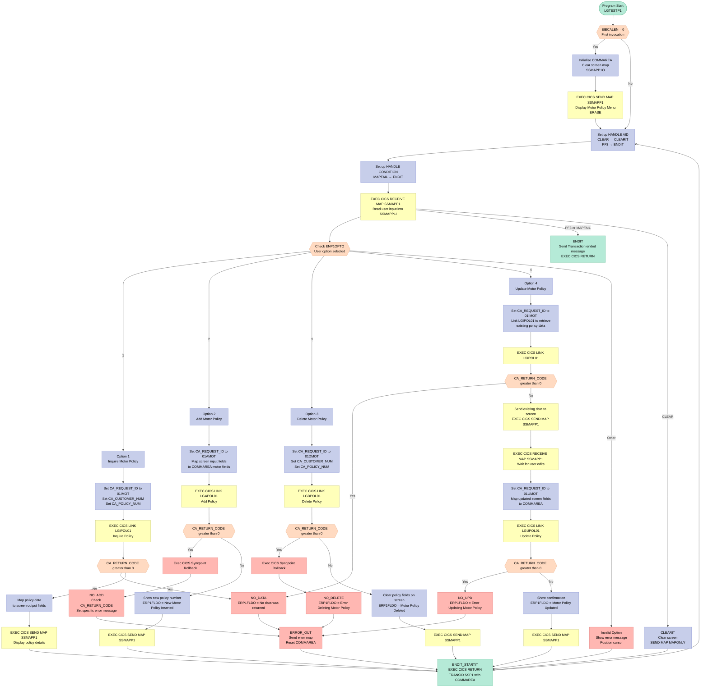
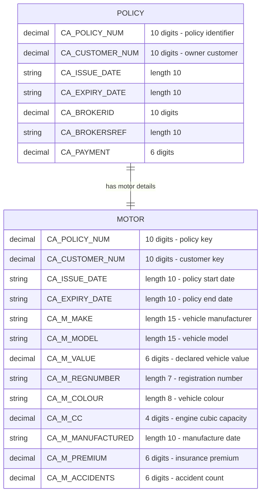

## Table of Contents

- [1. Purpose](#1-purpose)
- [2. Inputs](#2-inputs)
  - [2.1 Program Parameters (Procedure Entry)](#21-program-parameters-procedure-entry)
  - [2.2 CICS Screen Input (Map `SSMAPP1` / BMS Mapset `SSMAP`)](#22-cics-screen-input-map-ssmapp1--bms-mapset-ssmap)
  - [2.3 COMMAREA — Data Returned from Back-end Programs (External Program Interface)](#23-commarea--data-returned-from-back-end-programs-external-program-interface)
- [3. Outputs](#3-outputs)
  - [3.1 Returned and propagated backend results](#31-returned-and-propagated-backend-results)
  - [3.2 Screen outputs sent to the terminal](#32-screen-outputs-sent-to-the-terminal)
  - [3.3 Transactional side effects](#33-transactional-side-effects)
  - [3.4 CICS flow/control outputs](#34-cics-flowcontrol-outputs)
- [4. Processing Logic](#4-processing-logic)
  - [4.1 Mermaid Flow Diagram](#41-mermaid-flow-diagram)
  - [4.2 Processing Logic Description](#42-processing-logic-description)
  - [4.3 Database Tables](#43-database-tables)
- [5. Paragraphs](#5-paragraphs)
- [6. Dependencies](#6-dependencies)
  - [6.1 CICS Runtime & Transaction Environment](#61-cics-runtime--transaction-environment)
  - [6.2 BMS Map Resources](#62-bms-map-resources)
  - [6.3 Linked Backend Programs (CICS LINK)](#63-linked-backend-programs-cics-link)
  - [6.4 Communication Area (COMMAREA) / Copybooks](#64-communication-area-commarea--copybooks)
  - [6.5 Input Data Sources](#65-input-data-sources)
  - [6.6 Program Entry Parameters](#66-program-entry-parameters)
- [7. Constraints](#7-constraints)
  - [7.1 Input Validation Constraints](#71-input-validation-constraints)
  - [7.2 Conditional Processing Constraints](#72-conditional-processing-constraints)
  - [7.3 Transaction State and Sequencing Constraints](#73-transaction-state-and-sequencing-constraints)
  - [7.4 Data Integrity and Rollback Constraints](#74-data-integrity-and-rollback-constraints)
- [8. Error Handling](#8-error-handling)
  - [8.1 CICS AID Key and Condition Handling](#81-cics-aid-key-and-condition-handling)
  - [8.2 COMMAREA Initialization Guard](#82-commarea-initialization-guard)
  - [8.3 Backend Return Code Checks (`CA_RETURN_CODE`)](#83-backend-return-code-checks-ca_return_code)
  - [8.4 Transaction Rollback on Failure](#84-transaction-rollback-on-failure)
  - [8.5 Specific Return Code Discrimination (`NO_ADD` Block)](#85-specific-return-code-discrimination-no_add-block)
  - [8.6 Centralised Error Display and State Reset (`ERROR_OUT`)](#86-centralised-error-display-and-state-reset-error_out)
  - [8.7 Invalid User Option Handling](#87-invalid-user-option-handling)
  - [8.8 Session Termination Path (`ENDIT`)](#88-session-termination-path-endit)
- [9. Examples](#9-examples)
  - [9.1 Example 1: Motor Policy Inquiry (Option `1`)](#91-example-1-motor-policy-inquiry-option-1)
  - [9.2 Example 2: Add a New Motor Policy (Option `2`)](#92-example-2-add-a-new-motor-policy-option-2)
  - [9.3 Example 3: Invalid Option — Error Feedback (Otherwise branch)](#93-example-3-invalid-option--error-feedback-otherwise-branch)

## 1. Purpose

`LGTESTP1` is a CICS-based PL/I interactive menu program that serves as the front-end transaction handler for motor insurance policy maintenance within a General Insurance application. It presents a CICS BMS screen (SSMAPP1) to the user and accepts one of four options — inquire, add, delete, or update a motor policy — then populates a shared communication area with the relevant vehicle and policy details (make, model, value, registration number, colour, engine capacity, manufacture date, premium, and accident history) before linking to the appropriate backend policy processing program (`LGIPOL01`, `LGAPOL01`, `LGDPOL01`, or `LGUPOL01`). Results or confirmation messages are returned to the screen after each successful operation, while any backend error causes a syncpoint rollback (where applicable) and routes the user to a descriptive error message, with the transaction re-invoked via CICS pseudo-conversational return under transaction ID `SSP1`.

## 2. Inputs

### 2.1 Program Parameters (Procedure Entry)

- **`DFHEIPTR`** — CICS Executive Interface Block pointer passed as the first procedure parameter. It is the standard CICS EIB pointer required by all menu programs declared with `Options(Main,Reentrant)` and gives access to CICS system fields such as `EIBCALEN` (used to detect a first-time entry with no COMMAREA).
- **`COMM_AREA_PTR`** — Pointer to the COMMAREA structure passed as the second procedure parameter. It anchors the `COMM_AREA` based structure through which all transaction state, request routing, and policy data flow between this program and the back-end policy orchestrators (`LGIPOL01`, `LGAPOL01`, `LGDPOL01`, `LGUPOL01`).

### 2.2 CICS Screen Input (Map `SSMAPP1` / BMS Mapset `SSMAP`)

Received via `EXEC CICS RECEIVE MAP('SSMAPP1') INTO(SSMAPP1I)` on every conversational cycle:

- **`ENP1OPTI`** — 1-character option field (values `'1'`–`'4'`). Drives the `SELECT` statement to route to motor policy inquiry, add, delete, or update respectively; any other value triggers an error message.
- **Motor policy key fields** (used for inquiry, delete, and as the initial read before an update):
  - **`ENP1CNOO`** — 10-character customer number taken from the output-side overlay of the map; used as the inquiry/delete customer key passed to `CA_CUSTOMER_NUM`.
  - **`ENP1PNOO`** — 10-character policy number taken from the output-side overlay; used as the inquiry/delete policy key passed to `CA_POLICY_NUM`.
- **Motor policy data entry fields** (used for add and update operations):
  - **`ENP1CNOI`** — Customer number entered by the user for add/update operations; placed into `CA_CUSTOMER_NUM`.
  - **`ENP1IDAI`** — Policy issue date (10 characters); mapped to `CA_ISSUE_DATE`.
  - **`ENP1EDAI`** — Policy expiry date (10 characters); mapped to `CA_EXPIRY_DATE`.
  - **`ENP1CMKI`** — Vehicle make (up to 20 characters); mapped to `CA_M_MAKE`.
  - **`ENP1CMOI`** — Vehicle model (up to 20 characters); mapped to `CA_M_MODEL`.
  - **`ENP1VALI`** — Vehicle value (6 characters); mapped to `CA_M_VALUE`.
  - **`ENP1REGI`** — Vehicle registration number (7 characters); mapped to `CA_M_REGNUMBER`.
  - **`ENP1COLI`** — Vehicle colour (8 characters); mapped to `CA_M_COLOUR`.
  - **`ENP1CCI`** — Engine cubic capacity (8 characters); mapped to `CA_M_CC`.
  - **`ENP1MANI`** — Vehicle manufacture date (10 characters); mapped to `CA_M_MANUFACTURED`.
  - **`ENP1PREI`** — Insurance premium (6 characters); mapped to `CA_M_PREMIUM`.
  - **`ENP1ACCI`** — Accident history count (6 characters); mapped to `CA_M_ACCIDENTS`.

### 2.3 COMMAREA — Data Returned from Back-end Programs (External Program Interface)

After each `EXEC CICS LINK`, the following COMMAREA fields carry back-end response data that drive further processing or screen display:

- **`CA_RETURN_CODE`** — 2-digit numeric return code set by the linked program (`LGIPOL01`, `LGAPOL01`, `LGDPOL01`, `LGUPOL01`). A non-zero value triggers rollback or error routing; value `70` specifically means "customer does not exist".
- **`CA_CUSTOMER_NUM`** — Customer number echoed back by the back-end after a successful add or update, re-displayed on the screen.
- **`CA_POLICY_NUM`** — Policy number assigned and returned by `LGAPOL01` after a successful add operation; written back to `ENP1PNOI` for display.
- **Motor policy fields returned on inquiry** (populated by `LGIPOL01` and re-displayed):
  - **`CA_ISSUE_DATE`** — Policy issue date returned from back-end.
  - **`CA_EXPIRY_DATE`** — Policy expiry date returned from back-end.
  - **`CA_M_MAKE`** — Vehicle make returned from back-end.
  - **`CA_M_MODEL`** — Vehicle model returned from back-end.
  - **`CA_M_VALUE`** — Vehicle value returned from back-end.
  - **`CA_M_REGNUMBER`** — Vehicle registration number returned from back-end.
  - **`CA_M_COLOUR`** — Vehicle colour returned from back-end.
  - **`CA_M_CC`** — Engine cubic capacity returned from back-end.
  - **`CA_M_MANUFACTURED`** — Vehicle manufacture date returned from back-end.
  - **`CA_M_PREMIUM`** — Insurance premium returned from back-end.
  - **`CA_M_ACCIDENTS`** — Accident history returned from back-end.

## 3. Outputs

### 3.1 Returned and propagated backend results
- `CA_RETURN_CODE`
  - Receives the result status from backend policy programs called through `EXEC CICS LINK`:
    - `LGIPOL01` for inquiry
    - `LGAPOL01` for add
    - `LGDPOL01` for delete
    - `LGUPOL01` for update
  - Drives the program’s observable outcome:
    - success path continues with screen update
    - non-zero path routes to error handling
    - add/delete failure also triggers `EXEC CICS SYNCPOINT ROLLBACK`

- `CA_POLICY_NUM`
  - Returned from backend processing and shown back to the user after a successful add or update flow.
  - Also used as inquiry/delete/update input and therefore part of the transaction result context visible on screen.

- Motor policy data returned from inquiry backend and displayed to the user
  - `CA_ISSUE_DATE`
  - `CA_EXPIRY_DATE`
  - `CA_M_MAKE`
  - `CA_M_MODEL`
  - `CA_M_VALUE`
  - `CA_M_REGNUMBER`
  - `CA_M_COLOUR`
  - `CA_M_CC`
  - `CA_M_MANUFACTURED`
  - `CA_M_PREMIUM`
  - `CA_M_ACCIDENTS`
  - Role:
    - populated by `LGIPOL01`
    - copied to map fields and sent to the terminal
    - form the visible policy details for inquiry and the first stage of update

### 3.2 Screen outputs sent to the terminal
- Initial/default motor policy screen values on first entry
  - `ENP1CNOO = '0000000000'`
  - `ENP1PNOO = '0000000000'`
  - `ENP1VALO = '000000'`
  - `ENP1CCO = '00000'`
  - `ENP1ACCO = '000000'`
  - `ENP1PREO = '000000'`
  - Role:
    - establish the initial visible contents of the motor policy map when no COMMAREA is present

- Inquiry and update-display policy fields sent on `SSMAPP1`
  - `ENP1IDAI`
  - `ENP1EDAI`
  - `ENP1CMKI`
  - `ENP1CMOI`
  - `ENP1VALI`
  - `ENP1REGI`
  - `ENP1COLI`
  - `ENP1CCI`
  - `ENP1MANI`
  - `ENP1PREI`
  - `ENP1ACCI`
  - Role:
    - display retrieved motor policy data on the screen
    - also show the editable values during the update flow

- Confirmation fields shown after successful add/update
  - `ENP1CNOI`
  - `ENP1PNOI`
  - `ENP1OPTI`
  - `ERP1FLDO`
  - Role:
    - reflect the resulting customer/policy identifiers
    - clear the option field
    - show success feedback message

- Cleared policy detail fields shown after successful delete
  - `ENP1IDAI`
  - `ENP1EDAI`
  - `ENP1CMKI`
  - `ENP1CMOI`
  - `ENP1VALI`
  - `ENP1REGI`
  - `ENP1COLI`
  - `ENP1CCI`
  - `ENP1MANI`
  - `ERP1FLDO`
  - Role:
    - visibly remove deleted policy details from the screen
    - show delete confirmation

- Error and validation messages shown on the map
  - `ERP1FLDO = 'Please enter a valid option'`
  - `ERP1FLDO = 'Customer does not exist'`
  - `ERP1FLDO = 'Error Adding Motor Policy'`
  - `ERP1FLDO = 'Error Updating Motor Policy'`
  - `ERP1FLDO = 'Error Deleting Motor Policy'`
  - `ERP1FLDO = 'No data was returned.'`
  - Role:
    - communicate invalid option, missing data, and backend failure conditions to the user

- Cursor positioning output
  - `ENP1OPTL = -1`
  - Role:
    - positions the cursor to the option field when an invalid option is entered

- Map transmissions to terminal
  - `EXEC CICS SEND MAP ('SSMAPP1')`
  - Role:
    - the main observable UI output mechanism for all normal, success, and error screen states

- Map-only clear screen output
  - `EXEC CICS SEND MAP ('SSMAPP1') MAPONLY`
  - Role:
    - redisplays a cleared map when the user presses CLEAR

- End-of-transaction text message
  - `MSGEND = 'Transaction ended      '`
  - sent via `EXEC CICS SEND TEXT`
  - Role:
    - terminal message shown when PF3 or MAPFAIL routes to end processing

### 3.3 Transactional side effects
- Calls to backend policy programs via CICS LINK
  - `LGIPOL01`
  - `LGAPOL01`
  - `LGDPOL01`
  - `LGUPOL01`
  - Role:
    - produce the business-side observable effects of inquiry, insert, delete, and update operations

- Rollback on failed add/delete
  - `EXEC CICS SYNCPOINT ROLLBACK`
  - Role:
    - observable transactional side effect that cancels backend changes when those operations fail

### 3.4 CICS flow/control outputs
- `EXEC CICS RETURN TRANSID('SSP1') COMMAREA(COMM_AREA)`
  - Role:
    - returns control and preserves conversation state for the next invocation of the motor policy transaction

- `EXEC CICS RETURN`
  - Role:
    - ends processing without re-invoking the transaction in the immediate path

## 4. Processing Logic

### 4.1 Mermaid Flow Diagram



---

### 4.2 Processing Logic Description

#### 4.2.1 High-level Summary

`LGTESTP1` is a CICS pseudo-conversational PL/I program that implements the **Motor Policy Menu** for the GenApp general insurance application. It presents a BMS screen (`SSMAPP1`) to the terminal user, accepting a single option character (`ENP1OPTI`) to drive one of four motor insurance policy operations: **Inquire**, **Add**, **Delete**, or **Update**. Each operation is delegated to a corresponding policy orchestrator program via `EXEC CICS LINK`. The program uses transaction ID `SSP1` to re-invoke itself after each interaction, maintaining state via the COMMAREA passed on `EXEC CICS RETURN`.

---

#### 4.2.2 Execution Flow

**Step 1 – First Invocation Detection (`EIBCALEN = 0`)**

When the program is first started (no COMMAREA exists, so `EIBCALEN = 0`), the program:
- Points `COMM_AREA_PTR` to a local blank storage area.
- Clears the output map (`SSMAPP1O`) and initialises all COMMAREA fields to zero/blank.
- Initialises the numeric display fields on the screen (`ENP1CNOO`, `ENP1PNOO`, etc.) to formatted zeros.
- Issues `EXEC CICS SEND MAP SSMAPP1 ERASE` to display the blank Motor Policy Menu screen.

**Step 2 – Re-entry Point: Set Up AID and Condition Handlers (`A_GAIN` label)**

On every subsequent invocation (including the first pass after the initial send), the program:
- Registers `EXEC CICS HANDLE AID CLEAR(CLEARIT) PF3(ENDIT)` — pressing **CLEAR** routes to the screen-clear path; pressing **PF3** routes to the transaction-end path.
- Registers `EXEC CICS HANDLE CONDITION MAPFAIL(ENDIT)` — if the user presses Enter without typing anything on the map, the transaction ends gracefully.

**Step 3 – Receive User Input**

`EXEC CICS RECEIVE MAP('SSMAPP1') INTO(SSMAPP1I)` reads the user-entered data from the terminal into the input map structure `SSMAPP1I`. The key driving field is `ENP1OPTI` (option selector), and the pre-populated output fields (`ENP1CNOO`, `ENP1PNOO`) carry forward the customer/policy numbers from the previous cycle.

**Step 4 – Option Routing (`SELECT ENP1OPTO`)**

The program reads the option from the *output* overlay (`ENP1OPTO`, which reflects the last displayed value used as input echo) and branches:

---

**Option 1 – Inquire Motor Policy**
1. Sets `CA_REQUEST_ID = '01IMOT'`, `CA_CUSTOMER_NUM` from `ENP1CNOO`, `CA_POLICY_NUM` from `ENP1PNOO`.
2. Links to **`LGIPOL01`** (policy inquiry orchestrator) with the full 32500-byte COMMAREA.
3. If `CA_RETURN_CODE > 0` → jumps to `NO_DATA` error path.
4. On success: maps all returned motor policy fields (issue date, expiry date, make, model, value, registration, colour, CC, manufactured date, premium, accidents) from COMMAREA into the input map (`SSMAPP1I`) for display.
5. Sends the populated map to the screen and returns to `ENDIT_STARTIT`.

---

**Option 2 – Add Motor Policy**
1. Sets `CA_REQUEST_ID = '01AMOT'`, `CA_CUSTOMER_NUM` from `ENP1CNOI`.
2. Initialises payment/broker fields to zero/blank.
3. Maps all motor policy input fields from the screen (`ENP1IDAI`, `ENP1EDAI`, `ENP1CMKI`, `ENP1CMOI`, `ENP1VALI`, `ENP1REGI`, `ENP1COLI`, `ENP1CCI`, `ENP1MANI`, `ENP1PREI`, `ENP1ACCI`) into the corresponding COMMAREA fields.
4. Links to **`LGAPOL01`** (policy add orchestrator).
5. If `CA_RETURN_CODE > 0` → issues **`EXEC CICS Syncpoint Rollback`** to undo any partial DB2 changes, then routes to `NO_ADD`.
6. `NO_ADD` checks `CA_RETURN_CODE`: code `70` means the customer does not exist (specific message); any other code produces a generic add-error message.
7. On success: echoes the new customer/policy numbers back to the screen, clears the option field, sets confirmation message `'New Motor Policy Inserted'`, and sends the map.

---

**Option 3 – Delete Motor Policy**
1. Sets `CA_REQUEST_ID = '01DMOT'`, `CA_CUSTOMER_NUM` and `CA_POLICY_NUM` from screen output fields.
2. Links to **`LGDPOL01`** (policy delete orchestrator).
3. If `CA_RETURN_CODE > 0` → issues **`EXEC CICS Syncpoint Rollback`** and routes to `NO_DELETE` with message `'Error Deleting Motor Policy'`.
4. On success: blanks all policy detail fields on the screen and sets confirmation message `'Motor Policy Deleted'`.

---

**Option 4 – Update Motor Policy (two-phase)**
This option is a **two-step interaction within a single program invocation**:
1. **Phase A (Retrieve current data):** Sets `CA_REQUEST_ID = '01IMOT'` and links to **`LGIPOL01`** to pre-populate the screen with existing policy data. If inquiry fails, routes to `NO_DATA`.
2. Sends the populated screen to the user and immediately issues another `EXEC CICS RECEIVE MAP` to wait for the user's edits — making this a short-lived conversational pair within one program dispatch.
3. **Phase B (Commit the update):** Sets `CA_REQUEST_ID = '01UMOT'`, maps all edited screen fields back into the COMMAREA motor fields, then links to **`LGUPOL01`** (policy update orchestrator).
4. If `CA_RETURN_CODE > 0` → routes to `NO_UPD` with message `'Error Updating Motor Policy'`.
5. On success: displays updated customer/policy numbers and sets confirmation message `'Motor Policy Updated'`.

---

**Invalid Option (OTHERWISE)**
- Sets error message `'Please enter a valid option'` in the error field.
- Sets `ENP1OPTL = -1` to position the cursor on the option input field.
- Sends the map with `CURSOR` option and returns to `ENDIT_STARTIT`.

---

**Step 5 – Pseudo-Conversational Return (`ENDIT_STARTIT`)**

After any successful or invalid-option path, the program issues:
```
EXEC CICS RETURN TRANSID('SSP1') COMMAREA(COMM_AREA)
```
This ends the current CICS task but schedules transaction `SSP1` (this same program) to restart when the user presses Enter, passing the COMMAREA to the next invocation. This is the classic pseudo-conversational pattern.

**Step 6 – Error Paths**

All error labels (`NO_ADD`, `NO_UPD`, `NO_DELETE`, `NO_DATA`) set an appropriate message into `ERP1FLDO` (the screen error field) and fall through to `ERROR_OUT`, which:
1. Sends the error-decorated map to the terminal.
2. Fully resets the screen map structure and entire COMMAREA (`COMM_AREA_RAW = ''`).
3. Re-routes to `ENDIT_STARTIT` to continue pseudo-conversational operation.

**Step 7 – Termination Paths**

- **`ENDIT`** (PF3 or MAPFAIL): Sends the static message `'Transaction ended      '` to the terminal (`EXEC CICS SEND TEXT ERASE FREEKB`) and issues a plain `EXEC CICS RETURN` — ending the transaction with no re-entry.
- **`CLEARIT`** (CLEAR key): Blanks the map output structure, re-displays the empty map (`SEND MAP MAPONLY`), then returns with `TRANSID('SSP1')` — effectively restarting the menu.

---

#### 4.2.3 External Interactions

| Program Linked | Request ID | Purpose |
|---|---|---|
| `LGIPOL01` | `01IMOT` | Inquire (retrieve) a motor policy from DB2 |
| `LGAPOL01` | `01AMOT` | Add (insert) a new motor policy into DB2 |
| `LGDPOL01` | `01DMOT` | Delete an existing motor policy from DB2 |
| `LGUPOL01` | `01UMOT` | Update an existing motor policy in DB2 |

All interactions use `EXEC CICS LINK` with the 32500-byte COMMAREA structure as the data exchange mechanism. The orchestrator programs handle DB2 access; this menu program is purely a screen-handling and routing layer.

---

#### 4.2.4 Plain Language Summary

`LGTESTP1` is the **Motor Insurance Policy Menu screen handler**. When a user opens it on their terminal, they see a form where they can enter a customer number, policy number, and vehicle details, then choose one of four actions: look up a policy, add a new one, delete one, or update one.

The program reads the user's choice, packages the screen data into a shared data area (COMMAREA), and hands off to a specialist back-end program to do the actual database work. If that back-end program reports an error, the menu screen shows an error message and resets for the next attempt. If everything succeeds, it confirms the action (e.g., "New Motor Policy Inserted") and returns the screen to the user ready for the next request.

Pressing PF3 or Enter on a blank screen exits the transaction cleanly. Pressing CLEAR resets the form.

---

### 4.3 Database Tables

`LGTESTP1` itself performs no direct DB2 SQL. All database access is delegated to linked programs (`LGIPOL01`, `LGAPOL01`, `LGDPOL01`, `LGUPOL01`), which in turn call DB2 backend programs. The COMMAREA fields exchanged reflect the underlying **MOTOR** policy table structure:



## 5. Paragraphs

**Initial Entry / First-Time Invocation Block** (lines 691–710)

- Executed only when `EIBCALEN = 0`, meaning the transaction has been invoked for the first time with no existing communication area passed from a prior cycle.
- Sets up a local base communication area pointer (`COMM_AREA_PTR = ADDR(BASE_COMM_AREA)`) so all COMM_AREA fields are addressable.
- Clears the output map structure `SSMAPP1O` and resets the key communication area fields: `CA_REQUEST_ID`, `CA_RETURN_CODE`, `CA_CUSTOMER_NUM`, and `CA_REQUEST_INITIALISER`.
- Initialises all visible numeric output fields on the motor policy screen (`ENP1CNOO`, `ENP1PNOO`, `ENP1VALO`, `ENP1CCO`, `ENP1ACCO`, `ENP1PREO`) to their zero/blank defaults.
- Issues `EXEC CICS SEND MAP ('SSMAPP1') MAPSET('SSMAP') ERASE` to display the motor policy screen to the terminal for the first time, erasing any prior screen content.
- Control falls through to the `A_GAIN` label to begin waiting for user input.

---

**A_GAIN** (lines 712–890)

- The primary processing label, re-entered on every pseudo-conversational cycle after the first.
- Registers attention key handlers via `EXEC CICS HANDLE AID CLEAR(CLEARIT) PF3(ENDIT)`: pressing the CLEAR key transfers control to `CLEARIT` and pressing PF3 transfers control to `ENDIT`.
- Registers a condition handler via `EXEC CICS HANDLE CONDITION MAPFAIL(ENDIT)`: if the terminal sends an empty map (e.g., the user pressed Enter with no data), control transfers to `ENDIT`.
- Issues `EXEC CICS RECEIVE MAP('SSMAPP1') INTO(SSMAPP1I) MAPSET('SSMAP')` to read user input from the motor policy screen into the `SSMAPP1I` input map structure.
- Evaluates the user-selected option `ENP1OPTO` using a `SELECT` statement, branching into one of five paths:

  - **Option '1' — Motor Policy Inquiry:**
    - Sets `CA_REQUEST_ID = '01IMOT'`, populates customer number and policy number from screen output fields (`ENP1CNOO`, `ENP1PNOO`).
    - Calls `LGIPOL01` via `EXEC CICS LINK` with the 32,500-byte `COMM_AREA`.
    - If `CA_RETURN_CODE > 0`, branches to `NO_DATA` error label.
    - On success, copies all returned motor policy fields (dates, make, model, value, registration, colour, CC, manufactured date, premium, accidents) into the corresponding `SSMAPP1I` input fields and redisplays the screen via `EXEC CICS SEND MAP`.
    - Branches to `ENDIT_STARTIT` to re-queue the transaction.

  - **Option '2' — Motor Policy Add:**
    - Sets `CA_REQUEST_ID = '01AMOT'`; populates `CA_CUSTOMER_NUM` from `ENP1CNOI` (input field).
    - Clears broker and payment fields, then maps all motor policy input fields from the screen (`ENP1IDAI`, `ENP1EDAI`, make, model, value, registration, colour, CC, manufactured, premium, accidents) into the corresponding `CA_MOTOR` communication area fields.
    - Calls `LGAPOL01` via `EXEC CICS LINK`.
    - If `CA_RETURN_CODE > 0`, issues `EXEC CICS Syncpoint Rollback` to undo any partial work and branches to `NO_ADD`.
    - On success, writes the returned customer number and policy number back to the screen, sets the option field blank, displays a `'New Motor Policy Inserted'` confirmation message, and branches to `ENDIT_STARTIT`.

  - **Option '3' — Motor Policy Delete:**
    - Sets `CA_REQUEST_ID = '01DMOT'`; populates customer number and policy number from screen output fields.
    - Calls `LGDPOL01` via `EXEC CICS LINK`.
    - If `CA_RETURN_CODE > 0`, issues `EXEC CICS Syncpoint Rollback` and branches to `NO_DELETE`.
    - On success, blanks all policy-detail input fields on the screen, displays a `'Motor Policy Deleted'` confirmation message, and branches to `ENDIT_STARTIT`.

  - **Option '4' — Motor Policy Update:**
    - Performs a two-phase operation: first fetches current policy data (same logic as Option '1', calling `LGIPOL01` with `CA_REQUEST_ID = '01IMOT'`), redisplays the populated screen, and then issues a second `EXEC CICS RECEIVE MAP` to accept the user's modifications.
    - Sets `CA_REQUEST_ID = '01UMOT'`, re-maps all modified screen input fields into the communication area motor policy fields.
    - Calls `LGUPOL01` via `EXEC CICS LINK`.
    - If `CA_RETURN_CODE > 0`, branches to `NO_UPD`.
    - On success, writes returned customer and policy numbers to the screen, displays a `'Motor Policy Updated'` confirmation, and branches to `ENDIT_STARTIT`.

  - **OTHERWISE — Invalid Option:**
    - Sets `ERP1FLDO = 'Please enter a valid option'` and `ENP1OPTL = -1` (negative length to position the cursor on the option field).
    - Redisplays the map via `EXEC CICS SEND MAP ... CURSOR` to place the cursor at the option field.
    - Branches to `ENDIT_STARTIT`.

---

**ENDIT_STARTIT** (lines 897–900)

- Terminates the current CICS task and schedules the next pseudo-conversational cycle.
- Issues `EXEC CICS RETURN TRANSID('SSP1') COMMAREA(COMM_AREA)` so that when the user next presses an attention key, the transaction `SSP1` is re-invoked with the current communication area passed back in, allowing the program to resume from `A_GAIN`.

---

**ENDIT** (lines 902–908)

- Terminal exit label, reached when the user presses PF3, MAPFAIL is raised, or an explicit branch is taken to terminate the session.
- Sends a plain-text message `'Transaction ended      '` to the terminal via `EXEC CICS SEND TEXT ... ERASE FREEKB`, clearing the screen and unlocking the keyboard.
- Issues `EXEC CICS RETURN` with no `TRANSID`, ending the CICS task completely without scheduling another cycle.

---

**CLEARIT** (lines 910–919)

- Attention-key handler reached when the user presses the CLEAR key.
- Blanks the output map structure `SSMAPP1O` entirely.
- Sends the map in `MAPONLY` mode via `EXEC CICS SEND MAP ('SSMAPP1') MAPSET('SSMAP') MAPONLY`, which repaints the screen with only the static BMS-defined panel data (no variable field values), effectively resetting the screen.
- Issues `EXEC CICS RETURN TRANSID('SSP1') COMMAREA(COMM_AREA)` to re-queue the transaction, keeping the session alive for the next user interaction.

---

**NO_ADD** (lines 921–931)

- Error-handling label reached when the add operation (`LGAPOL01`) returns a non-zero `CA_RETURN_CODE`.
- Uses a nested `SELECT` on `CA_RETURN_CODE`:
  - If return code is `70`, sets `ERP1FLDO = 'Customer does not exist'`.
  - For all other non-zero codes, sets `ERP1FLDO = 'Error Adding Motor Policy'`.
- Falls through to `ERROR_OUT` in both cases.

---

**NO_UPD** (lines 933–935)

- Error-handling label reached when the update operation (`LGUPOL01`) returns a non-zero `CA_RETURN_CODE`.
- Sets the screen error field `ERP1FLDO = 'Error Updating Motor Policy'` and falls through to `ERROR_OUT`.

---

**NO_DELETE** (lines 937–939)

- Error-handling label reached when the delete operation (`LGDPOL01`) returns a non-zero `CA_RETURN_CODE`.
- Sets `ERP1FLDO = 'Error Deleting Motor Policy'` and falls through to `ERROR_OUT`.

---

**NO_DATA** (lines 941–943)

- Error-handling label reached when the inquiry operation (`LGIPOL01`) returns a non-zero `CA_RETURN_CODE`.
- Sets `ERP1FLDO = 'No data was returned.'` and falls through to `ERROR_OUT`.

---

**ERROR_OUT** (lines 945–957)

- Common error display and reset label, reached from all four specific error labels (`NO_ADD`, `NO_UPD`, `NO_DELETE`, `NO_DATA`).
- Sends the current (error-annotated) `SSMAPP1O` map to the terminal via `EXEC CICS SEND MAP` to display the error message to the user.
- Performs a full reset of state: blanks `SSMAPP1O`, clears `COMM_AREA_RAW`, resets `CA_REQUEST_ID`, `CA_RETURN_CODE`, `CA_CUSTOMER_NUM`, and `CA_REQUEST_INITIALISER` to their empty/zero defaults, preventing residual data from contaminating the next request.
- Branches to `ENDIT_STARTIT` to re-queue transaction `SSP1`, returning the session to the input-ready state rather than terminating.

## 6. Dependencies

### 6.1 CICS Runtime & Transaction Environment

- **CICS Transaction Manager**
  - The program runs as a CICS transaction and relies entirely on CICS for execution lifecycle, terminal I/O, and inter-program communication
  - `EXEC CICS RETURN TRANSID('SSP1') COMMAREA(...)` — re-invokes itself pseudo-conversationally under transaction ID **SSP1**; CICS must have this transaction defined
  - `EXEC CICS HANDLE AID CLEAR / PF3` — registers attention-identifier handling with CICS for keyboard actions
  - `EXEC CICS HANDLE CONDITION MAPFAIL` — registers a CICS condition handler for map-receive failures
  - `EXEC CICS SEND / RECEIVE MAP` — relies on CICS terminal services to display and receive BMS maps
  - `EXEC CICS SEND TEXT` — uses CICS terminal services to write the end-of-transaction message
  - `EXEC CICS Syncpoint Rollback` — invokes CICS syncpoint services to roll back unit-of-work on errors in add and delete paths
  - `EXEC CICS RETURN` — terminates or suspends the task via CICS task control
  - `EIBCALEN` — the CICS Execute Interface Block field used at program entry to detect a first-time (non-pseudo-conversational) invocation

### 6.2 BMS Map Resources

- **Mapset `SSMAP`** — the BMS mapset that must be installed in the CICS region; provides the physical screen layouts used for all send/receive operations
  - **Map `SSMAPP1`** — the Motor Policy menu screen; used for every send and receive in the program; its field structures are declared inline (originally `%INCLUDE SSMAP`) as `SSMAPP1I` (input) and `SSMAPP1O` (output)
  - Maps `SSMAPC1I/O`, `SSMAPP2I/O`, `SSMAPP3I/O`, `SSMAPP4I/O`, `SSMAPP5I/O` — additional map structures from the same `SSMAP` mapset declared within the program (not actively used by this program's logic but present from the shared copybook)

### 6.3 Linked Backend Programs (CICS LINK)

- **`LGIPOL01`** — invoked via `EXEC CICS LINK` for motor policy **inquiry** (request ID `01IMOT`); called for both option 1 (inquiry) and as the first step of option 4 (update pre-fetch); receives and returns policy details in the shared communication area
- **`LGAPOL01`** — invoked via `EXEC CICS LINK` for motor policy **add** (request ID `01AMOT`); adds a new motor policy record; returns the assigned policy number; a rollback is issued if it returns a non-zero return code
- **`LGDPOL01`** — invoked via `EXEC CICS LINK` for motor policy **delete** (request ID `01DMOT`); deletes an existing motor policy; a rollback is issued if it returns a non-zero return code
- **`LGUPOL01`** — invoked via `EXEC CICS LINK` for motor policy **update** (request ID `01UMOT`); updates motor policy data after a pre-fetch inquiry; called in option 4

### 6.4 Communication Area (COMMAREA) / Copybooks

- **`LGCMAREA` copybook** (`%INCLUDE LGCMAREA`, expanded inline) — defines the 32,500-byte `COMM_AREA` union structure passed via `COMMAREA` on every `EXEC CICS LINK` and `EXEC CICS RETURN`; contains:
  - `CA_REQUEST_ID` — 6-character transaction type code directing downstream programs
  - `CA_RETURN_CODE` — numeric return code set by backend programs; non-zero triggers error handling
  - `CA_CUSTOMER_NUM` — 10-digit customer identifier
  - `CA_POLICY_REQUEST` section — policy number, common dates, broker fields, and the motor-specific `CA_MOTOR` sub-structure (`CA_M_MAKE`, `CA_M_MODEL`, `CA_M_VALUE`, `CA_M_REGNUMBER`, `CA_M_COLOUR`, `CA_M_CC`, `CA_M_MANUFACTURED`, `CA_M_PREMIUM`, `CA_M_ACCIDENTS`)
  - `CA_REQUEST_INITIALISER` — used to blank-initialise the variable portion of the communication area before each new request

- **`SSMAP` copybook** (`%INCLUDE SSMAP`, expanded inline) — defines all BMS map I/O structures (`SSMAPC1I/O`, `SSMAPP1I/O` through `SSMAPP5I/O`) that describe terminal screen fields used by the program

### 6.5 Input Data Sources

- **CICS Terminal (operator input)** — the human operator supplies all transaction inputs through the `SSMAPP1` screen:
  - Option code (`ENP1OPTI` / `ENP1OPTO`) — selects inquiry, add, delete, or update
  - Customer number (`ENP1CNOI` / `ENP1CNOO`) — identifies the customer for the request
  - Policy number (`ENP1PNOI` / `ENP1PNOO`) — identifies an existing policy for inquiry, delete, or update
  - Motor policy fields (`ENP1IDAI`, `ENP1EDAI`, `ENP1CMKI`, `ENP1CMOI`, `ENP1VALI`, `ENP1REGI`, `ENP1COLI`, `ENP1CCI`, `ENP1MANI`, `ENP1PREI`, `ENP1ACCI`) — vehicle and policy details entered by the operator for add and update operations

### 6.6 Program Entry Parameters

- **`DFHEIPTR`** — CICS Execute Interface Block pointer, passed as the first parameter to the `LGTESTP1` procedure by the CICS runtime; required for all `EXEC CICS` commands to function
- **`COMM_AREA_PTR`** — pointer to the passed-in communication area (`COMMAREA`) on pseudo-conversational re-entry; used to restore state across transaction invocations

## 7. Constraints

### 7.1 Input Validation Constraints

- **Transaction option must be one of four valid values (`'1'`–`'4'`)**
  - Enforced by the `SELECT (ENP1OPTO)` statement at line 725; the `OTHERWISE` branch writes `'Please enter a valid option'` into the error field (`ERP1FLDO`), positions the cursor on the option field (`ENP1OPTL = -1`), and re-sends the map, blocking all further processing until a valid value is entered.

- **Customer number (`CA_CUSTOMER_NUM`) must resolve to a known customer for Add operations**
  - Enforced by return-code checking after `EXEC CICS LINK PROGRAM('LGAPOL01')`; a `CA_RETURN_CODE` of `70` specifically triggers the message `'Customer does not exist'` at the `NO_ADD` label (lines 922–926), preventing a new motor policy from being created for a non-existent customer.

- **Customer number and policy number are required for Inquiry, Delete, and Update operations**
  - Enforced implicitly: for options `'1'` (inquiry), `'3'` (delete), and `'4'` (update), `CA_CUSTOMER_NUM` and `CA_POLICY_NUM` are populated from the screen output fields `ENP1CNOO` and `ENP1PNOO` before calling the backend; if either is zero (matching the `'0000000000'` initialisation), the backend program returns a non-zero `CA_RETURN_CODE`, diverting control to `NO_DATA` or `NO_DELETE`/`NO_UPD`.

- **Motor policy fields are limited to fixed character widths**
  - Enforced structurally by the `COMM_AREA` / `SSMAPP1I` declarations:
    - `CA_M_MAKE` / `CA_M_MODEL`: 15 characters each
    - `CA_M_REGNUMBER`: 7 characters
    - `CA_M_COLOUR`: 8 characters
    - `CA_M_MANUFACTURED`: 10 characters
    - `CA_M_VALUE` / `CA_M_PREMIUM` / `CA_M_ACCIDENTS`: 6-digit numeric (`PIC '999999'`)
    - `CA_M_CC`: 4-digit numeric (`PIC '9999'`)
  - Any value that exceeds these widths is truncated silently by PL/I character/picture assignment.

- **COMMAREA total size is fixed at 32,500 bytes**
  - Every `EXEC CICS LINK` call specifies `LENGTH(32500)` (lines 733, 774, 796, 864), matching the `COMM_AREA_RAW CHAR(32500)` declaration; values larger than this cannot be passed, constraining the maximum data exchanged with any backend program.

---

### 7.2 Conditional Processing Constraints

- **A non-zero `CA_RETURN_CODE` from any backend program halts normal processing**
  - After each `EXEC CICS LINK`, the program tests `IF CA_RETURN_CODE > 0` and routes control to an error label (`NO_DATA`, `NO_ADD`, `NO_DELETE`, `NO_UPD`); successful completion of the business operation is conditional on the backend returning exactly `0`.

- **Update (option `'4'`) requires a successful prior inquiry before accepting user edits**
  - Enforced by sequencing: the program first issues `EXEC CICS LINK PROGRAM('LGIPOL01')` with `CA_REQUEST_ID = '01IMOT'` (lines 819–826) and checks the return code; only if that inquiry succeeds does it populate the screen with existing policy data, receive user modifications, and then issue `EXEC CICS LINK PROGRAM('LGUPOL01')` with `CA_REQUEST_ID = '01UMOT'` (line 862). The update cannot proceed if the inquiry fails.

- **The `CA_REQUEST_ID` must be set to the correct operation code before any backend call**
  - The program explicitly sets `CA_REQUEST_ID` to one of `'01IMOT'`, `'01AMOT'`, `'01DMOT'`, or `'01UMOT'` immediately before each `EXEC CICS LINK`; the backend programs use this field to determine which operation to perform, so misrouting is blocked by this mandatory assignment step.

- **`CA_REQUEST_INITIALISER` (32,482-byte overlay) must be blanked before each new Add or Update submission**
  - For option `'2'` (Add) the field is blanked at initialisation time (line 698); for all operations, the error path at `ERROR_OUT` (line 955) re-blanks it. This prevents residual data from a previous request type from contaminating a new one.

---

### 7.3 Transaction State and Sequencing Constraints

- **First-time entry (cold start) is detected by `EIBCALEN = 0`**
  - Enforced at lines 691–710: when `EIBCALEN` is zero the program initialises the communication area, sets all numeric output fields to zero, and sends the blank map before proceeding; subsequent invocations (pseudo-conversational returns) bypass this block entirely, ensuring one-time initialisation cannot repeat mid-session.

- **The transaction re-enters under transaction ID `'SSP1'` with a passed `COMMAREA`**
  - Every normal exit (`ENDIT_STARTIT`, `CLEARIT`, `ERROR_OUT → ENDIT_STARTIT`) uses `EXEC CICS RETURN TRANSID('SSP1') COMMAREA(COMM_AREA)`, constraining the program to a pseudo-conversational design; state cannot persist across invocations except through the `COMMAREA`.

- **PF3 or CLEAR key unconditionally terminates the session**
  - Enforced by `EXEC CICS HANDLE AID CLEAR(CLEARIT) PF3(ENDIT)` (lines 714–716): pressing CLEAR clears the screen and loops back under the same transaction ID; pressing PF3 branches to `ENDIT`, which sends the `'Transaction ended'` message and returns without a `TRANSID`, ending the pseudo-conversational chain.

- **MAPFAIL condition terminates the transaction**
  - Enforced by `EXEC CICS HANDLE CONDITION MAPFAIL(ENDIT)` (lines 717–718): if the `EXEC CICS RECEIVE MAP` finds no data on the screen (e.g., user pressed Enter with no input), control passes to `ENDIT` and the session ends; no processing is attempted on an empty map.

---

### 7.4 Data Integrity and Rollback Constraints

- **Failed Add operations trigger an immediate `SYNCPOINT ROLLBACK`**
  - Enforced at lines 775–778: if `LGAPOL01` returns a non-zero `CA_RETURN_CODE`, `Exec CICS Syncpoint Rollback` is issued before branching to `NO_ADD`, ensuring any partial database updates made within the Add unit-of-work are undone.

- **Failed Delete operations trigger an immediate `SYNCPOINT ROLLBACK`**
  - Enforced at lines 797–799: if `LGDPOL01` returns a non-zero `CA_RETURN_CODE`, `Exec CICS Syncpoint Rollback` is issued before branching to `NO_DELETE`, preventing a partial deletion from being committed.

- **The communication area and screen map are fully reset after any error**
  - Enforced in `ERROR_OUT` (lines 950–955): `SSMAPP1O`, `COMM_AREA_RAW`, `CA_REQUEST_ID`, `CA_RETURN_CODE`, `CA_CUSTOMER_NUM`, and `CA_REQUEST_INITIALISER` are all blanked/zeroed, ensuring no residual state from a failed transaction is carried into the next invocation.

## 8. Error Handling

### 8.1 CICS AID Key and Condition Handling

- **`EXEC CICS HANDLE AID` — Attention Identifier Routing**
  - Registered at the top of the main processing loop (`A_GAIN`) to intercept specific terminal attention keys before normal processing
  - `CLEAR` key is mapped to the `CLEARIT` label: when the user presses CLEAR, control branches to a routine that blanks the screen map, re-sends the motor policy map in map-only mode, and returns control to CICS with the transaction ID `SSP1`, effectively resetting the screen without error
  - `PF3` key is mapped to the `ENDIT` label: pressing PF3 unconditionally exits the transaction by sending the termination message (`'Transaction ended      '`) and issuing `EXEC CICS RETURN`, cleanly ending the session

- **`EXEC CICS HANDLE CONDITION MAPFAIL` — Map Receive Error Interception**
  - Also registered at the top of the main loop, immediately after `HANDLE AID`
  - If the `EXEC CICS RECEIVE MAP` call encounters a MAPFAIL condition (i.e., the user submits the map without entering any data), CICS routes control to the `ENDIT` label, terminating the transaction gracefully rather than propagating an unhandled exception

---

### 8.2 COMMAREA Initialization Guard

- **`EIBCALEN = 0` Check — First-Entry Detection**
  - At program entry, before the main loop, the program tests the CICS-supplied field `EIBCALEN` (communication area length) to determine whether this is the very first invocation of the transaction (no COMMAREA passed from a prior CICS RETURN)
  - If `EIBCALEN = 0`, the program allocates a local `BASE_COMM_AREA` buffer, sets `COMM_AREA_PTR` to point to it, initialises all COMMAREA fields and screen output fields to zero or blank, then sends the motor policy map with `ERASE` to present a fresh screen
  - This acts as a defensive initialisation guard: it prevents residual or uninitialised data from being used in subsequent processing logic, and avoids null-pointer or garbage-data errors on first entry

---

### 8.3 Backend Return Code Checks (`CA_RETURN_CODE`)

- **Non-zero `CA_RETURN_CODE` after `EXEC CICS LINK` — Operation Failure Detection**
  - After every `EXEC CICS LINK` call to a backend program, the program immediately checks whether `CA_RETURN_CODE > 0`; a non-zero value signals that the backend detected an error
  - **Inquiry (option 1):** if `CA_RETURN_CODE > 0` after linking to `LGIPOL01`, control branches to `NO_DATA`, which sets the error message `'No data was returned.'` and routes to the centralised error display routine
  - **Add (option 2):** if `CA_RETURN_CODE > 0` after linking to `LGAPOL01`, the program first issues `EXEC CICS Syncpoint Rollback` to undo any partial database changes, then branches to `NO_ADD`
  - **Delete (option 3):** if `CA_RETURN_CODE > 0` after linking to `LGDPOL01`, the program issues `EXEC CICS Syncpoint Rollback` and branches to `NO_DELETE`
  - **Update (option 4):** if `CA_RETURN_CODE > 0` after linking to `LGUPOL01` (the update step), control branches to `NO_UPD`; notably, the prior inquiry step within option 4 also checks `CA_RETURN_CODE` and routes to `NO_DATA` if the record cannot be found before the update form is even displayed

---

### 8.4 Transaction Rollback on Failure

- **`EXEC CICS Syncpoint Rollback` — Data Integrity Protection**
  - Issued explicitly for the Add and Delete operations when their respective backend programs return a non-zero `CA_RETURN_CODE`
  - This rolls back any uncommitted database changes within the current CICS unit of work, ensuring that a partial Add or partial Delete does not leave the database in an inconsistent state
  - Rollback is not issued for Inquiry or Update failures, consistent with those operations either being read-only (Inquiry) or requiring the same protection pattern where applicable

---

### 8.5 Specific Return Code Discrimination (`NO_ADD` Block)

- **`CA_RETURN_CODE` Value `70` — Customer Not Found**
  - Within the `NO_ADD` error path, the program performs a secondary `SELECT` on `CA_RETURN_CODE` to distinguish between specific backend error codes
  - Return code `70` is mapped to the specific message `'Customer does not exist'`, providing a meaningful, user-readable explanation of why the Add failed
  - Any other non-zero return code falls into the `OTHERWISE` branch and displays the generic message `'Error Adding Motor Policy'`
  - This is the only operation where return code discrimination is performed; the Delete and Update error paths use generic messages without inspecting the specific return code value

---

### 8.6 Centralised Error Display and State Reset (`ERROR_OUT`)

- **`ERROR_OUT` Label — Unified Error Response Routine**
  - All operation-specific error labels (`NO_ADD`, `NO_UPD`, `NO_DELETE`, `NO_DATA`) set an appropriate error message into the screen error field `ERP1FLDO` and then branch unconditionally to `ERROR_OUT` via `Go To`
  - At `ERROR_OUT`, the program sends the current screen map (with the populated error message visible to the user) via `EXEC CICS SEND MAP`
  - After displaying the error, the routine performs a full state reset: the screen output area `SSMAPP1O`, the raw COMMAREA `COMM_AREA_RAW`, `CA_REQUEST_ID`, `CA_RETURN_CODE`, `CA_CUSTOMER_NUM`, and `CA_REQUEST_INITIALISER` are all blanked or zeroed
  - Control then branches to `ENDIT_STARTIT`, which issues `EXEC CICS RETURN TRANSID('SSP1') COMMAREA(COMM_AREA)`, re-queuing the transaction for the next user interaction with a clean state

---

### 8.7 Invalid User Option Handling

- **`OTHERWISE` Branch in the `SELECT (ENP1OPTI)` Statement — Invalid Menu Selection**
  - The main processing `SELECT` statement handles options `'1'` through `'4'`; any other value (including blank or unexpected characters) falls into the `OTHERWISE` branch
  - The error message `'Please enter a valid option'` is written to `ERP1FLDO` on the screen
  - The option field cursor length attribute `ENP1OPTL` is set to `-1`, which positions the terminal cursor on the option input field to prompt the user to re-enter a valid selection
  - The screen is re-sent with the `CURSOR` option active, and control goes to `ENDIT_STARTIT` to await the next input cycle without terminating the transaction

---

### 8.8 Session Termination Path (`ENDIT`)

- **`ENDIT` Label — Controlled Transaction Termination**
  - Reached via the `PF3` key (through `HANDLE AID`) or via `MAPFAIL` (through `HANDLE CONDITION`)
  - Sends a static termination message `'Transaction ended      '` to the terminal using `EXEC CICS SEND TEXT` with `ERASE` and `FREEKB`
  - Immediately followed by `EXEC CICS RETURN` with no `TRANSID`, ensuring the transaction ends and is not re-queued, providing a clean, user-visible indication that the session has concluded

## 9. Examples

### 9.1 Example 1: Motor Policy Inquiry (Option `1`)

**Screen Input**

| Field | Value | Description |
|---|---|---|
| `ENP1OPTI` (option) | `1` | Selects motor policy inquiry |
| `ENP1CNOO` (customer number) | `0000000042` | Customer number to query |
| `ENP1PNOO` (policy number) | `0000000007` | Policy number to retrieve |

**How it works**

The program reads the map `SSMAPP1` and the `SELECT` on `ENP1OPTO` matches `'1'`. It sets `CA_REQUEST_ID = '01IMOT'`, copies the customer and policy numbers into the COMMAREA, then issues `EXEC CICS LINK PROGRAM('LGIPOL01')`. If `CA_RETURN_CODE` comes back as `00`, the returned motor policy fields are copied from the COMMAREA back into the screen output map fields and the map is re-sent.

**Expected Output (screen display)**

| Output Field | Example Value |
|---|---|
| `ENP1IDAO` (issue date) | `2019-03-15` |
| `ENP1EDAO` (expiry date) | `2024-03-14` |
| `ENP1CMKO` (make) | `FORD` |
| `ENP1CMOO` (model) | `FOCUS` |
| `ENP1VALO` (value) | `015000` |
| `ENP1REGO` (reg. number) | `AB12CDE` |
| `ENP1COLO` (colour) | `BLUE` |
| `ENP1CCO` (cubic capacity) | `1600` |
| `ENP1MANO` (manufactured) | `2018-06-01` |
| `ENP1PREO` (premium) | `000450` |
| `ENP1ACCO` (accidents) | `000001` |

The screen is refreshed with all policy details and the transaction re-issues under `TRANSID('SSP1')` for continued use.

---

### 9.2 Example 2: Add a New Motor Policy (Option `2`)

**Screen Input**

| Field | Value | Description |
|---|---|---|
| `ENP1OPTI` (option) | `2` | Selects motor policy add |
| `ENP1CNOI` (customer number) | `0000000042` | Customer to attach the policy to |
| `ENP1IDAI` (issue date) | `2024-01-01` | Policy start date |
| `ENP1EDAI` (expiry date) | `2025-01-01` | Policy end date |
| `ENP1CMKI` (make) | `TOYOTA` | Vehicle make |
| `ENP1CMOI` (model) | `COROLLA` | Vehicle model |
| `ENP1VALI` (value) | `012000` | Declared vehicle value |
| `ENP1REGI` (reg. no.) | `XY22ZZZ` | Registration number |
| `ENP1COLI` (colour) | `RED` | Vehicle colour |
| `ENP1CCI` (CC) | `1800` | Engine size |
| `ENP1MANI` (manufactured) | `2021-09-01` | Manufacture date |
| `ENP1PREI` (premium) | `000520` | Annual premium |
| `ENP1ACCI` (accidents) | `000000` | Accident history |

**How it works**

`SELECT` matches `'2'`. The program sets `CA_REQUEST_ID = '01AMOT'`, populates every motor-specific COMMAREA field from the screen input fields, then calls `LGAPOL01` via `EXEC CICS LINK`. On success (`CA_RETURN_CODE = 00`), the newly assigned `CA_POLICY_NUM` is written back to `ENP1PNOI` and a confirmation message is placed in the error field area.

**Expected Output (screen display)**

| Output Field | Example Value |
|---|---|
| `ENP1CNOO` (customer number) | `0000000042` |
| `ENP1PNOO` (new policy number) | `0000000089` *(assigned by backend)* |
| `ERP1FLDO` (message) | `New Motor Policy Inserted` |

If the customer does not exist, `CA_RETURN_CODE` returns `70`, and the screen shows the message `Customer does not exist` instead, with the COMMAREA and screen cleared for a fresh attempt.

---

### 9.3 Example 3: Invalid Option — Error Feedback (Otherwise branch)

**Screen Input**

| Field | Value |
|---|---|
| `ENP1OPTI` (option) | `9` |

**How it works**

The `SELECT (ENP1OPTO)` falls into the `OTHERWISE` branch. No backend program is called. The program sets `ERP1FLDO = 'Please enter a valid option'`, positions the cursor on the option field (`ENP1OPTL = -1`), and re-sends the map with the `CURSOR` option.

**Expected Output**

The motor policy screen is redisplayed unchanged except for the error message:

| Output Field | Value |
|---|---|
| `ERP1FLDO` (error message) | `Please enter a valid option` |
| Cursor position | Option input field (`ENP1OPTI`) |

The transaction loops back under `TRANSID('SSP1')` so the user can correct their entry without losing any data already on the screen.

---

Generated by IBM Bob Premium Package for Z
