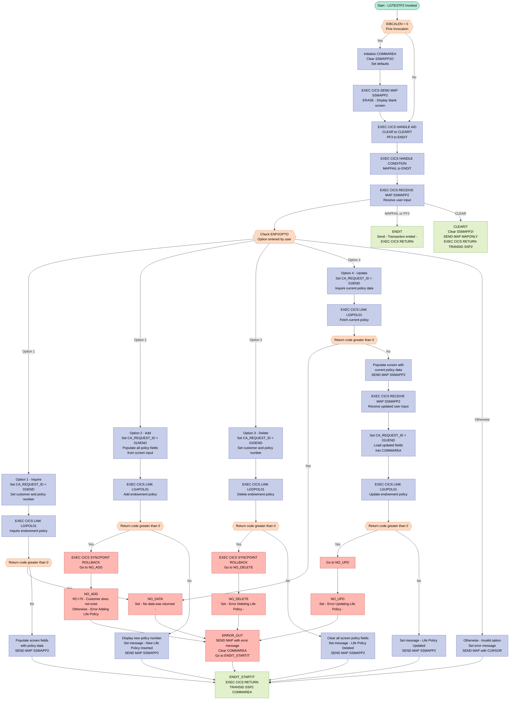
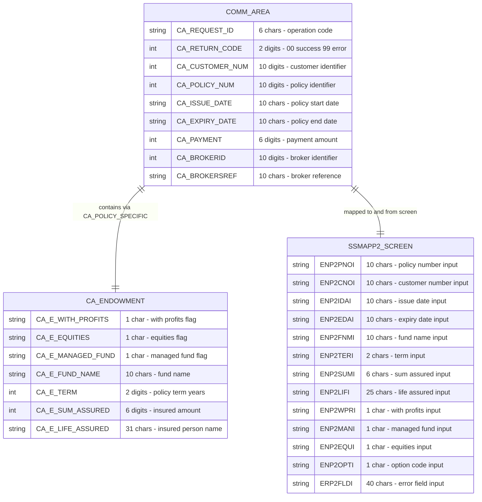

## Table of Contents

- [1. Purpose](#1-purpose)
- [2. Inputs](#2-inputs)
  - [2.1 CICS Communication Area (COMMAREA)](#21-cics-communication-area-commarea)
  - [2.2 CICS Terminal Screen Input (Map `SSMAPP2`, Mapset `SSMAP`)](#22-cics-terminal-screen-input-map-ssmapp2-mapset-ssmap)
  - [2.3 CICS Runtime / AID Fields](#23-cics-runtime--aid-fields)
  - [2.4 Linked Program Responses (External Data Sources)](#24-linked-program-responses-external-data-sources)
- [3. Outputs](#3-outputs)
- [4. Processing Logic](#4-processing-logic)
  - [4.1 Mermaid Flow Diagram](#41-mermaid-flow-diagram)
  - [4.2 Processing Logic Description](#42-processing-logic-description)
  - [4.3 Database Tables](#43-database-tables)
- [5. Paragraphs](#5-paragraphs)
- [6. Dependencies](#6-dependencies)
  - [6.1 CICS Transaction & Screen Interaction](#61-cics-transaction--screen-interaction)
  - [6.2 Linked External Programs (EXEC CICS LINK)](#62-linked-external-programs-exec-cics-link)
  - [6.3 Communication Area (COMMAREA)](#63-communication-area-commarea)
  - [6.4 BMS Screen Map Structures (Copybook `SSMAP`, inline-expanded)](#64-bms-screen-map-structures-copybook-ssmap-inline-expanded)
  - [6.5 Input Parameters](#65-input-parameters)
- [7. Constraints](#7-constraints)
  - [7.1 Data Validation Constraints](#71-data-validation-constraints)
  - [7.2 Transaction Sequencing Constraints](#72-transaction-sequencing-constraints)
  - [7.3 Error Handling and Rollback Constraints](#73-error-handling-and-rollback-constraints)
  - [7.4 Communication Area (COMMAREA) Structural Constraints](#74-communication-area-commarea-structural-constraints)
- [8. Error Handling](#8-error-handling)
  - [8.1 CICS AID Key Interception](#81-cics-aid-key-interception)
  - [8.2 CICS Map Failure Handling](#82-cics-map-failure-handling)
  - [8.3 Invalid or Unrecognised Option Entry](#83-invalid-or-unrecognised-option-entry)
  - [8.4 Return Code Checks After CICS LINK Calls](#84-return-code-checks-after-cics-link-calls)
  - [8.5 Transaction Rollback on Failure](#85-transaction-rollback-on-failure)
  - [8.6 Specialised Error Labels with User Notifications](#86-specialised-error-labels-with-user-notifications)
  - [8.7 Common Error Output and State Reset (`ERROR_OUT`)](#87-common-error-output-and-state-reset-error_out)
  - [8.8 Session Initialisation Guard (Zero EIBCALEN)](#88-session-initialisation-guard-zero-eibcalen)
- [9. Examples](#9-examples)
  - [9.1 Example 1 — Inquire on an Existing Endowment Policy (Option 1)](#91-example-1--inquire-on-an-existing-endowment-policy-option-1)
  - [9.2 Example 2 — Add a New Endowment Policy (Option 2)](#92-example-2--add-a-new-endowment-policy-option-2)
  - [9.3 Example 3 — Delete an Endowment Policy (Option 3)](#93-example-3--delete-an-endowment-policy-option-3)

## 1. Purpose

`LGTESTP2` is a CICS-hosted PL/I transaction program (transaction `SSP2`) that provides an interactive terminal menu for managing endowment insurance policies. It receives user input from the `SSMAPP2` BMS map — capturing a transaction option code along with a customer number and policy number — and routes each request to one of four dedicated back-end policy programs: it calls `LGIPOL01` to retrieve and display an existing endowment policy (option 1), `LGAPOL01` to create a new endowment policy (option 2), `LGDPOL01` to delete a policy (option 3), or performs a two-step inquiry followed by an update via `LGUPOL01` to modify policy attributes (option 4). For each operation, the program populates a shared communication area (`COMM_AREA`) with the relevant endowment policy attributes — such as fund name, policy term, sum assured, life assured name, and investment flags (with-profits, equities, managed fund) — exchanges data with the appropriate linked program, and then refreshes the BMS screen with the result or an appropriate error message, ultimately returning control back to the `SSP2` transaction to await further user interaction.

## 2. Inputs

### 2.1 CICS Communication Area (COMMAREA)

- **`CA_REQUEST_ID`** — Six-character request code passed in the COMMAREA that controls which endowment policy operation is executed (`01IEND` for inquiry, `01AEND` for add, `01DEND` for delete, `01UEND` for update). On the first invocation it is initialised internally; on subsequent invocations it is carried forward via `EXEC CICS RETURN COMMAREA`.
- **`CA_CUSTOMER_NUM`** — Ten-digit customer number passed in the COMMAREA to identify the customer whose endowment policy is being processed. Populated from screen input and also returned by downstream programs after a successful add.
- **`CA_POLICY_NUM`** — Ten-digit policy number passed in the COMMAREA to identify the specific endowment policy for inquiry, delete, and update operations. Also returned by downstream programs after a successful add or update.
- **`CA_ISSUE_DATE`** — Issue (effective) date of the endowment policy, carried in the COMMAREA to and from linked programs (`LGIPOL01`, `LGAPOL01`, `LGUPOL01`).
- **`CA_EXPIRY_DATE`** — Maturity/expiry date of the endowment policy, carried in the COMMAREA to and from linked programs.
- **`CA_E_FUND_NAME`** — Investment fund name for the endowment policy, carried in the COMMAREA for add, update, and inquiry operations.
- **`CA_E_TERM`** — Policy duration (term) carried in the COMMAREA for add, update, and inquiry operations.
- **`CA_E_SUM_ASSURED`** — Insured sum assured (maturity amount) carried in the COMMAREA for add, update, and inquiry operations.
- **`CA_E_LIFE_ASSURED`** — Name of the life assured, carried in the COMMAREA for add, update, and inquiry operations.
- **`CA_E_WITH_PROFITS`** — With-profits indicator flag carried in the COMMAREA for add, update, and inquiry operations.
- **`CA_E_MANAGED_FUND`** — Managed fund indicator flag carried in the COMMAREA for add, update, and inquiry operations.
- **`CA_E_EQUITIES`** — Equities indicator flag carried in the COMMAREA for add, update, and inquiry operations.

### 2.2 CICS Terminal Screen Input (Map `SSMAPP2`, Mapset `SSMAP`)

Received via `EXEC CICS RECEIVE MAP('SSMAPP2') INTO(SSMAPP2I)`:

- **`ENP2OPTI`** (`SSMAPP2I.ENP2OPTI`) — Single-character option code entered by the user on the endowment policy screen. Drives the primary transaction branch: `1`=Inquiry, `2`=Add, `3`=Delete, `4`=Update.
- **`ENP2CNOI`** (`SSMAPP2I.ENP2CNOI`) — Customer number keyed in by the user; used as input for add and update requests to identify the target customer.
- **`ENP2PNOI`** (`SSMAPP2I.ENP2PNOI`) — Policy number keyed in or carried back on the screen; used to confirm the policy reference after add/update.
- **`ENP2IDAI`** (`SSMAPP2I.ENP2IDAI`) — Issue date entered by the user; supplied to the COMMAREA for add and update processing.
- **`ENP2EDAI`** (`SSMAPP2I.ENP2EDAI`) — Expiry date entered by the user; supplied to the COMMAREA for add and update processing.
- **`ENP2FNMI`** (`SSMAPP2I.ENP2FNMI`) — Fund name entered by the user; supplied to the COMMAREA for add and update processing.
- **`ENP2TERI`** (`SSMAPP2I.ENP2TERI`) — Policy term entered by the user; supplied to the COMMAREA for add and update processing.
- **`ENP2SUMI`** (`SSMAPP2I.ENP2SUMI`) — Sum assured entered by the user; supplied to the COMMAREA for add and update processing.
- **`ENP2LIFI`** (`SSMAPP2I.ENP2LIFI`) — Life assured name entered by the user; supplied to the COMMAREA for add and update processing.
- **`ENP2WPRI`** (`SSMAPP2I.ENP2WPRI`) — With-profits flag entered by the user; supplied to the COMMAREA for add and update processing.
- **`ENP2MANI`** (`SSMAPP2I.ENP2MANI`) — Managed fund flag entered by the user; supplied to the COMMAREA for add and update processing.
- **`ENP2EQUI`** (`SSMAPP2I.ENP2EQUI`) — Equities flag entered by the user; supplied to the COMMAREA for add and update processing.

### 2.3 CICS Runtime / AID Fields

- **`EIBCALEN`** (CICS EIB field) — Length of the COMMAREA passed to this invocation. Used on entry to determine whether this is a fresh invocation (`EIBCALEN = 0`) or a pseudo-conversational return.
- **`ENP2OPTO`** (`SSMAPP2O.ENP2OPTO`) — Output-side option field of the map; used in the `SELECT` statement to route processing after the map is received, reflecting the last option displayed/returned on the screen.

### 2.4 Linked Program Responses (External Data Sources)

Data returned via COMMAREA after `EXEC CICS LINK` calls to back-end policy programs:

- **`LGIPOL01`** — Returns policy details (`CA_ISSUE_DATE`, `CA_EXPIRY_DATE`, `CA_E_*` fields, `CA_RETURN_CODE`) for inquiry and pre-update display.
- **`LGAPOL01`** — Returns the newly assigned `CA_POLICY_NUM` and `CA_RETURN_CODE` after a successful endowment policy add.
- **`LGDPOL01`** — Returns `CA_RETURN_CODE` confirming success or failure of a policy deletion.
- **`LGUPOL01`** — Returns `CA_RETURN_CODE` and updated `CA_POLICY_NUM` / `CA_CUSTOMER_NUM` after a successful policy update.

## 3. Outputs

**CICS Terminal Screen Output (EXEC CICS SEND MAP / SEND TEXT)**

The primary observable output of this program is the CICS map `SSMAPP2` sent to the terminal screen via `EXEC CICS SEND MAP`. The content of the screen varies by processing path:

- **Endowment Policy Inquiry (option 1)**
  - Screen fields populated and sent back to the user after a successful inquiry via `LGIPOL01`
    - `ENP2IDAI` (`CA_ISSUE_DATE`) — policy issue date displayed on screen
    - `ENP2EDAI` (`CA_EXPIRY_DATE`) — policy expiry date displayed on screen
    - `ENP2FNMI` (`CA_E_FUND_NAME`) — fund name displayed on screen
    - `ENP2TERI` (`CA_E_TERM`) — policy term displayed on screen
    - `ENP2SUMI` (`CA_E_SUM_ASSURED`) — sum assured displayed on screen
    - `ENP2LIFI` (`CA_E_LIFE_ASSURED`) — life assured name displayed on screen
    - `ENP2WPRI` (`CA_E_WITH_PROFITS`) — with-profits indicator displayed on screen
    - `ENP2MANI` (`CA_E_MANAGED_FUND`) — managed fund indicator displayed on screen
    - `ENP2EQUI` (`CA_E_EQUITIES`) — equities indicator displayed on screen

- **Endowment Policy Add (option 2)**
  - Screen fields updated and confirmation message sent after a successful add via `LGAPOL01`
    - `ENP2CNOI` (`CA_CUSTOMER_NUM`) — confirmed customer number echoed back on screen
    - `ENP2PNOI` (`CA_POLICY_NUM`) — newly assigned policy number displayed on screen
    - `ENP2FNMI` (`CA_E_FUND_NAME`) — confirmed fund name displayed on screen
    - `ENP2OPTI` — cleared to blank
    - `ERP2FLDO` — success message `'New Life Policy Inserted'` displayed in the error/message field

- **Endowment Policy Delete (option 3)**
  - Screen fields cleared and confirmation message sent after a successful delete via `LGDPOL01`
    - `ENP2IDAI`, `ENP2EDAI`, `ENP2FNMI`, `ENP2TERI`, `ENP2SUMI`, `ENP2LIFI`, `ENP2WPRI`, `ENP2MANI`, `ENP2EQUI` — all blanked on screen to reflect deletion
    - `ERP2FLDO` — success message `'Life Policy Deleted'` displayed in the error/message field

- **Endowment Policy Update (option 4)**
  - Screen first refreshed with current data from `LGIPOL01`, then after user re-submission and successful update via `LGUPOL01`
    - `ENP2CNOI` (`CA_CUSTOMER_NUM`) — confirmed customer number echoed back on screen
    - `ENP2PNOI` (`CA_POLICY_NUM`) — confirmed policy number echoed back on screen
    - `ENP2OPTI` — cleared to blank
    - `ERP2FLDO` — success message `'Life Policy Updated'` displayed in the error/message field

- **Invalid option entered (OTHERWISE branch)**
  - `ERP2FLDO` — validation message `'Please enter a valid option'` displayed in the error/message field
  - `ENP2OPTL` — set to `-1` to position the cursor on the option field

- **Error conditions (NO_ADD, NO_UPD, NO_DELETE, NO_DATA)**
  - `ERP2FLDO` — error message displayed in the error/message field; value depends on which error occurred:
    - `'Customer does not exist'` (add, return code 70)
    - `'Error Adding Life Policy'` (add, other errors)
    - `'Error Updating Life Policy'`
    - `'Error Deleting Life Policy'`
    - `'No data was returned.'`
  - The current `SSMAPP2O` map contents are sent to the screen, then the communication area and screen are reset

- **Session termination (ENDIT / CLEARIT / PF3 / CLEAR)**
  - `MSGEND` (`'Transaction ended'`) — plain text message sent via `EXEC CICS SEND TEXT` when the user presses PF3 or a MAPFAIL condition occurs, signalling the end of the transaction

**CICS Communication Area Returned to the Caller (EXEC CICS RETURN COMMAREA)**

On all non-terminal paths the program returns to CICS with `TRANSID('SSP2')` and the `COMM_AREA` passed back as the commarea, preserving state for the next pseudo-conversational invocation:

- `CA_REQUEST_ID` — request type last processed, carried forward in the commarea
- `CA_RETURN_CODE` — result code from the last linked program, carried forward in the commarea
- `CA_CUSTOMER_NUM` — customer number, carried forward in the commarea
- `CA_POLICY_NUM` — policy number (set after add or inquiry), carried forward in the commarea
- Endowment policy details (`CA_ISSUE_DATE`, `CA_EXPIRY_DATE`, `CA_E_FUND_NAME`, `CA_E_TERM`, `CA_E_SUM_ASSURED`, `CA_E_LIFE_ASSURED`, `CA_E_WITH_PROFITS`, `CA_E_MANAGED_FUND`, `CA_E_EQUITIES`) — policy attributes carried forward in the commarea

**Downstream Program Invocations (EXEC CICS LINK)**

The program drives back-end processing by linking to subordinate programs, which produce their own persistent side effects (database reads/writes):

- `LGIPOL01` — invoked for inquiry (options 1 and 4); reads the endowment policy record and returns data in `COMM_AREA`
- `LGAPOL01` — invoked for add (option 2); inserts a new endowment policy record; on failure an `EXEC CICS SYNCPOINT ROLLBACK` is issued to reverse any partial changes
- `LGDPOL01` — invoked for delete (option 3); removes the endowment policy record; on failure an `EXEC CICS SYNCPOINT ROLLBACK` is issued
- `LGUPOL01` — invoked for update (option 4); updates the endowment policy record and returns the confirmed policy details in `COMM_AREA`

## 4. Processing Logic

### 4.1 Mermaid Flow Diagram

---

### 4.2 Processing Logic Description

#### 4.2.1 High-level Summary

`LGTESTP2` is a CICS pseudo-conversational menu program (transaction `SSP2`) that provides the user interface for **Endowment Policy maintenance** in the GenApp insurance system. It presents BMS map `SSMAPP2` to the terminal user and dispatches four types of policy operations — **Inquire**, **Add**, **Delete**, and **Update** — by calling the appropriate downstream CICS policy orchestrator programs via `EXEC CICS LINK`.

---

#### 4.2.2 Execution Flow

**Step 1 — First-time Invocation Check**
When the transaction is first started, `EIBCALEN = 0` (no prior COMMAREA exists). The program initializes `COMM_AREA_PTR` to a local base area, blanks out the output map (`SSMAPP2O`), zeros customer/policy numbers, and sends the blank `SSMAPP2` screen to the terminal using `EXEC CICS SEND MAP … ERASE`. This clears the screen before the first user entry.

**Step 2 — Set Up AID and Condition Handlers (`A_GAIN` label)**
Every time through (first and subsequent invocations), the program registers:
- `EXEC CICS HANDLE AID CLEAR(CLEARIT) PF3(ENDIT)`: if the user presses **Clear**, control jumps to `CLEARIT`; if they press **PF3**, control jumps to `ENDIT`.
- `EXEC CICS HANDLE CONDITION MAPFAIL(ENDIT)`: if the map receive fails (e.g. user presses Enter with no data on a blank map), execution jumps to `ENDIT`.

**Step 3 — Receive User Input**
`EXEC CICS RECEIVE MAP('SSMAPP2') INTO(SSMAPP2I)` reads the user's screen input, including the option code (`ENP2OPTO`), customer number (`ENP2CNOO`/`ENP2CNOI`), policy number (`ENP2PNOO`/`ENP2PNOI`), and endowment policy detail fields.

**Step 4 — Dispatch on Option Code (`SELECT ENP2OPTO`)**
The option code drives the main business flow:

---

**Option `1` — Inquire Endowment Policy**
- Sets `CA_REQUEST_ID = '01IEND'`, populates `CA_CUSTOMER_NUM` and `CA_POLICY_NUM` from screen output fields.
- Issues `EXEC CICS LINK PROGRAM('LGIPOL01')` to retrieve the policy.
- If `CA_RETURN_CODE > 0`, jumps to `NO_DATA` (error path).
- On success, maps all returned policy fields (issue date, expiry date, fund name, term, sum assured, life assured, with-profits flag, managed fund flag, equities flag) into the `SSMAPP2O` output fields and sends the map back for display.
- Exits via `ENDIT_STARTIT` (pseudo-conversational return).

---

**Option `2` — Add Endowment Policy**
- Sets `CA_REQUEST_ID = '01AEND'` and populates `CA_CUSTOMER_NUM`, payment/broker fields (set to zero/blank), and all endowment policy attributes from the screen input fields (`ENP2*I`).
- Issues `EXEC CICS LINK PROGRAM('LGAPOL01')` to create the policy.
- If `CA_RETURN_CODE > 0`: issues `EXEC CICS SYNCPOINT ROLLBACK` to undo any partial DB2 changes, then jumps to `NO_ADD`.
  - `NO_ADD` returns code `70` displays "Customer does not exist"; any other non-zero code shows "Error Adding Life Policy".
- On success: copies back `CA_CUSTOMER_NUM` and `CA_POLICY_NUM` (newly assigned) to the screen, clears the option field, sets message "New Life Policy Inserted", and sends the map.

---

**Option `3` — Delete Endowment Policy**
- Sets `CA_REQUEST_ID = '01DEND'`, populates customer and policy numbers from output fields.
- Issues `EXEC CICS LINK PROGRAM('LGDPOL01')` to delete the policy.
- If `CA_RETURN_CODE > 0`: `EXEC CICS SYNCPOINT ROLLBACK`, jumps to `NO_DELETE` → "Error Deleting Life Policy".
- On success: blanks all policy detail screen fields and displays "Life Policy Deleted".

---

**Option `4` — Update Endowment Policy (two-phase)**
This option follows a two-step pattern:
1. **Read before Write**: Sets `CA_REQUEST_ID = '01IEND'`, links to `LGIPOL01` to fetch the current policy data. If error, jumps to `NO_DATA`. Otherwise, populates the screen with current values and sends the map.
2. **Receive updated input**: Issues a second `EXEC CICS RECEIVE MAP` to accept the user's modifications.
3. **Write**: Sets `CA_REQUEST_ID = '01UEND'`, reloads all modified fields from screen input into the COMMAREA, and links to `LGUPOL01` to apply the update.
4. If `CA_RETURN_CODE > 0`: jumps to `NO_UPD` → "Error Updating Life Policy".
5. On success: displays "Life Policy Updated" with the confirmed customer and policy numbers.

---

**Invalid Option — Otherwise Branch**
If the user enters anything other than 1–4, the program sets error message "Please enter a valid option", sets the option field length to `-1` (which positions the cursor there), and sends the map back with `CURSOR`.

---

**Step 5 — Exit Paths**

| Label | Behavior |
|---|---|
| `ENDIT_STARTIT` | `EXEC CICS RETURN TRANSID('SSP2') COMMAREA(COMM_AREA)` — returns to CICS, re-invoking the same transaction on the next user input (pseudo-conversational). |
| `ENDIT` | Sends "Transaction ended" text, then `EXEC CICS RETURN` with no transid — ends the session. Triggered by PF3 or MAPFAIL. |
| `CLEARIT` | Clears `SSMAPP2I`, sends the map with `MAPONLY` (no data, screen is reset to blank), then returns via `SSP2` transid — allows the user to start a fresh entry. |
| `ERROR_OUT` | Sends the map with the error message set, then clears all COMMAREA and screen data before returning via `ENDIT_STARTIT`. |

---

#### 4.2.3 External Interactions

| Called Program | CICS LINK Request ID | Purpose |
|---|---|---|
| `LGIPOL01` | `01IEND` | Inquire (read) an existing endowment policy from DB2 |
| `LGAPOL01` | `01AEND` | Add (create) a new endowment policy to DB2 |
| `LGDPOL01` | `01DEND` | Delete an existing endowment policy from DB2 |
| `LGUPOL01` | `01UEND` | Update an existing endowment policy in DB2 |

All interactions use `EXEC CICS LINK … COMMAREA(COMM_AREA) LENGTH(32500)`, passing the full 32,500-byte COMMAREA structure. The called orchestrator programs handle further delegation to DB2 backend programs (`LGAPDB01`, `LGIPDB01`, `LGDPDB01`, `LGUPDB01`).

---

#### 4.2.4 Plain Language Summary

`LGTESTP2` is the **Endowment Policy menu screen** of the GenApp insurance system. When a user opens transaction `SSP2` on their terminal, this program presents a form where they can enter a customer number, policy number, and policy details. By typing a number (1–4) in the option field, the user tells the program what to do:

- **1** — Look up and display an existing endowment policy.
- **2** — Create a brand-new endowment policy for a customer.
- **3** — Delete an existing endowment policy.
- **4** — Modify an existing endowment policy (the program first shows the current values, waits for changes, then saves them).

After each action, the screen refreshes to show the result or an error message. Pressing **PF3** or **Clear** exits or resets the screen. If something goes wrong (e.g. the customer doesn't exist, or a DB2 error occurs), any incomplete database changes are rolled back, an error message is displayed on screen, and the form is reset for a fresh attempt.

---

### 4.3 Database Tables

No SQL statements are present directly in `LGTESTP2`. Database access is performed entirely by the linked backend programs (`LGIPOL01`, `LGAPOL01`, `LGDPOL01`, `LGUPOL01`). The data structures exchanged through the COMMAREA correspond to the following logical entities:

## 5. Paragraphs

- **LGTESTP2 (Main Program Entry / Initialization Block)** — Lines 687–702
  - This is the program's entry logic, guarded by a check of `EIBCALEN` (the CICS Execute Interface Block communication area length). A value of zero means the transaction is being invoked for the first time with no prior state.
  - On first entry, the program sets `COMM_AREA_PTR` to point at the local `BASE_COMM_AREA` storage. It initialises the map output structure (`SSMAPP2O`), clears `CA_REQUEST_ID`, `CA_RETURN_CODE`, `CA_CUSTOMER_NUM`, and `CA_REQUEST_INITIALISER`, and zeroes the customer and policy number output fields on the map (`ENP2CNOO`, `ENP2PNOO`).
  - A `EXEC CICS SEND MAP` is issued to display the blank endowment policy screen (map `SSMAPP2` from mapset `SSMAP`) with the `ERASE` option, clearing the terminal.
  - Control then falls through to the `A_GAIN` label to await user input.

- **A_GAIN** — Line 704
  - This is the main processing loop label. It is the re-entry point for each pseudo-conversational cycle, establishing the AID and condition handlers before reading the map.
  - `EXEC CICS HANDLE AID CLEAR(CLEARIT) PF3(ENDIT)` registers the `CLEARIT` label as the target when the user presses the Clear key, and `ENDIT` when PF3 is pressed.
  - `EXEC CICS HANDLE CONDITION MAPFAIL(ENDIT)` directs control to `ENDIT` if the terminal map receive fails (e.g., no data entered).
  - `EXEC CICS RECEIVE MAP('SSMAPP2') INTO(SSMAPP2I) MAPSET('SSMAP')` reads the terminal data typed by the user into the `SSMAPP2I` input structure.
  - A `SELECT (ENP2OPTO)` statement branches on the single-character option value from the screen, dispatching to one of four transaction handlers or a catch-all invalid-option handler.

- **Option 1 — Endowment Policy Inquiry (WHEN '1')** — Lines 718–741
  - Handles the inquiry of an existing endowment policy.
  - Sets `CA_REQUEST_ID` to `'01IEND'`, loads `CA_CUSTOMER_NUM` from the map output field `ENP2CNOO`, and `CA_POLICY_NUM` from `ENP2PNOO`.
  - Issues `EXEC CICS LINK PROGRAM('LGIPOL01')` passing the 32,500-byte communication area to invoke the back-end inquiry program.
  - On a non-zero `CA_RETURN_CODE`, control branches via `GO TO NO_DATA`.
  - On success, all returned endowment fields (`CA_ISSUE_DATE`, `CA_EXPIRY_DATE`, `CA_E_FUND_NAME`, `CA_E_TERM`, `CA_E_SUM_ASSURED`, `CA_E_LIFE_ASSURED`, `CA_E_WITH_PROFITS`, `CA_E_MANAGED_FUND`, `CA_E_EQUITIES`) are moved to corresponding input map fields in `SSMAPP2I` so they appear on screen, and the map is sent back.
  - Ends with `GO TO ENDIT_STARTIT` to return control with transaction state preserved.

- **Option 2 — Add Endowment Policy (WHEN '2')** — Lines 743–775
  - Handles adding a new endowment policy for a customer.
  - Sets `CA_REQUEST_ID` to `'01AEND'`, loads customer number from the input field `ENP2CNOI`, zeroes out payment, broker ID, and broker reference fields, then maps all user-entered policy fields from the screen (`ENP2IDAI`, `ENP2EDAI`, `ENP2FNMI`, `ENP2TERI`, `ENP2SUMI`, `ENP2LIFI`, `ENP2WPRI`, `ENP2MANI`, `ENP2EQUI`) into the communication area.
  - Issues `EXEC CICS LINK PROGRAM('LGAPOL01')` to call the back-end policy add program.
  - On failure (`CA_RETURN_CODE > 0`), issues `EXEC CICS SYNCPOINT ROLLBACK` to undo any database changes, then branches to `NO_ADD`.
  - On success, writes the returned customer number and new policy number back to the map output fields (`ENP2CNOI`, `ENP2PNOI`), clears the option field, sets a confirmation message (`'New Life Policy Inserted'`), and sends the map.
  - Ends with `GO TO ENDIT_STARTIT`.

- **Option 3 — Delete Endowment Policy (WHEN '3')** — Lines 777–803
  - Handles deletion of an existing endowment policy.
  - Sets `CA_REQUEST_ID` to `'01DEND'`, loads `CA_CUSTOMER_NUM` from `ENP2CNOO` and `CA_POLICY_NUM` from `ENP2PNOO`.
  - Issues `EXEC CICS LINK PROGRAM('LGDPOL01')` to call the back-end deletion program.
  - On failure, issues `EXEC CICS SYNCPOINT ROLLBACK` and branches to `NO_DELETE`.
  - On success, blanks all endowment detail input fields on the map, sets the confirmation message `'Life Policy Deleted'`, and sends the refreshed map.
  - Ends with `GO TO ENDIT_STARTIT`.

- **Option 4 — Update Endowment Policy (WHEN '4')** — Lines 805–860
  - Handles a two-step update: first retrieves the existing policy data to pre-populate the screen, then accepts the user's edits and submits the update.
  - **Step 1 (Inquire):** Sets `CA_REQUEST_ID` to `'01IEND'`, loads customer and policy numbers from the output fields, links to `LGIPOL01`, and on error branches to `NO_DATA`. On success, populates the map input fields with the current policy data and sends the map for user editing.
  - **Step 2 (Update):** Issues `EXEC CICS RECEIVE MAP` to read the user's modifications back from the screen. Sets `CA_REQUEST_ID` to `'01UEND'`, refreshes the communication area with the edited field values, and links to `LGUPOL01` to perform the update.
  - On failure from the update link, branches to `NO_UPD`.
  - On success, writes the returned customer and policy numbers back to the screen, clears the option field, sets the message `'Life Policy Updated'`, sends the map, and ends with `GO TO ENDIT_STARTIT`.

- **OTHERWISE — Invalid Option Handler** — Lines 862–872
  - Catches any input option that is not `'1'`, `'2'`, `'3'`, or `'4'`.
  - Sets the map error field (`ERP2FLDO`) to `'Please enter a valid option'`, sets the cursor length attribute for the option field (`ENP2OPTL = -1`) to position the cursor, and sends the map back with the `CURSOR` option so the terminal highlights the invalid field.
  - Ends with `GO TO ENDIT_STARTIT` to keep the transaction active.

- **ENDIT_STARTIT** — Lines 879–882
  - A pseudo-conversational return label. Issues `EXEC CICS RETURN TRANSID('SSP2') COMMAREA(COMM_AREA)` to terminate the current task while re-queuing the transaction `SSP2` for the next user action, passing the current communication area state so context is preserved across interactions.

- **ENDIT** — Lines 884–890
  - A clean termination label, invoked when the user presses PF3 or when a MAPFAIL condition is raised.
  - Sends the static termination message `'Transaction ended'` to the terminal using `EXEC CICS SEND TEXT` with the `ERASE` and `FREEKB` options (erases the screen and unlocks the keyboard).
  - Issues a plain `EXEC CICS RETURN` with no `TRANSID`, fully ending the transaction without queuing a restart.

- **CLEARIT** — Lines 892–901
  - Handles the terminal Clear key.
  - Blanks the input map structure (`SSMAPP2I = ' '`) and re-sends the map using `EXEC CICS SEND MAP` with the `MAPONLY` option, which repaints the blank screen template without any data.
  - Issues `EXEC CICS RETURN TRANSID('SSP2') COMMAREA(COMM_AREA)` to keep the transaction alive so the user can re-enter data.

- **NO_ADD** — Lines 903–913
  - Error handler for a failed policy add operation.
  - Uses a `SELECT (CA_RETURN_CODE)` to distinguish error codes: return code `70` sets the message `'Customer does not exist'`; any other code sets `'Error Adding Life Policy'`.
  - Both branches fall through to `GO TO ERROR_OUT` to display the error and reset state.

- **NO_UPD** — Lines 915–917
  - Error handler for a failed policy update.
  - Sets `ERP2FLDO` to `'Error Updating Life Policy'` and branches to `ERROR_OUT`.

- **NO_DELETE** — Lines 919–921
  - Error handler for a failed policy deletion.
  - Sets `ERP2FLDO` to `'Error Deleting Life Policy'` and branches to `ERROR_OUT`.

- **NO_DATA** — Lines 923–925
  - Error handler for a failed policy inquiry (no data returned).
  - Sets `ERP2FLDO` to `'No data was returned.'` and branches to `ERROR_OUT`.

- **ERROR_OUT** — Lines 927–939
  - Central error display and reset routine, reached from all error handlers.
  - Sends the current map (with the error message already placed in `ERP2FLDO`) back to the terminal using `EXEC CICS SEND MAP`.
  - Resets the map input structure and the entire communication area to blank/zero: clears `SSMAPP2I`, `COMM_AREA_RAW`, `CA_REQUEST_ID`, `CA_RETURN_CODE`, `CA_CUSTOMER_NUM`, and `CA_REQUEST_INITIALISER`.
  - Transfers control to `ENDIT_STARTIT` to allow the user to retry or exit cleanly.

## 6. Dependencies

### 6.1 CICS Transaction & Screen Interaction

- **CICS Transaction `SSP2`** — The transaction identifier under which this program executes; returned via `EXEC CICS RETURN TRANSID('SSP2')` to enable pseudo-conversational restart
- **BMS Mapset `SSMAP`** — The Basic Mapping Support mapset used for all screen I/O; referenced in every `EXEC CICS SEND MAP` and `EXEC CICS RECEIVE MAP` call
  - **Map `SSMAPP2`** — The specific BMS map within `SSMAP` used to display and receive the endowment policy transaction screen (policy number, customer number, dates, fund details, options)
- **CICS EIBCALEN** — Execution Interface Block field tested at program entry to detect a fresh (non-pseudo-conversational) invocation, driving initial screen setup
- **CICS HANDLE AID / HANDLE CONDITION** — Used to intercept PF3 key (`ENDIT` label) and CLEAR key (`CLEARIT` label), and to trap `MAPFAIL` condition (e.g., no data entered) routing control to `ENDIT`

---

### 6.2 Linked External Programs (EXEC CICS LINK)

- **`LGIPOL01`** — Policy inquiry module; linked with `COMMAREA` and request ID `01IEND` to retrieve an existing endowment policy record by customer number and policy number (options 1 and 4)
- **`LGAPOL01`** — Policy add module; linked with `COMMAREA` and request ID `01AEND` to create a new endowment policy record for a given customer (option 2); rollback is issued on failure
- **`LGDPOL01`** — Policy delete module; linked with `COMMAREA` and request ID `01DEND` to remove an endowment policy record (option 3); rollback is issued on failure
- **`LGUPOL01`** — Policy update module; linked with `COMMAREA` and request ID `01UEND` to update an existing endowment policy record (option 4)

---

### 6.3 Communication Area (COMMAREA)

- **`LGCMAREA` copybook (inline-expanded)** — Defines the shared `COMM_AREA` structure (32,500 bytes) passed on all `EXEC CICS LINK` and `EXEC CICS RETURN` calls; contains:
  - `CA_REQUEST_ID` — Six-character code identifying the requested business operation (`01IEND`, `01AEND`, `01DEND`, `01UEND`)
  - `CA_RETURN_CODE` — Return status from linked programs; non-zero signals an error condition
  - `CA_CUSTOMER_NUM` — Ten-digit customer identifier linking the policy to its owner
  - `CA_POLICY_NUM` — Ten-digit policy number identifying the specific endowment policy
  - `CA_ISSUE_DATE` / `CA_EXPIRY_DATE` — Policy effective and maturity dates
  - `CA_E_WITH_PROFITS`, `CA_E_EQUITIES`, `CA_E_MANAGED_FUND` — Investment option flags for the endowment product
  - `CA_E_FUND_NAME` — Name of the associated investment fund
  - `CA_E_TERM` — Duration of the endowment policy
  - `CA_E_SUM_ASSURED` — Guaranteed cover amount
  - `CA_E_LIFE_ASSURED` — Name of the insured person
  - `CA_PAYMENT`, `CA_BROKERID`, `CA_BROKERSREF` — Supporting financial and broker fields populated on add/update requests

---

### 6.4 BMS Screen Map Structures (Copybook `SSMAP`, inline-expanded)

- **`SSMAPP2I` / `SSMAPP2O`** — Input/output structures for the endowment policy screen (map `SSMAPP2`); field prefixes `ENP2*` carry policy number, customer number, issue/expiry dates, fund name, term, sum assured, life assured, with-profits, equities, managed-fund flags, option code, and error message field
- **`SSMAPC1I` / `SSMAPC1O`** — Customer enquiry screen map structures (map not directly used in this program's active logic but declared via the shared `SSMAP` copybook)
- **`SSMAPP1I` / `SSMAPP1O`**, **`SSMAPP3I` / `SSMAPP3O`**, **`SSMAPP4I` / `SSMAPP4O`**, **`SSMAPP5I` / `SSMAPP5O`** — Additional policy-type screen map structures for motor, house, commercial, and claim policies; declared from the shared `SSMAP` copybook but not actively used in this program's processing path

---

### 6.5 Input Parameters

- **`DFHEIPTR`** — CICS-supplied pointer parameter required by the Enterprise PL/I CICS interface, passed as the first argument in the procedure signature
- **`COMM_AREA_PTR`** — Pointer to the communication area passed by the CICS runtime on pseudo-conversational re-entry; used to overlay the `COMM_AREA` based structure
- **`ENP2OPTI`** — One-character option entered by the user on the `SSMAPP2` screen; drives the `SELECT` statement choosing between inquiry (1), add (2), delete (3), and update (4) processing paths
- **`ENP2CNOI` / `ENP2CNOO`** — Customer number input/output fields on the screen map; supply the customer identifier for all policy operations
- **`ENP2PNOI` / `ENP2PNOO`** — Policy number input/output fields on the screen map; supply the policy identifier for inquiry, delete, and update operations

## 7. Constraints

### 7.1 Data Validation Constraints

- **Option code must be one of `'1'`, `'2'`, `'3'`, or `'4'`**
  - Enforced by the `SELECT (ENP2OPTO)` statement (line 716). Any value other than these four causes the `OTHERWISE` branch to execute, which sets the error message `'Please enter a valid option'`, highlights the option field (`ENP2OPTL = -1`), and re-sends the map with the cursor positioned on the option field without performing any business operation.

- **Customer number (`ENP2CNOO` / `ENP2CNOI`) must reference an existing customer**
  - For the Add operation (option `'2'`), if the downstream policy orchestrator (`LGAPOL01`) returns `CA_RETURN_CODE = 70`, the program intercepts this at `NO_ADD` and displays `'Customer does not exist'`. Processing is blocked and the policy is not created.

- **Policy number (`ENP2PNOO`) must correspond to an existing retrievable policy**
  - For Inquire (option `'1'`), Delete (option `'3'`), and Update (option `'4'`), if `CA_RETURN_CODE > 0` is returned by the linked program, the program branches to `NO_DATA`, `NO_DELETE`, or `NO_UPD` respectively and displays an error. No policy data is presented or modified when the record cannot be found or processed.

- **`CA_RETURN_CODE` must be `0` for any operation to complete successfully**
  - Checked immediately after every `EXEC CICS LINK` call (lines 725, 761, 784, 812, 848). Any non-zero return code diverts execution to an error-handling label, preventing further processing of that operation.

- **Endowment-specific field lengths are structurally constrained by the COMMAREA layout**
  - `CA_E_TERM` — `PIC '99'` (2 digits; max value 99)
  - `CA_E_SUM_ASSURED` — `PIC '999999'` (6 digits; max value 999,999)
  - `CA_E_LIFE_ASSURED` — `CHAR(31)` (maximum 31 characters)
  - `CA_E_FUND_NAME` — `CHAR(10)` (maximum 10 characters)
  - `CA_E_WITH_PROFITS`, `CA_E_EQUITIES`, `CA_E_MANAGED_FUND` — each `CHAR(1)` (single-character flag)
  - `CA_ISSUE_DATE`, `CA_EXPIRY_DATE` — each `CHAR(10)` (fixed-length date strings)
  - Screen map field `ENP2TERI` is `CHARACTER(2)`, matching the 2-digit COMMAREA picture; `ENP2SUMI` is `CHARACTER(6)`, matching 6 digits; `ENP2LIFI` is `CHARACTER(25)`, slightly narrower than the COMMAREA's 31-byte field, effectively limiting what can be entered on-screen.

- **Customer number and policy number are initialized to `'0000000000'` on first entry**
  - Enforced in the `EIBCALEN = 0` block (lines 695–696). This prevents stale or uninitialised identifiers from being submitted when the transaction starts cold.

---

### 7.2 Transaction Sequencing Constraints

- **The COMMAREA length passed on every `EXEC CICS LINK` must be exactly 32,500 bytes**
  - All three downstream links (`LGIPOL01`, `LGAPOL01`, `LGDPOL01`, `LGUPOL01`) specify `LENGTH(32500)`. This is a fixed contract; downstream programs validate this length and return an error (`CA_RETURN_CODE = 98`) if it is wrong.

- **Update (option `'4'`) requires a two-step interaction: inquire must precede the actual update**
  - The program first sets `CA_REQUEST_ID = '01IEND'` and calls `LGIPOL01` to retrieve the current policy data (lines 806–823), sends the map back for user editing, then issues a second `EXEC CICS RECEIVE MAP` (line 827) and only then sets `CA_REQUEST_ID = '01UEND'` and calls `LGUPOL01` (line 845). The update cannot proceed without the prior successful inquire completing.

- **The CICS transaction identifier `SSP2` must be passed on every `EXEC CICS RETURN TRANSID`**
  - Both `ENDIT_STARTIT` (line 880) and `CLEARIT` (line 899–901) return with `TRANSID('SSP2')` and pass the COMMAREA. This ensures the pseudo-conversational loop always re-enters the same program; no other transaction can be inserted between interactions.

- **CLEAR key and PF3 key unconditionally terminate the transaction**
  - Registered via `EXEC CICS HANDLE AID CLEAR(CLEARIT) PF3(ENDIT)` (lines 706–708). CLEAR clears the map and resumes with `SSP2`; PF3 branches to `ENDIT`, which displays `'Transaction ended'` and issues a bare `EXEC CICS RETURN` without a TRANSID, ending the pseudo-conversational loop entirely.

- **MAPFAIL condition unconditionally terminates the transaction**
  - `EXEC CICS HANDLE CONDITION MAPFAIL(ENDIT)` (lines 709–710) ensures that if no data is received from the terminal (e.g., user submits a blank screen), control goes to `ENDIT` and the transaction ends rather than proceeding with empty input.

---

### 7.3 Error Handling and Rollback Constraints

- **Add (option `'2'`) and Delete (option `'3'`) must roll back on failure**
  - On a non-zero `CA_RETURN_CODE` from `LGAPOL01` or `LGDPOL01`, the program issues `EXEC CICS SYNCPOINT ROLLBACK` (lines 762, 785) before branching to the error label. This ensures partial database changes are reversed. Inquire (option `'1'`) and Update (option `'4'`) do not issue explicit rollbacks on error.

- **On any error, the COMMAREA is fully reset before the transaction loops**
  - At `ERROR_OUT` (lines 932–937), `COMM_AREA_RAW`, `CA_REQUEST_ID`, `CA_RETURN_CODE`, `CA_CUSTOMER_NUM`, and `CA_REQUEST_INITIALISER` are all cleared to blanks/zero before returning with `TRANSID('SSP2')`. This prevents residual data from influencing the next interaction cycle.

- **`CA_RETURN_CODE = 70` is the only named/special error code handled explicitly**
  - In the `NO_ADD` handler, only return code `70` (customer does not exist) receives a specific message. All other non-zero codes from the Add path fall to the generic `'Error Adding Life Policy'` message. No other named codes are differentiated for any other operation.

---

### 7.4 Communication Area (COMMAREA) Structural Constraints

- **Payment and broker fields are always zeroed/blanked for Add and Update; they cannot be set from this screen**
  - For both option `'2'` (Add, lines 746–748) and option `'4'` (Update, lines 833–835), `CA_PAYMENT = 0`, `CA_BROKERID = 0`, and `CA_BROKERSREF = ' '` are hardcoded before the LINK. The screen provides no input fields for these values; they are structurally excluded from endowment policy creation and update via this menu.

- **`CA_REQUEST_ID` is a mandatory 6-character code that governs which backend operation is invoked**
  - The program sets it to exactly `'01IEND'` (inquire endowment), `'01AEND'` (add endowment), `'01DEND'` (delete endowment), or `'01UEND'` (update endowment) before each LINK. The linked programs use this value to dispatch internally; any deviation would cause the wrong operation to be executed.

- **COMMAREA total size is capped at 32,500 bytes (`COMM_AREA_RAW CHAR(32500)`)**
  - Declared at line 585. All policy-type-specific data including padding lives within this boundary. The raw union overlay ensures that regardless of policy type, the total area passed does not exceed this limit.

## 8. Error Handling

### 8.1 CICS AID Key Interception

- **`EXEC CICS HANDLE AID CLEAR(CLEARIT) PF3(ENDIT)`** is declared at the top of the main processing loop (`A_GAIN`). It intercepts specific terminal attention identifiers before any map receive is attempted:
  - When the operator presses **CLEAR**, control transfers unconditionally to the `CLEARIT` label, which blanks the screen map and returns to the transaction (`SSP2`) with the current COMMAREA, effectively resetting the screen without terminating the session.
  - When the operator presses **PF3**, control transfers to the `ENDIT` label, which sends a "Transaction ended" message to the terminal and issues a plain `EXEC CICS RETURN` with no TRANSID, terminating the transaction cleanly.

---

### 8.2 CICS Map Failure Handling

- **`EXEC CICS HANDLE CONDITION MAPFAIL(ENDIT)`** is declared alongside the AID handler. It traps the CICS `MAPFAIL` condition, which is raised when a map receive yields no data (e.g., the user pressed Enter on a blank screen). When triggered, control branches to `ENDIT`, ending the transaction gracefully with the "Transaction ended" message rather than propagating an unhandled CICS condition.

---

### 8.3 Invalid or Unrecognised Option Entry

- **`OTHERWISE` branch in the `SELECT` statement** acts as a catch-all for any option value entered on the screen that is not `'1'`, `'2'`, `'3'`, or `'4'`. When triggered, the error message `'Please enter a valid option'` is written to the screen error field (`ERP2FLDO`), the option field length attribute (`ENP2OPTL`) is set to `-1` to position the cursor, and the map is re-sent with `CURSOR` to prompt the user to re-enter a valid selection.

---

### 8.4 Return Code Checks After CICS LINK Calls

- After every `EXEC CICS LINK` to a downstream policy program, the program immediately inspects `CA_RETURN_CODE`. A non-zero value indicates that the linked program encountered a business or system error. The specific handling per operation is:

  - **Inquiry (option 1 and the first step of option 4):** If `CA_RETURN_CODE > 0`, control jumps to `NO_DATA`, which sets the error message `'No data was returned.'` on the screen.
  - **Add (option 2):** If `CA_RETURN_CODE > 0`, the program first issues `EXEC CICS SYNCPOINT ROLLBACK` to undo any partial database changes, then jumps to `NO_ADD`.
  - **Delete (option 3):** If `CA_RETURN_CODE > 0`, `EXEC CICS SYNCPOINT ROLLBACK` is issued and control jumps to `NO_DELETE`.
  - **Update (option 4, second link):** If `CA_RETURN_CODE > 0`, control jumps to `NO_UPD`.

---

### 8.5 Transaction Rollback on Failure

- For the **Add** and **Delete** operations, the error path explicitly issues `EXEC CICS SYNCPOINT ROLLBACK` before branching to the error handler. This ensures that any recoverable resource changes made by the linked back-end programs (e.g., DB2 inserts or deletes) are reversed when the operation fails, maintaining data integrity.

---

### 8.6 Specialised Error Labels with User Notifications

- The program defines four dedicated error label blocks that compose user-facing messages before converging on a common output routine:
  - **`NO_ADD`:** Inspects `CA_RETURN_CODE` further using a nested `SELECT`:
    - Return code `70` maps to the specific message `'Customer does not exist'`, providing a fine-grained diagnostic.
    - Any other non-zero code produces the generic message `'Error Adding Life Policy'`.
  - **`NO_UPD`:** Sets the message `'Error Updating Life Policy'`.
  - **`NO_DELETE`:** Sets the message `'Error Deleting Life Policy'`.
  - **`NO_DATA`:** Sets the message `'No data was returned.'`.
  - All four labels conclude with `Go To ERROR_OUT`.

---

### 8.7 Common Error Output and State Reset (`ERROR_OUT`)

- The `ERROR_OUT` label is the single convergence point for all runtime error paths. It:
  - Sends the current map (`SSMAPP2`) back to the terminal with the pre-populated error message in `ERP2FLDO`, so the user sees the failure reason on screen.
  - Completely resets internal state by clearing the map area (`SSMAPP2I`), the raw COMMAREA (`COMM_AREA_RAW`), `CA_REQUEST_ID`, `CA_RETURN_CODE`, and `CA_CUSTOMER_NUM` to blank or zero values.
  - Redirects to `ENDIT_STARTIT`, which returns control to CICS with `TRANSID('SSP2')` and the cleared COMMAREA, keeping the transaction alive for the next user interaction rather than terminating it.

---

### 8.8 Session Initialisation Guard (Zero EIBCALEN)

- At program entry, `EIBCALEN = 0` is tested. This condition is true on the very first invocation of the transaction (no COMMAREA passed from a prior return). The program handles this as a non-error initialisation path: it allocates and zeros the COMMAREA, initialises screen fields, and sends the blank map to the terminal. This prevents undefined behaviour if downstream code attempts to dereference a null COMMAREA pointer on first entry.

## 9. Examples

### 9.1 Example 1 — Inquire on an Existing Endowment Policy (Option 1)

**Input:**
| Field | Value |
|---|---|
| `ENP2OPTI` (Option) | `1` |
| `ENP2CNOI` / `ENP2CNOO` (Customer Number) | `0000000042` |
| `ENP2PNOI` / `ENP2PNOO` (Policy Number) | `0000000007` |

**Expected Output (screen fields populated after inquiry):**
| Field | Value |
|---|---|
| `ENP2IDAI` (Issue Date) | `2015-06-01` |
| `ENP2EDAI` (Expiry Date) | `2035-06-01` |
| `ENP2FNMI` (Fund Name) | `GROWTH` |
| `ENP2TERI` (Term) | `20` |
| `ENP2SUMI` (Sum Assured) | `050000` |
| `ENP2LIFI` (Life Assured) | `JOHN SMITH` |
| `ENP2WPRI` (With Profits) | `Y` |
| `ENP2MANI` (Managed Fund) | `N` |
| `ENP2EQUI` (Equities) | `Y` |
| `ERP2FLDO` (Error/Message field) | *(blank — no error)* |

**How the input leads to the output:**
The user enters option `1` (Inquiry) along with the customer number and policy number on the SSMAPP2 screen. The program sets `CA_REQUEST_ID = '01IEND'`, copies both numbers into the communication area, and issues `EXEC CICS LINK PROGRAM('LGIPOL01')`. The called program retrieves the endowment policy record and returns it via the communication area. LGTESTP2 then moves all the returned fields (`CA_ISSUE_DATE`, `CA_EXPIRY_DATE`, `CA_E_FUND_NAME`, etc.) into the corresponding screen output fields and re-displays the map. If `LGIPOL01` returns a non-zero `CA_RETURN_CODE`, the program branches to `NO_DATA` and displays `'No data was returned.'` instead.

---

### 9.2 Example 2 — Add a New Endowment Policy (Option 2)

**Input:**
| Field | Value |
|---|---|
| `ENP2OPTI` (Option) | `2` |
| `ENP2CNOI` (Customer Number) | `0000000042` |
| `ENP2IDAI` (Issue Date) | `2024-01-15` |
| `ENP2EDAI` (Expiry Date) | `2044-01-15` |
| `ENP2FNMI` (Fund Name) | `BALANCED` |
| `ENP2TERI` (Term) | `20` |
| `ENP2SUMI` (Sum Assured) | `100000` |
| `ENP2LIFI` (Life Assured) | `JANE DOE` |
| `ENP2WPRI` (With Profits) | `Y` |
| `ENP2MANI` (Managed Fund) | `Y` |
| `ENP2EQUI` (Equities) | `N` |

**Expected Output:**
| Field | Value |
|---|---|
| `ENP2CNOI` (Customer Number) | `0000000042` (echoed back) |
| `ENP2PNOI` (Policy Number) | `0000000099` (newly assigned by back-end) |
| `ENP2FNMI` (Fund Name) | `BALANCED` (echoed back) |
| `ENP2OPTI` (Option) | *(cleared to blank)* |
| `ERP2FLDO` (Message) | `New Life Policy Inserted` |

**How the input leads to the output:**
The user enters option `2` (Add) and populates all the endowment policy fields. The program sets `CA_REQUEST_ID = '01AEND'`, loads all screen values into the communication area (`CA_CUSTOMER_NUM`, `CA_ISSUE_DATE`, `CA_E_FUND_NAME`, etc.), and links to `LGAPOL01`. On success, the back-end assigns a new policy number which is returned in `CA_POLICY_NUM`. LGTESTP2 echoes the customer number and the newly generated policy number back to the screen and displays the confirmation message `'New Life Policy Inserted'`. If `LGAPOL01` returns an error (e.g., `CA_RETURN_CODE = 70` meaning the customer does not exist), a `SYNCPOINT ROLLBACK` is issued and the message `'Customer does not exist'` is displayed instead.

---

### 9.3 Example 3 — Delete an Endowment Policy (Option 3)

**Input:**
| Field | Value |
|---|---|
| `ENP2OPTI` (Option) | `3` |
| `ENP2CNOO` (Customer Number) | `0000000042` |
| `ENP2PNOO` (Policy Number) | `0000000099` |

**Expected Output:**
| Field | Value |
|---|---|
| `ENP2IDAI`, `ENP2EDAI`, `ENP2FNMI`, etc. | *(all cleared to blank)* |
| `ERP2FLDO` (Message) | `Life Policy Deleted` |

**How the input leads to the output:**
The user enters option `3` (Delete) with the target customer and policy numbers. The program sets `CA_REQUEST_ID = '01DEND'`, places the identifiers in the communication area, and links to `LGDPOL01`. On success, LGTESTP2 blanks out all policy-detail screen fields and displays the confirmation message `'Life Policy Deleted'`. If the delete fails, a `SYNCPOINT ROLLBACK` is issued and `'Error Deleting Life Policy'` appears in the error field.

---

Generated by IBM Bob Premium Package for Z
