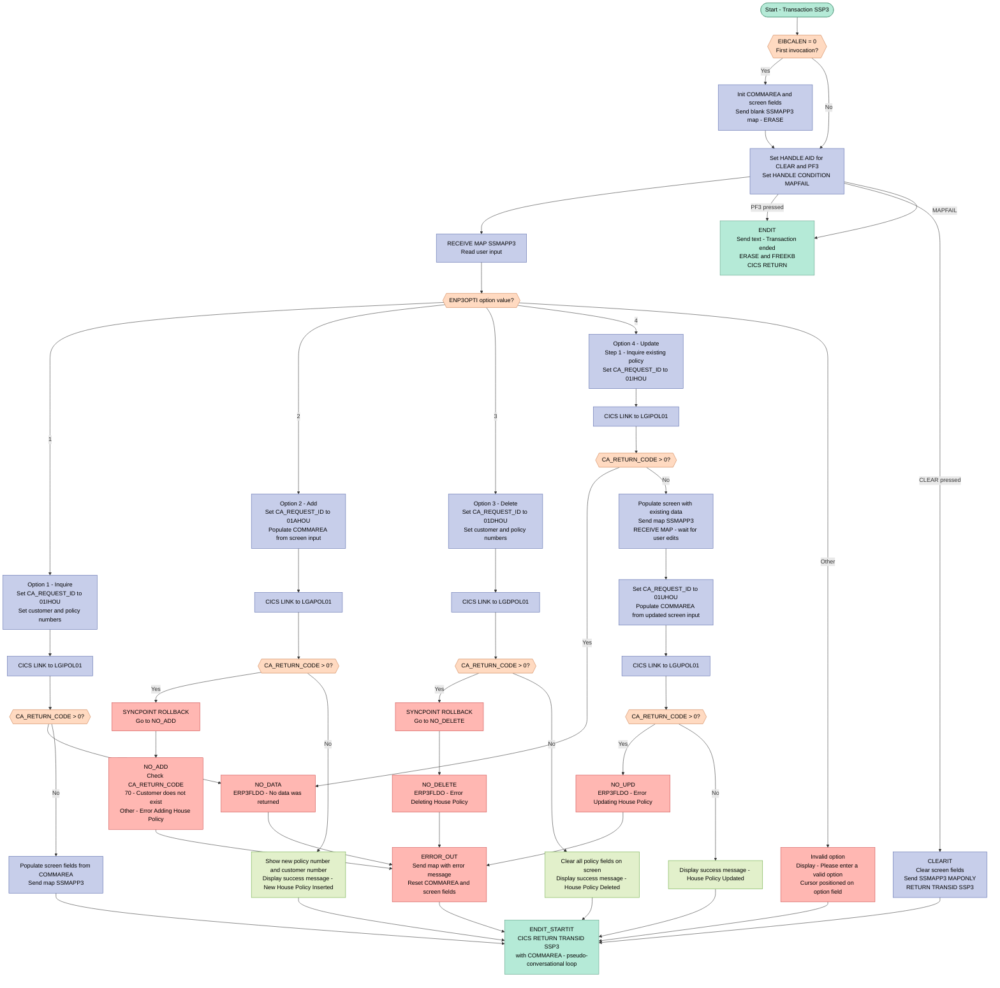
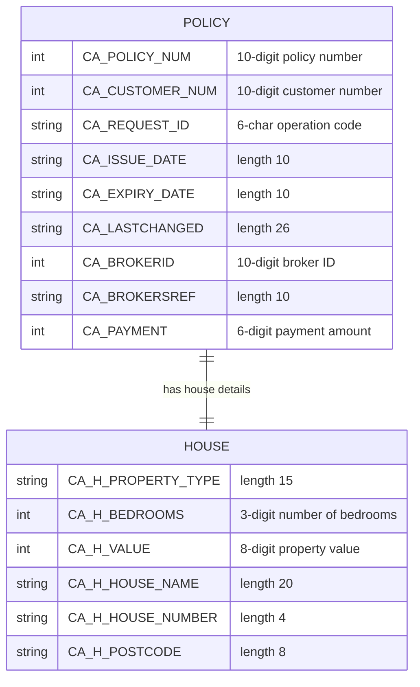

## Table of Contents

- [1. Purpose](#1-purpose)
- [2. Inputs](#2-inputs)
  - [2.1 Program Parameters (CICS COMMAREA)](#21-program-parameters-cics-commarea)
  - [2.2 CICS Terminal Screen Input (Map `SSMAPP3`, Mapset `SSMAP`)](#22-cics-terminal-screen-input-map-ssmapp3-mapset-ssmap)
  - [2.3 CICS Screen Output Fields (Read Back from Prior Send)](#23-cics-screen-output-fields-read-back-from-prior-send)
  - [2.4 CICS AID Keys](#24-cics-aid-keys)
  - [2.5 CICS System Fields](#25-cics-system-fields)
- [3. Outputs](#3-outputs)
  - [3.1 CICS Screen Output (EXEC CICS SEND MAP — map `SSMAPP3` / mapset `SSMAP`)](#31-cics-screen-output-exec-cics-send-map--map-ssmapp3--mapset-ssmap)
  - [3.2 CICS End-of-Transaction Screen Output (EXEC CICS SEND TEXT)](#32-cics-end-of-transaction-screen-output-exec-cics-send-text)
  - [3.3 CICS COMMAREA Passed on `EXEC CICS RETURN TRANSID('SSP3')`](#33-cics-commarea-passed-on-exec-cics-return-transidssp3)
  - [3.4 Back-End Program Calls (EXEC CICS LINK — data written to downstream services)](#34-back-end-program-calls-exec-cics-link--data-written-to-downstream-services)
- [4. Processing Logic](#4-processing-logic)
  - [4.1 Mermaid Flow Diagram](#41-mermaid-flow-diagram)
  - [4.2 Processing Logic Description](#42-processing-logic-description)
  - [4.3 Database Tables (if applicable)](#43-database-tables-if-applicable)
- [5. Paragraphs](#5-paragraphs)
- [6. Dependencies](#6-dependencies)
  - [6.1 CICS Runtime & Transaction Environment](#61-cics-runtime--transaction-environment)
  - [6.2 BMS Maps & Mapsets](#62-bms-maps--mapsets)
  - [6.3 Copybook / Include Members](#63-copybook--include-members)
  - [6.4 External Programs (EXEC CICS LINK)](#64-external-programs-exec-cics-link)
  - [6.5 COMMAREA / Inter-Program Data](#65-commarea--inter-program-data)
- [7. Constraints](#7-constraints)
  - [7.1 User Input Validation](#71-user-input-validation)
  - [7.2 Field Size Constraints (Declared Data Lengths)](#72-field-size-constraints-declared-data-lengths)
  - [7.3 COMMAREA and CICS LINK Constraints](#73-commarea-and-cics-link-constraints)
  - [7.4 Transaction Flow and Sequencing Constraints](#74-transaction-flow-and-sequencing-constraints)
  - [7.5 Error Handling and State Reset Constraints](#75-error-handling-and-state-reset-constraints)
  - [7.6 Initialisation Constraints](#76-initialisation-constraints)
- [8. Error Handling](#8-error-handling)
  - [8.1 Input Validation](#81-input-validation)
  - [8.2 Back-End Service Return Code Checks](#82-back-end-service-return-code-checks)
  - [8.3 Transaction Lifecycle and AID Key Handling](#83-transaction-lifecycle-and-aid-key-handling)
  - [8.4 Recovery and State Reset Logic](#84-recovery-and-state-reset-logic)
  - [8.5 User Notification via On-Screen Error Messages](#85-user-notification-via-on-screen-error-messages)
  - [8.6 Graceful Transaction Termination](#86-graceful-transaction-termination)
- [9. Examples](#9-examples)
  - [9.1 Example 1 — Inquire House Policy (Option 1)](#91-example-1--inquire-house-policy-option-1)
  - [9.2 Example 2 — Add House Policy (Option 2)](#92-example-2--add-house-policy-option-2)
  - [9.3 Example 3 — Delete House Policy (Option 3)](#93-example-3--delete-house-policy-option-3)
  - [9.4 Example 4 — Invalid Option Entry](#94-example-4--invalid-option-entry)
  - [9.5 Example 5 — Add Policy for Non-Existent Customer (Option 2, Error Path)](#95-example-5--add-policy-for-non-existent-customer-option-2-error-path)

## 1. Purpose

`LGTESTP3` is a CICS interactive PL/I program that serves as the menu-driven transaction handler (transaction `SSP3`) for managing house insurance policies within a general insurance application. It presents a BMS map screen (`SSMAPP3`) to the user, accepts a single-character option, and routes the request to one of four back-end service programs via `EXEC CICS LINK`: option 1 invokes `LGIPOL01` to inquire about an existing house policy, option 2 invokes `LGAPOL01` to add a new house policy, option 3 invokes `LGDPOL01` to delete a policy, and option 4 first retrieves the current policy details via `LGIPOL01` and then submits the user's changes through `LGUPOL01` to perform an update. Policy details exchanged with those back-end programs — including property type, number of bedrooms, declared value, house name, house number, postcode, and issue/expiry dates — are passed through a shared COMMAREA structure, and the outcome of each operation (success or failure) is reflected back to the user on the same screen with appropriate confirmation or error messages.

## 2. Inputs

### 2.1 Program Parameters (CICS COMMAREA)

- **`COMM_AREA`** — The CICS communication area passed into the program via the `COMM_AREA_PTR` pointer parameter on the procedure call. It serves as the primary bi-directional channel between this program and the back-end policy service programs (`LGIPOL01`, `LGAPOL01`, `LGDPOL01`, `LGUPOL01`). The fields within it that are consumed as inputs from the CICS runtime or a prior transaction pseudoconversation are:
  - **`CA_REQUEST_ID`** — Six-character field identifying the requested operation type (e.g., `01IHOU`, `01AHOU`, `01DHOU`, `01UHOU`). Set by this program before each `EXEC CICS LINK` call, but also preserved across pseudoconversational cycles via `EXEC CICS RETURN COMMAREA`.
  - **`CA_RETURN_CODE`** — Two-digit numeric return code received back from linked back-end programs; read after each `EXEC CICS LINK` to determine success or failure.
  - **`CA_CUSTOMER_NUM`** — Ten-digit customer identifier; read from the COMMAREA on re-entry after a prior transaction cycle and received back from back-end programs following add/update operations.
  - **`CA_POLICY_NUM`** — Ten-digit policy identifier within `CA_POLICY_REQUEST`; received back from back-end programs after a successful add and preserved in the COMMAREA across pseudoconversational cycles.
  - **`CA_ISSUE_DATE`** — Ten-character policy issue date within `CA_POLICY_COMMON`; returned by `LGIPOL01` during inquire and update operations.
  - **`CA_EXPIRY_DATE`** — Ten-character policy expiry date within `CA_POLICY_COMMON`; returned by `LGIPOL01` during inquire and update operations.
  - **`CA_H_PROPERTY_TYPE`** — Fifteen-character house property classification within `CA_HOUSE`; returned by the inquire back-end program.
  - **`CA_H_BEDROOMS`** — Three-digit bedroom count within `CA_HOUSE`; returned by the inquire back-end program.
  - **`CA_H_VALUE`** — Eight-digit property monetary value within `CA_HOUSE`; returned by the inquire back-end program.
  - **`CA_H_HOUSE_NAME`** — Twenty-character property name within `CA_HOUSE`; returned by the inquire back-end program.
  - **`CA_H_HOUSE_NUMBER`** — Four-character street number within `CA_HOUSE`; returned by the inquire back-end program.
  - **`CA_H_POSTCODE`** — Eight-character postal code within `CA_HOUSE`; returned by the inquire back-end program.
  - **`CA_REQUEST_INITIALISER`** — 32,482-character filler union member used to clear the request-specific portion of the COMMAREA; treated as an input seed to reset state between operations.

### 2.2 CICS Terminal Screen Input (Map `SSMAPP3`, Mapset `SSMAP`)

Fields received from the terminal operator via `EXEC CICS RECEIVE MAP('SSMAPP3') INTO(SSMAPP3I)`:

- **`ENP3OPTI`** — Single-character option field; the operator enters `'1'` (inquire), `'2'` (add), `'3'` (delete), or `'4'` (update) to select the house policy transaction to perform.
- **`ENP3CNOI`** — Ten-character customer number entered by the operator on the screen; used as `CA_CUSTOMER_NUM` when adding or updating a house policy.
- **`ENP3PNOI`** — Ten-character policy number entered by the operator on the screen; fed back to the output map after a successful add.
- **`ENP3IDAI`** — Ten-character issue date entered or confirmed by the operator; mapped to `CA_ISSUE_DATE` for add and update operations.
- **`ENP3EDAI`** — Ten-character expiry date entered or confirmed by the operator; mapped to `CA_EXPIRY_DATE` for add and update operations.
- **`ENP3TYPI`** — Fifteen-character property type entered by the operator; mapped to `CA_H_PROPERTY_TYPE` for add and update operations.
- **`ENP3BEDI`** — Three-character bedroom count entered by the operator; mapped to `CA_H_BEDROOMS` for add and update operations.
- **`ENP3VALI`** — Eight-character property value entered by the operator; mapped to `CA_H_VALUE` for add and update operations.
- **`ENP3HNMI`** — Twenty-character house name entered by the operator; mapped to `CA_H_HOUSE_NAME` for add and update operations.
- **`ENP3HNOI`** — Four-character house number entered by the operator; mapped to `CA_H_HOUSE_NUMBER` for add and update operations.
- **`ENP3HPCI`** — Eight-character postcode entered by the operator; mapped to `CA_H_POSTCODE` for add and update operations.

### 2.3 CICS Screen Output Fields (Read Back from Prior Send)

Fields on the output map `SSMAPP3O` that persist across the pseudoconversational cycle and are read back as positional inputs during inquire-then-update (option `'4'`) and delete/inquire (options `'1'` and `'3'`):

- **`ENP3CNOO`** — Ten-character customer number output field whose value from the prior screen send is treated as the customer identifier for inquire and delete operations.
- **`ENP3PNOO`** — Ten-character policy number output field whose value from the prior screen send is treated as the policy identifier for inquire and delete operations.

### 2.4 CICS AID Keys

- **`CLEAR` key** — Handled by the `CLEARIT` label; causes the screen to be cleared and the transaction to restart without invoking any back-end program.
- **`PF3` key** — Handled by the `ENDIT` label; terminates the transaction by sending the end message and returning without continuation.

### 2.5 CICS System Fields

- **`EIBCALEN`** — CICS-provided Execute Interface Block field indicating the length of the passed COMMAREA. When zero (first invocation), the program initialises the COMMAREA and sends the initial blank map rather than processing any user input.

## 3. Outputs

### 3.1 CICS Screen Output (EXEC CICS SEND MAP — map `SSMAPP3` / mapset `SSMAP`)

- **`ERP3FLDO`** — 40-character error/status message field written to the `SSMAPP3` screen on every terminal interaction
  - Set to `'New House Policy Inserted'` after a successful add (option 2)
  - Set to `'House Policy Deleted'` after a successful delete (option 3)
  - Set to `'House Policy Updated'` after a successful update (option 4)
  - Set to `'Please enter a valid option'` when an unrecognised option is entered
  - Set to `'Customer does not exist'` when the back-end add returns return code 70
  - Set to `'Error Adding House Policy'` on any other add failure
  - Set to `'Error Updating House Policy'` on an update failure
  - Set to `'Error Deleting House Policy'` on a delete failure
  - Set to `'No data was returned.'` when an inquire or update-prefetch finds no record

- **House policy data fields** — populated from the COMMAREA after a successful inquire (option 1) or update-prefetch (option 4) and written to the `SSMAPP3` map for display to the user
  - `ENP3IDAO` / `ENP3IDAI` — issue date sourced from `CA_ISSUE_DATE`
  - `ENP3EDAO` / `ENP3EDAI` — expiry date sourced from `CA_EXPIRY_DATE`
  - `ENP3TYPO` / `ENP3TYPI` — property type sourced from `CA_H_PROPERTY_TYPE`
  - `ENP3BEDO` / `ENP3BEDI` — bedroom count sourced from `CA_H_BEDROOMS`
  - `ENP3VALO` / `ENP3VALI` — property value sourced from `CA_H_VALUE`
  - `ENP3HNMO` / `ENP3HNMI` — house name sourced from `CA_H_HOUSE_NAME`
  - `ENP3HNOO` / `ENP3HNOI` — house number sourced from `CA_H_HOUSE_NUMBER`
  - `ENP3HPCO` / `ENP3HPCI` — postcode sourced from `CA_H_POSTCODE`

- **Confirmed policy and customer identifiers** — echoed back to the screen after a successful add (option 2) or update (option 4)
  - `ENP3CNOI` — customer number read back from `CA_CUSTOMER_NUM` after add/update
  - `ENP3PNOI` — policy number read back from `CA_POLICY_NUM` after add/update

### 3.2 CICS End-of-Transaction Screen Output (EXEC CICS SEND TEXT)

- **`MSGEND`** — static 24-character literal `'Transaction ended'` sent as plain text to the terminal when the user presses PF3 or CLEAR, or when a MAPFAIL condition is raised; signals final termination of the transaction

### 3.3 CICS COMMAREA Passed on `EXEC CICS RETURN TRANSID('SSP3')`

- **`COMM_AREA`** — the full 32,500-byte communication area is passed back to CICS as the COMMAREA on every pseudo-conversational return, preserving the current transaction state (policy number, customer number, request ID, return code, and all house policy fields) for the next invocation of the `SSP3` transaction

### 3.4 Back-End Program Calls (EXEC CICS LINK — data written to downstream services)

- **`LGIPOL01`** — called with `CA_REQUEST_ID='01IHOU'`, `CA_CUSTOMER_NUM`, and `CA_POLICY_NUM`; retrieves house policy data; the COMMAREA is the vehicle for both input and output
- **`LGAPOL01`** — called with `CA_REQUEST_ID='01AHOU'` and all house policy fields populated from screen input; inserts a new house policy record; returns `CA_POLICY_NUM` and `CA_RETURN_CODE`
- **`LGDPOL01`** — called with `CA_REQUEST_ID='01DHOU'`, `CA_CUSTOMER_NUM`, and `CA_POLICY_NUM`; deletes the identified house policy record; returns `CA_RETURN_CODE`
- **`LGUPOL01`** — called with `CA_REQUEST_ID='01UHOU'` and all updated house policy fields; modifies the existing house policy record; returns `CA_RETURN_CODE`

## 4. Processing Logic

### 4.1 Mermaid Flow Diagram

---

### 4.2 Processing Logic Description

#### 4.2.1 High-level Summary

`LGTESTP3` is a CICS pseudo-conversational menu program that provides an interactive screen interface for **House Insurance Policy transactions**. It runs under CICS transaction `SSP3` and supports four operations on a house policy: **Inquire** (1), **Add** (2), **Delete** (3), and **Update** (4). The user interacts with BMS map `SSMAPP3` (from mapset `SSMAP`). Based on the user's option selection, the program populates a shared COMMAREA and calls appropriate back-end policy service programs via `EXEC CICS LINK`.

---

#### 4.2.2 Execution Flow

**Step 1 – First Invocation Detection**
When the transaction starts fresh (i.e., `EIBCALEN = 0`, meaning no COMMAREA was passed from a prior invocation), the program:
- Allocates its own COMMAREA storage (`BASE_COMM_AREA`)
- Initialises all COMMAREA fields and screen output fields to spaces/zeroes
- Sends a clean (erased) `SSMAPP3` map to the terminal to prompt for input

**Step 2 – Set Up Key and Condition Handlers**
Before receiving user input, the program registers:
- `EXEC CICS HANDLE AID CLEAR(CLEARIT) PF3(ENDIT)` – pressing CLEAR re-displays the blank screen; pressing PF3 terminates the transaction
- `EXEC CICS HANDLE CONDITION MAPFAIL(ENDIT)` – if the RECEIVE MAP gets no data (e.g., user pressed Enter on empty screen), control transfers to `ENDIT`

**Step 3 – Receive User Input**
`EXEC CICS RECEIVE MAP('SSMAPP3') INTO(SSMAPP3I)` reads the terminal input into the map input structure. The key field is `ENP3OPTI` (the option character entered by the user) and the output counterpart `ENP3OPTO` from the prior screen cycle.

**Step 4 – Option Dispatch (`SELECT` on `ENP3OPTO`)**

| Option | Operation | Back-end Program | Request ID |
|--------|-----------|-----------------|------------|
| `'1'` | Inquire House Policy | `LGIPOL01` | `01IHOU` |
| `'2'` | Add House Policy | `LGAPOL01` | `01AHOU` |
| `'3'` | Delete House Policy | `LGDPOL01` | `01DHOU` |
| `'4'` | Update House Policy | `LGIPOL01` then `LGUPOL01` | `01IHOU` → `01UHOU` |
| Other | Invalid input | — | — |

---

**Option 1 – Inquire:**
- Sets `CA_REQUEST_ID = '01IHOU'`, customer number from screen output field `ENP3CNOO`, and policy number from `ENP3PNOO`
- Links to `LGIPOL01`
- On success (`CA_RETURN_CODE = 0`): populates all house policy screen fields (issue date, expiry date, property type, bedrooms, value, house name, house number, postcode) from the COMMAREA and sends the map
- On failure: jumps to `NO_DATA`

**Option 2 – Add:**
- Sets `CA_REQUEST_ID = '01AHOU'`, reads all policy data from the screen input fields (`ENP3*I`) into the COMMAREA (`CA_H_*` fields, dates, customer number)
- Zeroes payment and broker fields
- Links to `LGAPOL01`
- On success: reads back the assigned customer/policy number from COMMAREA, displays `'New House Policy Inserted'`
- On failure: issues `EXEC CICS SYNCPOINT ROLLBACK` to undo any partial DB2/VSAM changes, then jumps to `NO_ADD`

**Option 3 – Delete:**
- Sets `CA_REQUEST_ID = '01DHOU'`, passes existing customer/policy numbers from output fields
- Links to `LGDPOL01`
- On success: blanks all policy data fields on screen, displays `'House Policy Deleted'`
- On failure: issues `SYNCPOINT ROLLBACK`, then jumps to `NO_DELETE`

**Option 4 – Update (two-phase):**
- **Phase 1 – Pre-populate:** Sets `CA_REQUEST_ID = '01IHOU'` and links to `LGIPOL01` to retrieve the current policy data. If that fails, jumps to `NO_DATA`. On success, populates the screen with existing data and sends the map
- **Phase 2 – Receive edits:** Issues a second `EXEC CICS RECEIVE MAP` to wait for the user to modify the displayed data
- Sets `CA_REQUEST_ID = '01UHOU'`, populates COMMAREA from the updated screen input fields, and links to `LGUPOL01`
- On success: displays `'House Policy Updated'`
- On failure: jumps to `NO_UPD`

**Invalid Option:**
- Sets error message `'Please enter a valid option'` in `ERP3FLDO`
- Sends the map with `CURSOR` option to place the cursor on the option input field
- Loops back via `ENDIT_STARTIT`

---

**Step 5 – Terminal Control Labels**

| Label | Purpose |
|-------|---------|
| `ENDIT_STARTIT` | Pseudo-conversational loop end: `EXEC CICS RETURN TRANSID('SSP3') COMMAREA(COMM_AREA)` saves state and re-invokes the same transaction on the next user input |
| `ENDIT` | Graceful exit: sends `'Transaction ended'` text with `ERASE`/`FREEKB` and returns without a TRANSID, ending the conversational session |
| `CLEARIT` | Screen clear: blanks all input fields, sends `SSMAPP3` with `MAPONLY` (no data, just labels), then loops back via `ENDIT_STARTIT` |

---

**Step 6 – Error Handling**

| Label | Condition | Message |
|-------|-----------|---------|
| `NO_ADD` | `CA_RETURN_CODE = 70` | `'Customer does not exist'` |
| `NO_ADD` | Other return codes | `'Error Adding House Policy'` |
| `NO_UPD` | Any non-zero return code | `'Error Updating House Policy'` |
| `NO_DELETE` | Any non-zero return code | `'Error Deleting House Policy'` |
| `NO_DATA` | Any non-zero return code on inquire | `'No data was returned.'` |

All error paths converge at `ERROR_OUT`, which:
1. Sends the map with the error message in `ERP3FLDO`
2. Resets the COMMAREA (`COMM_AREA_RAW`, `CA_REQUEST_ID`, `CA_RETURN_CODE`, `CA_CUSTOMER_NUM`, `CA_REQUEST_INITIALISER`) to clean state
3. Jumps to `ENDIT_STARTIT` to loop the transaction

---

#### 4.2.3 External Interactions

| Program | CICS Command | Purpose |
|---------|-------------|---------|
| `LGIPOL01` | `EXEC CICS LINK` | Inquire existing house policy from DB2/VSAM |
| `LGAPOL01` | `EXEC CICS LINK` | Add a new house policy record |
| `LGDPOL01` | `EXEC CICS LINK` | Delete an existing house policy record |
| `LGUPOL01` | `EXEC CICS LINK` | Update an existing house policy record |

All calls use a shared 32,500-byte COMMAREA (`COMM_AREA`) as the data exchange mechanism. The `CA_REQUEST_ID` field tells the back-end program which operation to perform, and `CA_RETURN_CODE` carries the outcome back.

---

#### 4.2.4 Plain Language Summary

`LGTESTP3` is a **CICS terminal menu program** for managing house insurance policies. When a user starts the `SSP3` transaction, they see a data-entry screen where they can type in a customer number, a policy number, and property details, then select an option (1–4) to look up, add, remove, or change a house policy.

The program checks the option selected, packages the screen data into a shared area, and calls a specialist back-end program to do the actual database work. If the back-end reports success, the screen is refreshed with a confirmation message. If it reports an error, any partial changes are rolled back and an appropriate error message is shown. Pressing PF3 ends the session cleanly; pressing CLEAR refreshes the screen. The program is **pseudo-conversational** — between each user keystroke it exits and saves its state, reactivating on the next input, which is efficient for CICS memory management.

---

### 4.3 Database Tables (if applicable)

`LGTESTP3` itself does not issue any SQL statements. All database access is delegated to the linked back-end programs (`LGIPOL01`, `LGAPOL01`, `LGDPOL01`, `LGUPOL01`). The COMMAREA fields exchanged reflect the underlying `POLICY` and `HOUSE` tables that those programs access.

## 5. Paragraphs

- **Initialization block (EIBCALEN = 0 check)**
  - Serves as the program's first-invocation guard. When the CICS Execute Interface Block field `EIBCALEN` is zero, the program knows no COMMAREA was passed — meaning this is the very first time the transaction has been invoked for this terminal session.
  - Sets the COMMAREA pointer to a local base area, blanks the output map structure (`SSMAPP3O`), and resets all key COMMAREA fields (`CA_REQUEST_ID`, `CA_RETURN_CODE`, `CA_CUSTOMER_NUM`, `CA_REQUEST_INITIALISER`) to their initial/zero values.
  - Pre-populates the output map's policy number, customer number, value, and bedrooms fields with zeros/blanks so the screen is presented clean.
  - Issues `EXEC CICS SEND MAP ('SSMAPP3') MAPSET('SSMAP') ERASE` to display the house policy menu screen for the first time, erasing any previous screen content.
  - Control falls through to the `A_GAIN` label after this block on first invocation.

- **A_GAIN**
  - The main processing label that anchors the pseudo-conversational receive-and-dispatch loop. On every subsequent invocation (after the first), execution begins here directly.
  - Registers two attention-identifier (AID) handlers via `EXEC CICS HANDLE AID`: pressing the CLEAR key branches to `CLEARIT`; pressing PF3 branches to `ENDIT`. This establishes keyboard shortcut handling for the screen.
  - Registers a MAPFAIL condition handler via `EXEC CICS HANDLE CONDITION MAPFAIL(ENDIT)`, ensuring that if the user submits the map with no changed data, the program exits gracefully.
  - Issues `EXEC CICS RECEIVE MAP('SSMAPP3') INTO(SSMAPP3I) MAPSET('SSMAP')` to read the user's input from the SSMAPP3 map into the input structure `SSMAPP3I`.
  - Dispatches processing using a `SELECT (ENP3OPTO)` statement on the option field the user entered:
    - **Option '1' — Inquire House Policy**
      - Sets `CA_REQUEST_ID = '01IHOU'`, copies customer number (`ENP3CNOO`) and policy number (`ENP3PNOO`) from the output map fields into the COMMAREA.
      - Calls back-end program `LGIPOL01` via `EXEC CICS LINK` with the 32,500-byte COMMAREA.
      - If `CA_RETURN_CODE > 0`, branches to `NO_DATA` to report the failure.
      - On success, maps all returned house policy fields (issue date, expiry date, property type, bedrooms, value, house name, house number, postcode) from the COMMAREA into the input map fields (`ENP3IDAI`, `ENP3EDAI`, `ENP3TYPI`, etc.).
      - Sends the updated map back to the terminal via `EXEC CICS SEND MAP` and branches to `ENDIT_STARTIT` to end the task pseudo-conversationally.
    - **Option '2' — Add House Policy**
      - Sets `CA_REQUEST_ID = '01AHOU'`, copies customer number from the input field `ENP3CNOI`, and initialises payment, broker ID, and broker reference fields to zero/blank.
      - Moves all house policy details entered by the user (dates, property type, bedrooms, value, house name, house number, postcode) from the map input fields into the corresponding COMMAREA fields.
      - Calls `LGAPOL01` via `EXEC CICS LINK` to add the new house policy.
      - If `CA_RETURN_CODE > 0`, issues `EXEC CICS SYNCPOINT ROLLBACK` to back out any partial database changes and branches to `NO_ADD`.
      - On success, writes the returned customer number and policy number back to the output map fields (`ENP3CNOI`, `ENP3PNOI`), clears the option field, sets the confirmation message `'New House Policy Inserted'` in `ERP3FLDO`, sends the map, and branches to `ENDIT_STARTIT`.
    - **Option '3' — Delete House Policy**
      - Sets `CA_REQUEST_ID = '01DHOU'`, copies customer and policy numbers from the output map fields into the COMMAREA.
      - Calls `LGDPOL01` via `EXEC CICS LINK` to delete the house policy.
      - If `CA_RETURN_CODE > 0`, issues `EXEC CICS SYNCPOINT ROLLBACK` and branches to `NO_DELETE`.
      - On success, clears all house policy detail fields on the map to spaces, clears the option field, sets the confirmation message `'House Policy Deleted'`, sends the map, and branches to `ENDIT_STARTIT`.
    - **Option '4' — Update House Policy**
      - First performs an implicit inquire: sets `CA_REQUEST_ID = '01IHOU'`, copies the customer and policy numbers from output fields, and calls `LGIPOL01` to retrieve the current record. If `CA_RETURN_CODE > 0`, branches to `NO_DATA`.
      - Populates the map with the current values returned from the inquire call (same field mappings as option 1), then sends the map for the user to edit and issues a second `EXEC CICS RECEIVE MAP` to wait for the user's updated input.
      - After the user submits their changes, switches the request ID to `'01UHOU'`, re-copies all edited fields from the map into the COMMAREA, and calls `LGUPOL01` via `EXEC CICS LINK` to apply the update.
      - If `CA_RETURN_CODE > 0`, branches to `NO_UPD`.
      - On success, writes the returned customer and policy numbers back to the map, clears the option field, sets the confirmation message `'House Policy Updated'`, sends the map, and branches to `ENDIT_STARTIT`.
    - **OTHERWISE — Invalid option**
      - Sets `ERP3FLDO = 'Please enter a valid option'` and sets the option field length to `-1` to position the cursor on the option field.
      - Sends the map with the `CURSOR` option so the cursor lands on the option field, then branches to `ENDIT_STARTIT`.
  - After the `SELECT` block, a bare `EXEC CICS RETURN` acts as a safety return that is reached only if none of the select branches are taken (not normally executed).

- **ENDIT_STARTIT**
  - The standard pseudo-conversational termination point for all successful and controlled-exit paths.
  - Issues `EXEC CICS RETURN TRANSID('SSP3') COMMAREA(COMM_AREA)` to return control to CICS while specifying that the next terminal input should restart transaction `SSP3` (this program) and pass the current COMMAREA back, preserving session state between interactions.

- **ENDIT**
  - The graceful session-end label, branched to when the user presses PF3 or when a MAPFAIL condition is raised.
  - Sends the static end message `'Transaction ended'` to the terminal using `EXEC CICS SEND TEXT ... ERASE FREEKB`, clearing the screen and unlocking the keyboard.
  - Issues a plain `EXEC CICS RETURN` with no TRANSID, terminating the CICS task entirely without scheduling a successor transaction.

- **CLEARIT**
  - Handles the CLEAR key attention identifier.
  - Blanks the entire `SSMAPP3I` map input structure to remove any residual field values.
  - Issues `EXEC CICS SEND MAP ('SSMAPP3') MAPSET('SSMAP') MAPONLY` to redisplay the map using only the constant (labels/titles) from the mapset definition, without overlaying any data fields — effectively presenting a fresh blank screen.
  - Issues `EXEC CICS RETURN TRANSID('SSP3') COMMAREA(COMM_AREA)` to restart the transaction pseudo-conversationally, ready for new user input.

- **NO_ADD**
  - Error handler for a failed house policy add operation.
  - Uses a nested `SELECT (CA_RETURN_CODE)` to distinguish error codes:
    - Return code `70` maps to the message `'Customer does not exist'`.
    - Any other non-zero code maps to `'Error Adding House Policy'`.
  - Both branches perform a `GO TO ERROR_OUT` to reach the common error-display and cleanup routine.

- **NO_UPD**
  - Error handler for a failed house policy update operation.
  - Sets `ERP3FLDO = 'Error Updating House Policy'` and immediately branches to `ERROR_OUT`.

- **NO_DELETE**
  - Error handler for a failed house policy delete operation.
  - Sets `ERP3FLDO = 'Error Deleting House Policy'` and immediately branches to `ERROR_OUT`.

- **NO_DATA**
  - Error handler invoked when the inquire call (option 1 or the pre-update inquire in option 4) returns a non-zero return code.
  - Sets `ERP3FLDO = 'No data was returned.'` and branches to `ERROR_OUT`.

- **ERROR_OUT**
  - Common error display and state-reset routine reached from all error-handling labels (`NO_ADD`, `NO_UPD`, `NO_DELETE`, `NO_DATA`).
  - Issues `EXEC CICS SEND MAP ('SSMAPP3') FROM(SSMAPP3O) MAPSET('SSMAP')` to display the error message already placed in `ERP3FLDO` on the terminal screen.
  - Resets session state by blanking `SSMAPP3I`, clearing `COMM_AREA_RAW`, and resetting `CA_REQUEST_ID`, `CA_RETURN_CODE`, `CA_CUSTOMER_NUM`, and `CA_REQUEST_INITIALISER` to their default blank/zero values, preventing stale data from contaminating the next transaction cycle.
  - Branches to `ENDIT_STARTIT` to return control to CICS and reschedule the transaction, allowing the user to try again.

## 6. Dependencies

### 6.1 CICS Runtime & Transaction Environment

- **CICS Transaction `SSP3`** — the CICS transaction ID under which this program executes; passed on every `EXEC CICS RETURN TRANSID('SSP3')` to keep the pseudo-conversational loop alive
- **CICS Execute Interface Block (`EIBCALEN`)** — a CICS-supplied field checked at program entry to determine whether this is a fresh invocation (no COMMAREA) or a continuation; governs initial screen setup vs. normal processing
- **CICS HANDLE AID / HANDLE CONDITION** — CICS attention-identifier and condition-handling facilities used to intercept PF3, CLEAR key presses, and MAPFAIL conditions, routing control to `ENDIT` and `CLEARIT` respectively
- **EXEC CICS SYNCPOINT ROLLBACK** — CICS syncpoint service invoked on add and delete failures to undo any in-flight unit-of-work changes before returning an error to the user

### 6.2 BMS Maps & Mapsets

- **Mapset `SSMAP` / Map `SSMAPP3`** — the BMS mapset and map used for all screen I/O in this program; loaded and sent via `EXEC CICS SEND MAP` and received via `EXEC CICS RECEIVE MAP`; the map provides all house-policy input/output fields (policy number, customer number, dates, property type, bedrooms, value, house name/number, postcode, option, and error message fields)
  - **`SSMAPP3I` / `SSMAPP3O`** — the PL/I structures that mirror the BMS symbolic map for input and output respectively; declared inline from the expanded `SSMAP` include
  - **`ENP3OPTI` / `ENP3OPTO`** — option input/output fields that drive transaction branching (1=inquire, 2=add, 3=delete, 4=update)
  - **`ERP3FLDO`** — error/status message output field on the map

### 6.3 Copybook / Include Members

- **`SSMAP` (`plinc/SSMAP.inc`)** — PL/I include member that defines all BMS symbolic map structures for the full application (SSMAPC1I/O, SSMAPP1I/O through SSMAPP5I/O); inlined at compile time via `%INCLUDE SSMAP`
- **`LGCMAREA` (`plinc/LGCMAREA.inc`)** — PL/I include member that defines the shared COMMAREA structure (`COMM_AREA`) used across all GenApp back-end programs; inlined at compile time via `%INCLUDE LGCMAREA`

### 6.4 External Programs (EXEC CICS LINK)

- **`LGIPOL01`** — back-end policy inquiry program; called with `CA_REQUEST_ID = '01IHOU'` to retrieve house policy details for a given customer and policy number (used for both option 1 – inquire, and as a pre-step in option 4 – update)
- **`LGAPOL01`** — back-end policy add program; called with `CA_REQUEST_ID = '01AHOU'` to insert a new house policy record for the specified customer
- **`LGDPOL01`** — back-end policy delete program; called with `CA_REQUEST_ID = '01DHOU'` to remove an existing house policy record
- **`LGUPOL01`** — back-end policy update program; called with `CA_REQUEST_ID = '01UHOU'` to update an existing house policy record with modified field values

### 6.5 COMMAREA / Inter-Program Data

- **`COMM_AREA` (32,500 bytes, based on `LGCMAREA`)** — the primary data-exchange structure passed to all linked back-end programs and returned on `EXEC CICS RETURN TRANSID`; carries:
  - `CA_REQUEST_ID` — six-character operation code set before each `EXEC CICS LINK` call
  - `CA_RETURN_CODE` — two-digit return code read after each `EXEC CICS LINK` call to determine success or failure
  - `CA_CUSTOMER_NUM` — ten-digit customer identifier
  - `CA_POLICY_NUM` — ten-digit policy identifier
  - `CA_ISSUE_DATE`, `CA_EXPIRY_DATE` — policy date fields
  - `CA_H_PROPERTY_TYPE`, `CA_H_BEDROOMS`, `CA_H_VALUE`, `CA_H_HOUSE_NAME`, `CA_H_HOUSE_NUMBER`, `CA_H_POSTCODE` — house-policy-specific fields within the `CA_HOUSE` union member
  - `CA_REQUEST_INITIALISER` — 32,482-byte filler used to clear the request-specific portion of COMMAREA before reuse
  - `CA_PAYMENT`, `CA_BROKERID`, `CA_BROKERSREF` — common policy fields set to default values on add and update calls

## 7. Constraints

### 7.1 User Input Validation

- **Option field must be one of four discrete values** — `ENP3OPTI`/`ENP3OPTO` (the single-character option field on map `SSMAPP3`) is tested in a `SELECT` statement; only the literal values `'1'`, `'2'`, `'3'`, and `'4'` are accepted. Any other value causes the `OTHERWISE` branch to execute, sets `ERP3FLDO` to `'Please enter a valid option'`, repositions the cursor to the option field (`ENP3OPTL = -1`), and re-sends the map without performing any back-end call (lines 859–869).
  - `'1'` → Inquire house policy
  - `'2'` → Add house policy
  - `'3'` → Delete house policy
  - `'4'` → Update house policy

- **Customer number must identify an existing customer for Add** — when option `'2'` (add) is used and `LGAPOL01` returns `CA_RETURN_CODE = 70`, the program branches to `NO_ADD` and sets `ERP3FLDO` to `'Customer does not exist'`, blocking the insertion (lines 901–905). No add proceeds unless the back-end confirms the customer record exists.

- **Policy must exist before it can be inquired, deleted, or updated** — for options `'1'`, `'3'`, and `'4'`, a non-zero `CA_RETURN_CODE` from `LGIPOL01` (inquire) or `LGDPOL01`/`LGUPOL01` routes to `NO_DATA`, `NO_DELETE`, or `NO_UPD` respectively, each displaying an appropriate error and abandoning the operation (lines 727–728, 783–785, 811–812, 845–846).

### 7.2 Field Size Constraints (Declared Data Lengths)

- **Policy number (`CA_POLICY_NUM`)** — `PIC '9999999999'`: exactly 10 decimal digits; numeric only.
- **Customer number (`CA_CUSTOMER_NUM`)** — `PIC '9999999999'`: exactly 10 decimal digits; numeric only.
- **Return code (`CA_RETURN_CODE`)** — `PIC '99'`: exactly 2 decimal digits.
- **Request ID (`CA_REQUEST_ID`)** — `CHAR(6)`: exactly 6 characters; must contain a recognised operation code such as `'01IHOU'`, `'01AHOU'`, `'01DHOU'`, or `'01UHOU'`.
- **Issue date (`CA_ISSUE_DATE`) / Expiry date (`CA_EXPIRY_DATE`)** — both `CHAR(10)`: maximum 10 characters; no format validation is performed by this program (delegated to back-end).
- **Property type (`CA_H_PROPERTY_TYPE`)** — `CHAR(15)`: maximum 15 characters, mapped from screen field `ENP3TYPI` which is also 15 characters.
- **Bedroom count (`CA_H_BEDROOMS`)** — `PIC '999'`: exactly 3 decimal digits; numeric only.
- **House value (`CA_H_VALUE`)** — `PIC '99999999'`: exactly 8 decimal digits; numeric only.
- **House name (`CA_H_HOUSE_NAME`)** — `CHAR(20)`: maximum 20 characters.
- **House number (`CA_H_HOUSE_NUMBER`)** — `CHAR(4)`: maximum 4 characters, mapped to screen field `ENP3HNOI` (also 4 characters).
- **Postcode (`CA_H_POSTCODE`)** — `CHAR(8)`: maximum 8 characters, mapped to screen field `ENP3HPCI` (also 8 characters).
- **COMMAREA raw size** — `COMM_AREA_RAW CHAR(32500)`: the total communication area is fixed at 32,500 characters. This is the absolute upper bound on any data passed between the menu program and back-end programs.
- **Request initialiser (`CA_REQUEST_INITIALISER`)** — `CHAR(32482)`: the policy-request union overlay used to blank residual data; its size is an implicit constraint that the policy-specific portion of the COMMAREA cannot exceed 32,482 characters.
- **Error/message output field (`ERP3FLDO`)** — `CHAR(40)`: all user-facing messages are truncated to 40 characters.

### 7.3 COMMAREA and CICS LINK Constraints

- **COMMAREA length is fixed at 32,500 bytes on every LINK call** — all four `EXEC CICS LINK` calls (`LGIPOL01`, `LGAPOL01`, `LGDPOL01`, `LGUPOL01`) specify `LENGTH(32500)`. The receiving back-end programs must be able to accept a COMMAREA of exactly this length; a mismatch would cause a CICS LENGERR condition (lines 724–726, 758–760, 780–782, 842–844).
- **COMMAREA must be non-empty on pseudo-conversational re-entry** — `EIBCALEN = 0` is checked at program entry. If it is zero (first invocation or no COMMAREA passed), the program allocates its own local storage, initialises all fields, and sends the blank map. This prevents any processing against an uninitialised COMMAREA (lines 687–704).
- **COMMAREA is passed forward on every non-terminal return** — `EXEC CICS RETURN TRANSID('SSP3') COMMAREA(COMM_AREA)` is used at `ENDIT_STARTIT` and `CLEARIT` to preserve state across pseudo-conversational cycles. The transaction ID `'SSP3'` is hardcoded, so the COMMAREA is only meaningful if the next invocation is also transaction `SSP3` (lines 877–879, 896–898).

### 7.4 Transaction Flow and Sequencing Constraints

- **Update requires a successful prior Inquire in the same conversation cycle** — option `'4'` (update) first executes a full `EXEC CICS LINK` to `LGIPOL01` with `CA_REQUEST_ID = '01IHOU'` and displays the retrieved data to the user. Only after a second `EXEC CICS RECEIVE MAP` collecting the user's edits does it issue the `EXEC CICS LINK` to `LGUPOL01` with `CA_REQUEST_ID = '01UHOU'`. The update cannot be submitted in a single map interaction; the inquire-then-edit-then-update sequence is enforced by the program's control flow (lines 804–856).
- **CLEAR key or PF3 terminates the transaction unconditionally** — `EXEC CICS HANDLE AID CLEAR(CLEARIT) PF3(ENDIT)` is established at the top of every conversational cycle. Pressing CLEAR clears the map and re-registers the transaction (`CLEARIT` path); pressing PF3 sends the `'Transaction ended'` message and executes a plain `EXEC CICS RETURN` with no TRANSID, ending the pseudo-conversation (lines 708–710, 881–887).
- **MAPFAIL terminates the session** — `EXEC CICS HANDLE CONDITION MAPFAIL(ENDIT)` routes any null or empty map receive to `ENDIT`, terminating the transaction. No processing occurs if the user submits an empty screen (lines 711–712).

### 7.5 Error Handling and State Reset Constraints

- **Back-end failure triggers rollback for write operations** — for option `'2'` (add) and option `'3'` (delete), a non-zero `CA_RETURN_CODE` from the back-end program causes an `EXEC CICS SYNCPOINT ROLLBACK` before branching to the error label. This prevents partial updates from being committed. The rollback is not issued for the read-only inquire (option `'1'`) or for the inquire phase of update (lines 761–763, 783–785).
- **COMMAREA and map are fully reset after any error** — at `ERROR_OUT`, the program blanks `SSMAPP3I`, `COMM_AREA_RAW`, `CA_REQUEST_ID`, `CA_REQUEST_INITIALISER`, and resets `CA_RETURN_CODE = 0` and `CA_CUSTOMER_NUM = 0` before re-entering the pseudo-conversational loop. This ensures no residual data from a failed operation contaminates the next request (lines 929–936).
- **Add failure return code 70 is the only specifically handled back-end error code** — `NO_ADD` inspects `CA_RETURN_CODE`; only the value `70` produces the message `'Customer does not exist'`. All other non-zero codes fall to `OTHERWISE` producing the generic `'Error Adding House Policy'` message. For delete (`NO_DELETE`) and update (`NO_UPD`), no specific return-code discrimination is performed (lines 900–910).

### 7.6 Initialisation Constraints

- **Screen output fields for numeric values are pre-initialised to zero** — on first entry (`EIBCALEN = 0`), `ENP3CNOO`, `ENP3PNOO`, `ENP3VALO`, and `ENP3BEDO` are explicitly set to `'0000000000'`, `'0000000000'`, `'00000000'`, and `'000'` respectively, preventing the user from seeing uninitialised binary or garbage data in those fields (lines 695–698).
- **Policy-request area is blanked before each back-end call** — `CA_REQUEST_INITIALISER` is set to spaces at first entry and reset to spaces after every error, so no leftover house, motor, endowment, or commercial policy data from a prior operation is inadvertently carried into the next COMMAREA (lines 694, 934).
- **CA_PAYMENT and CA_BROKERID are zeroed; CA_BROKERSREF is blanked on Add and Update** — these fields are hardcoded to zero/spaces before calling `LGAPOL01` and `LGUPOL01`, meaning the menu program does not allow the user to supply broker or payment information for a house policy (lines 747–749, 831–833).

## 8. Error Handling

### 8.1 Input Validation

- **Invalid option check via SELECT/OTHERWISE construct**
  - After reading the map input, the program evaluates the user-entered option field (`ENP3OPTI`/`ENP3OPTO`) using a `SELECT` statement
  - If the value is not one of the four expected options (`'1'` through `'4'`), the `OTHERWISE` branch is triggered
  - The error field `ERP3FLDO` is populated with the message `'Please enter a valid option'`
  - The cursor is repositioned to the option field (`ENP3OPTL = -1`) to guide the user
  - The map is resent so the user can correct the entry without terminating the transaction

---

### 8.2 Back-End Service Return Code Checks

After every `EXEC CICS LINK` call to a back-end policy service program, the program immediately inspects `CA_RETURN_CODE` to detect failures before proceeding with any further processing.

- **Inquire failure (option 1 and option 4 — initial fetch)**
  - If `CA_RETURN_CODE > 0` after linking to `LGIPOL01`, control transfers unconditionally to the `NO_DATA` label
  - `ERP3FLDO` is set to `'No data was returned.'` before routing to the common error output routine

- **Add failure (option 2)**
  - If `CA_RETURN_CODE > 0` after linking to `LGAPOL01`, a `SYNCPOINT ROLLBACK` is issued first to undo any uncommitted database changes
  - Control then transfers to the `NO_ADD` label, where the return code is further interrogated in a nested `SELECT`:
    - A return code of `70` specifically indicates that the customer does not exist; `ERP3FLDO` is set to `'Customer does not exist'`
    - Any other non-zero return code routes to a generic message `'Error Adding House Policy'`
  - Both sub-paths within `NO_ADD` converge at `ERROR_OUT`

- **Delete failure (option 3)**
  - If `CA_RETURN_CODE > 0` after linking to `LGDPOL01`, a `SYNCPOINT ROLLBACK` is issued to back out uncommitted changes
  - Control transfers to `NO_DELETE`, where `ERP3FLDO` is set to `'Error Deleting House Policy'`
  - Processing continues to `ERROR_OUT`

- **Update failure (option 4)**
  - If `CA_RETURN_CODE > 0` after linking to `LGUPOL01`, control transfers to `NO_UPD`
  - `ERP3FLDO` is set to `'Error Updating House Policy'`
  - Processing continues to `ERROR_OUT`

---

### 8.3 Transaction Lifecycle and AID Key Handling

- **MAPFAIL condition handling via `EXEC CICS HANDLE CONDITION`**
  - The program registers a `MAPFAIL` handler that routes to the `ENDIT` label
  - If the user submits a map with no input data (resulting in MAPFAIL), the transaction ends gracefully

- **PF3 key and CLEAR key handling via `EXEC CICS HANDLE AID`**
  - Pressing **PF3** routes to the `ENDIT` label, cleanly terminating the transaction
  - Pressing **CLEAR** routes to the `CLEARIT` label, which blanks the map and re-displays it before returning with the transaction ID `SSP3`, keeping the session alive

- **EIBCALEN = 0 check for first-time invocation**
  - On the very first call (no communication area from a prior invocation), `EIBCALEN = 0` is true
  - The program initialises all communication area fields to zero/spaces, sets default display values (zeros for policy/customer number, value, and bedroom count), and sends a fresh blank map
  - This prevents residual data from corrupting the first screen presentation

---

### 8.4 Recovery and State Reset Logic

- **`EXEC CICS SYNCPOINT ROLLBACK` before error routing**
  - Issued unconditionally for the add (option 2) and delete (option 3) paths when a non-zero return code is detected
  - Ensures any partial database updates made by the back-end program are rolled back before the error is surfaced to the user, preserving data integrity

- **Communication area and screen state reset at `ERROR_OUT`**
  - After displaying the error message on the map, the program resets `SSMAPP3I`, `COMM_AREA_RAW`, `CA_REQUEST_ID`, `CA_RETURN_CODE`, `CA_CUSTOMER_NUM`, and `CA_REQUEST_INITIALISER` all to spaces or zero
  - This ensures that no stale data from the failed transaction is carried forward into the next interaction cycle
  - Control then transfers to `ENDIT_STARTIT` to return with the transaction ID `SSP3`, continuing the pseudo-conversational loop

---

### 8.5 User Notification via On-Screen Error Messages

All error conditions surface feedback to the user through the `ERP3FLDO` output field on the house policy map screen (`SSMAPP3`). The messages written to this field cover every detected failure:

- `'Please enter a valid option'` — invalid menu selection
- `'No data was returned.'` — policy inquiry found no matching record
- `'New House Policy Inserted'` — confirmation of successful add (informational, not an error)
- `'Customer does not exist'` — add attempted for a non-existent customer (return code 70)
- `'Error Adding House Policy'` — generic add failure
- `'House Policy Deleted'` — confirmation of successful delete (informational)
- `'Error Deleting House Policy'` — delete operation failed
- `'House Policy Updated'` — confirmation of successful update (informational)
- `'Error Updating House Policy'` — update operation failed

All error-path messages are sent to the terminal via `EXEC CICS SEND MAP` at the centralised `ERROR_OUT` routine, providing a single point for screen output on all failure branches.

---

### 8.6 Graceful Transaction Termination

- **`ENDIT` label**
  - Reached on PF3, CLEAR-to-end, or MAPFAIL conditions
  - Sends the static message `'Transaction ended'` as free text with `ERASE` and `FREEKB` options, clearing the screen and unlocking the keyboard
  - Issues `EXEC CICS RETURN` with no transaction ID, ending the task entirely

## 9. Examples

### 9.1 Example 1 — Inquire House Policy (Option 1)

**Screen Input**

| Field | Value |
|---|---|
| Customer Number (`ENP3CNOO`) | `0000000001` |
| Policy Number (`ENP3PNOO`) | `0000000042` |
| Option (`ENP3OPTI`) | `1` |

**Program Flow**

1. `ENP3OPTO = '1'` matches the `WHEN ('1')` branch.
2. `CA_REQUEST_ID` is set to `'01IHOU'`, `CA_CUSTOMER_NUM` to `0000000001`, and `CA_POLICY_NUM` to `0000000042`.
3. An `EXEC CICS LINK` is issued to `LGIPOL01` with the COMMAREA.
4. `LGIPOL01` returns `CA_RETURN_CODE = 0` (success) along with the policy details.
5. The returned fields are written to the screen output map fields (`ENP3IDAI`, `ENP3EDAI`, `ENP3TYPI`, `ENP3BEDI`, `ENP3VALI`, `ENP3HNMI`, `ENP3HNOI`, `ENP3HPCI`).
6. The map `SSMAPP3` is sent to the terminal displaying the policy details.

**Expected Screen Output (`ERP3FLDO`)**: *(no message — policy data fields are populated)*

| Field | Value |
|---|---|
| Issue Date | `2018-01-15` |
| Expiry Date | `2023-01-15` |
| Property Type | `Detached` |
| Bedrooms | `004` |
| Value | `00350000` |
| House Name | `Rose Cottage` |
| House Number | `12` |
| Postcode | `SW1A 2AA` |

---

### 9.2 Example 2 — Add House Policy (Option 2)

**Screen Input**

| Field | Value |
|---|---|
| Customer Number (`ENP3CNOI`) | `0000000001` |
| Issue Date (`ENP3IDAI`) | `2024-01-01` |
| Expiry Date (`ENP3EDAI`) | `2025-01-01` |
| Property Type (`ENP3TYPI`) | `Bungalow` |
| Bedrooms (`ENP3BEDI`) | `003` |
| Value (`ENP3VALI`) | `00200000` |
| House Name (`ENP3HNMI`) | `Sunny View` |
| House Number (`ENP3HNOI`) | `45` |
| Postcode (`ENP3HPCI`) | `M1 1AA` |
| Option (`ENP3OPTI`) | `2` |

**Program Flow**

1. `ENP3OPTO = '2'` matches the `WHEN ('2')` branch.
2. `CA_REQUEST_ID` is set to `'01AHOU'`; all house details and dates are copied from the screen input fields into the COMMAREA.
3. An `EXEC CICS LINK` is issued to `LGAPOL01`.
4. `LGAPOL01` returns `CA_RETURN_CODE = 0`; the newly assigned policy number is returned in `CA_POLICY_NUM`.
5. The confirmed customer and new policy number are written back to the screen output fields.
6. `ERP3FLDO` is set to `'New House Policy Inserted'` and the map is sent.

**Expected Screen Output**

| Field | Value |
|---|---|
| Customer Number displayed | `0000000001` |
| New Policy Number displayed | `0000000099` *(assigned by back-end)* |
| Message (`ERP3FLDO`) | `New House Policy Inserted` |

---

### 9.3 Example 3 — Delete House Policy (Option 3)

**Screen Input**

| Field | Value |
|---|---|
| Customer Number (`ENP3CNOO`) | `0000000001` |
| Policy Number (`ENP3PNOO`) | `0000000042` |
| Option (`ENP3OPTI`) | `3` |

**Program Flow**

1. `ENP3OPTO = '3'` matches the `WHEN ('3')` branch.
2. `CA_REQUEST_ID` is set to `'01DHOU'`, customer and policy numbers are placed in the COMMAREA.
3. `EXEC CICS LINK` calls `LGDPOL01`.
4. On success (`CA_RETURN_CODE = 0`), all policy detail screen fields are blanked and `ERP3FLDO` is set to `'House Policy Deleted'`.

**Expected Screen Output**

| Field | Value |
|---|---|
| All policy detail fields | *(blank)* |
| Message (`ERP3FLDO`) | `House Policy Deleted` |

---

### 9.4 Example 4 — Invalid Option Entry

**Screen Input**

| Field | Value |
|---|---|
| Option (`ENP3OPTI`) | `9` |

**Program Flow**

1. `ENP3OPTO = '9'` does not match any `WHEN` clause and falls through to `OTHERWISE`.
2. `ERP3FLDO` is set to `'Please enter a valid option'` and the cursor is positioned on the option field.
3. No back-end program is called.

**Expected Screen Output**

| Field | Value |
|---|---|
| Message (`ERP3FLDO`) | `Please enter a valid option` |
| Cursor | Positioned on the option input field |

---

### 9.5 Example 5 — Add Policy for Non-Existent Customer (Option 2, Error Path)

**Screen Input**

| Field | Value |
|---|---|
| Customer Number (`ENP3CNOI`) | `9999999999` *(does not exist)* |
| Option (`ENP3OPTI`) | `2` |

**Program Flow**

1. `ENP3OPTO = '2'` is processed; the COMMAREA is built and `LGAPOL01` is called.
2. `LGAPOL01` returns `CA_RETURN_CODE = 70` (customer not found).
3. An `EXEC CICS SYNCPOINT ROLLBACK` is issued to undo any partial work.
4. Control branches to `NO_ADD`; since `CA_RETURN_CODE = 70`, `ERP3FLDO` is set to `'Customer does not exist'`.
5. The error map is sent and the COMMAREA is cleared for the next transaction cycle.

**Expected Screen Output**

| Field | Value |
|---|---|
| Message (`ERP3FLDO`) | `Customer does not exist` |

---

Generated by IBM Bob Premium Package for Z
