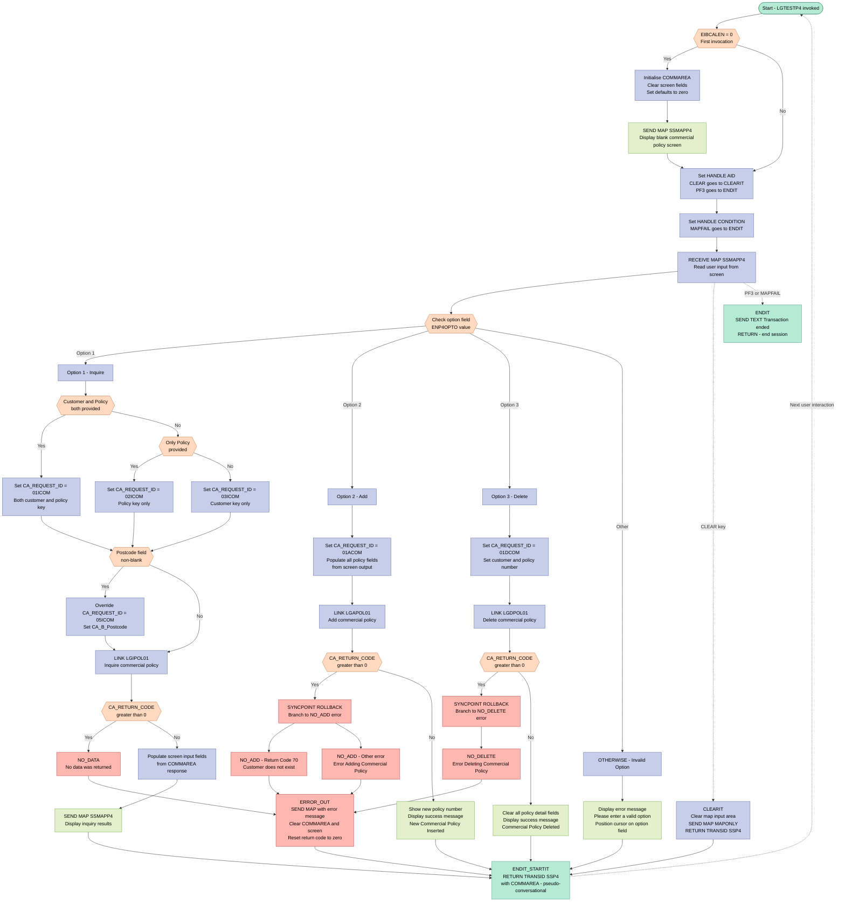
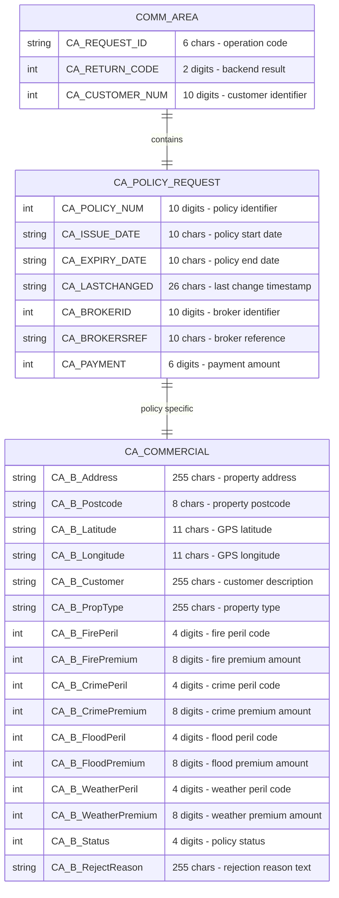

## Table of Contents

- [1. Purpose](#1-purpose)
- [2. Inputs](#2-inputs)
  - [2.1 Program Parameters](#21-program-parameters)
  - [2.2 CICS Communication Area (COMMAREA) — `COMM_AREA`](#22-cics-communication-area-commarea--comm_area)
  - [2.3 User Input — BMS Map `SSMAPP4` (screen `SSMAPP4O`/`SSMAPP4I`)](#23-user-input--bms-map-ssmapp4-screen-ssmapp4ossmapp4i)
  - [2.4 External Backend Programs (via `EXEC CICS LINK`)](#24-external-backend-programs-via-exec-cics-link)
- [3. Outputs](#3-outputs)
  - [3.1 BMS Screen Display (EXEC CICS SEND MAP / SEND TEXT)](#31-bms-screen-display-exec-cics-send-map--send-text)
  - [3.2 CICS Pseudo-Conversational State (EXEC CICS RETURN TRANSID / COMMAREA)](#32-cics-pseudo-conversational-state-exec-cics-return-transid--commarea)
  - [3.3 Backend Service Calls (EXEC CICS LINK)](#33-backend-service-calls-exec-cics-link)
- [4. Processing Logic](#4-processing-logic)
  - [4.1 Mermaid Flow Diagram](#41-mermaid-flow-diagram)
  - [4.2 Processing Logic Description](#42-processing-logic-description)
  - [4.3 Database Tables](#43-database-tables)
- [5. Paragraphs](#5-paragraphs)
- [6. Dependencies](#6-dependencies)
  - [6.1 CICS runtime and terminal interaction](#61-cics-runtime-and-terminal-interaction)
  - [6.2 Screen map and user interface dependencies](#62-screen-map-and-user-interface-dependencies)
  - [6.3 Program-to-program backend dependencies](#63-program-to-program-backend-dependencies)
  - [6.4 Communication area and data contract dependencies](#64-communication-area-and-data-contract-dependencies)
  - [6.5 Backend data source dependencies](#65-backend-data-source-dependencies)
  - [6.6 Control-flow and operational dependencies](#66-control-flow-and-operational-dependencies)
  - [6.7 Include and compile-time dependencies](#67-include-and-compile-time-dependencies)
  - [6.8 Messages and status conventions](#68-messages-and-status-conventions)
- [7. Constraints](#7-constraints)
  - [7.1 Data Validation Constraints](#71-data-validation-constraints)
  - [7.2 Conditional Processing Constraints](#72-conditional-processing-constraints)
  - [7.3 Session and Lifecycle Constraints](#73-session-and-lifecycle-constraints)
  - [7.4 Resource and Structural Constraints](#74-resource-and-structural-constraints)
- [8. Error Handling](#8-error-handling)
  - [8.1 Attention Key Interception (AID Handling)](#81-attention-key-interception-aid-handling)
  - [8.2 Exceptional Condition Handling](#82-exceptional-condition-handling)
  - [8.3 Input Validation — Unrecognised Menu Option](#83-input-validation--unrecognised-menu-option)
  - [8.4 Backend Return Code Checks](#84-backend-return-code-checks)
  - [8.5 Centralised Error Output and State Reset (`ERROR_OUT`)](#85-centralised-error-output-and-state-reset-error_out)
  - [8.6 Session Initialisation Guard (EIBCALEN Check)](#86-session-initialisation-guard-eibcalen-check)
  - [8.7 Graceful Transaction Termination](#87-graceful-transaction-termination)
- [9. Examples](#9-examples)
  - [9.1 Example 1 — Inquire a Commercial Policy by Customer Number and Policy Number (Option 1)](#91-example-1--inquire-a-commercial-policy-by-customer-number-and-policy-number-option-1)
  - [9.2 Example 2 — Add a New Commercial Policy (Option 2)](#92-example-2--add-a-new-commercial-policy-option-2)
  - [9.3 Example 3 — Delete a Commercial Policy (Option 3) with Error](#93-example-3--delete-a-commercial-policy-option-3-with-error)
  - [9.4 Example 4 — Invalid Option Entered](#94-example-4--invalid-option-entered)

## 1. Purpose

`LGTESTP4` is a CICS PL/I program that serves as the interactive menu handler for commercial insurance policy transactions under CICS transaction `SSP4`. It presents the BMS screen `SSMAPP4` to a terminal user and allows them to inquire upon, add, or delete a commercial property policy by selecting options 1, 2, or 3 respectively. For inquiries, it determines the appropriate search strategy — by customer and policy number, by policy number alone, by customer number alone, or by property postcode — and delegates the retrieval to the back-end program `LGIPOL01`. New policies are submitted to `LGAPOL01`, and deletions are forwarded to `LGDPOL01`, with failed operations triggering a CICS syncpoint rollback and a descriptive error message on screen. On success, the program confirms the outcome by refreshing the screen with the returned policy details or a confirmation message, then re-invokes itself pseudo-conversationally by returning with the `SSP4` transaction identifier and the communication area, maintaining session continuity until the user presses PF3 or CLEAR to end the transaction.

## 2. Inputs

### 2.1 Program Parameters

- **`DFHEIPTR`** — CICS-standard EIB pointer passed as the first procedure parameter; provides access to the CICS Execute Interface Block (EIB), including `EIBCALEN` (communication area length used to detect first-entry vs. pseudo-conversational re-entry).
- **`COMM_AREA_PTR`** — Pointer to the CICS communication area (`COMM_AREA`) passed as the second procedure parameter. On re-entry it carries all state from the previous transaction cycle, including the request identifier, return code, customer number, policy number, and the full policy-specific data block.

### 2.2 CICS Communication Area (COMMAREA) — `COMM_AREA`

Data exchanged with backend programs (`LGIPOL01`, `LGAPOL01`, `LGDPOL01`) via `EXEC CICS LINK … COMMAREA`:

- **`CA_REQUEST_ID`** — 6-character operation code (e.g., `01ICOM`, `02ICOM`, `01ACOM`, `01DCOM`, `05ICOM`) that tells the linked backend program which action to perform; set from screen input before each LINK call and received back on return.
- **`CA_RETURN_CODE`** — 2-digit numeric return code written by the backend program; a non-zero value signals a processing error and drives error-branch navigation or rollback.
- **`CA_CUSTOMER_NUM`** — 10-digit customer identifier populated from screen field `ENP4CNOO` before each backend call; returned by the backend to confirm the customer context.
- **`CA_POLICY_NUM`** — 10-digit policy identifier set from screen field `ENP4PNOO` for inquiry and delete operations; returned by `LGAPOL01` after a successful add to supply the newly assigned policy number.
- **`CA_REQUEST_INITIALISER`** — 32 482-character overlay of the `CA_REQUEST_SPECIFIC` union, used to carry (and reset) the entire policy-specific portion of the communication area between transaction cycles.
- **`CA_ISSUE_DATE`** — Policy issue date returned by the inquiry backend (`LGIPOL01`) or submitted to the add backend (`LGAPOL01`).
- **`CA_EXPIRY_DATE`** — Policy expiry date returned by the inquiry backend or submitted to the add backend.
- **`CA_B_Address`** — 255-character business property address returned on inquiry or submitted on add.
- **`CA_B_Postcode`** — 8-character postcode for the insured property; also used as a search key when `ENP4HPCO` is non-blank (request `05ICOM`).
- **`CA_B_Latitude`** / **`CA_B_Longitude`** — Geographic coordinates of the insured property, exchanged on inquiry and add.
- **`CA_B_Customer`** — 255-character customer description field exchanged on inquiry and add.
- **`CA_B_PropType`** — 255-character property-type description exchanged on inquiry and add.
- **`CA_B_FirePeril`** / **`CA_B_FirePremium`** — Fire peril indicator and associated premium exchanged on inquiry and add.
- **`CA_B_CrimePeril`** / **`CA_B_CrimePremium`** — Crime peril indicator and associated premium exchanged on inquiry and add.
- **`CA_B_FloodPeril`** / **`CA_B_FloodPremium`** — Flood peril indicator and associated premium exchanged on inquiry and add.
- **`CA_B_WeatherPeril`** / **`CA_B_WeatherPremium`** — Weather peril indicator and associated premium exchanged on inquiry and add.
- **`CA_B_Status`** — 4-digit numeric status code for the commercial policy, returned on inquiry or submitted on add.
- **`CA_B_RejectReason`** — 255-character rejection reason text returned on inquiry or submitted on add.

### 2.3 User Input — BMS Map `SSMAPP4` (screen `SSMAPP4O`/`SSMAPP4I`)

Fields read from the user's terminal via `EXEC CICS RECEIVE MAP('SSMAPP4')`:

- **`ENP4OPTO`** — Single-character menu option entered by the user; drives the main `SELECT` branch to inquiry (`1`), add (`2`), or delete (`3`).
- **`ENP4CNOO`** — 10-character customer number typed by the user; determines the inquiry request type and is passed to the backend as `CA_CUSTOMER_NUM`.
- **`ENP4PNOO`** — 10-character policy number typed by the user; determines the inquiry request type and is passed to the backend as `CA_POLICY_NUM` for inquiry and delete.
- **`ENP4HPCO`** — 8-character property postcode entered by the user; when non-blank it overrides the standard inquiry key and triggers a postcode-based search (`05ICOM`) via `CA_B_Postcode`.
- **`ENP4IDAO`** — 10-character issue date entered for a new policy (add path only); passed to `CA_ISSUE_DATE`.
- **`ENP4EDAO`** — 10-character expiry date entered for a new policy (add path only); passed to `CA_EXPIRY_DATE`.
- **`ENP4ADDO`** — 25-character property address entered by the user (add path); passed to `CA_B_Address`.
- **`ENP4LATO`** / **`ENP4LONO`** — 11-character latitude and longitude values entered by the user (add path); passed to `CA_B_Latitude` / `CA_B_Longitude`.
- **`ENP4CUSO`** — 25-character customer description entered by the user (add path); passed to `CA_B_Customer`.
- **`ENP4PTYO`** — 25-character property type entered by the user (add path); passed to `CA_B_PropType`.
- **`ENP4FPEO`** / **`ENP4FPRO`** — Fire peril code (4 chars) and premium (8 chars) entered by the user (add path); passed to `CA_B_FirePeril` / `CA_B_FirePremium`.
- **`ENP4CPEO`** / **`ENP4CPRO`** — Crime peril code and premium entered by the user (add path); passed to `CA_B_CrimePeril` / `CA_B_CrimePremium`.
- **`ENP4XPEO`** / **`ENP4XPRO`** — Flood peril code and premium entered by the user (add path); passed to `CA_B_FloodPeril` / `CA_B_FloodPremium`.
- **`ENP4WPEO`** / **`ENP4WPRO`** — Weather peril code and premium entered by the user (add path); passed to `CA_B_WeatherPeril` / `CA_B_WeatherPremium`.
- **`ENP4STAO`** — 4-character policy status entered by the user (add path); passed to `CA_B_Status`.
- **`ENP4REJO`** — 25-character rejection reason entered by the user (add path); passed to `CA_B_RejectReason`.

### 2.4 External Backend Programs (via `EXEC CICS LINK`)

Responses written back into `COMM_AREA` by linked programs and consumed by LGTESTP4:

- **`LGIPOL01`** — Commercial policy inquiry backend; returns `CA_RETURN_CODE`, `CA_CUSTOMER_NUM`, and all `CA_B_*` / `CA_POLICY_COMMON` fields populated with the retrieved policy data.
- **`LGAPOL01`** — Commercial policy add backend; returns `CA_RETURN_CODE` and `CA_POLICY_NUM` (newly assigned policy number) or an error code (e.g., 70 for unknown customer).
- **`LGDPOL01`** — Commercial policy delete backend; returns `CA_RETURN_CODE` indicating success or failure of the delete operation.

## 3. Outputs

### 3.1 BMS Screen Display (EXEC CICS SEND MAP / SEND TEXT)

The primary observable output of LGTESTP4 is the CICS BMS map **SSMAPP4** sent to the user terminal, together with a plain-text end-of-session message.

- **SSMAPP4 map — initial display** (`EXEC CICS SEND MAP 'SSMAPP4' … ERASE`)
  - Rendered at session start (EIBCALEN = 0) with a blank, initialised screen presenting the commercial policy entry panel to the user

- **SSMAPP4 map — inquiry result** (`EXEC CICS SEND MAP 'SSMAPP4' FROM(SSMAPP4O)` after option '1')
  - Displays the full policy record returned by backend program **LGIPOL01**:
    - `ENP4CNOI` — customer number confirmed from `CA_CUSTOMER_NUM`
    - `ENP4IDAI` — policy issue date from `CA_ISSUE_DATE`
    - `ENP4EDAI` — policy expiry date from `CA_EXPIRY_DATE`
    - `ENP4ADDI` — business address from `CA_B_Address`
    - `ENP4HPCI` — property postcode from `CA_B_Postcode`
    - `ENP4LATI` — latitude from `CA_B_Latitude`
    - `ENP4LONI` — longitude from `CA_B_Longitude`
    - `ENP4CUSI` — customer description from `CA_B_Customer`
    - `ENP4PTYI` — property type from `CA_B_PropType`
    - `ENP4FPEI` / `ENP4FPRI` — fire peril code and fire premium from `CA_B_FirePeril` / `CA_B_FirePremium`
    - `ENP4CPEI` / `ENP4CPRI` — crime peril code and crime premium from `CA_B_CrimePeril` / `CA_B_CrimePremium`
    - `ENP4XPEI` / `ENP4XPRI` — flood peril code and flood premium from `CA_B_FloodPeril` / `CA_B_FloodPremium`
    - `ENP4WPEI` / `ENP4WPRI` — weather peril code and weather premium from `CA_B_WeatherPeril` / `CA_B_WeatherPremium`
    - `ENP4STAI` — policy status from `CA_B_Status`
    - `ENP4REJI` — rejection reason from `CA_B_RejectReason`

- **SSMAPP4 map — add confirmation** (`EXEC CICS SEND MAP 'SSMAPP4' FROM(SSMAPP4O)` after option '2' success)
  - Displays the newly created policy identifiers returned by **LGAPOL01**:
    - `ENP4CNOI` — confirmed customer number from `CA_CUSTOMER_NUM`
    - `ENP4PNOI` — newly assigned policy number from `CA_POLICY_NUM`
    - `ERP4FLDO` — success message: `'New Commercial Policy Inserted'`

- **SSMAPP4 map — delete confirmation** (`EXEC CICS SEND MAP 'SSMAPP4' FROM(SSMAPP4O)` after option '3' success)
  - Clears all policy-detail screen input fields to spaces and displays:
    - `ERP4FLDO` — success message: `'Commercial Policy Deleted'`

- **SSMAPP4 map — clear screen** (`EXEC CICS SEND MAP 'SSMAPP4' … MAPONLY` on CLEAR key)
  - Sends the BMS map definition only, resetting the screen without any application data

- **SSMAPP4 map — error display** (`EXEC CICS SEND MAP 'SSMAPP4' FROM(SSMAPP4O)` via `ERROR_OUT`)
  - Presents an operator-facing error message in `ERP4FLDO`; possible values:
    - `'Customer does not exist'` — CA_RETURN_CODE = 70 on add
    - `'Error Adding Commercial Policy'` — any other non-zero return code on add
    - `'Error Deleting Commercial Policy'` — non-zero return code on delete
    - `'No data was returned.'` — non-zero return code on inquiry

- **SSMAPP4 map — invalid option** (`EXEC CICS SEND MAP 'SSMAPP4' FROM(SSMAPP4O) … CURSOR`)
  - `ERP4FLDO` set to `'Please enter a valid option'`; cursor positioned on option field (`ENP4OPTL = -1`)

- **MSGEND plain-text screen** (`EXEC CICS SEND TEXT FROM(MSGEND) … ERASE FREEKB`)
  - Displays `'Transaction ended'` and releases the keyboard when the user presses PF3, CLEAR triggers ENDIT, or a MAPFAIL condition occurs; signals clean session termination

---

### 3.2 CICS Pseudo-Conversational State (EXEC CICS RETURN TRANSID / COMMAREA)

- **`EXEC CICS RETURN TRANSID('SSP4') COMMAREA(COMM_AREA)`** — emitted after every successful or error map send via `ENDIT_STARTIT` and after CLEAR processing
  - Passes the entire `COMM_AREA` (32 500 bytes) back to the CICS task manager so the next invocation of transaction SSP4 can resume with preserved context; this is the mechanism by which the pseudo-conversational loop persists customer/policy state across interactions

---

### 3.3 Backend Service Calls (EXEC CICS LINK)

These represent observable side effects on downstream systems.

- **`EXEC CICS LINK PROGRAM('LGIPOL01') COMMAREA(COMM_AREA)`** — commercial policy inquiry
  - Input: `CA_REQUEST_ID` (one of `01ICOM`, `02ICOM`, `03ICOM`, `05ICOM`), `CA_CUSTOMER_NUM`, `CA_POLICY_NUM`, `CA_B_Postcode`
  - Output written back into `COMM_AREA`: full `CA_COMMERCIAL` sub-structure and `CA_POLICY_COMMON` dates; `CA_RETURN_CODE` signals success or failure

- **`EXEC CICS LINK PROGRAM('LGAPOL01') COMMAREA(COMM_AREA)`** — commercial policy add
  - Input: `CA_REQUEST_ID = '01ACOM'` plus the entire `CA_COMMERCIAL` and `CA_POLICY_COMMON` sub-structure populated from screen output fields
  - Observable side effect: a new commercial policy record is created in the back-end data store; on success, `CA_POLICY_NUM` is returned with the new policy number; on failure, `EXEC CICS SYNCPOINT ROLLBACK` is issued, undoing any partial changes

- **`EXEC CICS LINK PROGRAM('LGDPOL01') COMMAREA(COMM_AREA)`** — commercial policy delete
  - Input: `CA_REQUEST_ID = '01DCOM'`, `CA_CUSTOMER_NUM`, `CA_POLICY_NUM`
  - Observable side effect: the identified commercial policy record is removed from the back-end data store; on failure, `EXEC CICS SYNCPOINT ROLLBACK` is issued

## 4. Processing Logic

### 4.1 Mermaid Flow Diagram



---

### 4.2 Processing Logic Description

#### 4.2.1 High-level Summary

`LGTESTP4` is the **Commercial Policy Menu** program for CICS transaction **SSP4**. It provides an interactive terminal-based menu allowing users to **inquire**, **add**, or **delete** commercial insurance policies. It operates in a **pseudo-conversational** style — each time the user presses Enter, the program receives the screen, processes the request by linking to a backend policy orchestrator (`LGIPOL01`, `LGAPOL01`, or `LGDPOL01`), updates the screen, and returns control to CICS with the transaction ID and COMMAREA saved for the next interaction.

---

#### 4.2.2 Execution Flow

**Step 1 — First-Time Initialisation (`EIBCALEN = 0`)**

On the very first invocation, `EIBCALEN` (the CICS Execute Interface Block communication area length) is zero, meaning no COMMAREA was passed. The program:
- Sets a local pointer `COMM_AREA_PTR` to a locally allocated base area.
- Clears the BMS map structure `SSMAPP4O` (the commercial policy screen output area) to spaces.
- Resets `CA_REQUEST_ID`, `CA_RETURN_CODE`, `CA_CUSTOMER_NUM`, and `CA_REQUEST_INITIALISER` to neutral values.
- Initialises numeric screen fields (customer number, policy number, peril/premium fields, status) to zeros/spaces.
- Issues `EXEC CICS SEND MAP` with `ERASE` to paint the blank commercial policy screen (`SSMAPP4`) on the terminal.

**Step 2 — Key Handling Setup (Label `A_GAIN`)**

On all invocations (first and subsequent), the program establishes:
- `EXEC CICS HANDLE AID CLEAR(CLEARIT)` — if the user presses the CLEAR key, jump to `CLEARIT` to blank and re-display the screen.
- `EXEC CICS HANDLE AID PF3(ENDIT)` — if the user presses PF3, jump to `ENDIT` to terminate the session with the message "Transaction ended".
- `EXEC CICS HANDLE CONDITION MAPFAIL(ENDIT)` — if no data was entered (map receive fails), also go to `ENDIT`.

**Step 3 — Receive User Input**

`EXEC CICS RECEIVE MAP('SSMAPP4') INTO(SSMAPP4I)` reads the terminal input into the input map structure `SSMAPP4I`. The user's selected option is in `ENP4OPTO`.

**Step 4 — Option Dispatch (SELECT on `ENP4OPTO`)**

The program branches on the single-character option field:

---

**Option `'1'` — Inquire Commercial Policy**

The program determines which search key combination the user provided and sets `CA_REQUEST_ID` accordingly:

| Condition | Request ID | Meaning |
|---|---|---|
| Both Customer Num and Policy Num provided | `01ICOM` | Inquire by customer + policy |
| Only Policy Num provided | `02ICOM` | Inquire by policy number only |
| Only Customer Num provided | `03ICOM` | Inquire by customer number only |
| Postcode field non-blank (overrides above) | `05ICOM` | Inquire by postcode |

After setting the appropriate request ID and populating `CA_CUSTOMER_NUM`, `CA_POLICY_NUM`, and/or `CA_B_Postcode` in the COMMAREA, the program calls:

```
EXEC CICS LINK PROGRAM('LGIPOL01') COMMAREA(COMM_AREA) LENGTH(32500)
```

If `CA_RETURN_CODE > 0`, the program branches to `NO_DATA` (error path).

On success, all commercial policy fields returned in the COMMAREA (`CA_B_Address`, `CA_B_Postcode`, `CA_B_Latitude`, `CA_B_Longitude`, `CA_B_Customer`, `CA_B_PropType`, all four peril/premium pairs, `CA_B_Status`, `CA_B_RejectReason`, issue/expiry dates) are transferred to the screen input fields (`ENP4xxxI`) for display. The updated map is sent with `EXEC CICS SEND MAP FROM(SSMAPP4O)`.

---

**Option `'2'` — Add Commercial Policy**

Sets `CA_REQUEST_ID = '01ACOM'` and copies all screen output fields (`ENP4xxxO`) into the COMMAREA — customer number, issue/expiry dates, address, postcode, latitude, longitude, customer description, property type, fire/crime/flood/weather peril codes and premium amounts, policy status, and reject reason.

Calls:
```
EXEC CICS LINK PROGRAM('LGAPOL01') COMMAREA(COMM_AREA) LENGTH(32500)
```

On failure (`CA_RETURN_CODE > 0`):
- Issues `EXEC CICS SYNCPOINT ROLLBACK` to undo any partial database changes.
- Branches to `NO_ADD`, which distinguishes:
  - Return code `70` → "Customer does not exist"
  - Any other code → "Error Adding Commercial Policy"

On success, the assigned policy number (`CA_POLICY_NUM`) is written to `ENP4PNOI`, the option field is cleared, a success message "New Commercial Policy Inserted" is set in `ERP4FLDO`, and the updated map is sent.

---

**Option `'3'` — Delete Commercial Policy**

Sets `CA_REQUEST_ID = '01DCOM'`, loads customer number and policy number from the screen into COMMAREA, and calls:
```
EXEC CICS LINK PROGRAM('LGDPOL01') COMMAREA(COMM_AREA) LENGTH(32500)
```

On failure:
- Issues `EXEC CICS SYNCPOINT ROLLBACK`.
- Branches to `NO_DELETE` → sets error message "Error Deleting Commercial Policy".

On success, all policy detail screen input fields are cleared to spaces (expiry date, address, postcode, lat/long, customer name, property type, all peril/premium, status, reject reason, option), the message "Commercial Policy Deleted" is displayed, and the updated map is sent.

---

**Otherwise — Invalid Option**

Sets `ERP4FLDO` to "Please enter a valid option", sets `ENP4OPTL = -1` (positions cursor on the option field), and sends the map back with `CURSOR` option.

---

**Step 5 — Pseudo-Conversational Return (`ENDIT_STARTIT`)**

After every successful or error-handled interaction, the program issues:
```
EXEC CICS RETURN TRANSID('SSP4') COMMAREA(COMM_AREA)
```
This saves the COMMAREA state and re-arms transaction `SSP4` for the next user input, implementing the pseudo-conversational design pattern.

**Step 6 — CLEARIT Path**

If the user presses CLEAR, the map input area is blanked (`SSMAPP4I = ' '`), the screen is re-sent with `MAPONLY` (using only the map definition, not the program data), and the program returns with `TRANSID('SSP4')` to await the next input.

**Step 7 — ENDIT Path**

If the user presses PF3 or the map receive fails, the program sends the text "Transaction ended" (`MSGEND`) with `ERASE FREEKB` (clearing the screen and unlocking the keyboard) and issues a plain `EXEC CICS RETURN` to end the session.

**Step 8 — Error Recovery (`ERROR_OUT`)**

All error labels (`NO_ADD`, `NO_DELETE`, `NO_DATA`) converge at `ERROR_OUT`, which:
1. Sends the map with the pre-set error message in `ERP4FLDO`.
2. Clears `SSMAPP4I`, `COMM_AREA_RAW`, `CA_REQUEST_ID`, `CA_RETURN_CODE` (reset to 0), `CA_CUSTOMER_NUM` (reset to 0), and `CA_REQUEST_INITIALISER` to eliminate stale data.
3. Falls through to `ENDIT_STARTIT` to re-arm the transaction.

---

#### 4.2.3 External Interactions

| Program | CICS Command | Purpose |
|---|---|---|
| `LGIPOL01` | `EXEC CICS LINK` | Inquire commercial policy — routes to DB2 or VSAM backend |
| `LGAPOL01` | `EXEC CICS LINK` | Add new commercial policy — orchestrates DB2 insert and optional business rules |
| `LGDPOL01` | `EXEC CICS LINK` | Delete existing commercial policy — orchestrates DB2 delete |

All calls pass a 32,500-byte COMMAREA (`COMM_AREA`) by reference. The COMMAREA union structure carries the request identifier, customer/policy keys, and the full commercial policy detail block (`CA_COMMERCIAL`).

---

#### 4.2.4 Plain Language Summary

`LGTESTP4` is the **Commercial Property Insurance screen handler** for a mainframe insurance application. It presents a single screen to the operator and lets them choose what to do with a commercial policy:

- **Option 1 – Look up a policy**: The user enters some combination of a customer number, a policy number, or a property postcode. The program figures out the best search strategy, calls a back-end lookup service, and displays all the details (address, cover amounts for fire, crime, flood, and weather risks, premiums, status, and any rejection reason) back on screen.

- **Option 2 – Add a new policy**: The user fills in all the policy details on screen (address, risk coverages, premiums, dates, customer). The program passes everything to a back-end add service. If the customer doesn't exist or another error occurs, any database changes are rolled back and an appropriate error message is shown. On success, the new policy number is displayed.

- **Option 3 – Delete a policy**: The user provides the customer and policy numbers. The program calls a delete service. If it fails, changes are rolled back. On success, all detail fields are cleared from the screen and a confirmation message is shown.

The program is designed to keep the terminal session alive between interactions (pressing PF3 or CLEAR ends or refreshes the session). After every action — success or error — it saves its state and restands ready for the next user request without holding any CICS resources between interactions.

---

### 4.3 Database Tables

The program does not directly issue any SQL statements. Database access is performed exclusively by the linked backend programs (`LGIPOL01`, `LGAPOL01`, `LGDPOL01`) via the COMMAREA. The COMMAREA structure maps to the following logical data entities exchanged with those backends:



## 5. Paragraphs

- **Program Entry / First-Time Initialisation (EIBCALEN = 0 block)**
  - Executed only on the very first invocation of the transaction, when no COMMAREA has been passed (EIBCALEN = 0).
  - Sets `COMM_AREA_PTR` to point to a local `BASE_COMM_AREA` buffer so subsequent field references are safe.
  - Clears the entire SSMAPP4O output map structure and initialises the COMMAREA fields to neutral values: `CA_REQUEST_ID` to spaces, `CA_RETURN_CODE` and `CA_CUSTOMER_NUM` to zero, and `CA_REQUEST_INITIALISER` to spaces.
  - Pre-populates the customer number (`ENP4CNOO`) and policy number (`ENP4PNOO`) display fields with `'0000000000'`, and blanks the four peril/premium pairs, status, and other display-only fields.
  - Issues `EXEC CICS SEND MAP ('SSMAPP4') MAPSET('SSMAP') ERASE` to paint the empty commercial policy menu on the terminal for the first time, then falls through to `A_GAIN`.

- **A_GAIN**
  - Acts as the main processing loop label; control returns here on every subsequent transaction invocation via `EXEC CICS RETURN TRANSID('SSP4')`.
  - Registers attention-identifier handlers with `EXEC CICS HANDLE AID CLEAR(CLEARIT) PF3(ENDIT)` so that pressing Clear routes to `CLEARIT` and pressing PF3 routes to `ENDIT`.
  - Registers a condition handler with `EXEC CICS HANDLE CONDITION MAPFAIL(ENDIT)` so that an empty map receive (user pressed Enter with no data) terminates the transaction cleanly.
  - Reads the user's input from the BMS screen via `EXEC CICS RECEIVE MAP('SSMAPP4') INTO(SSMAPP4I) MAPSET('SSMAP')`.
  - Drives a `SELECT (ENP4OPTO)` statement that dispatches to one of three operation branches — inquiry (`'1'`), add (`'2'`), or delete (`'3'`) — or falls through to the otherwise error path for any unrecognised option.

  - **Option '1' — Inquiry Branch**
    - Determines the correct `CA_REQUEST_ID` value through a chain of `IF/ELSE IF` conditions:
      - Both customer number and policy number supplied → `'01ICOM'`; populates both `CA_CUSTOMER_NUM` and `CA_POLICY_NUM`.
      - Customer number absent, policy number present → `'02ICOM'`; populates only `CA_POLICY_NUM`.
      - Customer number present, policy number absent → `'03ICOM'`; populates only `CA_CUSTOMER_NUM`.
    - If a postcode is present in `ENP4HPCO`, overrides the request to `'05ICOM'` and sets `CA_B_Postcode`, enabling a postcode-based search regardless of the above conditions.
    - Calls the inquiry orchestrator via `EXEC CICS LINK PROGRAM('LGIPOL01') COMMAREA(COMM_AREA) LENGTH(32500)`.
    - On error (`CA_RETURN_CODE > 0`), branches via `GO TO NO_DATA`.
    - On success, transfers all returned COMMAREA commercial-policy fields to the corresponding SSMAPP4I input fields (customer number, issue/expiry dates, address, postcode, latitude, longitude, customer name, property type, all four peril codes and premium amounts, status, and reject reason).
    - Sends the populated map back with `EXEC CICS SEND MAP ('SSMAPP4') FROM(SSMAPP4O) MAPSET('SSMAP')` and then goes to `ENDIT_STARTIT`.

  - **Option '2' — Add Commercial Policy Branch**
    - Sets `CA_REQUEST_ID` to `'01ACOM'` and copies all user-entered output fields from the map into their COMMAREA counterparts (customer number, issue/expiry dates, address, postcode, latitude, longitude, customer name, property type, all four peril codes, premium amounts, status, and reject reason).
    - Calls the add orchestrator via `EXEC CICS LINK PROGRAM('LGAPOL01') COMMAREA(COMM_AREA) LENGTH(32500)`.
    - On error (`CA_RETURN_CODE > 0`), issues `EXEC CICS SYNCPOINT ROLLBACK` to undo the unit of work and branches to `NO_ADD`.
    - On success, reflects the confirmed `CA_CUSTOMER_NUM` and newly assigned `CA_POLICY_NUM` back to the screen input fields, clears the option field, sets the error/message field to `'New Commercial Policy Inserted'`, and sends the refreshed map before going to `ENDIT_STARTIT`.

  - **Option '3' — Delete Commercial Policy Branch**
    - Sets `CA_REQUEST_ID` to `'01DCOM'`, populates `CA_CUSTOMER_NUM` and `CA_POLICY_NUM` from the corresponding screen output fields.
    - Calls the delete orchestrator via `EXEC CICS LINK PROGRAM('LGDPOL01') COMMAREA(COMM_AREA) LENGTH(32500)`.
    - On error (`CA_RETURN_CODE > 0`), issues `EXEC CICS SYNCPOINT ROLLBACK` and branches to `NO_DELETE`.
    - On success, blanks all policy detail input fields on the screen (expiry date, address, postcode, latitude, longitude, customer, property type, all four peril/premium pairs, status, and reject reason), clears the option field, sets the message to `'Commercial Policy Deleted'`, sends the cleared map, and goes to `ENDIT_STARTIT`.

  - **OTHERWISE — Invalid Option Handler**
    - Sets `ERP4FLDO` to `'Please enter a valid option'` and sets `ENP4OPTL` to `-1` to position the cursor on the option field.
    - Sends the map back with `EXEC CICS SEND MAP ... CURSOR` to highlight the field in error, then goes to `ENDIT_STARTIT`.

- **ENDIT_STARTIT**
  - Issues `EXEC CICS RETURN TRANSID('SSP4') COMMAREA(COMM_AREA)` to terminate the current task while scheduling the same transaction (`SSP4`) to be restarted when the user next presses a key, passing the current COMMAREA for continuity.
  - This is the standard pseudo-conversational return that keeps the session alive between user interactions.

- **ENDIT**
  - Triggered by the PF3 key or a MAPFAIL condition via `EXEC CICS HANDLE AID/HANDLE CONDITION`.
  - Sends the static message `'Transaction ended'` to the terminal using `EXEC CICS SEND TEXT ... ERASE FREEKB`, which clears the screen and unlocks the keyboard.
  - Issues `EXEC CICS RETURN` with no TRANSID, fully terminating the transaction session.

- **CLEARIT**
  - Triggered when the user presses the Clear key.
  - Blanks the entire `SSMAPP4I` map input area and redisplays the screen in its default state via `EXEC CICS SEND MAP ('SSMAPP4') MAPSET('SSMAP') MAPONLY`, which sends only the map's static text with no variable data.
  - Issues `EXEC CICS RETURN TRANSID('SSP4') COMMAREA(COMM_AREA)` to resume the pseudo-conversational cycle.

- **NO_ADD**
  - Error handler branched to after a failed add operation.
  - Performs a `SELECT (CA_RETURN_CODE)` to identify the specific failure:
    - Return code 70 → sets `ERP4FLDO` to `'Customer does not exist'`.
    - Any other non-zero code → sets `ERP4FLDO` to `'Error Adding Commercial Policy'`.
  - Falls through unconditionally to `ERROR_OUT` via `GO TO ERROR_OUT`.

- **NO_DELETE**
  - Error handler branched to after a failed delete operation.
  - Sets `ERP4FLDO` to `'Error Deleting Commercial Policy'` and jumps directly to `ERROR_OUT`.

- **NO_DATA**
  - Error handler branched to when the inquiry backend returns no data.
  - Sets `ERP4FLDO` to `'No data was returned.'` and jumps to `ERROR_OUT`.

- **ERROR_OUT**
  - Common error-display and recovery routine reached from `NO_ADD`, `NO_DELETE`, and `NO_DATA`.
  - Sends the current SSMAPP4O map (which contains the error message in `ERP4FLDO`) to the terminal via `EXEC CICS SEND MAP ('SSMAPP4') FROM(SSMAPP4O) MAPSET('SSMAP')`.
  - Performs a full state reset: blanks `SSMAPP4I`, clears `COMM_AREA_RAW`, sets `CA_REQUEST_ID` to spaces, resets `CA_RETURN_CODE` to zero, resets `CA_CUSTOMER_NUM` to zero, and blanks `CA_REQUEST_INITIALISER` — ensuring no stale data from the failed transaction contaminates the next cycle.
  - Branches to `ENDIT_STARTIT` to return control pseudo-conversationally so the user can correct input and retry.

## 6. Dependencies

### 6.1 CICS runtime and terminal interaction
- CICS command-level runtime
  - Required because the program is a CICS online transaction program and uses multiple `EXEC CICS` commands:
    - `SEND MAP` / `RECEIVE MAP` for screen I/O
    - `HANDLE AID` and `HANDLE CONDITION MAPFAIL` for user-action and terminal error handling
    - `LINK` to invoke backend programs
    - `SYNCPOINT ROLLBACK` for transaction rollback on add/delete failures
    - `RETURN` with `TRANSID` and `COMMAREA` to continue the pseudo-conversation
    - `SEND TEXT` to terminate with a plain text message
  - Depends on standard CICS execution context values such as `EIBCALEN` to detect first entry versus continuation of the transaction

- CICS transaction definition `SSP4`
  - Used in `EXEC CICS RETURN TRANSID('SSP4')`
  - Required so the same transaction can be re-invoked across user interactions in pseudo-conversational mode

### 6.2 Screen map and user interface dependencies
- BMS map `SSMAPP4`
  - Used by `EXEC CICS SEND MAP('SSMAPP4')` and `EXEC CICS RECEIVE MAP('SSMAPP4')`
  - Provides the commercial policy entry/display screen used for inquiry, add, and delete operations

- BMS mapset `SSMAP`
  - Used in all map send/receive calls as `MAPSET('SSMAP')`
  - Contains the map definition and field layout for `SSMAPP4`

- Terminal/user input fields from the `SSMAPP4` map
  - Required as primary input source for business processing
  - Important fields include:
    - `ENP4OPTO`
      - User-selected option controlling processing path:
        - `'1'` inquiry
        - `'2'` add
        - `'3'` delete
    - `ENP4CNOO`
      - Customer number entered by the user
    - `ENP4PNOO`
      - Policy number entered by the user
    - `ENP4HPCO`
      - Postcode entered by the user; can drive postcode-based inquiry
    - Add-input fields used to populate the COMMAREA before add processing:
      - `ENP4IDAO`
      - `ENP4EDAO`
      - `ENP4ADDO`
      - `ENP4LATO`
      - `ENP4LONO`
      - `ENP4CUSO`
      - `ENP4PTYO`
      - `ENP4FPEO`
      - `ENP4FPRO`
      - `ENP4CPEO`
      - `ENP4CPRO`
      - `ENP4XPEO`
      - `ENP4XPRO`
      - `ENP4WPEO`
      - `ENP4WPRO`
      - `ENP4STAO`
      - `ENP4REJO`

### 6.3 Program-to-program backend dependencies
- `LGIPOL01`
  - Invoked via `EXEC CICS LINK PROGRAM('LGIPOL01')`
  - Backend inquiry/orchestration program for commercial policy retrieval
  - Receives request details in the COMMAREA and returns policy/customer/commercial data for display

- `LGAPOL01`
  - Invoked via `EXEC CICS LINK PROGRAM('LGAPOL01')`
  - Backend add/orchestration program for creating a new commercial policy
  - Returns generated or confirmed policy data, including `CA_POLICY_NUM`
  - Its failure result drives rollback and add-error handling

- `LGDPOL01`
  - Invoked via `EXEC CICS LINK PROGRAM('LGDPOL01')`
  - Backend delete/orchestration program for deleting a commercial policy
  - Its failure result drives rollback and delete-error handling

### 6.4 Communication area and data contract dependencies
- COMMAREA structure `COMM_AREA`
  - Core interface between `LGTESTP4` and linked backend programs
  - Must exist with the expected layout and size `LENGTH(32500)`
  - Carries both request and response data for all operations

- `COMM_AREA_PTR` procedure parameter
  - Required input parameter to the PL/I procedure
  - Provides access to the COMMAREA passed by CICS between transaction invocations

- `DFHEIPTR` procedure parameter
  - Required CICS-supplied procedure parameter for this menu program signature
  - Part of the expected CICS entry interface

- COMMAREA fields used as control inputs to backend services
  - `CA_REQUEST_ID`
    - Encodes the requested backend function
    - Values used by this program:
      - `01ICOM` inquiry by customer and policy
      - `02ICOM` inquiry by policy
      - `03ICOM` inquiry by customer
      - `05ICOM` inquiry by postcode
      - `01ACOM` add commercial policy
      - `01DCOM` delete commercial policy
  - `CA_CUSTOMER_NUM`
    - Customer identifier sent to and returned from backend programs
  - `CA_POLICY_NUM`
    - Policy identifier sent to inquiry/delete backends and returned after add
  - `CA_RETURN_CODE`
    - Backend completion status used to decide success, rollback, and error messaging
  - `CA_REQUEST_INITIALISER`
    - Used to blank/reset the request-specific portion of the COMMAREA between cycles

- COMMAREA response/request business fields
  - Used to exchange commercial policy details with backend programs
  - Includes:
    - `CA_ISSUE_DATE`
    - `CA_EXPIRY_DATE`
    - `CA_B_Address`
    - `CA_B_Postcode`
    - `CA_B_Latitude`
    - `CA_B_Longitude`
    - `CA_B_Customer`
    - `CA_B_PropType`
    - `CA_B_FirePeril`
    - `CA_B_FirePremium`
    - `CA_B_CrimePeril`
    - `CA_B_CrimePremium`
    - `CA_B_FloodPeril`
    - `CA_B_FloodPremium`
    - `CA_B_WeatherPeril`
    - `CA_B_WeatherPremium`
    - `CA_B_Status`
    - `CA_B_RejectReason`

### 6.5 Backend data source dependencies
- Policy data repository accessed indirectly through linked backend programs
  - `LGTESTP4` does not access DB2, VSAM, or files directly
  - It depends on backend policy programs to retrieve, create, and delete persisted commercial policy data
  - In this application architecture, those linked programs are the components that interact with the underlying policy storage

- Customer master data accessed indirectly through backend programs
  - Add processing explicitly depends on customer existence
  - Error code `70` is interpreted as `Customer does not exist`
  - Therefore successful add processing depends on backend access to valid customer records

### 6.6 Control-flow and operational dependencies
- Initial-entry versus resumed-entry behavior via `EIBCALEN`
  - The program depends on `EIBCALEN = 0` to identify first invocation and initialize screen/COMMAREA state correctly

- Pseudo-conversational state preservation
  - The program depends on CICS preserving and returning the COMMAREA across `RETURN TRANSID('SSP4')`
  - Required for multi-screen interaction and for retaining request/response state between terminal exchanges

- Valid user option values
  - The program functionally depends on the user entering one of:
    - `1`
    - `2`
    - `3`
  - Any other value causes an error message and cursor repositioning rather than business processing

### 6.7 Include and compile-time dependencies
- Include file `plinc/SSMAP.inc`
  - Source of the BMS map structure declarations, expanded in this listing
  - Required so the program can reference `SSMAPP4I`, `SSMAPP4O`, and the screen field names

- Include file `plinc/LGCMAREA.inc`
  - Source of the COMMAREA declaration, expanded in this listing
  - Required so the program and linked backends share the same request/response layout

### 6.8 Messages and status conventions
- Backend return-code convention
  - The program depends on linked backends setting `CA_RETURN_CODE` consistently
  - Specific meanings used by this program:
    - greater than zero indicates failure
    - `70` means customer does not exist during add

- Fixed end-user messages
  - While internal to the program, correct operation assumes the UI flow uses these message outputs to communicate results:
    - `New Commercial Policy Inserted`
    - `Commercial Policy Deleted`
    - `No data was returned.`
    - `Customer does not exist`
    - `Error Adding Commercial Policy`
    - `Error Deleting Commercial Policy`
    - `Please enter a valid option`
    - `Transaction ended`

## 7. Constraints

### 7.1 Data Validation Constraints

**Option Field Validation (`ENP4OPTO`)**
- The menu option entered by the user must be exactly `'1'` (inquiry), `'2'` (add), or `'3'` (delete); any other value, including blank or unrecognised characters, is rejected
- Enforced by a `SELECT (ENP4OPTO)` statement; the `OTHERWISE` branch writes `'Please enter a valid option'` to `ERP4FLDO`, sets `ENP4OPTL = -1` to position the cursor on the option field, and re-displays the map without invoking any backend program

**Customer Number Field (`ENP4CNOO`, `CA_CUSTOMER_NUM`)**
- Declared as a 10-character output field on the BMS map and mapped to `CA_CUSTOMER_NUM` (PIC `'9999999999'`), enforcing an implicit maximum of 10 decimal digits
- A value of all spaces (`' '`) or all zeros (`'0000000000'`) is treated as "not provided" — the inquiry routing logic tests both boundary values explicitly before routing to a backend
- Initialised to `'0000000000'` at first-entry (EIBCALEN = 0), establishing zero as the empty/default sentinel

**Policy Number Field (`ENP4PNOO`, `CA_POLICY_NUM`)**
- Declared as a 10-character output field mapped to `CA_POLICY_NUM` (PIC `'9999999999'`), limiting values to 10 decimal digits
- Treated as "not provided" when equal to spaces or `'0000000000'`; both sentinels are checked explicitly
- Initialised to `'0000000000'` at first-entry

**Postcode Field (`ENP4HPCO`, `CA_B_Postcode`)**
- Limited to 8 characters by both the BMS map output field declaration and the `CA_B_Postcode CHAR(8)` COMMAREA field
- A non-blank, non-all-spaces value (`^= ' '` and `^= '        '`) overrides all other inquiry routing, forcing `CA_REQUEST_ID = '05ICOM'` regardless of any customer/policy number provided; this makes the postcode criterion mutually exclusive with — and dominant over — customer/policy-number-based routing

**Commercial Policy Peril and Premium Fields**
- `CA_B_FirePeril`, `CA_B_CrimePeril`, `CA_B_FloodPeril`, `CA_B_WeatherPeril` are each declared as PIC `'9999'`, restricting their values to exactly 4 decimal digits (0–9999)
- `CA_B_FirePremium`, `CA_B_CrimePremium`, `CA_B_FloodPremium`, `CA_B_WeatherPremium` are each declared as PIC `'99999999'`, restricting values to exactly 8 decimal digits (0–99999999)
- These constraints are structural; no value outside the picture range can be stored in the COMMAREA field

**Status and Reject Reason Fields**
- `CA_B_Status` is PIC `'9999'`, accepting only 4 decimal digits
- `CA_B_RejectReason` is `CHAR(255)`, capping the rejection narrative at 255 characters; the corresponding screen field `ENP4REJI`/`ENP4REJO` is declared as `CHAR(25)`, meaning only the first 25 characters of the rejection reason are visible on screen

**Date Fields**
- `CA_ISSUE_DATE` and `CA_EXPIRY_DATE` are both `CHAR(10)`, matching standard 10-character date representations (e.g., `YYYY-MM-DD`); no further format validation is performed within this program — format correctness is delegated to the backend programs

**COMMAREA Size**
- The COMMAREA is declared with a fixed raw size of `CHAR(32500)` (`COMM_AREA_RAW`)
- Every `EXEC CICS LINK` call passes `LENGTH(32500)`, making this the mandatory fixed-length interface between the menu program and all backend programs (`LGIPOL01`, `LGAPOL01`, `LGDPOL01`)
- The `CA_REQUEST_INITIALISER CHAR(32482)` filler, used to blank-initialise the policy-specific union, is sized so that `CA_REQUEST_ID (6) + CA_RETURN_CODE (2) + CA_CUSTOMER_NUM (10) + CA_REQUEST_INITIALISER (32482) = 32500`

---

### 7.2 Conditional Processing Constraints

**Inquiry Routing Logic (`WHEN ('1')`)**
- Exactly one of four mutually exclusive request codes is selected based on the combination of fields provided:
  - Both customer number and policy number non-zero/non-blank → `'01ICOM'` (inquiry by customer + policy)
  - Customer number blank/zero only, policy number present → `'02ICOM'` (inquiry by policy only)
  - Customer number present, policy number blank/zero only → `'03ICOM'` (inquiry by customer only)
  - Postcode present (non-blank, non-all-spaces) → `'05ICOM'` (inquiry by postcode; overrides all above)
- If none of the three first conditions is met and no postcode is given, `CA_REQUEST_ID` retains whatever value was set by the COMMAREA from the prior cycle; no explicit guard is applied for the all-blank/all-zero case at this level — routing responsibility falls entirely to the backend

**Delete Operation Requires Both Keys (`WHEN ('3')`)**
- The delete path unconditionally assigns `CA_REQUEST_ID = '01DCOM'`, `CA_CUSTOMER_NUM = ENP4CNOO`, and `CA_POLICY_NUM = ENP4PNOO` without checking whether either field is blank or zero
- This implies that both a valid customer number and a valid policy number must be present on the screen for a meaningful delete; no explicit validation gate exists in this program — the backend program `LGDPOL01` is expected to reject the request and return a non-zero `CA_RETURN_CODE`

**Backend Return Code Gate**
- After every `EXEC CICS LINK`, `CA_RETURN_CODE > 0` is tested
  - For inquiry: branches to `NO_DATA` (displays `'No data was returned.'`)
  - For add: issues `EXEC CICS SYNCPOINT ROLLBACK` then branches to `NO_ADD`
    - `CA_RETURN_CODE = 70` specifically maps to `'Customer does not exist'`; all other non-zero codes map to `'Error Adding Commercial Policy'`
  - For delete: issues `EXEC CICS SYNCPOINT ROLLBACK` then branches to `NO_DELETE` (displays `'Error Deleting Commercial Policy'`)

**Transaction Rollback on Add/Delete Failure**
- Any non-zero return code from `LGAPOL01` (add) or `LGDPOL01` (delete) triggers `EXEC CICS SYNCPOINT ROLLBACK` before any error message is shown, ensuring that partial database changes are reversed before the screen is updated; inquiry errors do NOT trigger a rollback

**Screen Map Failure Terminates the Session**
- `EXEC CICS HANDLE CONDITION MAPFAIL(ENDIT)` is set before the `EXEC CICS RECEIVE MAP`; if the receive fails (e.g., user sends an empty screen), control transfers to `ENDIT`, which sends the `'Transaction ended'` message and returns without re-entering the transaction loop

---

### 7.3 Session and Lifecycle Constraints

**First-Entry Initialisation (EIBCALEN = 0)**
- The program tests `EIBCALEN = 0` to detect the very first invocation of the transaction (no prior COMMAREA)
- When true, a local `BASE_COMM_AREA` storage area is allocated and pointed to by `COMM_AREA_PTR`, and all COMMAREA fields and relevant screen fields are reset to spaces or zero before the initial `EXEC CICS SEND MAP` with `ERASE`
- Processing then falls through to `A_GAIN` to receive the first user input — no action is performed until the user makes a selection
- This prevents stale data from a prior transaction contaminating the initial display

**Pseudo-Conversational Transaction Continuation**
- After every successful or error-path screen send, `EXEC CICS RETURN TRANSID('SSP4') COMMAREA(COMM_AREA)` is issued at `ENDIT_STARTIT`, preserving the current COMMAREA state for the next invocation of transaction `SSP4`
- This means the program must be re-entered from the start on every user interaction; all state between interactions is carried exclusively in the COMMAREA passed back through CICS

**Session Termination via PF3 or CLEAR**
- `EXEC CICS HANDLE AID CLEAR(CLEARIT) PF3(ENDIT)` is registered unconditionally before the map receive
  - PF3 routes to `ENDIT`: sends the static `'Transaction ended'` message (24 characters, declared as `CHAR(24) STATIC`), erases the screen with `FREEKB`, and issues a plain `EXEC CICS RETURN` without a `TRANSID`, ending the transaction chain permanently
  - CLEAR routes to `CLEARIT`: blanks `SSMAPP4I`, re-sends the empty map using `MAPONLY` (no data), then returns with `TRANSID('SSP4')` and COMMAREA, keeping the transaction alive but resetting the screen

**COMMAREA State Reset after Error**
- After any error path (`NO_ADD`, `NO_DELETE`, `NO_DATA`) converges at `ERROR_OUT`, the entire COMMAREA raw area (`COMM_AREA_RAW`), the request ID, return code, customer number, and the request initialiser are all cleared to spaces/zero before `GO TO ENDIT_STARTIT`
- This ensures no error-state data leaks into the next transaction cycle

---

### 7.4 Resource and Structural Constraints

**COMMAREA Length Fixed at 32500 Bytes**
- All `EXEC CICS LINK` calls pass `LENGTH(32500)` explicitly, matching the `COMM_AREA_RAW CHAR(32500)` declaration; the receiving backend programs are expected to validate this same length
- The policy-specific union (`CA_POLICY_SPECIFIC`) has a raw overlay of `CHAR(32400)`, and the commercial sub-structure (`CA_COMMERCIAL`) is padded with `CA_B_FILLER CHAR(31298)` to fill the union to its full extent

**Field Width Limits on Screen Data**
- Address (`ENP4ADDO`/`CA_B_Address`): 25-character screen field vs 255-character COMMAREA field — only the first 25 characters are available from the screen input
- Customer name (`ENP4CUSO`/`CA_B_Customer`) and property type (`ENP4PTYO`/`CA_B_PropType`): 25-character screen fields vs 255-character COMMAREA fields — same truncation applies
- Latitude/Longitude: 11-character fields on both screen (`ENP4LATO`/`ENP4LONO`) and COMMAREA (`CA_B_Latitude`/`CA_B_Longitude`)
- Reject reason: 25-character screen field (`ENP4REJI`) vs 255-character COMMAREA field — only the first 25 characters of the backend's rejection reason text are shown

**Reentrant Execution**
- The program is compiled with `Options(Main, Reentrant)`, requiring that all modifiable working data be stack-allocated (`AUTOMATIC`); no static working-storage modification is permitted at runtime, which constrains how data can be shared or accumulated across the program's logic

## 8. Error Handling

### 8.1 Attention Key Interception (AID Handling)

- **EXEC CICS HANDLE AID CLEAR / PF3** — Two attention identifier (AID) traps are registered at the start of each conversational cycle. Pressing the CLEAR key transfers control to the `CLEARIT` label, and pressing PF3 transfers control to the `ENDIT` label. Both represent out-of-band escapes that bypass normal option processing entirely.
  - At `CLEARIT`, the screen buffer is blanked and the map is re-sent with no data (`MAPONLY`), giving the user a clean slate; control then returns to the transaction to await the next input.
  - At `ENDIT`, a termination message (`'Transaction ended'`) is sent to the terminal with the screen erased and the keyboard unlocked, followed by an unconditional `EXEC CICS RETURN` with no `TRANSID`, which ends the pseudo-conversational chain.

### 8.2 Exceptional Condition Handling

- **EXEC CICS HANDLE CONDITION MAPFAIL** — A condition handler is registered so that if the BMS `RECEIVE MAP` fails (e.g., the user presses Enter with no modified fields, producing a MAPFAIL condition), control is transferred unconditionally to `ENDIT`, gracefully terminating the transaction rather than allowing an unhandled CICS abend.

### 8.3 Input Validation — Unrecognised Menu Option

- **SELECT / OTHERWISE block on ENP4OPTO** — After receiving the map, a SELECT statement evaluates the option field entered by the user. Valid values are `'1'` (inquire), `'2'` (add), and `'3'` (delete). Any other value falls into the `OTHERWISE` branch, which:
  - Writes `'Please enter a valid option'` into the error message field `ERP4FLDO`.
  - Sets `ENP4OPTL = -1` to move the BMS cursor directly to the option input field, guiding the user to correct the entry.
  - Sends the map back to the terminal with the `CURSOR` option and then loops back through `ENDIT_STARTIT` so the transaction remains active.

### 8.4 Backend Return Code Checks

- **Post-LGIPOL01 (Inquiry) — CA_RETURN_CODE > 0 → NO_DATA** — After linking to `LGIPOL01`, the return code in `CA_RETURN_CODE` is tested. Any non-zero value signals that no data was returned from the inquiry backend. Control is transferred to the `NO_DATA` label, where the message `'No data was returned.'` is placed in the error field before routing to `ERROR_OUT`.

- **Post-LGAPOL01 (Add) — CA_RETURN_CODE > 0 → SYNCPOINT ROLLBACK + NO_ADD** — After linking to `LGAPOL01`, a non-zero return code triggers two actions:
  - An `EXEC CICS SYNCPOINT ROLLBACK` is issued first, undoing any database changes made by the backend so the data store is left consistent.
  - Control then transfers to `NO_ADD`, which inspects the specific return code value:
    - Return code `70` produces the targeted message `'Customer does not exist'`, indicating the referenced customer record was not found.
    - Any other non-zero value produces the generic message `'Error Adding Commercial Policy'`.
  - Both sub-paths converge at `ERROR_OUT`.

- **Post-LGDPOL01 (Delete) — CA_RETURN_CODE > 0 → SYNCPOINT ROLLBACK + NO_DELETE** — After linking to `LGDPOL01`, a non-zero return code similarly triggers:
  - An `EXEC CICS SYNCPOINT ROLLBACK` to reverse any partial changes.
  - Transfer to `NO_DELETE`, which sets `ERP4FLDO` to `'Error Deleting Commercial Policy'` before routing to `ERROR_OUT`.

### 8.5 Centralised Error Output and State Reset (`ERROR_OUT`)

- **Common error presentation routine** — All error branches (`NO_DATA`, `NO_ADD`, `NO_DELETE`) converge at the `ERROR_OUT` label, which acts as a single, centralised error-display and recovery point:
  - The current map (with the populated error message in `ERP4FLDO`) is sent back to the terminal so the user sees the specific error description.
  - The screen image (`SSMAPP4I`), the raw communication area (`COMM_AREA_RAW`), and the individual communication area fields (`CA_REQUEST_ID`, `CA_RETURN_CODE`, `CA_CUSTOMER_NUM`, `CA_REQUEST_INITIALISER`) are all cleared to spaces or zero. This prevents stale data from a failed transaction from contaminating the next cycle.
  - Control passes to `ENDIT_STARTIT`, which returns the transaction to its wait state with `TRANSID('SSP4')`, ready to accept fresh user input.

### 8.6 Session Initialisation Guard (EIBCALEN Check)

- **IF EIBCALEN = 0** — At program entry, the CICS-provided field `EIBCALEN` is tested. A value of zero indicates that this is the very first invocation of the transaction (no communication area has been passed from a prior cycle). The program responds by performing a full initialisation of the communication area and all relevant screen fields to known-safe default values (zeros and spaces) before displaying the initial map. This prevents undefined or garbage data from driving the first execution of the business logic.

### 8.7 Graceful Transaction Termination

- **ENDIT label** — Beyond its role as an AID/MAPFAIL target, `ENDIT` provides a clean termination path: it displays a human-readable `'Transaction ended'` message, erases the screen, frees the keyboard, and issues `EXEC CICS RETURN` without a `TRANSID`, definitively ending the pseudo-conversational transaction chain so no further re-entry occurs.

## 9. Examples

### 9.1 Example 1 — Inquire a Commercial Policy by Customer Number and Policy Number (Option 1)

**Input (user enters on screen SSMAPP4):**

| Field | Value |
|---|---|
| Option (`ENP4OPTO`) | `1` |
| Customer Number (`ENP4CNOO`) | `0000000042` |
| Policy Number (`ENP4PNOO`) | `0000000007` |
| Postcode (`ENP4HPCO`) | *(blank)* |

**Program logic:**
- `ENP4OPTO = '1'` routes to the inquiry branch.
- Both customer number and policy number are non-zero and non-blank, so `CA_REQUEST_ID` is set to `'01ICOM'`, `CA_CUSTOMER_NUM = 42`, `CA_POLICY_NUM = 7`.
- `LGIPOL01` is called via `EXEC CICS LINK`.
- On success (`CA_RETURN_CODE = 0`), all returned commercial fields are copied to the screen input fields and the map is re-sent.

**Expected output (screen SSMAPP4 refreshed with):**

| Screen Field | Returned Value (example) |
|---|---|
| Customer Number (`ENP4CNOI`) | `0000000042` |
| Issue Date (`ENP4IDAI`) | `2020-01-15` |
| Expiry Date (`ENP4EDAI`) | `2025-01-14` |
| Address (`ENP4ADDI`) | `10 High Street` |
| Postcode (`ENP4HPCI`) | `SW1A 1AA` |
| Fire Premium (`ENP4FPRI`) | `00001500` |
| Weather Premium (`ENP4WPRI`) | `00000750` |
| Status (`ENP4STAI`) | `0001` |

---

### 9.2 Example 2 — Add a New Commercial Policy (Option 2)

**Input (user enters on screen SSMAPP4):**

| Field | Value |
|---|---|
| Option (`ENP4OPTO`) | `2` |
| Customer Number (`ENP4CNOO`) | `0000000042` |
| Issue Date (`ENP4IDAO`) | `2024-06-01` |
| Expiry Date (`ENP4EDAO`) | `2025-05-31` |
| Address (`ENP4ADDO`) | `5 Commerce Park` |
| Postcode (`ENP4HPCO`) | `M1 1AE` |
| Fire Peril (`ENP4FPEO`) | `0001` |
| Fire Premium (`ENP4FPRO`) | `00002000` |
| Weather Peril (`ENP4WPEO`) | `0001` |
| Weather Premium (`ENP4WPRO`) | `00001000` |
| Status (`ENP4STAO`) | `0001` |

**Program logic:**
- `ENP4OPTO = '2'` routes to the add branch.
- `CA_REQUEST_ID` is set to `'01ACOM'`, and all screen output fields are mapped into the corresponding `CA_COMMERCIAL` / `CA_POLICY_COMMON` fields.
- `LGAPOL01` is called; on success (`CA_RETURN_CODE = 0`) the newly assigned `CA_POLICY_NUM` is returned.
- The screen is refreshed showing the new policy number and the message `'New Commercial Policy Inserted'`.

**Expected output:**

| Screen Field | Value |
|---|---|
| Customer Number (`ENP4CNOI`) | `0000000042` |
| Policy Number (`ENP4PNOI`) | `0000000015` *(newly assigned)* |
| Error/Message field (`ERP4FLDO`) | `New Commercial Policy Inserted` |

---

### 9.3 Example 3 — Delete a Commercial Policy (Option 3) with Error

**Input (user enters on screen SSMAPP4):**

| Field | Value |
|---|---|
| Option (`ENP4OPTO`) | `3` |
| Customer Number (`ENP4CNOO`) | `0000000099` |
| Policy Number (`ENP4PNOO`) | `0000000003` |

**Program logic:**
- `ENP4OPTO = '3'` routes to the delete branch.
- `CA_REQUEST_ID = '01DCOM'`, `CA_CUSTOMER_NUM = 99`, `CA_POLICY_NUM = 3` are set and `LGDPOL01` is called.
- Suppose `LGDPOL01` returns `CA_RETURN_CODE = 1` (error). A `SYNCPOINT ROLLBACK` is issued and control branches to `NO_DELETE`.
- The error message is placed in `ERP4FLDO` and the map is re-sent; the communication area is then reset to spaces/zero for the next transaction cycle.

**Expected output:**

| Screen Field | Value |
|---|---|
| Error/Message field (`ERP4FLDO`) | `Error Deleting Commercial Policy` |
| All policy detail fields | *(cleared to spaces/zeros)* |

---

### 9.4 Example 4 — Invalid Option Entered

**Input:**

| Field | Value |
|---|---|
| Option (`ENP4OPTO`) | `9` |

**Program logic:**
- The `SELECT (ENP4OPTO)` falls through to the `OTHERWISE` branch.
- `ERP4FLDO` is set to `'Please enter a valid option'` and `ENP4OPTL = -1` positions the cursor on the option field.
- The map is re-sent with the cursor positioned on the option input.

**Expected output:**

| Screen Field | Value |
|---|---|
| Error/Message field (`ERP4FLDO`) | `Please enter a valid option` |
| Cursor position | Option field (`ENP4OPT`) |

---

Generated by IBM Bob Premium Package for Z
