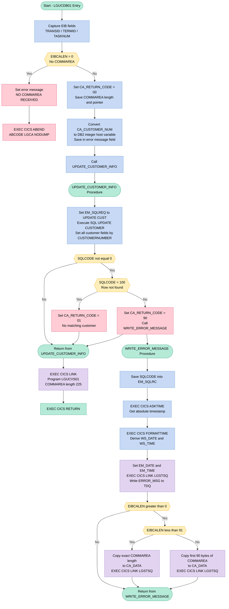
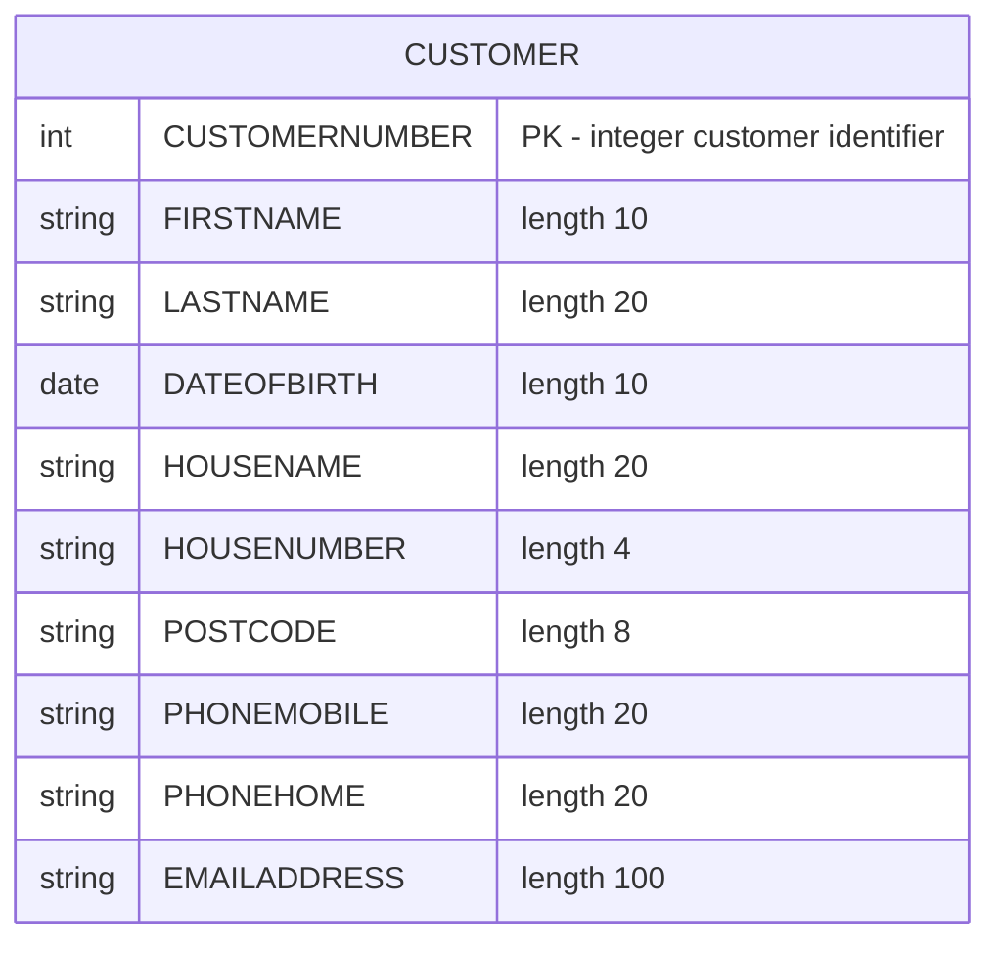

## Table of Contents

- [1. Purpose](#1-purpose)
- [2. Inputs](#2-inputs)
- [3. Outputs](#3-outputs)
- [4. Processing Logic](#4-processing-logic)
  - [4.1 Mermaid Flow Diagram](#41-mermaid-flow-diagram)
  - [4.2 Processing Logic Description](#42-processing-logic-description)
  - [4.3 Database Tables](#43-database-tables)
- [5. Paragraphs](#5-paragraphs)
- [6. Dependencies](#6-dependencies)
  - [6.1 DB2 Database](#61-db2-database)
  - [6.2 CICS Runtime Services](#62-cics-runtime-services)
  - [6.3 External Programs (CICS LINK Targets)](#63-external-programs-cics-link-targets)
  - [6.4 Communication Area (COMMAREA)](#64-communication-area-commarea)
  - [6.5 Copybooks / Include Members](#65-copybooks--include-members)
- [7. Constraints](#7-constraints)
  - [7.1 Communication Area Constraints](#71-communication-area-constraints)
  - [7.2 Data Identification Constraints](#72-data-identification-constraints)
  - [7.3 Return Code Constraints](#73-return-code-constraints)
  - [7.4 DB2 Update Constraints](#74-db2-update-constraints)
  - [7.5 Operation Sequencing Constraints](#75-operation-sequencing-constraints)
  - [7.6 Error Logging Constraints](#76-error-logging-constraints)
- [8. Error Handling](#8-error-handling)
  - [8.1 Missing Communication Area (COMMAREA) Guard](#81-missing-communication-area-commarea-guard)
  - [8.2 DB2 SQL Return Code Checking](#82-db2-sql-return-code-checking)
  - [8.3 Return Code Propagation to Caller](#83-return-code-propagation-to-caller)
  - [8.4 Error Message Logging via TDQ Writer Program](#84-error-message-logging-via-tdq-writer-program)
- [9. Examples](#9-examples)
  - [9.1 Example 1 — Successful Customer Update](#91-example-1--successful-customer-update)
  - [9.2 Example 2 — Customer Not Found (SQLCODE 100)](#92-example-2--customer-not-found-sqlcode-100)
  - [9.3 Example 3 — Unexpected DB2 Error](#93-example-3--unexpected-db2-error)

## 1. Purpose

`LGUCDB01` is a CICS-hosted Enterprise PL/I program that handles the DB2 portion of a customer record update operation within an insurance application. It receives a communication area containing a customer number and updated personal details (name, date of birth, address, phone numbers, and email address), validates that a communication area has been provided, and then issues a DB2 SQL `UPDATE` against the `CUSTOMER` table to apply those changes, using the customer number as the row selector. After the DB2 update succeeds, it transfers control via `EXEC CICS LINK` to a companion VSAM update program (`LGUCVS01`) to keep the file-based store consistent with the database. Throughout execution it sets a return code in the communication area to signal success, a not-found condition, or an unexpected DB2 error, and on failure it writes a timestamped diagnostic message — including the customer number, the SQL request type, and the SQLCODE — to a transient data queue through the shared logging program `LGSTSQ`.

## 2. Inputs

**Communication Area (COMMAREA) — passed via `COMM_AREA_PTR` procedure parameter**

- **`CA_CUSTOMER_NUM`** — 10-digit numeric picture field identifying the customer whose record is to be updated. Converted to the DB2 integer host variable `DB2_CUSTOMERNUM_INT` and used as the `WHERE` clause predicate in the SQL `UPDATE` against the `CUSTOMER` table.
- **`CA_RETURN_CODE`** — 2-digit picture field initialised to `'00'` on entry; set to `'01'` when no matching customer row is found (`SQLCODE 100`) or `'90'` on an unexpected DB2 error. Written back to the caller to communicate the operation outcome.
- **Customer update fields** — sub-fields of `CA_CUSTOMER_REQUEST`, all supplied by the caller and passed directly as DB2 host variables in the `UPDATE CUSTOMER SET …` statement:
  - **`CA_FIRST_NAME`** — 10-character customer first name → `FIRSTNAME` column
  - **`CA_LAST_NAME`** — 20-character customer last name → `LASTNAME` column
  - **`CA_DOB`** — 10-character date of birth → `DATEOFBIRTH` column
  - **`CA_HOUSE_NAME`** — 20-character residential property name → `HOUSENAME` column
  - **`CA_HOUSE_NUM`** — 4-character house number → `HOUSENUMBER` column
  - **`CA_POSTCODE`** — 8-character postal code → `POSTCODE` column
  - **`CA_PHONE_MOBILE`** — 20-character mobile phone number → `PHONEMOBILE` column
  - **`CA_PHONE_HOME`** — 20-character home phone number → `PHONEHOME` column
  - **`CA_EMAIL_ADDRESS`** — 100-character email address → `EMAILADDRESS` column

**CICS Execution Environment — provided by the CICS runtime**

- **`EIBCALEN`** — CICS Execute Interface Block field indicating the length of the passed COMMAREA. Checked at program entry; if zero the program abends (`LGCA`). Also used in `WRITE_ERROR_MESSAGE` to determine how many bytes of the COMMAREA raw overlay to log.
- **`EIBTRNID`** — CICS EIB transaction identifier, captured into `WS_TRANSID` for diagnostic tracing.
- **`EIBTRMID`** — CICS EIB terminal identifier, captured into `WS_TERMID` for diagnostic tracing.
- **`EIBTASKN`** — CICS EIB task number, captured into `WS_TASKNUM` for diagnostic tracing.

**Linked Program — resolved at runtime via `EXEC CICS LINK`**

- **`LGUCVS01`** — name of the downstream VSAM customer-update program. Passed as the `PROGRAM` operand in `EXEC CICS LINK` after the DB2 update completes; the same `COMM_AREA` (length 225) is forwarded to it, making the full communication area an implicit input/output channel to that program.

**DB2 Database — external data source**

- **`CUSTOMER` table** — the target DB2 table read and written by the `UPDATE CUSTOMER … WHERE CUSTOMERNUMBER = :DB2_CUSTOMERNUM_INT` statement. The existence (or absence) of a matching row directly determines the return code set back in `CA_RETURN_CODE`.

## 3. Outputs

**DB2 Database Update — `CUSTOMER` Table**
- `CA_RETURN_CODE` — Written back into the COMMAREA to signal the outcome of the update operation to the caller (`'00'` = success, `'01'` = no matching customer row found (SQLCODE 100), `'90'` = unexpected DB2 error)
- CUSTOMER table columns updated via SQL `UPDATE` statement, identified by `DB2_CUSTOMERNUM_INT` (derived from `CA_CUSTOMER_NUM`):
  - `CA_FIRST_NAME` → `FIRSTNAME`
  - `CA_LAST_NAME` → `LASTNAME`
  - `CA_DOB` → `DATEOFBIRTH`
  - `CA_HOUSE_NAME` → `HOUSENAME`
  - `CA_HOUSE_NUM` → `HOUSENUMBER`
  - `CA_POSTCODE` → `POSTCODE`
  - `CA_PHONE_MOBILE` → `PHONEMOBILE`
  - `CA_PHONE_HOME` → `PHONEHOME`
  - `CA_EMAIL_ADDRESS` → `EMAILADDRESS`

**CICS Program Invocations (Side Effects)**
- `LGUCVS01` — Invoked via `EXEC CICS LINK` after the DB2 update completes; receives the full `COMM_AREA` (225 bytes) to mirror the customer update into the VSAM file
- `LGSTSQ` (error path only) — Invoked via `EXEC CICS LINK` (called twice) to write diagnostic messages to a CICS transient data queue (TDQ) when a DB2 error occurs or no COMMAREA is received:
  - First call passes `ERROR_MSG` — contains formatted date, time, program name, customer number, SQL request label, and SQLCODE
  - Second call passes `CA_ERROR_MSG` — contains up to 90 bytes of the raw COMMAREA content for diagnostic tracing

**CICS Abend (Abnormal Termination)**
- `EXEC CICS ABEND ABCODE('LGCA') NODUMP` — Issued when no COMMAREA is received (`EIBCALEN = 0`); terminates the transaction with abend code `LGCA`

## 4. Processing Logic

### 4.1 Mermaid Flow Diagram



---

### 4.2 Processing Logic Description

**High-level Summary**

`LGUCDB01` is a CICS-linked PL/I program that updates a customer's details in a DB2 `CUSTOMER` table. It receives the customer's updated data through a CICS communication area (COMMAREA), executes an SQL `UPDATE` statement, handles DB2 error conditions, and then chains control to a companion VSAM update program (`LGUCVS01`) to keep both data stores synchronized. Error messages are written to a transient data queue via the logging utility `LGSTSQ`.

---

**Execution Flow**

1. **Entry and EIB Capture (Nodes A → B)**
   The program starts as a CICS main procedure receiving `COMM_AREA_PTR`. It immediately captures runtime context from the CICS Execute Interface Block (EIB): transaction ID (`EIBTRNID`), terminal ID (`EIBTRMID`), and task number (`EIBTASKN`) into working-storage fields used for diagnostic purposes.

2. **COMMAREA Validation (Node C)**
   The program checks `EIBCALEN` (length of the received COMMAREA). If it is zero, no COMMAREA was passed — the program sets an error message `NO COMMAREA RECEIVED` and issues `EXEC CICS ABEND ABCODE('LGCA') NODUMP`, forcing an abnormal task termination without producing a dump. This is a hard guard against operating with no input data.

3. **Initialization (Nodes F → G)**
   - `CA_RETURN_CODE` is set to `'00'` (success default).
   - The COMMAREA length and pointer are saved for later use.
   - `CA_CUSTOMER_NUM` (a 10-digit picture field) is converted to a `FIXED BIN(31)` integer (`DB2_CUSTOMERNUM_INT`) for use as the DB2 WHERE-clause predicate. The customer number is also copied into the error message structure (`EM_CUSNUM`) so it is available if a diagnostic message must be written.

4. **DB2 Customer Update — `UPDATE_CUSTOMER_INFO` (Nodes H → K → L)**
   The internal procedure `UPDATE_CUSTOMER_INFO` is called. It sets the diagnostic SQL request label `EM_SQLREQ` to `' UPDATE CUST    '`, then executes:
   ```sql
   UPDATE CUSTOMER
     SET FIRSTNAME=:CA_FIRST_NAME, LASTNAME=:CA_LAST_NAME, DATEOFBIRTH=:CA_DOB,
         HOUSENAME=:CA_HOUSE_NAME, HOUSENUMBER=:CA_HOUSE_NUM, POSTCODE=:CA_POSTCODE,
         PHONEMOBILE=:CA_PHONE_MOBILE, PHONEHOME=:CA_PHONE_HOME,
         EMAILADDRESS=:CA_EMAIL_ADDRESS
   WHERE CUSTOMERNUMBER = :DB2_CUSTOMERNUM_INT;
   ```
   All nine customer fields from the COMMAREA are updated in one statement, targeted by the integer customer number.

5. **DB2 Result Handling (Nodes M → N → O / P)**
   After the `UPDATE`, `SQLCODE` is examined:
   - **SQLCODE = 0**: Success — the procedure returns immediately, leaving `CA_RETURN_CODE = '00'`.
   - **SQLCODE = 100**: No matching row found — `CA_RETURN_CODE` is set to `'01'` (not-found indicator). No error message is written since this is an expected business condition.
   - **Any other SQLCODE**: An unexpected DB2 error has occurred. `CA_RETURN_CODE` is set to `'90'`, and `WRITE_ERROR_MESSAGE` is called to log the full diagnostic context.

6. **VSAM Update via CICS LINK (Node I)**
   After returning from `UPDATE_CUSTOMER_INFO`, the program issues `EXEC CICS LINK PROGRAM(LGUCVS01) COMMAREA(COMM_AREA) LENGTH(225)`. This transfers the same COMMAREA (225 bytes) to `LGUCVS01`, which applies the same customer update to the VSAM file, ensuring both DB2 and VSAM are kept in sync.

7. **Return to Caller (Node J)**
   `EXEC CICS RETURN` ends the CICS task and returns control to the calling program (the customer orchestrator `LGUCUS01`). The `CA_RETURN_CODE` value signals success (`'00'`), not-found (`'01'`), or error (`'90'`).

8. **Error Logging — `WRITE_ERROR_MESSAGE` (Nodes R → AA)**
   When invoked, this procedure:
   - Saves the current `SQLCODE` into `EM_SQLRC`.
   - Calls `EXEC CICS ASKTIME ABSTIME(WS_ABSTIME)` to get the current CICS absolute time value.
   - Calls `EXEC CICS FORMATTIME` to produce a formatted date (`MMDDYYYY`) and time string.
   - Stamps `EM_DATE` and `EM_TIME` in the error message structure, then links to `LGSTSQ` to write the full error message to a transient data queue (CSMT).
   - Conditionally dumps a portion of the COMMAREA for additional context:
     - If `EIBCALEN < 91`: the full COMMAREA is copied to `CA_DATA` and written via `LGSTSQ`.
     - If `EIBCALEN ≥ 91`: only the first 90 bytes are copied and written.

---

**External Interactions**

| System | Interaction | Purpose |
|---|---|---|
| **DB2** | `UPDATE CUSTOMER` | Updates all nine customer fields in the CUSTOMER table for the given customer number |
| **CICS LINK → LGUCVS01** | `EXEC CICS LINK` with COMMAREA (225 bytes) | Propagates the same customer update to the VSAM file store |
| **CICS LINK → LGSTSQ** | `EXEC CICS LINK` with `ERROR_MSG` | Writes a formatted error/diagnostic message to a TD queue (CSMT) |
| **CICS LINK → LGSTSQ** | `EXEC CICS LINK` with `CA_ERROR_MSG` | Writes a dump of the COMMAREA raw data to the TD queue for diagnostics |
| **CICS ABEND** | `ABCODE('LGCA') NODUMP` | Hard abend when no COMMAREA is present at program entry |

---

**Plain Language Summary**

When a user requests a customer record update through the GenApp insurance system, `LGUCDB01` is the program that carries out that update in the DB2 database. It checks that valid input data was passed, then updates the customer's name, date of birth, address, phone numbers, and email in the DB2 CUSTOMER table in a single operation. Once DB2 is updated, it hands control to a companion program (`LGUCVS01`) to make the same change in the VSAM file system, keeping both data stores consistent. If anything goes wrong — such as the customer not being found or a database error — the program sets an appropriate error code and logs a detailed diagnostic message (including the date, time, customer number, and database error code) to a system log queue for operator review.

---

### 4.3 Database Tables



## 5. Paragraphs

**Main Procedure Body (LGUCDB01 entry logic)**

- This is the program's main execution path, beginning at `LGUCDB01: Proc(COMM_AREA_PTR) Options(Main)` and running through to `EXEC CICS RETURN`.
- Initialises diagnostic working-storage fields from the CICS Executive Interface Block (EIB):
  - `WS_TRANSID` ← `EIBTRNID` (current transaction ID)
  - `WS_TERMID`  ← `EIBTRMID` (terminal ID)
  - `WS_TASKNUM` ← `EIBTASKN` (task number)
  - `WS_RETRY`   ← blank space
- Guards against a missing COMMAREA by testing `EIBCALEN = 0`:
  - If true, sets `EM_MSG_TEXT` to `' NO COMMAREA RECEIVED'`, calls `WRITE_ERROR_MESSAGE`, then issues `EXEC CICS ABEND ABCODE('LGCA') NODUMP` to terminate the task abnormally without producing a system dump.
- Initialises `CA_RETURN_CODE` to `'00'` (success), saves `EIBCALEN` into `WS_CALEN`, and snapshots the COMMAREA pointer into `WS_ADDR_DFHCOMMAREA` for dump tracing.
- Converts the 10-digit picture-clause customer number `CA_CUSTOMER_NUM` to the `FIXED BIN(31)` host variable `DB2_CUSTOMERNUM_INT` for use in the SQL `WHERE` clause, and also copies it into `EM_CUSNUM` for error message context.
- Calls the internal procedure `UPDATE_CUSTOMER_INFO` to perform the DB2 `UPDATE` operation.
- After the DB2 update returns, issues `EXEC CICS LINK PROGRAM(LGUCVS01) COMMAREA(COMM_AREA) LENGTH(225)` to invoke the VSAM counterpart program `LGUCVS01`, passing the same COMMAREA so the VSAM customer file is updated in parallel.
- Issues `EXEC CICS RETURN` to hand control back to the calling CICS program (the customer update orchestrator), then falls through to a PL/I `RETURN` statement.

---

**UPDATE_CUSTOMER_INFO**

- Internal procedure that encapsulates the DB2 `UPDATE` statement against the `CUSTOMER` table.
- Sets `EM_SQLREQ` to `' UPDATE CUST    '` before the SQL call, so any subsequent error message identifies which DB2 operation failed.
- Executes `EXEC SQL UPDATE CUSTOMER SET ... WHERE CUSTOMERNUMBER = :DB2_CUSTOMERNUM_INT`, supplying all nine customer fields as host variables:
  - `FIRSTNAME` ← `:CA_FIRST_NAME`
  - `LASTNAME` ← `:CA_LAST_NAME`
  - `DATEOFBIRTH` ← `:CA_DOB`
  - `HOUSENAME` ← `:CA_HOUSE_NAME`
  - `HOUSENUMBER` ← `:CA_HOUSE_NUM`
  - `POSTCODE` ← `:CA_POSTCODE`
  - `PHONEMOBILE` ← `:CA_PHONE_MOBILE`
  - `PHONEHOME` ← `:CA_PHONE_HOME`
  - `EMAILADDRESS` ← `:CA_EMAIL_ADDRESS`
- After the SQL statement, checks `SQLCODE`:
  - `SQLCODE = 0`: no action required; update was successful.
  - `SQLCODE = 100`: row not found — sets `CA_RETURN_CODE` to `'01'` to signal a "not found" condition to the caller.
  - Any other non-zero `SQLCODE`: sets `CA_RETURN_CODE` to `'90'` (unexpected DB2 error) and calls `WRITE_ERROR_MESSAGE` to log diagnostics.

---

**WRITE_ERROR_MESSAGE**

- Internal procedure responsible for writing structured diagnostic messages to the CICS transient data queue via the logging program `LGSTSQ`.
- Captures the current `SQLCODE` into `EM_SQLRC` for inclusion in the error text.
- Obtains the current clock value using `EXEC CICS ASKTIME ABSTIME(WS_ABSTIME)`, then formats it with `EXEC CICS FORMATTIME ABSTIME(WS_ABSTIME) MMDDYYYY(WS_DATE) TIME(WS_TIME)` to produce human-readable date and time strings.
- Copies the formatted date and time into `EM_DATE` and `EM_TIME` within the `ERROR_MSG` structure, which also carries the program name literal `' LGUCDB01'`, customer number (`EM_CUSNUM`), policy number (`EM_POLNUM`), the SQL request type (`EM_SQLREQ`), and the SQLCODE (`EM_SQLRC`).
- Issues `EXEC CICS LINK PROGRAM('LGSTSQ') COMMAREA(ERROR_MSG) LENGTH(STG(ERROR_MSG))` to write the full error message record to the TDQ. `STG(ERROR_MSG)` is the Enterprise PL/I built-in that returns the byte length of the structure at compile time.
- Conditionally writes up to 90 bytes of the raw COMMAREA for additional context:
  - If `EIBCALEN > 0` and `EIBCALEN < 91`: extracts exactly `EIBCALEN` bytes from `COMM_AREA_RAW` using `LEFT(COMM_AREA_RAW, EIBCALEN)` and writes it via a second `EXEC CICS LINK` to `LGSTSQ`.
  - If `EIBCALEN >= 91`: extracts the first 90 bytes of `COMM_AREA_RAW` and writes those instead.
- In both COMMAREA dump branches the data is placed into `CA_DATA` within the `CA_ERROR_MSG` structure before the LINK call.
- Returns to the caller after the logging is complete.

## 6. Dependencies

### 6.1 DB2 Database

- **CUSTOMER table** — The primary DB2 database table targeted by this program. An `EXEC SQL UPDATE` statement modifies nine columns (`FIRSTNAME`, `LASTNAME`, `DATEOFBIRTH`, `HOUSENAME`, `HOUSENUMBER`, `POSTCODE`, `PHONEMOBILE`, `PHONEHOME`, `EMAILADDRESS`) for the row identified by `CUSTOMERNUMBER`. The program depends on this table existing in the DB2 subsystem accessible from the CICS region.
  - **SQLCA (`EXEC SQL INCLUDE SQLCA`)** — The DB2 SQL Communication Area, included at compile time. Provides the `SQLCODE` field used after the `UPDATE` statement to detect success, "not found" (SQLCODE 100), or unexpected errors.

---

### 6.2 CICS Runtime Services

- **CICS Execution Interface Block (EIB)** — CICS-supplied control block automatically available to every task. The program reads:
  - `EIBTRNID` — current transaction identifier, stored in `WS_TRANSID` for diagnostics.
  - `EIBTRMID` — originating terminal identifier, stored in `WS_TERMID` for diagnostics.
  - `EIBTASKN` — CICS task number, stored in `WS_TASKNUM` for diagnostics.
  - `EIBCALEN` — length of the passed communication area; used to guard against a missing COMMAREA and to bound the amount of COMMAREA data written to the error log.
- **EXEC CICS ASKTIME / FORMATTIME** — CICS time services invoked during error handling to obtain and format the current timestamp (`WS_ABSTIME`, `WS_DATE`, `WS_TIME`) for inclusion in diagnostic messages.
- **EXEC CICS ABEND ABCODE('LGCA') NODUMP** — CICS abnormal-termination service issued when no COMMAREA is received; terminates the task with abend code `LGCA` without producing a dump.
- **EXEC CICS RETURN** — Returns control to the CICS task manager after all processing is complete.

---

### 6.3 External Programs (CICS LINK Targets)

- **`LGUCVS01`** — VSAM customer-update program. Invoked via `EXEC CICS LINK PROGRAM(LGUCVS01) COMMAREA(COMM_AREA) LENGTH(225)` after the DB2 update succeeds. It is responsible for propagating the same customer changes to the VSAM file store. The program depends on this module being installed and available in the CICS program library.
- **`LGSTSQ`** — Transient Data Queue writer utility program. Invoked (up to three times) via `EXEC CICS LINK PROGRAM('LGSTSQ')` during error handling to write the formatted `ERROR_MSG` structure and a portion of the raw COMMAREA to a CICS transient data queue for diagnostic logging. The program depends on `LGSTSQ` being available in the CICS environment.

---

### 6.4 Communication Area (COMMAREA)

- **`COMM_AREA` / `LGCMAREA` copybook** — The structured CICS communication area (maximum 32,500 bytes) passed into the program by the calling transaction. It supplies all input customer data fields consumed by the SQL `UPDATE` and also carries the return code back to the caller. The inline expansion of the `LGCMAREA` copybook (normally included via `EXEC SQL INCLUDE LGCMAREA`) defines the full structure, including customer request fields, policy data overlays, and the security request overlay.
  - `CA_REQUEST_ID` — identifies the type of request being processed.
  - `CA_RETURN_CODE` — output field; set to `'00'` (success), `'01'` (customer not found), or `'90'` (DB2 error).
  - `CA_CUSTOMER_NUM` — input; the 10-digit customer number used to locate the DB2 row.
  - `CA_FIRST_NAME`, `CA_LAST_NAME`, `CA_DOB`, `CA_HOUSE_NAME`, `CA_HOUSE_NUM`, `CA_POSTCODE`, `CA_PHONE_MOBILE`, `CA_PHONE_HOME`, `CA_EMAIL_ADDRESS` — input fields providing the new customer attribute values to be written to DB2.

---

### 6.5 Copybooks / Include Members

- **`SQLCA`** (via `EXEC SQL INCLUDE SQLCA`) — DB2-supplied copybook that declares the SQL Communication Area structure used for DB2 return-code checking.
- **`LGCMAREA`** (inline expansion; originally `EXEC SQL INCLUDE LGCMAREA`) — Application copybook defining the `COMM_AREA` structure shared across all GenApp programs.

## 7. Constraints

### 7.1 Communication Area Constraints

- **A COMMAREA must be present at invocation**: The program checks `EIBCALEN = 0` immediately after entry. If no COMMAREA was passed by the caller, the program writes an error message and issues `EXEC CICS ABEND ABCODE('LGCA') NODUMP`, terminating the task abnormally. Processing cannot proceed without a COMMAREA.
  - Enforced at lines 217–221.

- **COMMAREA raw size is bounded at 32,500 bytes**: The `COMM_AREA_RAW` overlay field is declared as `CHAR(32500)`, defining the maximum addressable size of the communication area.
  - Enforced by the `COMM_AREA` structure declaration (line 104).

- **Only the first 225 bytes of the COMMAREA are forwarded to the VSAM update program**: The `EXEC CICS LINK` to `LGUCVS01` explicitly passes `LENGTH(225)`, meaning only the first 225 bytes of `COMM_AREA` are visible to that downstream program regardless of the actual COMMAREA size received.
  - Enforced at lines 237–239.

---

### 7.2 Data Identification Constraints

- **Customer number must be a 10-digit numeric value**: `CA_CUSTOMER_NUM` is declared as `PIC '9999999999'` — a 10-digit picture field. Only numeric characters are structurally valid. The value is converted to a `FIXED BIN(31)` integer (`DB2_CUSTOMERNUM_INT`) before use in the SQL WHERE clause.
  - Enforced by the PIC clause declaration (line 109) and the conversion assignment (line 229).

- **Customer number must match an existing row in the CUSTOMER table**: The SQL `UPDATE … WHERE CUSTOMERNUMBER = :DB2_CUSTOMERNUM_INT` operates on exactly the row identified by the converted customer number. If no matching row exists (DB2 SQLCODE 100), the program sets `CA_RETURN_CODE = '01'` and halts further DB2 processing, with no row being updated.
  - Enforced at lines 265, 269–270.

---

### 7.3 Return Code Constraints

- **`CA_RETURN_CODE` is initialised to `'00'` before any processing**: This ensures the return code always reflects the outcome of the current invocation and is not carried over from prior state.
  - Enforced at line 224.

- **Only three discrete return code values are produced**:
  - `'00'` — successful initialisation and no DB2 error detected.
  - `'01'` — the SQL UPDATE found no matching customer row (SQLCODE 100).
  - `'90'` — an unexpected (non-100, non-zero) DB2 SQLCODE was returned.
  - Enforced at lines 224, 270, 272.

---

### 7.4 DB2 Update Constraints

- **All nine customer fields are updated unconditionally in a single SQL statement**: `FIRSTNAME`, `LASTNAME`, `DATEOFBIRTH`, `HOUSENAME`, `HOUSENUMBER`, `POSTCODE`, `PHONEMOBILE`, `PHONEHOME`, and `EMAILADDRESS` are all SET in one `UPDATE CUSTOMER` statement. There is no selective or partial update — the caller must supply values for all fields.
  - Enforced by the SQL UPDATE statement at lines 252–265.

- **Non-zero SQLCODE must be handled before proceeding**: The program tests `SQLCODE <> 0` after the UPDATE. Only if SQLCODE is zero (success) does processing continue to the VSAM LINK step without writing an error. Any non-zero SQLCODE causes either a `'01'` or `'90'` return code to be set.
  - Enforced at lines 267–276.

- **Unexpected DB2 errors trigger diagnostic logging**: When SQLCODE is non-zero and not equal to 100, the program calls `WRITE_ERROR_MESSAGE`, which writes a structured error record (including date, time, customer number, and SQLCODE) to the CICS TD queue via program `LGSTSQ`, before returning to the caller.
  - Enforced at lines 271–275, 285–318.

---

### 7.5 Operation Sequencing Constraints

- **DB2 update must occur before the VSAM update**: The program calls `UPDATE_CUSTOMER_INFO` (DB2 UPDATE) first and only then issues `EXEC CICS LINK` to `LGUCVS01` (VSAM update). The VSAM program is always invoked regardless of the DB2 outcome; there is no conditional guard on the LINK.
  - Enforced by the sequential flow at lines 234–239.

- **Error message logging must occur before the ABEND**: `WRITE_ERROR_MESSAGE` is called and completes before `EXEC CICS ABEND` is issued in the no-COMMAREA path, ensuring the diagnostic record is written prior to task termination.
  - Enforced at lines 218–220.

---

### 7.6 Error Logging Constraints

- **COMMAREA diagnostic data written to TDQ is capped at 90 bytes**: In `WRITE_ERROR_MESSAGE`, if `EIBCALEN` is less than 91, only the actual length of the COMMAREA is copied into the error message; otherwise exactly 90 bytes are taken. The `CA_DATA` field holding this data is declared `CHAR(90)`.
  - Enforced at lines 303–315.

- **COMMAREA diagnostic logging only occurs if a COMMAREA exists**: The TDQ write of COMMAREA content is guarded by `IF ( EIBCALEN > 0 )`, so no attempt is made to copy COMMAREA data when none was provided.
  - Enforced at line 303.

## 8. Error Handling

### 8.1 Missing Communication Area (COMMAREA) Guard

- On program entry, the CICS Execute Interface Block field `EIBCALEN` is inspected to determine whether a communication area was passed by the caller.
  - If `EIBCALEN` equals zero, meaning no COMMAREA was received, the program treats this as a fatal, unrecoverable condition.
    - The error message text field `EM_MSG_TEXT` is populated with the literal `' NO COMMAREA RECEIVED'` before any further action.
    - The `WRITE_ERROR_MESSAGE` subroutine is invoked to record the diagnostic information (see the logging section below).
    - `EXEC CICS ABEND ABCODE('LGCA') NODUMP` is then issued, which forces an abnormal end of the CICS task with the custom abend code `LGCA` and suppresses a system dump, immediately halting processing.

---

### 8.2 DB2 SQL Return Code Checking

- After the `UPDATE CUSTOMER` SQL statement executes inside the `UPDATE_CUSTOMER_INFO` procedure, the DB2-provided `SQLCODE` special register is tested.
  - If `SQLCODE` is non-zero, the program distinguishes between two sub-cases:
    - If `SQLCODE` equals `100` (the standard DB2 "row not found" code), the communication area return code field `CA_RETURN_CODE` is set to `'01'`, signalling to the caller that no matching customer record was found for the supplied customer number. No error message is written in this case, treating it as an expected "not found" outcome rather than a system fault.
    - For any other non-zero `SQLCODE`, `CA_RETURN_CODE` is set to `'90'`, indicating an unexpected DB2 error, and the `WRITE_ERROR_MESSAGE` subroutine is called to log the failure details.
  - If `SQLCODE` is zero, both sub-cases are bypassed, and `CA_RETURN_CODE` retains the value `'00'` set during initialisation, indicating success.

---

### 8.3 Return Code Propagation to Caller

- `CA_RETURN_CODE` in the COMMAREA is initialised to `'00'` at the start of processing to establish a default "success" state before any DB2 operation is attempted.
- The field is then conditionally overwritten to `'01'` or `'90'` based on the outcome of the DB2 UPDATE, allowing the upstream caller to inspect the result after the program returns via `EXEC CICS RETURN`.

---

### 8.4 Error Message Logging via TDQ Writer Program

- The `WRITE_ERROR_MESSAGE` procedure centralises all diagnostic output and is invoked from two call sites: the missing COMMAREA guard and the unexpected DB2 error branch.
  - The current `SQLCODE` value is captured into the error message structure field `EM_SQLRC` for inclusion in the log record.
  - `EXEC CICS ASKTIME` is called to obtain the current absolute timestamp into `WS_ABSTIME`, which is then formatted into human-readable date (`WS_DATE`) and time (`WS_TIME`) values using `EXEC CICS FORMATTIME`. These are placed into `EM_DATE` and `EM_TIME` within the error message structure.
  - The fully assembled `ERROR_MSG` structure — containing date, time, program name (`LGUCDB01`), customer number, policy number placeholder, SQL request label, and SQLCODE — is written to a transient data queue by linking to the helper program `LGSTSQ` with `EXEC CICS LINK PROGRAM('LGSTSQ') COMMAREA(ERROR_MSG)`.
  - A second log record is then conditionally written containing a snapshot of the raw COMMAREA bytes to aid further diagnosis:
    - If `EIBCALEN` is greater than zero but less than 91, the actual number of COMMAREA bytes (up to the real length) is extracted using the `LEFT` built-in and placed into `CA_DATA`, then sent to `LGSTSQ`.
    - If `EIBCALEN` is 91 or greater, the first 90 bytes of the COMMAREA are extracted and logged, capping the dump at a fixed size.
    - If `EIBCALEN` is zero (i.e., the COMMAREA-absent scenario), the COMMAREA snapshot step is skipped entirely since there is no data to capture.

## 9. Examples

### 9.1 Example 1 — Successful Customer Update

**Input (COMMAREA fields):**

| Field | Value |
|---|---|
| `CA_REQUEST_ID` | `UPCUST` |
| `CA_CUSTOMER_NUM` | `0000000042` |
| `CA_FIRST_NAME` | `John      ` |
| `CA_LAST_NAME` | `Smith               ` |
| `CA_DOB` | `1980-06-15` |
| `CA_HOUSE_NAME` | `Maple House        ` |
| `CA_HOUSE_NUM` | `12  ` |
| `CA_POSTCODE` | `SW1A 1AA` |
| `CA_PHONE_MOBILE` | `07700900123         ` |
| `CA_PHONE_HOME` | `02071234567         ` |
| `CA_EMAIL_ADDRESS` | `john.smith@example.com` (padded to 100 chars) |

**Processing:**
1. The program receives the COMMAREA and sets `CA_RETURN_CODE = '00'`.
2. `DB2_CUSTOMERNUM_INT` is set to `42` (integer conversion of `CA_CUSTOMER_NUM`).
3. `UPDATE_CUSTOMER_INFO` issues the SQL `UPDATE CUSTOMER SET … WHERE CUSTOMERNUMBER = 42`. DB2 finds the row and applies all nine column values. `SQLCODE = 0`.
4. Since `SQLCODE = 0`, `CA_RETURN_CODE` remains `'00'`.
5. `EXEC CICS LINK PROGRAM('LGUCVS01')` is called with the same COMMAREA to mirror the change in the VSAM file.
6. Control returns to the caller.

**Expected output:**

| Field | Value |
|---|---|
| `CA_RETURN_CODE` | `00` |

The caller receives `'00'`, indicating a fully successful update in both DB2 and VSAM.

---

### 9.2 Example 2 — Customer Not Found (SQLCODE 100)

**Input (COMMAREA fields):**

| Field | Value |
|---|---|
| `CA_CUSTOMER_NUM` | `0000099999` |
| `CA_FIRST_NAME` | `Jane      ` |
| `CA_LAST_NAME` | `Doe                 ` |
| *(remaining fields)* | *(any valid values)* |

**Processing:**
1. `CA_RETURN_CODE` is initialised to `'00'`.
2. `DB2_CUSTOMERNUM_INT` is set to `99999`.
3. The SQL `UPDATE CUSTOMER … WHERE CUSTOMERNUMBER = 99999` finds no matching row — DB2 returns `SQLCODE = 100` (not found).
4. Because `SQLCODE = 100`, the program sets `CA_RETURN_CODE = '01'`. No error message is written to the TD queue and no abend is issued.
5. `EXEC CICS LINK PROGRAM('LGUCVS01')` is still called (control flow continues unconditionally after the procedure returns).
6. Control returns to the caller.

**Expected output:**

| Field | Value |
|---|---|
| `CA_RETURN_CODE` | `01` |

The caller receives `'01'`, signalling that the requested customer does not exist in the DB2 CUSTOMER table.

---

### 9.3 Example 3 — Unexpected DB2 Error

**Input (COMMAREA fields):**

| Field | Value |
|---|---|
| `CA_CUSTOMER_NUM` | `0000000007` |
| `CA_EMAIL_ADDRESS` | *(value exceeding column constraint or DB2 unavailable)* |

**Processing:**
1. `CA_RETURN_CODE` is initialised to `'00'`.
2. `DB2_CUSTOMERNUM_INT` is set to `7`.
3. The SQL UPDATE fails with a non-zero, non-100 SQLCODE (e.g., `-803` for a constraint violation or `-904` for resource unavailability).
4. The program sets `CA_RETURN_CODE = '90'` and calls `WRITE_ERROR_MESSAGE`.
5. Inside `WRITE_ERROR_MESSAGE`, `EXEC CICS ASKTIME` / `EXEC CICS FORMATTIME` produce the current date and time. An error message containing the date, time, program name (`LGUCDB01`), customer number (`0000000007`), and the actual SQLCODE is written to the TD queue via `EXEC CICS LINK PROGRAM('LGSTSQ')`. Up to 90 bytes of the raw COMMAREA are also written for diagnostic tracing.
6. `EXEC CICS LINK PROGRAM('LGUCVS01')` is still invoked, then control returns to the caller.

**Expected output:**

| Field | Value |
|---|---|
| `CA_RETURN_CODE` | `90` |
| TD queue `CSMT` | Error message with timestamp, `LGUCDB01`, `CNUM=0000000007`, and the SQLCODE |

The caller receives `'90'` and the operations team can inspect the TD queue entry to diagnose the DB2 failure.

---

Generated by IBM Bob Premium Package for Z
