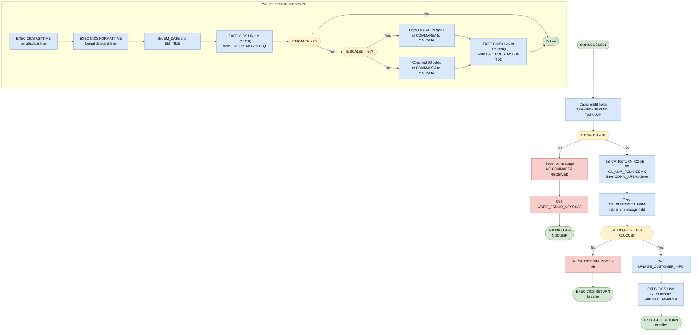
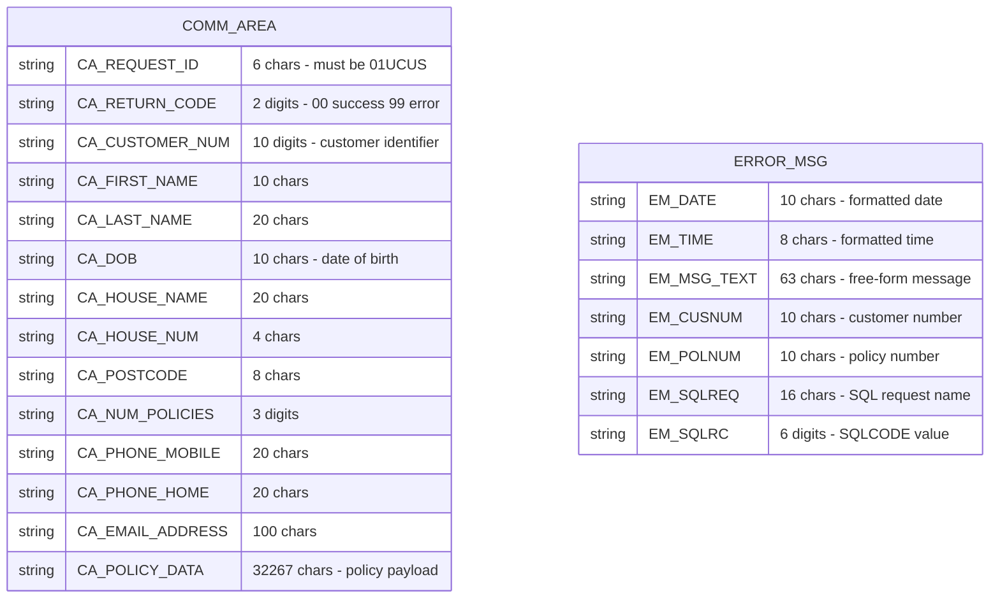

## Table of Contents

- [1. Purpose](#1-purpose)
- [2. Inputs](#2-inputs)
- [3. Outputs](#3-outputs)
- [4. Processing Logic](#4-processing-logic)
  - [4.1 Mermaid Flow Diagram](#41-mermaid-flow-diagram)
  - [4.2 Processing Logic Description](#42-processing-logic-description)
  - [4.3 Database Tables](#43-database-tables)
- [5. Paragraphs](#5-paragraphs)
- [6. Dependencies](#6-dependencies)
  - [6.1 CICS Runtime Environment](#61-cics-runtime-environment)
  - [6.2 Linked Programs (External Module Dependencies)](#62-linked-programs-external-module-dependencies)
  - [6.3 Communication Area (COMMAREA) — Input / Output Interface](#63-communication-area-commarea--input--output-interface)
  - [6.4 Include Files (Copybooks)](#64-include-files-copybooks)
  - [6.5 Internal Procedures (Intra-program Dependencies)](#65-internal-procedures-intra-program-dependencies)
- [7. Constraints](#7-constraints)
  - [7.1 Communication Area (COMMAREA) Constraints](#71-communication-area-commarea-constraints)
  - [7.2 Request Identifier Constraint](#72-request-identifier-constraint)
  - [7.3 Return Code Initialization Constraint](#73-return-code-initialization-constraint)
  - [7.4 Processing Sequencing Constraints](#74-processing-sequencing-constraints)
  - [7.5 Data Field Size Constraints](#75-data-field-size-constraints)
  - [7.6 Error Reporting Constraints](#76-error-reporting-constraints)
- [8. Error Handling](#8-error-handling)
- [9. Examples](#9-examples)
  - [9.1 Example 1 — Valid Update Request (Happy Path)](#91-example-1--valid-update-request-happy-path)
  - [9.2 Example 2 — Invalid Request ID (Rejected Request)](#92-example-2--invalid-request-id-rejected-request)
  - [9.3 Example 3 — Missing Communication Area (ABEND)](#93-example-3--missing-communication-area-abend)

## 1. Purpose

LGUCUS01 is a CICS-hosted PL/I program that serves as the business logic entry point for updating an existing customer record in a general insurance application. It receives a communication area containing the customer's identifying number and personal details — such as name, date of birth, address, and contact information — validates that a communication area was supplied and that the incoming request code matches the expected update service identifier (`01UCUS`), and then delegates the actual database update to a downstream program (`LGUCDB01`) via a CICS LINK call. If the communication area is absent the program issues a CICS ABEND, and if the request identifier is invalid it sets a non-zero return code and returns immediately to the caller without performing any update. Error conditions are also reported to a transient data queue through a shared logging routine that captures the timestamp, program name, customer number, and the first portion of the raw communication area, providing an auditable trace of failures during customer record maintenance.

## 2. Inputs

**CICS Communication Area (`COMM_AREA`) — passed via `COMM_AREA_PTR` parameter**

- `CA_REQUEST_ID` — 6-character request code supplied by the caller; must equal `'01UCUS'` to permit update processing to proceed; any other value causes an immediate error return
- `CA_CUSTOMER_NUM` — 10-digit customer identifier provided by the caller; used as the primary key to identify the customer record being updated and copied into error messages for traceability
- `CA_RETURN_CODE` — outcome code read and written through the communication area; initialized to `'00'` on entry and set to `'99'` when the request identifier is invalid; returned to the caller as the transaction status
- `CA_FIRST_NAME` — customer first name supplied in the update request payload
- `CA_LAST_NAME` — customer surname supplied in the update request payload
- `CA_DOB` — customer date of birth supplied in the update request payload
- `CA_HOUSE_NAME` — house or property name portion of the customer address supplied in the update payload
- `CA_HOUSE_NUM` — house or street number portion of the customer address supplied in the update payload
- `CA_POSTCODE` — postal code for the customer address supplied in the update payload
- `CA_PHONE_MOBILE` — customer mobile telephone number supplied in the update payload
- `CA_PHONE_HOME` — customer home telephone number supplied in the update payload
- `CA_EMAIL_ADDRESS` — customer email address supplied in the update payload
- `CA_NUM_POLICIES` — policy count field within the communication area; initialized to zero on entry and passed downstream as part of the full communication area
- `CA_POLICY_DATA` — bulk policy detail block carried in the communication area and forwarded unchanged to the downstream database program

**CICS Runtime Fields — provided by the CICS execution environment**

- `EIBCALEN` — CICS-supplied length of the received communication area; checked on entry to detect a missing commarea and abort with an abend if zero
- `EIBTRNID` — CICS-supplied transaction identifier for the current task; captured into working storage for diagnostic purposes
- `EIBTRMID` — CICS-supplied terminal identifier for the current task; captured into working storage for diagnostic purposes
- `EIBTASKN` — CICS-supplied task number for the current task; captured into working storage for diagnostic purposes

**Downstream Program Reference — statically defined constant**

- `LGUCDB01` — name of the downstream database update program invoked via `EXEC CICS LINK`; defined as a constant within the program and used to route the full communication area to the customer database update service

## 3. Outputs

**Communication Area (COMMAREA) — Returned to Caller**

- `CA_RETURN_CODE`
  - Set to `'00'` on successful entry; set to `'99'` when `CA_REQUEST_ID` is not `'01UCUS'`
  - Primary status indicator returned to the calling program, signalling whether the update request was accepted and processed

- `CA_CUSTOMER_NUM`
  - Customer number echoed back in the COMMAREA; serves as the primary business key linking the response to the originating customer

- `CA_NUM_POLICIES`
  - Initialised to `0` and carried back in the COMMAREA; represents the count of policies associated with the customer

- **Customer detail fields** — populated by the downstream `LGUCDB01` database update call via `EXEC CICS LINK` and reflected back in the COMMAREA to the caller:
  - `CA_FIRST_NAME` — customer first name
  - `CA_LAST_NAME` — customer last name
  - `CA_DOB` — customer date of birth
  - `CA_HOUSE_NAME` — property/house name
  - `CA_HOUSE_NUM` — house/street number
  - `CA_POSTCODE` — postal code
  - `CA_PHONE_MOBILE` — mobile telephone number
  - `CA_PHONE_HOME` — home telephone number
  - `CA_EMAIL_ADDRESS` — email address
  - `CA_POLICY_DATA` — policy data block associated with the customer

**CICS Abend — Abnormal Termination**

- `EXEC CICS ABEND ABCODE('LGCA') NODUMP`
  - Issued when no COMMAREA is received (`EIBCALEN = 0`); terminates the transaction with abend code `LGCA` without producing a dump
  - Observable side effect: the transaction is abnormally ended and the error is recorded in CICS logs

**Error Messages Written to TDQ (via `LGSTSQ`)**

- `ERROR_MSG`
  - Written to the CICS Transient Data Queue via `EXEC CICS LINK PROGRAM('LGSTSQ')` when no COMMAREA is detected
  - Contains: formatted date (`EM_DATE`), formatted time (`EM_TIME`), program name (`LGUCUS01`), customer number (`EM_CUSNUM`), and a descriptive error text (`EM_MSG_TEXT` = `' NO COMMAREA RECEIVED'`)

- `CA_ERROR_MSG`
  - Also written to the TDQ via `EXEC CICS LINK PROGRAM('LGSTSQ')` in the same error path
  - Contains up to 90 bytes of the raw COMMAREA content (`CA_DATA`), prefixed with the literal `COMMAREA=`, providing diagnostic context for the failure

**Downstream Program Invocation**

- `LGUCDB01` (via `EXEC CICS LINK`)
  - Called with the full `COMM_AREA` (32500 bytes) to apply the customer update to the database
  - The COMMAREA is passed by reference; any fields updated by `LGUCDB01` (including `CA_RETURN_CODE` and customer detail fields) are reflected back to the caller of `LGUCUS01`

## 4. Processing Logic

### 4.1 Mermaid Flow Diagram

---

### 4.2 Processing Logic Description

#### 4.2.1 High-level Summary

`LGUCUS01` is a CICS PL/I **customer update orchestrator**. It receives a communication area (COMMAREA) from a calling program, validates the request, and — if valid — delegates the actual database update work to a downstream DB2 program (`LGUCDB01`) via a CICS LINK call. It performs no direct database access itself; its responsibilities are limited to entry validation, request routing, and error reporting.

---

#### 4.2.2 Execution Flow

**Step 1 – EIB Field Capture**
On entry, the program reads three fields from the CICS Execute Interface Block (EIB): the transaction ID (`EIBTRNID`), terminal ID (`EIBTRMID`), and task number (`EIBTASKN`). These are stored in the working storage header block and are available for diagnostic purposes throughout the run.

**Step 2 – COMMAREA Presence Check**
The program checks `EIBCALEN` (the length of the passed COMMAREA as reported by CICS). If `EIBCALEN = 0`, no COMMAREA was received. This is a fatal condition: an error message `NO COMMAREA RECEIVED` is set, `WRITE_ERROR_MESSAGE` is called to log the fault, and then `EXEC CICS ABEND ABCODE('LGCA') NODUMP` terminates the task immediately with abend code `LGCA`. The `NODUMP` option suppresses a system dump.

**Step 3 – Initialisation**
If a COMMAREA exists, the program initialises the return code (`CA_RETURN_CODE = '00'`), sets the number of policies to zero (`CA_NUM_POLICIES = 0`), saves the COMMAREA pointer and length, and copies the customer number (`CA_CUSTOMER_NUM`) into the error message structure so it is available without further access if a later error occurs.

**Step 4 – Request ID Validation**
The program checks whether `CA_REQUEST_ID` equals `'01UCUS'` — the only valid request code this program accepts. If the request ID does not match, `CA_RETURN_CODE` is set to `'99'` (indicating an invalid or unrecognised request) and `EXEC CICS RETURN` sends control back to the caller immediately. No update is attempted.

**Step 5 – Customer Update Delegation**
If the request ID is valid, the internal procedure `UPDATE_CUSTOMER_INFO` is called. This procedure issues `EXEC CICS LINK PROGRAM('LGUCDB01') COMMAREA(COMM_AREA) LENGTH(32500)`, passing the entire 32,500-byte COMMAREA to the DB2 backend program. `LGUCDB01` is responsible for applying the customer record changes to the DB2 `CUSTOMER` table. Control returns to `LGUCUS01` after `LGUCDB01` completes.

**Step 6 – Return to Caller**
After `UPDATE_CUSTOMER_INFO` returns, `EXEC CICS RETURN` passes control back to the calling program. The COMMAREA, including any return code or updated fields set by `LGUCDB01`, is returned to the caller.

---

#### 4.2.3 Error Handling — `WRITE_ERROR_MESSAGE` Procedure

This procedure is only invoked for the fatal no-COMMAREA condition. Its steps are:

1. **Time/date acquisition**: `EXEC CICS ASKTIME` retrieves the current absolute time into `WS_ABSTIME`. `EXEC CICS FORMATTIME` converts it to a formatted date (`MMDDYYYY`) and time string.
2. **Error message logging**: `EXEC CICS LINK PROGRAM('LGSTSQ')` is called with `ERROR_MSG` as the COMMAREA. `LGSTSQ` is a shared logging utility that writes the message to a Transient Data Queue (TDQ).
3. **COMMAREA dump to TDQ**: If `EIBCALEN > 0`, up to 90 bytes of the raw COMMAREA content are written to `CA_DATA` and also logged via `LGSTSQ`. If `EIBCALEN < 91`, only the actual available bytes are copied; otherwise, exactly 90 bytes are taken.

---

#### 4.2.4 External Interactions

| Target Program | Mechanism | Purpose |
|---|---|---|
| `LGUCDB01` | `EXEC CICS LINK` | DB2 backend — applies customer data updates to the CUSTOMER table |
| `LGSTSQ` | `EXEC CICS LINK` | Shared logging utility — writes diagnostic messages and COMMAREA dumps to a TDQ |

---

#### 4.2.5 Plain Language Summary

When a request to update a customer's details arrives, `LGUCUS01` acts as a gatekeeper and traffic director. It first makes sure there is data in the request package (COMMAREA); if not, it logs the problem and stops with an error. It then checks that the request is specifically an "Update Customer" request (`'01UCUS'`); any other request is rejected immediately with return code `99`. For a valid request, it hands the entire package to `LGUCDB01`, which does the actual database work. Once the database program finishes, control is returned to whoever called `LGUCUS01`. The program itself never touches the database directly — it simply validates, routes, and returns.

---

### 4.3 Database Tables

`LGUCUS01` itself contains no SQL statements. Database access is fully delegated to `LGUCDB01`. The COMMAREA fields that describe the customer record being updated are shown below, as they represent the data contract passed to the DB2 backend.

## 5. Paragraphs

- **LGUCUS01 (Main Procedure — Mainline Logic)**
  - This is the main entry point of the program, receiving `COMM_AREA_PTR` as its parameter and declared with `Options(Main)`.
  - Initialises working-storage fields by copying CICS EIB values: `EIBTRNID` → `WS_TRANSID`, `EIBTRMID` → `WS_TERMID`, and `EIBTASKN` → `WS_TASKNUM`, providing runtime identity information for the current task.
  - **COMMAREA presence check:** Inspects `EIBCALEN`; if it equals zero, meaning no communication area was passed by the caller, it sets `EM_MSG_TEXT` to a descriptive error message, calls `WRITE_ERROR_MESSAGE` to log the fault, and then issues `EXEC CICS ABEND ABCODE('LGCA') NODUMP` to terminate the task abnormally with abend code `LGCA` without producing a dump.
  - **COMMAREA initialisation:** Sets `CA_RETURN_CODE` to `'00'` (success), resets `CA_NUM_POLICIES` to zero, records the COMMAREA length in `WS_CALEN`, saves the COMMAREA pointer in `WS_ADDR_DFHCOMMAREA`, and copies the customer number into `EM_CUSNUM` for potential error-message use.
  - **Request ID validation:** Checks whether `CA_REQUEST_ID` equals `'01UCUS'`. If it does not match, sets `CA_RETURN_CODE` to `'99'` and issues `EXEC CICS RETURN` immediately, rejecting the request without further processing.
  - If the request ID is valid, delegates to the `UPDATE_CUSTOMER_INFO` internal procedure to perform the actual update.
  - Concludes with `EXEC CICS RETURN` to hand control back to the CICS caller.

- **UPDATE_CUSTOMER_INFO (Internal Procedure)**
  - Encapsulates the single step required to apply the customer update: it issues `EXEC CICS LINK PROGRAM(LGUCDB01)` passing the full `COMM_AREA` as the COMMAREA with a length of 32,500 bytes.
  - This call transfers control to the downstream database program `LGUCDB01`, which is responsible for applying the customer record changes to the underlying data store.
  - All customer detail fields (`CA_FIRST_NAME`, `CA_LAST_NAME`, `CA_DOB`, `CA_HOUSE_NAME`, `CA_HOUSE_NUM`, `CA_POSTCODE`, `CA_PHONE_MOBILE`, `CA_PHONE_HOME`, `CA_EMAIL_ADDRESS`) and the request context (`CA_CUSTOMER_NUM`, `CA_REQUEST_ID`) are conveyed through the shared COMMAREA.
  - Contains no conditional logic or loops; it performs a single synchronous link and returns to the mainline.

- **WRITE_ERROR_MESSAGE (Internal Procedure)**
  - Provides a reusable error-logging routine called whenever a fatal condition is detected before normal processing can begin.
  - **Timestamp acquisition:** Issues `EXEC CICS ASKTIME ABSTIME(WS_ABSTIME)` to obtain the current absolute time, then `EXEC CICS FORMATTIME` to format it into a human-readable date (`WS_DATE`, MM/DD/YYYY) and time (`WS_TIME`), which are then copied into `EM_DATE` and `EM_TIME` within the `ERROR_MSG` structure.
  - **Primary error message write:** Calls `EXEC CICS LINK PROGRAM('LGSTSQ')` passing `ERROR_MSG` (which includes date, time, program identifier `LGUCUS01`, customer number, and a descriptive message text) to write the error entry to a transient data queue via the `LGSTSQ` logging service.
  - **COMMAREA dump write:** Conditionally appends a raw COMMAREA snapshot for diagnostic purposes:
    - If `EIBCALEN` is greater than zero and less than 91, it extracts exactly `EIBCALEN` bytes from `COMM_AREA_RAW` into `CA_DATA` and links to `LGSTSQ` again with the `CA_ERROR_MSG` structure.
    - If `EIBCALEN` is 91 or more, it extracts the first 90 bytes of `COMM_AREA_RAW` into `CA_DATA` and similarly links to `LGSTSQ`.
    - If `EIBCALEN` is zero, the COMMAREA snapshot step is skipped entirely.
  - Contains conditional branching (`IF`/`ELSE`) to safely handle varying COMMAREA lengths and avoid overrun; no loops are used.
  - Interacts exclusively with CICS services (`ASKTIME`, `FORMATTIME`, `LINK`) and produces no direct file or database I/O itself.

## 6. Dependencies

### 6.1 CICS Runtime Environment

- **CICS Transaction Server (CICS TS)**
  - The program runs as a CICS transaction and relies entirely on the CICS runtime for execution, command handling, and inter-program communication
  - **EXEC CICS RETURN** — used at the end of normal processing and after an invalid request ID to return control to the calling transaction
  - **EXEC CICS ABEND ABCODE('LGCA') NODUMP** — issued when no COMMAREA is received; terminates the task with abend code `LGCA` without producing a system dump
  - **EXEC CICS ASKTIME / FORMATTIME** — used inside `WRITE_ERROR_MESSAGE` to retrieve and format the current date and time for error logging
  - **EXEC CICS LINK PROGRAM(LGUCDB01)** — synchronous call to the downstream DB2 update program, passing the full COMMAREA (32,500 bytes); this is the primary business delegation mechanism
  - **EXEC CICS LINK PROGRAM('LGSTSQ')** — synchronous call to the shared queue-writer utility for writing error messages to a CICS transient data queue (TDQ)

- **CICS Execution Interface Block (EIB)** — system control block provided automatically by CICS at task start; the following fields are read at program entry:
  - **EIBTRNID** — the 4-character transaction ID of the current task; copied into `WS_TRANSID` for diagnostic identification
  - **EIBTRMID** — the 4-character terminal ID of the requesting terminal; copied into `WS_TERMID`
  - **EIBTASKN** — the 7-digit task number assigned by CICS; copied into `WS_TASKNUM`
  - **EIBCALEN** — the length of the COMMAREA passed by the caller; checked to detect a missing COMMAREA (value = 0) and stored in `WS_CALEN`

---

### 6.2 Linked Programs (External Module Dependencies)

- **LGUCDB01** — downstream DB2 backend program for customer update
  - Invoked via `EXEC CICS LINK` from the `UPDATE_CUSTOMER_INFO` internal procedure
  - Receives the full `COMM_AREA` (32,500 bytes) as its COMMAREA
  - Responsible for applying the actual customer record changes to the DB2 `CUSTOMER` table
  - Its program name is stored in the variable `LGUCDB01` (CHAR(8)), allowing it to be passed dynamically

- **LGSTSQ** — shared transient data queue (TDQ) writer utility
  - Invoked via `EXEC CICS LINK` (hard-coded program name `'LGSTSQ'`) inside `WRITE_ERROR_MESSAGE`
  - Called up to three times per error event: once with the formatted `ERROR_MSG` structure and once or twice with the raw COMMAREA content (`CA_ERROR_MSG`)
  - Acts as the centralised error-logging service for all CICS programs in the application

---

### 6.3 Communication Area (COMMAREA) — Input / Output Interface

- **COMM_AREA / COMM_AREA_PTR** — the COMMAREA passed into `LGUCUS01` by the calling program (e.g. a menu program)
  - Declared as a pointer-based `UNION` structure (`LGCMAREA` include)
  - Maximum size: 32,500 bytes (`COMM_AREA_RAW`)
  - Minimum header length validated: 28 bytes (`WS_CA_HEADER_LEN`)
  - Key fields consumed and produced:
    - **CA_REQUEST_ID** (CHAR 6) — must equal `'01UCUS'` for processing to proceed; any other value causes an immediate return with `CA_RETURN_CODE = '99'`
    - **CA_RETURN_CODE** (PIC `99`) — initialised to `'00'`; set to `'99'` on invalid request ID
    - **CA_CUSTOMER_NUM** (PIC `9999999999`) — customer identifier; copied into the error message field for traceability
    - **CA_NUM_POLICIES** (PIC `999`) — initialised to `0` at entry
    - **CA_FIRST_NAME, CA_LAST_NAME, CA_DOB, CA_HOUSE_NAME, CA_HOUSE_NUM, CA_POSTCODE, CA_PHONE_MOBILE, CA_PHONE_HOME, CA_EMAIL_ADDRESS** — customer personal and contact details passed through to `LGUCDB01`
    - **CA_POLICY_DATA** (CHAR 32,267) — policy data block forwarded to `LGUCDB01`

---

### 6.4 Include Files (Copybooks)

- **LGCMAREA** (`plinc/LGCMAREA.inc`) — compile-time `%INCLUDE` that defines the full `COMM_AREA` union structure shared across all CICS programs; its content is expanded inline in the compiled source

---

### 6.5 Internal Procedures (Intra-program Dependencies)

- **UPDATE_CUSTOMER_INFO** — internal procedure called from the main logic to delegate the CICS LINK call to `LGUCDB01`
- **WRITE_ERROR_MESSAGE** — internal error-handling procedure; called when no COMMAREA is received; orchestrates time/date retrieval and TDQ logging via `LGSTSQ`

## 7. Constraints

### 7.1 Communication Area (COMMAREA) Constraints

- **COMMAREA must be present at invocation**
  - `EIBCALEN` is checked at program entry; if it equals `0`, the program writes an error message (`' NO COMMAREA RECEIVED'`) to the error queue via `WRITE_ERROR_MESSAGE` and immediately issues `EXEC CICS ABEND ABCODE('LGCA') NODUMP`, terminating the task abnormally without a dump
  - No further processing of any kind is performed when the COMMAREA is absent

- **COMMAREA total raw size is fixed at 32,500 bytes**
  - `COMM_AREA_RAW` is declared as `CHAR(32500)`; the `EXEC CICS LINK` to `LGUCDB01` passes the full COMMAREA at exactly `LENGTH(32500)`, meaning the downstream DB2 program always receives the complete 32,500-byte structure
  - The header portion is tracked separately as `WS_CA_HEADER_LEN FIXED BIN(15) INIT(28)`, establishing a minimum structural offset for interpreting COMMAREA fields

- **Error logging writes at most 90 bytes of COMMAREA content**
  - Inside `WRITE_ERROR_MESSAGE`, when `EIBCALEN > 0`, if the actual length (`EIBCALEN`) is less than 91, only `EIBCALEN` bytes are copied into `CA_DATA`; otherwise exactly 90 bytes are taken via `LEFT(COMM_AREA_RAW, 90)`
  - `CA_DATA` is declared as `CHAR(90)`, hard-capping the diagnostic COMMAREA snapshot at 90 bytes regardless of the actual COMMAREA size

---

### 7.2 Request Identifier Constraint

- **Only request code `'01UCUS'` is accepted for processing**
  - `CA_REQUEST_ID` (6 characters) is compared against the literal `'01UCUS'` immediately after COMMAREA initialization
  - If `CA_REQUEST_ID ^= '01UCUS'`, the program sets `CA_RETURN_CODE = '99'` (error) and issues `EXEC CICS RETURN` immediately, bypassing all customer update logic; no call to `LGUCDB01` is made
  - Any other request code, including blank or partial matches, is unconditionally rejected

---

### 7.3 Return Code Initialization Constraint

- **`CA_RETURN_CODE` must be initialized to `'00'` before processing begins**
  - The program unconditionally sets `CA_RETURN_CODE = '00'` and `CA_NUM_POLICIES = 0` at the start of every execution, overwriting any value the caller may have placed in those fields
  - This ensures a clean baseline state before request-ID validation and downstream processing

---

### 7.4 Processing Sequencing Constraints

- **COMMAREA presence check must precede all other operations**
  - The `EIBCALEN = 0` abend guard is the first substantive logic executed; no COMMAREA fields are read or written before this check passes
  - This ordering is mandatory because all subsequent field accesses (`CA_RETURN_CODE`, `CA_REQUEST_ID`, `CA_CUSTOMER_NUM`, etc.) depend on a valid COMMAREA pointer

- **Request-ID validation must precede the customer update call**
  - `CA_REQUEST_ID` is validated before `CALL UPDATE_CUSTOMER_INFO` is invoked; the downstream CICS LINK to `LGUCDB01` is only reached if the request code is exactly `'01UCUS'`

- **`UPDATE_CUSTOMER_INFO` must complete before `EXEC CICS RETURN` is issued**
  - The main procedure calls `UPDATE_CUSTOMER_INFO` synchronously and then returns; the `EXEC CICS RETURN` in the main body is issued only after the procedure returns, ensuring the DB2 update is fully dispatched before control is passed back to the caller

---

### 7.5 Data Field Size Constraints

- **Customer number is exactly 10 numeric digits** — `CA_CUSTOMER_NUM PIC '9999999999'`
- **Request identifier is exactly 6 characters** — `CA_REQUEST_ID CHAR(6)`
- **Return code is exactly 2 numeric digits** — `CA_RETURN_CODE PIC '99'`
- **Customer name fields are bounded**: first name `CHAR(10)`, last name `CHAR(20)`
- **Date of birth is 10 characters** — `CA_DOB CHAR(10)`
- **Address fields are bounded**: house name `CHAR(20)`, house number `CHAR(4)`, postcode `CHAR(8)`
- **Phone numbers are 20 characters each** — `CA_PHONE_MOBILE CHAR(20)`, `CA_PHONE_HOME CHAR(20)`
- **Email address is at most 100 characters** — `CA_EMAIL_ADDRESS CHAR(100)`
- **Policy count is 3 numeric digits** — `CA_NUM_POLICIES PIC '999'`, limiting the representable number of associated policies to a maximum of 999
- **Policy data payload is 32,267 characters** — `CA_POLICY_DATA CHAR(32267)`, consuming the remainder of the customer request area within the 32,500-byte COMMAREA envelope

---

### 7.6 Error Reporting Constraints

- **Error messages are always timestamped before being written**
  - `WRITE_ERROR_MESSAGE` calls `EXEC CICS ASKTIME` and `EXEC CICS FORMATTIME` before dispatching the message via `EXEC CICS LINK PROGRAM('LGSTSQ')`; a message without a valid timestamp is never written
- **Error message text is bounded at 63 characters** — `EM_MSG_TEXT CHAR(63)` via the `EM_VARIABLE UNION`
- **COMMAREA diagnostic snapshot is sent only when COMMAREA is non-empty** — the second `EXEC CICS LINK` to `LGSTSQ` inside `WRITE_ERROR_MESSAGE` is conditional on `EIBCALEN > 0`

## 8. Error Handling

**Missing COMMAREA Detection and Abnormal Termination**

- The program checks the CICS Execute Interface Block field `EIBCALEN` at the very start of execution to determine whether a communication area was passed by the caller
  - If `EIBCALEN` equals zero, no COMMAREA was received, and the program treats this as a fatal, unrecoverable condition
  - An error message text `NO COMMAREA RECEIVED` is placed into the error message structure before any further action
  - The `WRITE_ERROR_MESSAGE` procedure is called to log the error (see below), and then `EXEC CICS ABEND ABCODE('LGCA') NODUMP` is issued
    - This forcibly terminates the CICS task with a custom abend code `LGCA` and suppresses dump generation, ensuring the failure is visible in system logs without producing a full storage dump

**Invalid Request Identifier Validation**

- After a successful COMMAREA check, the program validates the incoming request identifier `CA_REQUEST_ID` against the expected value `'01UCUS'`
  - If the request ID does not match, `CA_RETURN_CODE` is set to `'99'`, signalling an error status back to the caller
  - An `EXEC CICS RETURN` is then issued immediately, bypassing all downstream processing and returning control to the caller with the error return code set
  - No error message is logged for this condition; the non-zero return code alone serves as the caller notification

**Return Code Initialization as a Default Success Indicator**

- Before any processing occurs, `CA_RETURN_CODE` is initialized to `'00'` and `CA_NUM_POLICIES` is set to zero
  - This establishes a known, clean state so that any failure path which changes `CA_RETURN_CODE` explicitly stands out, and so the caller always receives a meaningful status code even if processing completes without error

**Error Message Logging via Transient Data Queue**

- The `WRITE_ERROR_MESSAGE` procedure provides a centralized error reporting mechanism used when fatal errors are detected
  - It retrieves the current timestamp using `EXEC CICS ASKTIME` and formats it into a human-readable date and time using `EXEC CICS FORMATTIME`, which are then embedded in the error message structure alongside the program identifier `LGUCUS01` and the affected customer number `EM_CUSNUM`
  - The fully formatted error message is written to a Transient Data Queue by linking to the shared logging program `LGSTSQ` via `EXEC CICS LINK`, passing the `ERROR_MSG` structure as the COMMAREA
  - In addition to the formatted message, up to 90 bytes of the raw COMMAREA content are captured and written as a second log entry:
    - If `EIBCALEN` is greater than zero but less than 91, only the actual received COMMAREA bytes are written
    - If `EIBCALEN` is 91 or greater, exactly 90 bytes of the COMMAREA are written
  - This two-part logging provides both a human-readable diagnostic message and the raw input context, supporting post-failure investigation

**Customer Number Preservation for Error Traceability**

- The customer number `CA_CUSTOMER_NUM` is copied into the error message field `EM_CUSNUM` immediately after the COMMAREA is confirmed to be present
  - This ensures that even if a downstream failure occurs, the error log entry always includes the customer identifier, enabling tracing of which customer record was being processed at the time of the failure

## 9. Examples

### 9.1 Example 1 — Valid Update Request (Happy Path)

**Input Communication Area:**

| Field | Value |
|---|---|
| `CA_REQUEST_ID` | `01UCUS` |
| `CA_CUSTOMER_NUM` | `0000001234` |
| `CA_FIRST_NAME` | `John` |
| `CA_LAST_NAME` | `Smith` |
| `CA_DOB` | `1980-05-12` |
| `CA_HOUSE_NAME` | `Maple House` |
| `CA_HOUSE_NUM` | `42` |
| `CA_POSTCODE` | `SW1A 1AA` |
| `CA_PHONE_MOBILE` | `07700900123` |
| `CA_PHONE_HOME` | `02071234567` |
| `CA_EMAIL_ADDRESS` | `john.smith@example.com` |

**Expected Output:**

| Field | Value |
|---|---|
| `CA_RETURN_CODE` | `00` |
| `CA_NUM_POLICIES` | `000` (initialized to 0) |

**Explanation:**
The program first validates that `CA_REQUEST_ID` equals `'01UCUS'`. Since it matches, `CA_RETURN_CODE` is set to `'00'` and `CA_NUM_POLICIES` is initialized to `0`. The program then calls `UPDATE_CUSTOMER_INFO`, which issues an `EXEC CICS LINK` to the downstream database update program `LGUCDB01`, passing the full communication area. `LGUCDB01` applies the customer record changes (name, address, contact details) to the database. Control returns to `LGUCUS01`, which then returns to the original caller with `CA_RETURN_CODE = '00'` indicating success.

---

### 9.2 Example 2 — Invalid Request ID (Rejected Request)

**Input Communication Area:**

| Field | Value |
|---|---|
| `CA_REQUEST_ID` | `01ICUS` *(incorrect — inquiry code, not update)* |
| `CA_CUSTOMER_NUM` | `0000005678` |
| `CA_FIRST_NAME` | `Jane` |
| `CA_LAST_NAME` | `Doe` |

**Expected Output:**

| Field | Value |
|---|---|
| `CA_RETURN_CODE` | `99` |

**Explanation:**
The program checks whether `CA_REQUEST_ID` equals `'01UCUS'`. In this case, the value `'01ICUS'` does not match, so the program immediately sets `CA_RETURN_CODE` to `'99'` — the error indicator — and issues `EXEC CICS RETURN` without invoking `UPDATE_CUSTOMER_INFO` or calling `LGUCDB01`. No database update takes place. The caller receives the communication area back with `CA_RETURN_CODE = '99'`, signalling that the request was rejected due to an invalid request identifier.

---

### 9.3 Example 3 — Missing Communication Area (ABEND)

**Input:** The program is invoked with no communication area (`EIBCALEN = 0`).

**Expected Output:** CICS ABEND with abend code `LGCA`; no return to caller.

**Explanation:**
Before any business processing begins, the program checks `EIBCALEN`. If it is zero, meaning no communication area was passed by the caller, the program populates the error message structure with `' NO COMMAREA RECEIVED'`, calls `WRITE_ERROR_MESSAGE` to log the diagnostic details (date, time, program name) to the transient data queue via `LGSTSQ`, and then issues `EXEC CICS ABEND ABCODE('LGCA') NODUMP`. Processing terminates immediately; no customer update is attempted.

---

Generated by IBM Bob Premium Package for Z
