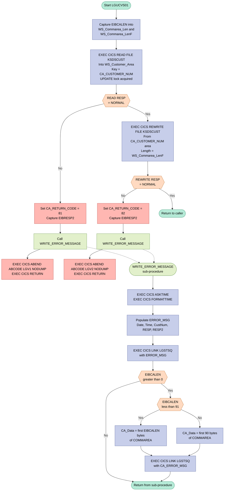
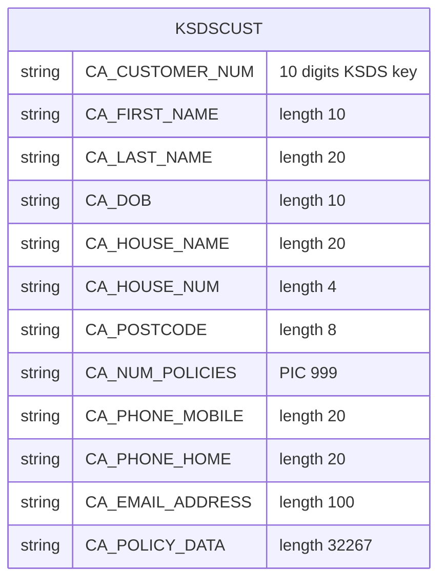

## Table of Contents

- [1. Purpose](#1-purpose)
- [2. Inputs](#2-inputs)
- [3. Outputs](#3-outputs)
- [4. Processing Logic](#4-processing-logic)
  - [4.1 Mermaid Flow Diagram](#41-mermaid-flow-diagram)
  - [4.2 Processing Logic Description](#42-processing-logic-description)
  - [4.3 Database Tables](#43-database-tables)
- [5. Paragraphs](#5-paragraphs)
- [6. Dependencies](#6-dependencies)
  - [6.1 CICS Resources](#61-cics-resources)
  - [6.2 Included Copybook / Include Member](#62-included-copybook--include-member)
  - [6.3 Communication Area (COMMAREA)](#63-communication-area-commarea)
  - [6.4 External Programs Invoked via CICS LINK](#64-external-programs-invoked-via-cics-link)
  - [6.5 CICS Commands / Services Used](#65-cics-commands--services-used)
  - [6.6 CICS Response Code Handling](#66-cics-response-code-handling)
- [7. Constraints](#7-constraints)
  - [7.1 Data Format & Size Constraints](#71-data-format--size-constraints)
  - [7.2 Sequencing & Ordering Constraints](#72-sequencing--ordering-constraints)
  - [7.3 Error Handling & Return Code Constraints](#73-error-handling--return-code-constraints)
  - [7.4 Resource & File Access Constraints](#74-resource--file-access-constraints)
- [8. Error Handling](#8-error-handling)
  - [8.1 CICS Response Code Checking (RESP / DFHRESP)](#81-cics-response-code-checking-resp--dfhresp)
  - [8.2 File I/O Error Handling](#82-file-io-error-handling)
  - [8.3 Return Code Signalling](#83-return-code-signalling)
  - [8.4 Error Logging and Notification](#84-error-logging-and-notification)
  - [8.5 Program Termination on Error](#85-program-termination-on-error)
- [9. Examples](#9-examples)
  - [9.1 Example 1 — Successful Customer Update](#91-example-1--successful-customer-update)
  - [9.2 Example 2 — Read Failure (Record Not Found)](#92-example-2--read-failure-record-not-found)
  - [9.3 Example 3 — Rewrite Failure (Record Locked / I/O Error)](#93-example-3--rewrite-failure-record-locked--io-error)

## 1. Purpose

`LGUCVS01` is a CICS-hosted PL/I program that updates an existing customer record in the insurance General Application (GenApp) system. It receives a communication area containing the customer number and updated customer profile details, uses that customer number as a VSAM KSDS key to read the existing record with exclusive update intent, and then rewrites it with the new data supplied in the communication area. If either the read or the rewrite fails, the program sets a specific return code in the communication area, logs a timestamped diagnostic message — including the customer number and CICS response codes — via a linked error-logging program (`LGSTSQ`), and terminates with a CICS ABEND before returning control to the caller.

## 2. Inputs

**Communication Area (COMMAREA) — passed via `COMM_AREA_PTR` parameter**

- `CA_REQUEST_ID` *(CHAR(6))* — Identifies the business function being requested; carried in the COMMAREA header and provides the operation context for the shared request layout.
- `CA_RETURN_CODE` *(PIC '99')* — Receives the outcome code written back to the caller; set to `'81'` on a failed VSAM read and `'82'` on a failed VSAM rewrite.
- `CA_CUSTOMER_NUM` *(PIC '9999999999')* — The VSAM KSDS key identifying which customer record to read and rewrite; also copied into the error log when file operations fail.

  **Customer Request Fields** *(active overlay within `CA_REQUEST_SPECIFIC` used during customer update)*
  - `CA_FIRST_NAME` *(CHAR(10))* — Customer's first name; part of the customer profile data rewritten to the VSAM file.
  - `CA_LAST_NAME` *(CHAR(20))* — Customer's last name; a core identity attribute in the rewritten record.
  - `CA_DOB` *(CHAR(10))* — Customer's date of birth; a personal attribute included in the maintained customer record.
  - `CA_POSTCODE` *(CHAR(8))* — Customer's postcode; an address attribute forming part of the updated customer details.
  - `CA_NUM_POLICIES` *(PIC '999')* — Count of policies linked to the customer; a business summary attribute carried in the update payload.
  - `CA_PHONE_MOBILE` *(CHAR(20))* — Customer's mobile phone number; contact information included in the rewritten record.
  - `CA_PHONE_HOME` *(CHAR(20))* — Customer's home telephone number; contact attribute persisted during the update.
  - `CA_EMAIL_ADDRESS` *(CHAR(100))* — Customer's email address; a key contact detail rewritten to the VSAM customer record.

  **Policy Request Fields** *(alternate overlay within `CA_REQUEST_SPECIFIC`; present in the shared COMMAREA layout)*
  - `CA_POLICY_NUM` *(PIC '9999999999')* — Policy identifier within the policy request overlay of the COMMAREA.
  - `CA_ISSUE_DATE` *(CHAR(10))* — Policy issue date within the common policy details structure.
  - `CA_EXPIRY_DATE` *(CHAR(10))* — Policy expiry date; defines the end of coverage in the policy details area.
  - `CA_PAYMENT` *(PIC '999999')* — Policy payment amount; a financial value carried in the common policy details overlay.

**CICS Execution Interface Block (EIB) — provided by the CICS runtime**

- `EIBCALEN` — Length of the COMMAREA passed by the invoking transaction; used to size the VSAM read, drive the rewrite length, and guard the error-logging logic that dumps COMMAREA content to the TSQ program `LGSTSQ`.

**VSAM KSDS File — `KSDSCUST`**

- The existing customer record keyed by `CA_CUSTOMER_NUM`; read with `UPDATE` intent and then rewritten with the new customer data supplied in the COMMAREA.

## 3. Outputs

**Communication Area (COMMAREA) — Outputs Returned to the Caller**

- `CA_RETURN_CODE`
  - Carries the outcome code written back into the COMMAREA for the calling program to inspect
  - Set to `'81'` when the VSAM KSDS read-for-update of `KSDSCUST` fails (CICS RESP is not NORMAL)
  - Set to `'82'` when the VSAM KSDS rewrite of `KSDSCUST` fails (CICS RESP is not NORMAL)
  - Remains unchanged (implicitly `'00'` as set by the caller before entry) on successful completion

**VSAM File — Persistent Data Written**

- `KSDSCUST` (VSAM KSDS customer file)
  - Updated via `EXEC CICS REWRITE FILE('KSDSCUST')` using the communication area data anchored at `CA_CUSTOMER_NUM` as the record key
  - The rewrite persists all customer fields supplied in the COMMAREA (`CA_FIRST_NAME`, `CA_LAST_NAME`, `CA_DOB`, `CA_POSTCODE`, `CA_NUM_POLICIES`, `CA_PHONE_MOBILE`, `CA_PHONE_HOME`, `CA_EMAIL_ADDRESS`) back to the file as the updated customer record

**Error Logging — Messages Written via LGSTSQ**

- Error message written to the CICS temporary storage queue via `EXEC CICS LINK PROGRAM('LGSTSQ')` using `ERROR_MSG` as the COMMAREA; triggered on either file operation failure
  - Contains the timestamp (`EM_DATE`, `EM_TIME`), program identifier (`LGUCVS01`), the failing customer number (`EM_CUSNUM` ← `CA_CUSTOMER_NUM`), the CICS response code (`EM_RESPRC` ← `WS_RESP`), and the secondary response code (`EM_RESP2RC` ← `WS_RESP2`)
- Supplementary COMMAREA dump written to the same queue via a second `EXEC CICS LINK PROGRAM('LGSTSQ')` call using `CA_ERROR_MSG`
  - Contains the first 90 bytes (or fewer if EIBCALEN < 91) of the raw COMMAREA (`CA_Data` ← `COMM_AREA_RAW`), prefixed with the literal `'COMMAREA='`; provides diagnostic context of the in-flight request at the point of failure

**CICS Abend — Transaction Termination Signal**

- `EXEC CICS ABEND ABCODE('LGV1') NODUMP` — issued without a dump when the VSAM read-for-update fails; terminates the CICS task with abend code `LGV1`
- `EXEC CICS ABEND ABCODE('LGV2') NODUMP` — issued without a dump when the VSAM rewrite fails; terminates the CICS task with abend code `LGV2`

## 4. Processing Logic

### 4.1 Mermaid Flow Diagram

---

### 4.2 Processing Logic Description

#### 4.2.1 High-level Summary

`LGUCVS01` is a CICS online PL/I program that performs a **VSAM KSDS customer record update**. It is the VSAM backend called (via CICS LINK or DYNAMIC LINK) from a customer update orchestrator such as `LGUCUS01`. The program reads an existing customer record with an exclusive update lock using `CA_CUSTOMER_NUM` as the KSDS key, then rewrites the record with the updated data carried in the COMMAREA. Any file I/O failure triggers structured error logging and a controlled CICS abend.

---

#### 4.2.2 Execution Flow

**Step 1 — Capture COMMAREA length**
On entry, `EIBCALEN` (the EIB field holding the length of the passed COMMAREA) is captured into two working-storage fields: `WS_Commarea_Len` (FIXED BIN 15) and `WS_Commarea_LenF` (FIXED BIN 15). These are used respectively as the `LENGTH` parameter on the READ and REWRITE commands.

**Step 2 — READ FILE with UPDATE lock**
An `EXEC CICS READ FILE('KSDSCUST')` is issued with:
- `INTO(WS_Customer_Area)` — reads the current record into a 1024-byte working buffer.
- `RIDFLD(CA_CUSTOMER_NUM)` — uses the 10-digit customer number from the COMMAREA as the KSDS key.
- `KEYLENGTH(10)` — explicitly specifies the key length.
- `UPDATE` — places an exclusive enqueue lock on the record, preventing concurrent updates until the subsequent REWRITE or UNLOCK is issued.
- `RESP(WS_RESP)` — captures the response code instead of raising a CICS condition.

**Step 3 — READ error check**
If `WS_RESP ≠ DFHRESP(NORMAL)`:
- `EIBRESP2` is saved into `WS_RESP2` for diagnostic detail.
- `CA_RETURN_CODE` is set to `'81'` — the business error code signalling a read failure.
- `WRITE_ERROR_MESSAGE` is called to log the failure.
- `EXEC CICS ABEND ABCODE('LGV1') NODUMP` abnormally terminates the transaction with a 4-character abend code `LGV1`, suppressing a system dump.
- `EXEC CICS RETURN` follows as a safety net.

**Step 4 — REWRITE FILE**
If the READ succeeds, `EXEC CICS REWRITE FILE('KSDSCUST')` is issued with:
- `FROM(CA_CUSTOMER_NUM)` — writes back the customer data from the COMMAREA starting at the `CA_CUSTOMER_NUM` field (i.e., the full updated customer record as laid out in the COMMAREA).
- `LENGTH(WS_Commarea_LenF)` — specifies the record length to write.
- `RESP(WS_RESP)` — captures the response code.

**Step 5 — REWRITE error check**
If `WS_RESP ≠ DFHRESP(NORMAL)`:
- `EIBRESP2` is saved into `WS_RESP2`.
- `CA_RETURN_CODE` is set to `'82'` — the business error code signalling a rewrite failure.
- `WRITE_ERROR_MESSAGE` is called to log the failure.
- `EXEC CICS ABEND ABCODE('LGV2') NODUMP` terminates the transaction with abend code `LGV2`.
- `EXEC CICS RETURN` follows.

**Step 6 — Successful return**
If both the READ and REWRITE complete normally, execution reaches the `RETURN` statement, returning control to the calling program. `CA_RETURN_CODE` is left as set by the caller (implicitly `'00'` for success, managed upstream).

---

#### 4.2.3 WRITE_ERROR_MESSAGE Sub-procedure

This internal procedure is invoked on any file I/O error. It performs the following:

1. **Timestamp acquisition** — `EXEC CICS ASKTIME ABSTIME(WS_ABSTIME)` retrieves the current absolute time; `EXEC CICS FORMATTIME` converts it to a human-readable date (`MM/DD/YYYY`) and time (`HH:MM:SS`).
2. **Populate ERROR_MSG structure** — fills `EM_DATE`, `EM_TIME`, `EM_CUSNUM` (customer number), `EM_RESPRC` (RESP value), and `EM_RESP2RC` (RESP2 value). The literal text `' Re-write  KSDSCUST '` is embedded in the structure, clearly identifying the file and operation in the log entry.
3. **Write to TS queue logger** — `EXEC CICS LINK PROGRAM('LGSTSQ')` passes the `ERROR_MSG` structure to the `LGSTSQ` utility program, which writes the message to a CICS Temporary Storage (TS) queue for diagnostic capture.
4. **Dump COMMAREA content** — if `EIBCALEN > 0`, up to 90 bytes of the raw COMMAREA are captured into `CA_Data` and a second `EXEC CICS LINK` to `LGSTSQ` logs the COMMAREA bytes alongside a `'COMMAREA='` prefix.
   - If `EIBCALEN < 91`: the exact COMMAREA content (all `EIBCALEN` bytes) is copied.
   - If `EIBCALEN ≥ 91`: only the first 90 bytes are copied, preventing buffer overflow.

---

#### 4.2.4 External Interactions

| Interaction | Command | Purpose |
|---|---|---|
| VSAM KSDS file `KSDSCUST` | `EXEC CICS READ ... UPDATE` | Locks and reads the customer record to be updated |
| VSAM KSDS file `KSDSCUST` | `EXEC CICS REWRITE` | Writes the updated customer data back to the VSAM dataset |
| CICS program `LGSTSQ` | `EXEC CICS LINK` | Utility program that writes error messages and COMMAREA dumps to a CICS TS queue |

---

#### 4.2.5 Plain Language Summary

When a customer update request arrives, this program acts as the VSAM file handler. It locates the customer's existing record in the `KSDSCUST` VSAM file using the customer number, places a lock on it to prevent anyone else from changing it at the same time, and then overwrites it with the new details provided in the request. If either the read or the write step fails, the program records exactly what went wrong (including timestamps, customer number, and error codes) into a log queue, then deliberately terminates the transaction with a named abend code (`LGV1` for a read failure, `LGV2` for a write failure) so that the problem is clearly identifiable for support staff.

---

### 4.3 Database Tables

This program does not access DB2 tables. It operates exclusively against the VSAM KSDS file `KSDSCUST` via CICS file control commands. No `erDiagram` is applicable.

The VSAM record layout is represented by the COMMAREA structure (`LGCMAREA` include):

## 5. Paragraphs

- **Main Procedure Body (LGUCVS01 — inline mainline logic)**
  - Serves as the program entry point and primary execution path for the customer update operation. The mainline logic is inline (not a named sub-procedure) and executes sequentially from program entry to the `RETURN` statement.
  - Captures the CICS communication area length by assigning `EIBCALEN` to both `WS_Commarea_Len` (binary halfword) and `WS_Commarea_LenF`, making the length available for subsequent CICS file commands.
  - Issues `EXEC CICS READ FILE('KSDSCUST')` with the `UPDATE` option, using `CA_CUSTOMER_NUM` (a 10-digit PIC field from the communication area) as the VSAM key and `KeyLength(10)`. The read acquires an exclusive lock on the record in preparation for an update. The record image is placed into `WS_Customer_Area`.
  - Checks `WS_RESP` against `DFHRESP(NORMAL)` after the read. If the read does not complete normally:
    - Captures `EIBRESP2` into `WS_RESP2` for supplemental diagnostic information.
    - Sets `CA_RETURN_CODE` to `'81'` to signal a read failure back to the caller.
    - Calls internal procedure `WRITE_ERROR_MESSAGE` to log diagnostic details.
    - Issues `EXEC CICS ABEND ABCODE('LGV1') NODUMP` to abnormally terminate the task with a custom abend code, suppressing a system dump.
    - Issues `EXEC CICS RETURN` to end the task after the abend directive.
  - Issues `EXEC CICS REWRITE FILE('KSDSCUST')` using `CA_CUSTOMER_NUM` as the source of the rewrite data and `WS_Commarea_LenF` as the record length. This replaces the locked record with updated data sourced directly from the communication area.
  - Checks `WS_RESP` again after the rewrite. If the rewrite does not complete normally:
    - Captures `EIBRESP2` into `WS_RESP2`.
    - Sets `CA_RETURN_CODE` to `'82'` to signal a rewrite failure.
    - Calls `WRITE_ERROR_MESSAGE` to log diagnostics.
    - Issues `EXEC CICS ABEND ABCODE('LGV2') NODUMP` and `EXEC CICS RETURN` to end the task.
  - Returns normally via `RETURN` after a successful read and rewrite sequence.

- **WRITE_ERROR_MESSAGE**
  - An internal sub-procedure called whenever a CICS file operation (read or rewrite) fails. Its sole purpose is to construct and dispatch a structured error log entry via a linked logging program.
  - Calls `EXEC CICS ASKTIME ABSTIME(WS_ABSTIME)` to obtain the current absolute time value (stored as a `FIXED BIN(31)` integer), then calls `EXEC CICS FORMATTIME` to convert it into human-readable `MMDDYYYY` date (`WS_DATE`) and `TIME` (`WS_TIME`) strings.
  - Populates the `ERROR_MSG` structure:
    - `EM_DATE` receives the formatted date.
    - `EM_TIME` receives the formatted time.
    - `EM_CUSNUM` receives the customer number from `CA_CUSTOMER_NUM`.
    - `EM_RESPRC` receives the primary CICS response code (`WS_RESP`).
    - `EM_RESP2RC` receives the secondary response code (`WS_RESP2`).
  - The structure also contains a static literal `' LGUCVS01'` identifying the program name, `' CNUM='` labeling the customer number, `' Re-write  KSDSCUST '` identifying the file, and `' RESP='` / `' RESP2='` labels — all embedded as INIT literals in the UNION overlay.
  - Issues `EXEC CICS LINK PROGRAM('LGSTSQ') COMMAREA(ERROR_MSG) LENGTH(STG(ERROR_MSG))` to pass the fully assembled error message to the `LGSTSQ` logging program.
  - Performs a conditional check on `EIBCALEN` (the communication area length) to optionally log a portion of the raw communication area for additional context:
    - If `EIBCALEN > 0` and `EIBCALEN < 91`, copies exactly `EIBCALEN` bytes from `COMM_AREA_RAW` into `CA_Data` using the `LEFT` built-in function, then links to `LGSTSQ` with the `CA_ERROR_MSG` structure (prefixed with the literal `'COMMAREA='`).
    - If `EIBCALEN >= 91`, copies the first 90 bytes of `COMM_AREA_RAW` into `CA_Data` and similarly links to `LGSTSQ` — capping the log entry to avoid overflow.
    - If `EIBCALEN` is zero, the communication area logging step is skipped entirely.
  - Returns to the mainline caller after logging is complete.

## 6. Dependencies

### 6.1 CICS Resources

- **KSDSCUST** — VSAM KSDS file accessed via CICS file control; the program issues a `READ ... UPDATE` to retrieve the customer record locked for update (keyed by `CA_CUSTOMER_NUM` with a key length of 10), and then a `REWRITE` to persist the updated customer data back to the file
- **CICS Execution Interface Block (EIB)** — Provides runtime context fields consumed directly by the program:
  - `EIBCALEN` — length of the communication area passed to the program, used to size the read/rewrite operations and to determine how much of the commarea to log on error
  - `EIBRESP2` — secondary CICS response code captured after a failed file operation and written into the error message for diagnosis

### 6.2 Included Copybook / Include Member

- **LGCMAREA** (`plinc/LGCMAREA.inc`) — PL/I `%INCLUDE` member (expanded inline) that defines the full `COMM_AREA` based-structure, including the `CA_REQUEST_ID`, `CA_RETURN_CODE`, `CA_CUSTOMER_NUM`, and all customer/policy request sub-structures; the program bases this structure on `COMM_AREA_PTR` received as a parameter

### 6.3 Communication Area (COMMAREA)

- **COMM_AREA / COMM_AREA_PTR** — Pointer parameter passed to the program at entry (`Options(Main)`); the entire customer update request and response are carried through this area, including customer identity, personal details, and the return code written back to the caller

### 6.4 External Programs Invoked via CICS LINK

- **LGSTSQ** — Error-logging utility program; invoked (potentially multiple times per error event) via `EXEC CICS LINK` to record:
  - A formatted error message (`ERROR_MSG`) containing the date, time, program name, customer number, and CICS response codes
  - A secondary commarea dump (`CA_ERROR_MSG`) containing the raw commarea content to assist with problem diagnosis

### 6.5 CICS Commands / Services Used

- **EXEC CICS READ FILE … UPDATE** — Reads and locks the `KSDSCUST` customer record for subsequent rewrite
- **EXEC CICS REWRITE FILE** — Writes the updated customer data back to `KSDSCUST`
- **EXEC CICS ABEND ABCODE NODUMP** — Issues a controlled abend (`LGV1` on read failure, `LGV2` on rewrite failure) without producing a dump, then returns to CICS
- **EXEC CICS RETURN** — Returns control to CICS after an abend or normal completion
- **EXEC CICS ASKTIME / FORMATTIME** — Retrieves the current absolute time and formats it into date (`MMDDYYYY`) and time strings for inclusion in the error message
- **EXEC CICS LINK PROGRAM** — Transfers control to `LGSTSQ` with a commarea for error logging

### 6.6 CICS Response Code Handling

- **DFHRESP(NORMAL)** — Symbolic CICS response constant used to test whether file operations completed successfully; any non-normal response triggers error handling and abend logic

## 7. Constraints

### 7.1 Data Format & Size Constraints

- **Communication area maximum size** — `COMM_AREA_RAW` is declared as `CHAR(32500)`, establishing an absolute upper bound of 32,500 bytes on the COMMAREA that can be processed; any data beyond this boundary is inaccessible.
- **Customer number format** — `CA_CUSTOMER_NUM` is declared as `PIC '9999999999'`, enforcing a strictly numeric, exactly 10-digit value; non-numeric or shorter/longer values are structurally invalid.
- **Return code format** — `CA_RETURN_CODE` is declared as `PIC '99'`, restricting it to exactly two numeric digits.
- **Customer data buffer size** — `WS_Customer_Area` is `CHAR(1024)`, meaning the customer record read from VSAM into this buffer cannot exceed 1,024 bytes; records larger than this will overflow the receiving field.
- **Policy number format** — `CA_POLICY_NUM` is `PIC '9999999999'`, enforcing a 10-digit numeric-only policy identifier.
- **Payment amount format** — `CA_PAYMENT` is `PIC '999999'`, restricting payment values to a maximum of six numeric digits (i.e., 0–999999).
- **Number of policies format** — `CA_NUM_POLICIES` is `PIC '999'`, limiting the policy count to a maximum of three numeric digits (0–999).
- **VSAM key length fixed at 10** — the `EXEC CICS READ` call specifies `KeyLength(10)`, enforcing that `CA_CUSTOMER_NUM` is used as exactly a 10-byte VSAM KSDS key; this must match the defined key length of the `KSDSCUST` file.
- **Field-level size constraints in COMMAREA** — individual customer fields carry implicit maximum-length constraints:
    - `CA_FIRST_NAME`: max 10 characters
    - `CA_LAST_NAME`: max 20 characters
    - `CA_DOB`: max 10 characters
    - `CA_POSTCODE`: max 8 characters
    - `CA_PHONE_MOBILE` / `CA_PHONE_HOME`: max 20 characters each
    - `CA_EMAIL_ADDRESS`: max 100 characters
- **Error logging COMMAREA dump limit** — in `WRITE_ERROR_MESSAGE`, a conditional check restricts the amount of raw COMMAREA data captured for logging:
    - If `EIBCALEN < 91`, exactly `EIBCALEN` bytes are captured into `CA_Data`
    - If `EIBCALEN >= 91`, only the first 90 bytes are captured, matching the `CA_Data` field size of `CHAR(90)`

---

### 7.2 Sequencing & Ordering Constraints

- **READ before REWRITE is mandatory** — the program unconditionally issues `EXEC CICS READ FILE('KSDSCUST') ... Update` before attempting `EXEC CICS REWRITE FILE('KSDSCUST')`; CICS requires a successful READ UPDATE to establish the exclusive record lock before a REWRITE can be issued in the same task.
- **REWRITE must use the locked record** — the REWRITE sources data from `CA_CUSTOMER_NUM` (the COMMAREA pointer area), but operates on the record token established by the preceding READ UPDATE; this means no change to the key is permitted between READ and REWRITE.
- **Error path terminates immediately** — if the READ fails, processing stops with `EXEC CICS ABEND` followed by `EXEC CICS RETURN`; the REWRITE is never reached, enforcing the rule that no update occurs unless the record was successfully read and locked.
- **Error logging precedes abend** — `WRITE_ERROR_MESSAGE` is always called before issuing `EXEC CICS ABEND`, ensuring diagnostic information is written to the TS queue (via `LGSTSQ`) before the task terminates.
- **Time/date retrieval sequence inside error logger** — within `WRITE_ERROR_MESSAGE`, `EXEC CICS ASKTIME` must complete before `EXEC CICS FORMATTIME`, as the `WS_ABSTIME` value produced by `ASKTIME` is the required input to `FORMATTIME`.

---

### 7.3 Error Handling & Return Code Constraints

- **Return code `'81'` reserved for READ failure** — if `WS_RESP <> DFHRESP(NORMAL)` after the READ, `CA_RETURN_CODE` is set to `'81'`; this value exclusively signals a VSAM read error to the caller.
- **Return code `'82'` reserved for REWRITE failure** — if `WS_RESP <> DFHRESP(NORMAL)` after the REWRITE, `CA_RETURN_CODE` is set to `'82'`; this value exclusively signals a VSAM rewrite error.
- **Abend codes are operation-specific** — READ failure triggers abend code `'LGV1'`; REWRITE failure triggers `'LGV2'`; these codes are distinct and must not be confused.
- **NODUMP constraint on abend** — both `EXEC CICS ABEND` calls specify `NODUMP`, meaning no system transaction dump is produced; this constrains diagnostic data to only what `WRITE_ERROR_MESSAGE` writes to the TS queue.
- **RESP2 is only captured on failure** — `WS_RESP2 = EIBRESP2` is assigned only inside the failure branches; it is not recorded on a successful operation.

---

### 7.4 Resource & File Access Constraints

- **Single target file** — the program exclusively operates on the VSAM KSDS file named `'KSDSCUST'`; no other file resource is accessed for the update itself.
- **Record identified solely by customer number** — the VSAM key used in both READ and REWRITE is `CA_CUSTOMER_NUM`; no secondary index or alternate key is used.
- **Commarea length governs I/O length** — the READ uses `Length(WS_Commarea_Len)` and the REWRITE uses `Length(WS_Commarea_LenF)`, both initialized from `EIBCALEN`; this ties the amount of data read from and written back to VSAM directly to the size of the COMMAREA passed by the caller, rather than a fixed record length.
- **Error logging is conditional on COMMAREA presence** — within `WRITE_ERROR_MESSAGE`, the raw COMMAREA dump to the TS queue is only performed if `EIBCALEN > 0`; if no COMMAREA was passed, the secondary error log entry is skipped entirely.
- **Auxiliary logging routed through `LGSTSQ`** — all error message writing is delegated to an external program via `EXEC CICS LINK PROGRAM('LGSTSQ')`; the current program has no direct TS queue write capability and depends on `LGSTSQ` being available.

## 8. Error Handling

### 8.1 CICS Response Code Checking (RESP / DFHRESP)

- After each CICS file operation, the `RESP` option is used to capture the CICS response code into the working storage variable `WS_RESP`, rather than relying on default CICS exception handling
  - This approach gives the program explicit, inline control over whether a CICS command succeeded or failed
  - The captured response is compared against `DFHRESP(NORMAL)`, the standard CICS symbolic constant representing a successful response, using an `IF` condition check
  - This pattern is applied consistently to both the Read-for-Update and the ReWrite operations against the VSAM KSDS file `KSDSCUST`

---

### 8.2 File I/O Error Handling

- **Read-for-Update failure:** If the `EXEC CICS READ` with the `UPDATE` option does not complete normally, the program detects the failure by comparing `WS_RESP` to `DFHRESP(NORMAL)`
  - The secondary response code is immediately captured from the CICS Execute Interface Block field `EIBRESP2` into `WS_RESP2`, providing additional diagnostic granularity beyond the primary response
  - The communication area return code `CA_RETURN_CODE` is set to the specific failure value `'81'`, signalling a read failure to the caller
  - The internal error logging procedure is invoked, an abend is issued, and the transaction is terminated

- **ReWrite failure:** If the `EXEC CICS REWRITE` operation does not complete normally, the same pattern is applied
  - `EIBRESP2` is captured into `WS_RESP2`
  - `CA_RETURN_CODE` is set to `'82'`, distinguishing this as a rewrite failure distinct from the read failure
  - The error logging procedure is invoked, an abend is issued, and the transaction is terminated

---

### 8.3 Return Code Signalling

- `CA_RETURN_CODE` in the communication area acts as a business-level error indicator passed back to the calling environment
  - A value of `'81'` indicates failure during the customer record read phase
  - A value of `'82'` indicates failure during the customer record rewrite phase
  - These distinct codes allow the caller to differentiate between the two failure modes without needing knowledge of the internal CICS response codes

---

### 8.4 Error Logging and Notification

- A dedicated internal procedure `WRITE_ERROR_MESSAGE` is called whenever a file operation fails
  - It obtains the current system time and date using `EXEC CICS ASKTIME` and `EXEC CICS FORMATTIME`, stamping the error record with a precise timestamp
  - The error message structure `ERROR_MSG` is populated with the program identifier (`LGUCVS01`), the customer number from the communication area, and both the primary (`WS_RESP`) and secondary (`WS_RESP2`) CICS response codes
  - The fully populated error message is written to a transient data queue by linking to the utility program `LGSTSQ` via `EXEC CICS LINK`, passing `ERROR_MSG` as the commarea
  - An additional log entry is written containing the raw communication area content to aid diagnosis
    - If the communication area length (`EIBCALEN`) is between 1 and 90 bytes, the exact content is captured and forwarded to `LGSTSQ`
    - If `EIBCALEN` exceeds 90 bytes, the first 90 bytes of the raw communication area are captured and forwarded, preventing buffer overflow in the fixed-length log area

---

### 8.5 Program Termination on Error

- After error logging, program execution is forcibly terminated using a two-step mechanism
  - `EXEC CICS ABEND ABCODE('LGV1')` is issued on a read failure, and `EXEC CICS ABEND ABCODE('LGV2')` is issued on a rewrite failure; the `NODUMP` option suppresses system dump generation, keeping the abend lightweight
  - `EXEC CICS RETURN` follows the abend to ensure control is returned to CICS cleanly, ending the task
  - The distinct abend codes `LGV1` and `LGV2` allow operations staff or monitoring tools to identify at a glance which file operation caused the abnormal termination

## 9. Examples

### 9.1 Example 1 — Successful Customer Update

**Input (Communication Area fields):**

| Field | Value |
|---|---|
| `CA_CUSTOMER_NUM` | `0000000042` |
| `CA_REQUEST_ID` | `01UCUS` |
| `CA_RETURN_CODE` | `00` |
| `CA_FIRST_NAME` | `Jane` |
| `CA_LAST_NAME` | `Smith` |
| `CA_DOB` | `1985-03-22` |
| `CA_POSTCODE` | `SW1A 1AA` |
| `CA_NUM_POLICIES` | `002` |
| `CA_PHONE_MOBILE` | `07700900123` |
| `CA_PHONE_HOME` | `02079460000` |
| `CA_EMAIL_ADDRESS` | `jane.smith@example.com` |

**Expected Output:**

- `CA_RETURN_CODE` remains `00`
- The VSAM KSDS file `KSDSCUST` is updated with the new customer data for key `0000000042`
- The program issues `EXEC CICS RETURN` and exits normally with no error messages written

**How the input leads to the output:**

The program issues an `EXEC CICS READ … UPDATE` against `KSDSCUST` using `CA_CUSTOMER_NUM` (`0000000042`) as the 10-byte RIDFLD key. Because the record exists and the read succeeds (`WS_RESP = DFHRESP(NORMAL)`), the program proceeds to `EXEC CICS REWRITE`, writing the updated communication-area data back to the file. Both operations return normally, so `CA_RETURN_CODE` is never changed from its incoming value of `00` and the program returns cleanly.

---

### 9.2 Example 2 — Read Failure (Record Not Found)

**Input (Communication Area fields):**

| Field | Value |
|---|---|
| `CA_CUSTOMER_NUM` | `0000009999` |
| `CA_REQUEST_ID` | `01UCUS` |
| `CA_RETURN_CODE` | `00` |
| `CA_FIRST_NAME` | `Bob` |
| `CA_LAST_NAME` | `Jones` |

**Expected Output:**

- `CA_RETURN_CODE` is set to `81`
- Error details (date, time, customer number `0000009999`, `RESP`/`RESP2` codes) are written to a transient-data queue via a CICS LINK to `LGSTSQ`
- The first 90 bytes of the raw communication area are also logged via a second LINK to `LGSTSQ`
- The transaction abends with abend code `LGV1` (no dump), then `EXEC CICS RETURN` is issued

**How the input leads to the output:**

Customer `0000009999` does not exist in `KSDSCUST`. The `EXEC CICS READ … UPDATE` returns a non-normal `RESP`. The program enters the error block: it captures `EIBRESP2`, sets `CA_RETURN_CODE = '81'`, and calls the internal `WRITE_ERROR_MESSAGE` procedure. That procedure timestamps the error with `ASKTIME`/`FORMATTIME`, builds a structured error record with the customer number and response codes, and links to `LGSTSQ` twice (once for the error message, once for the raw commarea dump). The program then abends with code `LGV1` and returns without ever attempting the rewrite.

---

### 9.3 Example 3 — Rewrite Failure (Record Locked / I/O Error)

**Input (Communication Area fields):**

| Field | Value |
|---|---|
| `CA_CUSTOMER_NUM` | `0000000007` |
| `CA_RETURN_CODE` | `00` |
| `CA_EMAIL_ADDRESS` | `updated.email@corp.com` |

**Expected Output:**

- `CA_RETURN_CODE` is set to `82`
- Error details logged to `LGSTSQ` (timestamp, customer number `0000000007`, `RESP`/`RESP2` codes, raw commarea prefix)
- Transaction abends with code `LGV2` (no dump), then returns

**How the input leads to the output:**

The `EXEC CICS READ … UPDATE` for customer `0000000007` succeeds (record found, exclusive lock granted). However, the subsequent `EXEC CICS REWRITE` encounters an error (e.g., file disabled, record length mismatch, or a concurrent conflict) and returns a non-normal `RESP`. The program enters the second error block: it saves `EIBRESP2`, sets `CA_RETURN_CODE = '82'`, and calls `WRITE_ERROR_MESSAGE` with the same logging logic as above. It then abends with `LGV2` and issues `EXEC CICS RETURN`, distinguishing this rewrite failure from the earlier read failure (`81`) by the different return code and abend code.

---

Generated by IBM Bob Premium Package for Z
