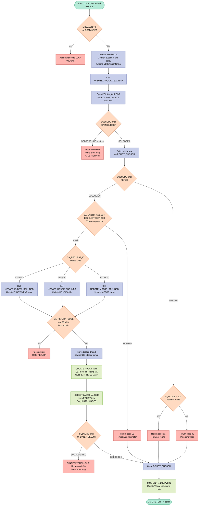
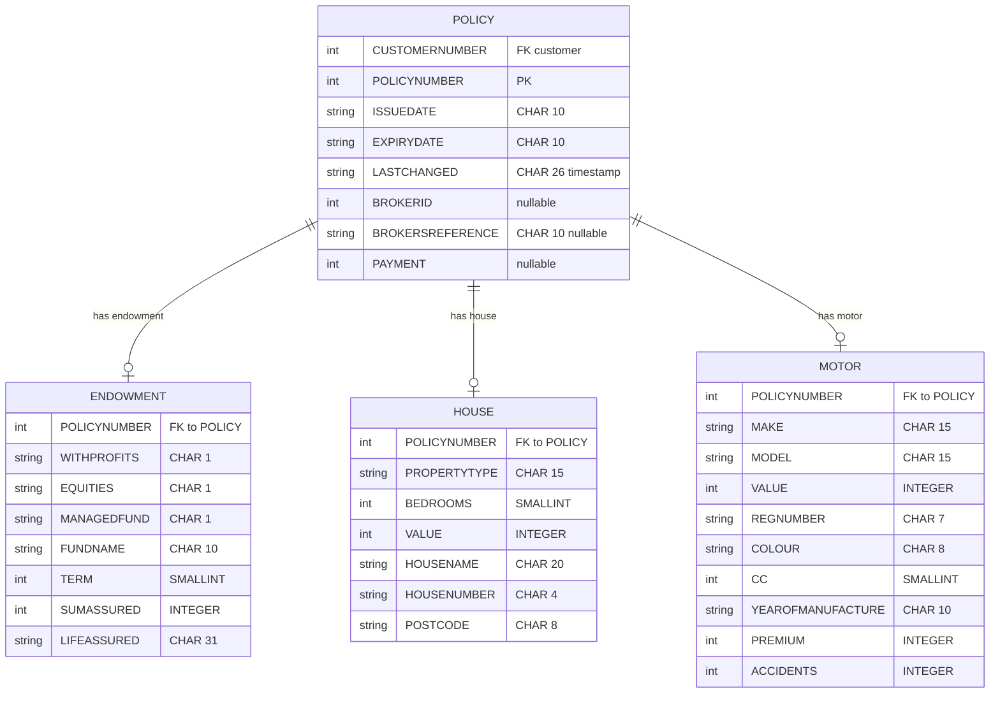

## Table of Contents

- [1. Purpose](#1-purpose)
- [2. Inputs](#2-inputs)
  - [2.1 CICS COMMAREA Parameter](#21-cics-commarea-parameter)
  - [2.2 CICS COMMAREA Fields — Request Control](#22-cics-commarea-fields--request-control)
  - [2.3 CICS COMMAREA Fields — Common Policy Data](#23-cics-commarea-fields--common-policy-data)
  - [2.4 CICS COMMAREA Fields — Endowment Policy (`CA_REQUEST_ID = '01UEND'`)](#24-cics-commarea-fields--endowment-policy-ca_request_id--01uend)
  - [2.5 CICS COMMAREA Fields — House Policy (`CA_REQUEST_ID = '01UHOU'`)](#25-cics-commarea-fields--house-policy-ca_request_id--01uhou)
  - [2.6 CICS COMMAREA Fields — Motor Policy (`CA_REQUEST_ID = '01UMOT'`)](#26-cics-commarea-fields--motor-policy-ca_request_id--01umot)
  - [2.7 CICS EIB (Executive Interface Block) Fields](#27-cics-eib-executive-interface-block-fields)
  - [2.8 DB2 Tables (External Data Sources)](#28-db2-tables-external-data-sources)
- [3. Outputs](#3-outputs)
  - [3.1 Return and status outputs](#31-return-and-status-outputs)
  - [3.2 Database updates](#32-database-updates)
  - [3.3 Cross-system update call](#33-cross-system-update-call)
  - [3.4 Error and diagnostic messages](#34-error-and-diagnostic-messages)
  - [3.5 Transaction control and terminal-visible side effects](#35-transaction-control-and-terminal-visible-side-effects)
- [4. Processing Logic](#4-processing-logic)
  - [4.1 Mermaid Flow Diagram](#41-mermaid-flow-diagram)
  - [4.2 Processing Logic Description](#42-processing-logic-description)
  - [4.3 Database Tables](#43-database-tables)
- [5. Paragraphs](#5-paragraphs)
- [6. Dependencies](#6-dependencies)
  - [6.1 DB2 Database Tables](#61-db2-database-tables)
  - [6.2 CICS Services](#62-cics-services)
  - [6.3 External Programs / Modules](#63-external-programs--modules)
  - [6.4 Include Files / Copybooks](#64-include-files--copybooks)
  - [6.5 Input Parameters / COMMAREA](#65-input-parameters--commarea)
  - [6.6 CICS Execution Block Fields](#66-cics-execution-block-fields)
- [7. Constraints](#7-constraints)
  - [7.1 Data Validation Constraints](#71-data-validation-constraints)
  - [7.2 Concurrency and Optimistic Locking Constraints](#72-concurrency-and-optimistic-locking-constraints)
  - [7.3 Sequencing and Ordering Constraints](#73-sequencing-and-ordering-constraints)
  - [7.4 Error Handling and Rollback Constraints](#74-error-handling-and-rollback-constraints)
  - [7.5 Resource and Memory Constraints](#75-resource-and-memory-constraints)
- [8. Error Handling](#8-error-handling)
  - [8.1 COMMAREA Validation](#81-commarea-validation)
  - [8.2 DB2 Cursor Open Error Handling](#82-db2-cursor-open-error-handling)
  - [8.3 DB2 FETCH Error Handling](#83-db2-fetch-error-handling)
  - [8.4 Timestamp Concurrency Check](#84-timestamp-concurrency-check)
  - [8.5 Policy-Specific Update Error Handling](#85-policy-specific-update-error-handling)
  - [8.6 Policy Table Update Error Handling](#86-policy-table-update-error-handling)
  - [8.7 Cursor Close Error Handling (`CLOSE_PCURSOR`)](#87-cursor-close-error-handling-close_pcursor)
  - [8.8 Error Logging and Notification (`WRITE_ERROR_MESSAGE`)](#88-error-logging-and-notification-write_error_message)
- [9. Examples](#9-examples)
  - [9.1 Example 1 — Successful House Policy Update](#91-example-1--successful-house-policy-update)
  - [9.2 Example 2 — Timestamp Mismatch (Concurrent Update Detected)](#92-example-2--timestamp-mismatch-concurrent-update-detected)
  - [9.3 Example 3 — Policy Not Found](#93-example-3--policy-not-found)

## 1. Purpose

`LGUPDB01` is a CICS-hosted PL/I program responsible for updating insurance policy records in a DB2 database on behalf of the General Insurance sample application. It receives a communication area (COMMAREA) identifying a specific customer and policy, then applies changes to the appropriate policy-type table — Endowment, House, or Motor — based on the request type supplied in the COMMAREA. Before writing any changes, it validates the incoming timestamp against the current DB2 record to prevent lost-update conflicts; if the timestamps do not match, it abandons the update and returns an error code to the caller. On a successful match, it updates both the policy-specific detail table and the main POLICY table (setting a new `LASTCHANGED` timestamp), then links to program `LGUPVS01` to complete any supplementary processing. Any DB2 errors encountered during the update are logged to a transient data queue via the shared `LGSTSQ` utility program, and the return code in the COMMAREA is set accordingly to communicate success or failure back to the calling application.

## 2. Inputs

### 2.1 CICS COMMAREA Parameter

- **`COMM_AREA` (via `COMM_AREA_PTR`)** — The sole entry-point parameter passed to `LGUPDB01` by the CICS runtime. The program is declared as `Proc(COMM_AREA_PTR)`, making this pointer the primary mechanism through which all caller-supplied data arrives. The structure overlaid on this pointer contains all fields listed below.

### 2.2 CICS COMMAREA Fields — Request Control

- **`CA_REQUEST_ID`** (`CHAR(6)`) — Identifies the type of policy update to perform. Valid values are `01UEND` (Endowment), `01UHOU` (House), and `01UMOT` (Motor). Controls which DB2 table is updated.
- **`CA_RETURN_CODE`** (`PIC '99'`) — Read on entry to initialize to `'00'`; also carries any error code set by a prior call back to the caller on return.
- **`CA_CUSTOMER_NUM`** (`PIC '9999999999'`) — The ten-digit customer number used as a DB2 WHERE predicate to locate the policy row to update.
- **`CA_POLICY_NUM`** (`PIC '9999999999'`) — The ten-digit policy number used together with `CA_CUSTOMER_NUM` to identify the exact row to update in the POLICY table and type-specific tables.

### 2.3 CICS COMMAREA Fields — Common Policy Data

- **`CA_ISSUE_DATE`** (`CHAR(10)`) — Issue date written to the POLICY table `ISSUEDATE` column.
- **`CA_EXPIRY_DATE`** (`CHAR(10)`) — Expiry date written to the POLICY table `EXPIRYDATE` column.
- **`CA_LASTCHANGED`** (`CHAR(26)`) — Timestamp from the commarea compared against the value held in DB2 as an optimistic-concurrency check; mismatch causes return code `'02'` without update.
- **`CA_BROKERID`** (`PIC '9999999999'`) — Broker identifier written to the POLICY table `BROKERID` column.
- **`CA_BROKERSREF`** (`CHAR(10)`) — Broker's reference string written to the POLICY table `BROKERSREFERENCE` column.
- **`CA_PAYMENT`** (`PIC '999999'`) — Payment amount, converted to integer format and available for use in the policy update.

### 2.4 CICS COMMAREA Fields — Endowment Policy (`CA_REQUEST_ID = '01UEND'`)

- **`CA_E_WITH_PROFITS`** (`CHAR(1)`) — With-profits flag written to the ENDOWMENT table `WITHPROFITS` column.
- **`CA_E_EQUITIES`** (`CHAR(1)`) — Equities flag written to the ENDOWMENT table `EQUITIES` column.
- **`CA_E_MANAGED_FUND`** (`CHAR(1)`) — Managed-fund flag written to the ENDOWMENT table `MANAGEDFUND` column.
- **`CA_E_FUND_NAME`** (`CHAR(10)`) — Fund name written to the ENDOWMENT table `FUNDNAME` column.
- **`CA_E_TERM`** (`PIC '99'`) — Policy term written to the ENDOWMENT table `TERM` column.
- **`CA_E_SUM_ASSURED`** (`PIC '999999'`) — Sum assured written to the ENDOWMENT table `SUMASSURED` column.
- **`CA_E_LIFE_ASSURED`** (`CHAR(31)`) — Life-assured name written to the ENDOWMENT table `LIFEASSURED` column.
- **`CA_E_PADDING_DATA`** (`CHAR(32348)`) — Variable-length overflow data; if the commarea length exceeds the required fixed length, this portion is written to the ENDOWMENT table VARCHAR field.

### 2.5 CICS COMMAREA Fields — House Policy (`CA_REQUEST_ID = '01UHOU'`)

- **`CA_H_PROPERTY_TYPE`** (`CHAR(15)`) — Property type written to the HOUSE table `PROPERTYTYPE` column.
- **`CA_H_BEDROOMS`** (`PIC '999'`) — Number of bedrooms written to the HOUSE table `BEDROOMS` column.
- **`CA_H_VALUE`** (`PIC '99999999'`) — Property value written to the HOUSE table `VALUE` column.
- **`CA_H_HOUSE_NAME`** (`CHAR(20)`) — House name written to the HOUSE table `HOUSENAME` column.
- **`CA_H_HOUSE_NUMBER`** (`CHAR(4)`) — House number written to the HOUSE table `HOUSENUMBER` column.
- **`CA_H_POSTCODE`** (`CHAR(8)`) — Postcode written to the HOUSE table `POSTCODE` column.

### 2.6 CICS COMMAREA Fields — Motor Policy (`CA_REQUEST_ID = '01UMOT'`)

- **`CA_M_MAKE`** (`CHAR(15)`) — Vehicle make written to the MOTOR table `MAKE` column.
- **`CA_M_MODEL`** (`CHAR(15)`) — Vehicle model written to the MOTOR table `MODEL` column.
- **`CA_M_VALUE`** (`PIC '999999'`) — Vehicle value written to the MOTOR table `VALUE` column.
- **`CA_M_REGNUMBER`** (`CHAR(7)`) — Registration number written to the MOTOR table `REGNUMBER` column.
- **`CA_M_COLOUR`** (`CHAR(8)`) — Vehicle colour written to the MOTOR table `COLOUR` column.
- **`CA_M_CC`** (`PIC '9999'`) — Engine cubic capacity written to the MOTOR table `CC` column.
- **`CA_M_MANUFACTURED`** (`CHAR(10)`) — Year of manufacture written to the MOTOR table `YEAROFMANUFACTURE` column.
- **`CA_M_PREMIUM`** (`PIC '999999'`) — Motor premium written to the MOTOR table `PREMIUM` column.
- **`CA_M_ACCIDENTS`** (`PIC '999999'`) — Accident count written to the MOTOR table `ACCIDENTS` column.

### 2.7 CICS EIB (Executive Interface Block) Fields

- **`EIBCALEN`** — Length of the commarea as set by the CICS runtime. Used on entry to detect a missing commarea (causes ABEND `LGCA` if zero) and to determine the actual length of variable data.
- **`EIBTRNID`** — CICS transaction identifier captured from the EIB for diagnostic logging.
- **`EIBTRMID`** — CICS terminal identifier captured from the EIB for diagnostic logging.
- **`EIBTASKN`** — CICS task number captured from the EIB for diagnostic logging.

### 2.8 DB2 Tables (External Data Sources)

- **`POLICY` table** — Queried via `POLICY_CURSOR` (`SELECT … FOR UPDATE`) using `CA_CUSTOMER_NUM` and `CA_POLICY_NUM` as keys; the fetched `LASTCHANGED` timestamp is compared against `CA_LASTCHANGED` before any update is applied.
- **`ENDOWMENT` table** — Updated when `CA_REQUEST_ID = '01UEND'`; row identified by `DB2_POLICYNUM_INT`.
- **`HOUSE` table** — Updated when `CA_REQUEST_ID = '01UHOU'`; row identified by `DB2_POLICYNUM_INT`.
- **`MOTOR` table** — Updated when `CA_REQUEST_ID = '01UMOT'`; row identified by `DB2_POLICYNUM_INT`.

## 3. Outputs

### 3.1 Return and status outputs

- `CA_RETURN_CODE`
  - Primary status returned to the caller through the COMMAREA.
  - Indicates the outcome of the update request:
    - `'00'` for successful processing
    - `'01'` when no matching row is found for a fetch or update
    - `'02'` when optimistic locking fails because `CA_LASTCHANGED` in the COMMAREA does not match the DB2 row timestamp
    - `'90'` for DB2 or system-related errors, including lock/contention and SQL failures
  - This is the program’s main observable result.

- `CA_LASTCHANGED`
  - Returned in the COMMAREA after a successful policy-table update.
  - Updated with the new `LASTCHANGED` timestamp read back from DB2 so the caller can use the refreshed concurrency token on later requests.

### 3.2 Database updates

- `POLICY` table row for the requested customer/policy
  - Updated when the current DB2 timestamp matches the COMMAREA timestamp.
  - Observable changes include:
    - `ISSUEDATE`
    - `EXPIRYDATE`
    - `LASTCHANGED` set to `CURRENT TIMESTAMP`
    - `BROKERID`
    - `BROKERSREFERENCE`
  - This is the main shared record updated by the program.

- `ENDOWMENT` table row for the requested policy
  - Updated when `CA_REQUEST_ID = '01UEND'`.
  - Observable changes include endowment-specific policy details such as:
    - `WITHPROFITS`
    - `EQUITIES`
    - `MANAGEDFUND`
    - `FUNDNAME`
    - `TERM`
    - `SUMASSURED`
    - `LIFEASSURED`
  - Represents persistence of endowment policy amendments.

- `HOUSE` table row for the requested policy
  - Updated when `CA_REQUEST_ID = '01UHOU'`.
  - Observable changes include:
    - `PROPERTYTYPE`
    - `BEDROOMS`
    - `VALUE`
    - `HOUSENAME`
    - `HOUSENUMBER`
    - `POSTCODE`
  - Represents persistence of house policy amendments.

- `MOTOR` table row for the requested policy
  - Updated when `CA_REQUEST_ID = '01UMOT'`.
  - Observable changes include:
    - `MAKE`
    - `MODEL`
    - `VALUE`
    - `REGNUMBER`
    - `COLOUR`
    - `CC`
    - `YEAROFMANUFACTURE`
    - `PREMIUM`
    - `ACCIDENTS`
  - Represents persistence of motor policy amendments.

- DB2 rollback
  - On certain failures after the policy update path begins, the program issues `EXEC CICS SYNCPOINT ROLLBACK`.
  - Observable effect is that pending DB2 updates are undone rather than committed.

### 3.3 Cross-system update call

- CICS link to `LGUPVS01`
  - After the DB2 update routine, the program links to `LGUPVS01` with the COMMAREA and length 225.
  - Observable side effect is delegation of the same update request to the VSAM-side update program, which may perform additional persistent updates outside this module.

### 3.4 Error and diagnostic messages

- Error record sent to `LGSTSQ`
  - On abnormal or SQL-related error paths, the program builds `ERROR_MSG` and sends it via `EXEC CICS LINK PROGRAM('LGSTSQ')`.
  - Message content includes:
    - current date
    - current time
    - program identifier text
    - customer number
    - policy number
    - SQL request name
    - SQLCODE
  - Role: operational logging / diagnostic reporting.

- COMMAREA snapshot sent to `LGSTSQ`
  - When an error occurs and a COMMAREA exists, the program sends a second message containing up to the first 90 bytes of the COMMAREA in `CA_ERROR_MSG`.
  - Role: captures request context for troubleshooting.

### 3.5 Transaction control and terminal-visible side effects

- CICS abend `LGCA`
  - If no COMMAREA is received (`EIBCALEN = 0`), the program issues `EXEC CICS ABEND ABCODE('LGCA') NODUMP`.
  - Observable result is abnormal task termination with abend code `LGCA`.

- CICS `RETURN`
  - The program ends by returning control to its caller.
  - Several error branches also return early after setting `CA_RETURN_CODE` and optionally logging errors.
  - Role: completes the transaction and hands the output COMMAREA status back to the caller.

## 4. Processing Logic

### 4.1 Mermaid Flow Diagram

---

### 4.2 Processing Logic Description

#### 4.2.1 High-level Summary

`LGUPDB01` is the DB2 back-end program for updating insurance policy records in the GenApp system. It is invoked via `EXEC CICS LINK` from the policy update orchestrator (`LGUPOL01`). The program uses an optimistic-locking approach: it opens a `SELECT FOR UPDATE` cursor on the POLICY table, compares the timestamp received in the COMMAREA against the current database timestamp, and only proceeds with the update if they match. Depending on the policy type indicated in the request (`01UEND`, `01UHOU`, or `01UMOT`), it also updates the corresponding policy-type-specific table (ENDOWMENT, HOUSE, or MOTOR). After the successful update it calls `LGUPVS01` to keep the VSAM copy in sync.

---

#### 4.2.2 Execution Flow

**Step 1 — Initialization and COMMAREA validation**
The program initialises working-storage fields (`WS_TRANSID`, `WS_TERMID`, `WS_TASKNUM`) from CICS EIB fields, and clears DB2 host variables. If `EIBCALEN = 0` (no COMMAREA received), it writes an error message and issues `EXEC CICS ABEND ABCODE('LGCA') NODUMP`, terminating immediately.

**Step 2 — Convert and save key identifiers**
`CA_CUSTOMER_NUM` and `CA_POLICY_NUM` from the COMMAREA are converted from display to binary integer format (`DB2_CUSTOMERNUM_INT`, `DB2_POLICYNUM_INT`) for use as DB2 host variables. Both are also copied into the error message structure for diagnostic purposes.

**Step 3 — Open POLICY_CURSOR**
Inside `UPDATE_POLICY_DB2_INFO`, the cursor `POLICY_CURSOR` (declared `WITH HOLD`, `FOR UPDATE`) is opened against the POLICY table, filtered by customer number and policy number. The cursor lock prevents concurrent updates.
- `SQLCODE 0` → proceed.
- `SQLCODE -913` (deadlock/timeout) or any other error → set `CA_RETURN_CODE = '90'`, write error message, and return immediately.

**Step 4 — Fetch the policy row**
A single row is fetched. The fetch result drives the next branch:
- `SQLCODE 0` (row found) → compare timestamps (Step 5).
- `SQLCODE 100` (no row) → `CA_RETURN_CODE = '01'` (not found).
- Any other non-zero SQLCODE → `CA_RETURN_CODE = '90'` and error message written.

**Step 5 — Timestamp comparison (optimistic locking)**
`CA_LASTCHANGED` (from the COMMAREA, representing the timestamp the user originally read) is compared with `DB2_LASTCHANGED` (freshly fetched from the database).
- **Match** → the record has not been changed since the user last read it; proceed with the update.
- **No match** → `CA_RETURN_CODE = '02'`; the update is abandoned because another user has modified the record in the interim. The cursor is closed and the program returns.

**Step 6 — Update the policy-type-specific table**
The request ID `CA_REQUEST_ID` determines which sub-procedure to call:

| Request ID | Policy Type | Sub-procedure called | Table updated |
|---|---|---|---|
| `01UEND` | Endowment | `UPDATE_ENDOW_DB2_INFO` | ENDOWMENT |
| `01UHOU` | House | `UPDATE_HOUSE_DB2_INFO` | HOUSE |
| `01UMOT` | Motor | `UPDATE_MOTOR_DB2_INFO` | MOTOR |

- **Endowment**: Numeric fields (`TERM`, `SUMASSURED`) are converted to small integer / integer format. If `EIBCALEN` exceeds the fixed commarea length, the extra bytes are treated as `VARCHAR` padding data and included in the update. The ENDOWMENT row is updated by `POLICYNUMBER`.
- **House**: `BEDROOMS` (SMALLINT) and `VALUE` (INTEGER) are converted; all house fields updated by `POLICYNUMBER`.
- **Motor**: `CC` (SMALLINT), `VALUE`, `PREMIUM`, and `ACCIDENTS` (INTEGER) are converted; all motor fields updated by `POLICYNUMBER`.

For all three types, `SQLCODE 100` after the UPDATE sets return code `'01'`; any other non-zero SQLCODE sets `'90'` and writes an error.

**Step 7 — Check sub-update result**
If `CA_RETURN_CODE ≠ '00'` after the type-specific update, the cursor is closed and the program returns without touching the POLICY table, preserving consistency.

**Step 8 — Update the POLICY table**
`DB2_BROKERID_INT` and `DB2_PAYMENT_INT` are set from the COMMAREA. An `UPDATE POLICY ... WHERE CURRENT OF POLICY_CURSOR` is issued, setting issue date, expiry date, broker ID, broker reference, and — critically — `LASTCHANGED = CURRENT TIMESTAMP` to generate a new timestamp. Immediately after, a `SELECT LASTCHANGED` retrieves the newly assigned timestamp back into `CA_LASTCHANGED` in the COMMAREA, so the caller receives the updated value.
- If either SQL statement returns a non-zero SQLCODE: `EXEC CICS SYNCPOINT ROLLBACK` is issued (undoing all DB2 changes in this unit of work), `CA_RETURN_CODE = '90'`, and an error message is written.

**Step 9 — Close cursor**
`CLOSE_PCURSOR` closes `POLICY_CURSOR`. `SQLCODE -501` (cursor not open) is treated as harmless and suppressed. Any other error sets `CA_RETURN_CODE = '90'` and returns.

**Step 10 — VSAM synchronisation**
After returning from `UPDATE_POLICY_DB2_INFO`, the program issues `EXEC CICS LINK Program('LGUPVS01') COMMAREA(COMM_AREA) LENGTH(225)` to replicate the update to the VSAM file store, ensuring both DB2 and VSAM remain consistent.

**Step 11 — Return to caller**
`EXEC CICS RETURN` passes control back to the calling orchestrator with `CA_RETURN_CODE` set to the final outcome (`'00'` = success, `'01'` = not found, `'02'` = timestamp conflict, `'90'` = system error).

---

#### 4.2.3 Error Handling

| Condition | Action |
|---|---|
| `EIBCALEN = 0` | ABEND `LGCA` (no dump) |
| Cursor OPEN failure (-913 or other) | RC=90, error message, immediate return |
| FETCH row not found (SQLCODE 100) | RC=01, close cursor |
| FETCH error | RC=90, error message, close cursor |
| Timestamp mismatch | RC=02, close cursor (no update performed) |
| Type-table UPDATE failure | RC=01 or RC=90, close cursor, no POLICY update |
| POLICY UPDATE / SELECT failure | SYNCPOINT ROLLBACK, RC=90, error message |
| CLOSE CURSOR -501 | Treated as success (cursor already closed) |

All error messages are written by `WRITE_ERROR_MESSAGE`, which obtains the current date/time via `EXEC CICS ASKTIME` / `EXEC CICS FORMATTIME` and routes the diagnostic record (including SQLCODE, customer number, and policy number) to the CICS TS queue via `EXEC CICS LINK PROGRAM('LGSTSQ')`. Up to 90 bytes of COMMAREA content are also logged for further diagnosis.

---

#### 4.2.4 External Interactions

| External Entity | Interaction | Purpose |
|---|---|---|
| DB2 table: **POLICY** | SELECT FOR UPDATE via cursor; UPDATE WHERE CURRENT OF cursor; SELECT LASTCHANGED | Lock the row, verify/update policy header, retrieve new timestamp |
| DB2 table: **ENDOWMENT** | UPDATE by POLICYNUMBER | Update endowment-specific policy details |
| DB2 table: **HOUSE** | UPDATE by POLICYNUMBER | Update house-specific policy details |
| DB2 table: **MOTOR** | UPDATE by POLICYNUMBER | Update motor-specific policy details |
| CICS program: **LGUPVS01** | EXEC CICS LINK | Replicate the same update to the VSAM store |
| CICS program: **LGSTSQ** | EXEC CICS LINK | Write diagnostic / error messages to a transient data queue |

---

#### 4.2.5 Plain Language Summary

`LGUPDB01` is the database worker that saves changes to an insurance policy. When a user submits an update, this program first locks the policy record in the database to prevent two people editing it simultaneously. It then checks that the record has not changed since the user originally opened it (by comparing timestamps) — if it has, it refuses the update and tells the caller the record is stale. If the timestamp matches, it saves the new details to the appropriate policy-type table (Endowment, House, or Motor) and then updates the main POLICY record with a fresh timestamp. If anything goes wrong with the database, it rolls back all the changes so nothing is left in a partial state. Finally it notifies the VSAM file system of the same changes to keep both storage systems consistent.

---

### 4.3 Database Tables

## 5. Paragraphs

- **LGUPDB01 (Main Procedure / Program Entry)**
  - Serves as the main entry point of the program; declared as `Proc(COMM_AREA_PTR) Options(Main)`, receiving the CICS COMMAREA pointer as its single parameter.
  - Declares and initializes all working storage structures: diagnostic header (`WS_HEADER`), error message layout (`ERROR_MSG`), DB2 host variable groups (`DB2_IN_INTEGERS`, `DB2_POLICY`, `DB2_ENDOWMENT`, `DB2_HOUSE`, `DB2_MOTOR`, `DB2_COMMERCIAL`, `DB2_CLAIM`), COMMAREA length constants, and the varying-length field `WS_VARY_FIELD` for DB2 VARCHAR handling.
  - Captures CICS execution context from EIB fields: `EIBTRNID` → `WS_TRANSID`, `EIBTRMID` → `WS_TERMID`, `EIBTASKN` → `WS_TASKNUM`; initializes DB2 host variable structures to spaces/zero.
  - **Control flow — COMMAREA guard:** checks `EIBCALEN = 0`; if true, writes an error message and issues `EXEC CICS ABEND ABCODE('LGCA') NODUMP`, terminating the task immediately without a dump.
  - Converts the picturized `CA_CUSTOMER_NUM` and `CA_POLICY_NUM` commarea fields to binary integer DB2 host variables (`DB2_CUSTOMERNUM_INT`, `DB2_POLICYNUM_INT`) and copies them into the error-message area for diagnostic purposes.
  - Calls the internal procedure `UPDATE_POLICY_DB2_INFO` to perform all DB2 update logic.
  - After the update returns, issues `EXEC CICS LINK Program('LGUPVS01') Commarea(COMM_AREA) LENGTH(225)` to delegate a VSAM counterpart update.
  - Issues `EXEC CICS RETURN` to hand control back to CICS, completing the transaction.

---

- **FETCH_DB2_POLICY_ROW**
  - An internal procedure responsible for fetching one row from the open `POLICY_CURSOR` into DB2 host variables.
  - Sets the diagnostic field `EM_SQLREQ` to `' FETCH  ROW   '` before executing the fetch, aiding post-failure error message content.
  - Executes `EXEC SQL FETCH POLICY_CURSOR INTO` for the columns `ISSUEDATE`, `EXPIRYDATE`, `LASTCHANGED`, `BROKERID`, `BROKERSREFERENCE`, and `PAYMENT`, using indicator variables (`IND_BROKERID`, `IND_BROKERSREF`, `IND_PAYMENT`) on the nullable columns to prevent an SQL failure when those columns contain database NULLs.
  - No conditional branching occurs inside this procedure; SQLCODE evaluation is handled by the caller (`UPDATE_POLICY_DB2_INFO`).

---

- **UPDATE_POLICY_DB2_INFO**
  - The central update-orchestration procedure; implements an optimistic-locking pattern using a DB2 cursor-with-hold to serialize the policy row update.
  - **Open cursor phase:** sets `EM_SQLREQ` to `' OPEN   PCURSOR '` and issues `EXEC SQL OPEN POLICY_CURSOR`. Evaluates SQLCODE:
    - `0` → sets `CA_RETURN_CODE = '00'` and continues.
    - `-913` (deadlock/timeout) → sets `CA_RETURN_CODE = '90'`, writes an error message, and returns immediately via `EXEC CICS RETURN`.
    - Any other non-zero code → same error-and-return path as `-913`.
  - **Fetch and timestamp check:** calls `FETCH_DB2_POLICY_ROW`. If `SQLCODE = 0` (row found), compares the `CA_LASTCHANGED` value from the commarea with `DB2_LASTCHANGED` fetched from the database:
    - **Match (timestamps equal):** proceeds with the update.
      - Dispatches to the appropriate policy-type update routine based on `CA_REQUEST_ID`:
        - `'01UEND'` → calls `UPDATE_ENDOW_DB2_INFO`
        - `'01UHOU'` → calls `UPDATE_HOUSE_DB2_INFO`
        - `'01UMOT'` → calls `UPDATE_MOTOR_DB2_INFO`
      - If the policy-type update sets `CA_RETURN_CODE` to anything other than `'00'`, calls `CLOSE_PCURSOR` and returns immediately — the policy table is not updated.
      - Converts `CA_BROKERID` and `CA_PAYMENT` to integer host variables, then issues `EXEC SQL UPDATE POLICY SET ISSUEDATE, EXPIRYDATE, LASTCHANGED = CURRENT TIMESTAMP, BROKERID, BROKERSREFERENCE WHERE CURRENT OF POLICY_CURSOR` — this positioned UPDATE also implicitly releases the row lock.
      - Immediately follows with `EXEC SQL SELECT LASTCHANGED INTO :CA_LASTCHANGED FROM POLICY WHERE POLICYNUMBER = :DB2_POLICYNUM_INT` to retrieve the DB2-assigned timestamp and return it in the commarea.
      - If the SELECT/UPDATE returns a non-zero SQLCODE, issues `EXEC CICS SYNCPOINT ROLLBACK` (backing out all DB2 changes in this UOW), sets `CA_RETURN_CODE = '90'`, and writes an error message.
    - **No match (timestamps differ):** sets `CA_RETURN_CODE = '02'` to signal a concurrent-update conflict to the caller without touching the database.
  - **Row-not-found or fetch error:** if the initial FETCH returned `SQLCODE = 100` (no row), sets `CA_RETURN_CODE = '01'`; any other non-zero code sets `CA_RETURN_CODE = '90'` and writes an error message.
  - Closes the cursor via `CLOSE_PCURSOR` before exiting.

---

- **CLOSE_PCURSOR**
  - An internal utility procedure that closes the `POLICY_CURSOR` and handles the resulting SQLCODE.
  - Sets `EM_SQLREQ` to `' CLOSE  PCURSOR'` before executing `EXEC SQL CLOSE POLICY_CURSOR`.
  - **Control flow on SQLCODE:**
    - `0` → normal close; sets `CA_RETURN_CODE = '00'`.
    - `-501` (cursor not open) → treated as non-fatal; sets `CA_RETURN_CODE = '00'`, records the `-501` indicator in `EM_SQLREQ`, and immediately issues `EXEC CICS RETURN` — avoids a spurious error when the cursor was never successfully opened.
    - Any other code → sets `CA_RETURN_CODE = '90'`, calls `WRITE_ERROR_MESSAGE`, and issues `EXEC CICS RETURN`.

---

- **UPDATE_ENDOW_DB2_INFO**
  - Updates the DB2 `ENDOWMENT` table for the policy number held in `DB2_POLICYNUM_INT`.
  - Converts picturized commarea fields `CA_E_TERM` and `CA_E_SUM_ASSURED` to their binary integer host variable equivalents (`DB2_E_TERM_SINT`, `DB2_E_SUMASSURED_INT`).
  - **VARCHAR handling branch:** calculates `WS_VARY_LEN = EIBCALEN - WS_REQUIRED_CA_LEN` to determine whether extra data for the VARCHAR column was passed in the commarea.
    - If `WS_VARY_LEN > 0`: copies the padding/life-assured overflow data from `CA_E_PADDING_DATA` into `WS_VARY_CHAR` via `SUBSTR`, then executes an `EXEC SQL UPDATE ENDOWMENT SET ... LIFEASSURED = :CA_E_LIFE_ASSURED` that includes all fields.
    - If `WS_VARY_LEN <= 0`: executes the same UPDATE statement but without the VARCHAR extension data — all fixed fields are still updated.
  - **Error handling:** if `SQLCODE <> 0` after either UPDATE:
    - `SQLCODE = 100` (no matching row) → `CA_RETURN_CODE = '01'`.
    - Any other code → `CA_RETURN_CODE = '90'` and calls `WRITE_ERROR_MESSAGE`.

---

- **UPDATE_HOUSE_DB2_INFO**
  - Updates the DB2 `HOUSE` table for the policy number held in `DB2_POLICYNUM_INT`.
  - Converts picturized commarea fields `CA_H_BEDROOMS` and `CA_H_VALUE` to binary integer host variables (`DB2_H_BEDROOMS_SINT`, `DB2_H_VALUE_INT`).
  - Executes `EXEC SQL UPDATE HOUSE SET PROPERTYTYPE, BEDROOMS, VALUE, HOUSENAME, HOUSENUMBER, POSTCODE WHERE POLICYNUMBER = :DB2_POLICYNUM_INT` using commarea values and the converted integers as host variables.
  - **Error handling:** if `SQLCODE <> 0`:
    - Both `SQLCODE = 100` (row not found) and any other non-zero code set `CA_RETURN_CODE = '01'`; for non-100 codes `WRITE_ERROR_MESSAGE` is also called to log the DB2 error.

---

- **UPDATE_MOTOR_DB2_INFO**
  - Updates the DB2 `MOTOR` table for the policy number held in `DB2_POLICYNUM_INT`.
  - Converts four picturized commarea fields to binary integer host variables: `CA_M_CC` → `DB2_M_CC_SINT`, `CA_M_VALUE` → `DB2_M_VALUE_INT`, `CA_M_PREMIUM` → `DB2_M_PREMIUM_INT`, `CA_M_ACCIDENTS` → `DB2_M_ACCIDENTS_INT`.
  - Executes `EXEC SQL UPDATE MOTOR SET MAKE, MODEL, VALUE, REGNUMBER, COLOUR, CC, YEAROFMANUFACTURE, PREMIUM, ACCIDENTS WHERE POLICYNUMBER = :DB2_POLICYNUM_INT` using commarea character fields and the converted integers as host variables.
  - **Error handling:** if `SQLCODE <> 0`:
    - `SQLCODE = 100` → `CA_RETURN_CODE = '01'`.
    - Any other code → `CA_RETURN_CODE = '90'` and calls `WRITE_ERROR_MESSAGE`.

---

- **WRITE_ERROR_MESSAGE**
  - A general-purpose diagnostic procedure invoked whenever a DB2 or system error is detected anywhere in the program.
  - Obtains the current wall-clock time using `EXEC CICS ASKTIME ABSTIME(WS_ABSTIME)` and formats it into a human-readable date (`WS_DATE`, MM/DD/YYYY) and time (`WS_TIME`) via `EXEC CICS FORMATTIME`.
  - Populates the `ERROR_MSG` structure with the formatted date and time, then calls `EXEC CICS LINK PROGRAM('LGSTSQ') COMMAREA(ERROR_MSG)` to write the message to the transient data queue managed by `LGSTSQ`.
  - **COMMAREA dump:** if `EIBCALEN > 0`, copies either the actual COMMAREA length (if ≤ 90 bytes) or the first 90 bytes of the raw COMMAREA into `CA_DATA` using the PL/I built-in `LEFT`, then issues a second `EXEC CICS LINK PROGRAM('LGSTSQ')` to log that COMMAREA snapshot alongside the error message — providing full context for post-failure diagnosis.

## 6. Dependencies

### 6.1 DB2 Database Tables

- **POLICY table**
  - Queried via `POLICY_CURSOR` (declared `WITH HOLD FOR UPDATE`) to lock the row for update
  - Columns read: `ISSUEDATE`, `EXPIRYDATE`, `LASTCHANGED`, `BROKERID`, `BROKERSREFERENCE`
  - Columns updated: `ISSUEDATE`, `EXPIRYDATE`, `LASTCHANGED`, `BROKERID`, `BROKERSREFERENCE`
  - Filtered by `CUSTOMERNUMBER` and `POLICYNUMBER`
  - A subsequent `SELECT` retrieves the newly assigned `LASTCHANGED` timestamp for return to the caller

- **ENDOWMENT table**
  - Updated when `CA_REQUEST_ID = '01UEND'`
  - Columns updated: `WITHPROFITS`, `EQUITIES`, `MANAGEDFUND`, `FUNDNAME`, `TERM`, `SUMASSURED`, `LIFEASSURED`
  - Filtered by `POLICYNUMBER`

- **HOUSE table**
  - Updated when `CA_REQUEST_ID = '01UHOU'`
  - Columns updated: `PROPERTYTYPE`, `BEDROOMS`, `VALUE`, `HOUSENAME`, `HOUSENUMBER`, `POSTCODE`
  - Filtered by `POLICYNUMBER`

- **MOTOR table**
  - Updated when `CA_REQUEST_ID = '01UMOT'`
  - Columns updated: `MAKE`, `MODEL`, `VALUE`, `REGNUMBER`, `COLOUR`, `CC`, `YEAROFMANUFACTURE`, `PREMIUM`, `ACCIDENTS`
  - Filtered by `POLICYNUMBER`

---

### 6.2 CICS Services

- **EXEC CICS ABEND (ABCODE 'LGCA') NODUMP**
  - Issued if no COMMAREA is received (`EIBCALEN = 0`)

- **EXEC CICS RETURN**
  - Used to return control to CICS on both success and error paths

- **EXEC CICS SYNCPOINT ROLLBACK**
  - Issued if the DB2 `UPDATE POLICY` statement fails, to roll back the unit of work

- **EXEC CICS ASKTIME / FORMATTIME**
  - Used in `WRITE_ERROR_MESSAGE` to obtain and format the current date and time for error logging

- **EXEC CICS LINK Program('LGUPVS01')**
  - Called unconditionally after `UPDATE_POLICY_DB2_INFO` completes
  - Passes the full `COMM_AREA` (length 225) to the VSAM update back-end program `LGUPVS01`

- **EXEC CICS LINK Program('LGSTSQ')**
  - Called from `WRITE_ERROR_MESSAGE` to write error messages to a transient data queue (CSMT)
  - Invoked up to twice per error: once for the formatted error message, once for the raw COMMAREA dump

---

### 6.3 External Programs / Modules

- **LGUPVS01** — VSAM-based policy update back-end; linked via `EXEC CICS LINK` after the DB2 updates are complete; receives the full COMMAREA
- **LGSTSQ** — Shared error-logging utility; linked via `EXEC CICS LINK`; writes diagnostic messages to the CICS transient data queue (CSMT)

---

### 6.4 Include Files / Copybooks

- **LGPOLICY** (`plinc/LGPOLICY.inc`) — Defines all DB2 host-variable structures for Customer, Policy, Endowment, House, Motor, Commercial, and Claim tables, plus policy-length constants; expanded inline via `%INCLUDE LGPOLICY`
- **LGCMAREA** (`plinc/LGCMAREA.inc`) — Defines the full COMMAREA layout (`COMM_AREA` based on `COMM_AREA_PTR`) covering all request types (customer, policy, endowment, house, motor, commercial, claim); expanded inline via `%INCLUDE LGCMAREA`
- **SQLCA** — DB2 SQL Communications Area; included via `EXEC SQL INCLUDE SQLCA`; provides `SQLCODE` and related fields used after every SQL statement

---

### 6.5 Input Parameters / COMMAREA

- **COMM_AREA_PTR** — Passed as the procedure parameter; points to the CICS COMMAREA at runtime
- **CA_REQUEST_ID** (6 chars) — Determines which policy type to update (`'01UEND'`, `'01UHOU'`, `'01UMOT'`)
- **CA_CUSTOMER_NUM** — Customer number used to identify the DB2 row
- **CA_POLICY_NUM** — Policy number used to identify the DB2 row and as the DB2 cursor filter
- **CA_LASTCHANGED** — Timestamp from the caller; compared against the DB2 value for optimistic-lock concurrency control
- **CA_ISSUE_DATE, CA_EXPIRY_DATE, CA_BROKERID, CA_BROKERSREF** — Common policy fields written to the POLICY table
- **CA_E_*, CA_H_*, CA_M_*** — Policy-type-specific fields written to ENDOWMENT, HOUSE, or MOTOR tables respectively

---

### 6.6 CICS Execution Block Fields

- **EIBTRNID** — CICS EIB field; supplies the current transaction ID, stored in `WS_TRANSID`
- **EIBTRMID** — CICS EIB field; supplies the terminal ID, stored in `WS_TERMID`
- **EIBTASKN** — CICS EIB field; supplies the task number, stored in `WS_TASKNUM`
- **EIBCALEN** — CICS EIB field; supplies the COMMAREA length; checked on entry (abend if zero) and used to compute the VARCHAR length for endowment updates

## 7. Constraints

### 7.1 Data Validation Constraints

- **COMMAREA presence (mandatory)**
  - `EIBCALEN` is tested at program entry; if it equals zero the program issues `EXEC CICS ABEND ABCODE('LGCA') NODUMP` and stops all further processing — no COMMAREA means no work can proceed
  - Enforced unconditionally before any other logic (lines 373–377)

- **Customer number and policy number (required, numeric)**
  - `CA_CUSTOMER_NUM` is declared `PIC '9999999999'` (10-digit numeric picture) and `CA_POLICY_NUM` is declared `PIC '9999999999'`; the PIC clause restricts input to decimal digits only
  - Both fields are copied into `FIXED BIN(31)` host variables (`DB2_CUSTOMERNUM_INT`, `DB2_POLICYNUM_INT`) before DB2 use, meaning non-numeric values would cause a conversion error at runtime

- **Policy type code (restricted enumeration)**
  - `CA_REQUEST_ID` (6 chars) must be one of the three recognised update codes: `'01UEND'` (Endowment), `'01UHOU'` (House), or `'01UMOT'` (Motor)
  - Enforced via a `SELECT (CA_REQUEST_ID)` statement with explicit `WHEN` branches (lines 456–472); any other value results in no update being attempted (silent no-op on the type-specific table, though the policy header may still be updated)

- **Field-length limits (fixed by COMMAREA structure)**
  - All character fields are fixed-length as declared in the `LGCMAREA` copybook; values exceeding declared lengths are silently truncated by PL/I:
    - `CA_ISSUE_DATE` / `CA_EXPIRY_DATE` — `CHAR(10)` (DB2 DATE format)
    - `CA_BROKERSREF` — `CHAR(10)`
    - `CA_BROKERID` — `PIC '9999999999'` (10-digit numeric)
    - `CA_PAYMENT` — `PIC '999999'` (6-digit numeric, max 999999)
  - Endowment-specific: `CA_E_FUND_NAME` `CHAR(10)`, `CA_E_TERM` `PIC '99'` (max 99), `CA_E_SUM_ASSURED` `PIC '999999'` (max 999,999), `CA_E_LIFE_ASSURED` `CHAR(31)`
  - House-specific: `CA_H_PROPERTY_TYPE` `CHAR(15)`, `CA_H_BEDROOMS` `PIC '999'` (max 999), `CA_H_VALUE` `PIC '99999999'` (max 99,999,999), `CA_H_HOUSE_NAME` `CHAR(20)`, `CA_H_HOUSE_NUMBER` `CHAR(4)`, `CA_H_POSTCODE` `CHAR(8)`
  - Motor-specific: `CA_M_MAKE` / `CA_M_MODEL` `CHAR(15)`, `CA_M_VALUE` `PIC '999999'` (max 999,999), `CA_M_REGNUMBER` `CHAR(7)`, `CA_M_COLOUR` `CHAR(8)`, `CA_M_CC` `PIC '9999'` (max 9,999 cc), `CA_M_MANUFACTURED` `CHAR(10)`, `CA_M_PREMIUM` / `CA_M_ACCIDENTS` `PIC '999999'` (max 999,999 each)

- **Numeric DB2 host variable precision**
  - Broker ID and payment are stored as `FIXED BIN(31)` (DB2 INTEGER); values outside the 32-bit signed integer range would cause overflow
  - `DB2_E_TERM_SINT` and `DB2_H_BEDROOMS_SINT` and `DB2_M_CC_SINT` are `FIXED BIN(15)` (DB2 SMALLINT); values exceeding the 16-bit signed range are invalid

---

### 7.2 Concurrency and Optimistic Locking Constraints

- **Timestamp match required before update (optimistic lock)**
  - After fetching the row via `POLICY_CURSOR`, the program compares `CA_LASTCHANGED` (value from the COMMAREA, i.e. the timestamp the caller last read) against `DB2_LASTCHANGED` (current value in DB2): `IF ( CA_LASTCHANGED = DB2_LASTCHANGED )`
  - If they do not match (`ELSE` branch, line 509), `CA_RETURN_CODE` is set to `'02'` and no update is performed — the caller must re-read and retry
  - This prevents overwriting changes made by another user between the read and the update

- **Pessimistic row lock via `CURSOR FOR UPDATE WITH HOLD`**
  - `POLICY_CURSOR` is declared `WITH HOLD FOR UPDATE OF …` (lines 226–240), which places an exclusive lock on the fetched row for the duration of the unit of work
  - No other transaction can update that POLICY row until the cursor is closed or the transaction ends

- **DB2 deadlock / timeout (SQLCODE -913) blocks all processing**
  - If opening `POLICY_CURSOR` returns SQLCODE `-913` (resource unavailable — deadlock or timeout), the program immediately sets `CA_RETURN_CODE = '90'`, writes an error message, and issues `EXEC CICS RETURN` — the update is completely abandoned (lines 436–440)

- **Policy-specific update failure blocks policy-header update**
  - If the type-specific update (Endowment, House, or Motor) leaves `CA_RETURN_CODE <> '00'`, the cursor is closed and `EXEC CICS RETURN` is issued before the `UPDATE POLICY` statement executes (lines 473–478)
  - This enforces atomicity: the policy header is never updated unless the subtype table update succeeds

---

### 7.3 Sequencing and Ordering Constraints

- **Mandatory execution order**
  - COMMAREA validation → host variable initialisation → cursor open → row fetch → timestamp comparison → subtype update → policy header update → cursor close → return
  - Each step is gated on the success of the previous one; failure at any stage causes an early return

- **Cursor must be opened before fetch**
  - `POLICY_CURSOR` is opened with `EXEC SQL OPEN POLICY_CURSOR` before `CALL FETCH_DB2_POLICY_ROW` is invoked; this is enforced by the sequential call structure in `UPDATE_POLICY_DB2_INFO`

- **Policy header update must follow subtype update**
  - The `UPDATE POLICY` (setting `LASTCHANGED` to `CURRENT TIMESTAMP`) is executed only after a successful subtype update; this ensures the new timestamp reflects a fully consistent state

- **Timestamp re-read must follow the policy header update**
  - After `UPDATE POLICY`, the program immediately executes `SELECT LASTCHANGED INTO :CA_LASTCHANGED FROM POLICY WHERE POLICYNUMBER = :DB2_POLICYNUM_INT` to retrieve the DB2-assigned timestamp and return it to the caller, enabling subsequent optimistic-lock checks

- **Cursor must be closed before return in all paths**
  - `CALL CLOSE_PCURSOR` is invoked both on normal completion (line 526) and on error after a subtype update failure (line 476); this prevents cursor leaks

- **`LGUPVS01` VSAM update is always called after DB2 update**
  - `EXEC CICS LINK Program('LGUPVS01') Commarea(COMM_AREA) LENGTH(225)` is issued unconditionally after `UPDATE_POLICY_DB2_INFO` returns, regardless of `CA_RETURN_CODE`; the VSAM store is always notified

---

### 7.4 Error Handling and Rollback Constraints

- **Policy header SQL failure triggers immediate rollback**
  - A non-zero SQLCODE from the `UPDATE POLICY` or the subsequent `SELECT LASTCHANGED` causes `EXEC CICS SYNCPOINT ROLLBACK`, resetting all DB2 changes in the current unit of work, and sets `CA_RETURN_CODE = '90'` (lines 501–507)

- **Subtype update SQL failure: row-not-found vs other errors**
  - SQLCODE `100` (row not found) in Endowment or Motor updates → `CA_RETURN_CODE = '01'`
  - Any other non-zero SQLCODE → `CA_RETURN_CODE = '90'` with an error message written to TD queue
  - House update uses `CA_RETURN_CODE = '01'` for both `SQLCODE = 100` and all other non-zero codes (lines 630–637), differing from the Endowment and Motor handling

- **Cursor close SQLCODE -501 (cursor not open) is tolerated**
  - In `CLOSE_PCURSOR`, SQLCODE `-501` is treated as success (`CA_RETURN_CODE = '00'`) to handle the case where the cursor was never successfully opened (lines 537–541)

- **Error message dump is limited to 90 bytes of COMMAREA**
  - In `WRITE_ERROR_MESSAGE`, if `EIBCALEN < 91` the raw COMMAREA bytes up to `EIBCALEN` are logged; otherwise only the first 90 bytes are logged (lines 697–708), preventing excessive TD queue writes

---

### 7.5 Resource and Memory Constraints

- **COMMAREA maximum size: 32,500 bytes**
  - `COMM_AREA_RAW` is declared `CHAR(32500)`, which is the maximum practical CICS COMMAREA size; data beyond this length is inaccessible

- **Endowment VARCHAR field size limit: 3,900 bytes**
  - `WS_VARY_CHAR` is declared `CHAR(3900)`, capping the variable-length endowment text that can be written to the DB2 ENDOWMENT table in a single update

- **Endowment VARCHAR update is conditional on remaining COMMAREA length**
  - `WS_VARY_LEN = EIBCALEN - WS_REQUIRED_CA_LEN`; only if `WS_VARY_LEN > 0` is the VARCHAR path taken; otherwise the non-VARCHAR SQL is used (lines 565–606)
  - This means the VARCHAR (`PADDINGDATA`) column is updated only when the caller explicitly includes extra data beyond the fixed commarea minimum

- **CICS LINK to `LGUPVS01` passes fixed 225-byte commarea**
  - `EXEC CICS LINK Program('LGUPVS01') Commarea(COMM_AREA) LENGTH(225)` — only the first 225 bytes of the full COMMAREA are passed to the VSAM update program, constraining what VSAM can see

## 8. Error Handling

### 8.1 COMMAREA Validation

- **Missing COMMAREA detection:** At program entry, the CICS EIB field `EIBCALEN` is checked. If it equals zero, indicating that no communication area was passed by the caller, an error message text is set to `' NO COMMAREA RECEIVED'` and control is passed to the `WRITE_ERROR_MESSAGE` procedure. The program then issues an `EXEC CICS ABEND` with abend code `LGCA` and the `NODUMP` option, terminating the task abnormally without producing a system dump.

---

### 8.2 DB2 Cursor Open Error Handling

- **SQLCODE check after OPEN POLICY_CURSOR:** Immediately after the cursor is opened, the SQLCODE is evaluated using a PL/I `SELECT` statement:
  - **SQLCODE = 0:** The cursor opened successfully; return code is set to `'00'`.
  - **SQLCODE = -913 (resource unavailable / deadlock or timeout):** A return code of `'90'` is set, `WRITE_ERROR_MESSAGE` is called to log the failure, and `EXEC CICS RETURN` is issued to terminate the current transaction gracefully, abandoning the update.
  - **All other non-zero SQLCODEs (OTHERWISE clause):** The same handling as -913 applies — return code `'90'`, error logging, and immediate CICS return — providing a catch-all for any unexpected cursor open failures.

---

### 8.3 DB2 FETCH Error Handling

- **SQLCODE check after FETCH POLICY_CURSOR:** After fetching the policy row, SQLCODE is inspected:
  - **SQLCODE = 0:** The fetch succeeded; processing continues.
  - **SQLCODE = 100 (row not found):** Return code is set to `'01'`, signalling to the caller that no matching policy row was found.
  - **Any other non-zero SQLCODE:** Return code is set to `'90'` and `WRITE_ERROR_MESSAGE` is called to log the unexpected DB2 failure. No immediate CICS return is issued here; the cursor close procedure is called as part of normal flow.

---

### 8.4 Timestamp Concurrency Check

- **Last-changed timestamp comparison:** After a successful fetch, the `CA_LASTCHANGED` value from the inbound communication area is compared against `DB2_LASTCHANGED` retrieved from the database. This is an optimistic concurrency guard:
  - **Timestamps match:** Processing continues and the policy-specific table update is attempted.
  - **Timestamps do not match:** Return code is set to `'02'`, signalling a concurrent modification conflict to the caller. No update is performed and no error message is logged, as this is a business-level rejection rather than a system error.

---

### 8.5 Policy-Specific Update Error Handling

After the cursor fetch succeeds and timestamps match, the appropriate update procedure is called based on `CA_REQUEST_ID`. Each procedure applies a consistent pattern:

- **Endowment table update (`UPDATE_ENDOW_DB2_INFO`):**
  - After the `UPDATE ENDOWMENT` SQL statement, SQLCODE is checked:
    - **SQLCODE = 100 (no row updated):** Return code is set to `'01'`.
    - **Any other non-zero SQLCODE:** Return code is set to `'90'` and `WRITE_ERROR_MESSAGE` is called to log the error.

- **House table update (`UPDATE_HOUSE_DB2_INFO`):**
  - After the `UPDATE HOUSE` SQL statement, SQLCODE is checked:
    - **SQLCODE = 100:** Return code is set to `'01'`.
    - **Any other non-zero SQLCODE:** Return code is set to `'01'` (note: same value as the not-found case, unlike the other update procedures) and `WRITE_ERROR_MESSAGE` is called.

- **Motor table update (`UPDATE_MOTOR_DB2_INFO`):**
  - After the `UPDATE MOTOR` SQL statement, SQLCODE is checked:
    - **SQLCODE = 100:** Return code is set to `'01'`.
    - **Any other non-zero SQLCODE:** Return code is set to `'90'` and `WRITE_ERROR_MESSAGE` is called.

- **Propagation of update failure to the caller:** After the policy-specific update procedure returns, `CA_RETURN_CODE` is tested. If it is not `'00'`, the cursor is closed via `CLOSE_PCURSOR` and `EXEC CICS RETURN` is issued immediately, preventing the subsequent policy-table update from running on a failed sub-update.

---

### 8.6 Policy Table Update Error Handling

- **SQLCODE check after UPDATE POLICY and SELECT LASTCHANGED:** After updating the POLICY table and re-selecting the new `LASTCHANGED` timestamp, the combined SQLCODE is checked:
  - **Non-zero SQLCODE:** `EXEC CICS SYNCPOINT ROLLBACK` is issued, rolling back all DB2 changes made within the current unit of work. Return code is then set to `'90'` and `WRITE_ERROR_MESSAGE` is called to log the failure. This is the primary transactional recovery mechanism in the program.

---

### 8.7 Cursor Close Error Handling (`CLOSE_PCURSOR`)

- **SQLCODE check after CLOSE POLICY_CURSOR:**
  - **SQLCODE = 0:** Return code is set to `'00'`; normal completion.
  - **SQLCODE = -501 (cursor not open):** Rather than treating this as a fatal error, return code is set to `'00'` and the program logs a diagnostic SQL request field (`'-501 detected c'`) before issuing `EXEC CICS RETURN`. This is a defensive tolerance for cases where the cursor was never successfully opened.
  - **Any other non-zero SQLCODE:** Return code is set to `'90'`, `WRITE_ERROR_MESSAGE` is called, and `EXEC CICS RETURN` is issued.

---

### 8.8 Error Logging and Notification (`WRITE_ERROR_MESSAGE`)

All error paths that require notification route through the shared `WRITE_ERROR_MESSAGE` procedure, which implements a consistent logging mechanism:

- **Timestamp acquisition:** `EXEC CICS ASKTIME` retrieves the current absolute time, and `EXEC CICS FORMATTIME` formats it into date (`WS_DATE`) and time (`WS_TIME`) fields, which are embedded in the error message structure.
- **Error message content:** The `ERROR_MSG` structure includes the date, time, program identifier (`LGIPOL01`), customer number (`EM_CUSNUM`), policy number (`EM_POLNUM`), the SQL operation being performed at failure (`EM_SQLREQ`), and the SQLCODE value (`EM_SQLRC`), providing a full diagnostic record.
- **Logging via LGSTSQ:** The error message is written by calling `EXEC CICS LINK PROGRAM('LGSTSQ')`, which acts as a transient data queue logging utility. This call is made once for the formatted error message and potentially a second time with raw COMMAREA content.
- **COMMAREA dump in log:** Up to 90 bytes of the raw communication area content (`COMM_AREA_RAW`) are also written to the log queue. If `EIBCALEN` is less than 91, only the actual number of bytes received is written; otherwise the full 90-byte excerpt is written. This aids diagnosis of malformed or unexpected input.

## 9. Examples

### 9.1 Example 1 — Successful House Policy Update

**Input (COMMAREA fields):**

| Field | Value |
|---|---|
| `CA_REQUEST_ID` | `01UHOU` |
| `CA_CUSTOMER_NUM` | `0000000042` |
| `CA_POLICY_NUM` | `0000000007` |
| `CA_ISSUE_DATE` | `2020-01-15` |
| `CA_EXPIRY_DATE` | `2025-01-15` |
| `CA_LASTCHANGED` | `2023-06-01-10.30.00.000000` *(must match DB2 value)* |
| `CA_BROKERID` | `0000000001` |
| `CA_BROKERSREF` | `BREF001   ` |
| `CA_PAYMENT` | `000500` |
| `CA_H_PROPERTY_TYPE` | `Detached      ` |
| `CA_H_BEDROOMS` | `004` |
| `CA_H_VALUE` | `00250000` |
| `CA_H_HOUSE_NAME` | `The Oaks           ` |
| `CA_H_HOUSE_NUMBER` | `12  ` |
| `CA_H_POSTCODE` | `SW1A 1AA` |

**Expected Output:**

- `CA_RETURN_CODE` = `00`
- The `HOUSE` table row for policy `7` is updated with the new property type, bedrooms count, value, house name, house number, and postcode.
- The `POLICY` table row for customer `42` / policy `7` is updated with the new issue date, expiry date, broker ID, and broker's reference. `LASTCHANGED` is set to `CURRENT TIMESTAMP` by DB2.
- The updated `LASTCHANGED` timestamp is read back from DB2 and placed into `CA_LASTCHANGED` in the COMMAREA, so the caller has the new version stamp.
- Control is passed to `LGUPVS01` via `EXEC CICS LINK` for any downstream validation/versioning step.

**How the input leads to the output:**

1. The program verifies a COMMAREA was received (non-zero `EIBCALEN`); otherwise it abends with `LGCA`.
2. `CA_CUSTOMER_NUM` and `CA_POLICY_NUM` are converted to binary integers for DB2 host variables.
3. `POLICY_CURSOR` is opened `FOR UPDATE` on the matching row.
4. The row is fetched; `CA_LASTCHANGED` (from the COMMAREA) is compared with `DB2_LASTCHANGED` (from DB2). They match, confirming no concurrent update has occurred.
5. Because `CA_REQUEST_ID` = `01UHOU`, `UPDATE_HOUSE_DB2_INFO` is called, issuing `UPDATE HOUSE … WHERE POLICYNUMBER = :DB2_POLICYNUM_INT`.
6. Back in the main update procedure, the `POLICY` table is updated `WHERE CURRENT OF POLICY_CURSOR`, releasing the row lock.
7. The new `LASTCHANGED` timestamp is selected back into `CA_LASTCHANGED`.
8. The cursor is closed and `LGUPVS01` is linked.

---

### 9.2 Example 2 — Timestamp Mismatch (Concurrent Update Detected)

**Input (COMMAREA fields):**

| Field | Value |
|---|---|
| `CA_REQUEST_ID` | `01UMOT` |
| `CA_CUSTOMER_NUM` | `0000000099` |
| `CA_POLICY_NUM` | `0000000021` |
| `CA_LASTCHANGED` | `2023-05-01-09.00.00.000000` *(stale — DB2 holds a newer timestamp)* |
| `CA_M_MAKE` | `Toyota         ` |
| `CA_M_MODEL` | `Corolla        ` |
| … | *(other motor fields populated)* |

**Expected Output:**

- `CA_RETURN_CODE` = `02`
- No rows are updated in either `MOTOR` or `POLICY`.
- The cursor is closed cleanly; control flows to `LGUPVS01`.

**How the input leads to the output:**

1. The cursor is opened and the policy row is fetched successfully (`SQLCODE = 0`).
2. The program compares `CA_LASTCHANGED` with the `DB2_LASTCHANGED` value just fetched. They **do not match** — the record was changed by another transaction after the caller last read it.
3. The `ELSE` branch sets `CA_RETURN_CODE = '02'` to signal the optimistic-lock conflict; neither the `MOTOR` update procedure nor the `POLICY` update SQL is executed.
4. The cursor is closed, and the program returns `02` to the caller so they can re-read the latest data before retrying.

---

### 9.3 Example 3 — Policy Not Found

**Input (COMMAREA fields):**

| Field | Value |
|---|---|
| `CA_REQUEST_ID` | `01UEND` |
| `CA_CUSTOMER_NUM` | `0000001234` |
| `CA_POLICY_NUM` | `0000009999` *(does not exist in DB2)* |
| `CA_LASTCHANGED` | `2023-01-01-00.00.00.000000` |
| *(endowment fields)* | *(any values)* |

**Expected Output:**

- `CA_RETURN_CODE` = `01`
- No DB2 rows are updated.
- An error message (containing customer number, policy number, and `SQLCODE=100`) is written to the CICS transient data queue via `LGSTSQ`.

**How the input leads to the output:**

1. `POLICY_CURSOR` opens successfully, but the `FETCH` returns `SQLCODE = 100` (no row found for customer `1234` / policy `9999`).
2. The `SQLCODE = 100` branch sets `CA_RETURN_CODE = '01'` and calls `WRITE_ERROR_MESSAGE`.
3. `WRITE_ERROR_MESSAGE` obtains the current time/date via `EXEC CICS ASKTIME` / `FORMATTIME`, formats an error record containing the program name, customer number, policy number, and SQLCODE, then links to `LGSTSQ` to write it to the transient data queue.
4. The cursor is closed and the program exits, returning `01` to the caller.

---

Generated by IBM Bob Premium Package for Z
